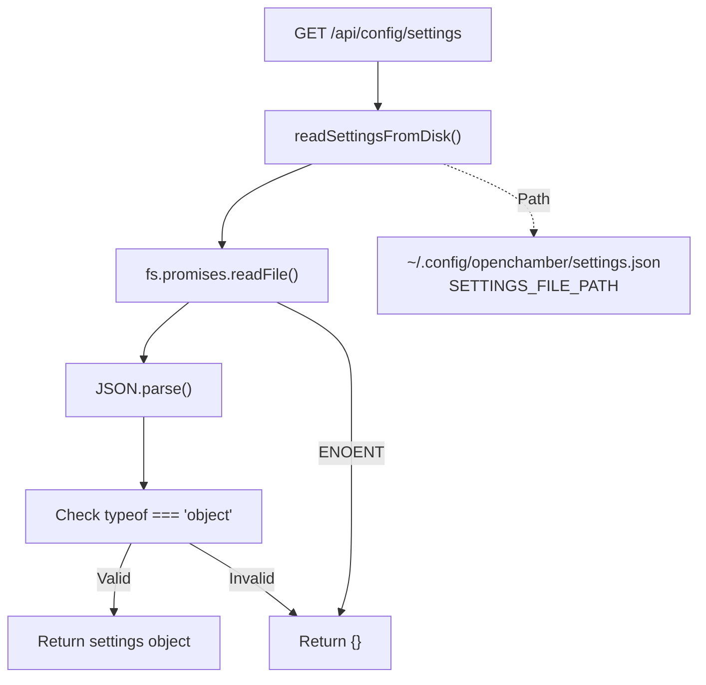
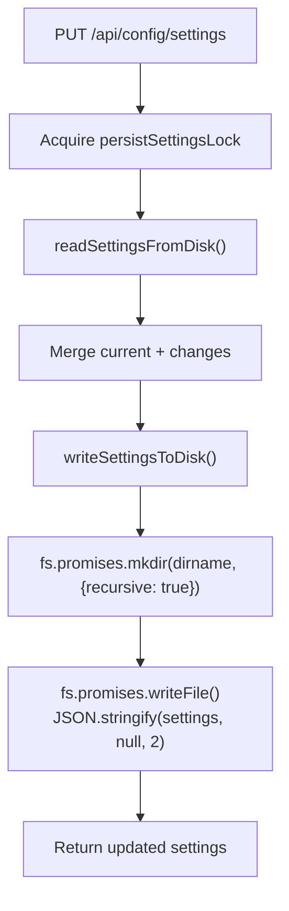
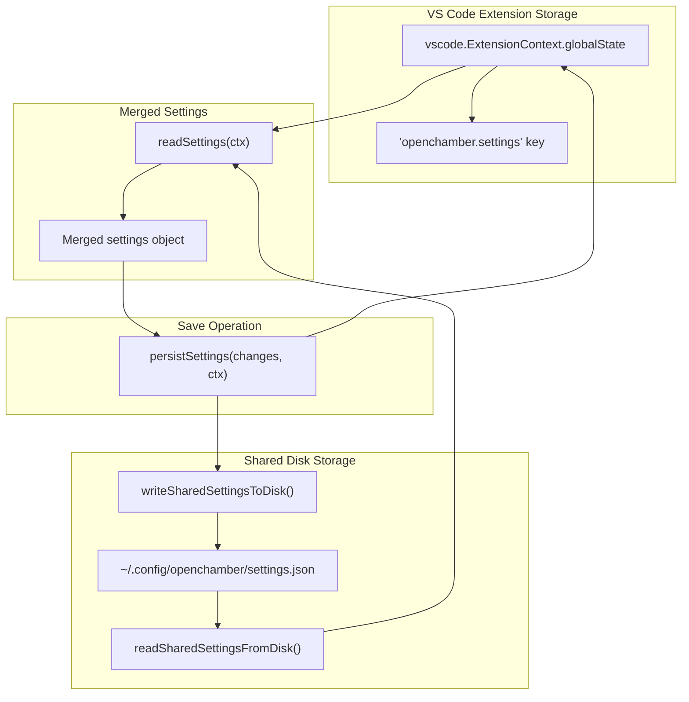
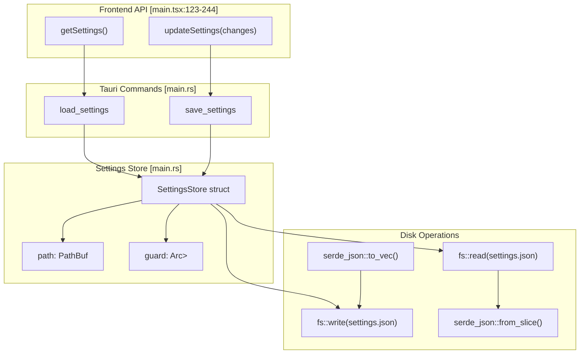
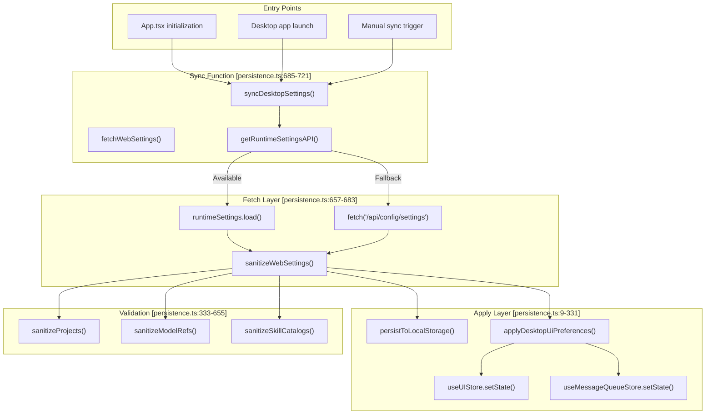
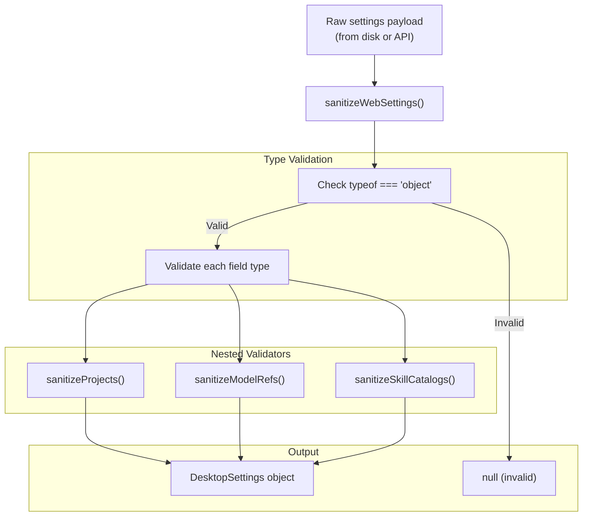
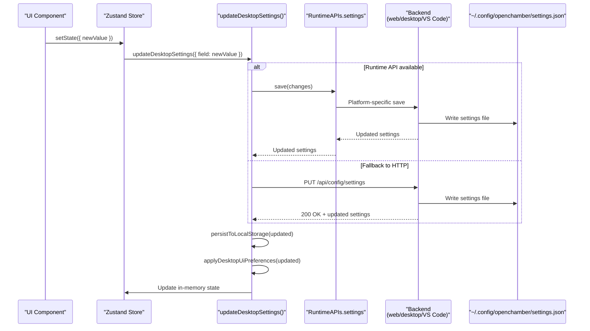
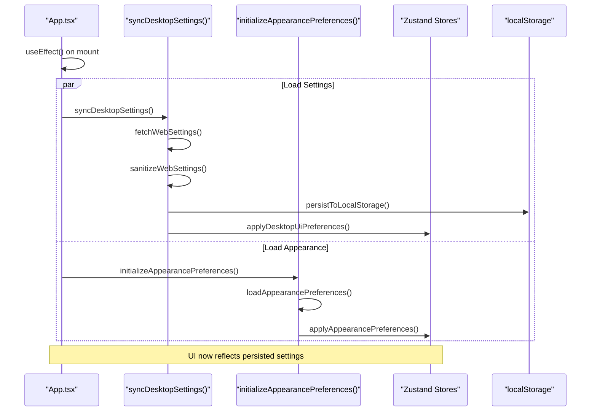

<!-- source: DeepWiki mcp.deepwiki.com · repo btriapitsyn/openchamber · page 4.4 Settings and Persistence · fetched 2026-10-26 -->

# Settings and Persistence

<details>
<summary>Relevant source files</summary>

The following files were used as context for generating this wiki page:

- [packages/desktop/src-tauri/src/main.rs](packages/desktop/src-tauri/src/main.rs)
- [packages/ui/src/App.tsx](packages/ui/src/App.tsx)
- [packages/ui/src/lib/api/types.ts](packages/ui/src/lib/api/types.ts)
- [packages/ui/src/lib/desktop.ts](packages/ui/src/lib/desktop.ts)
- [packages/ui/src/lib/persistence.ts](packages/ui/src/lib/persistence.ts)
- [packages/vscode/src/bridge.ts](packages/vscode/src/bridge.ts)
- [packages/web/server/index.js](packages/web/server/index.js)

</details>


This document describes how OpenChamber manages user settings and persists configuration across the web server, desktop application, and VS Code extension. Settings are stored in `~/.config/openchamber/settings.json` and synchronized across all three runtime environments.

For runtime API abstraction patterns, see [Multi-Platform Deployment](#3.1). For state management in the UI layer, see [State Management](#3.4).

---

## Overview

OpenChamber uses a three-tier settings architecture:

| Layer | Implementation | Purpose |
|-------|----------------|---------|
| **Disk Storage** | `~/.config/openchamber/settings.json` | Persistent storage shared across all runtimes |
| **Runtime APIs** | `SettingsAPI` interface in web/desktop/VS Code | Platform-specific read/write operations |
| **UI Stores** | Zustand stores (`useUIStore`, `useConfigStore`) | In-memory state with change tracking |

Settings are validated and sanitized when loaded, then applied to UI stores to drive rendering and behavior.

Sources: [packages/ui/src/lib/persistence.ts:1-800](), [packages/web/server/index.js:1048-1079](), [packages/vscode/src/bridge.ts:98-254]()
</thinking>

---

## Settings File Location

All three runtime environments persist settings to the same file path:

```
~/.config/openchamber/settings.json
```

This shared location enables cross-runtime synchronization. When a user changes a setting in the desktop app, it immediately becomes available to the web server and VS Code extension.

**Constants defining the path:**

- **Web server**: `SETTINGS_FILE_PATH = path.join(OPENCHAMBER_DATA_DIR, 'settings.json')` [packages/web/server/index.js:1051]()
- **VS Code**: `OPENCHAMBER_SHARED_SETTINGS_PATH = path.join(os.homedir(), '.config', 'openchamber', 'settings.json')` [packages/vscode/src/bridge.ts:103]()
- **Desktop**: Settings are accessed via Tauri commands that read/write to the same path [packages/desktop/src-tauri/src/main.rs]() (inferred from command names)

Sources: [packages/web/server/index.js:1048-1051](), [packages/vscode/src/bridge.ts:103]()
</thinking>

---

## Settings Schema

The `DesktopSettings` interface defines the complete settings schema:

```typescript
interface DesktopSettings {
  // Theme preferences
  themeId?: string;
  useSystemTheme?: boolean;
  themeVariant?: 'light' | 'dark';
  lightThemeId?: string;
  darkThemeId?: string;
  
  // Project management
  projects?: ProjectEntry[];
  activeProjectId?: string;
  lastDirectory?: string;
  homeDirectory?: string;
  pinnedDirectories?: string[];
  
  // OpenCode binary path
  opencodeBinary?: string;
  
  // UI preferences
  showReasoningTraces?: boolean;
  showTextJustificationActivity?: boolean;
  toolCallExpansion?: 'collapsed' | 'activity' | 'detailed';
  fontSize?: number;
  terminalFontSize?: number;
  padding?: number;
  cornerRadius?: number;
  inputBarOffset?: number;
  
  // Notification settings
  nativeNotificationsEnabled?: boolean;
  notificationMode?: 'always' | 'hidden-only';
  notifyOnCompletion?: boolean;
  notifyOnError?: boolean;
  notifyOnQuestion?: boolean;
  notificationTemplates?: {
    completion: { title: string; message: string };
    error: { title: string; message: string };
    question: { title: string; message: string };
    subtask: { title: string; message: string };
  };
  
  // Session management
  autoDeleteEnabled?: boolean;
  autoDeleteAfterDays?: number;
  messageLimit?: number;
  
  // Model preferences
  defaultModel?: string;
  defaultVariant?: string;
  defaultAgent?: string;
  favoriteModels?: Array<{ providerID: string; modelID: string }>;
  recentModels?: Array<{ providerID: string; modelID: string }>;
  
  // Git preferences
  defaultGitIdentityId?: string;
  autoCreateWorktree?: boolean;
  gitmojiEnabled?: boolean;
  
  // Other features
  queueModeEnabled?: boolean;
  diffLayoutPreference?: 'dynamic' | 'inline' | 'side-by-side';
  diffViewMode?: 'single' | 'stacked';
  directoryShowHidden?: boolean;
  filesViewShowGitignored?: boolean;
  openInAppId?: string;
  zenModel?: string;
  skillCatalogs?: SkillCatalogConfig[];
  
  // Desktop-specific
  securityScopedBookmarks?: string[];
  approvedDirectories?: string[];
}
```

Sources: [packages/ui/src/lib/desktop.ts:32-114](), [packages/ui/src/lib/api/types.ts:497-532]()

---

## Web Server Settings Persistence

The web server implements settings read/write operations using Node.js filesystem APIs.

### Settings Read/Write Functions

**Read Operation Flow:**



Sources: [packages/web/server/index.js:1054-1069]()

**Write Operation Flow:**



Sources: [packages/web/server/index.js:1071-1079](), [packages/web/server/index.js:56-57]()

### Lock-Based Concurrency Control

The web server uses a promise chain to serialize write operations:

```javascript
let persistSettingsLock = Promise.resolve();

// In save operation:
persistSettingsLock = persistSettingsLock.then(async () => {
  await fsPromises.mkdir(path.dirname(SETTINGS_FILE_PATH), { recursive: true });
  const current = await readSettingsFromDisk();
  const next = mutate(current);
  await writeSettingsToDisk(next);
});
```

This prevents race conditions when multiple clients update settings concurrently.

Sources: [packages/web/server/index.js:56-57]()

---

## VS Code Settings Persistence

The VS Code extension stores settings in two locations:

1. **Extension-specific settings**: VS Code's `globalState` API
2. **Shared settings file**: `~/.config/openchamber/settings.json`

### Dual Storage Architecture



Sources: [packages/vscode/src/bridge.ts:98-254]()

### Settings Read Logic

The `readSettings()` function merges two sources:

```typescript
const readSettings = (ctx?: BridgeContext) => {
  // 1. Read from VS Code globalState
  const stored = ctx?.context?.globalState.get<Record<string, unknown>>(SETTINGS_KEY) || {};
  const restStored = { ...stored };
  delete restStored.lastDirectory;  // Special handling
  
  // 2. Read from shared file (~/.config/openchamber/settings.json)
  const shared = readSharedSettingsFromDisk();
  const sharedOpencodeBinary = typeof shared.opencodeBinary === 'string' 
    ? shared.opencodeBinary.trim() : '';
  
  // 3. Merge with VS Code environment context
  const workspaceFolder = vscode.workspace.workspaceFolders?.[0]?.uri.fsPath || '';
  const themeVariant = vscode.window.activeColorTheme.kind === vscode.ColorThemeKind.Light
    ? 'light' : 'dark';
  
  // 4. Return merged settings with precedence: stored > shared > defaults
  return {
    themeVariant,
    lastDirectory: workspaceFolder,
    ...restStored,
    opencodeBinary: typeof restStored.opencodeBinary === 'string'
      ? String(restStored.opencodeBinary).trim()
      : (sharedOpencodeBinary || undefined),
  };
};
```

This ensures:
- `lastDirectory` always reflects the current VS Code workspace
- `themeVariant` matches the active VS Code color theme
- `opencodeBinary` can be set in either location
- Extension-specific settings take precedence over shared settings

Sources: [packages/vscode/src/bridge.ts:130-152]()

### Settings Write Logic

The `persistSettings()` function saves changes to both storage locations:

```typescript
const persistSettings = async (changes: Record<string, unknown>, ctx?: BridgeContext) => {
  const current = readSettings(ctx);
  const restChanges = { ...changes };
  delete restChanges.lastDirectory;  // Never persist lastDirectory
  
  // Normalize empty-string clears to key removal
  const keysToClear = new Set<string>();
  for (const key of ['defaultModel', 'defaultVariant', 'defaultAgent', 'defaultGitIdentityId', 'opencodeBinary']) {
    const value = restChanges[key];
    if (typeof value === 'string' && value.trim().length === 0) {
      keysToClear.add(key);
      delete restChanges[key];
    }
  }
  
  // Merge and save to VS Code globalState
  const merged = { ...current, ...restChanges, lastDirectory: current.lastDirectory };
  for (const key of keysToClear) {
    delete merged[key];
  }
  await ctx?.context?.globalState.update(SETTINGS_KEY, merged);
  
  // Update shared file for opencodeBinary
  if (keysToClear.has('opencodeBinary')) {
    await writeSharedSettingsToDisk({ opencodeBinary: '' });
  } else if (typeof restChanges.opencodeBinary === 'string') {
    await writeSharedSettingsToDisk({ opencodeBinary: restChanges.opencodeBinary.trim() });
  }
  
  return merged;
};
```

The write operation:
1. Excludes `lastDirectory` (always derived from VS Code workspace)
2. Clears keys when set to empty string (matches web/desktop behavior)
3. Saves all settings to VS Code `globalState`
4. Writes `opencodeBinary` to shared file for cross-runtime access

Sources: [packages/vscode/src/bridge.ts:215-254]()

---

## Desktop Settings Persistence

The desktop application uses Tauri commands to read and write settings through the Rust backend.

### Settings Commands Architecture



Sources: [packages/desktop/src/main.tsx:123-244](), [packages/desktop/src-tauri/src/main.rs]() (inferred from command structure)

### Desktop-Specific Settings

The desktop app stores additional fields not used by web or VS Code:

| Field | Type | Purpose |
|-------|------|---------|
| `securityScopedBookmarks` | `Record<string, string>` | Base64-encoded macOS security bookmarks for persistent directory access |
| `approvedDirectories` | `string[]` | List of directories the user has explicitly granted access to |
| `windowState` | `{ x, y, width, height, maximized }` | Window position and size for restore on launch |

These fields are excluded when settings are synchronized to the web server or VS Code.

Sources: [packages/ui/src/lib/desktop.ts:44-46]()

---

## Settings Synchronization Flow

The UI layer implements a complete synchronization system that loads settings from the runtime API, validates them, and applies them to Zustand stores.

### Sync Architecture



Sources: [packages/ui/src/lib/persistence.ts:685-721](), [packages/ui/src/lib/persistence.ts:657-683](), [packages/ui/src/lib/persistence.ts:9-331]()

### Synchronization Steps

The `syncDesktopSettings()` function performs these operations:

1. **Fetch settings** from runtime API or HTTP endpoint
2. **Sanitize and validate** all fields using type guards
3. **Persist to localStorage** for client-side cache
4. **Apply to Zustand stores** to update UI state
5. **Dispatch event** to notify other components

```typescript
export const syncDesktopSettings = async (): Promise<void> => {
  // 1. Fetch from runtime API or HTTP
  const webSettings = await fetchWebSettings();
  if (!webSettings) return;
  
  // 2. Apply settings (includes sanitization)
  const applySettings = (settings: DesktopSettings) => {
    persistToLocalStorage(settings);      // 3. Cache locally
    applyDesktopUiPreferences(settings);  // 4. Update stores
    
    // 5. Notify listeners
    window.dispatchEvent(
      new CustomEvent<DesktopSettings>('openchamber:settings-synced', { 
        detail: settings 
      })
    );
  };
  
  applySettings(webSettings);
};
```

Sources: [packages/ui/src/lib/persistence.ts:685-721]()

---

## Settings Validation and Sanitization

All settings loaded from disk are validated and sanitized before use. This prevents corrupted or malicious data from breaking the application.

### Validation Functions

**`sanitizeWebSettings(payload)` - Main validation entry point**



Sources: [packages/ui/src/lib/persistence.ts:333-655]()

### Project Validation

The `sanitizeProjects()` function ensures project entries are valid and deduplicated:

```typescript
const sanitizeProjects = (value: unknown): DesktopSettings['projects'] | undefined => {
  if (!Array.isArray(value)) return undefined;
  
  const result: NonNullable<DesktopSettings['projects']> = [];
  const seenIds = new Set<string>();
  const seenPaths = new Set<string>();
  
  for (const entry of value) {
    if (!entry || typeof entry !== 'object') continue;
    
    const id = typeof entry.id === 'string' ? entry.id.trim() : '';
    const rawPath = typeof entry.path === 'string' ? entry.path.trim() : '';
    if (!id || !rawPath) continue;
    
    // Normalize path: remove trailing slashes, convert backslashes
    const normalizedPath = rawPath === '/' 
      ? rawPath 
      : rawPath.replace(/\\/g, '/').replace(/\/+$/, '');
    if (!normalizedPath) continue;
    
    // Deduplicate by ID and path
    if (seenIds.has(id) || seenPaths.has(normalizedPath)) continue;
    seenIds.add(id);
    seenPaths.add(normalizedPath);
    
    result.push({
      id,
      path: normalizedPath,
      label: typeof entry.label === 'string' ? entry.label.trim() : undefined,
      addedAt: typeof entry.addedAt === 'number' ? entry.addedAt : undefined,
      lastOpenedAt: typeof entry.lastOpenedAt === 'number' ? entry.lastOpenedAt : undefined,
      sidebarCollapsed: typeof entry.sidebarCollapsed === 'boolean' 
        ? entry.sidebarCollapsed 
        : undefined,
    });
  }
  
  return result.length > 0 ? result : undefined;
};
```

This validation:
- Rejects non-array values
- Requires both `id` and `path` fields
- Normalizes paths (backslash → forward slash, remove trailing slashes)
- Deduplicates by both ID and path
- Validates optional fields with type guards

Sources: [packages/ui/src/lib/persistence.ts:118-167]()

---

## Settings Update Flow

When settings are changed in the UI, the changes are persisted through the `updateDesktopSettings()` function.

### Update Architecture



Sources: [packages/ui/src/lib/persistence.ts:723-767]()

### Update Implementation

The `updateDesktopSettings()` function tries the runtime API first, then falls back to HTTP:

```typescript
export const updateDesktopSettings = async (changes: Partial<DesktopSettings>): Promise<void> => {
  const runtimeSettings = getRuntimeSettingsAPI();
  
  // Try runtime API first
  if (runtimeSettings) {
    try {
      const updated = await runtimeSettings.save(changes);
      if (updated) {
        persistToLocalStorage(updated);
        applyDesktopUiPreferences(updated);
      }
      return;
    } catch (error) {
      console.warn('Failed to update settings via runtime settings API:', error);
    }
  }
  
  // Fallback to HTTP endpoint
  try {
    const response = await fetch('/api/config/settings', {
      method: 'PUT',
      headers: {
        'Content-Type': 'application/json',
        Accept: 'application/json',
      },
      body: JSON.stringify(changes),
    });
    
    if (!response.ok) {
      console.warn('Failed to update settings via API:', response.status);
      return;
    }
    
    const updated = await response.json();
    if (updated) {
      persistToLocalStorage(updated);
      applyDesktopUiPreferences(updated);
    }
  } catch (error) {
    console.warn('Failed to update settings via API:', error);
  }
};
```

The function:
1. Checks for a registered `RuntimeAPIs.settings` instance
2. Uses `save(changes)` if available (desktop/VS Code)
3. Falls back to `PUT /api/config/settings` (web)
4. Updates localStorage and Zustand stores on success

Sources: [packages/ui/src/lib/persistence.ts:723-767]()

---

## Runtime Settings API Interface

All three runtime environments implement the `SettingsAPI` interface to provide consistent settings access.

### SettingsAPI Interface

```typescript
interface SettingsAPI {
  load(): Promise<SettingsLoadResult>;
  save(changes: Partial<SettingsPayload>): Promise<SettingsPayload>;
  restartOpenCode?: () => Promise<{ restarted: boolean }>;
}

interface SettingsLoadResult {
  settings: SettingsPayload;
  source: 'desktop' | 'web';
}

interface SettingsPayload {
  themeId?: string;
  useSystemTheme?: boolean;
  projects?: ProjectEntry[];
  activeProjectId?: string;
  nativeNotificationsEnabled?: boolean;
  // ... (see DesktopSettings for complete list)
  [key: string]: unknown;
}
```

Sources: [packages/ui/src/lib/api/types.ts:497-544]()

### Implementation Comparison

| Runtime | `load()` | `save()` | `restartOpenCode()` |
|---------|----------|----------|---------------------|
| **Web** | `GET /api/config/settings` | `PUT /api/config/settings` | `POST /api/config/restart-opencode` |
| **Desktop** | `invoke('load_settings')` | `invoke('save_settings')` | `invoke('restart_opencode')` |
| **VS Code** | `readSettings(ctx)` from bridge | `persistSettings(changes, ctx)` | Not implemented |

The web server and desktop implementations read/write `~/.config/openchamber/settings.json`. VS Code reads from both `globalState` and the shared file, writing to both on save.

Sources: [packages/ui/src/lib/api/types.ts:539-544]()

---

## Settings Persistence Initialization

Settings are loaded and synchronized during application startup.

### Initialization Flow



Sources: [packages/ui/src/App.tsx:1-328]() (inferred from typical React app initialization)

The initialization happens in two phases:

1. **Settings sync**: Loads user preferences from disk and applies to stores
2. **Appearance init**: Loads theme and appearance settings separately for faster rendering

Both operations use the persist API to wait for Zustand hydration before applying changes:

```typescript
const persistApi = getPersistApi();

const applySettings = (settings: DesktopSettings) => {
  const apply = () => applyDesktopUiPreferences(settings);
  
  if (persistApi?.hasHydrated?.()) {
    apply();  // Stores already hydrated
  } else {
    apply();  // Apply now
    if (persistApi?.onFinishHydration) {
      const unsubscribe = persistApi.onFinishHydration(() => {
        unsubscribe?.();
        apply();  // Re-apply after hydration
      });
    }
  }
};
```

This ensures settings are applied correctly whether Zustand hydration completes before or after settings are loaded.

Sources: [packages/ui/src/lib/persistence.ts:685-721](), [packages/ui/src/lib/persistence.ts:769-799]()

---

## Platform Detection and Conditional Compilation

The codebase uses Rust's `cfg` attributes to conditionally compile macOS-specific code:

```rust
#[cfg(target_os = "macos")]
use window_vibrancy::{apply_vibrancy, NSVisualEffectMaterial};

#[cfg(target_os = "macos")]
static NEEDS_TRAFFIC_LIGHT_FIX: AtomicBool = AtomicBool::new(false);

#[cfg(target_os = "macos")]
fn get_macos_major_version() -> isize { ... }

#[cfg(target_os = "macos")]
fn adjust_traffic_lights_position<R: tauri::Runtime>(...) { ... }

#[cfg(target_os = "macos")]
fn prevent_app_nap() { ... }
```

And in dependencies:

```toml
[target.'cfg(target_os = "macos")'.dependencies]
window-vibrancy = "0.7.1"
```

This ensures that macOS-specific code and dependencies are only included when building for macOS, keeping binaries lean for other platforms.

Sources: [packages/desktop/src-tauri/src/main.rs:67-74](), [packages/desktop/src-tauri/src/main.rs:84-330](), [packages/desktop/src-tauri/Cargo.toml:57-58]()

---

## Desktop Feature Summary

| Feature | Implementation | Availability |
|---------|----------------|--------------|
| **Native Menu Bar** | `build_macos_menu()` with 25+ menu items | macOS only |
| **Window Vibrancy** | `window-vibrancy` crate, `NSVisualEffectMaterial::Sidebar` | macOS only |
| **Traffic Light Positioning** | `adjust_traffic_lights_position()` using objc2 | macOS < 15 |
| **App Nap Prevention** | `NSProcessInfo.beginActivityWithOptions_reason()` | macOS only |
| **Security Bookmarks** | NSURL security-scoped bookmarks | macOS only |
| **Directory Picker** | First-launch prompt, `@tauri-apps/plugin-dialog` | All desktop |
| **Native Notifications** | `@tauri-apps/plugin-notification` | All desktop |
| **Dock Badge** | `window.set_badge_count()` | macOS only |
| **Auto-Updates** | `@tauri-apps/plugin-updater`, Ed25519 signatures | All desktop |
| **Window State** | Position/size persistence in `SettingsStore` | All desktop |

These platform-specific features combine to create a native-quality experience that leverages macOS capabilities while maintaining cross-platform compatibility where appropriate.

---

