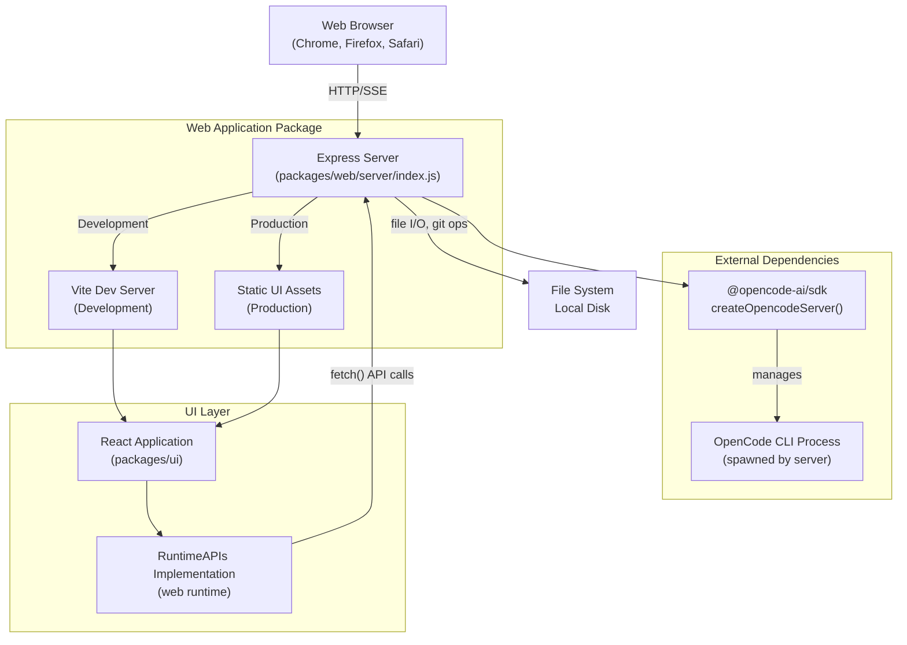
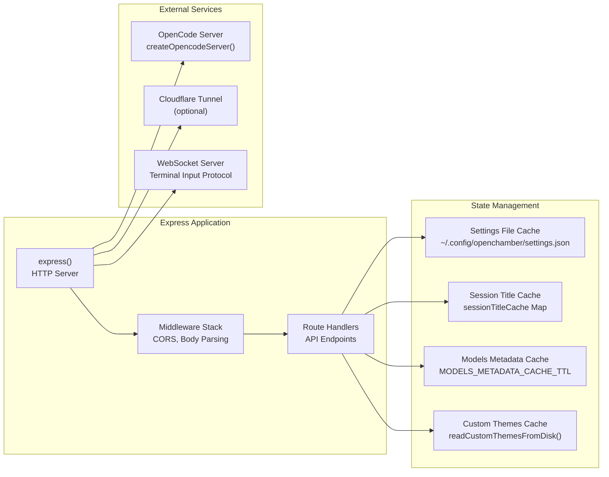
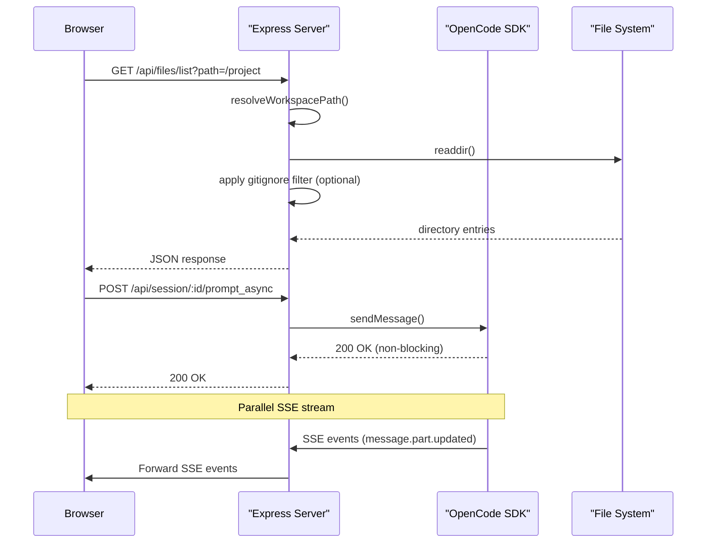
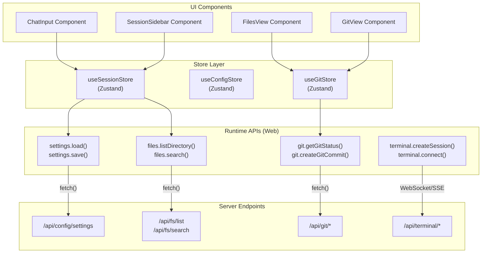
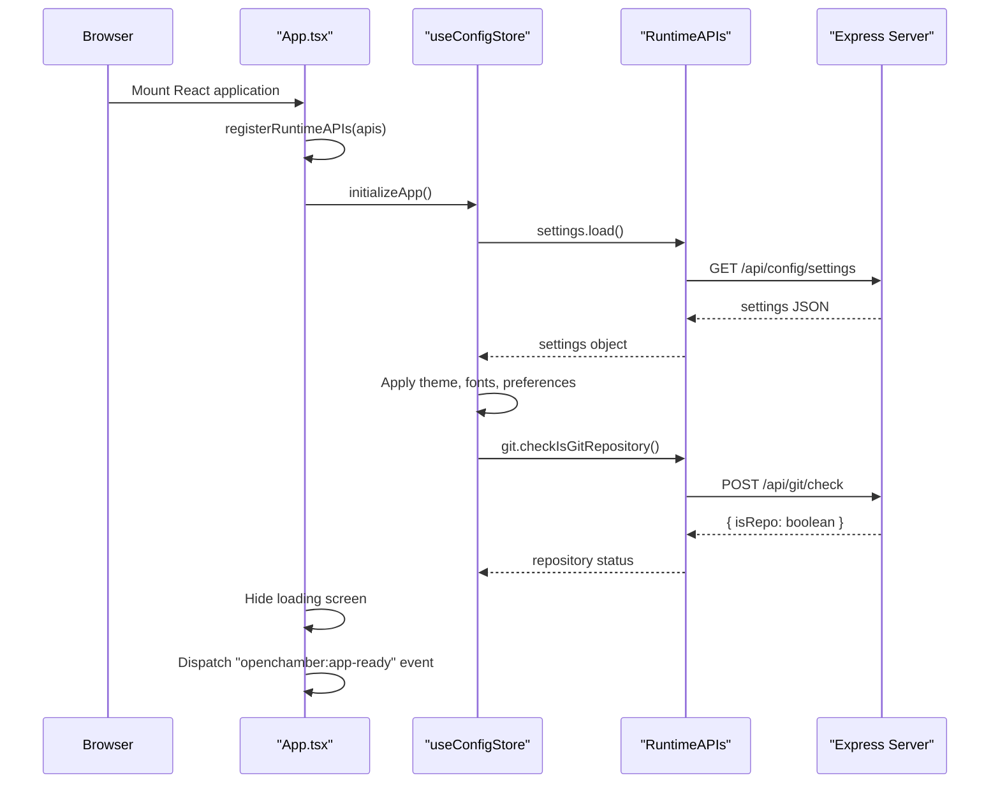
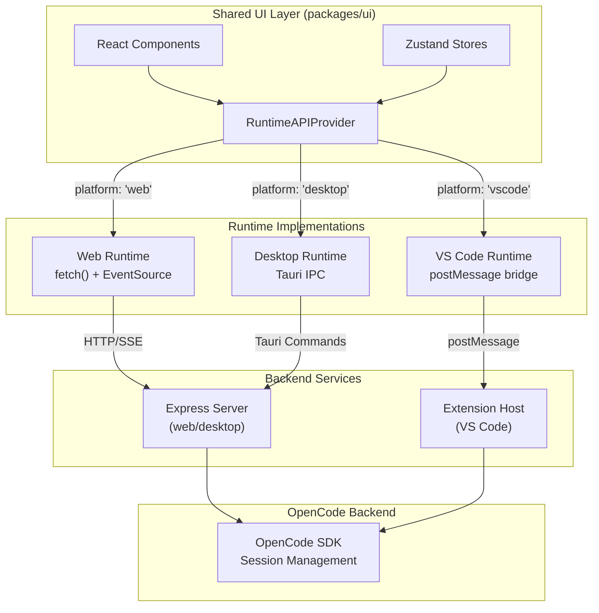
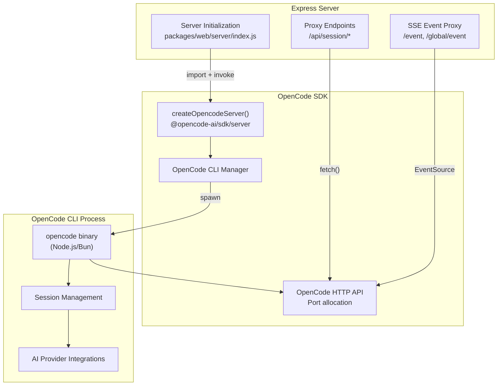
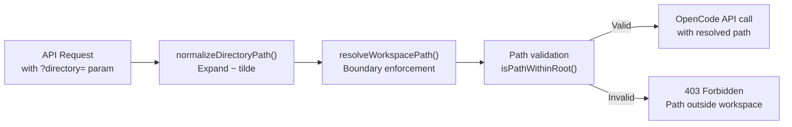
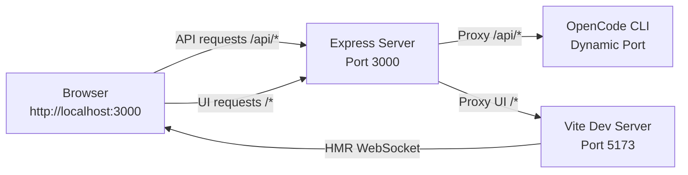
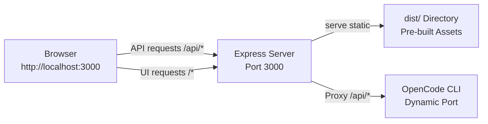

<!-- source: DeepWiki mcp.deepwiki.com · repo btriapitsyn/openchamber · page 5 Web Application · fetched 2026-10-26 -->

# Web Application

Relevant source files

The following files were used as context for generating this wiki page:

- [packages/desktop/src-tauri/src/main.rs](packages/desktop/src-tauri/src/main.rs)
- [packages/ui/src/App.tsx](packages/ui/src/App.tsx)
- [packages/ui/src/lib/api/types.ts](packages/ui/src/lib/api/types.ts)
- [packages/vscode/src/bridge.ts](packages/vscode/src/bridge.ts)
- [packages/web/server/index.js](packages/web/server/index.js)

## Purpose and Scope

The Web Application is the Express-based server and Vite-bundled client that provide the primary deployment mode for OpenChamber. This document covers the high-level architecture, server structure, client application, and how the web runtime integrates with the OpenCode backend. For detailed information about Express middleware, routing patterns, and endpoint implementations, see [Server Architecture](#5.1). For specifics on API endpoint design, SSE streaming, and directory scoping mechanisms, see [API Endpoints and Proxying](#5.2).

## Architecture Overview

The web application consists of two primary components: an Express server that handles backend operations and API proxying, and a Vite-bundled React application that provides the user interface. The server acts as an intermediary between the UI and the OpenCode SDK, managing file operations, Git integration, settings persistence, and real-time event streaming.

**Sources:** [packages/web/server/index.js:1-27](), [packages/ui/src/App.tsx:1-50]()

The server operates on a configurable port (default 3000, configurable via `DEFAULT_PORT`) and can be accessed either directly via browser or bundled as a sidecar process in the desktop application. The architecture supports both development mode (with Vite HMR) and production mode (serving pre-built static assets).

## Server Structure

The Express server is implemented in a single monolithic file that handles initialization, middleware setup, routing, and integration with external services. The server follows a functional programming style with explicit state management through closures and module-level variables.

### Core Server Components

**Sources:** [packages/web/server/index.js:1-100](), [packages/web/server/index.js:1048-1080]()

The server manages several categories of functionality:

| Category | Key Constants/Functions | Purpose |
|----------|------------------------|---------|
| **Settings Persistence** | `SETTINGS_FILE_PATH`, `readSettingsFromDisk()`, `writeSettingsToDisk()` | Load and save user preferences to disk |
| **File Operations** | `searchFilesystemFiles()`, `resolveWorkspacePath()`, `resolveWorkspacePathFromWorktrees()` | Directory listing, file search with fuzzy matching, workspace boundary enforcement |
| **Git Integration** | `normalizeDirectoryPath()`, `simpleGit()` integration | Git operations via `simple-git` library |
| **Theme Management** | `OPENCHAMBER_USER_THEMES_DIR`, `readCustomThemesFromDisk()`, `normalizeThemeJson()` | Custom theme loading and validation |
| **Notification System** | `prepareNotificationLastMessage()`, `buildTemplateVariables()` | Desktop and web push notification preparation |

**Sources:** [packages/web/server/index.js:1048-1113](), [packages/web/server/index.js:59-246](), [packages/web/server/index.js:413-550]()

### Request Flow Architecture

**Sources:** [packages/web/server/index.js:413-550](), [packages/web/server/index.js:239-315]()

The server enforces workspace boundaries through path resolution functions that prevent directory traversal attacks while supporting Git worktree scenarios where legitimate project paths may exist outside the primary workspace root.

## Client Application

The client application is a Vite-bundled React application located in `packages/ui` that is shared across all runtime environments (web, desktop, VS Code). For the web runtime, the application communicates with the Express server via standard HTTP and SSE connections.

### Web Runtime Implementation

The web runtime provides implementations of the `RuntimeAPIs` interface that use `fetch()` for HTTP requests and `EventSource` for SSE connections. The runtime abstraction allows the same UI code to operate across different platforms without modification.

**Sources:** [packages/ui/src/lib/api/types.ts:1-100](), [packages/ui/src/App.tsx:46-70]()

The `RuntimeAPIs` interface defines platform-agnostic contracts for:

| API Surface | Key Methods | Implementation Location |
|-------------|-------------|------------------------|
| **RuntimeDescriptor** | `platform`, `isDesktop`, `isVSCode` | [packages/ui/src/lib/api/types.ts:4-13]() |
| **SettingsAPI** | `load()`, `save()`, `restartOpenCode()` | [packages/ui/src/lib/api/types.ts:539-544]() |
| **FilesAPI** | `listDirectory()`, `search()`, `readFile()`, `writeFile()` | [packages/ui/src/lib/api/types.ts:474-484]() |
| **GitAPI** | `getGitStatus()`, `createGitCommit()`, `gitPush()`, `listGitWorktrees()` | [packages/ui/src/lib/api/types.ts:383-432]() |
| **TerminalAPI** | `createSession()`, `connect()`, `sendInput()`, `resize()` | [packages/ui/src/lib/api/types.ts:88-96]() |
| **GitHubAPI** | `authStatus()`, `prCreate()`, `prMerge()`, `issuesList()` | [packages/ui/src/lib/api/types.ts:880-904]() |

**Sources:** [packages/ui/src/lib/api/types.ts:1-1038]()

### Application Initialization Flow

**Sources:** [packages/ui/src/App.tsx:127-169](), [packages/ui/src/App.tsx:62-93]()

The initialization process loads settings from persistent storage, applies theme and font preferences, checks Git repository status, and configures the OpenCode SDK client with the active workspace directory. The web runtime differs from desktop and VS Code runtimes in that it performs initialization immediately on mount, whereas VS Code waits for the OpenCode manager to report "connected" status.

## Runtime Abstraction

The web runtime is one of three platform implementations (web, desktop, VS Code) that provide concrete implementations of the `RuntimeAPIs` interface. This abstraction allows the shared UI codebase to operate seamlessly across different execution environments.

### Multi-Runtime Architecture

**Sources:** [packages/ui/src/lib/api/types.ts:3-13](), [packages/ui/src/App.tsx:46-68](), [packages/vscode/src/bridge.ts:49-96]()

The runtime abstraction provides several key benefits:

1. **Platform Detection**: The `RuntimeDescriptor` interface exposes boolean flags (`isDesktop`, `isVSCode`) that allow UI components to conditionally render platform-specific features
2. **API Consistency**: All platforms implement the same `RuntimeAPIs` contract, ensuring consistent behavior across deployments
3. **Transport Abstraction**: Network transport details (HTTP, IPC, WebSockets) are hidden behind async function interfaces
4. **Feature Availability**: Optional API surfaces (e.g., `editor?.openFile()`, `vscode?.executeCommand()`) allow graceful degradation when features are unavailable

**Sources:** [packages/ui/src/lib/api/types.ts:906-921]()

The web runtime is unique in that:
- It communicates directly with the Express server over standard HTTP/HTTPS
- It supports optional Cloudflare Tunnel for remote access
- It has no native OS integrations (file system access is mediated through the server)
- It can be deployed as a standalone service or embedded in the desktop application

## OpenCode Integration

The web server integrates with the OpenCode SDK through the `createOpencodeServer()` factory function, which manages the lifecycle of an OpenCode CLI process and provides an HTTP API for session management, message sending, and event streaming.

### SDK Integration Architecture

**Sources:** [packages/web/server/index.js:23](), [packages/web/server/index.js:1-27]()

The OpenCode SDK handles:

| Responsibility | Implementation | Notes |
|---------------|----------------|-------|
| **Process Spawning** | `createOpencodeServer()` spawns OpenCode CLI | Automatically finds available port, manages process lifecycle |
| **Health Monitoring** | Periodic `/health` checks with `HEALTH_CHECK_INTERVAL` | 15-second interval, triggers graceful shutdown on failure |
| **API Proxying** | Express routes forward requests to OpenCode HTTP API | Preserves headers, handles authentication, manages timeouts |
| **Event Streaming** | SSE connections multiplexed through Express | Maintains persistent connections, handles reconnection logic |
| **Error Handling** | Captures stderr output, exposes via `/health` endpoint | Enables debugging of OpenCode startup failures |

**Sources:** [packages/web/server/index.js:32-38]()

The web server does not implement AI provider logic directly; instead, it delegates all session management, message handling, and AI interactions to the OpenCode backend. This separation of concerns allows the web application to remain stateless with respect to AI operations.

### Directory Context Management

The OpenCode SDK requires a working directory context for file-based operations and Git integration. The web server manages this through:

**Sources:** [packages/web/server/index.js:59-78](), [packages/web/server/index.js:239-268]()

Directory resolution supports:
- **Tilde Expansion**: `~/project` resolves to `$HOME/project`
- **Relative Paths**: Resolved relative to active workspace directory
- **Worktree Awareness**: Paths in Git worktrees are allowed even if outside primary workspace
- **Config Root Access**: `~/.config/openchamber` paths are permitted for per-project settings

**Sources:** [packages/web/server/index.js:239-315]()

## Development and Production Modes

The web server supports two operational modes that affect how the UI is served and how the OpenCode backend is managed.

### Development Mode

In development mode, the Express server runs alongside a Vite development server that provides Hot Module Replacement (HMR) for the React application. The server proxies UI requests to Vite while handling API requests directly.

**Sources:** [packages/web/server/index.js:1-27]()

Development mode characteristics:
- Vite serves unbundled ES modules with on-demand transpilation
- Changes to React components trigger instant browser updates
- Source maps are available for debugging
- OpenCode CLI is spawned with verbose logging enabled
- CORS is relaxed to allow cross-origin requests from Vite

### Production Mode

In production mode, the Express server serves pre-built static assets directly from the `dist/` directory while continuing to handle API requests and OpenCode proxying.

**Sources:** [packages/web/server/index.js:1-27]()

Production mode characteristics:
- UI assets are bundled, minified, and optimized by Vite build process
- Single-page application routing handled by Express catch-all route
- OpenCode CLI runs in production mode with reduced logging
- Optional Cloudflare Tunnel support for remote access
- Graceful shutdown handling with `SHUTDOWN_TIMEOUT` for in-flight requests

**Sources:** [packages/web/server/index.js:32-38](), [packages/web/server/index.js:11]()

The server automatically detects which mode to operate in based on the presence of the `dist/` directory and environment variables.

---

