<!-- source: DeepWiki mcp.deepwiki.com · repo btriapitsyn/openchamber · page 5.1 Server Architecture · fetched 2026-10-26 -->

# Server Architecture

<details>
<summary>Relevant source files</summary>

The following files were used as context for generating this wiki page:

- [packages/desktop/src-tauri/src/main.rs](packages/desktop/src-tauri/src/main.rs)
- [packages/ui/src/App.tsx](packages/ui/src/App.tsx)
- [packages/ui/src/lib/api/types.ts](packages/ui/src/lib/api/types.ts)
- [packages/vscode/src/bridge.ts](packages/vscode/src/bridge.ts)
- [packages/web/server/index.js](packages/web/server/index.js)

</details>


This page documents the Express-based web server architecture in `packages/web`, which serves as the HTTP backend for OpenChamber's web deployment and as the sidecar process for the desktop application. For client-side communication patterns, see [Real-Time Communication](#3.3). For VS Code extension architecture, see [Extension Architecture](#6.1). For desktop sidecar lifecycle management, see [Sidecar Process Management](#4.3).

---

## Overview

The OpenChamber web server is an Express application that provides:
- HTTP API endpoints for UI interactions
- Proxying and orchestration for OpenCode SDK calls
- File system operations with directory scoping
- Git operations and GitHub API integration
- Server-Sent Events (SSE) for real-time streaming
- WebSocket support for terminal I/O
- Settings persistence and synchronization
- Web push notifications

The server runs either as a standalone web service or as a sidecar process bundled with the Tauri desktop application.

**Sources**: [packages/web/server/index.js:1-50]()

---

## Server Bootstrap and Initialization

The server initialization sequence establishes the Express application, validates the OpenCode CLI, starts the OpenCode backend, and configures routes.

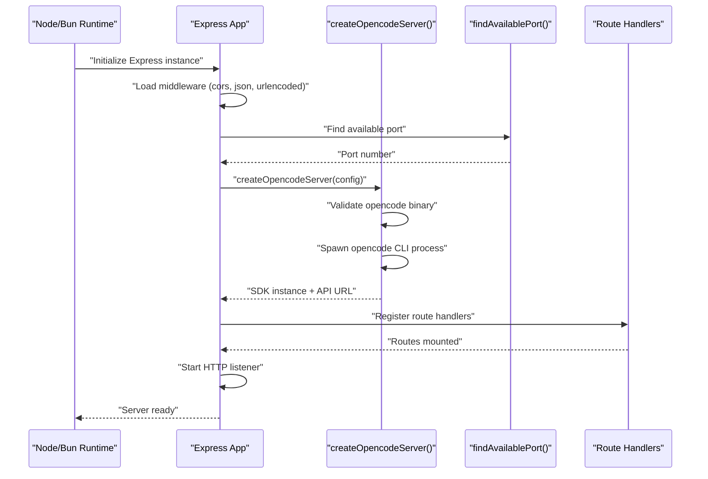

**Port Selection**: The server uses `DEFAULT_PORT` (3000) or finds an available port. For desktop mode, it reads `desktopLocalPort` from settings to maintain a stable endpoint across restarts.

**OpenCode Validation**: At startup, the server attempts to locate the OpenCode CLI binary. If the binary path is configured in settings (`opencodeBinary`), it uses that path; otherwise, it searches the system PATH. A grace period (`OPEN_CODE_READY_GRACE_MS`) allows the CLI to initialize before serving requests.

**Sources**: [packages/web/server/index.js:1-100](), [packages/web/server/index.js:2400-2600]()

---

## Express Application Structure

The server is organized into logical layers: middleware, route handlers, OpenCode integration, and utility functions.

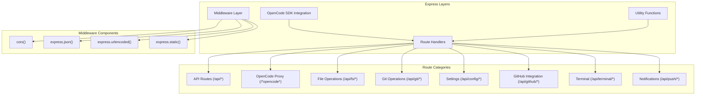

**Middleware Stack**:
- **CORS**: Configured to allow cross-origin requests from desktop/web clients
- **Body Parsers**: `express.json()` and `express.urlencoded()` for request parsing
- **Static Files**: Serves Vite-built UI from `dist/` directory

**Sources**: [packages/web/server/index.js:2300-2450]()

---

## OpenCode SDK Integration

The server uses `@opencode-ai/sdk/server` to manage the OpenCode CLI lifecycle and provide a stable HTTP API for session management, message streaming, and tool invocation.

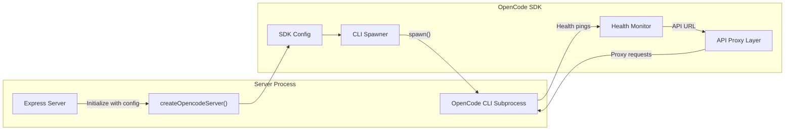

**Configuration**: The SDK accepts:
- `opencodeBinary`: Path to the OpenCode CLI executable
- `port`: Port for the OpenCode HTTP server (auto-assigned if not specified)
- `directory`: Active project directory for session context

**API URL**: Once the OpenCode CLI is ready, the SDK provides a base URL (e.g., `http://localhost:57124`) that the Express server proxies to. This URL is used for all OpenCode session operations.

**Health Monitoring**: The SDK periodically checks the CLI process health and restarts it if it crashes. The server responds with `503 Service Unavailable` if OpenCode is not running.

**Sources**: [packages/web/server/index.js:23](), [packages/web/server/index.js:2400-2500]()

---

## Request Routing Architecture

The server implements a multi-layered routing strategy with OpenCode proxying, API endpoints, and static file serving.

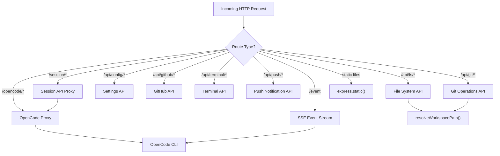

**Routing Precedence**:
1. **API Routes** (`/api/*`): Direct server-side operations
2. **OpenCode Proxy** (`/opencode/*`, `/session/*`, `/event`): Forwarded to OpenCode CLI
3. **Static Files**: UI assets served from `dist/`

**Route Handler Structure**: Each route validates input, performs directory scoping (if applicable), executes the operation, and returns a JSON response. Error responses include descriptive messages and appropriate HTTP status codes.

**Sources**: [packages/web/server/index.js:2300-2800]()

---

## Directory Scoping and Security

The server enforces strict directory scoping to prevent unauthorized file system access. All file and git operations are validated against the active project directory.

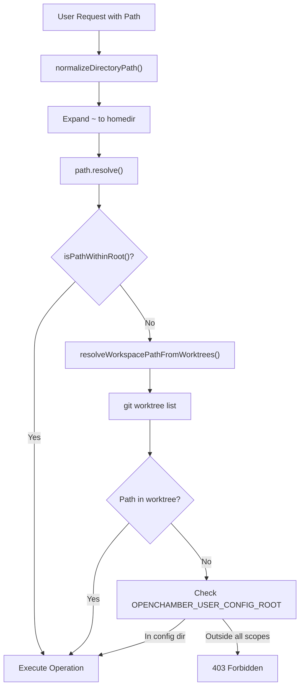

**Key Functions**:
- **`normalizeDirectoryPath(value)`**: Expands `~` to home directory, normalizes slashes
- **`resolveWorkspacePath(targetPath, baseDirectory)`**: Validates path is within `baseDirectory` or OpenChamber config directory
- **`resolveWorkspacePathFromWorktrees(targetPath, baseDirectory)`**: Extends validation to include git worktrees
- **`isPathWithinRoot(resolvedPath, rootPath)`**: Uses `path.relative()` to check containment

**Special Cases**:
- Paths under `~/.config/openchamber/` are allowed for per-project configuration
- Git worktrees linked to the main repository are considered valid scopes
- Symlinks are resolved before validation

**Sources**: [packages/web/server/index.js:59-315]()

---

## File System Operations

The server provides comprehensive file system APIs with gitignore-aware filtering and fuzzy search capabilities.

### Directory Listing

**Endpoint**: `GET /api/fs/list?path=<path>&respectGitignore=<bool>`

The listing operation reads directory entries and optionally filters ignored files using `git check-ignore`.

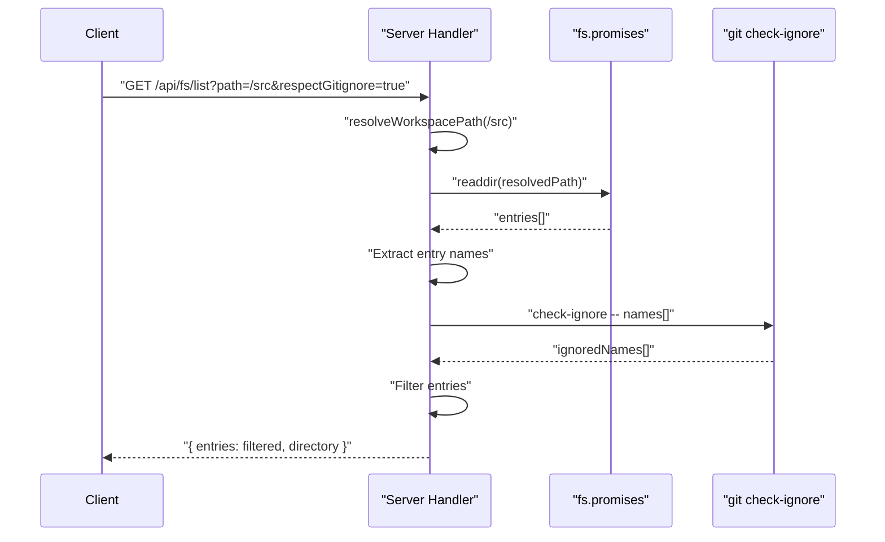

**Gitignore Integration**: When `respectGitignore=true`, the server spawns `git check-ignore` with entry names and filters results. This ensures the UI respects `.gitignore` patterns.

**Sources**: [packages/web/server/index.js:333-339](), [packages/web/server/index.js:2800-2900]()

### File Search

**Endpoint**: `POST /api/fs/search`

File search implements fuzzy matching with gitignore filtering and configurable result limits.

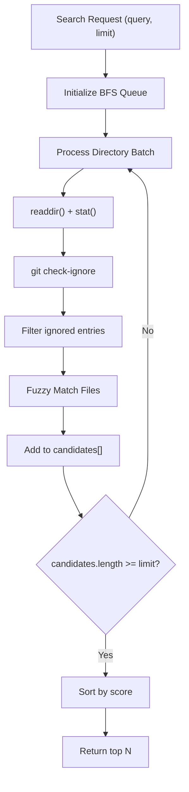

**Fuzzy Matching Algorithm** (`fuzzyMatchScoreNormalized`):
- Exact substring match: High score with position bonus
- Character-by-character fuzzy match: Score based on gaps, consecutive matches, and word boundaries
- Scoring factors: Match position, path length, consecutive characters, word boundary alignment

**Performance Optimizations**:
- Parallel directory traversal (`FILE_SEARCH_MAX_CONCURRENCY = 5`)
- Early termination at `collectLimit` (3x requested limit for fuzzy queries)
- Excluded directories: `node_modules`, `.git`, `dist`, `build`, etc.

**Sources**: [packages/web/server/index.js:340-550]()

---

## Settings Management

Settings are persisted to `~/.config/openchamber/settings.json` and synchronized across all runtime environments.

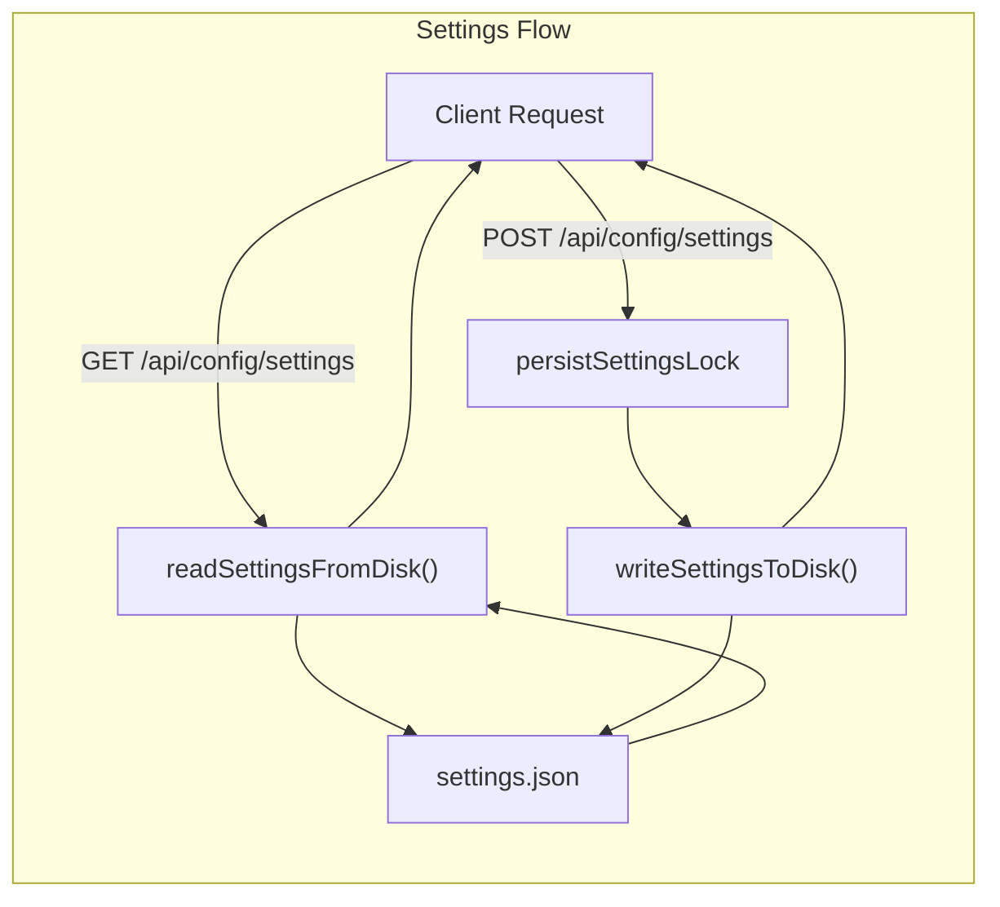

**Key Settings**:
- `projects`: Array of project entries with path, label, icon, color
- `activeProjectId`: Currently selected project
- `themeId`, `lightThemeId`, `darkThemeId`: Theme preferences
- `opencodeBinary`: Path to OpenCode CLI executable
- `defaultModel`, `defaultAgent`, `defaultVariant`: AI model defaults
- `autoDeleteEnabled`, `autoDeleteAfterDays`: Auto-cleanup configuration
- `nativeNotificationsEnabled`, `notificationMode`: Notification preferences

**Concurrency Control**: `persistSettingsLock` ensures writes are serialized to prevent race conditions during rapid setting updates.

**Validation**: The server validates settings structure before persisting. Invalid entries are filtered or rejected with descriptive error messages.

**Sources**: [packages/web/server/index.js:1054-1079](), [packages/web/server/index.js:2600-2700]()

---

## GitHub Integration

The server provides GitHub OAuth device flow authentication and REST API operations for pull requests, issues, and repository management.

### OAuth Device Flow

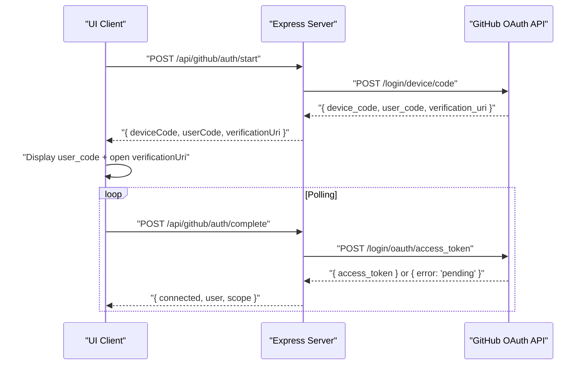

**Multi-Account Support**: The server maintains a list of authenticated accounts in settings (`githubAccounts`). Each account has:
- `accountId`: Unique identifier
- `user`: GitHub user profile (`login`, `id`, `avatarUrl`)
- `scope`: OAuth scopes granted
- `current`: Boolean indicating active account

**Token Storage**: Access tokens are stored in memory (for web) or in the desktop application's secure storage. The server never logs tokens.

**Sources**: [packages/web/server/index.js:3500-3700]()

### Pull Request Operations

**Key Endpoints**:
- `GET /api/github/pr/status?directory=<path>&branch=<name>`: Check if PR exists for branch
- `POST /api/github/pr/create`: Create new pull request
- `PUT /api/github/pr/update`: Update PR title/body
- `POST /api/github/pr/merge`: Merge pull request
- `GET /api/github/prs/list`: List repository pull requests
- `GET /api/github/pr/context`: Fetch PR details with comments, files, checks

**PR Creation Flow**:
1. Extract owner/repo from git remote URL
2. Validate branch exists and has commits
3. Call GitHub API `POST /repos/:owner/:repo/pulls`
4. Return PR number and URL

**Sources**: [packages/web/server/index.js:3700-4200]()

---

## Notification System

The server implements a dual notification system: native desktop notifications and web push notifications.

### Desktop Notifications

For desktop mode, the server emits special log prefixes that the Tauri backend intercepts:

```javascript
console.log(`${DESKTOP_NOTIFY_PREFIX}${JSON.stringify({
  title: "Agent Completed",
  body: messageText
})}`);
```

The Tauri process monitors stderr/stdout, detects `[OpenChamberDesktopNotify]` prefix, and triggers native OS notifications.

### Web Push Notifications

**Endpoint**: `POST /api/push/subscribe`

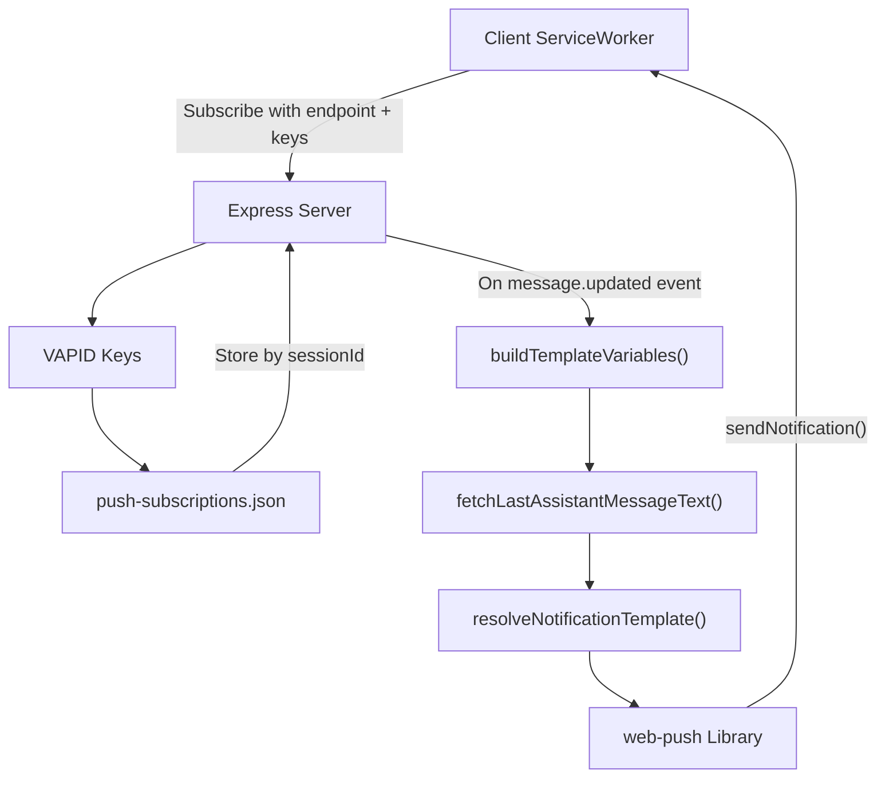

**VAPID Keys**: Generated once at server startup using `web-push.generateVAPIDKeys()` and stored in memory. Desktop mode persists keys across restarts.

**Subscription Management**: Each subscription is associated with a session ID. When a session completes, the server:
1. Fetches the last assistant message via OpenCode API
2. Builds template variables (project name, branch, session title, agent name)
3. Resolves notification template (configurable in settings)
4. Sends push notification to all registered endpoints for that session

**Visibility Tracking**: The client can call `POST /api/push/visibility` to signal when the app is visible/hidden. The server suppresses notifications when the app is active.

**Sources**: [packages/web/server/index.js:1082-1250](), [packages/web/server/index.js:4500-4800]()

---

## Terminal Support

The server provides WebSocket-based terminal I/O for integrated terminal sessions, with fallback HTTP support.

### Terminal Session Flow

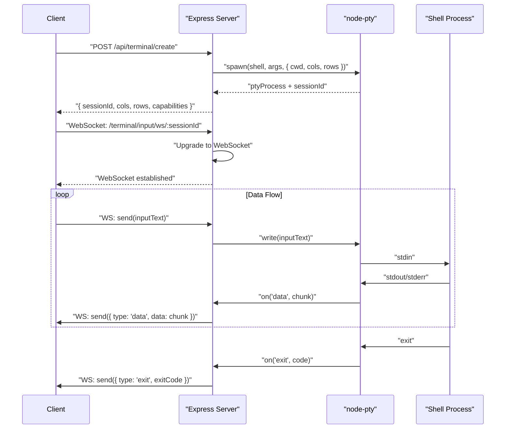

**WebSocket Protocol**: The server uses a custom protocol (`TERMINAL_INPUT_WS_PATH`) for terminal input. Control frames indicate session binding, and data frames carry terminal I/O.

**Fallback HTTP**: If WebSocket is unavailable, the client can use `POST /api/terminal/input` to send input as HTTP requests.

**PTY Backend**: The server uses `node-pty` (Node.js) or `pty-rs` (Bun) to spawn pseudo-terminal processes. The shell is determined by `$SHELL` environment variable.

**Sources**: [packages/web/server/index.js:13-22](), [packages/web/server/index.js:5000-5500]()

---

## SSE Event Streaming

The server proxies Server-Sent Events from the OpenCode CLI to the client for real-time message streaming.

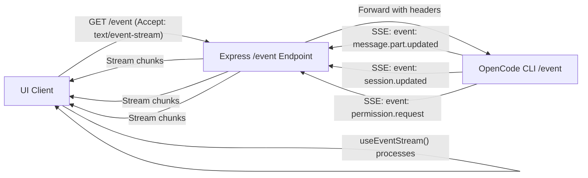

**Event Types**:
- `message.part.updated`: Incremental message content streaming
- `message.updated`: Message finalization
- `session.updated`: Session metadata changes
- `session.status`: Session execution status
- `permission.request`: File/directory access requests
- `mcp.tools.changed`: MCP tool catalog updates

**Connection Management**: The server maintains long-lived HTTP connections for SSE. If the OpenCode CLI restarts, the client automatically reconnects via exponential backoff retry logic (implemented in `useEventStream`).

**Desktop Notification Trigger**: The server monitors `message.updated` events with `finish: 'stop'` to trigger notification dispatch.

**Sources**: [packages/web/server/index.js:2500-2600](), [packages/ui/src/hooks/useEventStream.ts:1-200]()

---

## API Endpoint Reference

### File System Endpoints

| Endpoint | Method | Description |
|----------|--------|-------------|
| `/api/fs/list` | GET | List directory entries with optional gitignore filtering |
| `/api/fs/search` | POST | Fuzzy file search with gitignore support |
| `/api/fs/read` | POST | Read file contents as UTF-8 text |
| `/api/fs/write` | POST | Write file contents with directory creation |
| `/api/fs/delete` | POST | Delete file or directory recursively |
| `/api/fs/rename` | POST | Rename/move file or directory |
| `/api/fs/mkdir` | POST | Create directory with parents |
| `/api/fs/home` | GET | Get user home directory path |
| `/api/files/pick` | POST | File picker (desktop-only, triggers native dialog) |

### Git Endpoints

| Endpoint | Method | Description |
|----------|--------|-------------|
| `/api/git/status` | POST | Get repository status (staged, unstaged, ahead/behind) |
| `/api/git/diff` | POST | Get unified diff for file or staging area |
| `/api/git/filediff` | POST | Get original/modified content for diff view |
| `/api/git/branches` | POST | List branches with tracking info |
| `/api/git/commit` | POST | Create commit with message |
| `/api/git/push` | POST | Push commits to remote |
| `/api/git/pull` | POST | Pull changes from remote |
| `/api/git/fetch` | POST | Fetch from remote without merge |
| `/api/git/checkout` | POST | Checkout branch |
| `/api/git/worktrees` | POST | List git worktrees |
| `/api/git/worktree/create` | POST | Create new worktree with branch |
| `/api/git/worktree/delete` | POST | Delete worktree |

### GitHub Endpoints

| Endpoint | Method | Description |
|----------|--------|-------------|
| `/api/github/auth/status` | GET | Check authentication status |
| `/api/github/auth/start` | POST | Start OAuth device flow |
| `/api/github/auth/complete` | POST | Complete device flow and exchange token |
| `/api/github/auth/disconnect` | POST | Revoke access token |
| `/api/github/pr/status` | GET | Check PR status for branch |
| `/api/github/pr/create` | POST | Create pull request |
| `/api/github/pr/update` | PUT | Update PR title/body |
| `/api/github/pr/merge` | POST | Merge pull request |
| `/api/github/prs/list` | GET | List repository pull requests |
| `/api/github/pr/context` | GET | Get PR details (comments, files, checks) |

**Sources**: [packages/web/server/index.js:2300-5000]()

---

## Error Handling and Health Monitoring

The server implements comprehensive error handling and health checks for operational reliability.

### Health Check Endpoint

**Endpoint**: `GET /health`

Returns server status including OpenCode availability:

```json
{
  "ok": true,
  "openCodeRunning": true,
  "apiUrl": "http://localhost:57124",
  "lastOpenCodeError": null
}
```

### Error Response Format

All API endpoints return consistent error responses:

```json
{
  "error": "Path is outside of active workspace",
  "code": "INVALID_PATH",
  "details": { "path": "/etc/passwd" }
}
```

### OpenCode Unavailability

When OpenCode CLI is not running, the server returns:
- **Status**: `503 Service Unavailable`
- **Error**: `"OpenCode API unavailable"`

The client displays a connection status indicator and retries with exponential backoff.

**Sources**: [packages/web/server/index.js:2200-2300]()

---

