<!-- source: DeepWiki mcp.deepwiki.com · repo btriapitsyn/openchamber · page 5.2 API Endpoints and Proxying · fetched 2026-10-26 -->

# API and Proxying

<details>
<summary>Relevant source files</summary>

The following files were used as context for generating this wiki page:

- [packages/desktop/src-tauri/src/main.rs](packages/desktop/src-tauri/src/main.rs)
- [packages/ui/src/App.tsx](packages/ui/src/App.tsx)
- [packages/ui/src/lib/api/types.ts](packages/ui/src/lib/api/types.ts)
- [packages/vscode/src/bridge.ts](packages/vscode/src/bridge.ts)
- [packages/web/server/index.js](packages/web/server/index.js)

</details>


## Purpose and Scope

This document details the API architecture and proxying mechanisms in the web application's Express server. It covers how the server handles incoming HTTP requests, proxies them to the OpenCode backend, manages SSE (Server-Sent Events) streaming, and provides custom endpoints for web-specific functionality.

For information about the overall web server architecture, see [Server Architecture](#5.1). For details on OpenCode backend integration patterns across platforms, see [OpenCode Backend Integration](#3.2).

## API Architecture Overview

The Express server at [packages/web/server/index.js]() implements a dual-mode API architecture: **custom endpoints** for web-specific operations and **proxied endpoints** that forward requests to the OpenCode backend. All API routes use the `/api` prefix.

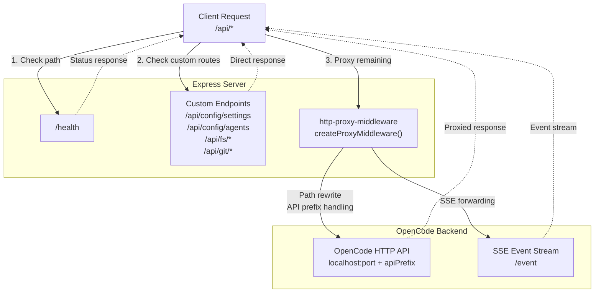

**Sources:** [packages/web/server/index.js:1760-1877](), [packages/web/server/index.js:1970-2010]()

### Request Routing Decision Tree

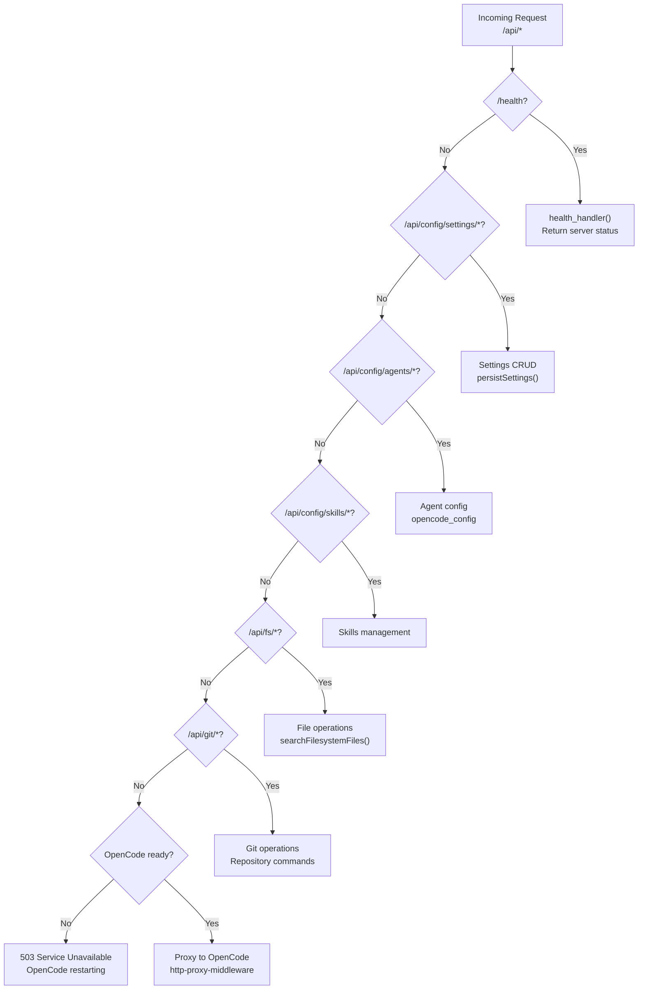

**Sources:** [packages/web/server/index.js:1770-1795](), [packages/web/server/index.js:1996-2004]()

## OpenCode Proxy Configuration

The proxy middleware is configured in `setupProxy()` at [packages/web/server/index.js:1760-1877](). It uses `http-proxy-middleware` to forward requests to the dynamically discovered OpenCode port.

### Proxy Middleware Setup

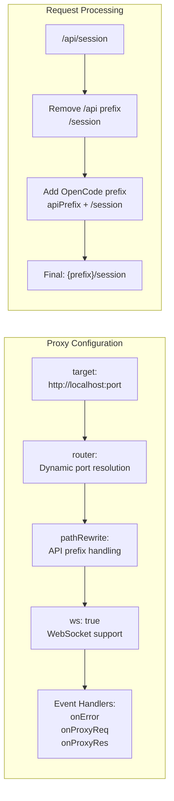

**Sources:** [packages/web/server/index.js:1819-1876]()

Key configuration details:

| Configuration | Implementation | Location |
|--------------|----------------|----------|
| **Target** | `http://localhost:${openCodePort}` | [index.js:1820-1826]() |
| **Path Rewrite** | Strips `/api` prefix and adds OpenCode API prefix | [index.js:1828-1840]() |
| **WebSocket** | `ws: true` for SSE support | [index.js:1841]() |
| **Error Handling** | `onError` returns 503 on failures | [index.js:1842-1847]() |
| **SSE Headers** | Special handling for `text/event-stream` | [index.js:1848-1856]() |

### API Prefix Detection

OpenCode may serve its API at different path prefixes (e.g., `/api`, `/`, or custom). The server implements automatic prefix detection:

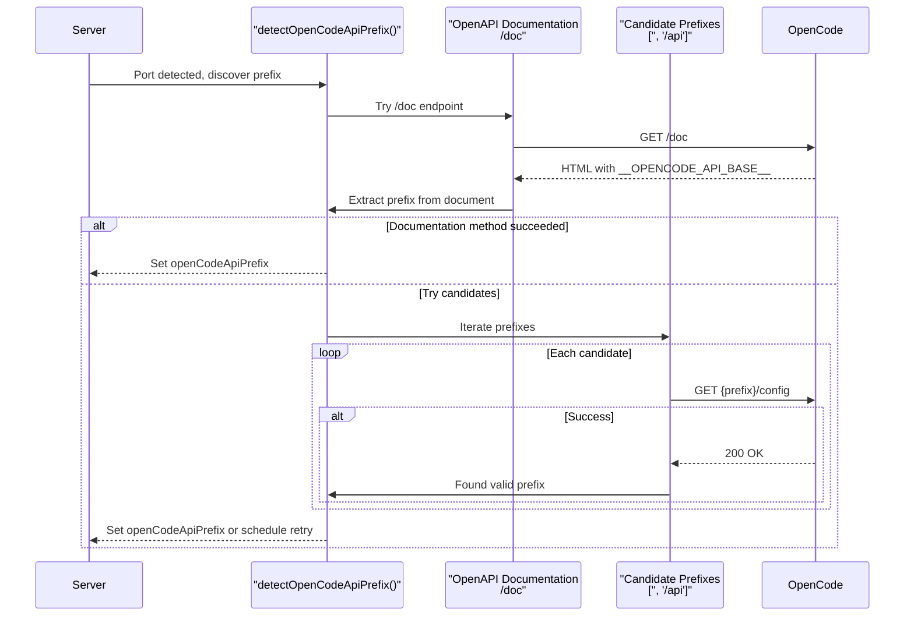

**Sources:** [packages/web/server/index.js:1226-1368](), [packages/web/server/index.js:1036-1111]()

The detection algorithm:
1. **Documentation Extraction**: Attempts to read `/doc` endpoint and extract `__OPENCODE_API_BASE__` global variable ([index.js:1326-1368]())
2. **Candidate Probing**: Tests known prefixes (`''`, `'/api'`) by calling `/config` endpoint ([index.js:1226-1257]())
3. **Retry Scheduling**: Uses exponential backoff if detection fails ([index.js:1307-1324]())
4. **State Tracking**: Maintains `openCodeApiPrefixDetected` flag and `openCodeApiPrefix` value ([index.js:869-870]())

### Path Rewriting Logic

The `pathRewrite` function in the proxy configuration transforms paths:

```javascript
pathRewrite: (path) => {
  if (!path.startsWith('/api')) {
    return path;  // Pass through non-API paths
  }

  const suffix = path.slice(4) || '/';  // Remove '/api' prefix

  if (!openCodeApiPrefixDetected || openCodeApiPrefix === '') {
    return suffix;  // No prefix, return suffix only
  }

  return `${openCodeApiPrefix}${suffix}`;  // Add OpenCode prefix
}
```

**Example transformations:**

| Incoming Path | OpenCode Prefix | Rewritten Path |
|--------------|-----------------|----------------|
| `/api/session` | `''` | `/session` |
| `/api/session` | `/api` | `/api/session` |
| `/api/config` | `/v1` | `/v1/config` |
| `/api/agent` | `''` | `/agent` |

**Sources:** [packages/web/server/index.js:1828-1840]()

## SSE Event Streaming

Server-Sent Events (SSE) enable real-time updates from OpenCode to the client. The proxy handles SSE specially to ensure proper streaming behavior.

### SSE Proxy Flow

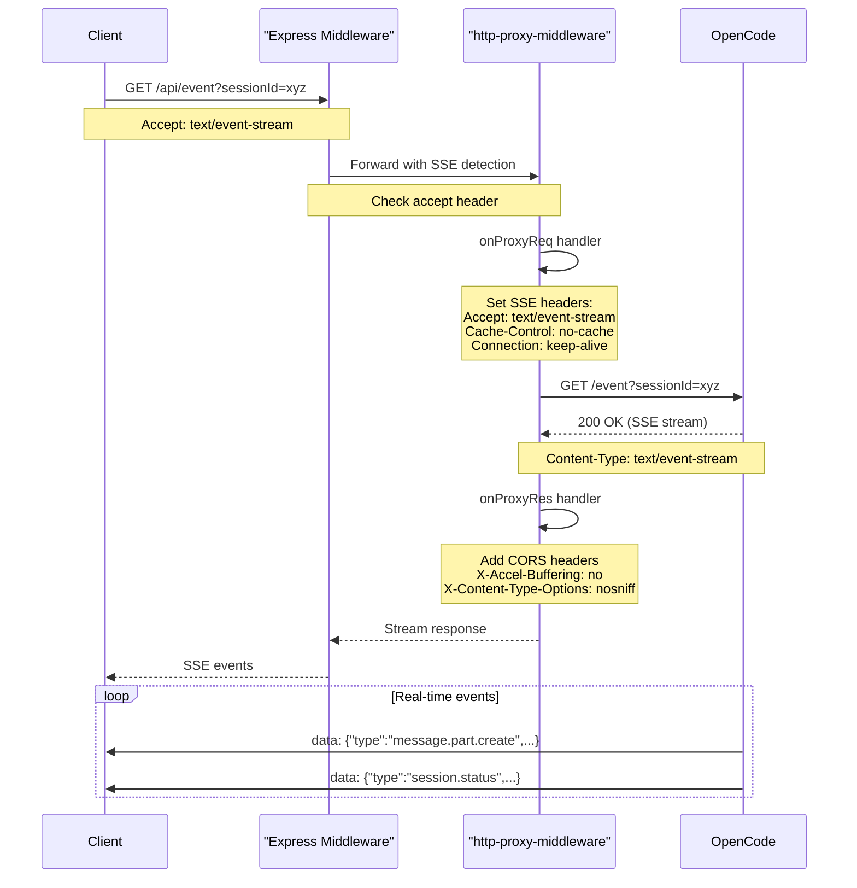

**Sources:** [packages/web/server/index.js:1848-1873]()

### SSE-Specific Headers

The proxy applies special headers for SSE connections:

| Header | Value | Purpose |
|--------|-------|---------|
| `Accept` | `text/event-stream` | Request SSE format |
| `Cache-Control` | `no-cache` | Prevent caching |
| `Connection` | `keep-alive` | Maintain persistent connection |
| `X-Accel-Buffering` | `no` | Disable nginx buffering |
| `X-Content-Type-Options` | `nosniff` | Security header |
| `Access-Control-Allow-*` | `*` | CORS support |

**Sources:** [packages/web/server/index.js:1850-1868]()

### SSE Event Types

OpenCode emits various event types through the SSE stream. The proxy forwards these transparently:

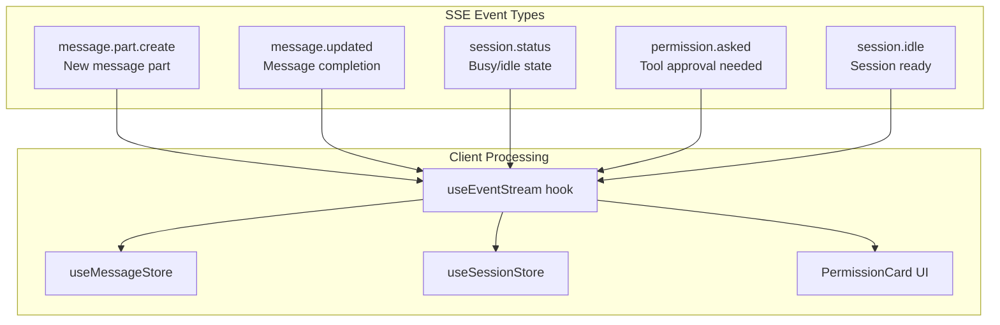

**Sources:** [packages/web/server/index.js:1125-1203]()

## Custom Endpoints

The server provides custom endpoints that bypass the proxy and implement web-specific functionality.

### Settings Management

Settings are persisted to `~/.config/openchamber/settings.json` (or `OPENCHAMBER_DATA_DIR`).

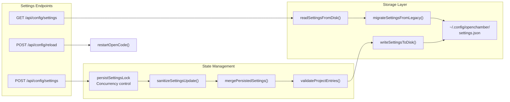

**Sources:** [packages/web/server/index.js:290-320](), [packages/web/server/index.js:522-842](), [packages/web/server/index.js:2800-3000]()

Key functions:

| Function | Purpose | Location |
|----------|---------|----------|
| `readSettingsFromDisk()` | Load settings JSON from disk | [index.js:295-310]() |
| `writeSettingsToDisk()` | Save settings JSON to disk | [index.js:312-320]() |
| `sanitizeSettingsUpdate()` | Validate and clean settings payload | [index.js:522-621]() |
| `mergePersistedSettings()` | Merge changes with current settings | [index.js:623-679]() |
| `persistSettings()` | Atomic save with locking | [index.js:808-842]() |

### File System Operations

File search and directory operations are implemented server-side:

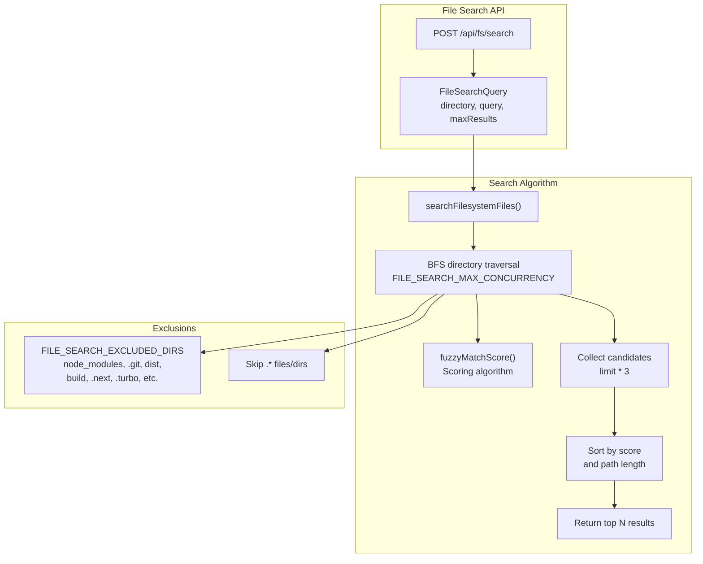

**Sources:** [packages/web/server/index.js:26-40](), [packages/web/server/index.js:71-87](), [packages/web/server/index.js:89-257](), [packages/web/server/index.js:2400-2500]()

The fuzzy matching algorithm ([index.js:94-159]()):
- **Exact substring match**: Highest score with bonuses for word boundaries
- **Fuzzy match**: All query characters must appear in order
- **Scoring factors**: Character position, gaps, consecutive matches, path length
- **Performance**: Breadth-first search with concurrency limit of 5

### Git Operations Proxy

Git operations are handled through Tauri commands on desktop, but the web server implements direct Git integration:

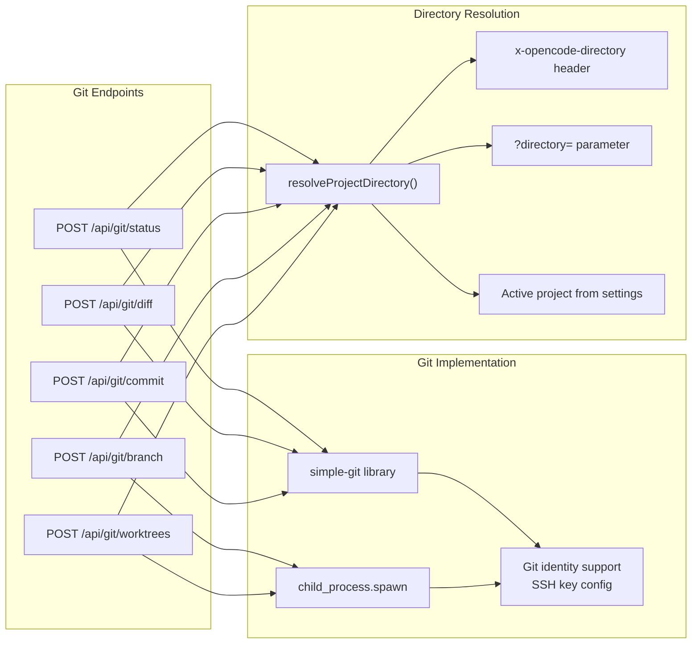

**Sources:** [packages/web/server/index.js:357-390](), [packages/web/server/index.js:2600-2800]()

Directory resolution priority ([index.js:357-390]()):
1. `x-opencode-directory` HTTP header
2. `?directory=` query parameter
3. Active project from settings (`activeProjectId`)
4. First project in projects list
5. Legacy `lastDirectory` setting

## Request/Response Lifecycle

### Complete Request Flow

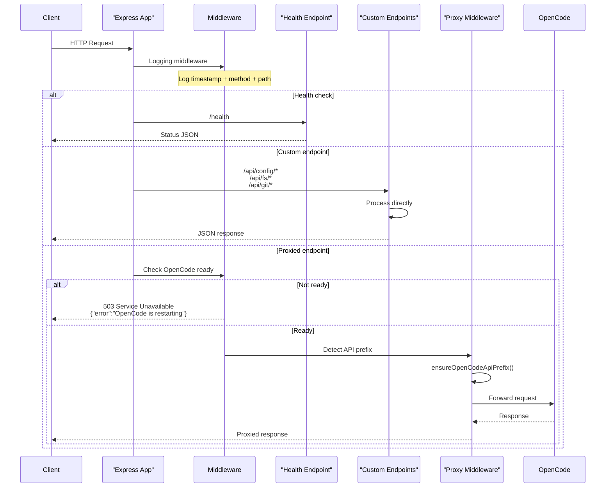

**Sources:** [packages/web/server/index.js:1770-1877](), [packages/web/server/index.js:1996-2010]()

### Error Handling Strategy

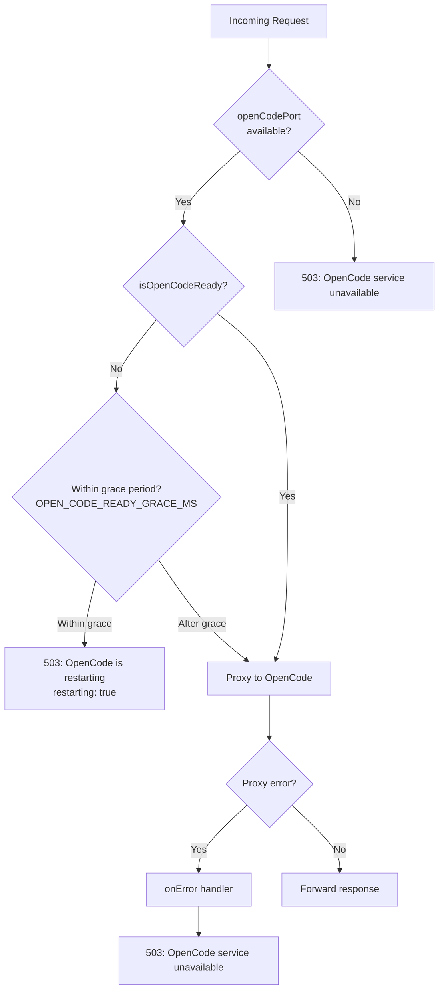

**Sources:** [packages/web/server/index.js:1770-1795](), [packages/web/server/index.js:1842-1847]()

Constants for health monitoring:

| Constant | Value | Purpose |
|----------|-------|---------|
| `HEALTH_CHECK_INTERVAL` | 30000ms | How often to check OpenCode health |
| `OPEN_CODE_READY_GRACE_MS` | 12000ms | Grace period after restart before 503s |
| `CLIENT_RELOAD_DELAY_MS` | 800ms | Client reload delay after config change |
| `LONG_REQUEST_TIMEOUT_MS` | 240000ms | Timeout for long-running requests |

**Sources:** [packages/web/server/index.js:18-24]()

### HMR State Preservation

The server uses global state to survive Vite Hot Module Replacement (HMR) reloads:

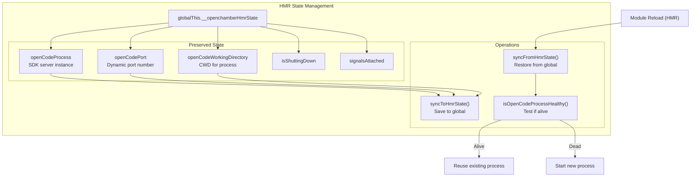

**Sources:** [packages/web/server/index.js:844-927]()

Key HMR functions:

- `getHmrState()`: Initialize or retrieve global state object ([index.js:847-858]())
- `syncToHmrState()`: Save current values to global ([index.js:882-888]())
- `syncFromHmrState()`: Restore values from global ([index.js:891-897]())
- `isOpenCodeProcessHealthy()`: Test if process is responsive ([index.js:911-926]())

This prevents zombie OpenCode processes when the development server hot-reloads.

**Sources:** [packages/web/server/index.js:844-927]()

---

