<!-- source: DeepWiki mcp.deepwiki.com · repo btriapitsyn/openchamber · page 6 VS Code Extension · fetched 2026-10-26 -->

# VS Code Extension

<details>
<summary>Relevant source files</summary>

The following files were used as context for generating this wiki page:

- [packages/ui/src/components/layout/VSCodeLayout.tsx](packages/ui/src/components/layout/VSCodeLayout.tsx)
- [packages/vscode/assets/icon-titlebar.svg](packages/vscode/assets/icon-titlebar.svg)
- [packages/vscode/src/ChatViewProvider.ts](packages/vscode/src/ChatViewProvider.ts)
- [packages/vscode/src/extension.ts](packages/vscode/src/extension.ts)
- [packages/vscode/src/opencode.ts](packages/vscode/src/opencode.ts)
- [packages/vscode/src/sessionActivityWatcher.ts](packages/vscode/src/sessionActivityWatcher.ts)
- [packages/vscode/webview/api/bridge.ts](packages/vscode/webview/api/bridge.ts)
- [packages/vscode/webview/main.tsx](packages/vscode/webview/main.tsx)

</details>


The VS Code extension integrates OpenChamber into Visual Studio Code as a sidebar webview and editor panels. It manages the OpenCode CLI process, bridges communication between webviews and the extension host, and provides editor commands for code interaction.

This page provides an architectural overview. For implementation details, see:
- [Extension Architecture](#6.1) - Activation, commands, and lifecycle management
- [Bridge Communication](#6.2) - Message-based IPC and API proxying
- [Webview Integration](#6.3) - Webview lifecycle and UI rendering

For shared UI components, see [UI Component Library](#7). For OpenCode integration patterns, see [OpenCode Backend Integration](#3.2).

---

## Overview

The VS Code extension operates in three distinct contexts:

| Context | Runtime | Purpose |
|---------|---------|---------|
| **Extension Host** | Node.js process | CLI management, command registration, bridge handling |
| **Webview (Sidebar)** | Isolated JavaScript | Chat interface using `VSCodeLayout` component |
| **Webview (Editor Panel)** | Isolated JavaScript | Session editor using `SessionEditorPanelProvider` |

The extension spawns and manages the OpenCode CLI process via `@opencode-ai/sdk`, proxies HTTP/SSE traffic between webviews and OpenCode, and exposes VS Code commands for editor integration.

**Extension Package Structure**

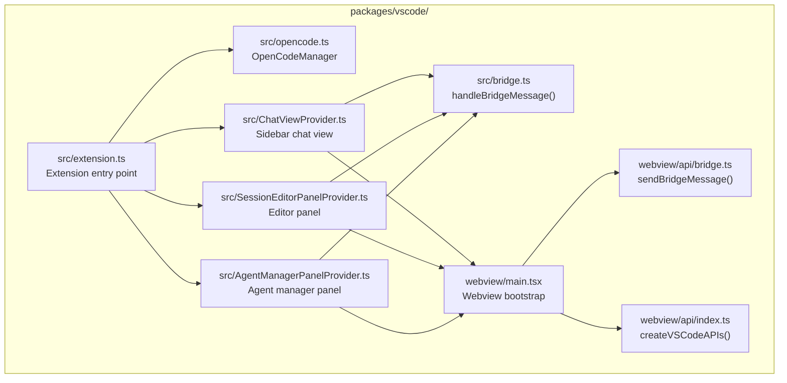

**Sources:**
- [packages/vscode/src/extension.ts:1-573]()
- [packages/vscode/src/opencode.ts:1-638]()
- [packages/vscode/src/ChatViewProvider.ts:1-577]()
- [packages/vscode/webview/main.tsx:1-700]()

---

## Multi-Platform Context

The VS Code extension is one of three OpenChamber deployment targets, each using the shared `@openchamber/ui` package with platform-specific runtime adapters.

**Runtime Comparison**

| Feature | Web | Desktop | **VS Code** |
|---------|-----|---------|-------------|
| **Backend** | External Express server | Sidecar binary (Tauri) | Managed CLI (`@opencode-ai/sdk`) |
| **UI Container** | Browser window | Tauri WebView | VS Code Webview |
| **Communication** | Direct HTTP/SSE | Tauri IPC commands | postMessage bridge |
| **Layout** | `MainLayout` | `MainLayout` | `VSCodeLayout` |
| **Session UI** | Full views | Full views | Compact sidebar + editor panels |
| **Settings Storage** | localStorage + backend | Desktop file + backend | VS Code globalState |

The VS Code extension uses `VSCodeLayout` ([packages/ui/src/components/layout/VSCodeLayout.tsx:1-692]()) which provides a responsive interface that adapts to sidebar width constraints and supports both sidebar and editor panel view modes.

**Sources:**
- [packages/ui/src/components/layout/VSCodeLayout.tsx:1-692]()
- [packages/vscode/webview/main.tsx:58-69]()

---

## Architecture Layers

**High-Level Architecture**

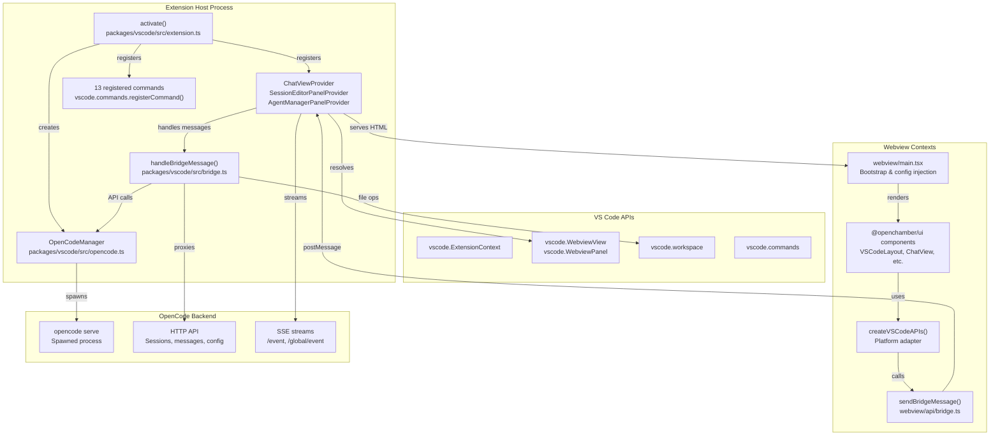

**Sources:**
- [packages/vscode/src/extension.ts:34-561]()
- [packages/vscode/src/opencode.ts:308-637]()
- [packages/vscode/src/ChatViewProvider.ts:8-389]()

### Extension Host Layer

The extension host runs in Node.js and has full access to VS Code APIs and the file system. Key responsibilities:

- **Lifecycle Management**: `activate()` and `deactivate()` functions manage extension setup and teardown
- **OpenCode Manager**: `createOpenCodeManager()` spawns and monitors the OpenCode CLI process
- **Webview Providers**: Instantiate webview views (sidebar) and panels (editor)
- **Command Registry**: Register VS Code commands for editor integration
- **Bridge Handler**: Process webview requests for API calls, file operations, and settings

See [Extension Architecture](#6.1) for detailed lifecycle and command information.

**Sources:**
- [packages/vscode/src/extension.ts:34-561]()
- [packages/vscode/src/opencode.ts:308-637]()

### Bridge Communication Layer

The bridge enables bidirectional communication between isolated webview contexts and the extension host using VS Code's `postMessage` API.

**Bridge Request/Response Pattern**

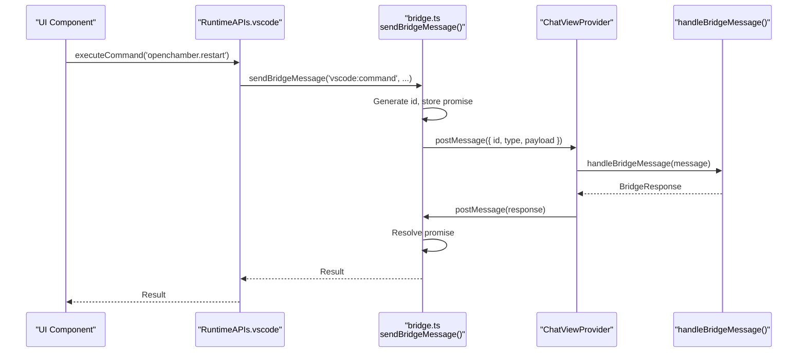

The bridge uses promise-based request-response with:
- Unique request IDs (`req_<counter>_<timestamp>`)
- Timeout management (default 30s, configurable)
- Typed message payloads for different operation types

See [Bridge Communication](#6.2) for protocol details, SSE proxying, and message types.

**Sources:**
- [packages/vscode/webview/api/bridge.ts:61-91]()
- [packages/vscode/src/bridge.ts:1-300]()

### Webview Integration Layer

Webviews run in isolated JavaScript contexts with limited access to VS Code APIs. The webview bootstrap process:

1. **Config Injection**: `window.__VSCODE_CONFIG__` provides initial state (workspace, theme, connection status)
2. **Runtime Adapter**: `createVSCodeAPIs()` implements the `RuntimeAPIs` interface for platform abstraction
3. **UI Rendering**: React components from `@openchamber/ui` render using `VSCodeLayout`
4. **Bridge Setup**: Event listeners handle messages from extension host

See [Webview Integration](#6.3) for webview lifecycle, theme synchronization, and activity monitoring.

**Sources:**
- [packages/vscode/webview/main.tsx:48-277]()
- [packages/vscode/webview/api/index.ts:1-200]()
- [packages/ui/src/components/layout/VSCodeLayout.tsx:1-692]()

---

## Key Components

### OpenCode Manager

The `OpenCodeManager` ([packages/vscode/src/opencode.ts:37-48]()) provides an interface for managing the OpenCode CLI lifecycle:

| Method | Purpose |
|--------|---------|
| `start(workdir?)` | Spawns OpenCode CLI process, waits for health check |
| `stop()` | Terminates CLI process and cleanup |
| `restart()` | Stop and start sequence |
| `getStatus()` | Returns connection status: `connecting`, `connected`, `error`, `disconnected` |
| `getApiUrl()` | Returns detected or configured API URL |
| `getWorkingDirectory()` | Returns OpenCode working directory |
| `isCliAvailable()` | Indicates if CLI binary was found |
| `getDebugInfo()` | Returns diagnostics for troubleshooting |
| `onStatusChange(callback)` | Subscribe to status change events |

The manager uses `@opencode-ai/sdk`'s `createOpencodeServer()` to spawn the CLI with dynamic port allocation and automatic health checking ([packages/vscode/src/opencode.ts:427-433]()).

**Sources:**
- [packages/vscode/src/opencode.ts:37-637]()

### Webview Providers

Three webview providers serve different UI contexts:

| Provider | Type | View Type / Title | Purpose |
|----------|------|-------------------|---------|
| `ChatViewProvider` | WebviewView | `openchamber.chatView` | Sidebar chat interface |
| `SessionEditorPanelProvider` | WebviewPanel | `OpenChamber Session` | Editor panel for session focus |
| `AgentManagerPanelProvider` | WebviewPanel | `OpenChamber Agent Manager` | Agent configuration interface |

All providers share common functionality:
- HTML generation with config injection
- Theme synchronization
- Connection status broadcasting
- SSE proxying for real-time events
- Bridge message handling

The sidebar view uses `retainContextWhenHidden: true` to preserve state when hidden ([packages/vscode/src/extension.ts:129]()).

**Sources:**
- [packages/vscode/src/ChatViewProvider.ts:8-577]()
- [packages/vscode/src/SessionEditorPanelProvider.ts:8-400]()
- [packages/vscode/src/AgentManagerPanelProvider.ts:8-352]()

### Command System

The extension registers 13 commands for editor and sidebar integration:

| Command | Trigger | Action |
|---------|---------|--------|
| `openchamber.openSidebar` | Command palette | Opens and focuses chat sidebar |
| `openchamber.focusChat` | Keybinding | Focuses chat view |
| `openchamber.openActiveSessionInEditor` | Title bar button | Opens current session in editor panel |
| `openchamber.openNewSessionInEditor` | Command palette | Creates new session in editor panel |
| `openchamber.newSession` | Sidebar button | Creates new chat session |
| `openchamber.addToContext` | Editor context menu | Adds selection to chat input |
| `openchamber.explain` | Editor context menu | Creates explanation session |
| `openchamber.improveCode` | Editor context menu | Creates code improvement session |
| `openchamber.restartApi` | Command palette | Restarts OpenCode CLI |
| `openchamber.showOpenCodeStatus` | Command palette | Shows diagnostic information |
| `openchamber.showSettings` | Settings button | Opens settings view |
| `openchamber.openAgentManager` | Command palette | Opens agent manager panel |
| `openchamber.setActiveSession` | Internal | Tracks active session for title bar |

Commands are registered during activation and remain available for the extension lifetime.

**Sources:**
- [packages/vscode/src/extension.ts:134-334]()
- [packages/vscode/package.json:59-164]()

---

## Configuration

The extension supports configuration via VS Code settings and OpenCode CLI discovery:

### VS Code Settings

| Setting | Type | Purpose |
|---------|------|---------|
| `openchamber.apiUrl` | string | External OpenCode server URL (bypasses CLI management) |
| `openchamber.opencodeBinary` | string | Path to OpenCode CLI binary or directory |

**Sources:**
- [packages/vscode/package.json:169-184]()

### CLI Discovery

The `resolveOpencodeCliPath()` function ([packages/vscode/src/opencode.ts:86-226]()) searches for the OpenCode CLI in this order:

1. Configured `openchamber.opencodeBinary` setting
2. Shared OpenChamber settings file: `~/.config/openchamber/settings.json`
3. Environment variables: `OPENCODE_BINARY`, `OPENCODE_PATH`, `OPENCHAMBER_OPENCODE_PATH`
4. Standard installation directories: `~/.opencode/bin`, `~/.bun/bin`, `~/.local/bin`
5. System PATH lookup via `where` (Windows) or shell `command -v` (Unix)

If the CLI is not found, the extension displays an error with a link to the OpenCode repository.

**Sources:**
- [packages/vscode/src/opencode.ts:86-226]()
- [packages/vscode/src/opencode.ts:466-481]()

---

## Integration Points

### VS Code Workspace

The extension integrates with VS Code workspace APIs:

- **Workspace Folders**: First folder becomes OpenCode working directory ([packages/vscode/src/ChatViewProvider.ts:376]())
- **Active Editor**: Commands read selections and file paths ([packages/vscode/src/extension.ts:231-262]())
- **File System**: Bridge provides file operations for webview ([packages/vscode/src/bridge.ts:50-150]())
- **Settings**: Uses `vscode.workspace.getConfiguration()` for extension settings ([packages/vscode/src/opencode.ts:335-349]())

### Theme System

The extension synchronizes VS Code themes with the webview:

1. Listens for `onDidChangeActiveColorTheme` and `onDidChangeConfiguration` events
2. Sends theme kind (`light`, `dark`, `high-contrast`) to webviews
3. Optionally includes Shiki syntax highlighting themes
4. Webview reads CSS variables from `--vscode-*` properties to reconstruct theme

Theme updates use double `requestAnimationFrame` to ensure CSS variables are updated before reading ([packages/vscode/webview/main.tsx:223-230]()).

**Sources:**
- [packages/vscode/src/extension.ts:516-537]()
- [packages/vscode/webview/main.tsx:188-249]()

### Session Activity Monitoring

The extension monitors OpenCode SSE streams to track session activity phases:

| Phase | Trigger |
|-------|---------|
| `busy` | `session.status` event with `type: "busy"` or `"retry"` |
| `cooldown` | `message.updated` with `role: "assistant"`, `finish: "stop"` |
| `idle` | `session.status` with other types, or after 2s cooldown |

Activity events are injected into SSE streams and broadcast to webviews for UI updates (e.g., loading indicators).

**Sources:**
- [packages/vscode/src/ChatViewProvider.ts:391-480]()
- [packages/vscode/src/sessionActivityWatcher.ts:1-281]()

---

## Deployment

The extension is packaged as a `.vsix` file using `@vscode/vsce`:

1. Webview assets are built with Vite: `webview/main.tsx` → `dist/webview.js`
2. Extension code is compiled with TypeScript: `src/**/*.ts` → `dist/extension.js`
3. Package metadata from `package.json` includes contribution points (commands, views, menus)
4. Assets include icon SVGs and README

The extension can be installed via:
- VS Code Marketplace (when published)
- Local `.vsix` file: `code --install-extension openchamber-<version>.vsix`
- Extension sidebar: "Install from VSIX..."

**Sources:**
- [packages/vscode/package.json:1-200]()
- [packages/vscode/vite.config.ts:1-50]()

---

## Extension Lifecycle

The extension activates when the user opens the OpenChamber sidebar or invokes a command. The `activate()` function sets up all providers, registers commands, and starts the OpenCode manager asynchronously to avoid blocking webview resolution.

**Extension Activation Sequence**

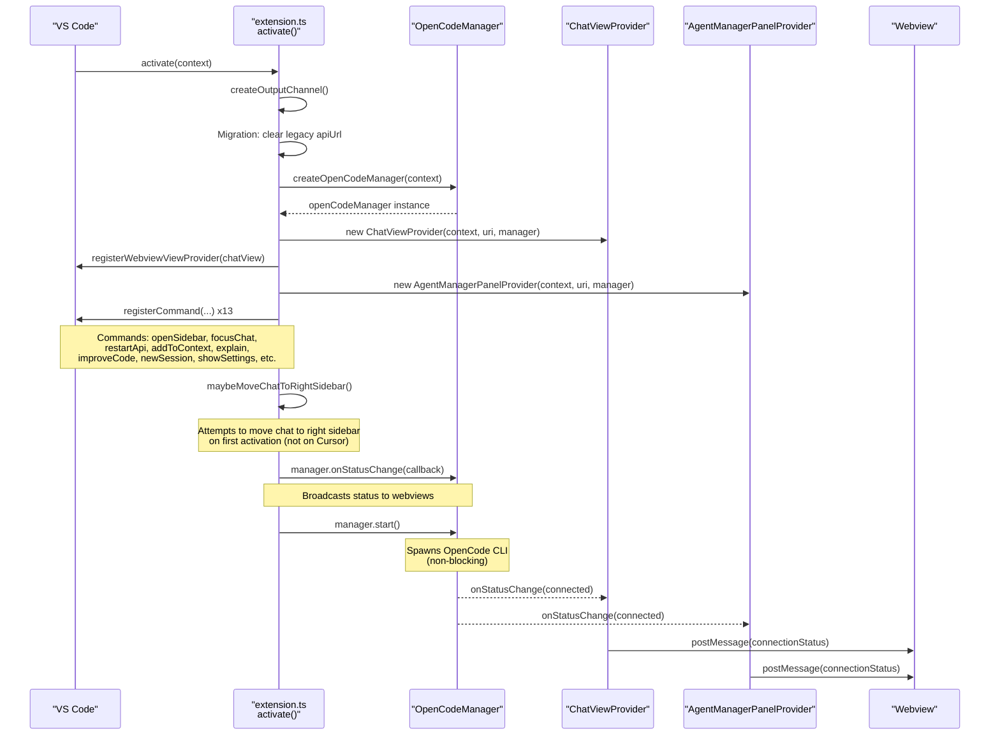

**Sources:**
- [packages/vscode/src/extension.ts:28-470]()

The `activate()` function performs several setup tasks:

1. **Output Channel Creation** ([extension.ts:29]()): Creates a diagnostic output channel for logging.

2. **Legacy Settings Migration** ([extension.ts:106-110]()): Clears auto-assigned API URLs from older extension versions that used ports 47680-47689.

3. **OpenCode Manager Creation** ([extension.ts:113]()): Instantiates the manager from `@opencode-ai/sdk` which handles CLI process lifecycle.

4. **Webview Provider Registration** ([extension.ts:117-125]()): Registers `ChatViewProvider` as a webview view provider with `retainContextWhenHidden: true` to preserve state.

5. **Command Registration** ([extension.ts:128-434]()): Registers 13 commands including sidebar navigation, context menu actions, and API restart.

6. **Right Sidebar Auto-Move** ([extension.ts:82-102]()): On first activation, attempts to move the chat view to the secondary sidebar if supported by the VS Code host.

7. **Status Change Subscription** ([extension.ts:460-465]()): Listens for OpenCode connection status changes and broadcasts to all webviews.

8. **Non-Blocking Start** ([extension.ts:469]()): Starts OpenCode manager without blocking activation to avoid delaying webview resolution.

---

## Webview Provider System

The extension uses two webview providers: `ChatViewProvider` for the sidebar chat interface, and `AgentManagerPanelProvider` for the standalone agent configuration panel.

**Webview Provider Class Structure**

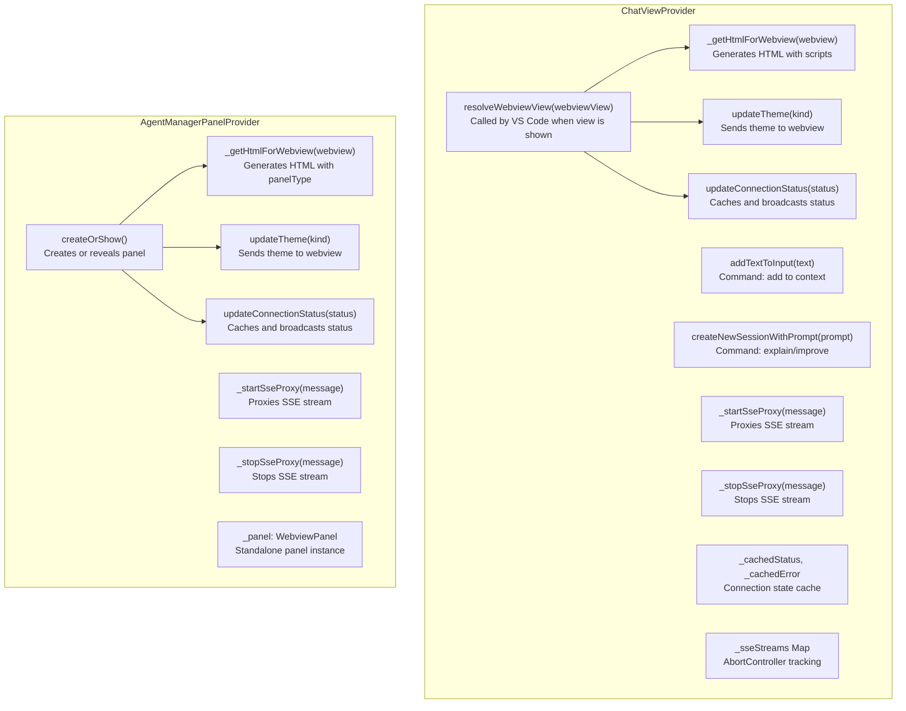

**Sources:**
- [packages/vscode/src/ChatViewProvider.ts:8-383]()
- [packages/vscode/src/AgentManagerPanelProvider.ts:8-352]()

### ChatViewProvider

`ChatViewProvider` implements `vscode.WebviewViewProvider` to display the chat interface in the sidebar. Key characteristics:

- **View Type**: `openchamber.chatView` ([ChatViewProvider.ts:9]())
- **Retention**: Webview context is retained when hidden ([extension.ts:123]())
- **Visibility Tracking**: `isVisible()` method checks `_view?.visible` ([ChatViewProvider.ts:13-15]())
- **Connection State Caching**: Stores `_cachedStatus` and `_cachedError` to send to webview when it resolves after connection is ready ([ChatViewProvider.ts:18-19]())
- **SSE Stream Management**: Maintains `_sseStreams` Map for AbortController tracking and `_sseHeartbeats` for 30-second keep-alive timers ([ChatViewProvider.ts:21-22]())

The `resolveWebviewView()` method ([ChatViewProvider.ts:30-73]()):

1. Configures webview options with script enablement and local resource roots
2. Generates HTML via `_getHtmlForWebview()` with embedded configuration
3. Sends cached theme including optional Shiki theme JSON
4. Broadcasts cached connection status
5. Sets up message handler for bridge requests, SSE proxy commands, and API restart

### AgentManagerPanelProvider

`AgentManagerPanelProvider` creates a standalone webview panel for managing agents. It differs from the chat provider by:

- **Panel Creation**: Uses `vscode.window.createWebviewPanel()` instead of view provider registration ([AgentManagerPanelProvider.ts:36-45]())
- **On-Demand Instantiation**: Panel is created only when `createOrShow()` is invoked ([AgentManagerPanelProvider.ts:26-31]())
- **Panel Type Hint**: Passes `panelType: 'agentManager'` to webview HTML to conditionally render agent UI ([AgentManagerPanelProvider.ts:349]())
- **Disposal Handling**: Cleans up SSE streams and heartbeats when panel is closed ([AgentManagerPanelProvider.ts:56-69]())

Both providers share identical SSE proxying logic and bridge message handling patterns.

---

## Bridge Communication

The bridge system enables bidirectional communication between the extension host (Node.js) and the webview (isolated JavaScript context) using `postMessage` and promise-based request-response patterns.

**Bridge Request-Response Flow**

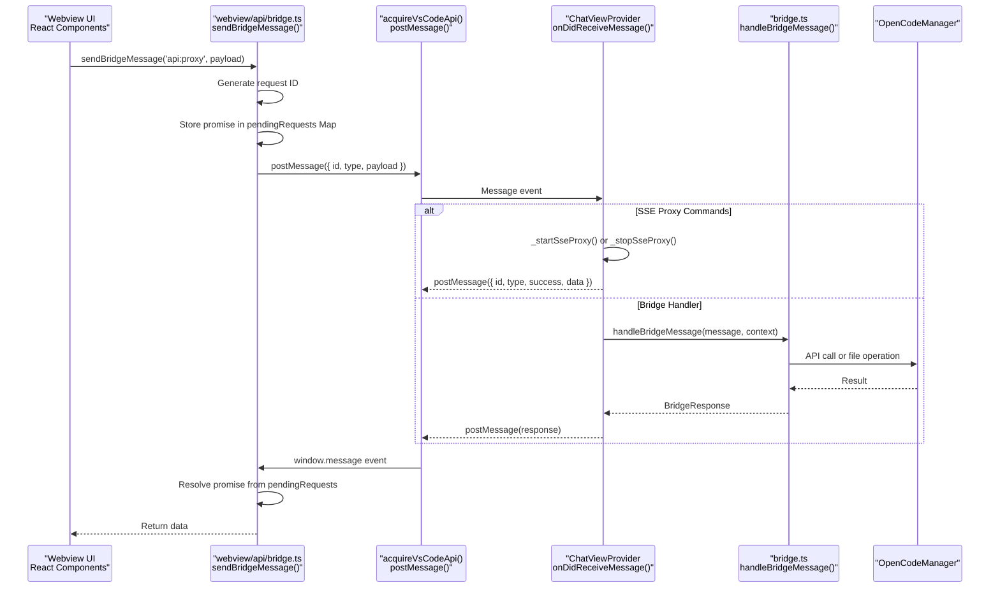

**Sources:**
- [packages/vscode/webview/api/bridge.ts:1-171]()
- [packages/vscode/src/ChatViewProvider.ts:49-72]()

### Bridge Request Format

Requests from webview to extension host use a typed message structure ([bridge.ts:25-29]()):

```
{
  id: "req_<counter>_<timestamp>",
  type: "api:proxy" | "api:sse:start" | "api:fs:list" | ...,
  payload?: { method, path, headers, bodyBase64, ... }
}
```

### Bridge Response Format

Responses from extension host to webview ([bridge.ts:31-37]()):

```
{
  id: "<matching request id>",
  type: "<matching request type>",
  success: boolean,
  data?: unknown,
  error?: string
}
```

### Request Lifecycle

1. **Promise Creation** ([bridge.ts:70-77]()): `sendBridgeMessage()` generates unique request ID and stores promise callbacks in `pendingRequests` Map.

2. **Timeout Management** ([bridge.ts:79-87]()): Default 30-second timeout; configurable via `sendBridgeMessageWithOptions()`.

3. **Message Dispatch** ([bridge.ts:89]()): Posts request to extension host via `acquireVsCodeApi().postMessage()`.

4. **Response Handling** ([bridge.ts:46-59]()): Window message listener resolves or rejects promise based on response success flag.

### Bridge Message Types

The bridge supports multiple message types handled by different layers:

| Type | Handler | Purpose |
|------|---------|---------|
| `api:proxy` | `handleBridgeMessage()` | HTTP request proxying to OpenCode API |
| `api:sse:start` | `ChatViewProvider._startSseProxy()` | SSE stream initialization |
| `api:sse:stop` | `ChatViewProvider._stopSseProxy()` | SSE stream termination |
| `api:fs:list` | Webview `main.tsx` | File system browsing (local handler) |
| `api:fs:search` | Webview `main.tsx` | File search (local handler) |
| `api:config/agents` | `handleBridgeMessage()` | Agent CRUD operations |
| `api:config/settings:get` | `handleBridgeMessage()` | Settings retrieval |
| `vscode:command` | `handleBridgeMessage()` | Execute VS Code commands |
| `restartApi` | Direct provider handling | Restart OpenCode manager |

**Sources:**
- [packages/vscode/webview/main.tsx:336-560]()
- [packages/vscode/src/ChatViewProvider.ts:49-72]()

---

## OpenCode Integration

The extension integrates with the OpenCode backend using `@opencode-ai/sdk`'s `createOpenCodeManager()` which handles CLI process lifecycle, health monitoring, and API URL detection.

**OpenCode Manager Integration**

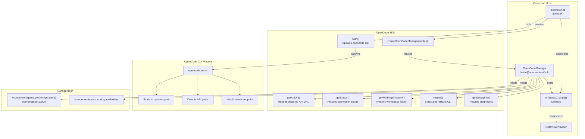

**Sources:**
- [packages/vscode/src/extension.ts:113-469]()

### Configuration Sources

The OpenCode manager respects configuration from multiple sources:

1. **External API URL** ([extension.ts:106-110](), [package.json:169-173]()): Setting `openchamber.apiUrl` disables local CLI spawning and connects to external OpenCode server.

2. **Workspace Folder** ([ChatViewProvider.ts:370]()): First workspace folder becomes the working directory for OpenCode CLI.

3. **CLI Availability** ([ChatViewProvider.ts:373]()): `isCliAvailable()` method indicates whether SDK found the `opencode` CLI binary.

### Connection Status Flow

The manager emits status changes through the `onStatusChange` callback ([extension.ts:460-465]()):

```
connecting → connected | error | disconnected
```

Status updates trigger webview broadcasts via `updateConnectionStatus()` methods in both providers ([ChatViewProvider.ts:87-94](), [AgentManagerPanelProvider.ts:110-117]()).

### Diagnostic Information

The `showOpenCodeStatus` command ([extension.ts:285-434]()) collects comprehensive diagnostics:

- Extension and VS Code versions
- Workspace folders
- Configured and resolved API URLs
- OpenCode server URL, mode, CLI path
- Detected port and API prefix
- Connection timestamps and durations
- Last exit code and errors
- API endpoint probes (config, providers, agents, sessions)

This information is written to the OpenChamber output channel for troubleshooting.

---

## SSE Streaming

Both webview providers implement SSE (Server-Sent Events) proxying to stream real-time updates from the OpenCode backend to the webview. VS Code's webview security model requires proxying through the extension host.

**SSE Proxy Architecture**

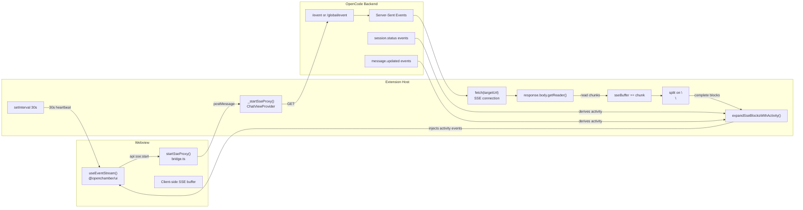

**Sources:**
- [packages/vscode/src/ChatViewProvider.ts:175-348]()
- [packages/vscode/src/ChatViewProvider.ts:385-571]()

### SSE Proxy Lifecycle

1. **Stream Initiation** ([ChatViewProvider.ts:175-196]()): Webview sends `api:sse:start` with path and headers. Provider generates unique `streamId` and creates `AbortController`.

2. **Target URL Resolution** ([ChatViewProvider.ts:195-196]()): Constructs target URL from `apiBaseUrl` and requested path (`/event` or `/global/event`).

3. **Fallback Handling** ([ChatViewProvider.ts:212-222]()): If `/global/event` fails, falls back to `/event` and wraps events in global envelope format.

4. **Stream Reading** ([ChatViewProvider.ts:266-296]()): Reads SSE chunks with `TextDecoder`, accumulates into buffer, splits on `\n\n` to forward complete event blocks.

5. **Activity Injection** ([ChatViewProvider.ts:287-292](), [ChatViewProvider.ts:560-570]()): Analyzes SSE events to derive session activity phases (idle, busy, cooldown) and injects synthetic `openchamber:session-activity` events.

6. **Heartbeat Timer** ([ChatViewProvider.ts:256-263]()): Emits 30-second heartbeat events to keep connection alive and signal UI that stream is active.

7. **Stream Termination** ([ChatViewProvider.ts:322-335]()): Releases reader, posts `api:sse:end` message, removes from tracking map, clears heartbeat timer.

### Activity Injection System

The SSE proxy injects synthetic activity events by analyzing event payloads:

**Activity Derivation Logic** ([ChatViewProvider.ts:427-474]()):

| Event Type | Condition | Activity Phase |
|------------|-----------|----------------|
| `session.status` | `status.type` is `"busy"` or `"retry"` | `busy` |
| `session.status` | `status.type` is other | `idle` |
| `message.updated` | `role="assistant"` and `finish="stop"` | `cooldown` |
| `message.part.updated` | `role="assistant"` and `finish="stop"` | `cooldown` |
| `session.idle` | Always | `idle` |

Injected events follow this format ([ChatViewProvider.ts:476-484]()):

```
data: {
  "type": "openchamber:session-activity",
  "properties": {
    "sessionId": "<session id>",
    "phase": "idle" | "busy" | "cooldown"
  }
}
```

### Global Event Wrapping

For OpenCode versions without `/global/event`, the proxy wraps single-directory events into the global format ([ChatViewProvider.ts:539-558]()):

```
// Original: data: { type: "...", properties: {...} }
// Wrapped:  data: { directory: "/workspace/path", payload: {...} }
```

This enables VS Code extension (single-workspace) to use multi-workspace event APIs when available, with graceful fallback.

---

## Command System

The extension registers 13 VS Code commands that integrate OpenChamber functionality with the editor and context menus.

**Command Registration Summary**

```mermaid
graph TB
    subgraph "Sidebar Commands"
        OpenSidebar["openchamber.openSidebar<br/>Opens chat view in sidebar"]
        FocusChat["openchamber.focusChat<br/>Focuses chat view"]
        RestartApi["openchamber.restartApi<br/>Restarts OpenCode manager"]
        ShowStatus["openchamber.showOpenCodeStatus<br/>Logs diagnostics to output"]
    end
    
    subgraph "Session Commands"
        NewSession["openchamber.newSession<br/>Creates new chat session"]
        ShowSettings["openchamber.showSettings<br/>Opens settings view"]
    end
    
    subgraph "Agent Management"
        OpenAgentManager["openchamber.openAgentManager<br/>Opens agent manager panel"]
    end
    
    subgraph "Editor Context Menu"
        AddToContext["openchamber.addToContext<br/>Adds selection to chat input"]
        Explain["openchamber.explain<br/>Creates session with explanation prompt"]
        ImproveCode["openchamber.improveCode<br/>Creates session with improvement prompt"]
    end
    
    subgraph "Registered in package.json"
        Commands["contributes.commands[]<br/>13 command definitions"]
        Menus["contributes.menus<br/>editor/context, view/title"]
    end
    
    Commands --> OpenSidebar
    Commands --> FocusChat
    Commands --> RestartApi
    Commands --> ShowStatus
    Commands --> NewSession
    Commands --> ShowSettings
    Commands --> OpenAgentManager
    Commands --> AddToContext
    Commands --> Explain
    Commands --> ImproveCode
    
    Menus -->|"Submenu"| AddToContext
    Menus -->|"Submenu"| Explain
    Menus -->|"Submenu"| ImproveCode
```

**Sources:**
- [packages/vscode/package.json:59-164]()
- [packages/vscode/src/extension.ts:128-283]()

### Sidebar Navigation Commands

**`openchamber.openSidebar`** ([extension.ts:129-144]()): Opens the OpenChamber activity bar container and focuses the chat view. Executes two commands: `workbench.view.extension.openchamber` (container) and `openchamber.chatView.focus` (view).

**`openchamber.focusChat`** ([extension.ts:146-150]()): Directly focuses the chat view without opening the container.

**`openchamber.restartApi`** ([extension.ts:164-172]()): Calls `openCodeManager.restart()` to stop and restart the OpenCode CLI process. Shows informational or error messages via `vscode.window.showInformationMessage()`.

**`openchamber.showOpenCodeStatus`** ([extension.ts:285-434]()): Collects diagnostic information including connection status, API URLs, OpenCode server details, and probe results from multiple endpoints. Writes report to the OpenChamber output channel.

### Session Management Commands

**`openchamber.newSession`** ([extension.ts:272-276]()): Posts command to webview to create new session: `chatViewProvider.createNewSession()`.

**`openchamber.showSettings`** ([extension.ts:278-282]()): Posts command to webview to show settings view: `chatViewProvider.showSettings()`.

**`openchamber.openAgentManager`** ([extension.ts:158-161]()): Opens or reveals the agent manager panel via `agentManagerProvider.createOrShow()`.

### Editor Context Menu Commands

These commands appear in the editor context menu under an "OpenChamber" submenu ([package.json:118-164]()).

**`openchamber.addToContext`** ([extension.ts:175-208]()): Captures selected text with file path and line numbers, formats as markdown code block, and sends to chat input. Example format:

```
src/example.ts:10-15
```typescript
<selected code>
```
```

**`openchamber.explain`** ([extension.ts:210-240]()): Creates new session with explanation prompt. If text is selected, includes it in a code block. Otherwise, references the entire file path.

**`openchamber.improveCode`** ([extension.ts:242-270]()): Similar to explain but with "Improve the following Code:" prompt. Requires text selection.

### Automatic Sidebar Positioning

On first activation, the extension attempts to move the chat view to the right sidebar ([extension.ts:82-102](), [extension.ts:152]()):

1. Queries available commands to find the "move to secondary sidebar" command (naming varies by VS Code build)
2. Focuses the chat view
3. Executes the move command
4. Stores `openchamber.sidebarAutoMoveAttempted` in `globalState` to avoid repeating
5. Skips this behavior on Cursor (detected via `vscode.env.appName`)

---

## Theme Synchronization

The extension synchronizes VS Code's color theme with the webview by reading CSS variables from the webview context and reconstructing a theme object compatible with the UI library.

**Theme Synchronization Flow**

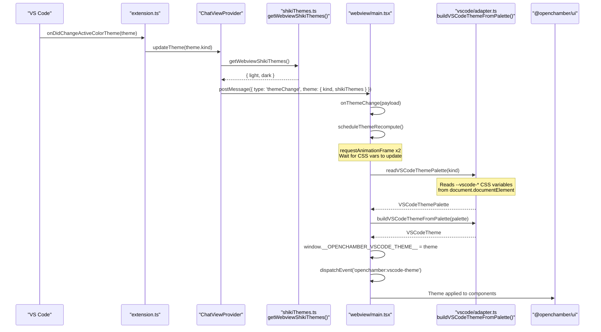

**Sources:**
- [packages/vscode/src/extension.ts:437-457]()
- [packages/vscode/src/ChatViewProvider.ts:75-85]()
- [packages/vscode/webview/main.tsx:206-247]()

### Theme Kind Detection

VS Code theme kind is determined by `vscode.window.activeColorTheme.kind` ([extension.ts:438](), [extension.ts:453]()):

- `vscode.ColorThemeKind.Light` (1) → `"light"`
- `vscode.ColorThemeKind.Dark` (2) → `"dark"`
- `vscode.ColorThemeKind.HighContrast` (3) → `"high-contrast"`

The extension listens for two theme change events:

1. **`onDidChangeActiveColorTheme`** ([extension.ts:437]()): Triggered immediately when theme changes.
2. **`onDidChangeConfiguration`** ([extension.ts:447]()): Triggered when `workbench.colorTheme`, `workbench.preferredLightColorTheme`, or `workbench.preferredDarkColorTheme` settings change.

Both events call `updateTheme()` on all webview providers to ensure synchronization.

### Shiki Theme Integration

The `getWebviewShikiThemes()` function retrieves syntax highlighting themes for code blocks:

1. Reads the active VS Code theme name from `vscode.workspace.getConfiguration('workbench').get('colorTheme')`
2. Searches for theme JSON in VS Code's extensions directory
3. Returns `{ light?: ThemeJSON, dark?: ThemeJSON }`
4. Falls back to `null` if theme cannot be loaded

This payload is sent alongside the theme kind in the `themeChange` message ([ChatViewProvider.ts:78-83]()).

### CSS Variable Reading

The webview reads VS Code-provided CSS variables after theme changes ([webview/main.tsx:206-217]()):

```javascript
const palette = readVSCodeThemePalette(preferredKind);
const theme = buildVSCodeThemeFromPalette(palette);
```

This occurs in `requestAnimationFrame` callbacks to ensure VS Code has updated the CSS variables before reading.

### Async Theme Update Timing

Theme recomputation is deferred using double `requestAnimationFrame` ([webview/main.tsx:224-227]()):

```javascript
requestAnimationFrame(() => {
  emitVSCodeTheme(kind);
  requestAnimationFrame(() => emitVSCodeTheme(kind));
});
```

This pattern ensures CSS variables are read after VS Code asynchronously updates webview styles following theme changes.

---

## Settings Management

The extension persists settings in VS Code's `globalState` storage, which provides JSON-serializable key-value storage that survives VS Code restarts.

**Settings Storage Architecture**

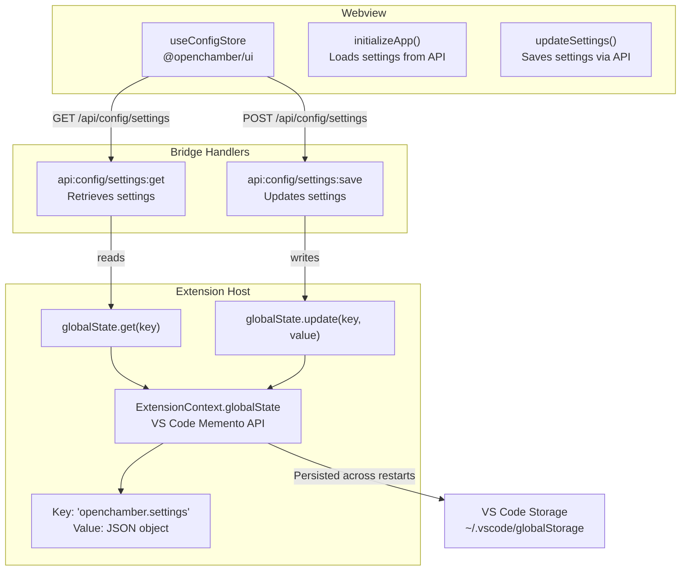

**Sources:**
- [packages/vscode/src/extension.ts:378]()
- [packages/vscode/webview/main.tsx:552-560]()

### Settings Key Structure

Settings are stored under the key `'openchamber.settings'` ([extension.ts:11]()) as a JSON object. The bridge handlers filter out the `lastDirectory` key when returning settings to the webview ([extension.ts:379]()).

### Settings API Endpoints

**GET `/api/config/settings`** ([webview/main.tsx:552-556]()): Returns settings from `globalState.get(SETTINGS_KEY)`, excluding `lastDirectory`.

**POST `/api/config/settings`** ([webview/main.tsx:557-560]()): Merges request body with existing settings and saves via `globalState.update(SETTINGS_KEY, updated)`.

### Workspace Folder Persistence

The extension stores the active workspace folder in `localStorage` ([webview/main.tsx:249-267]()):

```javascript
window.__OPENCHAMBER_HOME__ = normalizedWorkspaceFolder;
window.localStorage.setItem('lastDirectory', normalizedWorkspaceFolder);
window.localStorage.setItem('homeDirectory', normalizedWorkspaceFolder);
```

This ensures the UI layer uses the correct working directory for API requests.

### Settings Migration

The extension includes migration logic for legacy settings ([extension.ts:106-110]()):

```javascript
const legacyApiUrl = config.get<string>('apiUrl') || '';
if (/^https?:\/\/localhost:4768\d\/?$/.test(legacyApiUrl.trim())) {
  await config.update('apiUrl', '', vscode.ConfigurationTarget.Global);
}
```

This clears auto-assigned API URLs from older extension versions (ports 47680-47689).

---

## Webview HTML Generation

Both webview providers generate HTML using the `getWebviewHtml()` utility function, which injects scripts, styles, and configuration.

**HTML Structure**

```
<!DOCTYPE html>
<html>
  <head>
    <meta charset="UTF-8">
    <meta name="viewport" content="width=device-width, initial-scale=1.0">
    <meta http-equiv="Content-Security-Policy" content="...">
    <title>OpenChamber</title>
    <style>/* Initial loading screen styles */</style>
  </head>
  <body>
    <div id="initial-loading">/* Loading spinner and status */</div>
    <div id="root"></div>
    <script>
      window.__VSCODE_CONFIG__ = {
        apiUrl: "...",
        workspaceFolder: "...",
        theme: "light" | "dark" | "high-contrast",
        connectionStatus: "connecting" | "connected" | "error",
        cliAvailable: true | false,
        panelType: "chat" | "agentManager"
      };
    </script>
    <script type="module" src="webview.js"></script>
  </body>
</html>
```

**Sources:**
- [packages/vscode/src/ChatViewProvider.ts:369-382]()
- [packages/vscode/src/AgentManagerPanelProvider.ts:339-351]()

### Configuration Injection

The `__VSCODE_CONFIG__` global provides initial state:

- `apiUrl`: Empty (managed by SDK) or configured external URL
- `workspaceFolder`: First workspace folder path ([ChatViewProvider.ts:370]())
- `theme`: Theme kind name (`"light"`, `"dark"`, `"high-contrast"`)
- `connectionStatus`: Cached status from manager ([ChatViewProvider.ts:372]())
- `cliAvailable`: Whether SDK found `opencode` CLI ([ChatViewProvider.ts:373]())
- `panelType`: `"chat"` or `"agentManager"` to conditionally render UI ([AgentManagerPanelProvider.ts:349]())

### Content Security Policy

The CSP meta tag restricts resource loading to approved sources:

- Scripts: `'self'` and webview origin
- Styles: `'unsafe-inline'` (required for React inline styles)
- Images: `'self'`, `https:`, `data:`
- Fonts: `'self'`
- Connect: `'self'` and `https:` (for API requests)

### Loading Screen

The initial loading screen ([ChatViewProvider.ts:369-382]()) displays:

- OpenChamber logo (SVG)
- Animated spinner
- Status text: "Starting OpenCode API..." (updated via `setLoadingStatusText()`)
- Fade-out animation when bootstrap completes ([webview/main.tsx:75-86]())

The loading screen remains visible until:

1. React UI mounts to `#root` ([webview/main.tsx:99-123]())
2. OpenCode connection status is `"connected"` ([webview/main.tsx:152]())
3. Bootstrap data loads (providers and agents) ([webview/main.tsx:159-162]())

If connection fails, the error message is displayed in red, and the screen fades out to reveal the UI ([webview/main.tsx:171-174]()).

---

