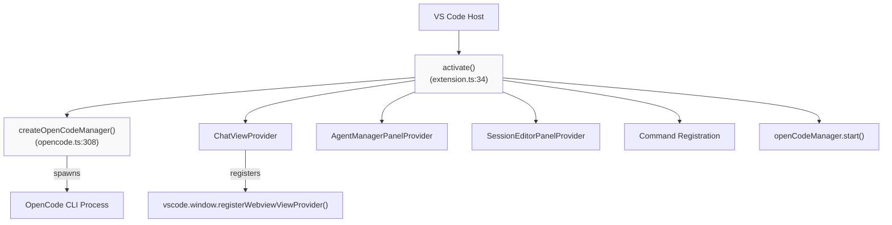
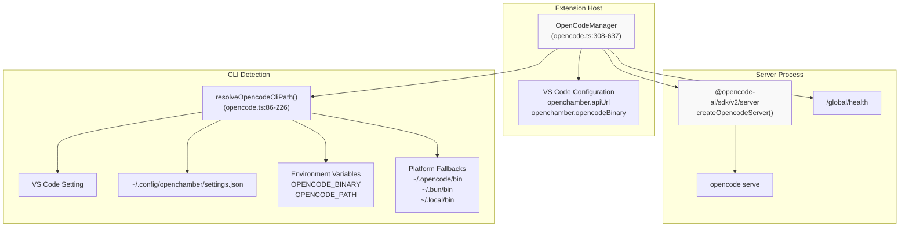
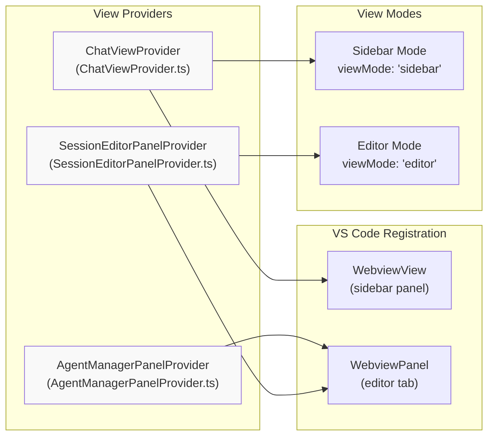
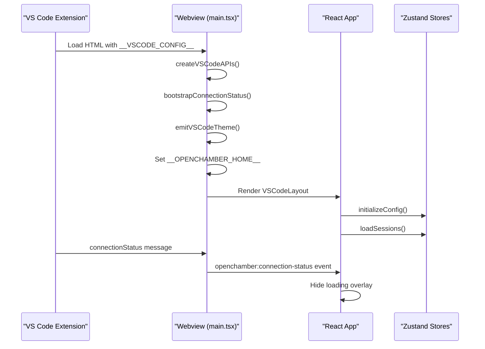
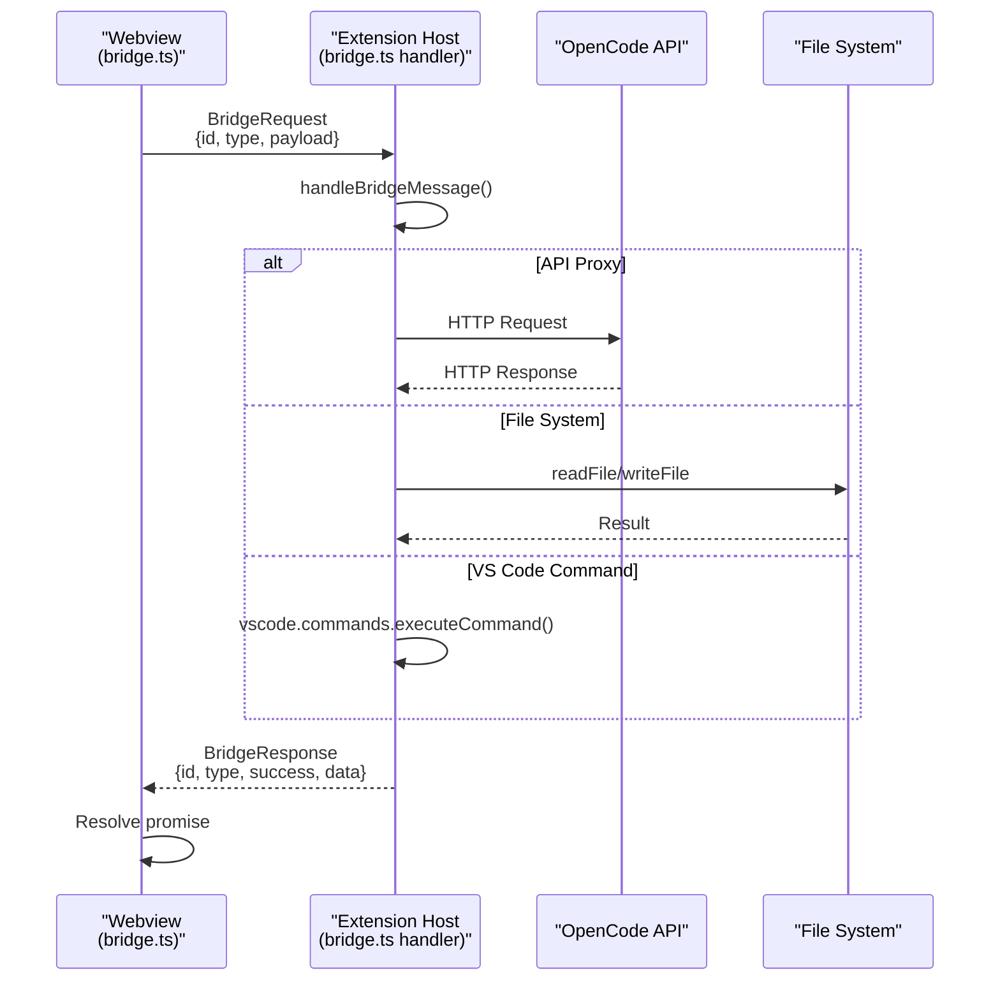
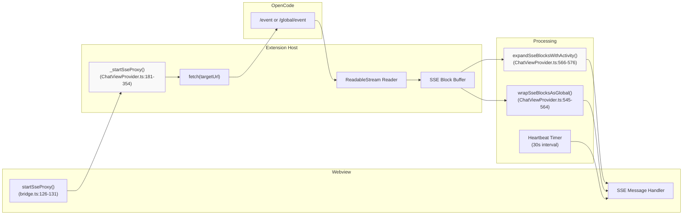
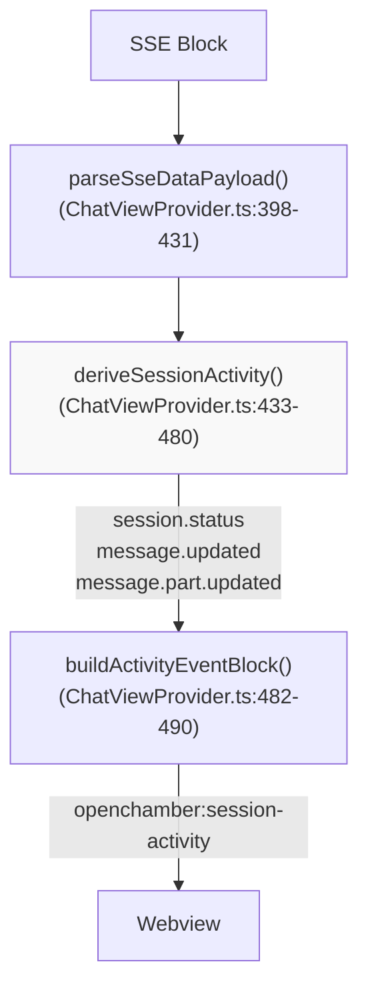
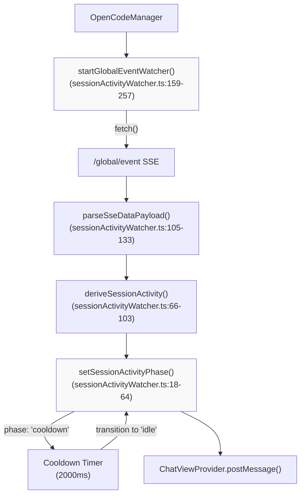
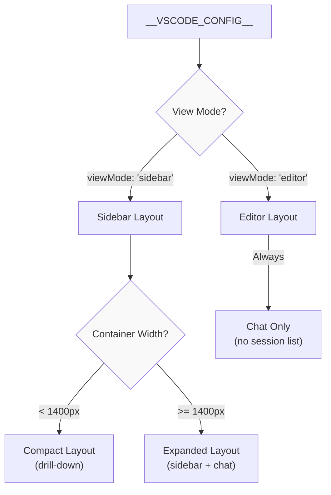
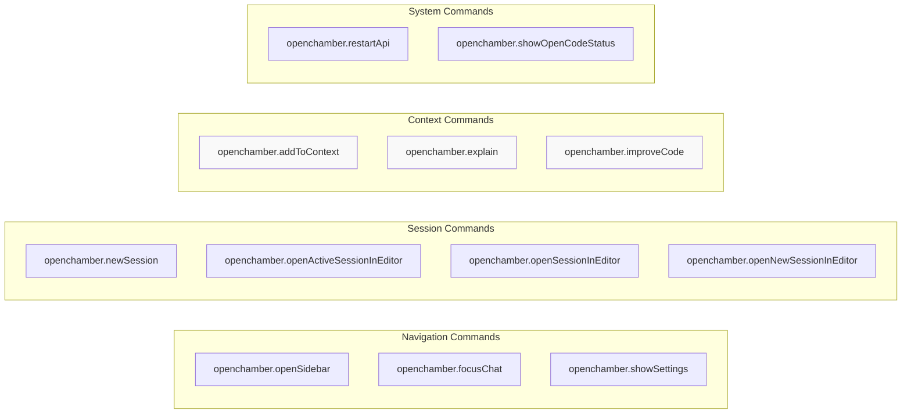

<!-- source: DeepWiki mcp.deepwiki.com · repo btriapitsyn/openchamber · page 6.1 Extension Architecture · fetched 2026-10-26 -->

# Extension Architecture

<details>
<summary>Relevant source files</summary>

The following files were used as context for generating this wiki page:

- [packages/ui/src/components/layout/VSCodeLayout.tsx](packages/ui/src/components/layout/VSCodeLayout.tsx)
- [packages/vscode/assets/icon-titlebar.svg](packages/vscode/assets/icon-titlebar.svg)
- [packages/vscode/src/ChatViewProvider.ts](packages/vscode/src/ChatViewProvider.ts)
- [packages/vscode/src/extension.ts](packages/vscode/src/extension.ts)
- [packages/vscode/src/opencode.ts](packages/vscode/src/opencode.ts)
- [packages/vscode/src/sessionActivityWatcher.ts](packages/vscode/src/sessionActivityWatcher.ts)
- [packages/vscode/webview/api/bridge.ts](packages/vscode/webview/api/bridge.ts)
- [packages/vscode/webview/main.tsx](packages/vscode/webview/main.tsx)

</details>


## Purpose and Scope

This page documents the architecture of the VS Code extension (`packages/vscode`), which provides OpenChamber as a native VS Code panel with webview-based UI. The extension manages the OpenCode backend server lifecycle, bridges communication between the webview and extension host, and exposes VS Code commands for quick actions.

For information about the shared UI components used across all platforms, see [UI Component Library](#7). For details on the runtime API abstraction layer, see [Multi-Platform Deployment](#3.1). For backend communication patterns specific to other platforms, see [Web Application](#5) and [Desktop Application](#4).

---

## Extension Activation and Entry Points

The extension activates through `activate()` in [packages/vscode/src/extension.ts:34-561]() and registers multiple view providers and commands. Activation is non-blocking to avoid delaying webview resolution while OpenCode starts up.

### Activation Lifecycle



**Key Activation Steps:**

| Step | Component | Purpose |
|------|-----------|---------|
| 1 | Legacy API URL cleanup | Clears obsolete auto-assigned ports [extension.ts:111-116]() |
| 2 | OpenCode manager creation | Initializes server lifecycle manager [extension.ts:119]() |
| 3 | View provider registration | Registers `ChatViewProvider` with retainContextWhenHidden [extension.ts:123-131]() |
| 4 | Command registration | Registers 15+ VS Code commands [extension.ts:134-337]() |
| 5 | Theme listeners | Subscribes to color theme changes [extension.ts:515-538]() |
| 6 | Status change handler | Connects OpenCode status to webviews [extension.ts:541-556]() |
| 7 | Server start | Spawns OpenCode server asynchronously [extension.ts:560]() |

**Sources:** [packages/vscode/src/extension.ts:34-561]()

---

## OpenCode Manager

The `OpenCodeManager` interface manages the OpenCode server lifecycle, providing `start()`, `stop()`, and `restart()` methods. The implementation (`createOpenCodeManager`) handles CLI detection, process spawning via the SDK, and health checking.

### OpenCode Manager Architecture



### CLI Resolution Strategy

The extension resolves the OpenCode CLI path through multiple fallback strategies in [packages/vscode/src/opencode.ts:86-226]():

1. **VS Code configuration**: `openchamber.opencodeBinary` setting
2. **Shared settings**: Reads `~/.config/openchamber/settings.json` (shared with desktop app)
3. **Environment variables**: `OPENCODE_BINARY`, `OPENCODE_PATH`, etc.
4. **Platform-specific fallbacks**: `~/.opencode/bin`, `~/.bun/bin`, `~/.local/bin`, npm/Chocolatey/Scoop paths
5. **Shell PATH lookup**: Spawns login shell to resolve `command -v opencode`

### Server Lifecycle

The manager maintains connection status (`connecting`, `connected`, `error`, `disconnected`) and notifies listeners via `onStatusChange()` [opencode.ts:631-635](). Health checking uses `/global/health` endpoint with automatic fallback to root path detection [opencode.ts:261-306]().

**Key Methods:**

| Method | Purpose | Implementation |
|--------|---------|----------------|
| `start(workdir?)` | Spawns OpenCode server from workspace directory | [opencode.ts:536-550]() |
| `stop()` | Kills server and port-bound processes | [opencode.ts:552-566]() |
| `restart()` | Stop + delay + start | [opencode.ts:568-579]() |
| `getApiUrl()` | Returns base URL (configured or detected) | [opencode.ts:362-376]() |
| `getDebugInfo()` | Returns diagnostic information | [opencode.ts:608-630]() |

**Sources:** [packages/vscode/src/opencode.ts:1-637](), [packages/vscode/src/extension.ts:119-227]()

---

## View Providers

The extension provides three webview-based panels: chat sidebar, agent manager, and session editor. Each implements VS Code's webview provider pattern with message-based communication.

### View Provider Types



### ChatViewProvider

`ChatViewProvider` is the primary interface, registered as `openchamber.chatView` [ChatViewProvider.ts:8-9](). It provides:

- **Webview resolution**: Generates HTML with script tags for bundled React app [ChatViewProvider.ts:30-73]()
- **Connection status broadcasting**: Posts `connectionStatus` messages on OpenCode state changes [ChatViewProvider.ts:87-94]()
- **Command handling**: Processes commands like `addToContext`, `createSessionWithPrompt` [ChatViewProvider.ts:96-144]()
- **SSE proxying**: Proxies Server-Sent Events through extension host [ChatViewProvider.ts:55-65]()
- **Theme synchronization**: Sends theme changes with Shiki syntax themes [ChatViewProvider.ts:75-85]()

**Key Features:**

| Feature | Purpose | Implementation |
|---------|---------|----------------|
| SSE proxy | Streams OpenCode events to webview | [ChatViewProvider.ts:181-354]() |
| Message bridge | Routes bridge requests to handlers | [ChatViewProvider.ts:49-72]() |
| Activity injection | Injects session activity events into SSE stream | [ChatViewProvider.ts:289-320]() |
| Global event wrapping | Wraps `/event` as `/global/event` for older OpenCode versions | [ChatViewProvider.ts:206-228]() |

**Sources:** [packages/vscode/src/ChatViewProvider.ts:1-577](), [packages/vscode/src/extension.ts:123-131]()

---

## Webview Initialization

The webview entry point [packages/vscode/webview/main.tsx:1-689]() bootstraps the React application and establishes the bridge communication layer.

### Webview Bootstrap Flow



### Configuration Injection

The extension host injects configuration via `__VSCODE_CONFIG__` [main.tsx:18-28]():

```typescript
interface Window {
  __VSCODE_CONFIG__?: {
    apiUrl?: string;              // Configured API URL (if external mode)
    workspaceFolder: string;      // Primary workspace folder path
    theme: string;                // 'light' | 'dark' | 'high-contrast'
    connectionStatus: string;     // Initial connection status
    cliAvailable?: boolean;       // Whether OpenCode CLI was found
    panelType?: 'chat' | 'agentManager';  // Panel type for conditional rendering
    viewMode?: 'sidebar' | 'editor';       // Sidebar or editor tab
    initialSessionId?: string | null;     // Session to open (editor mode)
  };
}
```

### Local Request Handling

The webview intercepts certain API paths and handles them locally without proxying to OpenCode [main.tsx:376-689]():

| Path Pattern | Handler | Purpose |
|-------------|---------|---------|
| `/health`, `/api/health` | Returns connection status | [main.tsx:380-392]() |
| `/api/fs/list` | Bridge message: `api:fs:list` | File listing [main.tsx:394-399]() |
| `/api/fs/search` | Bridge message: `api:fs:search` | File search [main.tsx:401-417]() |
| `/api/config/agents/:name` | Bridge message: `api:config/agents` | Agent CRUD [main.tsx:435-468]() |
| `/api/config/skills/*` | Bridge message: `api:config/skills` | Skills management [main.tsx:574-597]() |
| `/api/quota/:provider` | Bridge message: `api:quota:get` | Quota fetching [main.tsx:650-658]() |
| `/auth/session` | Returns `authenticated: true` | VS Code host is trusted [main.tsx:624-632]() |

**Sources:** [packages/vscode/webview/main.tsx:1-689]()

---

## Bridge Communication

The bridge provides message-based IPC between the webview (untrusted context) and extension host (trusted Node.js context). It uses VS Code's `postMessage` API with promise-based request/response correlation.

### Bridge Message Flow



### Bridge Request Types

The bridge handles multiple request types defined in [packages/vscode/webview/api/bridge.ts:1-180]() and [packages/vscode/src/bridge.ts:1-766]():

| Request Type | Purpose | Handler Location |
|--------------|---------|------------------|
| `api:proxy` | Proxies HTTP requests to OpenCode | [bridge.ts:42-115]() |
| `api:session:message` | Direct proxy for session messages (lower latency) | [bridge.ts:117-160]() |
| `api:sse:start` | Starts SSE stream proxy | [ChatViewProvider.ts:181-354]() |
| `api:sse:stop` | Stops SSE stream | [ChatViewProvider.ts:356-373]() |
| `api:fs:list` | Lists directory contents | [bridge.ts:291-347]() |
| `api:fs:search` | Searches files | [bridge.ts:349-416]() |
| `api:config/agents` | Agent CRUD operations | [bridge.ts:550-602]() |
| `api:git:*` | Git operations (status, commit, etc.) | [bridge.ts:659-755]() |
| `vscode:command` | Executes VS Code commands | [bridge.ts:162-168]() |

### Promise Correlation

Requests are correlated using unique IDs [bridge.ts:61-91]():

```typescript
const pendingRequests = new Map<string, {
  resolve: (value: unknown) => void;
  reject: (reason: Error) => void;
}>();

export function sendBridgeMessage<T>(type: string, payload?: unknown): Promise<T> {
  return new Promise((resolve, reject) => {
    const id = `req_${++requestIdCounter}_${Date.now()}`;
    pendingRequests.set(id, { resolve, reject });
    
    setTimeout(() => {
      if (pendingRequests.has(id)) {
        pendingRequests.delete(id);
        reject(new Error(`Request ${type} timed out`));
      }
    }, 30000);
    
    vscodeApi.postMessage({ id, type, payload });
  });
}
```

**Sources:** [packages/vscode/webview/api/bridge.ts:1-180](), [packages/vscode/src/bridge.ts:1-766]()

---

## SSE Proxying

Server-Sent Events cannot be consumed directly in webviews due to cross-origin restrictions. The extension host proxies SSE streams through the bridge, with special handling for activity injection and global event wrapping.

### SSE Proxy Architecture



### Stream Management

Each SSE stream is assigned a unique `streamId` and tracked in `_sseStreams` map with an `AbortController` [ChatViewProvider.ts:199-256](). The extension reads chunks from the response body and forwards complete SSE blocks (delimited by `\n\n`) to reduce webview message pressure [ChatViewProvider.ts:272-342]().

### Activity Injection

The extension injects synthetic `openchamber:session-activity` events into the SSE stream by parsing events for session status changes [ChatViewProvider.ts:566-576]():



**Detected Activity Events:**

| OpenCode Event | Detected Activity | Condition |
|----------------|-------------------|-----------|
| `session.status` | `busy` or `idle` | `statusType === 'busy'` or `'retry'` |
| `message.updated` | `cooldown` | `role === 'assistant'` and `finish === 'stop'` |
| `message.part.updated` | `cooldown` | Same as above |
| `session.idle` | `idle` | Explicit idle event |

### Heartbeat Timer

For activity-enabled streams (main event stream), the extension injects heartbeat events every 30 seconds to keep webview responsive [ChatViewProvider.ts:262-269]():

```typescript
const heartbeatTimer = setInterval(() => {
  if (controller.signal.aborted) return;
  const heartbeatChunk = `${buildHeartbeatEventBlock()}\n\n`;
  this._view?.webview.postMessage({ type: 'api:sse:chunk', streamId, chunk: heartbeatChunk });
}, 30000);
```

**Sources:** [packages/vscode/src/ChatViewProvider.ts:181-577](), [packages/vscode/webview/api/bridge.ts:126-135]()

---

## Session Activity Tracking

The extension tracks session activity phases (`idle`, `busy`, `cooldown`) by subscribing to the global event stream, mirroring the behavior of web and desktop platforms.

### Activity Watcher Flow



### Activity Phase Transitions

The watcher maintains a `Map<sessionId, { phase, updatedAt }>` [sessionActivityWatcher.ts:11-13]() and broadcasts phase changes via `openchamber:session-activity` messages:

| From | To | Trigger | Delay |
|------|----|---------| ------|
| Any | `busy` | `session.status` with `statusType === 'busy'` | Immediate |
| Any | `cooldown` | `message.updated` or `message.part.updated` with `finish === 'stop'` | Immediate |
| `cooldown` | `idle` | Timer expires | 2000ms |
| Any | `idle` | `session.status` with `statusType === 'idle'` | Immediate |

### Connection Lifecycle

The watcher starts when OpenCode connects [extension.ts:549-551]() and stops on disconnect [extension.ts:552-554]():

```typescript
openCodeManager.onStatusChange((status, error) => {
  chatViewProvider?.updateConnectionStatus(status, error);
  
  if (status === 'connected' && chatViewProvider && openCodeManager) {
    setChatViewProvider(chatViewProvider);
    void startGlobalEventWatcher(openCodeManager, chatViewProvider);
  } else if (status === 'disconnected' || status === 'error') {
    stopGlobalEventWatcher();
  }
});
```

**Sources:** [packages/vscode/src/sessionActivityWatcher.ts:1-281](), [packages/vscode/src/extension.ts:540-556]()

---

## VS Code Layout Integration

The UI package provides `VSCodeLayout` component [packages/ui/src/components/layout/VSCodeLayout.tsx:49-421]() which adapts the shared UI to VS Code's webview constraints.

### View Modes and Layout Variants



### Layout Configurations

| Layout | Width Threshold | Structure | Use Case |
|--------|----------------|-----------|----------|
| Editor Mode | N/A | Chat view only | Dedicated editor tab for single session |
| Expanded Sidebar | >= 1400px | Sessions sidebar + Chat view | Wide sidebar with side-by-side layout |
| Compact Sidebar | < 1400px | Drill-down between Sessions/Chat | Narrow sidebar with view switching |
| Mobile Settings | < 550px | Single-column settings | Settings view on narrow panels |

### Bootstrap Sequence

The layout waits for OpenCode connection before loading data [VSCodeLayout.tsx:183-245]():

1. Listen for `openchamber:connection-status` event
2. When `status === 'connected'`, call `initializeConfig()`
3. Load providers and agents from OpenCode
4. Load sessions list
5. Mark bootstrap complete when core datasets present
6. Hide loading overlay and render UI

### Initial Session Handling

In editor mode, the layout applies `initialSessionId` from config [VSCodeLayout.tsx:247-271]():

```typescript
React.useEffect(() => {
  if (viewMode !== 'editor') return;
  if (hasAppliedInitialSession.current) return;
  if (!hasInitializedOnce || connectionStatus !== 'connected') return;
  
  // No initialSessionId means open a new session draft
  if (!initialSessionId) {
    hasAppliedInitialSession.current = true;
    openNewSessionDraft();
    return;
  }
  
  if (!sessions.some((session) => session.id === initialSessionId)) return;
  
  hasAppliedInitialSession.current = true;
  void useSessionStore.getState().setCurrentSession(initialSessionId);
}, [connectionStatus, hasInitializedOnce, initialSessionId, openNewSessionDraft, sessions, viewMode]);
```

**Sources:** [packages/ui/src/components/layout/VSCodeLayout.tsx:1-692]()

---

## Command Registration

The extension registers 15+ commands for quick actions and integration with VS Code's command palette [extension.ts:134-337]().

### Command Categories



### Key Commands

| Command ID | Purpose | Keybinding | Implementation |
|------------|---------|------------|----------------|
| `openchamber.openSidebar` | Opens container and focuses chat view | Custom | [extension.ts:135-150]() |
| `openchamber.addToContext` | Adds selected text to chat input | Right-click menu | [extension.ts:229-263]() |
| `openchamber.explain` | Creates session with "Explain..." prompt | Right-click menu | [extension.ts:265-295]() |
| `openchamber.improveCode` | Creates session with "Improve..." prompt | Right-click menu | [extension.ts:297-325]() |
| `openchamber.restartApi` | Restarts OpenCode server | Command palette | [extension.ts:218-227]() |
| `openchamber.showOpenCodeStatus` | Logs diagnostic info to output channel | Command palette | [extension.ts:339-513]() |
| `openchamber.openActiveSessionInEditor` | Opens current session in dedicated editor tab | Custom | [extension.ts:183-191]() |

### Context Menu Integration

Three commands appear in editor context menus when text is selected:

1. **Add to Context**: Formats selection as `file:lineRange` with code block and sends to chat input [extension.ts:229-263]()
2. **Explain**: Creates new session with prompt `"Explain the following Code / Text:\n\n{file:lineRange}\n```{lang}\n{code}\n```"` [extension.ts:265-295]()
3. **Improve Code**: Same format as Explain but with "Improve..." prompt [extension.ts:297-325]()

**Sources:** [packages/vscode/src/extension.ts:134-337]()

---

## Diagnostic Tools

The extension provides detailed diagnostic information through `openchamber.showOpenCodeStatus` command [extension.ts:339-513]().

### Status Report Contents

The status report logs to output channel and includes:

| Category | Information | Source |
|----------|-------------|--------|
| Version | OpenChamber version, OpenCode version, VS Code version | [extension.ts:448-452]() |
| Workspace | Workspace folders, primary workspace path | [extension.ts:453]() |
| Connection | Status, working directory, API URL | [extension.ts:454-461]() |
| Configuration | Configured API URL, OpenCode binary path | [extension.ts:457-458]() |
| Server | CLI path, detected port, API prefix, mode (managed/external) | [extension.ts:461-475]() |
| Timing | Last start time, last connected time, connected duration | [extension.ts:476-491]() |
| Health | Ready elapsed time, ready attempts, start attempts, last exit code | [extension.ts:479-492]() |
| API Probes | Health, config, providers, agents, commands, project, sessions | [extension.ts:417-442]() |

### API Health Probes

The status command probes multiple OpenCode endpoints to diagnose connection issues [extension.ts:417-442]():

```typescript
const probeTargets: Array<{ label: string; path: string; includeDirectory?: boolean; timeoutMs?: number }> = [
  { label: 'health', path: '/global/health', includeDirectory: false },
  { label: 'config', path: '/config', includeDirectory: true },
  { label: 'providers', path: '/config/providers', includeDirectory: true },
  { label: 'agents', path: '/agent', includeDirectory: true, timeoutMs: 12000 },
  { label: 'commands', path: '/command', includeDirectory: true, timeoutMs: 10000 },
  { label: 'project', path: '/project/current', includeDirectory: true },
  { label: 'sessions', path: '/session', includeDirectory: true, timeoutMs: 12000 },
  { label: 'sessionStatus', path: '/session/status', includeDirectory: true },
];
```

Each probe reports status code, elapsed time, response summary, and error messages.

**Sources:** [packages/vscode/src/extension.ts:339-513]()

---

## Summary

The VS Code extension architecture consists of:

- **Extension activation**: Non-blocking startup with deferred OpenCode server initialization
- **OpenCode manager**: Multi-strategy CLI detection, health checking, and lifecycle management
- **View providers**: Three webview panels (chat, agent manager, session editor) with shared UI
- **Bridge communication**: Promise-based IPC with request correlation and timeout handling
- **SSE proxying**: Stream forwarding with activity injection, global wrapping, and heartbeat timers
- **Session activity tracking**: Phase monitoring (idle/busy/cooldown) with cooldown transitions
- **VS Code layout**: Responsive layout with sidebar/editor modes and width-based adaptation
- **Command registration**: 15+ commands for navigation, context actions, and system control
- **Diagnostic tools**: Comprehensive status reporting with API health probes

The extension provides deep VS Code integration while reusing the shared UI package, maintaining consistency with web and desktop platforms through the RuntimeAPIs abstraction layer.

---

