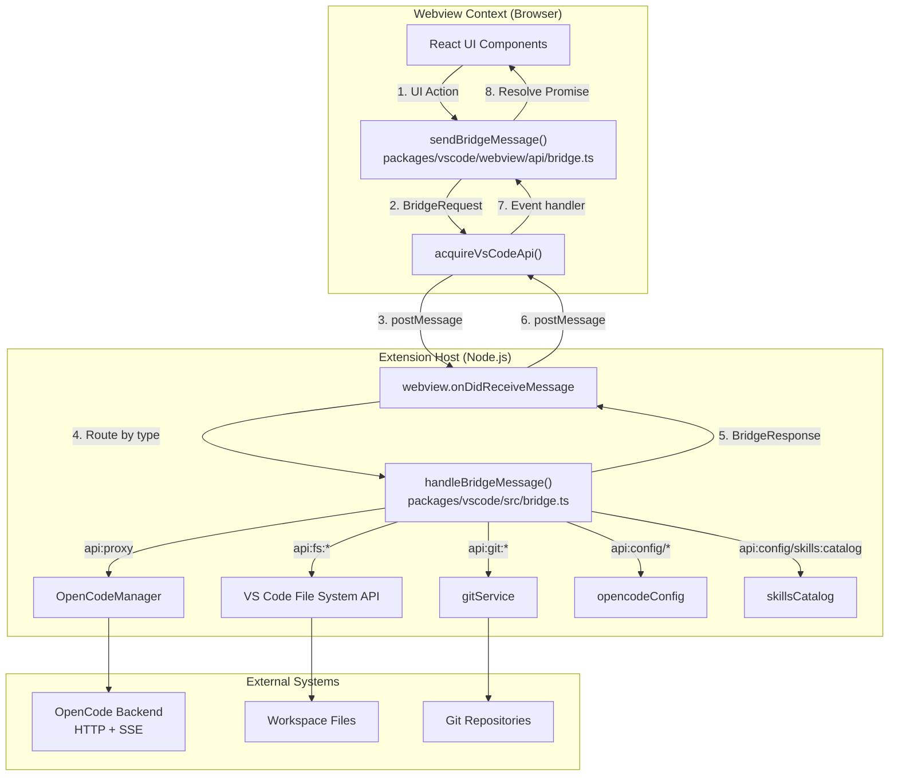
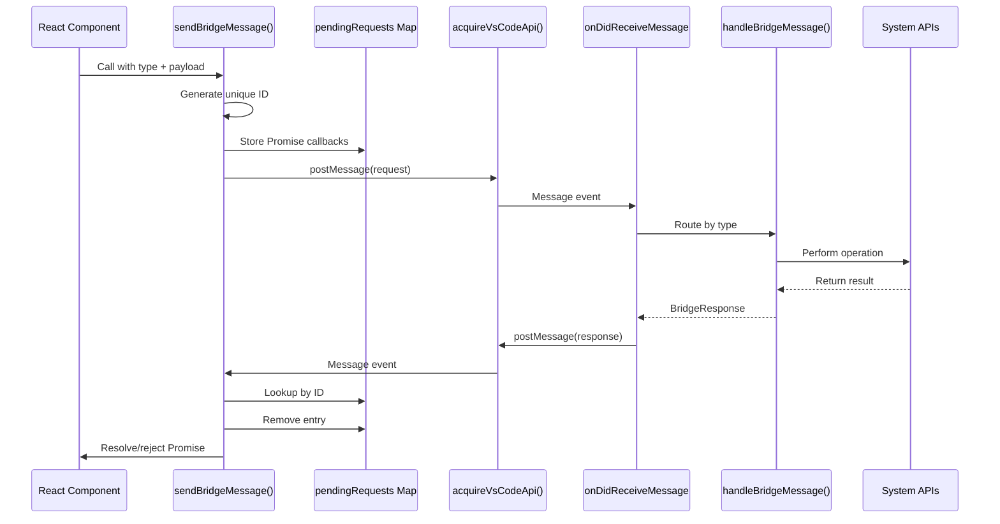
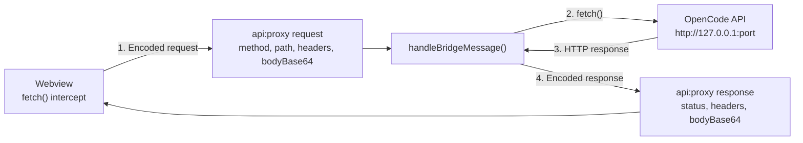
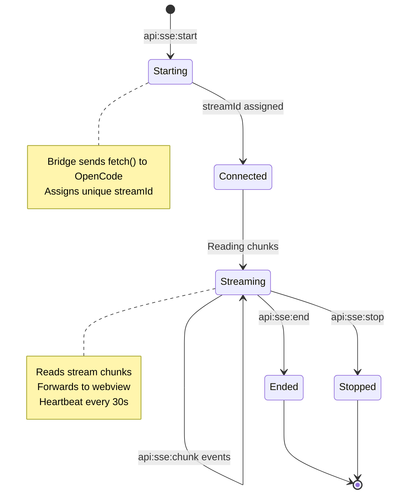
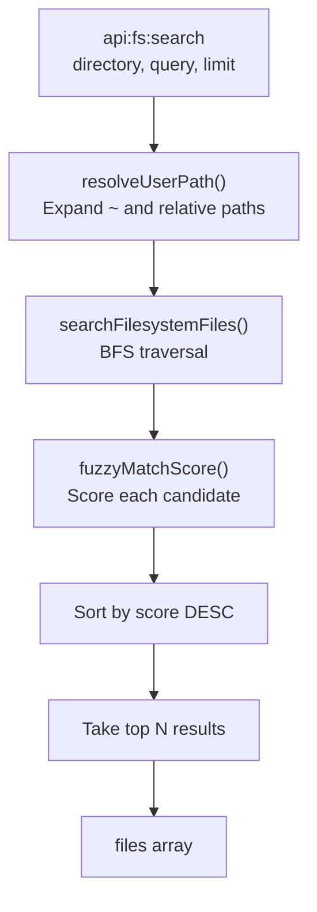
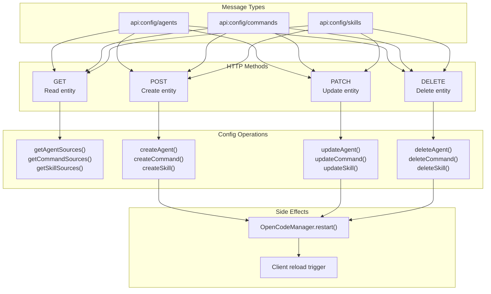
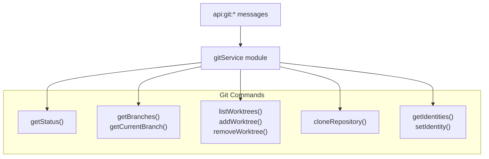

<!-- source: DeepWiki mcp.deepwiki.com · repo btriapitsyn/openchamber · page 6.2 Bridge Communication · fetched 2026-10-26 -->

# Bridge Communication

<details>
<summary>Relevant source files</summary>

The following files were used as context for generating this wiki page:

- [packages/ui/src/components/layout/VSCodeLayout.tsx](packages/ui/src/components/layout/VSCodeLayout.tsx)
- [packages/vscode/assets/icon-titlebar.svg](packages/vscode/assets/icon-titlebar.svg)
- [packages/vscode/src/ChatViewProvider.ts](packages/vscode/src/ChatViewProvider.ts)
- [packages/vscode/src/extension.ts](packages/vscode/src/extension.ts)
- [packages/vscode/src/opencode.ts](packages/vscode/src/opencode.ts)
- [packages/vscode/src/sessionActivityWatcher.ts](packages/vscode/src/sessionActivityWatcher.ts)
- [packages/vscode/webview/api/bridge.ts](packages/vscode/webview/api/bridge.ts)
- [packages/vscode/webview/main.tsx](packages/vscode/webview/main.tsx)

</details>


## Purpose and Scope

This document describes the message-passing bridge that enables communication between VS Code webviews and the extension host in the OpenChamber VS Code extension. The bridge facilitates API proxying, file system operations, configuration management, and VS Code integration.

For information about how webviews are created and managed, see [Webview Integration](#6.3). For details on the extension's overall architecture, see [Extension Architecture](#6.1).

---

## System Architecture

The bridge implements a request-response messaging pattern between two isolated contexts: the extension host (Node.js) and webviews (sandboxed browser environment). The extension host has full system access and manages the OpenCode backend, while webviews run the React UI with restricted capabilities.

### Bridge Message Flow



**Sources:** [packages/vscode/src/bridge.ts:405-1430](), [packages/vscode/webview/api/bridge.ts:61-91](), [packages/vscode/src/ChatViewProvider.ts:49-72]()

---

## Message Protocol

### Request-Response Pattern

The bridge uses a request-response pattern with Promise-based message handling. Each request is assigned a unique ID, and responses are matched to pending requests.

#### BridgeRequest Structure

```typescript
interface BridgeRequest {
  id: string;           // Unique request ID
  type: string;         // Message type (route selector)
  payload?: unknown;    // Type-specific payload
}
```

#### BridgeResponse Structure

```typescript
interface BridgeResponse {
  id: string;           // Matches request ID
  type: string;         // Echo of request type
  success: boolean;     // Operation result
  data?: unknown;       // Response payload
  error?: string;       // Error message if failed
}
```

**Sources:** [packages/vscode/src/bridge.ts:15-27](), [packages/vscode/webview/api/bridge.ts:25-37]()

### Message Handling Flow



**Sources:** [packages/vscode/webview/api/bridge.ts:39-91](), [packages/vscode/src/ChatViewProvider.ts:49-72]()

---

## API Proxying

The bridge proxies HTTP and SSE requests to the OpenCode backend, enabling the webview to communicate with the API without direct network access.

### HTTP Request Proxying

The `api:proxy` message type forwards HTTP requests to OpenCode and returns the response.

#### Request Flow



The request body and response body are encoded as base64 to handle binary data safely across the message boundary.

**Implementation:** [packages/vscode/src/bridge.ts:410-473]()

#### ApiProxyRequestPayload

| Field | Type | Description |
|-------|------|-------------|
| `method` | `string` | HTTP method (GET, POST, etc.) |
| `path` | `string` | API path (e.g., `/session/123`) |
| `headers` | `Record<string, string>` | Request headers |
| `bodyBase64` | `string` | Base64-encoded request body |

#### ApiProxyResponsePayload

| Field | Type | Description |
|-------|------|-------------|
| `status` | `number` | HTTP status code |
| `headers` | `Record<string, string>` | Response headers |
| `bodyBase64` | `string` | Base64-encoded response body |

**Sources:** [packages/vscode/src/bridge.ts:29-40]()

### SSE Stream Proxying

Server-Sent Events (SSE) require special handling because they are long-lived streaming connections. The bridge manages active SSE streams and forwards chunks to the webview.

#### SSE Lifecycle



**Sources:** [packages/vscode/src/ChatViewProvider.ts:175-348]()

#### SSE Message Types

| Type | Direction | Purpose |
|------|-----------|---------|
| `api:sse:start` | Webview → Extension | Start SSE stream |
| `api:sse:chunk` | Extension → Webview | Forward data chunk |
| `api:sse:end` | Extension → Webview | Stream completed |
| `api:sse:stop` | Webview → Extension | Abort stream |

#### SSE Activity Injection

For `/event` and `/global/event` endpoints, the bridge injects synthetic `openchamber:session-activity` events derived from `message.updated` and `session.status` events. This provides session activity indicators without modifying the backend.

**Sources:** [packages/vscode/src/ChatViewProvider.ts:385-570]()

---

## File System Operations

The bridge exposes file system operations that respect VS Code's workspace boundaries and security model.

### Directory Listing

The `api:fs:list` message type lists directory contents with metadata.

```typescript
// Request payload
{ path: string }

// Response data
{
  directory: string,     // Normalized path
  path: string,          // Normalized path (alias)
  entries: FileEntry[]   // Directory contents
}

interface FileEntry {
  name: string;
  path: string;
  isDirectory: boolean;
}
```

**Implementation:** [packages/vscode/src/bridge.ts:511-518]()

### File Search

The `api:fs:search` message type performs fuzzy file search within a directory.



The search algorithm:
1. Performs breadth-first traversal with concurrent directory reads
2. Skips excluded directories: `node_modules`, `.git`, `dist`, `build`, `.next`, `.turbo`, `.cache`, `coverage`, `tmp`, `logs`
3. Collects 3x the requested limit for fuzzy matching
4. Scores candidates using fuzzy matching algorithm
5. Sorts by score (descending), path length (ascending), alphabetically
6. Returns top N results

**Implementation:** [packages/vscode/src/bridge.ts:231-374](), [packages/vscode/src/bridge.ts:520-524]()

#### Fuzzy Match Scoring

The `fuzzyMatchScore` function implements a weighted scoring algorithm:

| Condition | Score Modifier |
|-----------|---------------|
| Exact substring match | +100 |
| Match at start | +20 bonus |
| Match after separator (`/`, `.`, `-`, `_`, space) | +15 bonus |
| Each character match | +10 |
| Character near start | +18 - position |
| Consecutive matches | +12 per consecutive |
| Gap between matches | -gap (max -10) |
| Short path bonus | +24 - (length / 3) |

**Sources:** [packages/vscode/src/bridge.ts:165-229]()

### File Operations

| Message Type | Purpose | Payload | Response |
|--------------|---------|---------|----------|
| `api:fs:read` | Read file contents | `{ path: string }` | `{ content: string, path: string }` |
| `api:fs:write` | Write file contents | `{ path: string, content: string }` | `{ success: boolean, path: string }` |
| `api:fs:mkdir` | Create directory | `{ path: string }` | `{ success: boolean, path: string }` |
| `api:fs:exec` | Execute shell commands | `{ commands: string[], cwd: string }` | `{ success: boolean, results: [] }` |

**Implementation:** [packages/vscode/src/bridge.ts:543-657]()

### File Picker Integration

The `api:files/pick` message type displays the native VS Code file picker and returns selected files with their contents encoded as data URLs.

```typescript
// Request payload
{ allowMany?: boolean }

// Response data
{
  files: Array<{
    name: string,
    mimeType: string,
    size: number,
    dataUrl: string   // data:mime;base64,content
  }>,
  skipped: Array<{
    name: string,
    reason: string    // e.g., "File exceeds 10MB limit"
  }>
}
```

Files larger than 10MB are skipped with a reason message.

**Sources:** [packages/vscode/src/bridge.ts:659-727]()

---

## Configuration Management

The bridge provides CRUD operations for OpenCode configuration entities: agents, commands, and skills.

### Configuration Entity Operations



**Sources:** [packages/vscode/src/bridge.ts:745-903](), [packages/vscode/src/opencodeConfig.ts:1-400]()

### Agent/Command Configuration Flow

Agents and commands require an OpenCode restart after modification because they are loaded into memory at startup.

#### Request Payload

```typescript
{
  method: 'GET' | 'POST' | 'PATCH' | 'DELETE',
  name: string,           // Entity name
  body?: {                // For POST/PATCH
    scope?: 'project' | 'user',
    content?: string,     // Markdown content
    // ... other fields
  },
  directory?: string      // Target directory for scope resolution
}
```

#### Response Payload (POST/PATCH/DELETE)

```typescript
{
  success: true,
  requiresReload: true,
  message: string,        // e.g., "Agent foo updated successfully. Reloading interface…"
  reloadDelayMs: 800      // Delay before client reload
}
```

**Sources:** [packages/vscode/src/bridge.ts:745-823](), [packages/vscode/src/bridge.ts:825-903]()

### Skill Configuration Flow

Skills do not require an OpenCode restart because they are loaded on-demand. The response sets `requiresReload: false`.

**Sources:** [packages/vscode/src/bridge.ts:905-979]()

### Skills Catalog

The `api:config/skills:catalog` message type fetches the skills catalog from ClawdHub and user-configured sources.

```typescript
// Request payload
{ refresh?: boolean }

// Response data
{
  sources: SkillsCatalogSource[],
  catalog: SkillEntry[]
}
```

The bridge:
1. Reads `skillCatalogs` from settings
2. Calls `getSkillsCatalog()` with additional sources
3. Optionally refreshes cached catalog data

**Implementation:** [packages/vscode/src/bridge.ts:981-1021]()

---

## Settings Persistence

Settings are persisted to VS Code's `globalState` storage, separate from workspace settings.

### Settings Operations

| Message Type | Purpose |
|--------------|---------|
| `api:config/settings:get` | Read all settings |
| `api:config/settings:save` | Update settings |

#### Settings Structure

```typescript
{
  themeVariant: 'light' | 'dark',    // Derived from VS Code theme
  lastDirectory: string,              // Workspace folder (not persisted)
  defaultModel?: string,              // User preferences
  defaultVariant?: string,
  defaultAgent?: string,
  skillCatalogs?: SkillsCatalogSourceConfig[]
}
```

The `readSettings()` function merges persisted values with runtime context (theme, workspace folder).

**Sources:** [packages/vscode/src/bridge.ts:61-95](), [packages/vscode/src/bridge.ts:729-738]()

---

## Git Integration

The bridge exposes Git operations through the `api:git:*` message namespace.

### Git Operations



Git operations are delegated to the `gitService` module, which executes `git` commands via VS Code's process APIs.

**Sources:** [packages/vscode/src/bridge.ts:1023-1253](), [packages/vscode/src/gitService.ts:1-500]()

---

## Provider Authentication

The `api:provider/auth:remove` message type removes stored authentication credentials for AI providers.

```typescript
// Request payload
{ providerID: string }

// Response data
{ success: boolean }
```

This delegates to `removeProviderAuth()` which deletes the provider's credential file.

**Sources:** [packages/vscode/src/bridge.ts:1255-1264](), [packages/vscode/src/opencodeAuth.ts:1-100]()

---

## Implementation Details

### Path Resolution

The bridge uses `resolveUserPath()` to normalize file paths:
1. Expand tilde (`~`) to home directory
2. Resolve relative paths against workspace root
3. Normalize path separators to forward slashes

**Sources:** [packages/vscode/src/bridge.ts:97-125]()

### Directory Exclusions

File operations skip common build and dependency directories to improve performance:

```typescript
const FILE_SEARCH_EXCLUDED_DIRS = new Set([
  'node_modules', '.git', 'dist', 'build', 
  '.next', '.turbo', '.cache', 'coverage', 'tmp', 'logs'
]);
```

**Sources:** [packages/vscode/src/bridge.ts:137-148]()

### Timeout Handling

The webview-side bridge sets a default 30-second timeout on requests. SSE operations disable the timeout (`timeoutMs: 0`) to allow long-lived connections.

**Sources:** [packages/vscode/webview/api/bridge.ts:65-91]()

### Error Handling

All bridge operations return a successful response with structured error information rather than throwing exceptions across the message boundary:

```typescript
// Error response example
{
  id: "req_123",
  type: "api:fs:read",
  success: false,
  error: "File not found"
}
```

**Sources:** [packages/vscode/src/bridge.ts:405-1430]()

---

