<!-- source: DeepWiki mcp.deepwiki.com · repo btriapitsyn/openchamber · page 6.3 Webview Integration · fetched 2026-10-26 -->

# Webview Integration

<details>
<summary>Relevant source files</summary>

The following files were used as context for generating this wiki page:

- [packages/ui/src/components/layout/VSCodeLayout.tsx](packages/ui/src/components/layout/VSCodeLayout.tsx)
- [packages/vscode/assets/icon-titlebar.svg](packages/vscode/assets/icon-titlebar.svg)
- [packages/vscode/src/ChatViewProvider.ts](packages/vscode/src/ChatViewProvider.ts)
- [packages/vscode/src/extension.ts](packages/vscode/src/extension.ts)
- [packages/vscode/src/opencode.ts](packages/vscode/src/opencode.ts)
- [packages/vscode/src/sessionActivityWatcher.ts](packages/vscode/src/sessionActivityWatcher.ts)
- [packages/vscode/webview/api/bridge.ts](packages/vscode/webview/api/bridge.ts)
- [packages/vscode/webview/main.tsx](packages/vscode/webview/main.tsx)

</details>


This document describes how VS Code webviews are created, managed, and synchronized with the extension host in the OpenChamber VS Code extension. It covers the provider patterns, message-passing bridge, SSE proxying, and theme synchronization mechanisms that enable the React-based UI to communicate with the extension backend.

For information about the extension architecture and activation lifecycle, see [Extension Architecture](#6.1). For details on the bridge communication protocol and API proxying, see [Bridge Communication](#6.2).

## Overview

The VS Code extension uses two distinct webview patterns to embed the OpenChamber UI:

- **WebviewView**: A sidebar view (`ChatViewProvider`) that provides persistent chat interface
- **WebviewPanel**: A standalone panel (`AgentManagerPanelProvider`) for agent management

Both webview types load the same React application bundle but render different components based on the `panelType` configuration. The webviews communicate with the extension host through a message-passing bridge and receive SSE events proxied through the extension to work around webview security restrictions.

## Webview Provider Architecture

The extension registers two webview providers that manage lifecycle, HTML generation, and communication with the webview content.

### Provider Class Hierarchy

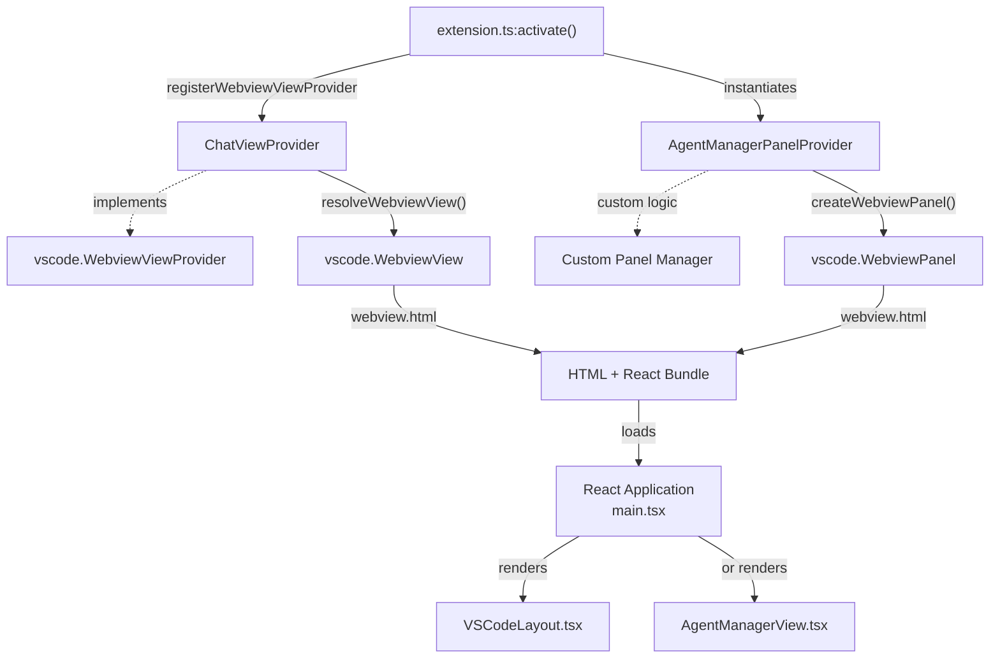

**Sources:** [packages/vscode/src/extension.ts:28-470](), [packages/vscode/src/ChatViewProvider.ts:8-383](), [packages/vscode/src/AgentManagerPanelProvider.ts:8-352]()

### ChatViewProvider Implementation

The `ChatViewProvider` implements VS Code's `WebviewViewProvider` interface for sidebar integration:

| Method | Purpose | Key Actions |
|--------|---------|-------------|
| `resolveWebviewView()` | Called when view becomes visible | Sets webview options, generates HTML, registers message handlers |
| `updateTheme()` | Synchronizes VS Code theme | Fetches Shiki themes, posts theme change message |
| `updateConnectionStatus()` | Broadcasts OpenCode status | Caches status, sends to webview if resolved |
| `addTextToInput()` | Injects text into chat input | Reveals view, posts command message |
| `createNewSessionWithPrompt()` | Creates session with initial prompt | Reveals view, posts command with payload |

**Sources:** [packages/vscode/src/ChatViewProvider.ts:8-383]()

### AgentManagerPanelProvider Implementation

The `AgentManagerPanelProvider` uses a custom panel management approach:

| Method | Purpose | Key Actions |
|--------|---------|-------------|
| `createOrShow()` | Creates or reveals panel | Creates `WebviewPanel` if needed, otherwise reveals existing |
| `updateTheme()` | Synchronizes theme | Posts theme change with Shiki themes |
| `updateConnectionStatus()` | Updates connection state | Caches and broadcasts status |

The panel pattern differs from the view pattern in that it creates a standalone editor tab rather than a sidebar view, using `vscode.window.createWebviewPanel()` directly.

**Sources:** [packages/vscode/src/AgentManagerPanelProvider.ts:8-352]()

## Webview Lifecycle and State Management

### Initialization Sequence

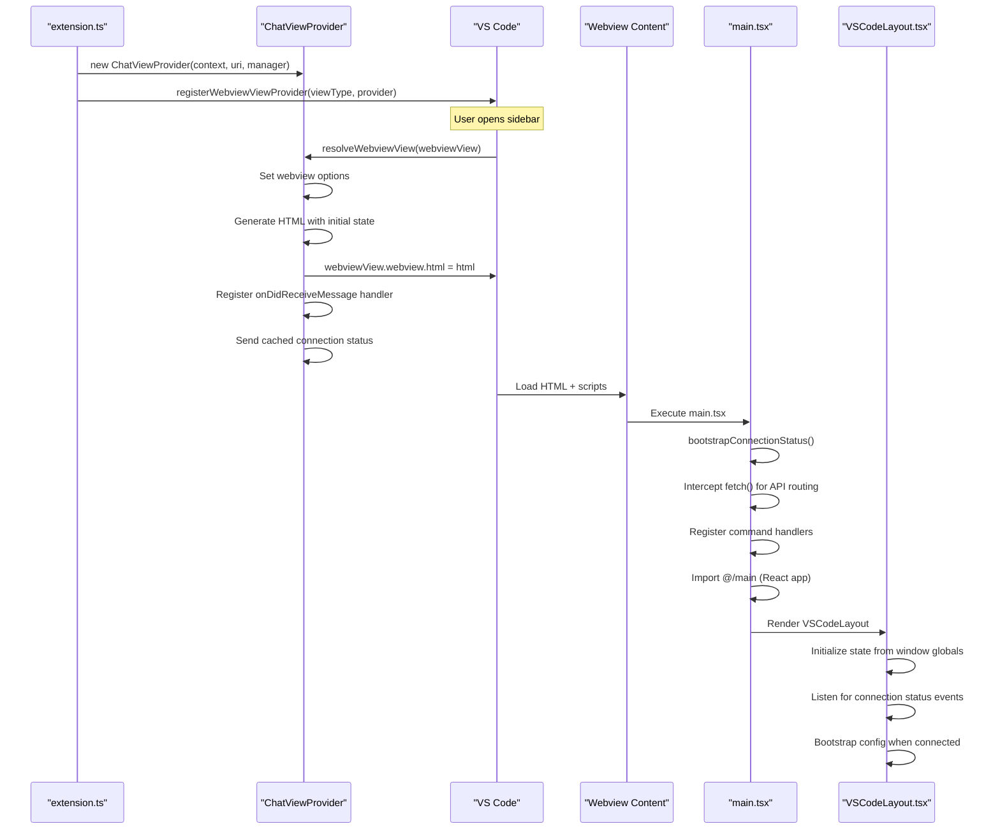

**Sources:** [packages/vscode/src/extension.ts:115-126](), [packages/vscode/src/ChatViewProvider.ts:30-73](), [packages/vscode/webview/main.tsx:35-810](), [packages/ui/src/components/layout/VSCodeLayout.tsx:16-234]()

### State Caching Pattern

Both provider classes cache connection status and errors to handle the case where the webview is resolved after the OpenCode backend connects:

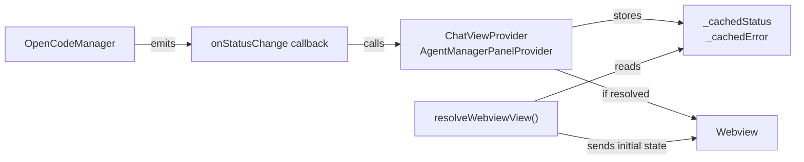

This pattern ensures the webview receives the correct connection state regardless of initialization order.

**Sources:** [packages/vscode/src/ChatViewProvider.ts:18-19,87-94,146-156](), [packages/vscode/src/AgentManagerPanelProvider.ts:14-15,110-129](), [packages/vscode/src/extension.ts:459-465]()

## HTML Generation and Configuration

### HTML Template Structure

The webview HTML is generated by `getWebviewHtml()` which injects configuration and scripts:

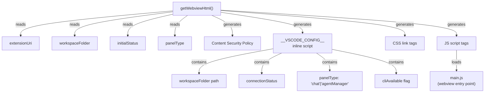

**Sources:** [packages/vscode/src/ChatViewProvider.ts:369-382](), [packages/vscode/src/AgentManagerPanelProvider.ts:339-351]()

### Configuration Injection

The `__VSCODE_CONFIG__` global is read by [packages/vscode/webview/main.tsx:19-33]() to bootstrap the webview:

| Property | Type | Purpose |
|----------|------|---------|
| `workspaceFolder` | `string` | Root directory for OpenCode operations |
| `connectionStatus` | `'connecting' \| 'connected' \| 'error' \| 'disconnected'` | Initial OpenCode backend status |
| `cliAvailable` | `boolean` | Whether OpenCode CLI is installed |
| `panelType` | `'chat' \| 'agentManager'` | Determines which UI to render |
| `theme` | `string` | Initial VS Code theme kind |

**Sources:** [packages/vscode/webview/main.tsx:19-57]()

## Message Passing and Commands

### Webview-to-Extension Communication

The webview uses the bridge API to send structured requests to the extension host:

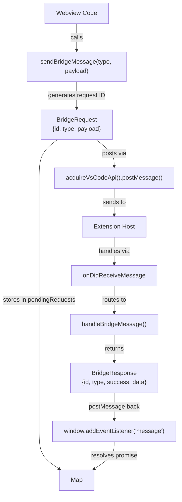

**Sources:** [packages/vscode/webview/api/bridge.ts:61-91](), [packages/vscode/src/ChatViewProvider.ts:49-72]()

### Extension-to-Webview Commands

The extension can send commands to the webview to trigger UI actions:

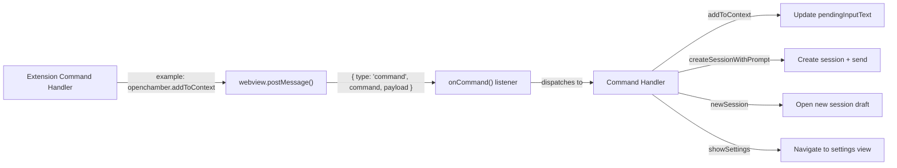

The command system enables VS Code commands (like "Explain" and "Improve Code") to interact with the webview without coupling to its internal state management.

**Sources:** [packages/vscode/webview/api/bridge.ts:132-148](), [packages/vscode/webview/main.tsx:731-797](), [packages/vscode/src/ChatViewProvider.ts:96-144]()

## SSE Event Proxying

Webviews cannot directly connect to the OpenCode SSE endpoints due to VS Code's security restrictions. The providers implement SSE proxying to forward events through the extension host.

### SSE Proxy Architecture

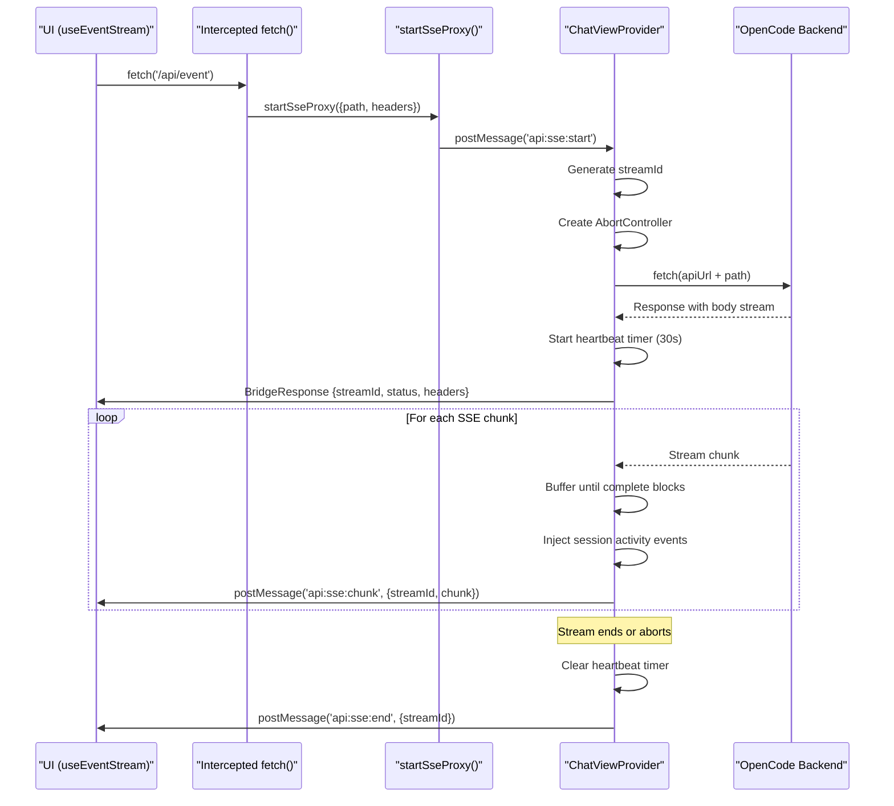

**Sources:** [packages/vscode/src/ChatViewProvider.ts:175-348](), [packages/vscode/webview/main.tsx:644-706]()

### SSE Event Injection

The providers inject synthetic events into the SSE stream to enhance the UI:

| Event Type | Purpose | Trigger |
|------------|---------|---------|
| `openchamber:session-activity` | Session busy/idle state | Derived from `session.status` and `message.updated` events |
| `openchamber:heartbeat` | Keep connection alive | Every 30 seconds during active streams |

The activity injection is performed by [packages/vscode/src/ChatViewProvider.ts:560-570]() which parses each SSE block, derives session activity state, and appends synthetic events.

**Sources:** [packages/vscode/src/ChatViewProvider.ts:385-570]()

### SSE Buffering Strategy

To reduce message passing overhead through the webview postMessage channel, the provider buffers SSE chunks and only forwards complete event blocks (delimited by `\n\n`):

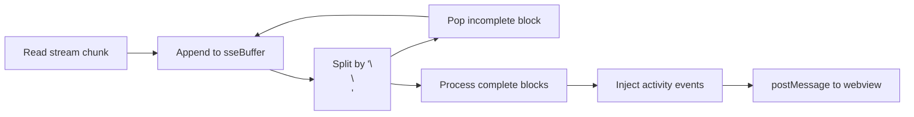

This optimization is critical for performance when streaming large message parts or tool executions.

**Sources:** [packages/vscode/src/ChatViewProvider.ts:266-295]()

## Theme Synchronization

The webview adapts to VS Code theme changes in real-time, including syntax highlighting themes for code blocks.

### Theme Change Flow

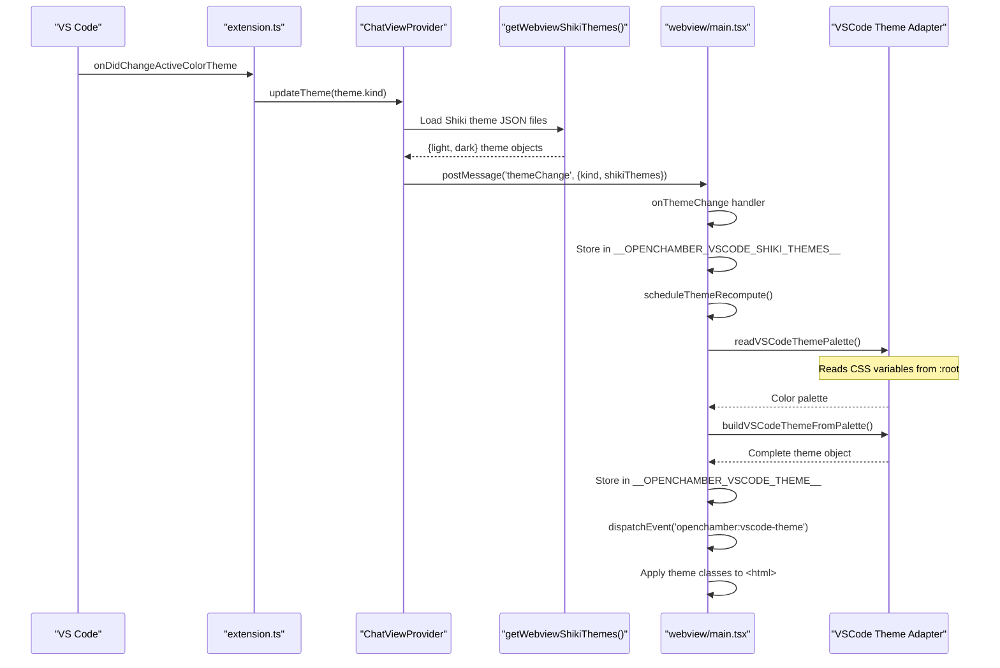

**Sources:** [packages/vscode/src/extension.ts:437-457](), [packages/vscode/src/ChatViewProvider.ts:75-85](), [packages/vscode/webview/main.tsx:206-247]()

### Theme Palette Extraction

VS Code exposes its theme colors as CSS variables on the webview's `:root` element. The theme adapter reads these variables to build a complete theme object:

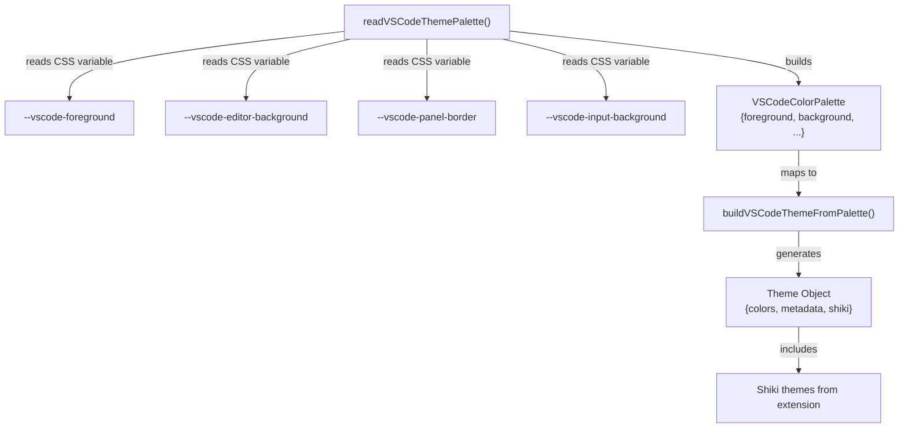

The theme recomputation is scheduled across multiple animation frames to ensure CSS variables have updated after VS Code applies theme changes.

**Sources:** [packages/vscode/webview/main.tsx:206-247]()

## Webview Visibility and Retention

### WebviewView Context Retention

The chat view is registered with `retainContextWhenHidden: true` to preserve state when the sidebar is collapsed:

```typescript
vscode.window.registerWebviewViewProvider(
  ChatViewProvider.viewType,
  chatViewProvider,
  { webviewOptions: { retainContextWhenHidden: true } }
)
```

This ensures:
- React state persists across visibility changes
- SSE connections remain active when sidebar is hidden
- No re-initialization overhead when re-opening the view

**Sources:** [packages/vscode/src/extension.ts:119-125]()

### Panel Disposal Cleanup

The `AgentManagerPanelProvider` registers a disposal handler to clean up SSE streams and timers:

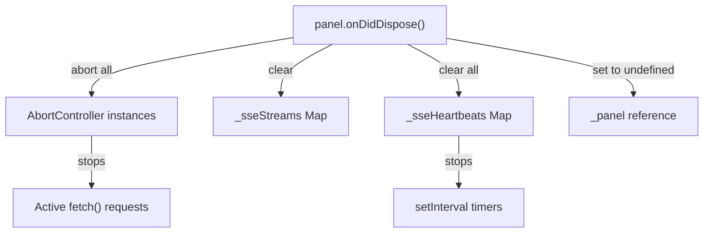

This cleanup prevents memory leaks and ensures the panel can be cleanly recreated.

**Sources:** [packages/vscode/src/AgentManagerPanelProvider.ts:56-69]()

## Global Event Bus Integration

The webview uses CustomEvents on the window object to coordinate between the bridge layer and React components:

| Event Name | Payload | Purpose |
|------------|---------|---------|
| `openchamber:connection-status` | `{status, error}` | Broadcast OpenCode connection changes |
| `openchamber:navigate` | `{view}` | Navigate between chat/sessions/settings |
| `openchamber:vscode-theme` | `{theme, palette}` | Theme updates from adapter |
| `openchamber:vscode-shiki-themes` | `{shikiThemes}` | Syntax highlighting theme updates |

This decouples the bridge communication layer from React state management, allowing main.tsx to intercept and transform messages before they reach the UI components.

**Sources:** [packages/vscode/webview/main.tsx:59-95](), [packages/ui/src/components/layout/VSCodeLayout.tsx:58-95]()

## Bootstrap and Loading States

### Multi-Phase Initialization

The webview displays a loading overlay that hides after both the UI mounts and OpenCode connects:

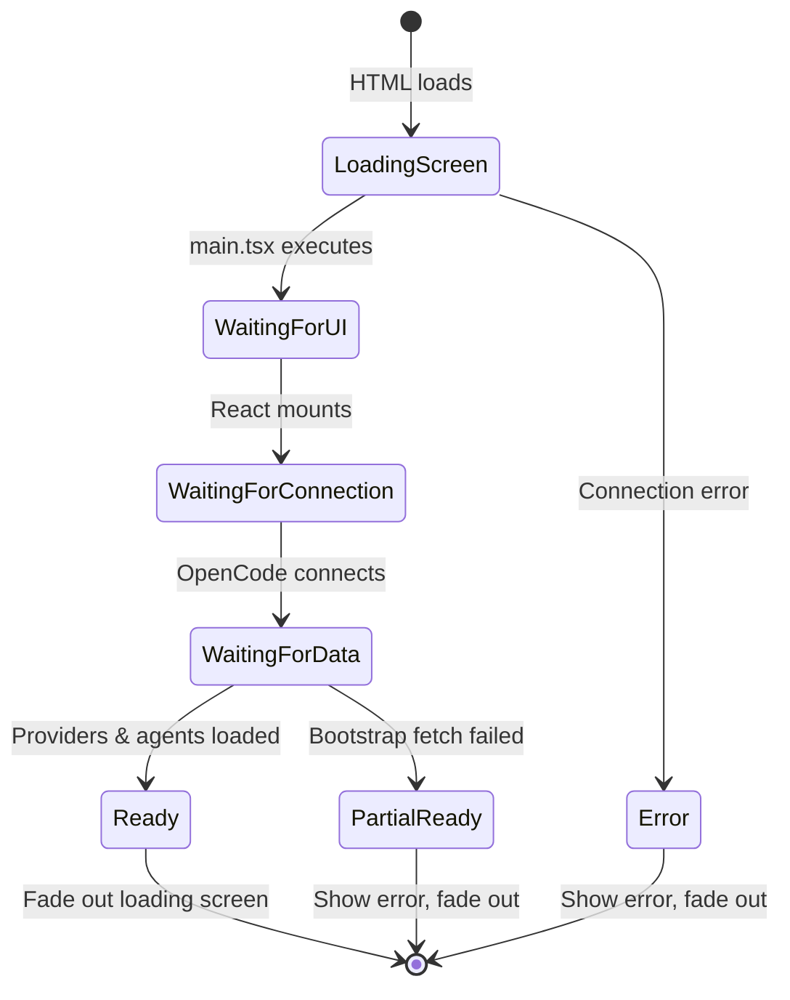

The loading logic tracks:
- `uiMounted`: Set to true after React renders
- `bootstrapProvidersReady`: Set when `/api/config/providers` succeeds
- `bootstrapAgentsReady`: Set when `/api/agent` succeeds
- `bootstrapFailed`: Set if any critical fetch fails

**Sources:** [packages/vscode/webview/main.tsx:99-184]()

### Bootstrap Fetch Tracking

The webview intercepts `fetch()` calls and records bootstrap progress:

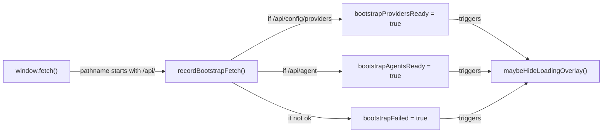

This ensures the loading screen remains visible until the UI has the data it needs to render the initial view.

**Sources:** [packages/vscode/webview/main.tsx:130-143,631-636]()

---

