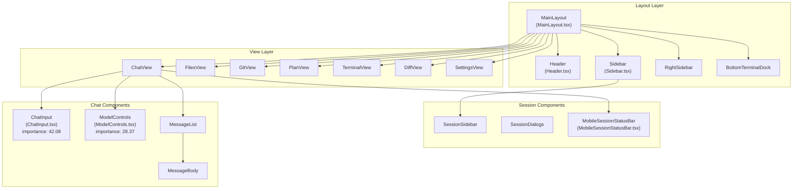
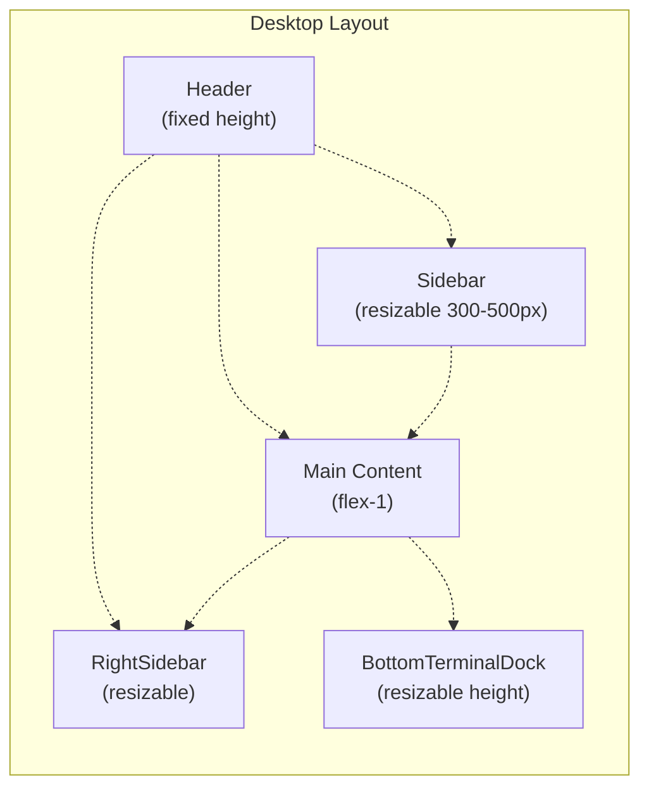
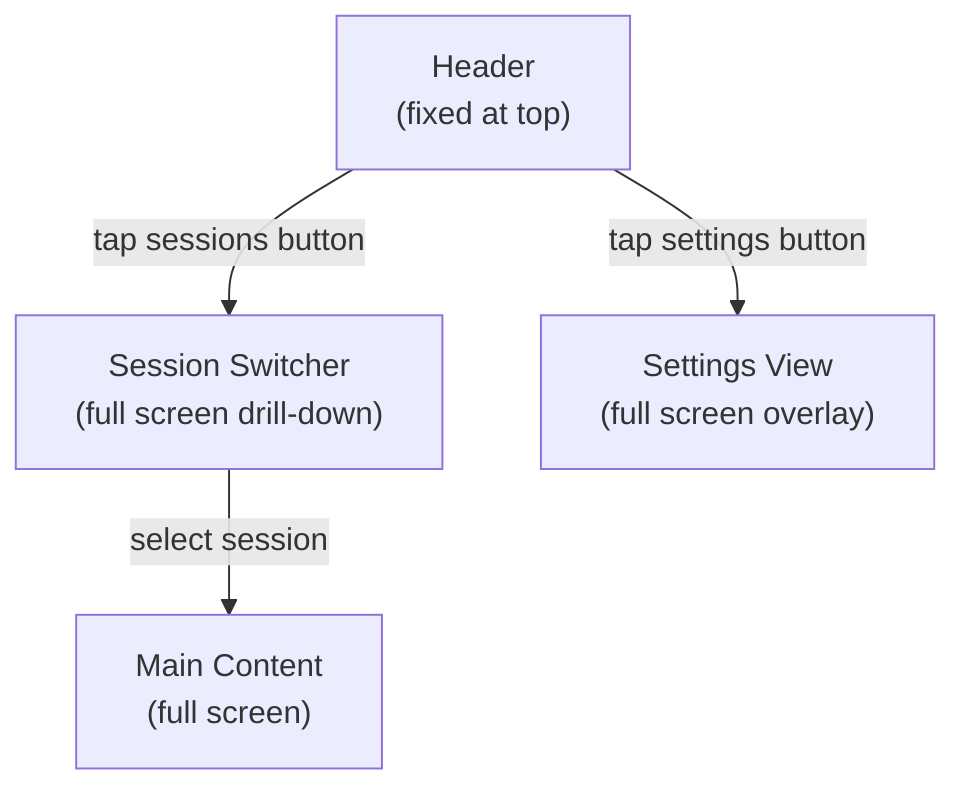
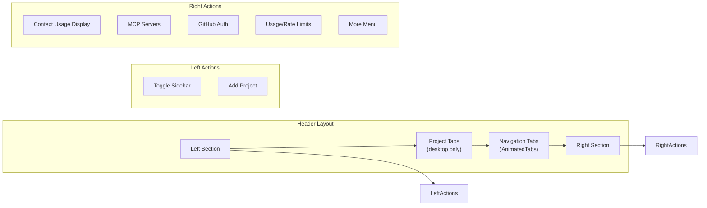
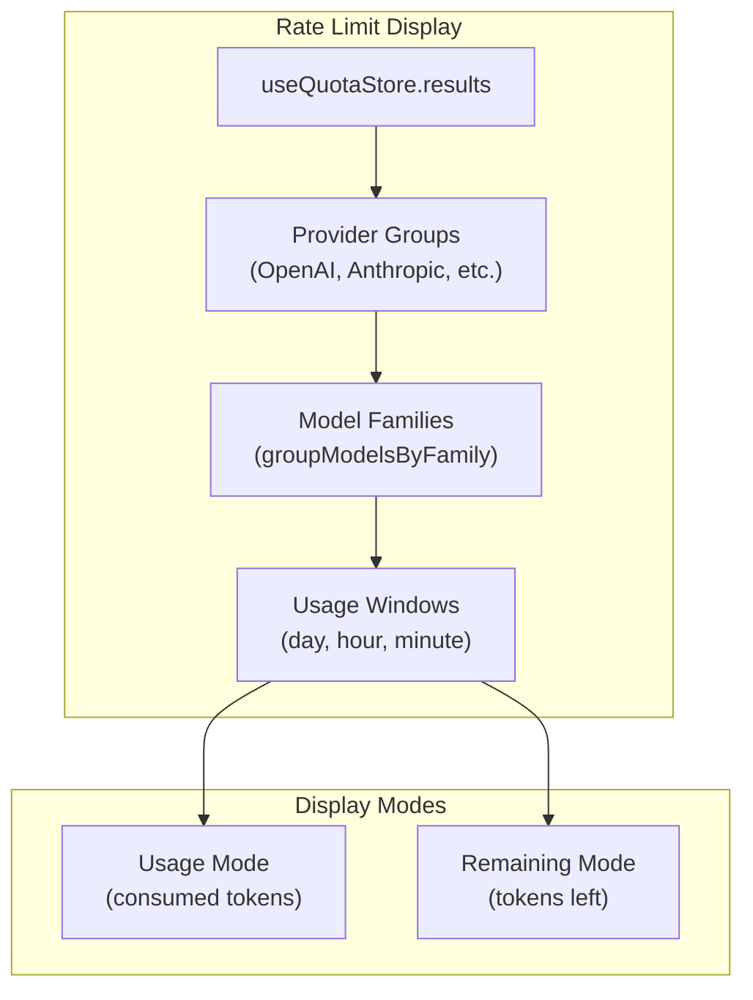
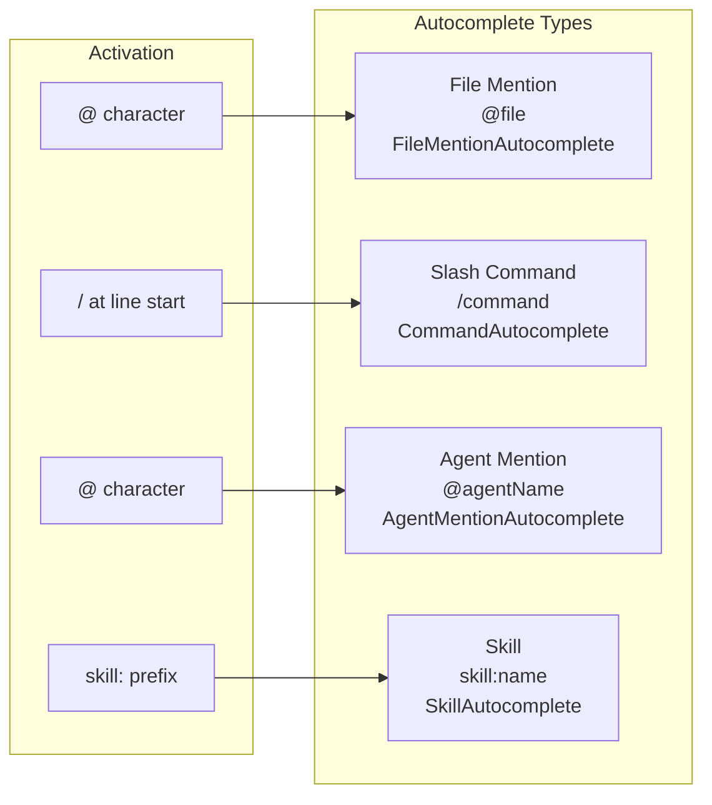
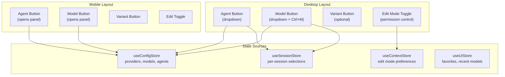

<!-- source: DeepWiki mcp.deepwiki.com · repo btriapitsyn/openchamber · page 7 UI Component Library · fetched 2026-10-26 -->

# UI Component Library

<details>
<summary>Relevant source files</summary>

The following files were used as context for generating this wiki page:

- [packages/ui/src/components/chat/ChatInput.tsx](packages/ui/src/components/chat/ChatInput.tsx)
- [packages/ui/src/components/chat/MobileSessionStatusBar.tsx](packages/ui/src/components/chat/MobileSessionStatusBar.tsx)
- [packages/ui/src/components/chat/ModelControls.tsx](packages/ui/src/components/chat/ModelControls.tsx)
- [packages/ui/src/components/layout/Header.tsx](packages/ui/src/components/layout/Header.tsx)
- [packages/ui/src/components/layout/MainLayout.tsx](packages/ui/src/components/layout/MainLayout.tsx)
- [packages/ui/src/components/layout/Sidebar.tsx](packages/ui/src/components/layout/Sidebar.tsx)
- [packages/ui/src/index.css](packages/ui/src/index.css)

</details>


This document describes the shared React component library (`packages/ui`) that provides the user interface across all OpenChamber platforms: web, desktop (Tauri), and VS Code extension. For information about platform-specific deployment and initialization, see [Multi-Platform Deployment](#3.1). For state management patterns, see [State Management](#3.4).

## Package Structure

The UI package is organized as a standalone, platform-agnostic React application that adapts to different runtime environments through the `RuntimeAPIs` abstraction layer.

**Core Directory Structure:**

```
packages/ui/src/
├── components/          # React components
│   ├── layout/         # Layout and navigation
│   ├── chat/           # Chat interface components
│   ├── session/        # Session management UI
│   ├── views/          # Full-page views
│   ├── ui/             # Reusable UI primitives
│   └── ...
├── stores/             # Zustand state stores
├── hooks/              # Custom React hooks
├── lib/                # Utility functions
├── contexts/           # React contexts
└── styles/             # Global styles
```

The package exports components that are imported by the platform-specific entry points in `packages/web`, `packages/desktop`, and `packages/vscode`.

**Sources:** [packages/ui/src/components/layout/MainLayout.tsx:1-25](), overview diagram

## Component Hierarchy

The component tree is organized into distinct layers: layout containers, view components, and interactive controls.



**Sources:** [packages/ui/src/components/layout/MainLayout.tsx:24-612](), [packages/ui/src/components/layout/Header.tsx:1-139](), overview Diagram 5

## MainLayout and Responsive Design

The `MainLayout` component ([MainLayout.tsx:45-613]()) provides the root layout structure and implements responsive behavior for both mobile and desktop environments.

### Desktop Layout Structure

On desktop, the layout uses a nested flexbox structure with resizable panels:



Key layout features:
- **Header:** Fixed height, always visible, contains navigation tabs and project selector
- **Sidebar:** Left panel with sessions list, resizable width (300-500px), toggleable
- **Main content:** Central area displaying active view (chat, files, git, etc.)
- **RightSidebar:** Context panel and Git tools, auto-hides below 1140px viewport width
- **BottomTerminalDock:** Terminal view, auto-hides below 640px viewport height

**Responsive Auto-Hiding:** [MainLayout.tsx:142-202]()

```typescript
const RIGHT_SIDEBAR_AUTO_CLOSE_WIDTH = 1140;
const BOTTOM_TERMINAL_AUTO_CLOSE_HEIGHT = 640;
```

The layout tracks viewport size and automatically closes/reopens panels, remembering whether the closure was user-initiated or automatic.

### Mobile Layout Structure

On mobile, the layout switches to a drill-down pattern with full-screen views:



Mobile-specific behavior ([MainLayout.tsx:504-549]()):
- Header remains visible but session sidebar overlays full screen when opened
- Settings and multi-run launcher render as full-screen overlays
- No resizable panels or sidebars
- Edge swipe gestures enabled via `useEdgeSwipe` hook

**Sources:** [packages/ui/src/components/layout/MainLayout.tsx:45-613](), [packages/ui/src/components/layout/Sidebar.tsx:1-266]()

## Visual Viewport and Keyboard Handling

The layout implements sophisticated mobile keyboard avoidance ([MainLayout.tsx:231-469]()):

```typescript
// CSS custom properties set by viewport handler
--oc-visual-viewport-offset-top   // Top offset when keyboard appears
--oc-keyboard-inset                // Keyboard height (stable step function)
--oc-keyboard-home-indicator       // iOS home indicator adjustment (34px when keyboard open)
--oc-keyboard-avoid-offset         // Per-element translateY offset
```

**Keyboard Detection Algorithm:**
1. Monitors `window.visualViewport` resize/scroll events
2. Calculates inset as `layoutHeight - (viewport.height + viewport.offsetTop)`
3. Uses step function: treats inset as keyboard only if > 120px (focused input) or > 180px (unfocused)
4. Immediately drops to 0 when keyboard closing detected (height increasing while inset non-zero)
5. Applies translateY offset to elements marked with `data-keyboard-avoid` attribute

**Sources:** [packages/ui/src/components/layout/MainLayout.tsx:231-469]()

## Header Component

The `Header` component ([Header.tsx:139-803]()) provides navigation, project management, and system status displays.

### Desktop Header Structure



**Key Features:**

**Project Tabs** ([Header.tsx:280-497]()): 
- Only visible on desktop (non-VS Code)
- Drag-to-reorder using pointer events
- Per-project activity indicators (streaming sessions, attention states)
- Custom label, icon, and color metadata
- Overflow scroll with fade indicators

**Navigation Tabs** ([Header.tsx:591-709]()):
- Chat, Plan, Git, Diff, Terminal, Files
- Badge counts (e.g., diff file count)
- Responsive label hiding via container queries

**Context Usage Display** ([Header.tsx:242-260]()):
- Shows token usage percentage for current session
- Displays normalized output tokens vs limits
- Stable reference to prevent flicker (only updates when tokens change)

**Sources:** [packages/ui/src/components/layout/Header.tsx:139-803]()

### Usage and Rate Limits Dropdown

The header includes a comprehensive usage tracking UI ([Header.tsx:599-693]()):



**Data Flow:**
1. `useQuotaStore` fetches quota data from OpenCode API
2. `rateLimitGroups` memoized calculation groups by provider and model family
3. Collapsible sections per provider, showing per-model usage windows
4. Toggle between "usage" and "remaining" display modes
5. Persisted to desktop settings via `updateDesktopSettings`

**Sources:** [packages/ui/src/components/layout/Header.tsx:599-714]()

## ChatInput Component

The `ChatInput` component ([ChatInput.tsx:70-1957]()) is the primary message composition interface with importance score 42.08.

### Component Architecture

```mermaid
graph TB
    subgraph "ChatInput State"
        LocalState["Local State<br/>message, attachedFiles, drafts"]
        MessageHistory["Message History<br/>(up/down arrow navigation)"]
        AutocompleteState["Autocomplete State<br/>(files, commands, agents, skills)"]
    end
    
    subgraph "Store Integration"
        SessionStore["useSessionStore<br/>sendMessage, abortCurrentOperation"]
        ConfigStore["useConfigStore<br/>currentAgent, currentModel"]
        UIStore["useUIStore<br/>isMobile, queueModeEnabled"]
        MessageQueueStore["useMessageQueueStore<br/>queuedMessages, addToQueue"]
        FileStore["useFileStore<br/>attachedFiles"]
        InlineCommentDraftStore["useInlineCommentDraftStore<br/>drafts, consumeDrafts"]
    end
    
    subgraph "UI Elements"
        Textarea["Textarea<br/>(auto-sizing, max 8 lines)"]
        AttachmentsList["AttachedFilesList"]
        QueuedChips["QueuedMessageChips"]
        Autocomplete["Autocomplete Components<br/>(file, command, agent, skill)"]
        MobileControls["UnifiedControlsDrawer<br/>(mobile only)"]
    end
    
    LocalState --> SessionStore
    LocalState --> ConfigStore
    LocalState --> UIStore
    LocalState --> MessageQueueStore
    LocalState --> FileStore
    LocalState --> InlineCommentDraftStore
    
    LocalState --> UI Elements
```

### Message Queue System

The chat input supports queuing multiple messages when the assistant is busy ([ChatInput.tsx:133-144]()):

**Queue Mode Behavior:**
- **Enabled:** Enter key queues message, Ctrl+Enter sends immediately
- **Disabled:** Enter key sends message, Ctrl+Enter queues

**Auto-Send Logic** ([ChatInput.tsx:675-703]()):
- When session transitions from busy→idle, queued messages auto-send
- Skips auto-send if session was recently aborted (within 2 seconds)
- Uses `queuedOnly: true` flag to send queued messages without current input

**Sources:** [packages/ui/src/components/chat/ChatInput.tsx:133-703]()

### Message Composition Features

**Draft Persistence** ([ChatInput.tsx:59-264]()):
- Saves input to `localStorage` under key `openchamber_chat_input_draft`
- Controlled by `persistChatDraft` user setting
- Clears draft on session switch if setting disabled
- Auto-selects restored draft text on mount

**Inline Comments** ([ChatInput.tsx:146-158]()):
- Integrates with `useInlineCommentDraftStore` for code review comments
- Appends drafts to message using `appendInlineComments` function
- Consumes drafts when message sent (removes from store)

**File Attachments** ([ChatInput.tsx:112-115]()):
- Managed by `useFileStore.attachedFiles`
- Drag-and-drop zone with `isDragging` state
- Server file picker for directory-scoped selection
- Restored on send failure for retry

**Agent Mentions** ([ChatInput.tsx:29-30]()):
- Parses `@agentName` syntax using `parseAgentMentions`
- Sets agent selection for message if mention found
- Supports switching agent mid-session

**Message History Navigation** ([ChatInput.tsx:93-95, 748-792]()):
- Up/Down arrow keys cycle through previous user messages
- Only when cursor at start (up) or end (down) of input
- Preserves current draft when entering history mode
- Filters to text-only messages from current session

**Sources:** [packages/ui/src/components/chat/ChatInput.tsx:59-792]()

### Autocomplete System

The input provides four types of autocomplete ([ChatInput.tsx:21-24]()):



**Keyboard Navigation:**
- Enter/Tab: Accept selected item
- Up/Down: Navigate options
- Escape: Close autocomplete
- Prevents default textarea behavior when autocomplete open

**Update Logic** ([ChatInput.tsx:899-990]()):
- Detects trigger patterns after cursor position changes
- Extracts query text after trigger character
- Shows/hides appropriate autocomplete component
- Tab key cycles between autocomplete types when multiple available

**Sources:** [packages/ui/src/components/chat/ChatInput.tsx:81-990]()

### Mobile-Specific Adaptations

**Touch Input Handling** ([ChatInput.tsx:271-313]()):
- Prevents iOS default scroll-to-reveal behavior
- Forces scroll to top before focusing textarea
- Uses `preventScroll: true` focus option
- Sets cursor to end of text after focus

**Mobile Controls Drawer** ([ChatInput.tsx:315-361]()):
- Full-screen overlay for model/agent selection
- Opens with keyboard blur to prevent layout shift
- Separate panels: unified controls, model selector, agent selector
- Close button returns to unified controls

**Sources:** [packages/ui/src/components/chat/ChatInput.tsx:271-361]()

## ModelControls Component

The `ModelControls` component ([ModelControls.tsx:284-1709]()) provides model, agent, and variant selection with importance score 28.37.

### Component Structure



### Model Selection UI

**Desktop Dropdown** ([ModelControls.tsx:1196-1506]()):
- Searchable list with fuzzy matching (`fuzzyMatch` utility)
- Keyboard navigation (up/down arrows, enter to select)
- Grouped by provider with collapsible sections
- Shows favorites, recent models, and all models
- Displays model metadata: capabilities, modalities, pricing, token limits

**Mobile Panel** ([ModelControls.tsx:1509-1709]()):
- Full-screen `MobileOverlayPanel` component
- Provider-level expansion (only current provider expanded by default)
- Touch-optimized spacing and interactions
- Long-press on model shows tooltip with details

**Model Metadata Display** ([ModelControls.tsx:233-274]()):
- **Capabilities:** Tool calling, reasoning (icons with tooltips)
- **Modalities:** Text, image, video, audio, PDF input/output icons
- **Cost:** Formatted as "In $X · Out $Y" per token
- **Limits:** Context and output token limits (compact notation)
- **Knowledge cutoff:** Formatted date range

**Sources:** [packages/ui/src/components/chat/ModelControls.tsx:233-1709]()

### Agent Selection and Edit Permissions

**Agent Selection Logic** ([ModelControls.tsx:326-356]()):
1. Checks for per-session saved agent selection
2. Falls back to sticky reference (prevents flicker during server-driven switches)
3. Uses global `currentAgentName` as final fallback

**Edit Mode Control** ([ModelControls.tsx:489-533]()):
- Three modes: `ask` (require approval), `allow` (auto-approve), `deny` (reject), `full` (unrestricted)
- Resolved from agent's `permission` ruleset using `resolveWildcardPermissionAction`
- Per-session preference via `setSessionAgentEditMode`
- Toggle only available when agent's default is `ask`
- Displays icon indicating current mode with themed colors

**Model Initialization** ([ModelControls.tsx:619-823]()):
- Attempts to restore saved per-session model selection on mount
- Falls back to inference from existing messages (via `analyzeAndSaveExternalSessionChoices`)
- Sets default agent and model if no saved selection
- Handles provider/model missing cases gracefully

**Sources:** [packages/ui/src/components/chat/ModelControls.tsx:326-823]()

## MobileSessionStatusBar Component

The `MobileSessionStatusBar` component ([MobileSessionStatusBar.tsx:456-535]()) displays session status and activity at the top of the mobile chat view.

### Display Modes

```mermaid
graph TB
    subgraph "Collapsed Mode"
        CurrentTitle_C["Current Session Title"]
        RunningCount_C["Running Count<br/>(spinner icon + count)"]
        UnreadCount_C["Unread Count<br/>(dot + count)"]
        NewButton_C["New Button"]
    end
    
    subgraph "Expanded Mode"
        CurrentTitle_E["Current Session Title"]
        SessionList["Session List<br/>(up to 3 preview, then 'More')"]
        RunningCount_E["Running Count"]
        UnreadCount_E["Unread Count"]
        NewButton_E["New Button"]
        MoreButton["More/Less Button"]
    end
    
    CollapsedMode["Collapsed<br/>(tap to expand)"] --> Expanded Mode
    ExpandedMode["Expanded<br/>(tap header to collapse)"] --> CollapsedMode
```

**Session Grouping Algorithm** ([MobileSessionStatusBar.tsx:22-115]()):
1. Builds parent-child map from session `parentID` field
2. Filters to top-level sessions (no parent or parent not in list)
3. Enriches with status: `busy`, `retry`, or `idle`
4. Calculates running children count per parent
5. Sorts into two buckets: running/needs-attention first, then viewed (by updated time)
6. Limits child indicators to 3 per parent, shows "+N" for overflow

**Status Indicators:**
- Running: Spinning loader icon (`RiLoader4Line`) in info color
- Needs attention: Red dot indicator (server-authoritative from `sessionAttentionStates`)
- Idle: Empty circle outline

**Sources:** [packages/ui/src/components/chat/MobileSessionStatusBar.tsx:1-535]()

## Styling System

The UI package uses a comprehensive CSS-based design system ([index.css:1-1013]()).

### Design System Variables

All colors and dimensions use CSS custom properties defined in `styles/design-system.css`:

```css
/* Core semantic colors */
--background
--foreground
--primary
--primary-foreground
--secondary
--secondary-foreground
--accent
--accent-foreground
--muted
--muted-foreground
--border
--destructive

/* Surface variants */
--surface
--surface-foreground
--surface-muted
--surface-mutedForeground
--sidebar
--sidebar-foreground

/* Interactive states */
--interactive-hover
--interactive-selection
--interactive-selection-foreground
--interactive-border

/* Status colors */
--status-success
--status-error
--status-warning
--status-info
```

**Typography System** (`styles/typography.css`):
- `--font-sans`: IBM Plex Sans
- `--font-mono`: IBM Plex Mono
- Font size variables: `--text-markdown`, `--text-code`, etc.
- Typography classes: `typography-micro`, `typography-meta`, etc.

**Sources:** [packages/ui/src/index.css:1-13]()

### Platform-Specific Adaptations

**VS Code Runtime** ([index.css:173-662]()):
- Detects `.vscode-runtime` class on root element
- Overrides placeholder colors using VS Code theme variables
- Forces semantic font sizes on tool cards to override syntax themes
- Collapses model/agent labels earlier via container queries

**Mobile Optimizations** ([index.css:939-1012]()):
- Terminal font ligatures disabled for performance
- Reduced motion animations for accessibility
- Touch-optimized spacing and hit targets

**Scrollbar Styling** ([index.css:391-520]()):
- Custom WebKit scrollbar thumb with design system colors
- Overlay scrollbar mode for chat (hidden native, custom overlay)
- Firefox fallback using `scrollbar-width` and `scrollbar-color`
- `.scrollbar-hidden` utility class for completely hidden scrollbars

**Sources:** [packages/ui/src/index.css:173-1012]()

### Syntax Highlighting

The CSS includes fallback syntax highlighting rules for CodeMirror ([index.css:36-171]()):

**Token Categories:**
- Comments: `tok-comment`, `tok-docComment`, `tok-meta`
- Keywords: `tok-keyword`, `tok-controlKeyword`, `tok-modifier`
- Operators: `tok-operator`, `tok-operatorKeyword`, etc.
- Strings: `tok-string`, `tok-escape`, `tok-regexp`
- Numbers: `tok-number`, `tok-bool`, `tok-atom`
- Functions: `tok-function.tok-variableName`
- Variables: `tok-variableName`, `tok-propertyName`
- Types: `tok-className`, `tok-typeName`

Each category maps to a design system variable (e.g., `var(--syntax-comment)`), ensuring consistency with the active theme.

**Sources:** [packages/ui/src/index.css:36-171]()

### Streamdown Content Styling

Markdown rendering via Streamdown library ([index.css:614-865]()):

**Font Configuration:**
- Text content: IBM Plex Sans at `--text-markdown` size
- Code blocks: IBM Plex Mono at `--text-code` size
- Tool cards: Render at code size to match typography

**Semantic Color Overrides:**
- Inline code background: `--markdown-inline-code-bg`
- Headings: `--markdown-heading1` through `--markdown-heading4`
- Links: `--markdown-link`, `--markdown-link-hover`
- Blockquotes: `--markdown-blockquote`, `--markdown-blockquote-border`

**List Styling Fix** ([index.css:840-854]()):
- Restores default list markers (disc for `ul`, decimal for `ol`)
- Sets `list-style-position: outside` for proper indentation
- Required to override Tailwind reset

**Virtualization Disabled** ([index.css:862-865]()):
- Forces `content-visibility: visible` on code blocks
- Prevents late height changes that break scroll-to-bottom behavior

**Sources:** [packages/ui/src/index.css:614-865]()

## Container Query System

The UI uses CSS container queries for responsive component adaptations without media queries ([index.css:639-709]()):

### Model Controls Responsiveness

```css
@container model-controls (max-width: 11rem) {
  .model-controls__agent-label { display: none; }
}
@container model-controls (max-width: 9rem) {
  .model-controls__model-label { display: none; }
}
```

Labels hide progressively as component width shrinks, independent of viewport size.

### Commit Actions Collapse

```css
@container commit-actions (max-width: 28rem) {
  .commit-actions__label--long { display: none; }
}
@container commit-actions (max-width: 22rem) {
  .commit-actions__label { display: none; }
  .commit-actions__btn { padding-inline: 0.5rem; }
}
```

### Animated Tabs Adaptation

```css
@container animated-tabs (max-width: 23rem) {
  .animated-tabs__label { display: none; }
  .animated-tabs__button {
    padding-inline: 0.5rem;
    gap: 0;
  }
}
```

These queries allow components to adapt to their container size rather than global viewport, enabling consistent behavior when components appear in different layout contexts (e.g., main view vs. sidebar).

**Sources:** [packages/ui/src/index.css:639-709]()

## Component Export Strategy

The UI package serves as a shared library with explicit exports for platform-specific entry points:

```typescript
// Platform-specific imports
import { MainLayout } from '@openchamber/ui';
import { RuntimeAPIs } from '@openchamber/ui/hooks/useRuntimeAPIs';

// Web: Direct React rendering
ReactDOM.createRoot(el).render(<MainLayout />)

// Desktop: Wrapped in Tauri context
<MainLayout /> inside Tauri WebView

// VS Code: Wrapped in webview messaging
<MainLayout /> inside vscode.postMessage context
```

The `RuntimeAPIs` abstraction provides platform-specific implementations for file system access, Git operations, GitHub authentication, and settings persistence, allowing the UI code to remain platform-agnostic.

**Key Abstraction Points:**
- `useRuntimeAPIs()` hook returns platform-specific API implementations
- `isDesktopShell()`, `isVSCodeRuntime()`, `isTauriShell()` platform detection utilities
- Conditional rendering based on runtime (e.g., mobile controls, VS Code adaptations)

**Sources:** [packages/ui/src/components/layout/MainLayout.tsx:1-25](), [packages/ui/src/components/chat/ModelControls.tsx:42-43]()

---

