<!-- source: DeepWiki mcp.deepwiki.com · repo btriapitsyn/openchamber · page 7.1 Layout and Navigation · fetched 2026-10-26 -->

# Layout and Navigation

<details>
<summary>Relevant source files</summary>

The following files were used as context for generating this wiki page:

- [packages/ui/src/components/layout/Header.tsx](packages/ui/src/components/layout/Header.tsx)
- [packages/ui/src/components/layout/MainLayout.tsx](packages/ui/src/components/layout/MainLayout.tsx)
- [packages/ui/src/components/layout/Sidebar.tsx](packages/ui/src/components/layout/Sidebar.tsx)
- [packages/ui/src/index.css](packages/ui/src/index.css)

</details>


This document describes the main application layout structure, navigation systems, and responsive behavior across different platforms. It covers the `Header`, `MainLayout`, `Sidebar`, and related components that provide the primary navigation and window management interface.

For information about specific view implementations (Chat, Files, Git, etc.), see [UI Component Library](#7). For state management of UI preferences, see [State Management](#3.4).

---

## Layout Structure

OpenChamber uses a hierarchical layout system that adapts between desktop and mobile form factors. The root layout component manages viewport dimensions, panel visibility, and keyboard interactions.

### Component Hierarchy

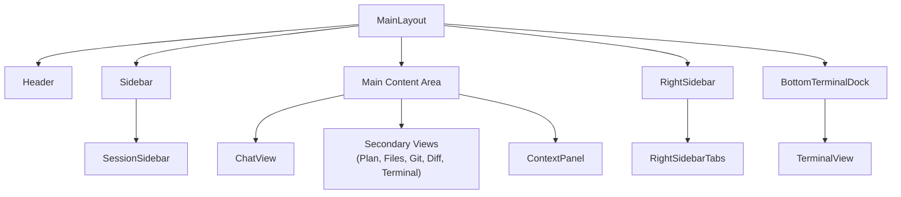

**Sources:** [packages/ui/src/components/layout/MainLayout.tsx:1-614]()

### Desktop Layout Pattern

On desktop, the layout uses a three-column design with collapsible panels:

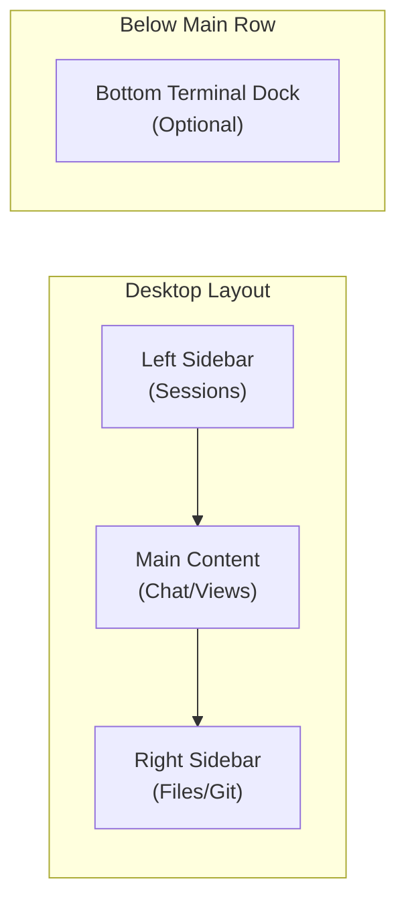

The layout structure is defined in [packages/ui/src/components/layout/MainLayout.tsx:554-600]():

- **Header**: Fixed at top, always visible
- **Sidebar**: Left panel containing `SessionSidebar`, width 300-500px
- **Main content**: Center area showing active tab view
- **RightSidebar**: Right panel for files/git operations
- **BottomTerminalDock**: Optional terminal below main content

**Sources:** [packages/ui/src/components/layout/MainLayout.tsx:45-613]()

### Mobile Layout Pattern

Mobile uses a drill-down navigation pattern where panels replace each other:

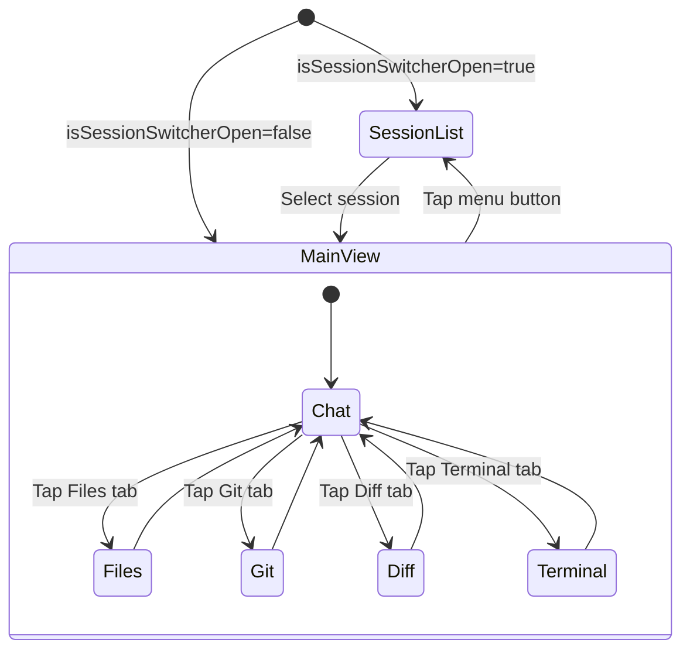

Mobile layout implementation: [packages/ui/src/components/layout/MainLayout.tsx:504-549]()

**Sources:** [packages/ui/src/components/layout/MainLayout.tsx:504-549]()

---

## Header Component

The `Header` component provides the primary navigation interface, including tab switching, project management, and utility controls.

### Header Sections

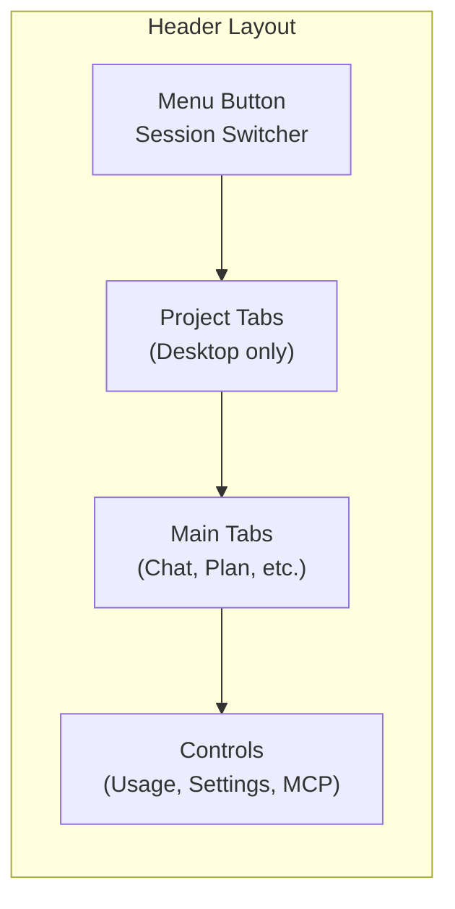

The header contains several distinct functional areas:

1. **Session Switcher Button**: Opens left sidebar (desktop) or drill-down (mobile) - [packages/ui/src/components/layout/Header.tsx:870-877]()
2. **Project Tabs**: Desktop-only project switcher with drag-reorder - [packages/ui/src/components/layout/Header.tsx:280-496]()
3. **Main Tabs**: View navigation (Chat, Plan, Files, etc.) - [packages/ui/src/components/layout/Header.tsx:974-1006]()
4. **Context Usage Display**: Shows token usage for current session - [packages/ui/src/components/layout/Header.tsx:283]()
5. **Service Dropdowns**: Usage stats, MCP tools, GitHub auth - [packages/ui/src/components/layout/Header.tsx:1014-1024]()
6. **Settings Button**: Opens settings dialog - [packages/ui/src/components/layout/Header.tsx:879-885]()

**Sources:** [packages/ui/src/components/layout/Header.tsx:139-1548]()

### Main Tab Configuration

The tab system is dynamic based on context and device type:

| Tab ID | Label | Icon | Visibility |
|--------|-------|------|------------|
| `chat` | Chat | `RiChat4Line` | Always visible |
| `plan` | Plan | `RiFileTextLine` | When plan file exists |
| `diff` | Diff | `DiffIcon` | Mobile only |
| `files` | Files | `RiFolder6Line` | Mobile only |
| `terminal` | Terminal | `RiTerminalBoxLine` | Mobile only |
| `git` | Git | `RiGitBranchLine` | Mobile only |

Tab configuration: [packages/ui/src/components/layout/Header.tsx:974-1006]()

The active tab is stored in `useUIStore` state as `activeMainTab` and controls which view is rendered in the main content area.

**Sources:** [packages/ui/src/components/layout/Header.tsx:974-1006](), [packages/ui/src/stores/useUIStore.ts]()

---

## Project Tabs System

Desktop users can open multiple projects simultaneously. The header displays project tabs with drag-to-reorder support and session indicators.

### Project Tab Features

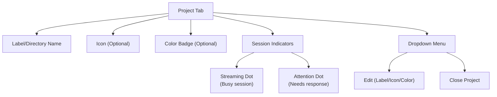

**Sources:** [packages/ui/src/components/layout/Header.tsx:280-436](), [packages/ui/src/components/layout/Header.tsx:1219-1402]()

### Project Tab Drag Reorder

Users can reorder projects by dragging tabs. The implementation uses pointer events with a dead zone to distinguish drags from clicks:

**Drag State Management** [packages/ui/src/components/layout/Header.tsx:296-317]():
- `dragStateRef`: Tracks drag operation state (projectId, overlay, virtual layout)
- `draggingProjectId`: Visible state for UI feedback
- `dragCurrentOrder`: Current order during drag

**Drag Flow** [packages/ui/src/components/layout/Header.tsx:1160-1402]():

1. **PointerDown**: Capture pointer, initialize drag state with 5px dead zone
2. **PointerMove**: After dead zone, create visual overlay and compute virtual layout
3. **Virtual Layout**: Pure computation (no DOM reads) of tab positions using cached widths
4. **Swap Detection**: Check if drag crosses another tab's center point
5. **PointerUp**: Commit order change via `reorderProjects(fromIndex, toIndex)`

The virtual layout system [packages/ui/src/components/layout/Header.tsx:318-330]() avoids layout thrashing by computing all positions from immutable width measurements taken once at drag start.

**Sources:** [packages/ui/src/components/layout/Header.tsx:296-330](), [packages/ui/src/components/layout/Header.tsx:1108-1158](), [packages/ui/src/components/layout/Header.tsx:1160-1402]()

### Project Session Indicators

Each project tab displays indicators for active sessions:

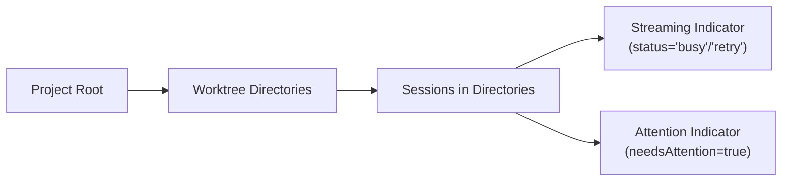

Indicator computation: [packages/ui/src/components/layout/Header.tsx:376-435]()

The system checks:
1. Sessions in project root directory
2. Sessions in associated git worktree directories
3. Session status (busy/retry → streaming dot)
4. Attention state (needsAttention → attention dot)

**Sources:** [packages/ui/src/components/layout/Header.tsx:376-435]()

---

## Responsive Panel Management

The layout automatically opens/closes panels based on viewport dimensions to maintain usability at different screen sizes.

### Auto-Open/Close Thresholds

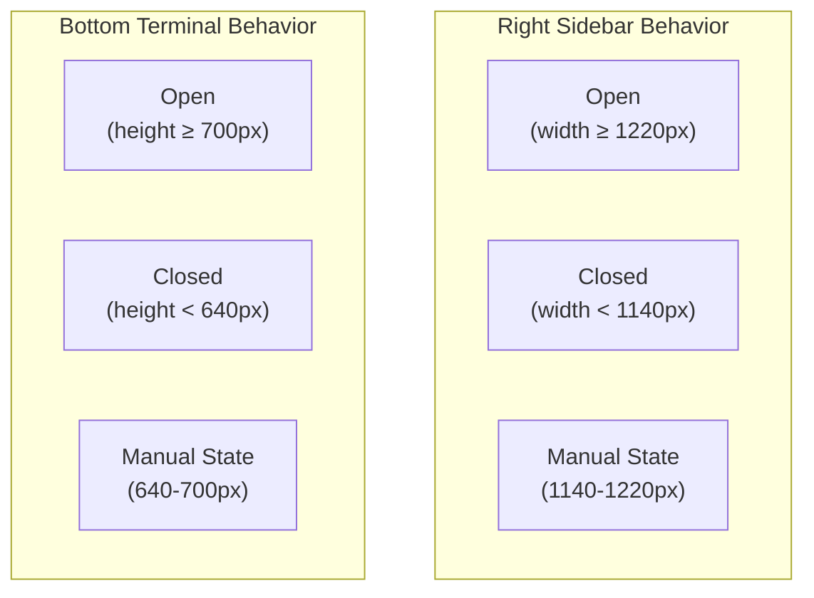

Threshold constants: [packages/ui/src/components/layout/MainLayout.tsx:46-49]()

```typescript
RIGHT_SIDEBAR_AUTO_CLOSE_WIDTH = 1140;
RIGHT_SIDEBAR_AUTO_OPEN_WIDTH = 1220;
BOTTOM_TERMINAL_AUTO_CLOSE_HEIGHT = 640;
BOTTOM_TERMINAL_AUTO_OPEN_HEIGHT = 700;
```

**Auto-Close Logic** [packages/ui/src/components/layout/MainLayout.tsx:154-165]():
- When viewport shrinks below close threshold, panel closes automatically
- System sets `rightSidebarAutoClosedRef.current = true` to track auto-close

**Auto-Open Logic** [packages/ui/src/components/layout/MainLayout.tsx:162-165]():
- When viewport grows above open threshold, panel reopens only if it was auto-closed
- Manual user closes are respected (auto-open disabled)

**Manual Override Detection** [packages/ui/src/components/layout/MainLayout.tsx:209-224]():
- When user manually toggles panel in the reopenable range, auto-close flag clears
- Prevents unwanted reopening when user explicitly closed panel

**Sources:** [packages/ui/src/components/layout/MainLayout.tsx:46-49](), [packages/ui/src/components/layout/MainLayout.tsx:142-202](), [packages/ui/src/components/layout/MainLayout.tsx:204-229]()

---

## Sidebar Components

### Left Sidebar

The left sidebar contains the session list and project management interface. It is resizable on desktop.

**Resize Implementation** [packages/ui/src/components/layout/Sidebar.tsx:88-113]():
- Min width: 300px
- Max width: 500px
- Drag handle: 4px wide on right edge
- Resize state prevents transitions during drag

**Desktop Backdrop** [packages/ui/src/components/layout/Sidebar.tsx:145-148]():
```css
bg-[color:var(--sidebar-overlay-strong)] backdrop-blur
supports-[backdrop-filter]:bg-[color:var(--sidebar-overlay-soft)]
```

The desktop app uses a semi-transparent backdrop with blur effect for visual depth.

**Footer Controls** [packages/ui/src/components/layout/Sidebar.tsx:182-249]():
- Settings button: Opens settings dialog
- Update button: Shown when desktop app update available
- About button: Shows app info (web only)
- Help button: Opens keyboard shortcuts

**Sources:** [packages/ui/src/components/layout/Sidebar.tsx:1-266]()

### Right Sidebar

The right sidebar displays contextual tools and information based on the selected tab. It uses the same resize pattern as the left sidebar.

Content is provided by `RightSidebarTabs` component, which typically includes:
- File browser and editor
- Git status and operations
- Diff viewer

**Sources:** [packages/ui/src/components/layout/MainLayout.tsx:577-579]()

---

## Mobile Layout Specifics

Mobile layout uses distinct patterns optimized for touch interaction and limited screen space.

### Drill-Down Navigation

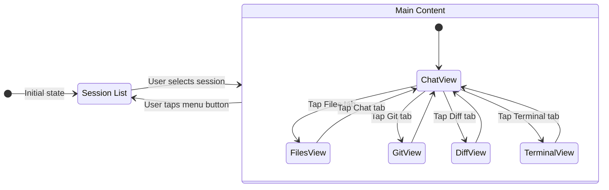

Implementation: [packages/ui/src/components/layout/MainLayout.tsx:516-528]()

Only one panel is visible at a time:
- When `isSessionSwitcherOpen=true`: Show `SessionSidebar` with `mobileVariant` prop
- When `isSessionSwitcherOpen=false`: Show main content with tab navigation

**Sources:** [packages/ui/src/components/layout/MainLayout.tsx:504-549]()

### Mobile Keyboard Handling

Mobile devices require special handling for virtual keyboard (soft keyboard) interactions to prevent layout issues and ensure text inputs remain visible.

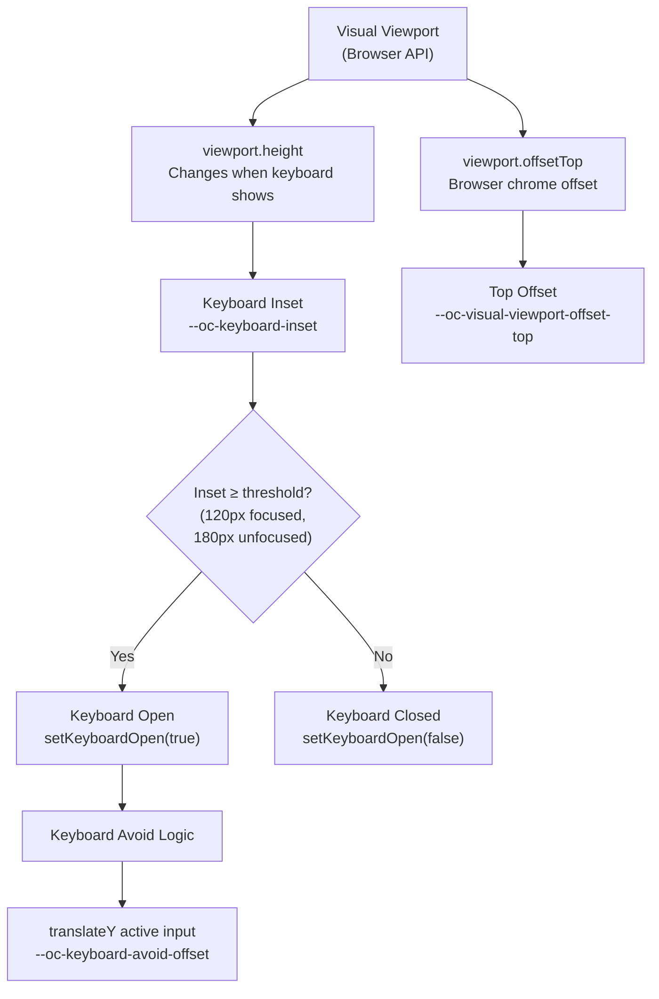

**Visual Viewport Tracking** [packages/ui/src/components/layout/MainLayout.tsx:290-390]():

The system monitors `window.visualViewport` for height changes:
1. Calculate raw inset: `layoutHeight - (viewport.height + viewport.offsetTop)`
2. Apply threshold: 120px when input focused, 180px when unfocused
3. Use sticky state to prevent flicker during keyboard animation
4. Detect closing by height increase while keyboard open

**Keyboard Avoidance** [packages/ui/src/components/layout/MainLayout.tsx:356-378]():

Elements with `data-keyboard-avoid` attribute automatically translate upward when keyboard obscures focused input:
- Target resolution: Check for explicit `data-keyboard-avoid-target-id` or closest `[data-keyboard-avoid]`
- Overlap calculation: Compare input bottom with viewport bottom
- Translation: Set `--oc-keyboard-avoid-offset` CSS variable

**Opt-Out**: Components can use `data-keyboard-avoid="none"` to disable automatic translation (e.g., CodeMirror handles its own scrolling).

**Focus Tracking** [packages/ui/src/components/layout/MainLayout.tsx:411-455]():
- `focusin`: Reset ignore flag, allow keyboard detection when input focused
- `focusout`: Defer keyboard close until next frame to handle focus transitions
- Check visual viewport is actually at zero height before closing

**Sources:** [packages/ui/src/components/layout/MainLayout.tsx:231-469]()

---

## Keyboard Navigation

The header implements keyboard shortcuts for efficient navigation.

### Navigation Shortcuts

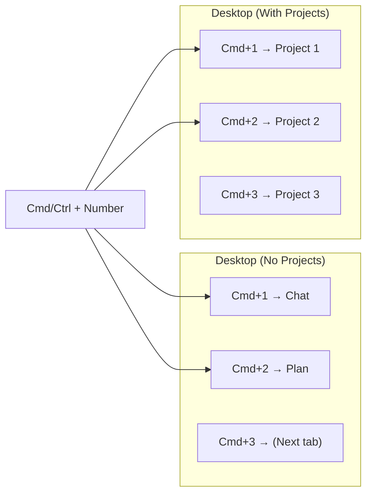

Keyboard handling: [packages/ui/src/components/layout/Header.tsx:1033-1056]()

**Logic**:
1. If `showProjectTabs=true`: Numbers 1-9 switch between projects
2. If `showProjectTabs=false`: Numbers 1-9 switch between main tabs
3. Only primary modifier (Cmd/Ctrl) without Shift/Alt

**Sources:** [packages/ui/src/components/layout/Header.tsx:1033-1056]()

---

## Platform-Specific Adaptations

### VS Code Runtime

VS Code extension uses a simplified layout:

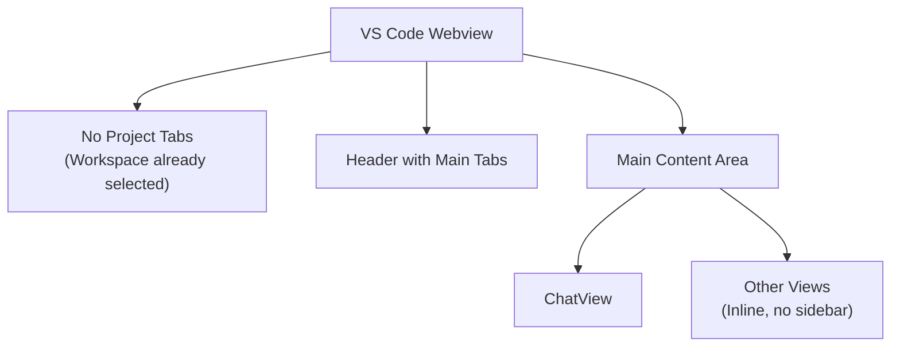

Adaptations:
- Project tabs hidden: [packages/ui/src/components/layout/Header.tsx:282]() checks `!isVSCodeRuntime()`
- Context usage always shown: [packages/ui/src/components/layout/Header.tsx:283]()
- Simplified responsive breakpoints: [packages/ui/src/index.css:651-662]()

**Sources:** [packages/ui/src/components/layout/Header.tsx:281-283](), [packages/ui/src/index.css:651-662]()

### Desktop App

Desktop (Tauri) adds native window features:

**Window Dragging** [packages/ui/src/components/layout/Header.tsx:952-972]():
- Header uses `app-region-drag` CSS class
- Interactive elements use `app-region-no-drag` to prevent conflicts
- Implements `getCurrentWindow().startDragging()` on mousedown

**macOS Traffic Lights** [packages/ui/src/components/layout/Header.tsx:889-908]():
- Header reserves 5.5rem left padding for traffic lights
- Height varies by macOS version:
  - macOS 15 Sequoia+: 56px (`h-14`)
  - macOS 11-14: Default height
  - macOS 10 Big Sur+: 48px (`h-12`)

**Instance Switcher** [packages/ui/src/components/layout/Header.tsx:524-577]():
Desktop can connect to multiple OpenCode backends. The header shows current instance label and provides switcher dialog.

**Sources:** [packages/ui/src/components/layout/Header.tsx:189-234](), [packages/ui/src/components/layout/Header.tsx:889-908](), [packages/ui/src/components/layout/Header.tsx:952-972](), [packages/ui/src/components/layout/Header.tsx:524-577]()

---

## CSS Architecture

Layout styling uses CSS custom properties for dynamic dimensions.

### Key CSS Variables

| Variable | Purpose | Set By |
|----------|---------|--------|
| `--oc-header-height` | Header height in pixels | [packages/ui/src/components/layout/Header.tsx:910-946]() |
| `--oc-visual-viewport-offset-top` | Browser chrome offset | [packages/ui/src/components/layout/MainLayout.tsx:296]() |
| `--oc-keyboard-inset` | Virtual keyboard height | [packages/ui/src/components/layout/MainLayout.tsx:349]() |
| `--oc-keyboard-avoid-offset` | Input translation offset | [packages/ui/src/components/layout/MainLayout.tsx:375]() |
| `--oc-keyboard-home-indicator` | iOS home indicator height | [packages/ui/src/components/layout/MainLayout.tsx:353-354]() |

**Header Height Calculation** [packages/ui/src/components/layout/Header.tsx:910-946]():
- Uses `ResizeObserver` to track header dimensions
- Updates `--oc-header-height` on resize, orientation change
- Allows main content to use `padding-top: var(--oc-header-height)`

**Responsive Label Hiding** [packages/ui/src/index.css:592-609]():
```css
@media (max-width: 940px) {
  .header-tab-label { display: none; }
  .header-open-label { display: none; }
}
```

Tab labels collapse to icons-only on narrow screens.

**Sources:** [packages/ui/src/components/layout/Header.tsx:910-950](), [packages/ui/src/components/layout/MainLayout.tsx:231-469](), [packages/ui/src/index.css:592-609]()

---

## Context Panel Integration

The `ContextPanel` is a special right-side panel that temporarily replaces the left sidebar when opened.

**Auto-Close Left Sidebar** [packages/ui/src/components/layout/MainLayout.tsx:126-140]():
```typescript
if (isContextPanelOpen) {
  if (currentlyOpen) {
    setSidebarOpen(false);
    leftSidebarAutoClosedByContextRef.current = true;
  }
}
```

When context panel opens, left sidebar auto-closes and tracks the state for later restoration.

**Auto-Reopen Logic** [packages/ui/src/components/layout/MainLayout.tsx:136-139]():
When context panel closes, left sidebar reopens if it was auto-closed (not manually closed by user).

**Sources:** [packages/ui/src/components/layout/MainLayout.tsx:69-140]()

---

## Full-Screen Overlays

Settings and multi-run launcher use full-screen overlays with different patterns on mobile vs desktop.

### Mobile Full-Screen Pattern

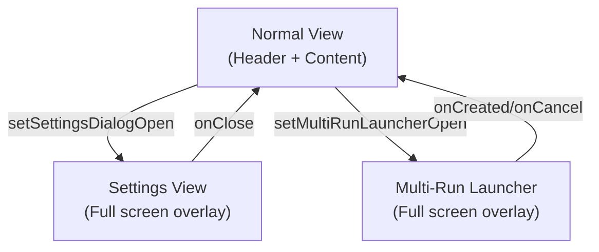

Mobile implementation: [packages/ui/src/components/layout/MainLayout.tsx:532-549]()

Both overlays:
- Use `absolute inset-0 z-10` positioning
- Include `header-safe-area` class for status bar offset
- Hide normal content with conditional rendering

### Desktop Windowed Pattern

Desktop uses windowed dialogs:
- Settings: `SettingsWindow` component with blur backdrop [packages/ui/src/components/layout/MainLayout.tsx:603-606]()
- Multi-run: Inline full-screen overlay [packages/ui/src/components/layout/MainLayout.tsx:589-599]()

**Sources:** [packages/ui/src/components/layout/MainLayout.tsx:504-607]()

---

## Edge Swipe Navigation

Mobile uses edge swipe gestures for sidebar navigation.

The `useEdgeSwipe` hook [packages/ui/src/hooks/useEdgeSwipe.ts]() detects horizontal swipes from screen edges:
- Left edge swipe: Open session sidebar
- Right edge swipe: Close session sidebar (when open)

Enabled in MainLayout: [packages/ui/src/components/layout/MainLayout.tsx:81]()

**Sources:** [packages/ui/src/components/layout/MainLayout.tsx:81](), [packages/ui/src/hooks/useEdgeSwipe.ts]()

---

