<!-- source: DeepWiki mcp.deepwiki.com · repo btriapitsyn/openchamber · page 7.2 Chat Interface · fetched 2026-10-26 -->

# Chat Interface

<details>
<summary>Relevant source files</summary>

The following files were used as context for generating this wiki page:

- [packages/ui/src/components/chat/ChatInput.tsx](packages/ui/src/components/chat/ChatInput.tsx)
- [packages/ui/src/components/chat/MobileSessionStatusBar.tsx](packages/ui/src/components/chat/MobileSessionStatusBar.tsx)
- [packages/ui/src/components/chat/ModelControls.tsx](packages/ui/src/components/chat/ModelControls.tsx)

</details>


## Purpose and Scope

This document describes the chat input interface components that enable users to compose and send messages to AI assistants. The chat interface includes text input, autocomplete systems, file attachment handling, message queuing, and mobile-specific interactions.

For information about how messages are displayed after being sent, see [Message Rendering](#7.4). For details on agent and model selection controls, see [Model and Agent Controls](#7.5). For session management and switching, see [Session Management UI](#7.3).

## Component Architecture

The chat interface consists of three primary components that work together to provide the message composition experience:

```mermaid
graph TB
    ChatInput["ChatInput<br/>(packages/ui/src/components/chat/ChatInput.tsx)"]
    ModelControls["ModelControls<br/>(packages/ui/src/components/chat/ModelControls.tsx)"]
    StatusRow["StatusRow / MobileSessionStatusBar"]
    
    subgraph "Input Components"
        Textarea["Textarea<br/>Auto-resizing text area"]
        AttachedFilesList["AttachedFilesList<br/>File attachment display"]
        QueuedMessageChips["QueuedMessageChips<br/>Queued message display"]
    end
    
    subgraph "Autocomplete Systems"
        CommandAutocomplete["CommandAutocomplete<br/>Slash commands"]
        AgentMentionAutocomplete["AgentMentionAutocomplete<br/>Hash mentions"]
        FileMentionAutocomplete["FileMentionAutocomplete<br/>At mentions"]
        SkillAutocomplete["SkillAutocomplete<br/>Skill selection"]
    end
    
    subgraph "Mobile Components"
        UnifiedControlsDrawer["UnifiedControlsDrawer<br/>Mobile controls panel"]
        MobileAgentButton["MobileAgentButton"]
        MobileModelButton["MobileModelButton"]
        MobileSessionStatusBar["MobileSessionStatusBar"]
    end
    
    ChatInput --> Textarea
    ChatInput --> AttachedFilesList
    ChatInput --> QueuedMessageChips
    ChatInput --> CommandAutocomplete
    ChatInput --> AgentMentionAutocomplete
    ChatInput --> FileMentionAutocomplete
    ChatInput --> SkillAutocomplete
    ChatInput --> UnifiedControlsDrawer
    ChatInput --> ModelControls
    ChatInput --> StatusRow
    
    UnifiedControlsDrawer --> MobileAgentButton
    UnifiedControlsDrawer --> MobileModelButton
    
    ModelControls --> MobileSessionStatusBar
```

**Sources:** [packages/ui/src/components/chat/ChatInput.tsx:1-100](), [packages/ui/src/components/chat/ModelControls.tsx:1-60]()

## Text Input and Auto-sizing

### Textarea Component

The chat input uses a dynamically resizing textarea that adjusts its height based on content up to a maximum of 8 visible lines:

| Feature | Implementation | Location |
|---------|---------------|----------|
| Auto-resize | `adjustTextareaHeight()` recalculates height on content change | [packages/ui/src/components/chat/ChatInput.tsx:861-893]() |
| Max height | `MAX_VISIBLE_TEXTAREA_LINES = 8` lines with scrolling | [packages/ui/src/components/chat/ChatInput.tsx:51]() |
| Draft persistence | Saves to `localStorage` with key `openchamber_chat_input_draft` | [packages/ui/src/components/chat/ChatInput.tsx:59-264]() |
| Mobile focus | Prevents scroll jumping with `preventScroll: true` option | [packages/ui/src/components/chat/ChatInput.tsx:234-242]() |

### Draft Persistence

The input automatically saves drafts to localStorage when the `persistChatDraft` setting is enabled:

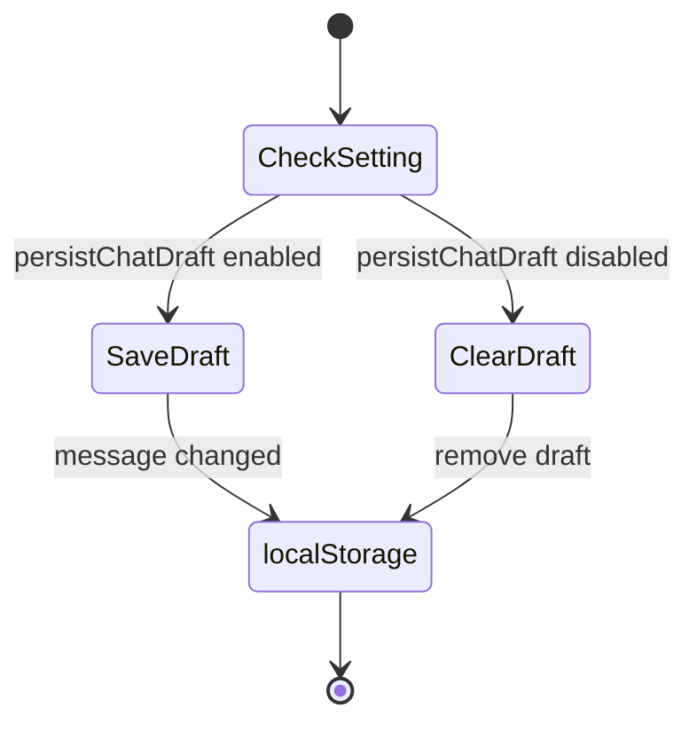

**Sources:** [packages/ui/src/components/chat/ChatInput.tsx:244-264]()

### Message History Navigation

Users can navigate through their previous messages using arrow keys:

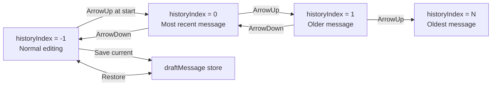

The implementation maintains two state variables:
- `historyIndex`: Current position in history (-1 = not browsing)
- `draftMessage`: Preserves current input when entering history mode

**Sources:** [packages/ui/src/components/chat/ChatInput.tsx:93-96](), [packages/ui/src/components/chat/ChatInput.tsx:757-792]()

## Autocomplete Systems

The chat input provides four context-sensitive autocomplete systems triggered by special characters:

### Trigger Characters and State Management

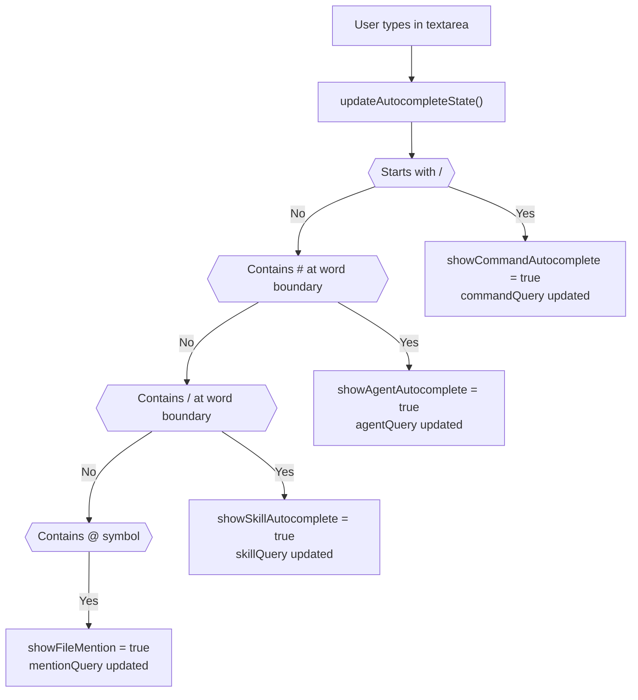

**Sources:** [packages/ui/src/components/chat/ChatInput.tsx:899-975]()

### Autocomplete Reference Table

| Symbol | Component | Purpose | Handler Ref | State Variables |
|--------|-----------|---------|-------------|-----------------|
| `/` | `CommandAutocomplete` | Slash commands | `commandRef` | `showCommandAutocomplete`, `commandQuery` |
| `#` | `AgentMentionAutocomplete` | Agent mentions | `agentRef` | `showAgentAutocomplete`, `agentQuery` |
| `/` (word boundary) | `SkillAutocomplete` | Skill selection | `skillRef` | `showSkillAutocomplete`, `skillQuery` |
| `@` | `FileMentionAutocomplete` | File mentions | `mentionRef` | `showFileMention`, `mentionQuery` |

**Sources:** [packages/ui/src/components/chat/ChatInput.tsx:81-102]()

### Command Autocomplete

Commands are triggered when the input starts with `/`. Examples include:
- `/undo` - Reverts to last message and populates input
- `/redo` - Unrevert or partial redo
- `/timeline` - Opens timeline dialog
- `/compact` - Calls SDK summarize endpoint

Commands are handled locally before sending to the assistant:

**Sources:** [packages/ui/src/components/chat/ChatInput.tsx:546-596]()

### Mobile Tab Selection

On mobile, users can switch between autocomplete types using tabs:

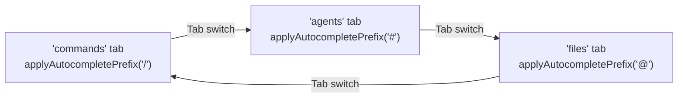

**Sources:** [packages/ui/src/components/chat/ChatInput.tsx:995-1027]()

## File Attachments

The chat input supports multiple methods of attaching files to messages:

### Attachment Methods

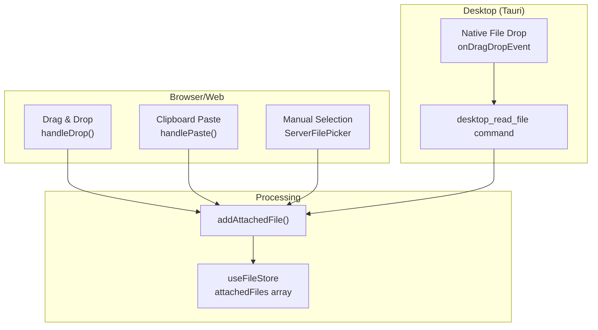

**Sources:** [packages/ui/src/components/chat/ChatInput.tsx:1096-1149](), [packages/ui/src/components/chat/ChatInput.tsx:1392-1424](), [packages/ui/src/components/chat/ChatInput.tsx:1427-1528]()

### Drag and Drop Implementation

The component maintains drag state and handles different data transfer types:

| State | Purpose | Trigger |
|-------|---------|---------|
| `isDragging` | Visual feedback during drag | `handleDragEnter`, `handleDragOver` |
| `canAcceptDropRef` | Validates drop target | Updated when `currentSessionId` changes |

For desktop (Tauri) environments, the component uses native file drop events and handles retina display coordinate scaling:

**Sources:** [packages/ui/src/components/chat/ChatInput.tsx:1427-1528]()

### Paste Handler

The paste handler processes both text and images from the clipboard:

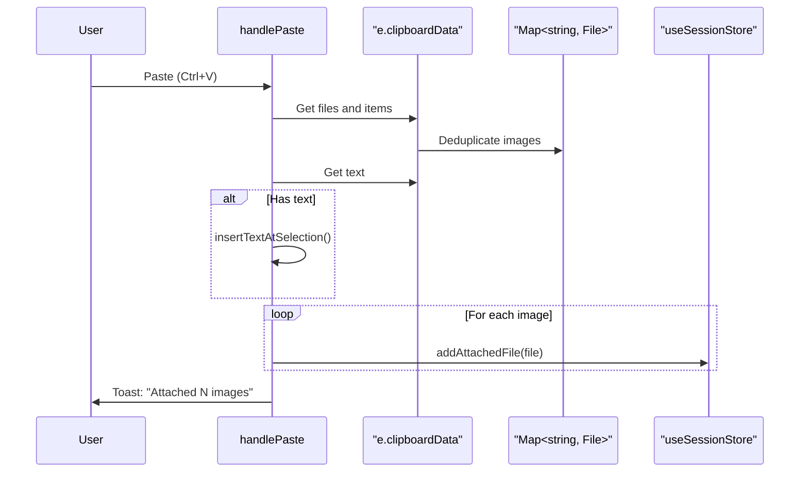

**Sources:** [packages/ui/src/components/chat/ChatInput.tsx:1096-1149]()

### Server File Picker

The `ServerFilePicker` component allows manual file selection from the project directory:

**Sources:** [packages/ui/src/components/chat/ChatInput.tsx:26](), [packages/ui/src/components/chat/ChatInput.tsx:114]()

## Message Queue

The message queue allows users to compose multiple messages while the assistant is working:

### Queue State Management

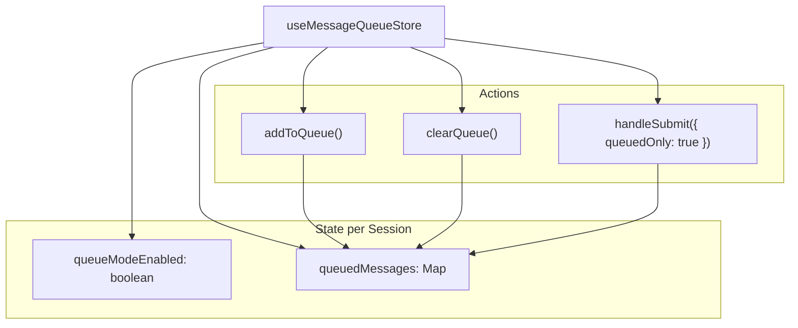

**Sources:** [packages/ui/src/components/chat/ChatInput.tsx:133-144]()

### Queue Mode Behavior

The queue mode changes the behavior of Enter and Ctrl+Enter:

| Queue Mode | Enter | Ctrl+Enter | Condition |
|------------|-------|------------|-----------|
| Enabled | Add to queue | Send all | `queueModeEnabled = true` |
| Disabled | Send | Add to queue | `queueModeEnabled = false` |

**Sources:** [packages/ui/src/components/chat/ChatInput.tsx:794-823]()

### Auto-Send Queued Messages

The component automatically sends queued messages when the session transitions from busy to idle:

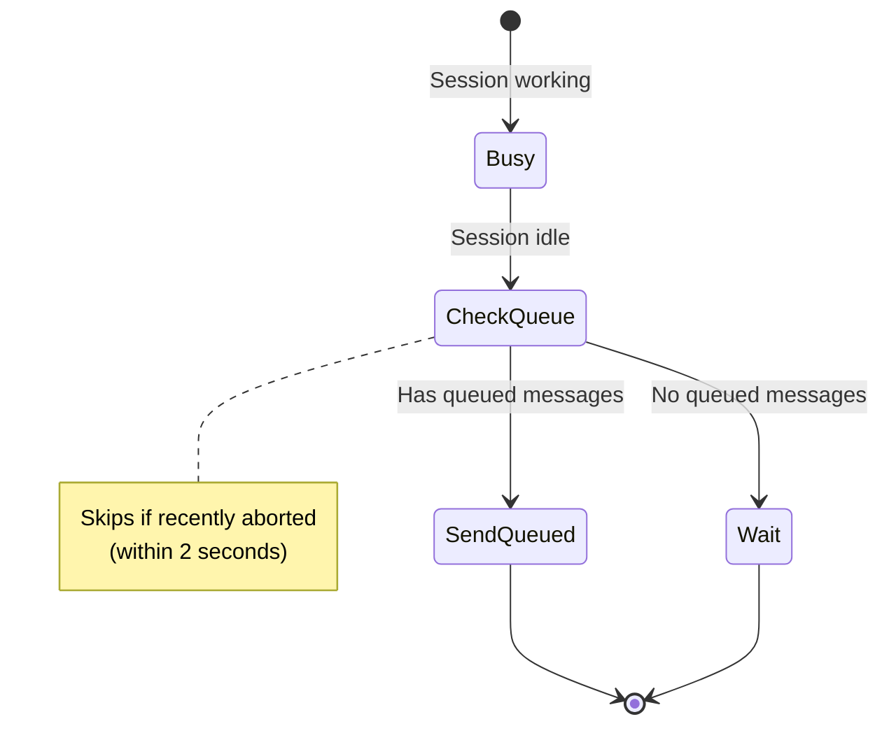

**Sources:** [packages/ui/src/components/chat/ChatInput.tsx:675-703]()

## Message Submission Flow

### Primary Submission Path

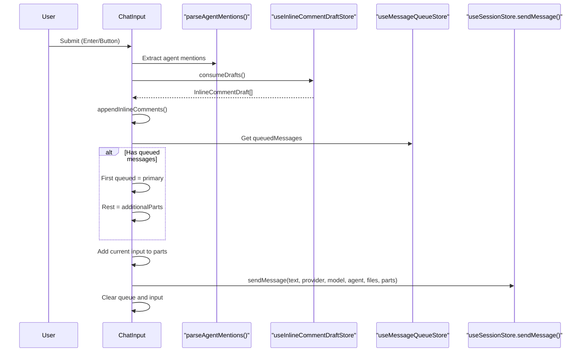

**Sources:** [packages/ui/src/components/chat/ChatInput.tsx:427-661]()

### Message Parts Structure

Messages can consist of multiple parts for queued messages and inline comments:

| Field | Type | Purpose |
|-------|------|---------|
| `primaryText` | `string` | First message text |
| `primaryAttachments` | `AttachedFile[]` | Files for first message |
| `additionalParts` | `Array<{text, attachments?, synthetic?}>` | Queued messages and conflict resolutions |
| `agentMentionName` | `string \| undefined` | Agent override from `#mention` |

**Sources:** [packages/ui/src/components/chat/ChatInput.tsx:445-524]()

### Error Recovery

When message sending fails, the component attempts to restore attachments:

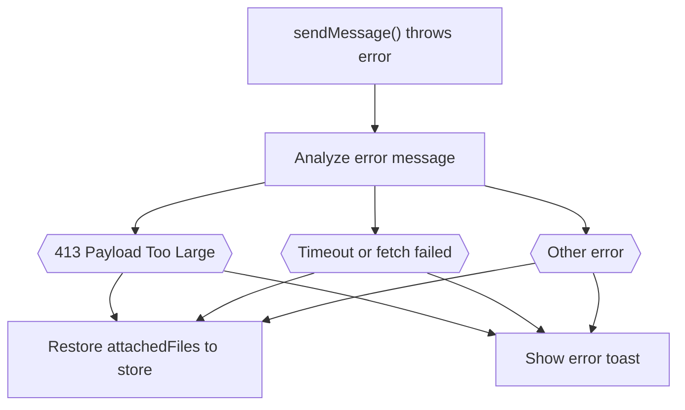

**Sources:** [packages/ui/src/components/chat/ChatInput.tsx:614-656]()

## Mobile Interface

### Mobile Controls Architecture

The mobile interface uses drawer panels for controls that are displayed inline on desktop:

```mermaid
graph TB
    MobileButton["Input bar buttons<br/>(agent, model, attach)"]
    UnifiedControlsDrawer["UnifiedControlsDrawer<br/>Bottom sheet panel"]
    
    subgraph "Panel Types (mobileControlsPanel)"
        AgentPanel["'agent'<br/>Agent selection"]
        ModelPanel["'model'<br/>Model selection"]
        FilesPanel["'files'<br/>File picker"]
    end
    
    MobileButton -->|handleOpenMobilePanel()| UnifiedControlsDrawer
    UnifiedControlsDrawer --> AgentPanel
    UnifiedControlsDrawer --> ModelPanel
    UnifiedControlsDrawer --> FilesPanel
```

**Sources:** [packages/ui/src/components/chat/ChatInput.tsx:28](), [packages/ui/src/components/chat/ChatInput.tsx:342-361]()

### Mobile Session Status Bar

On mobile devices, the `MobileSessionStatusBar` displays session information at the top of the chat view:

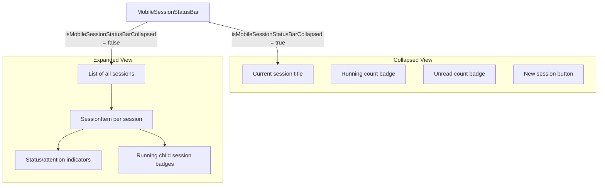

**Sources:** [packages/ui/src/components/chat/MobileSessionStatusBar.tsx:1-535]()

### Session Grouping Logic

The mobile status bar groups sessions into running and idle categories:

| Category | Criteria | Sort Order |
|----------|----------|------------|
| Running | `statusType !== 'idle'` OR has running children OR needs attention | Most recent first |
| Idle | No activity | Most recent first |

**Sources:** [packages/ui/src/components/chat/MobileSessionStatusBar.tsx:64-105]()

### Touch Interactions

Mobile-specific touch handling prevents iOS scroll behavior issues:

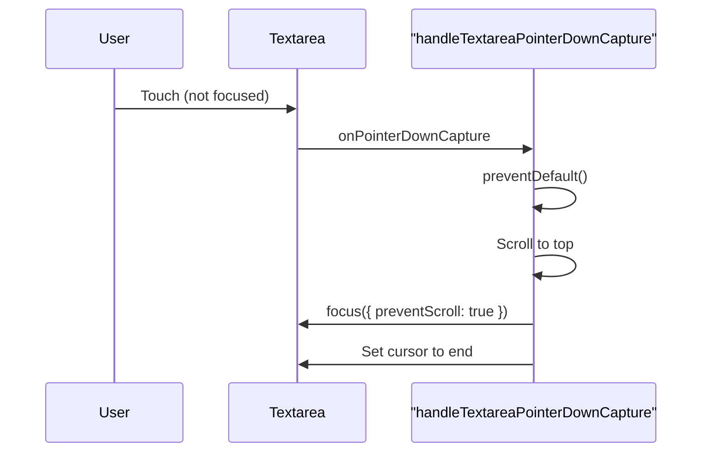

**Sources:** [packages/ui/src/components/chat/ChatInput.tsx:271-313]()

## Keyboard Interactions

### Keyboard Shortcut Reference

| Key Combination | Context | Action |
|----------------|---------|--------|
| `Enter` | Queue mode off | Send message |
| `Ctrl/Cmd + Enter` | Queue mode off | Add to queue |
| `Enter` | Queue mode on | Add to queue |
| `Ctrl/Cmd + Enter` | Queue mode on | Send all |
| `Shift + Enter` | Always | New line |
| `Tab` | No autocomplete | Cycle to next agent |
| `Tab` | Autocomplete open | Navigate autocomplete |
| `ArrowUp` | Cursor at start | Navigate to older message |
| `ArrowDown` | In history mode | Navigate to newer message |
| `Escape` | Autocomplete open | Close autocomplete |

**Sources:** [packages/ui/src/components/chat/ChatInput.tsx:705-824]()

### IME Composition Handling

The component properly handles Input Method Editor (IME) composition for international keyboards:

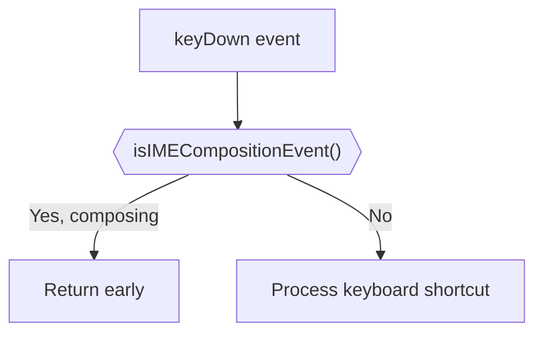

**Sources:** [packages/ui/src/components/chat/ChatInput.tsx:705-708](), [packages/ui/src/components/chat/ChatInput.tsx:40]()

## State Management Integration

The chat input integrates with multiple Zustand stores:

### Store Dependencies

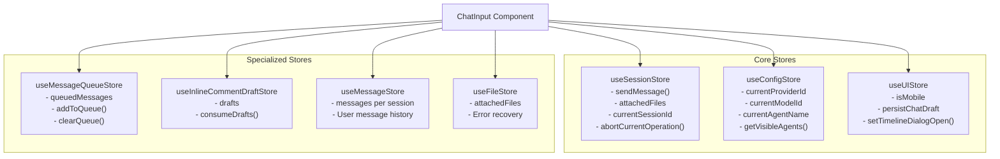

**Sources:** [packages/ui/src/components/chat/ChatInput.tsx:12-39](), [packages/ui/src/components/chat/ChatInput.tsx:104-159]()

### Session Store Actions

| Action | Purpose | Return Type |
|--------|---------|-------------|
| `sendMessage()` | Submit message with parts to OpenCode | `Promise<void>` |
| `addAttachedFile()` | Add file to attachments | `Promise<void>` |
| `addServerFile()` | Add file from server path | `void` |
| `clearAttachedFiles()` | Remove all attachments | `void` |
| `abortCurrentOperation()` | Cancel running operation | `Promise<void>` |
| `consumePendingInputText()` | Get text from undo/redo | `{text: string, mode: 'replace' \| 'append'} \| null` |

**Sources:** [packages/ui/src/components/chat/ChatInput.tsx:104-120]()

## Abort and Status Handling

### Abort Flow

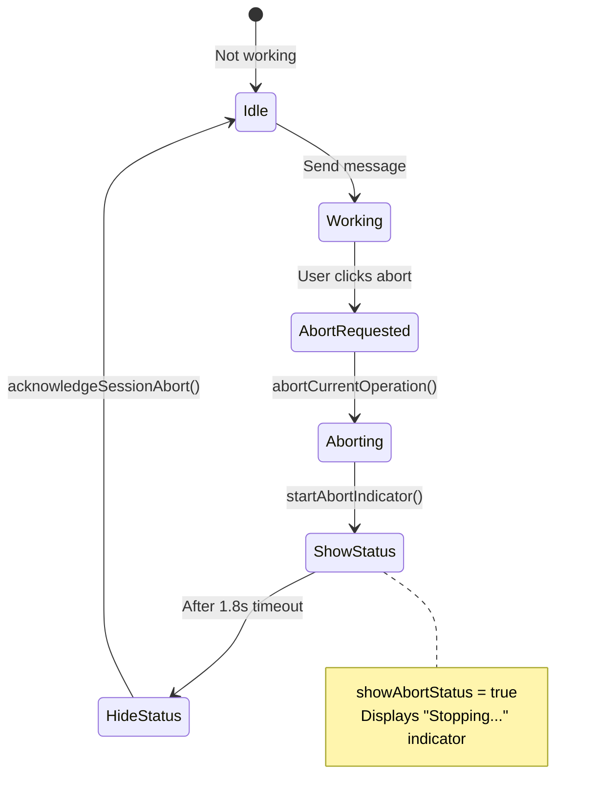

**Sources:** [packages/ui/src/components/chat/ChatInput.tsx:826-845]()

### Session Abort Flags

The component tracks recent aborts to prevent auto-sending queued messages immediately after an abort:

**Sources:** [packages/ui/src/components/chat/ChatInput.tsx:681-686]()

## Component Props and Configuration

### ChatInput Props

| Prop | Type | Purpose |
|------|------|---------|
| `onOpenSettings` | `() => void` (optional) | Callback to open settings panel |
| `scrollToBottom` | `(options?: {instant?, force?}) => void` (optional) | Scroll chat to bottom |

**Sources:** [packages/ui/src/components/chat/ChatInput.tsx:54-57]()

### ModelControls Props

| Prop | Type | Purpose |
|------|------|---------|
| `className` | `string` (optional) | CSS classes for container |
| `mobilePanel` | `MobileControlsPanel` (optional) | External mobile panel state |
| `onMobilePanelChange` | `(panel: MobileControlsPanel) => void` (optional) | Mobile panel state setter |
| `onMobilePanelSelection` | `() => void` (optional) | Callback after selection |
| `onAgentPanelSelection` | `() => void` (optional) | Agent-specific selection callback |

**Sources:** [packages/ui/src/components/chat/ModelControls.tsx:276-282]()

### MobileSessionStatusBar Props

| Prop | Type | Purpose |
|------|------|---------|
| `onSessionSwitch` | `(sessionId: string) => void` (optional) | Callback when session changes |
| `cornerRadius` | `number` (optional) | Border radius for styling |

**Sources:** [packages/ui/src/components/chat/MobileSessionStatusBar.tsx:10-13]()

---

