<!-- source: DeepWiki mcp.deepwiki.com · repo btriapitsyn/openchamber · page 7.3 Session Management UI · fetched 2026-10-26 -->

# Session Management UI

<details>
<summary>Relevant source files</summary>

The following files were used as context for generating this wiki page:

- [packages/ui/src/components/session/BranchPickerDialog.tsx](packages/ui/src/components/session/BranchPickerDialog.tsx)
- [packages/ui/src/components/session/SessionSidebar.tsx](packages/ui/src/components/session/SessionSidebar.tsx)
- [packages/ui/src/lib/worktreeSessionCreator.ts](packages/ui/src/lib/worktreeSessionCreator.ts)
- [packages/ui/src/stores/useProjectsStore.ts](packages/ui/src/stores/useProjectsStore.ts)

</details>


This document describes the UI components responsible for organizing and managing sessions in the OpenChamber interface. It covers the session sidebar, session list display, project organization, worktree integration UI, and related dialogs.

For information about the underlying session state management and data storage, see [State Management](#3.4). For details about Git worktree operations and multi-run execution, see [Worktrees and Multi-Run](#8.2).

## Overview

Session management UI provides a hierarchical interface for organizing AI conversations within projects. The primary component is `SessionSidebar`, which displays:

- **Project-based organization**: Sessions grouped by project directory
- **Workspace groups**: Sessions organized by Git worktrees within projects
- **Hierarchical sessions**: Parent-child session relationships with expand/collapse
- **Session metadata**: Date labels, worktree indicators, file change statistics
- **Interactive actions**: Rename, delete, share, pin sessions
- **Drag-and-drop**: Project reordering with persistence

Supporting components include `BranchPickerDialog` for branch management, `GitHubIssuePickerDialog` and `GitHubPullRequestPickerDialog` for GitHub-based session creation, and `ProjectNotesTodoPanel` for project notes.

## Component Architecture

The session management UI is built from several interconnected components that work with Zustand stores to manage project and session data.

### Core Components Diagram

```mermaid
graph TB
    SessionSidebar["SessionSidebar<br/>Main container component"]
    
    subgraph "Project Display"
        SortableProjectItem["SortableProjectItem<br/>Drag-and-drop project header"]
        ProjectDragOverlay["ProjectDragOverlay<br/>Visual feedback during drag"]
    end
    
    subgraph "Session Display"
        SortableGroupItem["SortableGroupItem<br/>Workspace group container"]
        GroupDragOverlay["GroupDragOverlay<br/>Visual feedback for group drag"]
        renderSessionNode["renderSessionNode()<br/>Recursive session tree renderer"]
    end
    
    subgraph "Dialog Components"
        BranchPickerDialog["BranchPickerDialog<br/>Branch management UI"]
        GitHubIssuePickerDialog["GitHubIssuePickerDialog<br/>Create session from issue"]
        GitHubPullRequestPickerDialog["GitHubPullRequestPickerDialog<br/>Create session from PR"]
        ProjectNotesTodoPanel["ProjectNotesTodoPanel<br/>Project notes editor"]
    end
    
    subgraph "State Stores"
        useSessionStore["useSessionStore<br/>sessions, worktreeMetadata"]
        useProjectsStore["useProjectsStore<br/>projects, activeProjectId"]
        useDirectoryStore["useDirectoryStore<br/>currentDirectory"]
        useUIStore["useUIStore<br/>UI preferences"]
        useGitStore["useGitStore<br/>Git status, branches"]
    end
    
    SessionSidebar --> SortableProjectItem
    SessionSidebar --> SortableGroupItem
    SessionSidebar --> renderSessionNode
    SessionSidebar --> ProjectDragOverlay
    SessionSidebar --> GroupDragOverlay
    
    SessionSidebar --> BranchPickerDialog
    SessionSidebar --> GitHubIssuePickerDialog
    SessionSidebar --> GitHubPullRequestPickerDialog
    SessionSidebar --> ProjectNotesTodoPanel
    
    SessionSidebar --> useSessionStore
    SessionSidebar --> useProjectsStore
    SessionSidebar --> useDirectoryStore
    SessionSidebar --> useUIStore
    SessionSidebar --> useGitStore
```

**Sources**: [packages/ui/src/components/session/SessionSidebar.tsx:1-81](), [packages/ui/src/components/session/SessionSidebar.tsx:246-537](), [packages/ui/src/components/session/SessionSidebar.tsx:559-2075]()

## SessionSidebar Component

The `SessionSidebar` component is the primary interface for browsing and managing sessions, displayed in the left sidebar of the application. It renders a hierarchical view of projects, workspace groups, and sessions.

### Data Flow and Rendering Pipeline

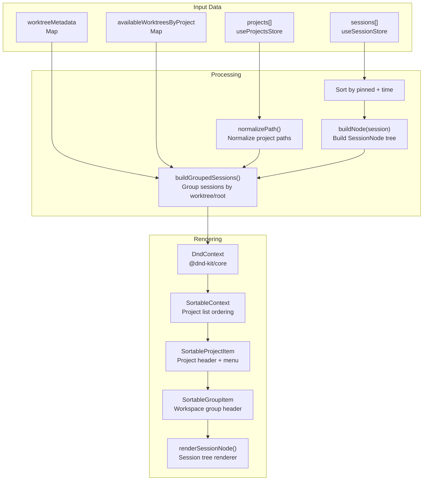

**Sources**: [packages/ui/src/components/session/SessionSidebar.tsx:664-806](), [packages/ui/src/components/session/SessionSidebar.tsx:848-862](), [packages/ui/src/components/session/SessionSidebar.tsx:1169-1180](), [packages/ui/src/components/session/SessionSidebar.tsx:1182-1298]()

### Project Organization

Projects are displayed as collapsible sections with sticky headers. Each project shows its directory path, sessions, and workspace groups.

| Project Feature | Implementation | Source |
|----------------|----------------|--------|
| Sticky headers | IntersectionObserver on sentinel div | Lines 1592-1638 |
| Collapse state | `collapsedProjects` Set, persisted to localStorage | Lines 579, 756-765 |
| Drag-and-drop | `@dnd-kit/core` with `SortableProjectItem` | Lines 246-506, 1437-1475 |
| Context menu | DropdownMenu with rename, close, new session | Lines 391-452 |

### Project Actions

| Action | UI Element | Handler | Store Method |
|--------|-----------|---------|--------------|
| Add Project | "+" button in header | `handleOpenDirectoryDialog()` | `addProject()` |
| Remove Project | Context menu "Close Project" | Menu item → `onClose` prop | `removeProject()` |
| Rename Project | Context menu "Rename" | Inline input form | `renameProject()` |
| New Session | "+" button on project header | `onNewSession` prop | `openNewSessionDraft()` |
| New Worktree Session | Branch icon button (if git repo) | `onNewWorktreeSession` prop | Calls `createWorktreeSession()` |
| New from Issue | Context menu (if git repo) | Opens `GitHubIssuePickerDialog` | Dialog callback |
| New from PR | Context menu (if git repo) | Opens `GitHubPullRequestPickerDialog` | Dialog callback |
| Manage Branches | Context menu (if git repo) | Opens `BranchPickerDialog` | Dialog operations |
| Multi-Run | Context menu (if git repo) | `openMultiRunLauncher()` | Opens launcher dialog |

**Sources**: [packages/ui/src/components/session/SessionSidebar.tsx:1126-1166](), [packages/ui/src/components/session/SessionSidebar.tsx:391-452](), [packages/ui/src/components/session/SessionSidebar.tsx:454-496]()

### Drag-and-Drop Implementation

Projects and workspace groups can be reordered using `@dnd-kit/core`:

#### Project Reordering

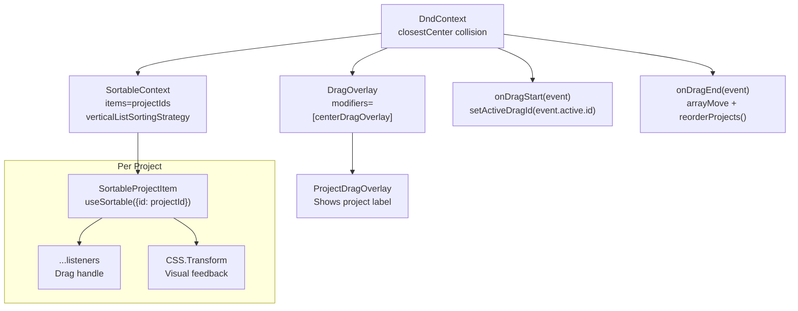

**Sources**: [packages/ui/src/components/session/SessionSidebar.tsx:6-22](), [packages/ui/src/components/session/SessionSidebar.tsx:176-187](), [packages/ui/src/components/session/SessionSidebar.tsx:278-283](), [packages/ui/src/components/session/SessionSidebar.tsx:1437-1475]()

#### Workspace Group Reordering

Workspace groups within a project can also be reordered:

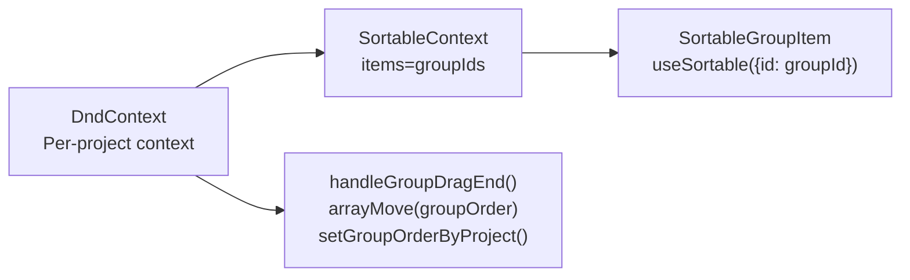

The group order is persisted to localStorage under `'oc.sessions.groupOrder'`.

**Sources**: [packages/ui/src/components/session/SessionSidebar.tsx:508-537](), [packages/ui/src/components/session/SessionSidebar.tsx:1477-1525](), [packages/ui/src/components/session/SessionSidebar.tsx:89]()

## Session Grouping and Display

Sessions are organized into a three-level hierarchy: projects → workspace groups → sessions.

### Workspace Groups (SessionGroup Type)

Sessions are grouped by their worktree directory within each project:

```typescript
type SessionGroup = {
  id: string;                    // 'root' or group identifier
  label: string;                 // Display label
  branch: string | null;         // Git branch name
  description: string | null;    // Full path description
  isMain: boolean;              // True for project root group
  worktree: WorktreeMetadata | null;
  directory: string | null;     // Normalized directory path
  sessions: SessionNode[];      // Session tree roots
};
```

**Sources**: [packages/ui/src/components/session/SessionSidebar.tsx:202-211]()

### Session Grouping Algorithm

The `buildGroupedSessions()` function groups sessions by their worktree:

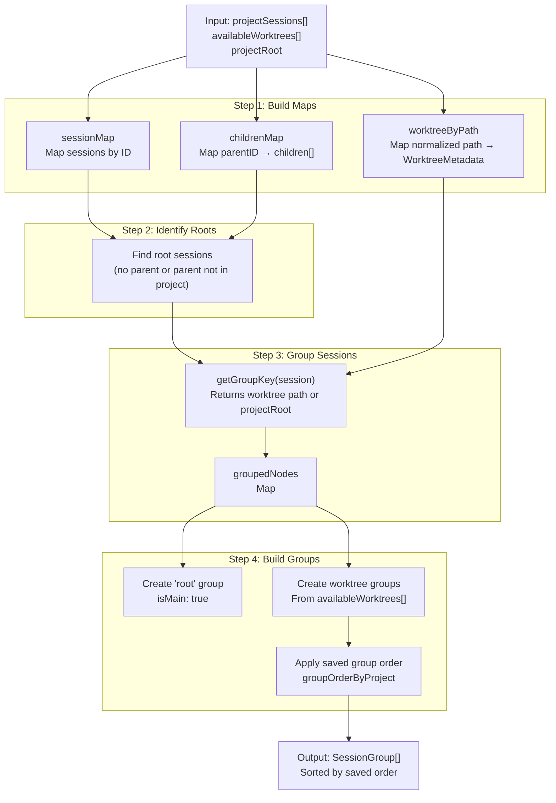

**Sources**: [packages/ui/src/components/session/SessionSidebar.tsx:1182-1298]()

### Session Node Rendering

Each session is rendered recursively by `renderSessionNode()`:

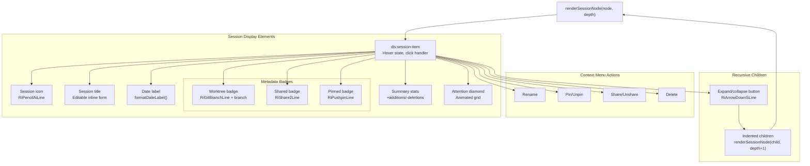

**Sources**: [packages/ui/src/components/session/SessionSidebar.tsx:1300-1591]()

### Session Node Features

| Feature | Implementation | State Storage |
|---------|----------------|---------------|
| Title editing | Inline form with save/cancel | `editingId`, `editTitle` |
| Date labels | `formatDateLabel()` - Today/Yesterday/Date | Computed from `session.time.updated` |
| Expand/collapse | Toggle button, recursive children | `expandedParents` Set, localStorage |
| Pinned sessions | Pin icon badge, sort priority | `pinnedSessionIds` Set, localStorage |
| Worktree badge | Branch icon + tooltip with path | From `worktreeMetadata` Map |
| Shared badge | Share icon, copy URL on click | From `session.share` property |
| Summary stats | "+5/-3" format | From `session.summary` property |
| Attention state | Animated diamond grid | From `sessionAttentionStates` Map |

**Sources**: [packages/ui/src/components/session/SessionSidebar.tsx:1007-1060](), [packages/ui/src/components/session/SessionSidebar.tsx:82-86](), [packages/ui/src/components/session/SessionSidebar.tsx:590-601](), [packages/ui/src/components/session/SessionSidebar.tsx:1133-1145]()

## Worktree Session Creation

The UI provides multiple entry points for creating worktree-based sessions:

### Creation Methods

| Method | UI Trigger | Function Called | Notes |
|--------|-----------|-----------------|-------|
| New Worktree Session | Branch icon button on project | `createWorktreeSession()` | Auto-generates branch name |
| New from GitHub Issue | Context menu → GitHub icon | `createWorktreeSessionForNewBranch()` | Branch from issue data |
| New from GitHub PR | Context menu → PR icon | `createWorktreeSessionForBranch()` | Checks out PR branch |
| Branch Picker | Context menu → Manage Branches | Creates worktree for existing branch | Via `BranchPickerDialog` |

**Sources**: [packages/ui/src/components/session/SessionSidebar.tsx:1126-1166](), [packages/ui/src/lib/worktreeSessionCreator.ts:60-226](), [packages/ui/src/lib/worktreeSessionCreator.ts:310-487]()

### Worktree Session Creation Flow

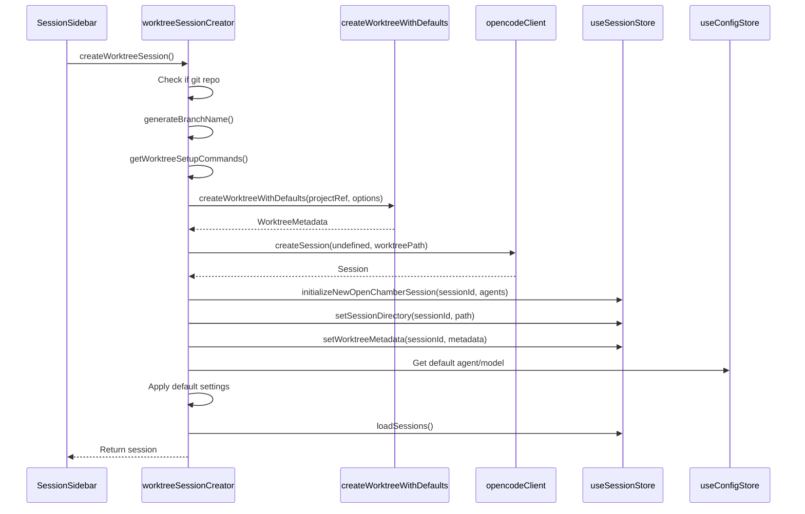

**Sources**: [packages/ui/src/lib/worktreeSessionCreator.ts:60-226]()

## Branch Picker Dialog

The `BranchPickerDialog` component provides a UI for managing Git branches and their associated worktrees.

### Branch Management Features

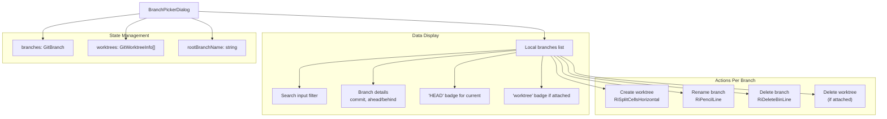

**Sources**: [packages/ui/src/components/session/BranchPickerDialog.tsx:1-583]()

### Branch Operations

| Operation | Implementation | Confirmation |
|-----------|----------------|--------------|
| Create worktree | Calls `createWorktreeWithDefaults()` | None |
| Rename | Calls `renameBranch()`, inline edit form | Confirm button |
| Delete | Calls `deleteGitBranch()`, force if not merged | Double-confirm for force |
| Delete worktree | Calls `sessionEvents.requestDelete()` with worktree metadata | External confirmation dialog |

The dialog protects the project root branch from rename/delete operations.

**Sources**: [packages/ui/src/components/session/BranchPickerDialog.tsx:143-166](), [packages/ui/src/components/session/BranchPickerDialog.tsx:168-195](), [packages/ui/src/components/session/BranchPickerDialog.tsx:197-231](), [packages/ui/src/components/session/BranchPickerDialog.tsx:233-285]()

## GitHub Integration Dialogs

Two dialog components enable creating sessions from GitHub issues and pull requests.

### GitHub Issue Picker

`GitHubIssuePickerDialog` displays a searchable list of repository issues:

- Fetches issues via `runtimeApis.github.getIssues()`
- Shows issue number, title, author, labels, status
- On selection, creates worktree with branch name `issue-{number}-{slug}`
- Calls `createWorktreeSessionForNewBranch()` with issue details in initial message

**Sources**: [packages/ui/src/components/session/GitHubIssuePickerDialog.tsx:1-500]() (inferred from imports in SessionSidebar.tsx:77)

### GitHub Pull Request Picker

`GitHubPullRequestPickerDialog` displays a searchable list of pull requests:

- Fetches PRs via `runtimeApis.github.getPullRequests()`
- Shows PR number, title, author, branch, status
- On selection, creates worktree checking out the PR head branch
- Calls `createWorktreeSessionForBranch()` with PR metadata
- Sets upstream to PR head for easy push

**Sources**: [packages/ui/src/components/session/GitHubPullRequestPickerDialog.tsx:1-600]() (inferred from imports in SessionSidebar.tsx:78)

## Session Actions

The sidebar provides several actions for managing sessions through context menus and inline controls.

### Session Selection

Clicking a session triggers `handleSessionSelect()`:

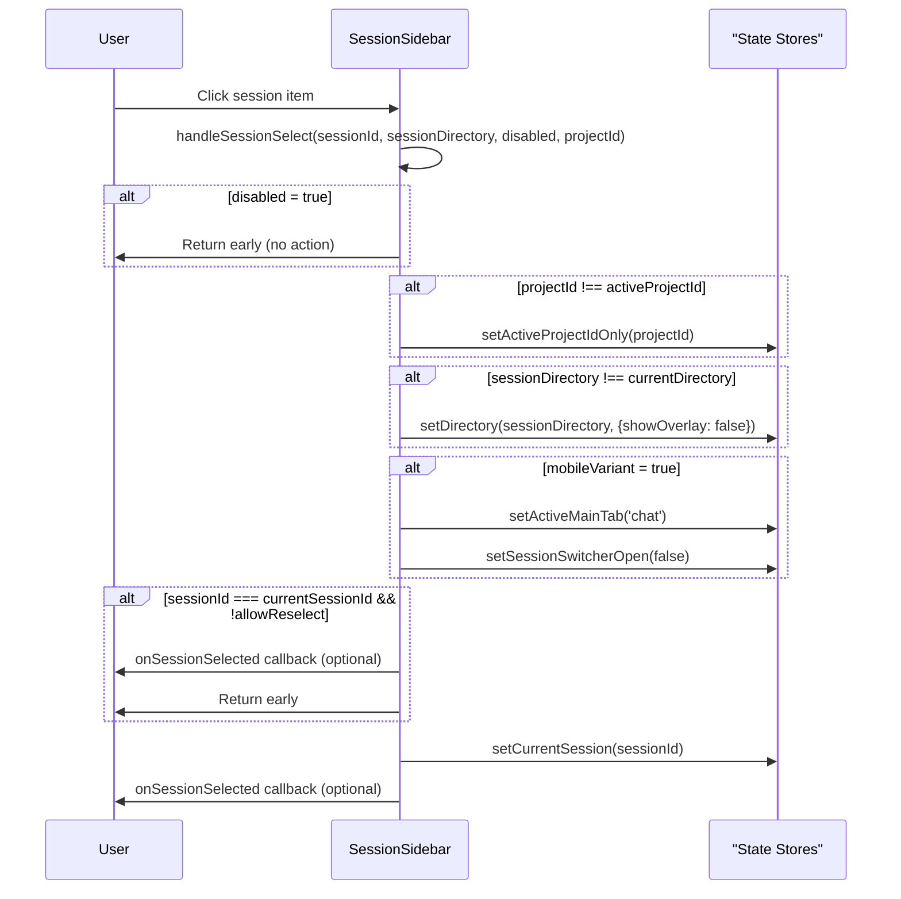

**Sources**: [packages/ui/src/components/session/SessionSidebar.tsx:950-993]()

### Session Context Menu Actions

| Action | Handler | Implementation | State Update |
|--------|---------|----------------|--------------|
| Rename | `handleSaveEdit()` | Inline input form, calls `updateSessionTitle()` | `editingId`, `editTitle` |
| Pin/Unpin | `togglePinnedSession()` | Toggle in `pinnedSessionIds` Set | Persisted to localStorage |
| Share | `handleShareSession()` | Calls `shareSession()`, returns share URL | Updates `session.share` |
| Copy Link | `handleCopyShareUrl()` | `navigator.clipboard.writeText()` | Shows toast |
| Unshare | `handleUnshareSession()` | Calls `unshareSession()` | Removes `session.share` |
| Delete | `handleDeleteSession()` | Checks for worktree/descendants | Calls `deleteSession()` or `deleteSessions()` |

**Sources**: [packages/ui/src/components/session/SessionSidebar.tsx:1000-1011](), [packages/ui/src/components/session/SessionSidebar.tsx:791-801](), [packages/ui/src/components/session/SessionSidebar.tsx:1026-1068](), [packages/ui/src/components/session/SessionSidebar.tsx:1089-1124]()

### Session Deletion Logic

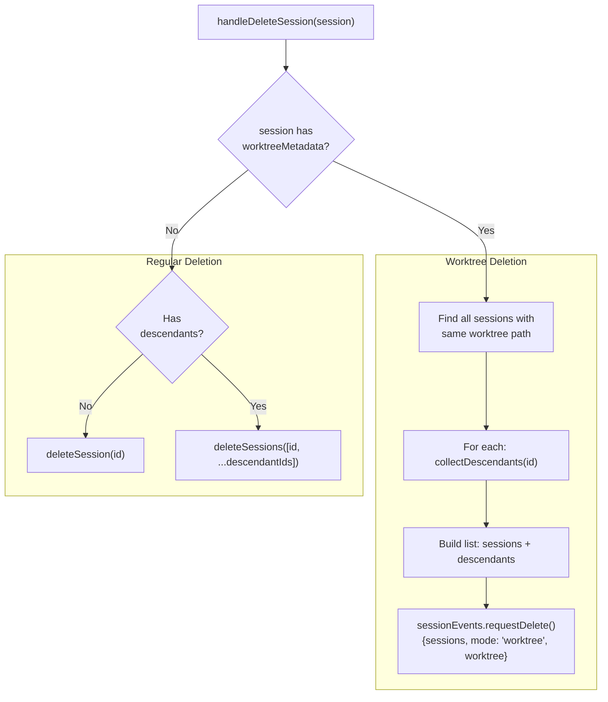

The worktree deletion path uses `sessionEvents.requestDelete()` to show a confirmation dialog before deletion.

**Sources**: [packages/ui/src/components/session/SessionSidebar.tsx:1089-1124](), [packages/ui/src/components/session/SessionSidebar.tsx:1070-1084]()

### Session Sharing Workflow

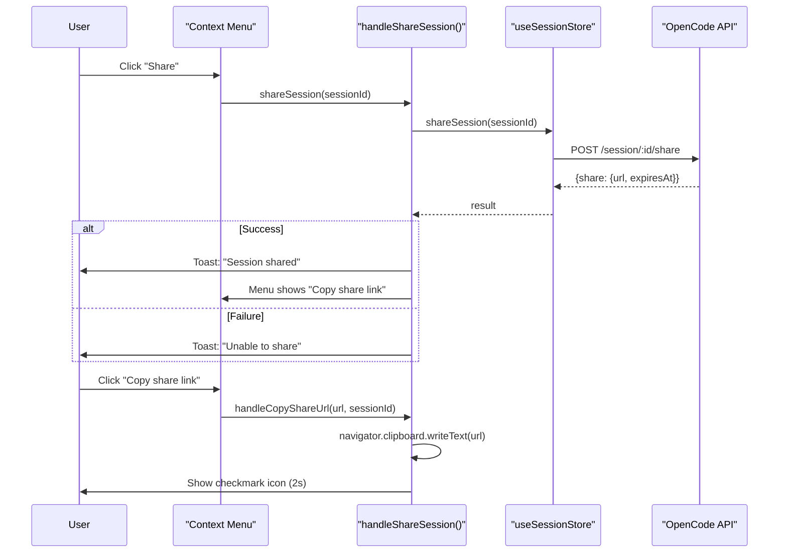

**Sources**: [packages/ui/src/components/session/SessionSidebar.tsx:1026-1056](), [packages/ui/src/components/session/SessionSidebar.tsx:1040-1056](), [packages/ui/src/components/session/SessionSidebar.tsx:1058-1068]()

## Sticky Headers and Scroll Behavior

On desktop runtime, project headers become sticky when scrolling, providing visual context.

### Sticky Header Implementation

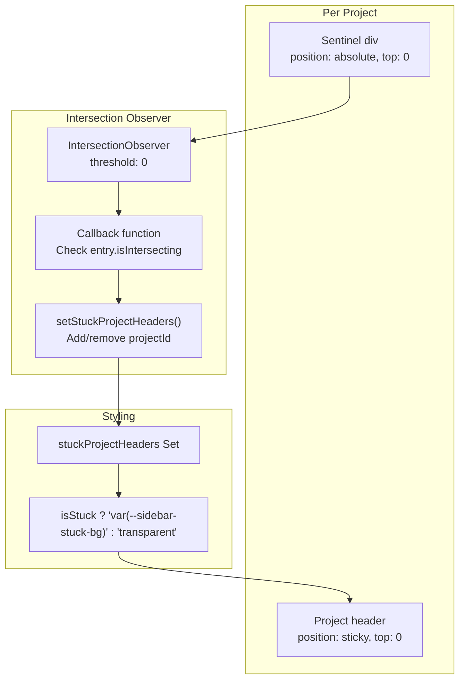

When the sentinel div scrolls out of view (exits intersection), the header is marked as "stuck" and receives a background color.

**Sources**: [packages/ui/src/components/session/SessionSidebar.tsx:1592-1638](), [packages/ui/src/components/session/SessionSidebar.tsx:294-299](), [packages/ui/src/components/session/SessionSidebar.tsx:307-316]()

## State Management Integration

The session management UI relies on several Zustand stores for coordinated state updates:

### Store Dependencies

```mermaid
graph TB
    SessionSidebar["SessionSidebar Component"]
    
    subgraph "Read-Only State"
        sessions["useSessionStore<br/>sessions, currentSessionId"]
        sessionMeta["useSessionStore<br/>worktreeMetadata, sessionsByDirectory"]
        sessionStatus["useSessionStore<br/>sessionStatus, sessionAttentionStates"]
        projects["useProjectsStore<br/>projects, activeProjectId"]
        directory["useDirectoryStore<br/>currentDirectory, homeDirectory"]
        ui["useUIStore<br/>setActiveMainTab, setSessionSwitcherOpen"]
        config["useConfigStore<br/>settingsAutoCreateWorktree"]
        git["useGitStore<br/>directories (git status)"]
    end
    
    subgraph "State Mutations"
        setCurrentSession["setCurrentSession(id)"]
        updateSessionTitle["updateSessionTitle(id, title)"]
        deleteSession["deleteSession(id)"]
        shareSession["shareSession(id)"]
        setActiveProject["setActiveProject(id)"]
        setDirectory["setDirectory(path)"]
        addProject["addProject(path)"]
        removeProject["removeProject(id)"]
        renameProject["renameProject(id, label)"]
    end
    
    SessionSidebar --> sessions
    SessionSidebar --> sessionMeta
    SessionSidebar --> sessionStatus
    SessionSidebar --> projects
    SessionSidebar --> directory
    SessionSidebar --> ui
    SessionSidebar --> config
    SessionSidebar --> git
    
    SessionSidebar --> setCurrentSession
    SessionSidebar --> updateSessionTitle
    SessionSidebar --> deleteSession
    SessionSidebar --> shareSession
    SessionSidebar --> setActiveProject
    SessionSidebar --> setDirectory
    SessionSidebar --> addProject
    SessionSidebar --> removeProject
    SessionSidebar --> renameProject
```

**Sources**: [packages/ui/src/components/session/SessionSidebar.tsx:660-696]()

## Directory Status Checking

The sidebar continuously checks if project and session directories still exist on the file system:

### Directory Validation Flow

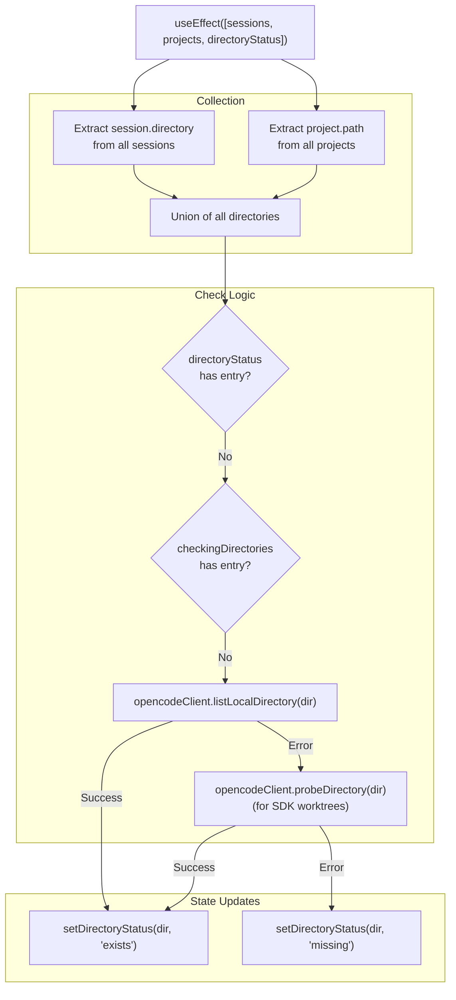

Sessions in missing directories display a warning icon (`RiErrorWarningLine`) with tooltip "Directory not found".

**Sources**: [packages/ui/src/components/session/SessionSidebar.tsx:863-932](), [packages/ui/src/components/session/SessionSidebar.tsx:1445-1467]()

## State Persistence

Several aspects of session management UI state persist across application restarts:

### Persistence Keys and Storage

| State | Storage Key | Storage Location | Data Type | Content |
|-------|-------------|------------------|-----------|---------|
| Collapsed projects | `'oc.sessions.projectCollapse'` | localStorage (web) or settings file (desktop) | `string[]` | Project IDs |
| Expanded sessions | `'oc.sessions.expandedParents'` | localStorage | `string[]` | Session IDs (parent sessions) |
| Pinned sessions | `'oc.sessions.pinned'` | localStorage | `string[]` | Session IDs |
| Group order | `'oc.sessions.groupOrder'` | localStorage | `Record<projectId, string[]>` | Workspace group order per project |
| Group collapse | `'oc.sessions.groupCollapse'` | localStorage | `string[]` | Collapsed workspace group IDs |
| Active session by project | `'oc.sessions.activeSessionByProject'` | localStorage | `Record<projectId, sessionId>` | Last active session per project |

**Sources**: [packages/ui/src/components/session/SessionSidebar.tsx:88-93](), [packages/ui/src/components/session/SessionSidebar.tsx:590-649](), [packages/ui/src/components/session/SessionSidebar.tsx:748-789]()

### Desktop Settings Persistence

On desktop runtime, project collapse state is persisted to the desktop settings file (not just localStorage):

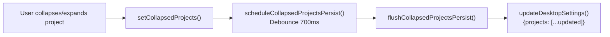

This ensures project collapse state survives app restarts on desktop.

**Sources**: [packages/ui/src/components/session/SessionSidebar.tsx:702-746]()

## Platform-Specific Behaviors

### Desktop Runtime (`isDesktopShell()`)

| Feature | Implementation | Source |
|---------|----------------|--------|
| Sticky headers | IntersectionObserver with `--sidebar-stuck-bg` | Lines 1592-1638 |
| Directory picker | `requestDirectoryAccess()` via Tauri IPC | Lines 1126-1152 |
| Settings persistence | `updateDesktopSettings()` to config file | Lines 702-736 |

**Sources**: [packages/ui/src/components/session/SessionSidebar.tsx:1592-1638](), [packages/ui/src/components/session/SessionSidebar.tsx:1126-1152](), [packages/ui/src/components/session/SessionSidebar.tsx:702-736]()

### VS Code Extension (`isVSCodeRuntime()`)

| Feature | Behavior | Reason |
|---------|----------|--------|
| Single project | Only workspace folder shown | VS Code scopes to single workspace |
| No project persistence | Settings not persisted to desktop file | Extension uses VS Code state storage |
| Simplified worktree UI | May hide worktree features | Depends on workspace config |

**Sources**: [packages/ui/src/components/session/SessionSidebar.tsx:700](), [packages/ui/src/stores/useProjectsStore.ts:182-230]()

### Mobile Variant (`mobileVariant` prop)

| Feature | Implementation | Source |
|---------|----------------|--------|
| Auto-switch to chat | `setActiveMainTab('chat')` on session select | Line 966 |
| Close switcher | `setSessionSwitcherOpen(false)` on select | Line 967 |
| Always-visible menus | No opacity:0 on project/session menu buttons | Lines 400, 1363 |
| Overlay panel | `MobileOverlayPanel` wrapper component | Lines 1680-1804 |

**Sources**: [packages/ui/src/components/session/SessionSidebar.tsx:966-967](), [packages/ui/src/components/session/SessionSidebar.tsx:1680-1804]()

## Error Handling

The multi-run system includes comprehensive error handling:

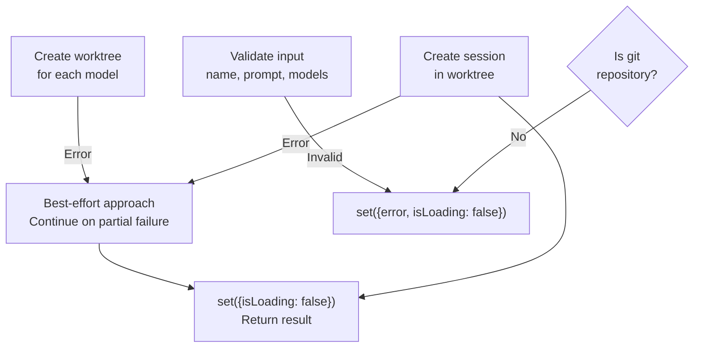

Errors are displayed in the launcher UI and stored in `useMultiRunStore.error`.

**Sources**: [packages/ui/src/stores/useMultiRunStore.ts:101-311](), [packages/ui/src/components/multirun/MultiRunLauncher.tsx:546-551]()

---

