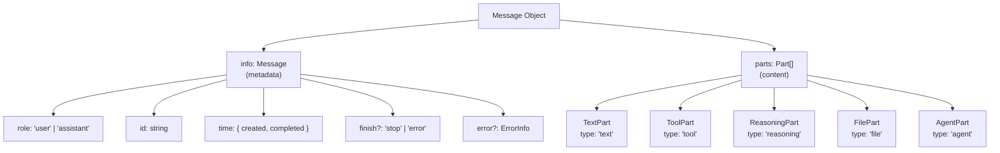
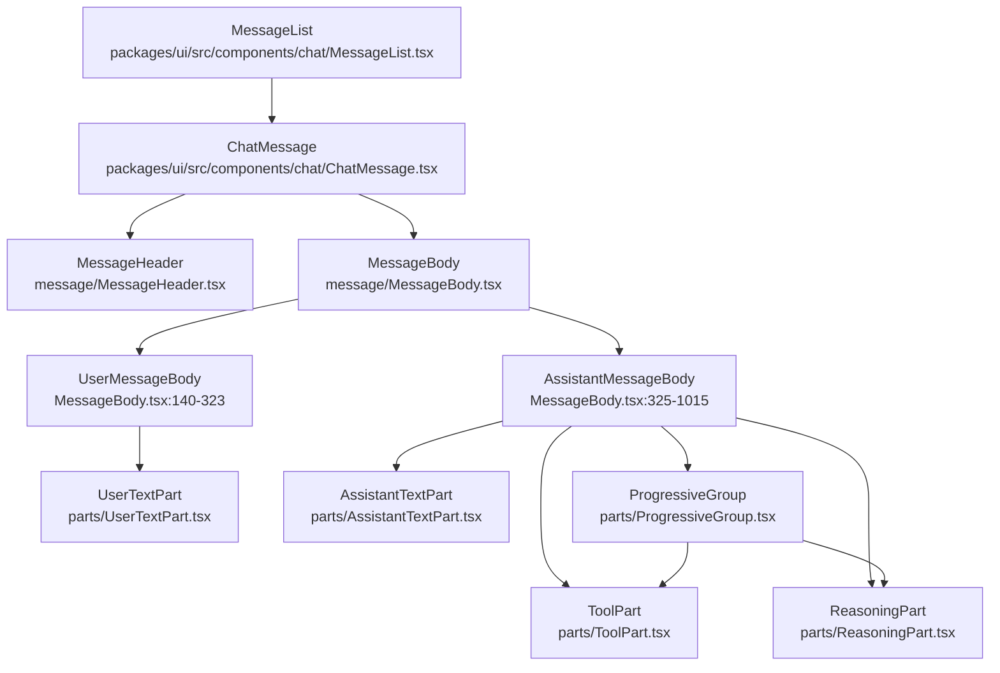
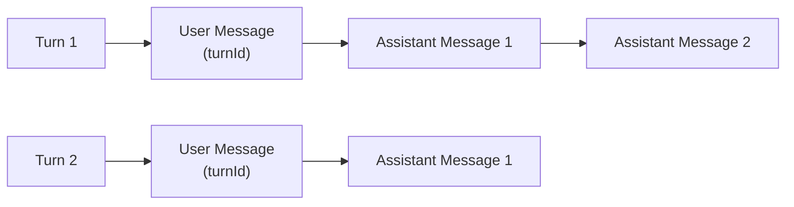
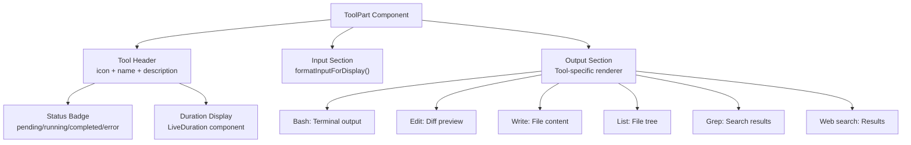
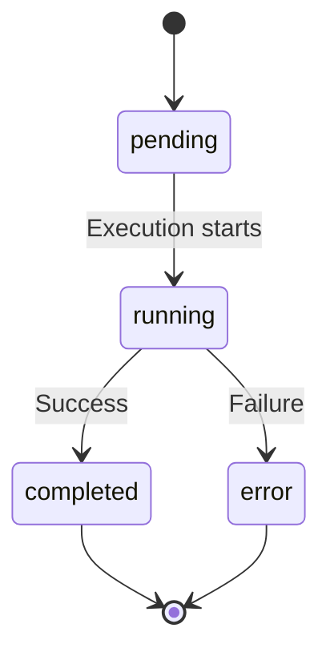
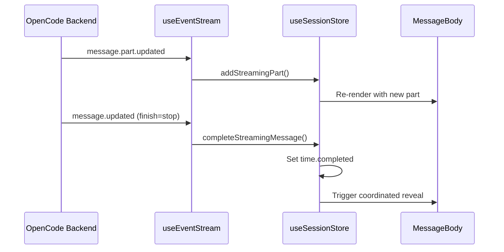
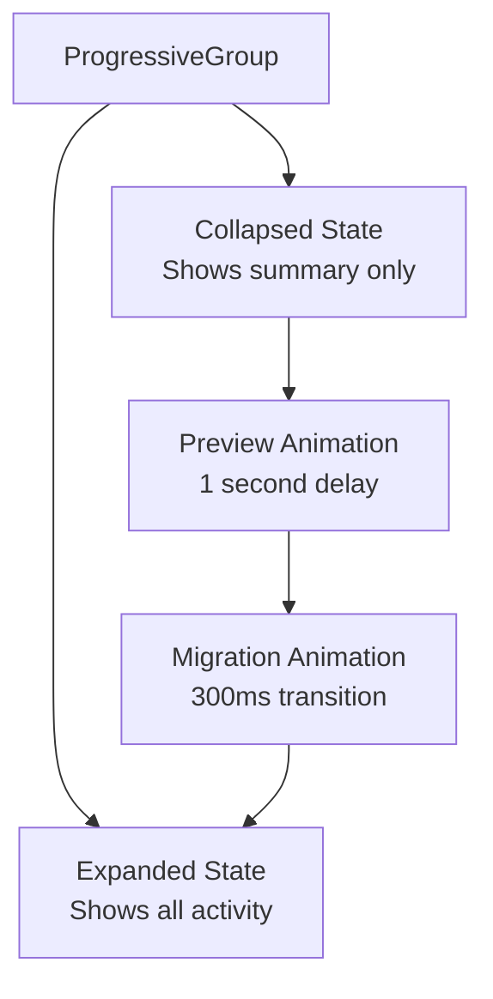
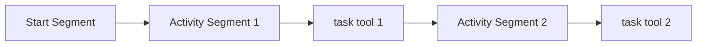
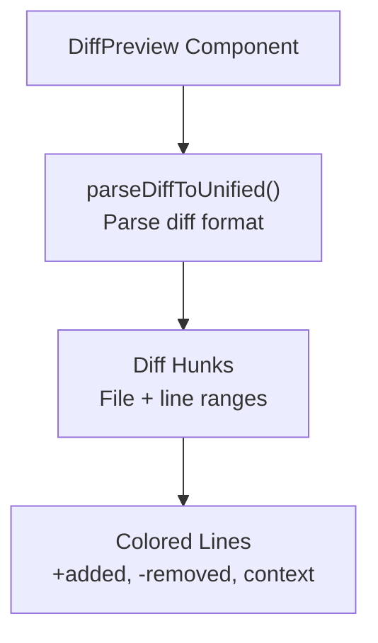

<!-- source: DeepWiki mcp.deepwiki.com · repo btriapitsyn/openchamber · page 7.4 Message Rendering · fetched 2026-10-26 -->

# Message Rendering

<details>
<summary>Relevant source files</summary>

The following files were used as context for generating this wiki page:

- [packages/ui/src/components/chat/ChatContainer.tsx](packages/ui/src/components/chat/ChatContainer.tsx)
- [packages/ui/src/components/chat/ChatMessage.tsx](packages/ui/src/components/chat/ChatMessage.tsx)
- [packages/ui/src/components/chat/MessageList.tsx](packages/ui/src/components/chat/MessageList.tsx)
- [packages/ui/src/components/chat/hooks/useTurnGrouping.ts](packages/ui/src/components/chat/hooks/useTurnGrouping.ts)
- [packages/ui/src/components/chat/message/MessageBody.tsx](packages/ui/src/components/chat/message/MessageBody.tsx)
- [packages/ui/src/hooks/useChatScrollManager.ts](packages/ui/src/hooks/useChatScrollManager.ts)
- [packages/ui/src/stores/messageStore.ts](packages/ui/src/stores/messageStore.ts)
- [packages/ui/src/stores/types/sessionTypes.ts](packages/ui/src/stores/types/sessionTypes.ts)
- [packages/ui/src/stores/useSessionStore.ts](packages/ui/src/stores/useSessionStore.ts)

</details>


This page documents how messages are rendered in the OpenChamber UI, including the message structure, turn grouping system, part rendering pipeline, and real-time streaming animations. For information about composing and sending messages, see [Chat Interface](#7.2). For session organization, see [Session Management](#7.3).

## Overview

Message rendering in OpenChamber handles the display of conversational exchanges between users and AI assistants. The system supports multi-part messages, real-time streaming updates, turn-based grouping, and specialized visualizations for tool executions and reasoning traces. Messages are organized into turns (user prompt + assistant response(s)), with support for activity grouping that progressively reveals tool executions and reasoning steps as they complete.

## Message Structure

### Core Data Model

Messages follow a structured format consisting of metadata and content parts:



**Sources:** [packages/ui/src/components/chat/ChatMessage.tsx:52-69](), [packages/ui/src/components/chat/message/MessageBody.tsx:107-138]()

### Part Types

The system supports multiple part types, each with distinct rendering logic:

| Part Type | Purpose | Rendered By |
|-----------|---------|-------------|
| `text` | User/assistant text content | `UserTextPart`, `AssistantTextPart` |
| `tool` | Tool execution (bash, edit, etc.) | `ToolPart` |
| `reasoning` | Model reasoning traces | `ReasoningPart` |
| `file` | File attachments | `MessageFilesDisplay` |
| `agent` | Agent mentions (`#agent-name`) | Inline in `UserTextPart` |
| `compaction` | Memory compaction markers | Filtered or displayed as `/compact` |

**Sources:** [packages/ui/src/components/chat/message/MessageBody.tsx:359-366](), [packages/ui/src/components/chat/ChatMessage.tsx:139-151]()

## Message Rendering Pipeline

### Component Hierarchy



**Sources:** [packages/ui/src/components/chat/MessageList.tsx:26-117](), [packages/ui/src/components/chat/ChatMessage.tsx:71-79](), [packages/ui/src/components/chat/message/MessageBody.tsx:107-1015]()

### Rendering Decisions

The rendering pipeline makes several key decisions based on message state:

```typescript
// Message role determination
const messageRole = deriveMessageRole(message.info)
const isUser = messageRole.isUser

// Completion state affects part visibility
const isMessageCompleted = Boolean(messageCompletedAt && messageCompletedAt > 0)
const displayParts = isUser ? visibleParts : (isMessageCompleted ? visibleParts : [])
```

Assistant messages are only fully rendered when `message.info.time.completed` is set, enabling coordinated reveal of text and tool parts. User messages render immediately.

**Sources:** [packages/ui/src/components/chat/ChatMessage.tsx:136-327](), [packages/ui/src/components/chat/message/messageRole.ts]()

## Turn Grouping System

### Turn Detection

The `useTurnGrouping` hook organizes messages into conversational turns, where each turn consists of one user message followed by zero or more assistant messages:



The turn ID is derived from the user message ID. Multiple assistant messages in a turn occur when agents request additional information or when multi-step reasoning occurs.

**Sources:** [packages/ui/src/components/chat/hooks/useTurnGrouping.ts:86-106]()

### Activity Parts

Each turn analyzes assistant message parts to identify "activity" that should be grouped:

```typescript
interface TurnActivityPart {
    id: string;           // Part ID or synthetic ID
    turnId: string;       // User message ID
    messageId: string;    // Assistant message containing this part
    kind: 'tool' | 'reasoning' | 'justification';
    part: Part;           // Original part data
    endedAt?: number;     // Timestamp when part completed
}
```

Activity parts are segmented into groups based on `task` tool boundaries, enabling progressive disclosure as the agent works through subtasks.

**Sources:** [packages/ui/src/components/chat/hooks/useTurnGrouping.ts:17-76](), [packages/ui/src/components/chat/hooks/useTurnGrouping.ts:185-263]()

### Turn Grouping Context

Each assistant message receives a `TurnGroupingContext` that controls rendering behavior:

| Property | Type | Purpose |
|----------|------|---------|
| `turnId` | string | User message ID for this turn |
| `isFirstAssistantInTurn` | boolean | Controls header display |
| `isLastAssistantInTurn` | boolean | Used for UI state decisions |
| `headerMessageId` | string | Message that should display the header |
| `activityParts` | TurnActivityPart[] | All activity in turn |
| `activityGroupSegments` | TurnActivityGroup[] | Segmented activity groups |
| `isWorking` | boolean | Whether agent is currently active |
| `isGroupExpanded` | boolean | User toggle state |
| `previewedPartIds` | Set\<string\> | Parts already shown to user |

**Sources:** [packages/ui/src/components/chat/hooks/useTurnGrouping.ts:41-61](), [packages/ui/src/components/chat/hooks/useTurnGrouping.ts:464-510]()

## Part Rendering

### Text Parts

Text parts are rendered differently for user and assistant messages:

**User Text Parts:**
- Rendered immediately as markdown
- Support agent mentions (e.g., `#agent-name`) with highlighting
- Copy button appears on hover
- Minimal formatting to preserve user intent

**Assistant Text Parts:**
- Coordinated reveal with tool parts
- Streaming animation during message composition
- Syntax highlighting for code blocks
- Copy button for entire message

**Sources:** [packages/ui/src/components/chat/message/parts/UserTextPart.tsx](), [packages/ui/src/components/chat/message/parts/AssistantTextPart.tsx]()

### Tool Part Rendering

Tool parts display the input, output, and state of tool executions:



Each tool type has specialized rendering logic in [packages/ui/src/components/chat/message/toolRenderers.ts]().

**Sources:** [packages/ui/src/components/chat/message/parts/ToolPart.tsx:31-40](), [packages/ui/src/components/chat/message/parts/ToolPart.tsx:174-214]()

### Tool States

Tool parts transition through multiple states:



The status is extracted from `part.state.status`, and rendering adapts based on the current state (e.g., showing live duration for running tools, error messages for failed tools).

**Sources:** [packages/ui/src/components/chat/message/parts/ToolPart.tsx:392-408]()

### Reasoning Parts

Reasoning parts display the model's internal thought process:

- Only shown when `showReasoningTraces` is enabled in UI settings
- Rendered as collapsible markdown sections
- Included in activity groups when present
- Uses `ReasoningPart` component with syntax highlighting

**Sources:** [packages/ui/src/components/chat/message/parts/ReasoningPart.tsx](), [packages/ui/src/components/chat/message/MessageBody.tsx:430-442]()

## Streaming and Animation

### Message Streaming Lifecycle

Messages stream in real-time via Server-Sent Events, managed by `useEventStream`:



The streaming system batches rapid updates to prevent UI thrashing while maintaining responsiveness.

**Sources:** [packages/ui/src/hooks/useEventStream.ts:681-761](), [packages/ui/src/hooks/useEventStream.ts:763-967]()

### Coordinated Rendering

Assistant messages coordinate the reveal of text and tool parts to avoid premature display:

```typescript
// Hold assistant text until tools and reasoning complete
const shouldHoldAssistantText = 
    awaitingMessageCompletion ||
    (shouldCoordinateRendering && (!assistantTextReady || !allToolsFinalized)) ||
    shouldHoldForReasoning

// Hold tools until they're finalized
const shouldHoldTools = 
    awaitingMessageCompletion ||
    (hasTools && (hasPendingTools || hasOpenStep || !allToolsFinalized))
```

This ensures users see a coherent message rather than partial content flickering in.

**Sources:** [packages/ui/src/components/chat/message/MessageBody.tsx:452-467]()

### Animation System

Messages support fade-in animations for freshness detection:

```typescript
const shouldAnimateMessage = MessageFreshnessDetector.getInstance()
    .shouldAnimateMessage(message.info, currentSessionId)
```

The `FadeInOnReveal` wrapper applies CSS transitions to new content. Animation is disabled for historical messages and re-renders.

**Sources:** [packages/ui/src/components/chat/ChatMessage.tsx:439-443](), [packages/ui/src/components/chat/message/FadeInOnReveal.tsx]()

## Activity Organization

### Progressive Groups

The `ProgressiveGroup` component manages activity visualization with progressive disclosure:



When the agent is working (`isWorking: true`), new activity parts preview briefly before migrating into the expanded activity group.

**Sources:** [packages/ui/src/components/chat/message/parts/ProgressiveGroup.tsx](), [packages/ui/src/components/chat/message/MessageBody.tsx:673-733]()

### Migration Timer

The migration timer delays activity reveal to reduce UI churn:

```typescript
const useMigrationTimer = (
    turnGroupingContext: TurnGroupingContext | undefined,
    previewablePartIds: Set<string>
): { isAnimating: boolean } => {
    // Wait 1000ms before starting migration
    // Then animate for 300ms
    // Finally mark parts as previewed
}
```

This creates a smooth transition where tools appear briefly in their standalone position before joining the activity group.

**Sources:** [packages/ui/src/components/chat/message/MessageBody.tsx:31-99]()

### Activity Segmentation

Activity is segmented based on `task` tool boundaries:



Each segment has an `anchorMessageId` and `afterToolPartId` that determines where it renders relative to the task tools.

**Sources:** [packages/ui/src/components/chat/hooks/useTurnGrouping.ts:264-361]()

## Tool Visualization

### Edit and MultiEdit Tools

Edit tools display unified diff previews:



The diff is parsed into hunks showing the file path, line numbers, and color-coded changes. Syntax highlighting is applied based on file extension.

**Sources:** [packages/ui/src/components/chat/message/parts/ToolPart.tsx:378-445](), [packages/ui/src/components/chat/message/toolRenderers.ts]()

### Bash Tool

Bash tool output renders terminal content with ANSI color support:

- Exit code displayed in header
- Live duration counter while running
- Output scrollable with max-height constraints
- Command shown in monospace with syntax highlighting

**Sources:** [packages/ui/src/components/chat/message/parts/ToolPart.tsx:560-650]()

### Task Tool

Task tools (sub-agent executions) show a summary of completed work:

```typescript
interface TaskToolSummaryEntry {
    id?: string;
    tool?: string;
    state?: {
        status?: string;
        title?: string;
    };
}
```

The summary lists all completed tools within the task, with an option to open the sub-agent's session.

**Sources:** [packages/ui/src/components/chat/message/parts/ToolPart.tsx:242-376]()

### List, Grep, and Glob Tools

Search and file listing tools have specialized formatters:

| Tool | Renderer | Output Format |
|------|----------|---------------|
| `list` | `renderListOutput()` | Hierarchical file tree |
| `grep` | `renderGrepOutput()` | File:line matches with context |
| `glob` | `renderGlobOutput()` | File path list with counts |
| `web-search` | `renderWebSearchOutput()` | Markdown result summaries |

**Sources:** [packages/ui/src/components/chat/message/toolRenderers.ts](), [packages/ui/src/components/chat/message/parts/ToolPart.tsx:662-800]()

### Tool Icons

Each tool type has an associated icon from Remix Icons:

```typescript
export const getToolIcon = (toolName: string) => {
    // Maps tool names to appropriate icons
    // e.g., 'edit' -> RiPencilLine
    //       'bash' -> RiTerminalBoxLine
    //       'read' -> RiFileTextLine
}
```

**Sources:** [packages/ui/src/components/chat/message/parts/ToolPart.tsx:43-96]()

## Real-Time Updates

### Event Stream Integration

The `useEventStream` hook processes SSE events and updates message state:

```typescript
// Handle incoming part updates
case 'message.part.updated': {
    const part = props.part as Part
    const sessionId = resolvedSessionId
    const messageId = resolvedMessageId
    
    addStreamingPart(sessionId, messageId, messagePart, roleInfo)
    break
}

// Handle message completion
case 'message.updated': {
    const finish = message.finish
    updateMessageInfo(sessionId, messageId, message as Message)
    
    if (hasCompletedTimestamp) {
        completeStreamingMessage(sessionId, messageId)
    }
    break
}
```

**Sources:** [packages/ui/src/hooks/useEventStream.ts:681-967]()

### Message Completion Detection

Message completion is detected via multiple signals:

1. `message.info.time.completed` timestamp set
2. `message.info.finish` status equals `"stop"`
3. All parts have `time.end` timestamps

The completion state triggers the coordinated reveal of assistant message content.

**Sources:** [packages/ui/src/components/chat/ChatMessage.tsx:298-311](), [packages/ui/src/components/chat/message/MessageBody.tsx:420-428]()

### Scroll Management

The scroll manager coordinates with message rendering to maintain scroll position:

```typescript
interface AnimationHandlers {
    onAnimationStart?: () => void;
    onAnimationComplete?: () => void;
    onContentReady?: () => void;
}
```

These callbacks notify the scroll system when content appears, enabling smooth auto-scroll to new messages and scroll restoration when loading older messages.

**Sources:** [packages/ui/src/hooks/useChatScrollManager.ts](), [packages/ui/src/components/chat/ChatMessage.tsx:642-722]()

---

**Sources:** [packages/ui/src/components/chat/message/MessageBody.tsx](), [packages/ui/src/components/chat/ChatMessage.tsx](), [packages/ui/src/components/chat/MessageList.tsx](), [packages/ui/src/components/chat/hooks/useTurnGrouping.ts](), [packages/ui/src/hooks/useEventStream.ts](), [packages/ui/src/components/chat/message/parts/ToolPart.tsx](), [packages/ui/src/lib/toolHelpers.ts]()

---

