<!-- source: DeepWiki mcp.deepwiki.com · repo btriapitsyn/openchamber · page 7.5 Model and Agent Controls · fetched 2026-10-26 -->

# Model and Agent Controls

<details>
<summary>Relevant source files</summary>

The following files were used as context for generating this wiki page:

- [packages/ui/src/components/chat/ChatInput.tsx](packages/ui/src/components/chat/ChatInput.tsx)
- [packages/ui/src/components/chat/MobileSessionStatusBar.tsx](packages/ui/src/components/chat/MobileSessionStatusBar.tsx)
- [packages/ui/src/components/chat/ModelControls.tsx](packages/ui/src/components/chat/ModelControls.tsx)

</details>


This document describes the model and agent selection interface in OpenChamber, which allows users to choose AI models, agents, and configure permission modes. This component is the primary control surface for configuring which model and agent to use in a conversation session.

For information about how these selections integrate with the chat input and message sending, see [Chat Interface](#7.2). For details on session management and persistence, see [Session Management](#7.3).

## Purpose and Scope

The Model and Agent Controls system provides:
- Model selection from configured providers
- Agent selection with mode-specific filtering
- Variant selection for models with multiple versions
- Permission mode configuration (edit, bash, webfetch)
- Session-level preference persistence and restoration
- Model metadata display (capabilities, modalities, costs, limits)
- Favorites and recent model tracking
- Search and filtering across providers and models

The system adapts its UI based on runtime environment (Desktop, Web, VS Code) and device type (mobile vs desktop).

Sources: [packages/ui/src/components/chat/ModelControls.tsx:1-1800]()

## Component Architecture

The `ModelControls` component serves as the main orchestrator for model and agent selection. It integrates with multiple state stores and renders different UI patterns based on the runtime environment.

### Core Component Structure

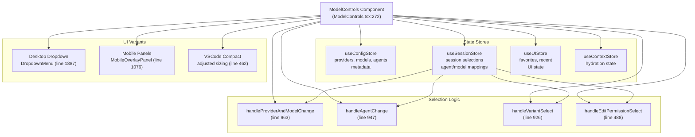

**Diagram: ModelControls Component Architecture**

The component uses runtime detection to determine which UI variant to render:
- `useIsDesktopRuntime()` - Tauri desktop application
- `useIsVSCodeRuntime()` - VS Code extension webview
- `useDeviceInfo().isMobile` - Mobile browser detection

Sources: [packages/ui/src/components/chat/ModelControls.tsx:272-334](), [packages/ui/src/components/chat/ModelControls.tsx:462-468]()

## State Management

The component coordinates multiple Zustand stores to manage selection state at different scopes:

### Store Responsibilities

| Store | Purpose | Key Methods |
|-------|---------|-------------|
| `useConfigStore` | Global configuration | `setProvider()`, `setModel()`, `setAgent()`, `getModelMetadata()` |
| `useSessionStore` | Session-specific selections | `saveAgentModelForSession()`, `getSessionAgentSelection()`, `setSessionAgentEditMode()` |
| `useUIStore` | UI state and preferences | `toggleFavoriteModel()`, `addRecentModel()`, `setModelSelectorOpen()` |
| `useContextStore` | Hydration status | `hasHydrated` flag |

Sources: [packages/ui/src/components/chat/ModelControls.tsx:273-309]()

### State Flow Diagram

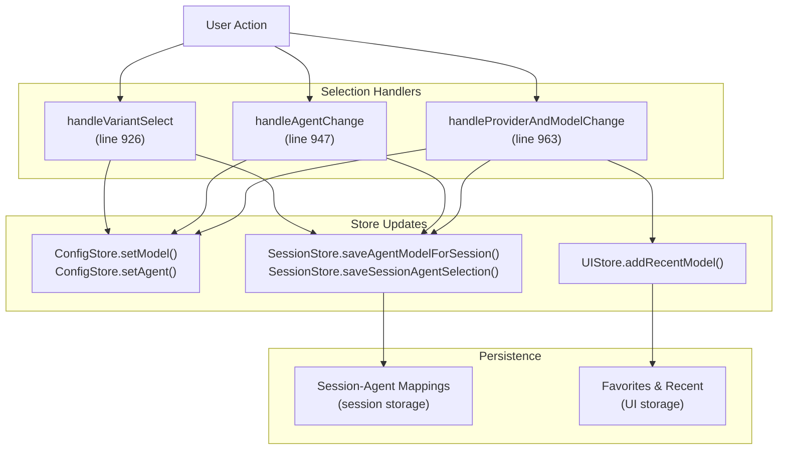

**Diagram: State Management Flow**

Sources: [packages/ui/src/components/chat/ModelControls.tsx:947-988]()

## Model Selection System

Model selection involves choosing a provider and model combination. The system maintains a two-level hierarchy: providers contain models.

### Provider and Model Data Structure

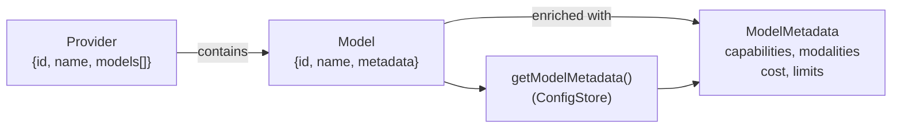

**Diagram: Provider-Model Hierarchy**

Sources: [packages/ui/src/components/chat/ModelControls.tsx:498-503]()

### Model Selection Handler

The `handleProviderAndModelChange` function handles model selection with validation:

```typescript
// Simplified flow from line 963
handleProviderAndModelChange(providerId: string, modelId: string) {
  1. Call tryApplyModelSelection() to validate and apply
  2. If 'applied':
     - Add to recent models via UIStore.addRecentModel()
     - Close selection menu
     - Restore focus to chat input
  3. If 'provider-missing' or 'model-missing':
     - Log error and abort
}
```

The `tryApplyModelSelection` helper (line 538) performs validation:
1. Check provider exists in providers list
2. Check model exists in provider's models array
3. Update ConfigStore with `setProvider()` and `setModel()`
4. Save to SessionStore if session is active

Sources: [packages/ui/src/components/chat/ModelControls.tsx:538-565](), [packages/ui/src/components/chat/ModelControls.tsx:963-988]()

### Model Filtering and Search

Both mobile and desktop variants support search filtering:

**Desktop**: Query stored in `desktopModelQuery` state (line 336), filtered in render loop (line 1988)

**Mobile**: Query stored in `mobileModelQuery` state (line 319), filtered via `filteredProviders` computation (line 1290)

The filtering uses `fuzzyMatch()` utility to match against:
- Provider names and IDs
- Model names and IDs

Sources: [packages/ui/src/components/chat/ModelControls.tsx:1287-1305](), [packages/ui/src/components/chat/ModelControls.tsx:1988-2026]()

## Agent Selection and Management

Agents represent different AI personas with specific configurations, permissions, and default models.

### Agent Data Structure

Agents contain:
- `name` - Unique identifier
- `description` - Human-readable description
- `mode` - Visibility mode: `'primary'`, `'subagent'`, `'all'`
- `model` - Optional default provider/model configuration
- `permission` - Permission ruleset (edit, bash, webfetch)
- `prompt` - Optional custom system prompt
- `temperature`, `topP` - Optional sampling parameters

Sources: [packages/ui/src/components/chat/ModelControls.tsx:386-409]()

### Agent Selection Flow

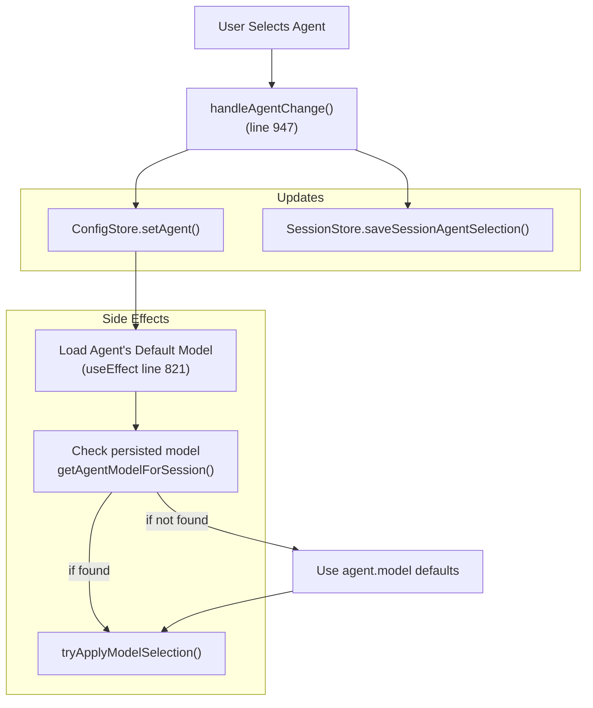

**Diagram: Agent Selection Flow**

The agent change effect (line 821) implements a priority system:
1. Check session-specific model override for this agent
2. If not found, use agent's default model configuration
3. Apply using `tryApplyModelSelection()`

Sources: [packages/ui/src/components/chat/ModelControls.tsx:821-866](), [packages/ui/src/components/chat/ModelControls.tsx:947-961]()

### Visible Agent Filtering

The component uses `getVisibleAgents()` from ConfigStore (line 292) which filters based on:
- Excludes internal/hidden agents
- Returns agents with `mode` matching UI context

Sources: [packages/ui/src/components/chat/ModelControls.tsx:292]()

## Permission Mode Configuration

Permission modes control how the AI agent can execute tools and file operations. The system supports four modes with cascading defaults.

### Permission Mode Hierarchy

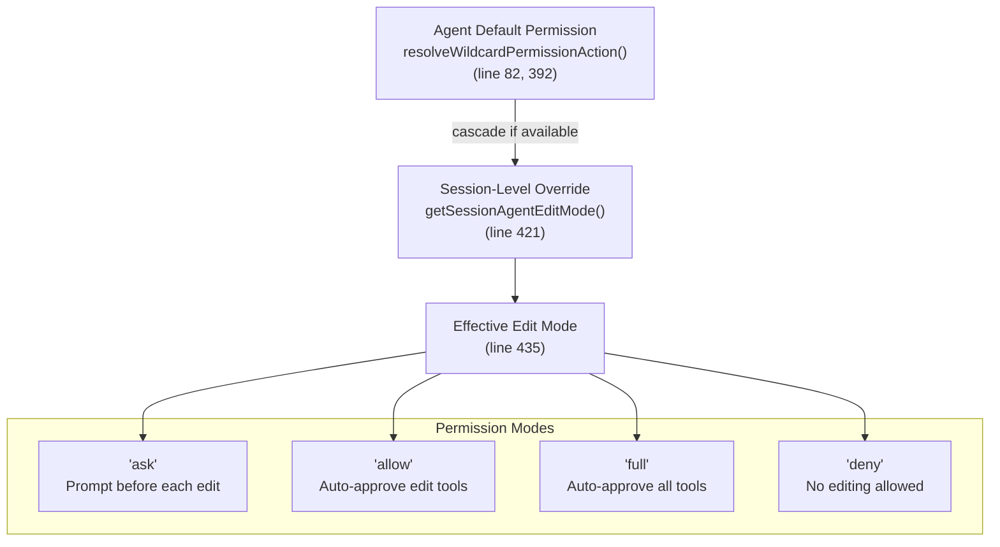

**Diagram: Permission Mode Resolution**

Sources: [packages/ui/src/components/chat/ModelControls.tsx:388-443]()

### Permission Ruleset Format

Agents define permissions using a ruleset array of rules:

```typescript
// From line 59
type PermissionRule = {
  permission: string;  // 'edit', 'bash', 'webfetch', or '*'
  pattern: string;     // file pattern or '*' for wildcard
  action: 'allow' | 'ask' | 'deny';
}
```

The `resolveWildcardPermissionAction()` function (line 82) resolves the action for a given permission by:
1. Searching rules in reverse order (last rule wins)
2. Matching specific permission with wildcard pattern
3. Falling back to wildcard permission with wildcard pattern

Sources: [packages/ui/src/components/chat/ModelControls.tsx:59-103]()

### Permission UI State Calculation

The `calculateEditPermissionUIState()` function determines which modes are available:

| Input | Output |
|-------|--------|
| Agent default edit mode | `cascadeDefaultMode` - baseline mode |
| Webfetch permission | Used to determine if 'full' mode is available |
| Bash permission | Used to determine if 'full' mode is available |

The function returns:
- `cascadeDefaultMode` - The default mode to use
- `modeAvailability` - Boolean flags for each mode
- `autoApproveAvailable` - Whether any auto-approve mode is available

Sources: [packages/ui/src/components/chat/ModelControls.tsx:411-417]()

### Permission Mode Toggle

```mermaid
sequenceDiagram
    participant User
    participant Toggle["Permission Toggle Button<br/>(line 2157)"]
    participant Handler["handleEditPermissionSelect<br/>(line 488)"]
    participant Store["SessionStore"]
    
    User->>Toggle: Click mode option
    Toggle->>Handler: Call with mode
    Handler->>Handler: Validate not disabled
    Handler->>Store: setSessionAgentEditMode()
    Handler->>Handler: Close menus
    Note over Store: Persists session-agent-mode mapping
```

**Diagram: Permission Mode Selection Sequence**

Sources: [packages/ui/src/components/chat/ModelControls.tsx:488-496]()

## Session State Persistence

The component implements a sophisticated session initialization system that restores model and agent selections when switching sessions or opening existing conversations.

### Session Initialization Flow

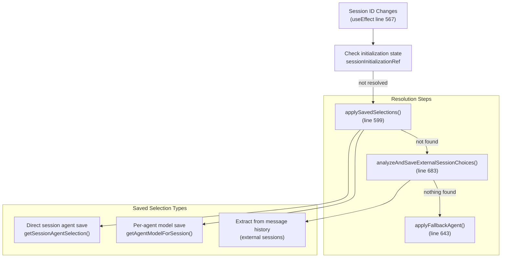

**Diagram: Session Initialization Process**

Sources: [packages/ui/src/components/chat/ModelControls.tsx:567-766]()

### Session Initialization Reference

The component uses a ref to track initialization state per session:

```typescript
// From line 532
sessionInitializationRef = {
  sessionId: string;    // Current session being initialized
  resolved: boolean;    // Whether initialization completed
  inFlight: boolean;    // Whether async analysis is running
}
```

This prevents duplicate initialization when the effect reruns due to dependency changes.

Sources: [packages/ui/src/components/chat/ModelControls.tsx:532-598]()

### External Session Analysis

For sessions with existing messages but no saved selections, the component analyzes message history:

1. Call `analyzeAndSaveExternalSessionChoices()` (line 683)
2. Extract provider/model from message metadata
3. Discover multiple agents used in the session
4. Select the most recently used agent
5. Apply the discovered model selection

This enables seamless import of sessions from external sources (e.g., OpenCode sessions created outside the UI).

Sources: [packages/ui/src/components/chat/ModelControls.tsx:676-737]()

### Preference Persistence Points

| Trigger | Saved Data | Store Method |
|---------|-----------|--------------|
| Agent selection | Session → Agent mapping | `saveSessionAgentSelection()` |
| Model selection | Session → Agent → Provider/Model | `saveAgentModelForSession()` |
| Variant selection | Session → Agent → Provider/Model → Variant | `saveAgentModelVariantForSession()` |
| Permission mode change | Session → Agent → Edit Mode | `setSessionAgentEditMode()` |

Sources: [packages/ui/src/components/chat/ModelControls.tsx:947-954](), [packages/ui/src/components/chat/ModelControls.tsx:963-988](), [packages/ui/src/components/chat/ModelControls.tsx:926-945](), [packages/ui/src/components/chat/ModelControls.tsx:488-496]()

## Variant Selection System

Variants allow models to have multiple versions (e.g., different context lengths or optimization profiles).

### Variant Resolution Logic

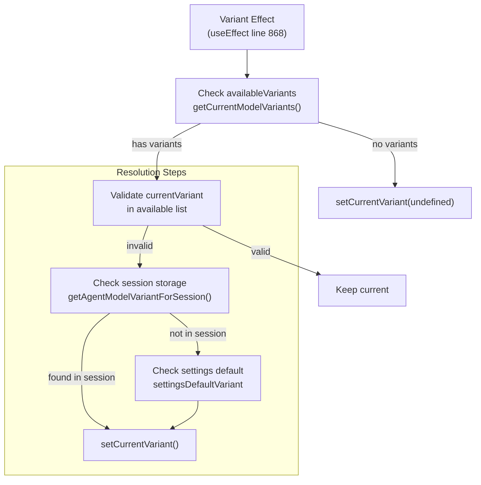

**Diagram: Variant Resolution Flow**

The system resolves variants in priority order:
1. Current selection if valid
2. Session-saved variant for this agent/model
3. Settings default variant if available
4. `undefined` (no variant selected)

Sources: [packages/ui/src/components/chat/ModelControls.tsx:868-924]()

### Variant UI Rendering

Variants appear as a secondary dropdown next to the model selector when `availableVariants.length > 0`:

**Desktop**: Rendered as separate `DropdownMenu` component (line 2081)

**Mobile**: Rendered as `MobileOverlayPanel` with variant list (line 2474)

Sources: [packages/ui/src/components/chat/ModelControls.tsx:507-514](), [packages/ui/src/components/chat/ModelControls.tsx:2081-2106]()

## Mobile vs Desktop Rendering

The component implements separate UI patterns for mobile and desktop environments.

### Rendering Strategy

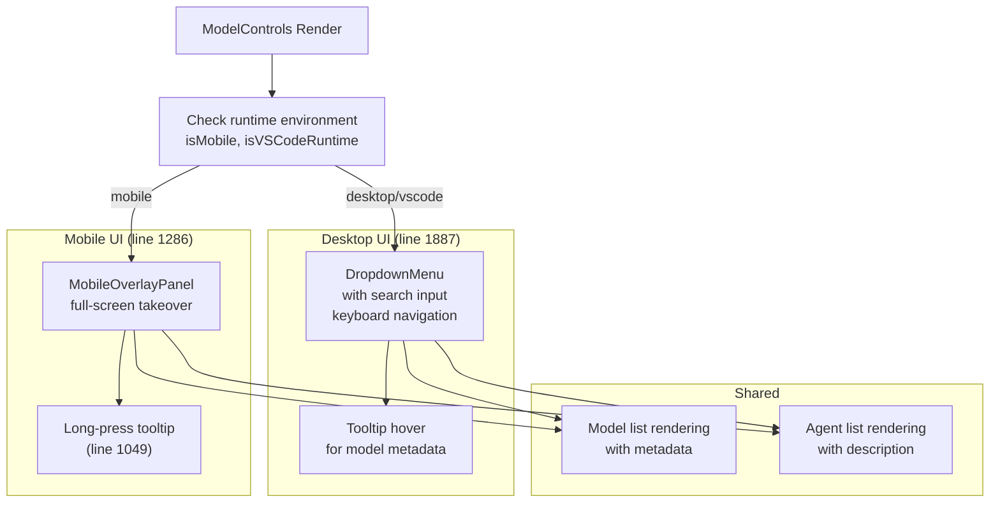

**Diagram: UI Rendering Strategy**

Sources: [packages/ui/src/components/chat/ModelControls.tsx:462-468](), [packages/ui/src/components/chat/ModelControls.tsx:1286-1431]()

### Mobile-Specific Features

**Panel Navigation**: Mobile uses `activeMobilePanel` state (line 317) to track which panel is open:
- `'model'` - Model selection panel
- `'agent'` - Agent selection panel
- `'variant'` - Variant selection panel
- `null` - All panels closed

**Long-Press Tooltips**: Mobile devices can long-press controls to view detailed metadata (line 1049):
- Model tooltip shows capabilities, modalities, limits, metadata
- Agent tooltip shows description, mode, model config, permissions

**Provider Expansion**: Mobile collapses providers by default, tracking expansion in `expandedMobileProviders` Set (line 323)

Sources: [packages/ui/src/components/chat/ModelControls.tsx:317-330](), [packages/ui/src/components/chat/ModelControls.tsx:1049-1062](), [packages/ui/src/components/chat/ModelControls.tsx:1037-1047]()

### Desktop-Specific Features

**Dropdown Menu**: Uses shadcn/ui `DropdownMenu` component with nested menus for providers (line 1887)

**Keyboard Navigation**: Supports arrow keys and Enter for model selection (line 2358):
- Up/Down arrows navigate model list
- Enter selects highlighted model
- Escape closes menu

**Search Focus**: Automatically focuses search input when menu opens (line 2360)

Sources: [packages/ui/src/components/chat/ModelControls.tsx:1887-2400](), [packages/ui/src/components/chat/ModelControls.tsx:2358-2399]()

### Size Variant Calculation

The component calculates size classes based on runtime (line 462):

```typescript
sizeVariant = isMobile ? 'mobile' : isVSCodeRuntime ? 'vscode' : 'default';
buttonHeight = sizeVariant === 'mobile' ? 'h-9' : sizeVariant === 'vscode' ? 'h-6' : 'h-8';
iconSize = sizeVariant === 'mobile' ? 'h-5 w-5' : 'h-4 w-4';
```

This ensures appropriate sizing across different environments.

Sources: [packages/ui/src/components/chat/ModelControls.tsx:462-468]()

## Model Metadata Display System

The component displays rich metadata about models to help users make informed selections.

### Metadata Categories

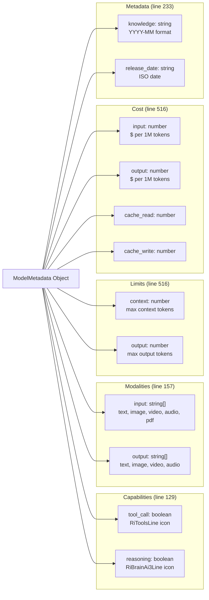

**Diagram: Model Metadata Structure**

Sources: [packages/ui/src/components/chat/ModelControls.tsx:122-266]()

### Capability Icons

Capabilities are rendered as icon badges using definitions (line 129):

```typescript
CAPABILITY_DEFINITIONS = [
  {
    key: 'tool_call',
    icon: RiToolsLine,
    label: 'Tool calling',
    isActive: (metadata) => metadata?.tool_call === true
  },
  {
    key: 'reasoning',
    icon: RiBrainAi3Line,
    label: 'Reasoning',
    isActive: (metadata) => metadata?.reasoning === true
  }
]
```

Active capabilities are filtered using `getCapabilityIcons()` (line 225) and rendered as small icon badges.

Sources: [packages/ui/src/components/chat/ModelControls.tsx:129-142](), [packages/ui/src/components/chat/ModelControls.tsx:225-231]()

### Modality Icons

Input and output modalities are mapped to icons (line 157):

| Modality | Icon | Label |
|----------|------|-------|
| `text` | `RiText` | Text |
| `image` | `RiFileImageLine` | Image |
| `video` | `RiFileVideoLine` | Video |
| `audio` | `RiFileMusicLine` | Audio |
| `pdf` | `RiFilePdfLine` | PDF |

The `getModalityIcons()` function (line 167) extracts unique modalities from metadata and maps them to icon definitions.

Sources: [packages/ui/src/components/chat/ModelControls.tsx:157-188]()

### Formatters

The component includes specialized formatters for metadata display:

**Token Formatter** (line 204):
- Uses compact notation (K, M, B suffixes)
- Removes trailing `.0` decimals
- Returns `'—'` for invalid values

**Cost Formatter** (line 217):
- Formats as USD currency
- Shows up to 4 decimal places
- Returns `'—'` for invalid values

**Knowledge Date Formatter** (line 233):
- Parses `YYYY-MM` format
- Displays as `MMM YYYY` (e.g., "Oct 2024")
- Falls back to raw string if invalid

**Release Date Formatter** (line 251):
- Parses ISO date strings
- Displays as `MMM DD, YYYY`
- Falls back to raw string if invalid

Sources: [packages/ui/src/components/chat/ModelControls.tsx:204-266]()

## Favorites and Recent Models

The component integrates with `useUIStore` to track user preferences for models.

### Favorites System

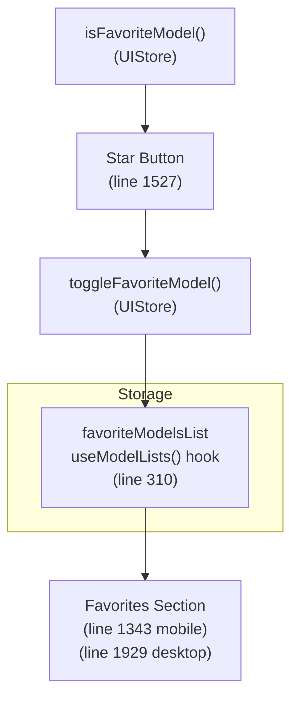

**Diagram: Favorites System Flow**

Favorites appear in a dedicated section at the top of model selection lists when not searching. Users can toggle favorites by clicking the star icon next to each model.

Sources: [packages/ui/src/components/chat/ModelControls.tsx:309-310](), [packages/ui/src/components/chat/ModelControls.tsx:1343-1386](), [packages/ui/src/components/chat/ModelControls.tsx:1527-1543]()

### Recent Models System

Recent models are automatically tracked when a model is selected (line 975):

```typescript
addRecentModel(providerId, modelId);  // Called after successful selection
```

The recent models section appears below favorites (when not searching) showing the most recently used models in reverse chronological order.

Sources: [packages/ui/src/components/chat/ModelControls.tsx:975](), [packages/ui/src/components/chat/ModelControls.tsx:1389-1431]()

## Keyboard Navigation and Shortcuts

The desktop variant implements comprehensive keyboard navigation for power users.

### Keyboard Event Handling

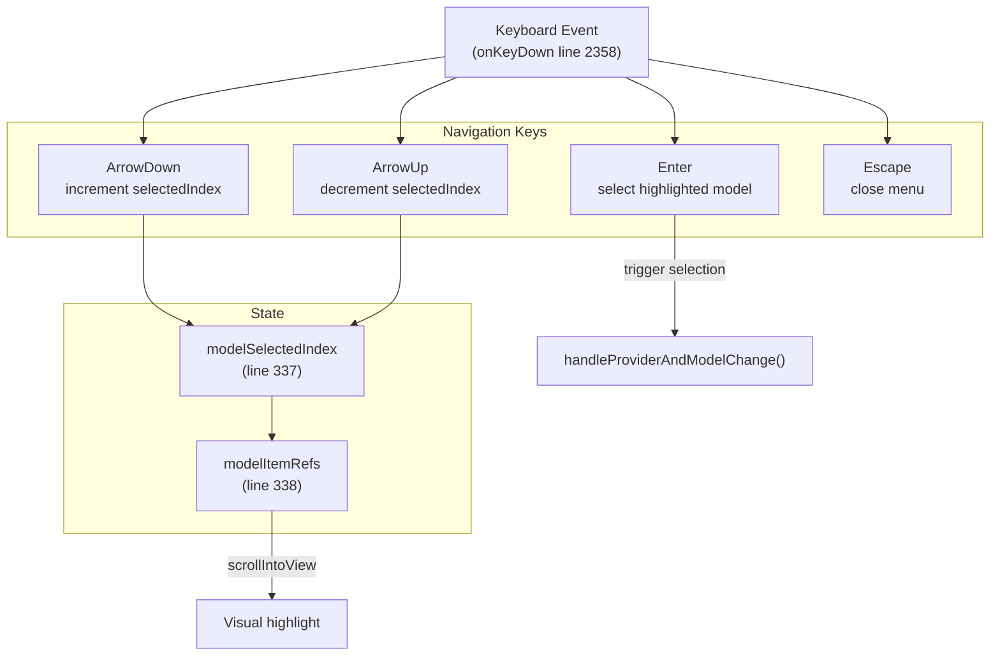

**Diagram: Keyboard Navigation Flow**

The component maintains:
- `modelSelectedIndex` state tracking currently highlighted item
- `modelItemRefs` array of DOM element refs for scrolling
- Auto-scroll to keep highlighted item visible

Sources: [packages/ui/src/components/chat/ModelControls.tsx:337-338](), [packages/ui/src/components/chat/ModelControls.tsx:2358-2399]()

### Focus Management

The component implements automatic focus restoration:

1. **On Menu Open**: Focus search input (line 2360)
2. **On Menu Close**: Restore focus to chat input (line 372-377)
3. **On Model Select**: Restore focus to chat input (line 980-984)

This ensures keyboard users maintain efficient workflow without mouse interaction.

Sources: [packages/ui/src/components/chat/ModelControls.tsx:362-379](), [packages/ui/src/components/chat/ModelControls.tsx:980-984](), [packages/ui/src/components/chat/ModelControls.tsx:2360]()

### Global Shortcuts

The model selector can be opened via global keyboard shortcut (Ctrl+M / Cmd+M) by setting `isModelSelectorOpen` in UIStore. The component uses this global state (line 332):

```typescript
const agentMenuOpen = isModelSelectorOpen;
const setAgentMenuOpen = setModelSelectorOpen;
```

This allows the keyboard shortcut handler (defined elsewhere) to open the model selector without direct component reference.

Sources: [packages/ui/src/components/chat/ModelControls.tsx:332-333]()

---

