<!-- source: DeepWiki mcp.deepwiki.com · repo btriapitsyn/openchamber · page 7.6 File Management · fetched 2026-10-26 -->

# File Management

<details>
<summary>Relevant source files</summary>

The following files were used as context for generating this wiki page:

- [packages/ui/src/components/ui/CodeMirrorEditor.tsx](packages/ui/src/components/ui/CodeMirrorEditor.tsx)
- [packages/ui/src/components/views/FilesView.tsx](packages/ui/src/components/views/FilesView.tsx)
- [packages/ui/src/components/views/PierreDiffViewer.tsx](packages/ui/src/components/views/PierreDiffViewer.tsx)
- [packages/ui/src/components/views/PlanView.tsx](packages/ui/src/components/views/PlanView.tsx)
- [packages/ui/src/hooks/useLongPress.ts](packages/ui/src/hooks/useLongPress.ts)
- [packages/ui/src/lib/messages/inlineComments.ts](packages/ui/src/lib/messages/inlineComments.ts)
- [packages/ui/src/stores/useFilesViewTabsStore.ts](packages/ui/src/stores/useFilesViewTabsStore.ts)
- [packages/ui/src/stores/useInlineCommentDraftStore.ts](packages/ui/src/stores/useInlineCommentDraftStore.ts)

</details>


This document describes OpenChamber's file browsing, editing, and diff viewing capabilities. The file management system provides a tree-based file browser, integrated code editor, and diff viewer with inline commenting support across web, desktop, and VS Code environments.

For Git-specific operations like commits and branches, see [Git Interface](#7.7). For session-level project directory management, see [Session Management UI](#7.3).

---

## Overview

The file management system consists of three primary components:

1. **FilesView** - File browser with integrated editor
2. **PierreDiffViewer** - Diff viewer for code changes
3. **Inline Comment System** - Annotation layer for code review

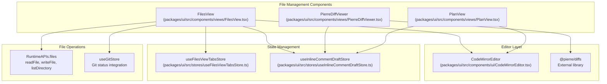

**Sources:** [packages/ui/src/components/views/FilesView.tsx:1-100](), [packages/ui/src/stores/useFilesViewTabsStore.ts:1-50]()

---

## File Browser Architecture

### FilesView Component

The `FilesView` component ([packages/ui/src/components/views/FilesView.tsx]()) provides a dual-pane interface with a file tree on the left and editor on the right (or editor-only mode on mobile).

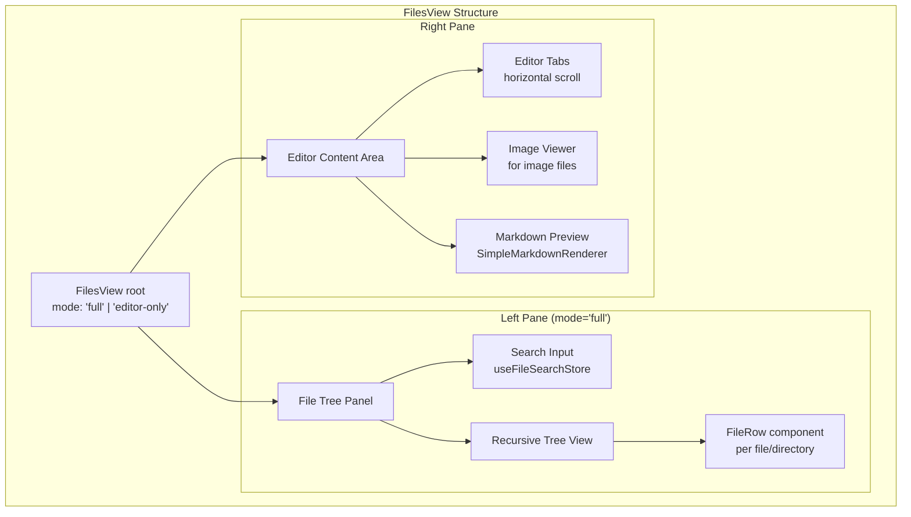

**Sources:** [packages/ui/src/components/views/FilesView.tsx:489-493](), [packages/ui/src/components/views/FilesView.tsx:327-487]()

### Path Normalization

All file paths are normalized using `normalizePath()` to handle cross-platform path differences:

| Function | Purpose | Lines |
|----------|---------|-------|
| `normalizePath` | Converts backslashes to forward slashes, handles UNC paths, removes trailing slashes | [packages/ui/src/components/views/FilesView.tsx:96-114]() |
| `isAbsolutePath` | Detects absolute paths (Unix `/`, Windows `C:/`, UNC `//`) | [packages/ui/src/components/views/FilesView.tsx:116-118]() |
| `toComparablePath` | Case-insensitive comparison for Windows paths | [packages/ui/src/components/views/FilesView.tsx:120-125]() |
| `isPathWithinRoot` | Validates path is within project root | [packages/ui/src/components/views/FilesView.tsx:127-135]() |

**Sources:** [packages/ui/src/components/views/FilesView.tsx:96-135]()

### Tree Structure and Loading

The file tree uses lazy loading with on-demand directory expansion:

```mermaid
sequenceDiagram
    participant User
    participant FilesView
    participant LoadedDirs["loadedDirsRef<br/>Set<string>"]
    participant RuntimeAPI["files.listDirectory"]
    participant Store["useFilesViewTabsStore"]
    
    User->>FilesView: Click directory
    FilesView->>LoadedDirs: Check if loaded
    alt Not loaded
        FilesView->>RuntimeAPI: listDirectory(path, {respectGitignore})
        RuntimeAPI-->>FilesView: Array of entries
        FilesView->>FilesView: mapDirectoryEntries()
        FilesView->>LoadedDirs: Mark as loaded
        FilesView->>Store: expandPath(root, path)
    end
    FilesView->>User: Display children
```

**Sources:** [packages/ui/src/components/views/FilesView.tsx:762-808](), [packages/ui/src/components/views/FilesView.tsx:567-569]()

### File Operations

File operations are provided through the `RuntimeAPIs.files` interface with platform-specific implementations:

| Operation | Method | Desktop | Web | Lines |
|-----------|--------|---------|-----|-------|
| Create File | `files.writeFile(path, content)` | Tauri command | POST `/api/fs/write` | [packages/ui/src/components/views/FilesView.tsx:894-906]() |
| Create Folder | `files.createDirectory(path)` | Tauri command | POST `/api/fs/create-directory` | [packages/ui/src/components/views/FilesView.tsx:907-917]() |
| Rename | `files.rename(oldPath, newPath)` | Tauri command | POST `/api/fs/rename` | [packages/ui/src/components/views/FilesView.tsx:918-948]() |
| Delete | `files.delete(path)` | Tauri command | POST `/api/fs/delete` | [packages/ui/src/components/views/FilesView.tsx:949-974]() |

**Sources:** [packages/ui/src/components/views/FilesView.tsx:888-981]()

### Context Menu and Dialogs

File operations are initiated through context menus (desktop) or button menus (mobile):

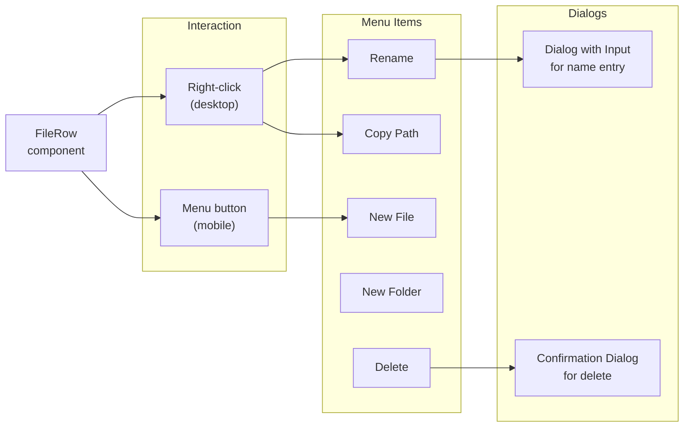

**Sources:** [packages/ui/src/components/views/FilesView.tsx:327-487](), [packages/ui/src/components/views/FilesView.tsx:594-615]()

### File Status Indicators

Files display status dots based on editor state and Git status:

| Status | Color Variable | Condition | Lines |
|--------|----------------|-----------|-------|
| `open` | `--status-info` | File is open in tab | [packages/ui/src/components/views/FilesView.tsx:162]() |
| `modified` | `--status-warning` | Unsaved editor changes | [packages/ui/src/components/views/FilesView.tsx:163]() |
| `git-modified` | `--status-warning` | Git working tree changes | [packages/ui/src/components/views/FilesView.tsx:164]() |
| `git-added` | `--status-success` | Staged for commit | [packages/ui/src/components/views/FilesView.tsx:165]() |
| `git-deleted` | `--status-error` | Deleted in working tree | [packages/ui/src/components/views/FilesView.tsx:166]() |

**Sources:** [packages/ui/src/components/views/FilesView.tsx:158-170]()

### File Icons

File type detection uses extension-based categorization:

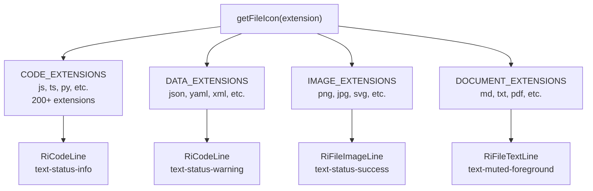

**Sources:** [packages/ui/src/components/views/FilesView.tsx:187-319](), [packages/ui/src/components/views/FilesView.tsx:303-319]()

---

## Code Editor Integration

### CodeMirror Configuration

The `CodeMirrorEditor` component ([packages/ui/src/components/ui/CodeMirrorEditor.tsx]()) wraps CodeMirror 6 with custom extensions:

| Extension | Purpose | Lines |
|-----------|---------|-------|
| `lineNumbers` | Gutter with interactive line numbers | [packages/ui/src/components/ui/CodeMirrorEditor.tsx:199]() |
| `history` | Undo/redo support | [packages/ui/src/components/ui/CodeMirrorEditor.tsx:200]() |
| `indentUnit` | 2-space indentation | [packages/ui/src/components/ui/CodeMirrorEditor.tsx:201]() |
| `keymap` | Default bindings + tab for indent | [packages/ui/src/components/ui/CodeMirrorEditor.tsx:202]() |
| `EditorView.editable` | Read-only mode control | [packages/ui/src/components/ui/CodeMirrorEditor.tsx:214]() |
| `highlightLines` | Visual line selection highlight | [packages/ui/src/components/ui/CodeMirrorEditor.tsx:216]() |
| `blockWidgets` | Inline comment rendering | [packages/ui/src/components/ui/CodeMirrorEditor.tsx:217]() |
| `search` | Find/replace panel | [packages/ui/src/components/ui/CodeMirrorEditor.tsx:218]() |

**Sources:** [packages/ui/src/components/ui/CodeMirrorEditor.tsx:19-33](), [packages/ui/src/components/ui/CodeMirrorEditor.tsx:194-220]()

### Theme Integration

Editor themes are generated from the active UI theme using `createFlexokiCodeMirrorTheme()`:

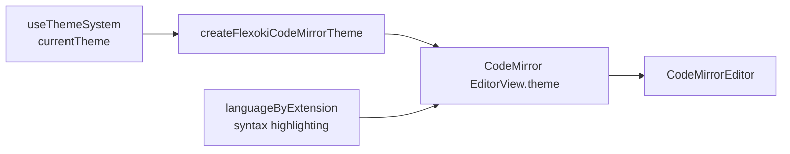

**Sources:** [packages/ui/src/components/views/FilesView.tsx:495-496](), [packages/ui/src/components/views/FilesView.tsx:44-46]()

### Line Selection for Comments

Interactive line numbers support click-and-drag selection for inline comments:

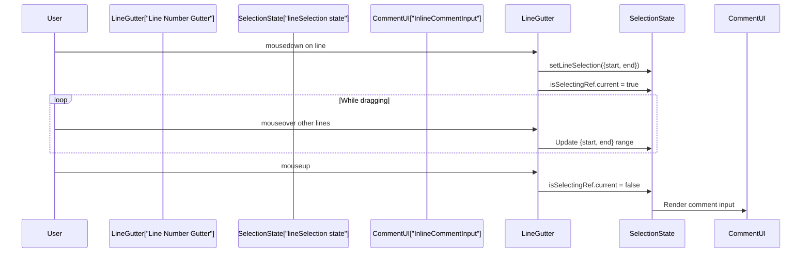

**Sources:** [packages/ui/src/components/views/FilesView.tsx:617-642](), [packages/ui/src/components/views/FilesView.tsx:1283-1319]()

### Block Widgets for Comments

The editor uses CodeMirror's block widget system to inject React components at specific lines:

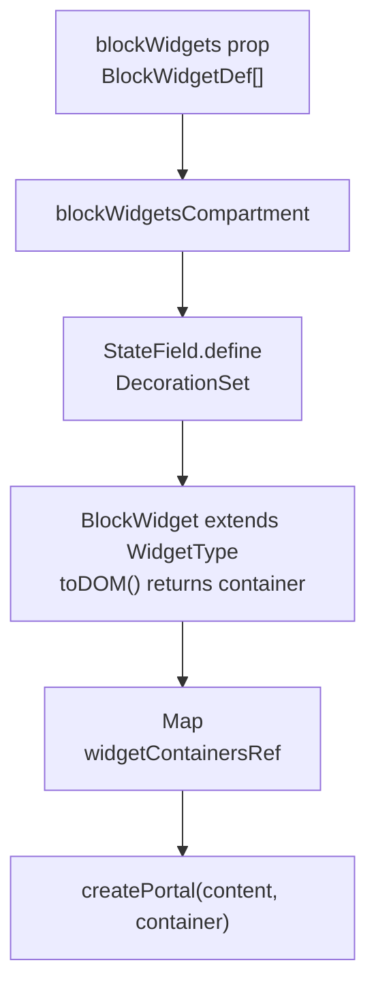

**Sources:** [packages/ui/src/components/ui/CodeMirrorEditor.tsx:13-17](), [packages/ui/src/components/ui/CodeMirrorEditor.tsx:51-77](), [packages/ui/src/components/ui/CodeMirrorEditor.tsx:305-312]()

---

## Diff Viewer (PierreDiffViewer)

### Pierre Diffs Integration

The `PierreDiffViewer` component uses the `@pierre/diffs` library for high-performance diff rendering:

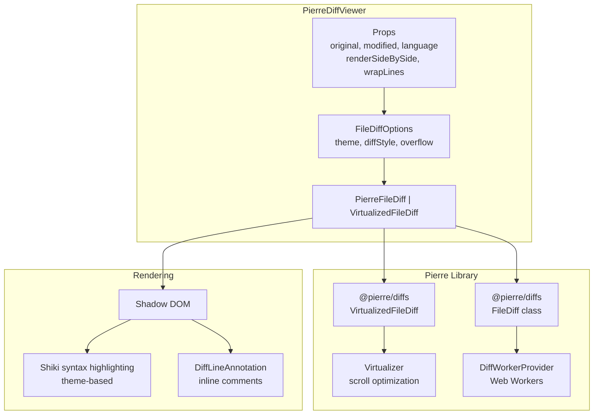

**Sources:** [packages/ui/src/components/views/PierreDiffViewer.tsx:30-38](), [packages/ui/src/components/views/PierreDiffViewer.tsx:196-204](), [packages/ui/src/components/views/PierreDiffViewer.tsx:622-687]()

### Diff Configuration

Key options passed to Pierre:

| Option | Value | Purpose | Lines |
|--------|-------|---------|-------|
| `diffStyle` | `'split'` or `'unified'` | Side-by-side vs unified view | [packages/ui/src/components/views/PierreDiffViewer.tsx:556]() |
| `lineDiffType` | `'none'` | Disabled word-level diffs for performance | [packages/ui/src/components/views/PierreDiffViewer.tsx:560]() |
| `overflow` | `'wrap'` or `'scroll'` | Line wrapping behavior | [packages/ui/src/components/views/PierreDiffViewer.tsx:564]() |
| `enableLineSelection` | `true` | Allow user line selection | [packages/ui/src/components/views/PierreDiffViewer.tsx:566]() |
| `onLineSelected` | callback | Handler for selection changes | [packages/ui/src/components/views/PierreDiffViewer.tsx:568]() |
| `renderAnnotation` | function | Custom annotation renderer | [packages/ui/src/components/views/PierreDiffViewer.tsx:570]() |

**Sources:** [packages/ui/src/components/views/PierreDiffViewer.tsx:550-571]()

### Line Selection in Diffs

Diff line selection includes side information (`deletions` vs `additions`):

```typescript
type SelectedLineRange = {
  start: number;
  end: number;
  side?: 'deletions' | 'additions'; // Pierre terminology
}

// Maps to storage as:
type StoredSide = 'original' | 'modified'; // Store terminology
```

**Sources:** [packages/ui/src/components/views/PierreDiffViewer.tsx:7-10](), [packages/ui/src/components/views/PierreDiffViewer.tsx:408-413]()

### Shadow DOM Integration

Pierre renders into a Shadow DOM, requiring special handling for comments:

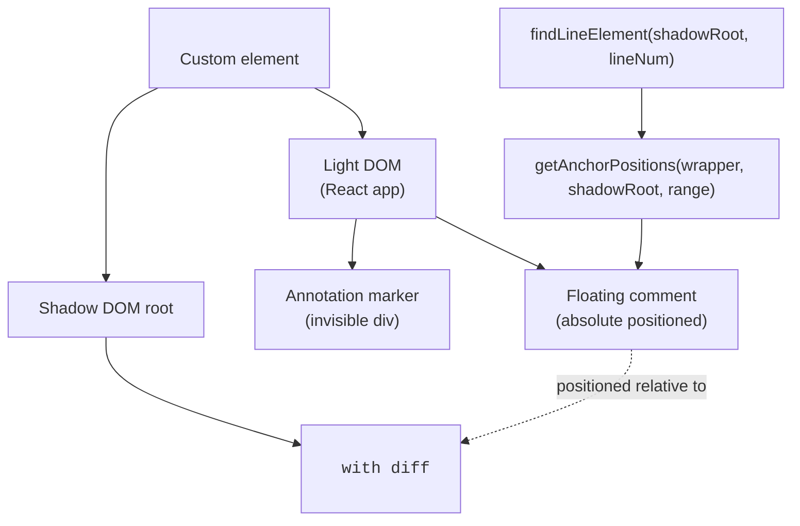

**Sources:** [packages/ui/src/components/views/PierreDiffViewer.tsx:296-328](), [packages/ui/src/components/views/PierreDiffViewer.tsx:335-381]()

### Theme Synchronization

Diff themes are synchronized with the app theme using CSS custom properties:

**Sources:** [packages/ui/src/components/views/PierreDiffViewer.tsx:477-547]()

---

## Inline Comment System

### Comment Draft Storage

Inline comments are stored per session in `useInlineCommentDraftStore`:

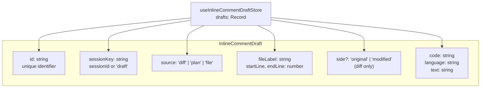

**Sources:** [packages/ui/src/stores/useInlineCommentDraftStore.ts:5-19]()

### Comment Actions

| Action | Purpose | Lines |
|--------|---------|-------|
| `addDraft(draft)` | Create new comment with generated ID | [packages/ui/src/stores/useInlineCommentDraftStore.ts:44-63]() |
| `updateDraft(sessionKey, id, updates)` | Edit existing comment text/range | [packages/ui/src/stores/useInlineCommentDraftStore.ts:65-85]() |
| `removeDraft(sessionKey, id)` | Delete single comment | [packages/ui/src/stores/useInlineCommentDraftStore.ts:87-105]() |
| `consumeDrafts(sessionKey)` | Retrieve and clear all drafts for session | [packages/ui/src/stores/useInlineCommentDraftStore.ts:119-134]() |

**Sources:** [packages/ui/src/stores/useInlineCommentDraftStore.ts:25-34]()

### Comment Formatting

Comments are formatted into structured text when sent to the AI:

```typescript
// Diff format (includes side):
"Comment on `file.ts` lines 10-15 (modified):
```typescript
code content here
```

User comment text"

// File/Plan format (no side):
"Comment on `file.ts` lines 10-15:
```typescript
code content here
```

User comment text"
```

**Sources:** [packages/ui/src/lib/messages/inlineComments.ts:7-17]()

### Floating Comment UI

Comments render as floating elements positioned absolutely relative to code lines:

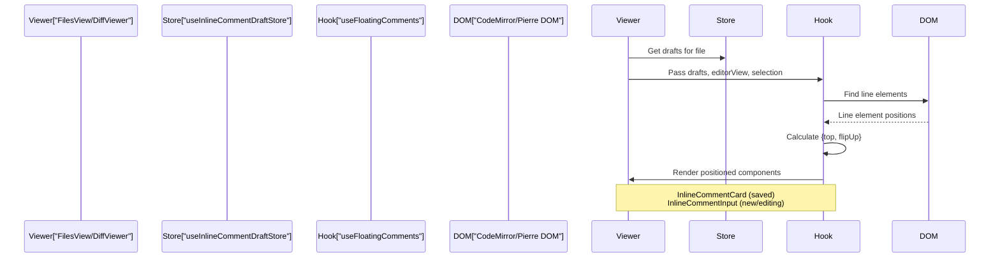

**Sources:** [packages/ui/src/components/views/FilesView.tsx:1320-1355](), [packages/ui/src/components/views/PierreDiffViewer.tsx:310-328]()

### Mobile Comment Interactions

Mobile uses tap-to-extend selection behavior:

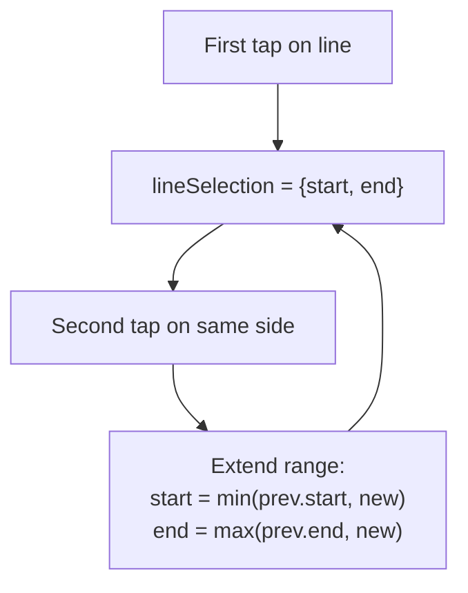

**Sources:** [packages/ui/src/components/views/PierreDiffViewer.tsx:242-265](), [packages/ui/src/components/views/FilesView.tsx:1283-1319]()

---

## Tab Management

### useFilesViewTabsStore Structure

The tab store manages per-root state with LRU eviction:

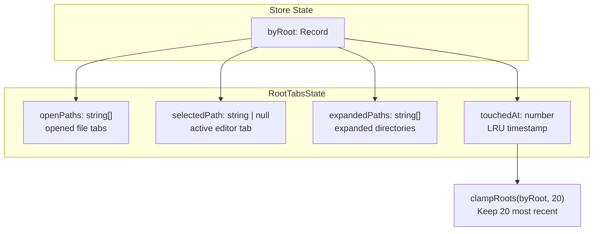

**Sources:** [packages/ui/src/stores/useFilesViewTabsStore.ts:6-15](), [packages/ui/src/stores/useFilesViewTabsStore.ts:139-151]()

### Tab Operations

| Action | Purpose | Lines |
|--------|---------|-------|
| `addOpenPath(root, path)` | Open file in new tab | [packages/ui/src/stores/useFilesViewTabsStore.ts:166-193]() |
| `removeOpenPath(root, path)` | Close single tab | [packages/ui/src/stores/useFilesViewTabsStore.ts:195-226]() |
| `removeOpenPathsByPrefix(root, prefix)` | Close tabs matching path prefix (for delete/rename) | [packages/ui/src/stores/useFilesViewTabsStore.ts:228-263]() |
| `setSelectedPath(root, path)` | Switch active tab | [packages/ui/src/stores/useFilesViewTabsStore.ts:265-293]() |
| `toggleExpandedPath(root, path)` | Expand/collapse directory | [packages/ui/src/stores/useFilesViewTabsStore.ts:314-342]() |

**Sources:** [packages/ui/src/stores/useFilesViewTabsStore.ts:17-26]()

### Path Sanitization

All paths undergo normalization and validation on load:

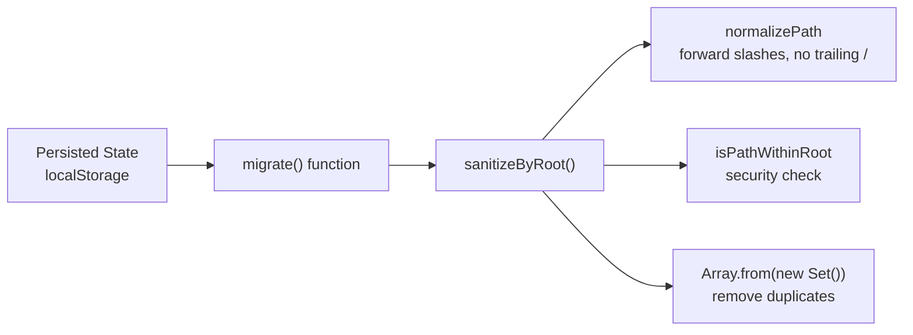

**Sources:** [packages/ui/src/stores/useFilesViewTabsStore.ts:67-137](), [packages/ui/src/stores/useFilesViewTabsStore.ts:404-414]()

---

## Search Functionality

### File Search Implementation

File search uses fuzzy matching with scoring:

```mermaid
sequenceDiagram
    participant User
    participant Input["Search Input<br/>debounced 200ms"]
    participant Store["useFileSearchStore"]
    participant API["searchFiles(dir, query, limit)"]
    participant Fuzzy["fuzzyScore(query, candidate)"]
    
    User->>Input: Type query
    Input->>Store: debouncedSearchQuery
    Store->>API: Search request
    API->>Fuzzy: Score each file path
    Fuzzy-->>API: Scores (null if no match)
    API->>API: Sort by score descending
    API-->>Store: Top N results
    Store->>User: Display filtered list
```

**Sources:** [packages/ui/src/components/views/FilesView.tsx:506-508](), [packages/ui/src/components/views/FilesView.tsx:983-1031](), [packages/ui/src/components/views/FilesView.tsx:1033-1093]()

### Fuzzy Scoring Algorithm

The fuzzy matcher awards points for:
- Character match (+10)
- Early position (+18 - index)
- Start of string (+12)
- After delimiter (+10 for `/`, `_`, `-`, `.`, ` `)
- Consecutive matches (+12 per consecutive)
- Shorter strings (+24 - length/3)

**Sources:** [packages/ui/src/components/views/FilesView.tsx:983-1031]()

---

## Mobile Adaptations

### Responsive Layout

On mobile (`isMobile` from `useDeviceInfo`), FilesView switches between tree and editor views:

| State | Displays | Trigger |
|-------|----------|---------|
| `showMobilePageContent = false` | File tree only | Default state |
| `showMobilePageContent = true` | Editor only | File selection |

**Sources:** [packages/ui/src/components/views/FilesView.tsx:510](), [packages/ui/src/components/views/FilesView.tsx:1402-1422]()

### Touch Interactions

Mobile-specific behaviors:

1. **Long Press** - Uses `useLongPress` hook for context menu trigger ([packages/ui/src/hooks/useLongPress.ts:1-100]())
2. **Tap-to-Extend** - Second tap on selected range extends rather than replaces
3. **Menu Buttons** - Always-visible menu buttons instead of hover-only
4. **Auto-scroll** - Comment inputs scroll into view on creation

**Sources:** [packages/ui/src/components/views/FilesView.tsx:1357-1367](), [packages/ui/src/components/views/PierreDiffViewer.tsx:250-257]()

### Mobile Line Selection

Mobile line number interaction bypasses drag behavior:

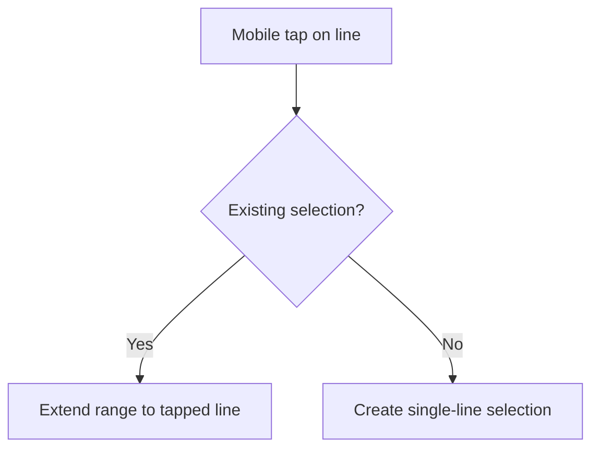

**Sources:** [packages/ui/src/components/views/PlanView.tsx:539-548]()

---

## Image and Markdown Support

### Image Viewing

Images are detected by extension and rendered natively:

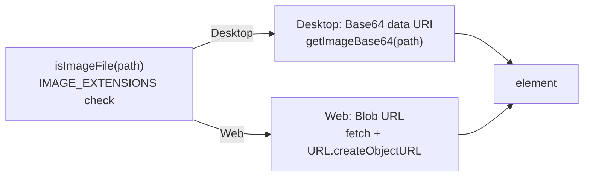

**Sources:** [packages/ui/src/components/views/FilesView.tsx:280-284](), [packages/ui/src/components/views/FilesView.tsx:1179-1213]()

### Markdown Preview

Markdown files (`.md`, `.markdown`) support preview mode:

| Component | Preview Implementation | Lines |
|-----------|----------------------|-------|
| FilesView | `SimpleMarkdownRenderer` with preview toggle | [packages/ui/src/components/views/FilesView.tsx:1464-1476]() |
| PlanView | Same renderer for plan files | [packages/ui/src/components/views/PlanView.tsx:498-512]() |

Preview mode preference is persisted in localStorage with key `openchamber:files:md-viewer-mode`.

**Sources:** [packages/ui/src/components/views/FilesView.tsx:856-881](), [packages/ui/src/components/views/PlanView.tsx:136-158]()

---

