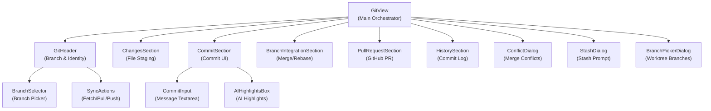
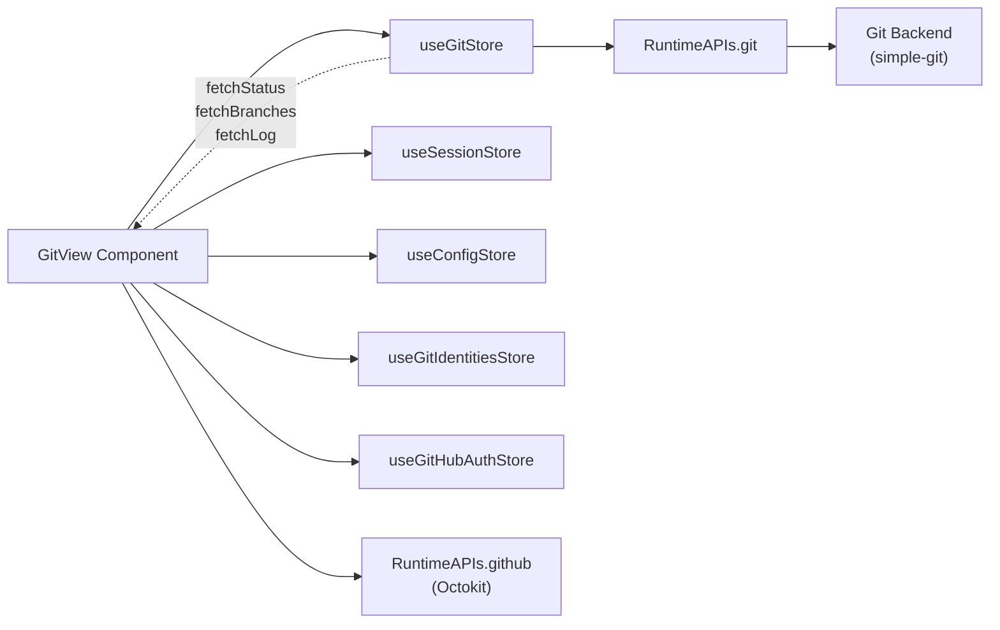
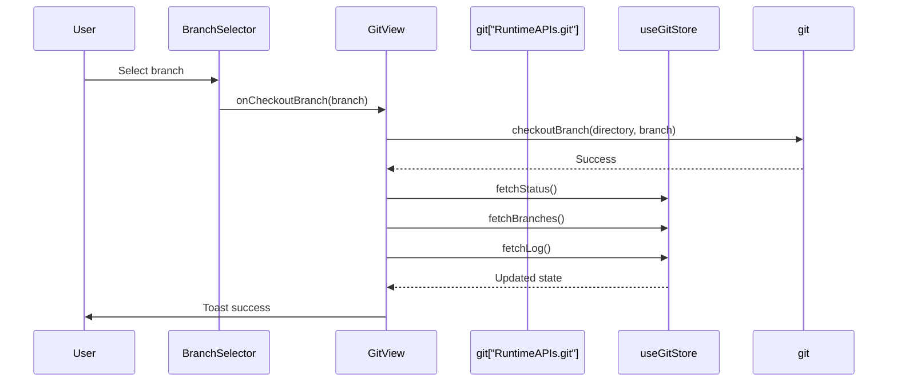
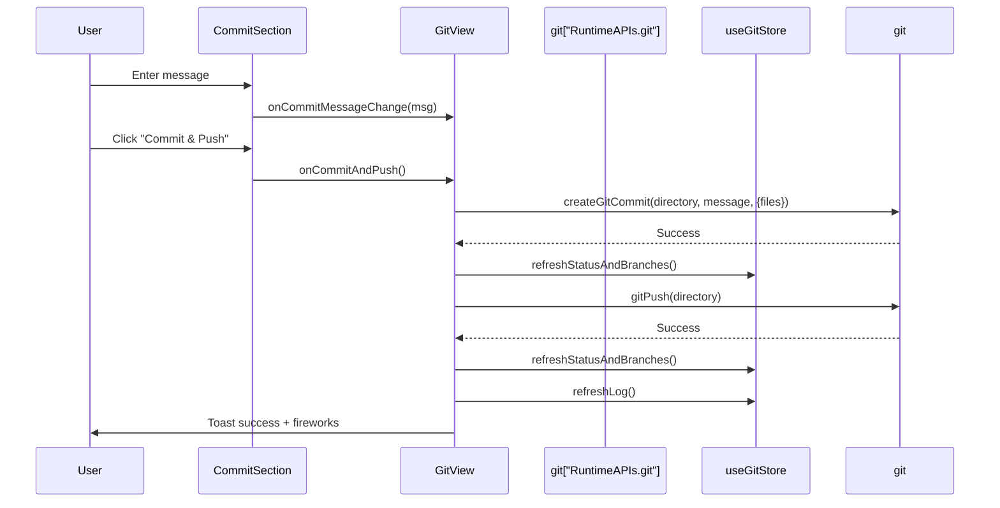
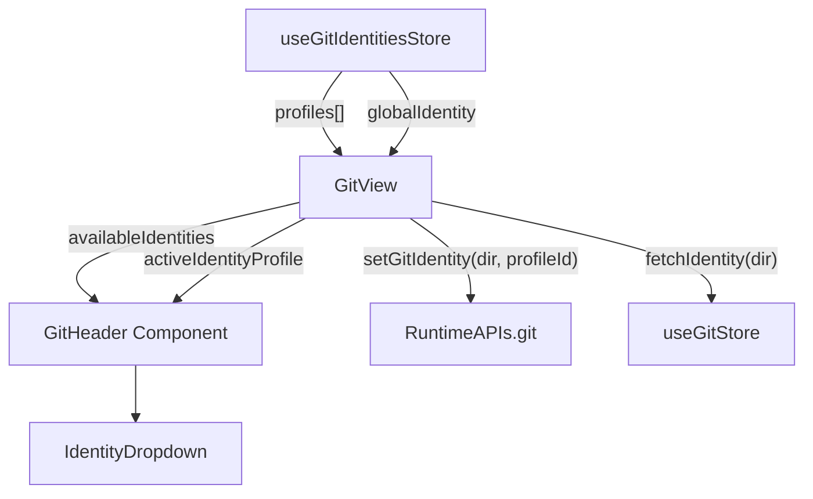
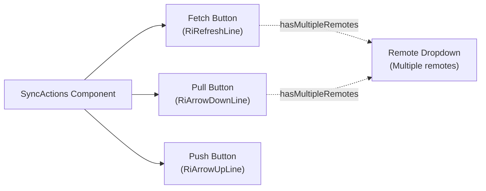
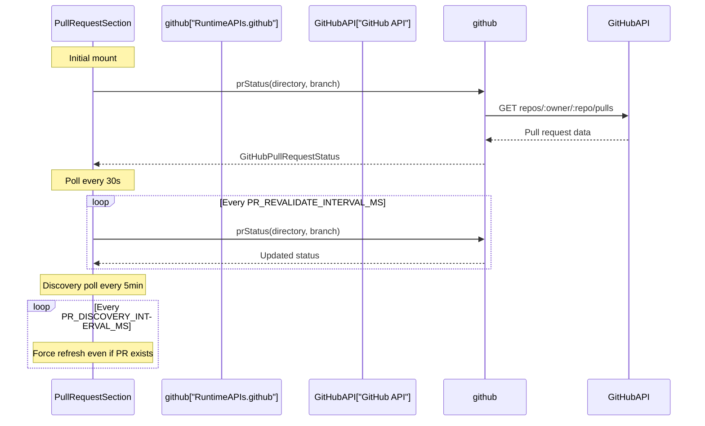
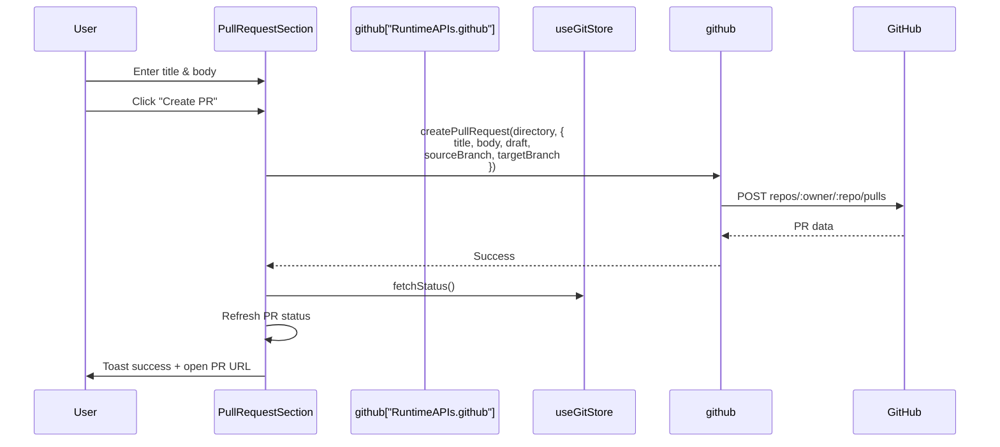
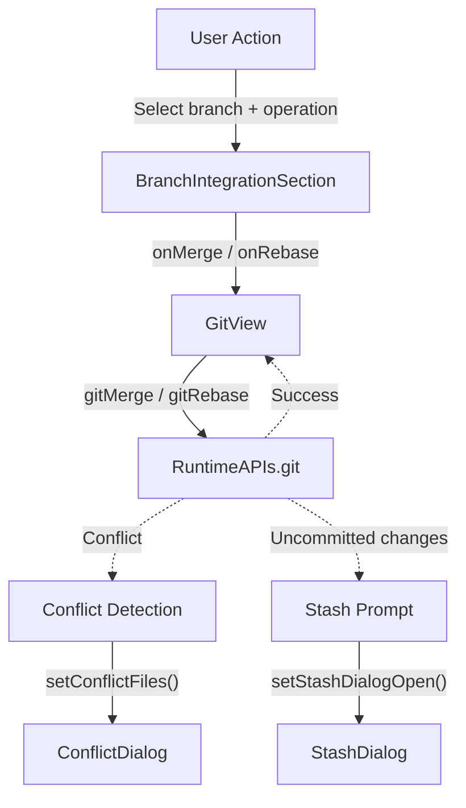

<!-- source: DeepWiki mcp.deepwiki.com · repo btriapitsyn/openchamber · page 7.7 Git Interface · fetched 2026-10-26 -->

# Git Interface

<details>
<summary>Relevant source files</summary>

The following files were used as context for generating this wiki page:

- [packages/ui/src/components/views/GitView.tsx](packages/ui/src/components/views/GitView.tsx)
- [packages/ui/src/components/views/git/AIHighlightsBox.tsx](packages/ui/src/components/views/git/AIHighlightsBox.tsx)
- [packages/ui/src/components/views/git/BranchSelector.tsx](packages/ui/src/components/views/git/BranchSelector.tsx)
- [packages/ui/src/components/views/git/CommitInput.tsx](packages/ui/src/components/views/git/CommitInput.tsx)
- [packages/ui/src/components/views/git/CommitSection.tsx](packages/ui/src/components/views/git/CommitSection.tsx)
- [packages/ui/src/components/views/git/GitHeader.tsx](packages/ui/src/components/views/git/GitHeader.tsx)
- [packages/ui/src/components/views/git/PullRequestSection.tsx](packages/ui/src/components/views/git/PullRequestSection.tsx)
- [packages/ui/src/components/views/git/SyncActions.tsx](packages/ui/src/components/views/git/SyncActions.tsx)

</details>


## Purpose and Scope

This page documents the Git Interface UI components that provide visual controls for Git operations within OpenChamber. The Git Interface encompasses repository status display, file staging, commit creation, branch management, and GitHub pull request integration. These components are rendered within the `GitView` component and its sub-components.

For backend Git operations and worktree management, see [Git Operations](#8.3). For worktree session creation, see [Worktrees and Multi-Run](#8.2).

## Overview

The Git Interface is implemented as a collection of React components that interact with Git through the `RuntimeAPIs.git` interface. The primary component is `GitView`, which coordinates state management through `useGitStore` and renders specialized sub-components for different Git workflows.

**Key Capabilities:**
- Real-time repository status monitoring
- Visual file staging and selection
- AI-powered commit message generation with gitmoji support
- Branch creation, checkout, and management
- GitHub pull request creation and status tracking
- Git identity profile management
- Fetch, pull, push operations with remote selection

Sources: [packages/ui/src/components/views/GitView.tsx:1-220]()

## Component Architecture

### Component Hierarchy



**Sources:** [packages/ui/src/components/views/GitView.tsx:48-62]()

### State Management Integration



**Sources:** [packages/ui/src/components/views/GitView.tsx:221-247](), [packages/ui/src/stores/useGitStore.tsx]()

## GitView Component

The `GitView` component serves as the main orchestrator for all Git UI functionality. It manages local state for UI interactions while coordinating with `useGitStore` for Git data.

### Component Props

| Prop | Type | Default | Description |
|------|------|---------|-------------|
| `mode` | `'full' \| 'sidebar'` | `'full'` | Display mode affecting layout and spacing |

**Sources:** [packages/ui/src/components/views/GitView.tsx:216-218]()

### Core State Management

The component maintains several categories of local state:

**File Selection State:**
- `selectedPaths: Set<string>` - Files selected for staging
- `hasUserAdjustedSelection: boolean` - Whether user manually changed selection
- `revertingPaths: Set<string>` - Files currently being reverted

**Commit State:**
- `commitMessage: string` - Current commit message text
- `generatedHighlights: string[]` - AI-generated bullet points
- `isGeneratingMessage: boolean` - AI generation in progress

**Operation State:**
- `syncAction: SyncAction` - Active sync operation (`'fetch'`, `'pull'`, `'push'`, or `null`)
- `commitAction: CommitAction` - Active commit operation (`'commit'`, `'commitAndPush'`, or `null`)
- `branchOperation: BranchOperation` - Active branch operation (`'merge'`, `'rebase'`, or `null`)

**Sources:** [packages/ui/src/components/views/GitView.tsx:304-411]()

### Snapshot Persistence

`GitView` persists user state across directory changes using a `Map<string, GitViewSnapshot>`:

```typescript
type GitViewSnapshot = {
  directory?: string;
  selectedPaths: string[];
  commitMessage: string;
  generatedHighlights: string[];
};
```

State is saved to `gitViewSnapshots` whenever `commitMessage`, `selectedPaths`, or `generatedHighlights` change, and restored when the component mounts with a previously-visited directory.

**Sources:** [packages/ui/src/components/views/GitView.tsx:76-82](), [packages/ui/src/components/views/GitView.tsx:536-544]()

### Active Directory Synchronization

When `currentDirectory` changes, `GitView` updates `useGitStore` and triggers data fetching:

```typescript
React.useEffect(() => {
  if (currentDirectory) {
    setActiveDirectory(currentDirectory);
    
    const dirState = useGitStore.getState().directories.get(currentDirectory);
    if (!dirState?.status) {
      fetchAll(currentDirectory, git, { force: true });
    }
  }
}, [currentDirectory, setActiveDirectory, fetchAll, git]);
```

**Sources:** [packages/ui/src/components/views/GitView.tsx:612-621]()

## Branch Management

### BranchSelector Component

The `BranchSelector` provides a dropdown UI for viewing, switching, and creating branches. It displays local branches, remote branches, and ahead/behind counts.

#### Branch Switching Flow



**Sources:** [packages/ui/src/components/views/GitView.tsx:917-935](), [packages/ui/src/components/views/git/BranchSelector.tsx:96-104]()

#### Branch Creation Flow

When creating a new branch, the flow differs based on remote count:

1. **Single Remote:** Create branch, checkout, push with `--set-upstream`
2. **Multiple Remotes:** Show remote selection dialog before pushing

```typescript
const handleCreateBranch = async (branchName: string, remote?: GitRemote) => {
  await git.createBranch(currentDirectory, branchName, checkoutBase ?? 'HEAD');
  await git.checkoutBranch(currentDirectory, branchName);
  
  try {
    await git.gitPush(currentDirectory, {
      remote: remoteName,
      branch: branchName,
      options: ['--set-upstream'],
    });
    pushSucceeded = true;
  } catch (pushError) {
    // Branch created locally, upstream setup failed
  }
};
```

**Sources:** [packages/ui/src/components/views/GitView.tsx:855-900]()

#### Branch Name Sanitization

Branch names are sanitized using `sanitizeBranchNameInput`:
- Trim whitespace
- Replace spaces with hyphens
- Remove invalid characters (keep alphanumeric, `._/-`)
- Collapse multiple consecutive hyphens/slashes
- Remove leading/trailing hyphens/slashes

**Sources:** [packages/ui/src/components/views/git/BranchSelector.tsx:45-56]()

### WorktreeBranchDisplay Component

In worktree mode (`isWorktreeMode === true`), `GitView` renders `WorktreeBranchDisplay` instead of `BranchSelector`. This component shows the current branch with an optional rename capability but disables checkout operations.

**Sources:** [packages/ui/src/components/views/git/GitHeader.tsx:291-307]()

## Commit Interface

### CommitSection Component

The `CommitSection` component provides the UI for creating commits. It accepts the following props:

| Prop | Type | Description |
|------|------|-------------|
| `selectedCount` | `number` | Number of files selected for commit |
| `commitMessage` | `string` | Current commit message |
| `generatedHighlights` | `string[]` | AI-generated highlights |
| `onGenerateMessage` | `() => void` | Trigger AI message generation |
| `onCommit` | `() => void` | Execute commit |
| `onCommitAndPush` | `() => void` | Execute commit then push |
| `gitmojiEnabled` | `boolean` | Show gitmoji picker button |
| `variant` | `'framed' \| 'plain'` | Visual style variant |

**Sources:** [packages/ui/src/components/views/git/CommitSection.tsx:21-37]()

### Commit Flow



**Sources:** [packages/ui/src/components/views/GitView.tsx:765-810]()

### AI Commit Message Generation

The `handleGenerateCommitMessage` function requests AI-generated commit messages from the backend:

```typescript
const { message } = await git.generateCommitMessage(
  currentDirectory,
  Array.from(selectedPaths),
  zenModel ? { zenModel } : undefined
);

const subject = message.subject?.trim() ?? '';
const highlights = Array.isArray(message.highlights) ? message.highlights : [];
```

If gitmoji is enabled (`settingsGitmojiEnabled`), the function attempts to match the subject against conventional commit prefixes and prepend an appropriate emoji code.

**Sources:** [packages/ui/src/components/views/GitView.tsx:812-853]()

### Gitmoji Integration

Gitmoji support is implemented with the following features:

1. **Caching:** Gitmoji list is fetched from GitHub and cached in `localStorage` with a 7-day TTL
2. **Keyword Mapping:** Conventional commit types (feat, fix, etc.) are mapped to emoji codes
3. **Auto-prefixing:** Generated messages are automatically prefixed with matching emoji
4. **Manual Selection:** Users can open a picker dialog to browse and insert emoji

The keyword map includes:

| Keyword | Emoji Code |
|---------|------------|
| `feat`, `feature`, `add`, `create` | `:sparkles:` |
| `fix`, `bug` | `:bug:` |
| `docs` | `:memo:` |
| `refactor` | `:recycle:` |
| `perf`, `optimize` | `:zap:` |
| `test` | `:white_check_mark:` |

**Sources:** [packages/ui/src/components/views/GitView.tsx:95-139](), [packages/ui/src/components/views/GitView.tsx:185-209]()

## Git Identity Management

### Identity Profile System

Git identity management allows users to configure name/email per repository. The system supports multiple identity profiles stored in `useGitIdentitiesStore`.



**Sources:** [packages/ui/src/components/views/GitView.tsx:229-231](), [packages/ui/src/components/views/git/GitHeader.tsx:102-190]()

### Identity Profile Structure

```typescript
type GitIdentityProfile = {
  id: string;
  name: string;
  userName: string;
  userEmail: string;
  authType: 'ssh' | 'token';
  host?: string;  // For filtering token-based profiles by repo host
  icon?: string;  // Icon identifier
  color?: string; // Color token
};
```

**Sources:** [packages/ui/src/lib/api/types.ts]()

### Auto-Apply Default Identity

`GitView` automatically applies the default identity profile to new repositories if no local identity exists:

```typescript
React.useEffect(() => {
  if (!defaultGitIdentityId || defaultGitIdentityId === 'global') return;
  if (isGitRepo !== true) return;
  
  const previousAttempt = autoAppliedDefaultRef.current.get(currentDirectory);
  if (previousAttempt === defaultId) return;
  
  const hasLocal = await git.hasLocalIdentity?.(currentDirectory);
  if (hasLocal === true) return;
  
  await git.setGitIdentity(currentDirectory, defaultId);
}, [currentDirectory, defaultGitIdentityId, isGitRepo]);
```

**Sources:** [packages/ui/src/components/views/GitView.tsx:653-690]()

### Identity Icon and Color System

Identity profiles support visual customization through icon and color tokens:

**Icon Map:**
- `branch` → `RiGitBranchLine`
- `briefcase` → `RiBriefcaseLine`
- `house` → `RiHomeLine`
- `graduation` → `RiGraduationCapLine`
- `code` → `RiCodeLine`
- `heart` → `RiHeartLine`
- `user` → `RiUser3Line`

**Color Token Map:**
- `keyword`, `error`, `string`, `function`, `type`, `success`, `info`, `warning` → Mapped to CSS variables

**Sources:** [packages/ui/src/components/views/git/GitHeader.tsx:55-84]()

## Sync Operations

### SyncActions Component

The `SyncActions` component renders fetch, pull, and push buttons with loading states and ahead/behind counters.



**Sources:** [packages/ui/src/components/views/git/SyncActions.tsx:1-216]()

### Fetch, Pull, Push Operations

Each sync operation follows a similar pattern:

**Fetch:**
```typescript
await git.gitFetch(currentDirectory, { remote: remote.name });
toast.success(`Fetched from ${remote.name}`);
await refreshStatusAndBranches(false);
await refreshLog();
```

**Pull:**
```typescript
const result = await git.gitPull(currentDirectory, { remote: remote.name });
toast.success(`Pulled ${result.files.length} file(s) from ${remote.name}`);
await refreshStatusAndBranches(false);
await refreshLog();
```

**Push:**
```typescript
await git.gitPush(currentDirectory);
toast.success('Pushed to upstream');
await refreshStatusAndBranches(false);
await refreshLog();
```

**Sources:** [packages/ui/src/components/views/GitView.tsx:728-763]()

### Remote Selection

When multiple remotes exist, `SyncActions` renders dropdown menus instead of direct buttons. Each remote displays its name and fetch URL:

```typescript
{remotes.map((remote) => (
  <DropdownMenuItem key={remote.name} onSelect={() => onSelect(remote)}>
    <span className="typography-ui-label">{remote.name}</span>
    <span className="typography-meta">{remote.fetchUrl}</span>
  </DropdownMenuItem>
))}
```

**Sources:** [packages/ui/src/components/views/git/SyncActions.tsx:146-159]()

## GitHub Pull Request Integration

### PullRequestSection Component

The `PullRequestSection` component provides a complete GitHub PR workflow, including creation, status monitoring, check tracking, and merge operations.

#### Component Props

| Prop | Type | Description |
|------|------|-------------|
| `directory` | `string` | Repository directory path |
| `branch` | `string` | Current branch name |
| `baseBranch` | `string` | Target base branch |
| `trackingBranch` | `string?` | Upstream tracking branch |
| `remotes` | `GitRemote[]` | Available remotes |
| `remoteBranches` | `string[]` | Remote branch names |
| `variant` | `'framed' \| 'plain'` | Visual style |

**Sources:** [packages/ui/src/components/views/git/PullRequestSection.tsx:267-276]()

### PR Discovery and Status Polling

The component implements automatic PR discovery and status polling:



**Constants:**
- `PR_REVALIDATE_TTL_MS = 90_000` (90 seconds)
- `PR_REVALIDATE_INTERVAL_MS = 30_000` (30 seconds)
- `PR_DISCOVERY_INTERVAL_MS = 300_000` (5 minutes)

**Sources:** [packages/ui/src/components/views/git/PullRequestSection.tsx:67-69]()

### PR Creation Flow



**Sources:** [packages/ui/src/components/views/git/PullRequestSection.tsx:867-932]()

### AI-Powered PR Description Generation

The component can generate PR descriptions using AI:

```typescript
const generated = await generatePullRequestDescription({
  directory,
  branch,
  baseBranch: targetBaseBranch,
  additionalContext,
  zenModel: useConfigStore.getState().settingsZenModel,
});

setTitle(generated.title || branchToTitle(branch));
setBody(generated.description || '');
```

The `generatePullRequestDescription` function is provided by the backend and analyzes the diff between branches.

**Sources:** [packages/ui/src/components/views/git/PullRequestSection.tsx:1023-1055]()

### PR Status Display

The component calculates a visual state from the PR status:

| Visual State | Conditions |
|--------------|------------|
| `'merged'` | `pr.state === 'merged'` |
| `'closed'` | `pr.state === 'closed'` |
| `'draft'` | `pr.draft === true` |
| `'blocked'` | Checks failed or not mergeable |
| `'open'` | Default open state |

**Sources:** [packages/ui/src/components/views/git/PullRequestSection.tsx:84-104]()

### Check Runs and Status

The component displays GitHub check runs with detailed information:

**Check Run Display:**
- App name and check name
- Status and conclusion
- Annotations (errors, warnings)
- Job steps with expandable details
- External links to check details

**Sources:** [packages/ui/src/components/views/git/PullRequestSection.tsx:667-795]()

### Chat Integration

The PR section supports sending PR context to chat:

**Failed Checks to Chat:**
```typescript
const visibleText = 'Review these PR failed checks and propose likely fixes.';
const instructionsText = `Summarize what is failing, identify root causes, propose fixes.`;
const payloadText = `GitHub PR failed checks (JSON)\n${JSON.stringify({
  repo: context.repo,
  pr: context.pr,
  failedChecks: failed,
  failedAnnotations,
})}`;

dispatchSyntheticPrompt(target, visibleText, instructionsText, payloadText);
```

**Comments to Chat:**
```typescript
const visibleText = `Review ${timelineComments.length} PR comment(s) and propose responses.`;
const payloadText = `GitHub PR comments (JSON)\n${JSON.stringify({
  repo, pr,
  issueComments: commentsDetails.issueComments,
  reviewComments: commentsDetails.reviewComments,
})}`;

dispatchSyntheticPrompt(target, visibleText, instructionsText, payloadText);
```

**Sources:** [packages/ui/src/components/views/git/PullRequestSection.tsx:797-892]()

### PR Merge Operations

The component supports three merge methods:

| Method | Description |
|--------|-------------|
| `'merge'` | Standard merge commit |
| `'squash'` | Squash all commits into one |
| `'rebase'` | Rebase and fast-forward |

```typescript
await github.mergePullRequest(directory, pr.number, {
  method: mergeMethod,
});
```

**Sources:** [packages/ui/src/components/views/git/PullRequestSection.tsx:934-971]()

## Branch Integration Operations

### BranchIntegrationSection Component

This component handles merge and rebase operations with conflict detection and resolution support.



**Sources:** [packages/ui/src/components/views/GitView.tsx:59]()

### Conflict Resolution Flow

When conflicts occur during merge or rebase, the state is persisted to `localStorage`:

```typescript
const persistConflictState = (
  directory: string,
  files: string[],
  operation: 'merge' | 'rebase'
) => {
  const payload = { directory, conflictFiles: files, operation };
  window.localStorage.setItem(conflictStorageKey, JSON.stringify(payload));
};
```

On mount, `GitView` restores conflict state if it matches the current directory:

```typescript
React.useEffect(() => {
  const raw = window.localStorage.getItem(conflictStorageKey);
  if (!raw) return;
  
  const parsed = JSON.parse(raw);
  if (parsed.directory !== currentDirectory) {
    window.localStorage.removeItem(conflictStorageKey);
    return;
  }
  
  setConflictFiles(parsed.conflictFiles);
  setConflictOperation(parsed.operation);
  setConflictDialogOpen(true);
}, [conflictStorageKey, currentDirectory]);
```

**Sources:** [packages/ui/src/components/views/GitView.tsx:413-470]()

## Empty State and Loading States

### GitEmptyState Component

When not in a Git repository (`isGitRepo === false`), `GitView` renders `GitEmptyState`, which displays a message indicating the current directory is not a Git repository.

**Sources:** [packages/ui/src/components/views/git/GitEmptyState.tsx]()

### Loading Indicators

The component displays loading states during:
- `isLoading` - Git status fetch in progress
- `isLogLoading` - Git log fetch in progress
- `syncAction !== null` - Fetch/pull/push in progress
- `commitAction !== null` - Commit in progress
- `isGeneratingMessage` - AI message generation in progress
- `isSettingIdentity` - Identity profile application in progress

**Sources:** [packages/ui/src/components/views/GitView.tsx:237-238](), [packages/ui/src/components/views/GitView.tsx:309-311]()

## Responsive and Mobile Adaptations

The Git Interface adapts to different screen sizes and input methods:

### Two-Row Header Layout

When `isSidebarMode` or `isMobile` is true, `GitHeader` switches to a two-row layout:
- **Row 1:** Branch selector
- **Row 2:** Sync buttons, management buttons, identity control

**Sources:** [packages/ui/src/components/views/git/GitHeader.tsx:220-320]()

### Icon-Only Buttons

In sidebar mode, several buttons switch to icon-only display with tooltips:
- Sync actions (fetch, pull, push)
- History button
- Branch management button

**Sources:** [packages/ui/src/components/views/git/GitHeader.tsx:230-257](), [packages/ui/src/components/views/git/SyncActions.tsx:40-41]()

### Touch Input Handling

The `CommitInput` component adapts to touch devices:

```typescript
<Textarea
  autoCorrect={hasTouchInput ? 'on' : 'off'}
  autoCapitalize={hasTouchInput ? 'sentences' : 'off'}
  spellCheck={hasTouchInput ? true : false}
/>
```

**Sources:** [packages/ui/src/components/views/git/CommitInput.tsx:44-46]()

## Component Communication Patterns

### Callback Props Pattern

All interactive components use callback props for communicating actions to `GitView`:

```typescript
<CommitSection
  onCommit={handleCommit}
  onCommitAndPush={() => handleCommit({ pushAfter: true })}
  onGenerateMessage={handleGenerateCommitMessage}
/>

<BranchSelector
  onCheckout={handleCheckoutBranch}
  onCreate={handleCreateBranch}
/>

<SyncActions
  onFetch={handleSyncAction}
  onPull={handleSyncAction}
  onPush={handleSyncAction}
/>
```

**Sources:** [packages/ui/src/components/views/GitView.tsx:1-2196]()

### Async Operation Pattern

All Git operations follow this pattern:
1. Set loading state (`setSyncAction`, `setCommitAction`, etc.)
2. Execute operation via `RuntimeAPIs.git`
3. Handle success: refresh state, show toast, trigger effects
4. Handle error: show error toast
5. Clear loading state in `finally` block

```typescript
try {
  setCommitAction(action);
  await git.createGitCommit(directory, message, { files });
  toast.success('Commit created successfully');
  await refreshStatusAndBranches();
  await refreshLog();
} catch (err) {
  const message = err instanceof Error ? err.message : 'Failed';
  toast.error(message);
} finally {
  setCommitAction(null);
}
```

**Sources:** [packages/ui/src/components/views/GitView.tsx:765-810]()

---

