<!-- source: DeepWiki mcp.deepwiki.com · repo btriapitsyn/openchamber · page 8 Core Systems · fetched 2026-10-26 -->

# Core Systems

<details>
<summary>Relevant source files</summary>

The following files were used as context for generating this wiki page:

- [packages/ui/src/components/session/BranchPickerDialog.tsx](packages/ui/src/components/session/BranchPickerDialog.tsx)
- [packages/ui/src/components/session/SessionSidebar.tsx](packages/ui/src/components/session/SessionSidebar.tsx)
- [packages/ui/src/lib/desktop.ts](packages/ui/src/lib/desktop.ts)
- [packages/ui/src/lib/persistence.ts](packages/ui/src/lib/persistence.ts)
- [packages/ui/src/lib/worktreeSessionCreator.ts](packages/ui/src/lib/worktreeSessionCreator.ts)
- [packages/ui/src/stores/useProjectsStore.ts](packages/ui/src/stores/useProjectsStore.ts)

</details>


This page documents advanced features and systems that extend OpenChamber's capabilities beyond basic chat functionality. These systems include configuration management with directory-scoped settings, the multi-run system for parallel prompt execution across models, Git worktree integration for isolated development environments, and the skills catalog system.

For information about the shared UI component library used across platforms, see [UI Component Library](#7). For details on state management patterns, see [State Management](#3.4).

---

## Configuration Management System

OpenChamber implements a hierarchical configuration system that supports directory-scoped settings, persistent defaults, and multi-platform synchronization.

### Directory-Scoped Configuration

The configuration store maintains separate provider, agent, and model selections for each project directory, allowing different settings per workspace.

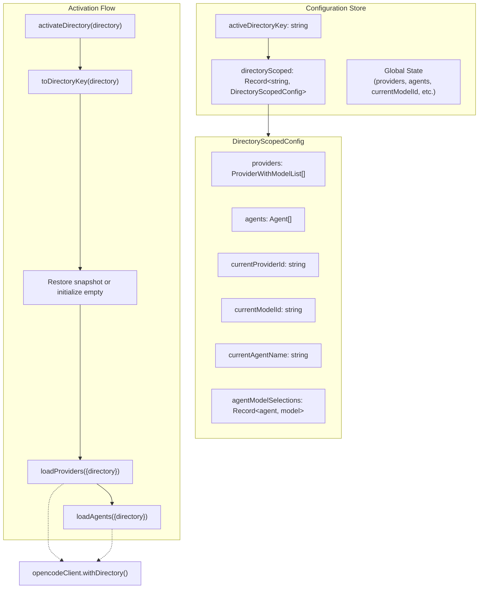

**Sources:** [packages/ui/src/stores/useConfigStore.ts:314-474]()

The store uses `activeDirectoryKey` to track the current directory and maintains a `directoryScoped` map to preserve configuration state when switching between directories. The special key `"__global__"` represents null/undefined directories.

| Function | Purpose |
|----------|---------|
| `activateDirectory(directory)` | Switch active directory context, restore snapshot if available |
| `toDirectoryKey(directory)` | Normalize directory path to storage key |
| `loadProviders({directory})` | Fetch providers for specific directory via `opencodeClient.withDirectory()` |
| `loadAgents({directory})` | Fetch agents for specific directory |

### Settings Persistence Layer

Settings are persisted differently across platforms using a unified interface:

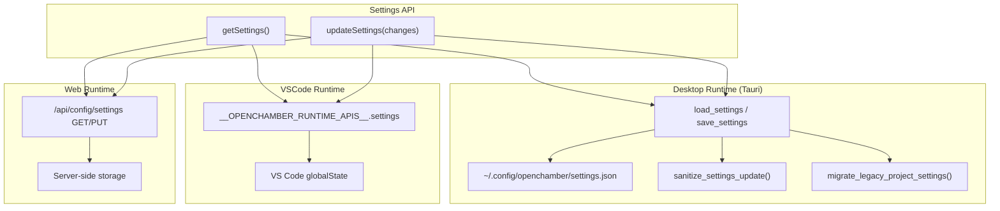

**Sources:** [packages/ui/src/lib/persistence.ts:275-302](), [packages/desktop/src-tauri/src/commands/settings.rs:24-62]()

### Default Model and Agent System

The configuration system supports persistent defaults for models, agents, and variants that apply to all new sessions:

```typescript
// Settings structure
interface OpenChamberDefaults {
    defaultModel?: string;      // format: "provider/model"
    defaultVariant?: string;
    defaultAgent?: string;
    autoCreateWorktree?: boolean;
}
```

**Sources:** [packages/ui/src/stores/useConfigStore.ts:23-28]()

The defaults system has priority order:
1. **Settings-based defaults** (`settingsDefaultModel`, `settingsDefaultAgent`) - highest priority, set by user in Settings UI
2. **Agent preferences** - agent's preferred model from configuration
3. **Last used** - most recently used model/agent

When loading providers, if `settingsDefaultModel` is set and no current model is selected, the store automatically applies the settings default:

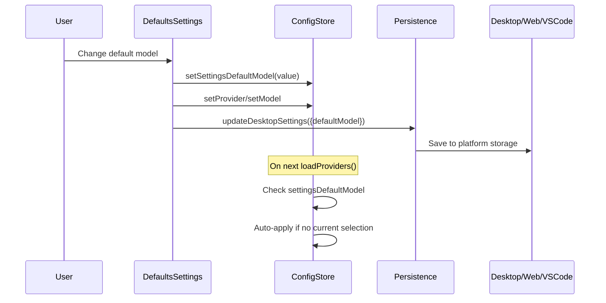

**Sources:** [packages/ui/src/components/sections/openchamber/DefaultsSettings.tsx:102-142](), [packages/ui/src/stores/useConfigStore.ts:534-556]()

### Settings Synchronization

Settings are synchronized across platforms using a unified flow:

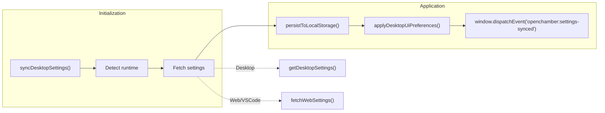

**Sources:** [packages/ui/src/lib/persistence.ts:304-340]()

Settings include:
- Theme preferences (`themeId`, `useSystemTheme`, `lightThemeId`, `darkThemeId`)
- Project management (`projects`, `activeProjectId`)
- Directory access (`lastDirectory`, `homeDirectory`, `approvedDirectories`)
- UI preferences (`showReasoningTraces`, `autoDeleteEnabled`, `queueModeEnabled`)
- Model/agent defaults (`defaultModel`, `defaultVariant`, `defaultAgent`, `autoCreateWorktree`)
- Skill catalogs (`skillCatalogs`)

**Sources:** [packages/ui/src/lib/desktop.ts:40-64](), [packages/desktop/src-tauri/src/commands/settings.rs:173-379]()

---

## Multi-Run System

The multi-run system enables parallel execution of the same prompt across multiple models, each running in an isolated Git worktree with its own branch.

### Multi-Run Architecture

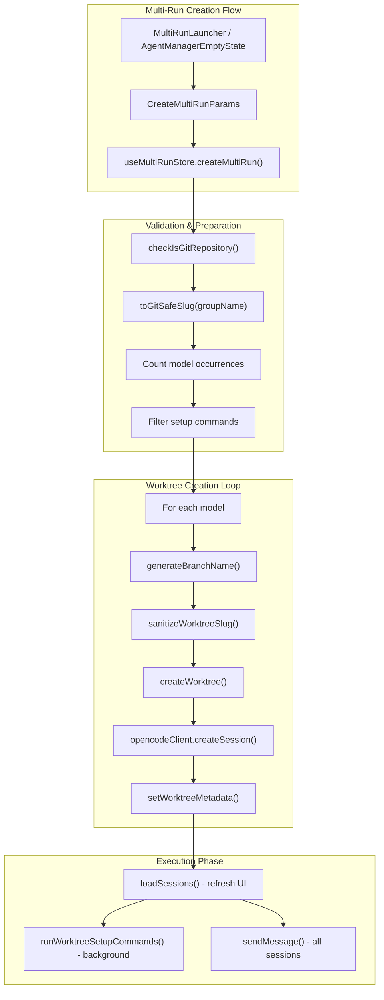

**Sources:** [packages/ui/src/stores/useMultiRunStore.ts:95-319]()

### Multi-Run Parameters

```typescript
interface CreateMultiRunParams {
  name: string;                           // Group name (slug used for branches)
  prompt: string;                         // Same prompt for all models
  models: MultiRunModelSelection[];       // 1-5 models, can include duplicates
  agent?: string;                         // Optional agent
  worktreeBaseBranch?: string;           // Base branch (default: HEAD)
  files?: MultiRunFileAttachment[];      // Shared file attachments
  setupCommands?: string[];              // Commands to run in each worktree
}

interface MultiRunModelSelection {
  providerID: string;
  modelID: string;
  displayName?: string;
  variant?: string;
}
```

**Sources:** [packages/ui/src/types/multirun.ts:24-39]()

### Branch and Worktree Naming

The system generates deterministic branch names and worktree paths:

| Input | Example | Result |
|-------|---------|--------|
| Group name | `"feature-auth"` | Slug: `"feature-auth"` |
| Model | `"openai/gpt-4o"` | Model slug: `"openai-gpt-4o"` |
| Branch | Slug + model slug | `"feature-auth/openai-gpt-4o"` |
| Duplicate model (2nd instance) | Same model selected twice | `"feature-auth/openai-gpt-4o/2"` |
| Worktree path | Branch name sanitized | `.openchamber/feature-auth-openai-gpt-4o` |

**Sources:** [packages/ui/src/stores/useMultiRunStore.ts:15-50]()

### Duplicate Model Handling

The system supports selecting the same model multiple times for A/B testing with different variants:

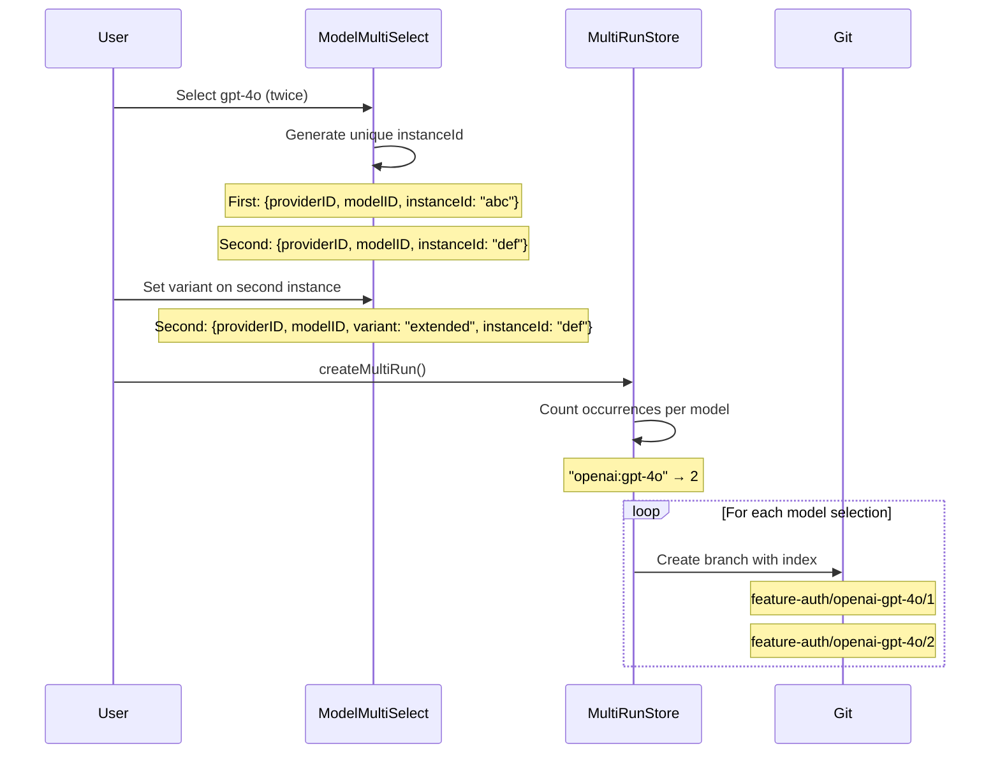

**Sources:** [packages/ui/src/stores/useMultiRunStore.ts:159-180](), [packages/ui/src/components/multirun/ModelMultiSelect.tsx:126-134]()

### Setup Commands System

Multi-run supports automated setup commands that execute in each new worktree after creation:

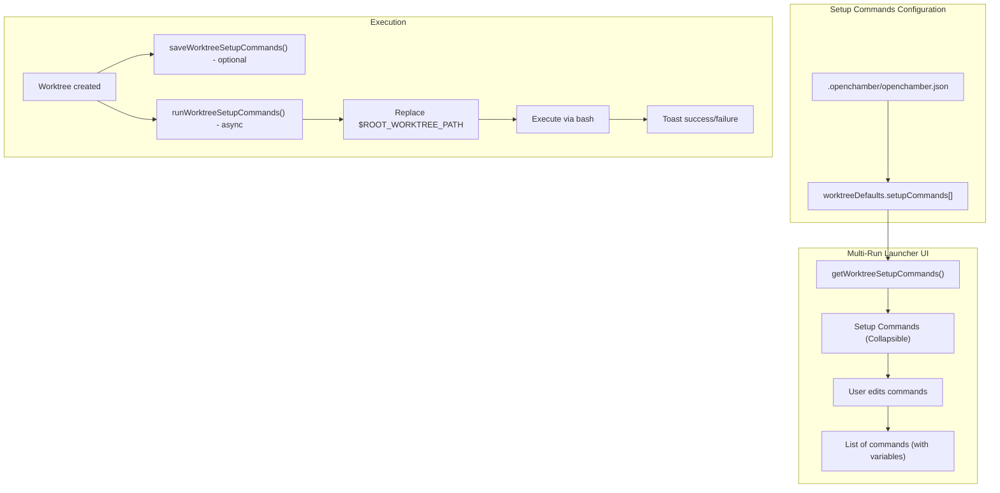

**Sources:** [packages/ui/src/components/multirun/MultiRunLauncher.tsx:140-162](), [packages/ui/src/stores/useMultiRunStore.ts:228-274]()

Example setup commands:
```bash
# Install dependencies
bun install

# Link to root project dependencies (using variable)
ln -sf $ROOT_WORKTREE_PATH/node_modules node_modules

# Build project
bun run build
```

The `$ROOT_WORKTREE_PATH` variable is replaced with the main project directory path during execution.

---

## Worktree Session Creation

OpenChamber provides a standalone worktree session creator that can be invoked from keyboard shortcuts, menu actions, or other non-hook contexts.

### Worktree Session Flow

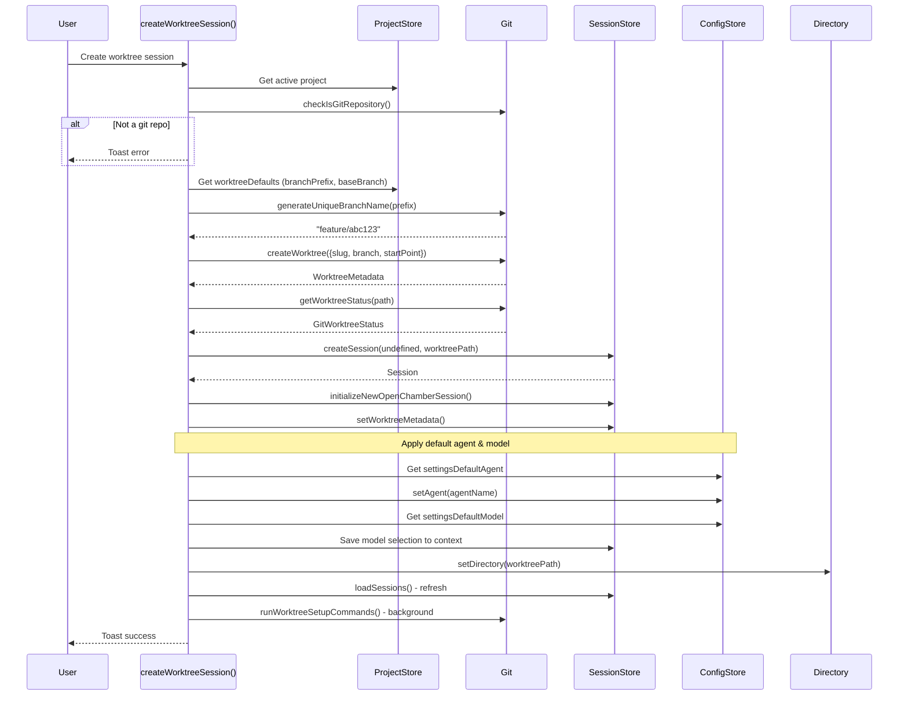

**Sources:** [packages/ui/src/lib/worktreeSessionCreator.ts:41-244]()

### Worktree Defaults per Project

Projects can have their own worktree defaults configured:

```typescript
interface ProjectEntry {
  id: string;
  path: string;
  label?: string;
  worktreeDefaults?: {
    branchPrefix?: string;      // e.g., "feature/"
    baseBranch?: string;        // e.g., "main"
    autoCreateWorktree?: boolean;
  };
}
```

**Sources:** [packages/desktop/src-tauri/src/commands/settings.rs:133-157]()

These defaults are used when creating worktree sessions and control:
- **Branch naming**: Prefix for generated branch names
- **Base branch**: Starting point for new branches (default: `HEAD`)
- **Auto-creation**: Whether keyboard shortcuts default to worktree or standard sessions

### Auto-Create Worktree Setting

The global `autoCreateWorktree` setting (separate from per-project defaults) controls keyboard shortcut behavior:

| Setting | Cmd+N Behavior | Shift+Cmd+N Behavior |
|---------|----------------|----------------------|
| `false` (default) | Standard session | Worktree session |
| `true` | Worktree session | Standard session |

**Sources:** [packages/ui/src/components/sections/openchamber/DefaultsSettings.tsx:291-309]()

---

## Session Organization and Worktree Display

The session sidebar displays sessions organized by project, with special handling for worktree sessions.

### Session Sidebar Structure

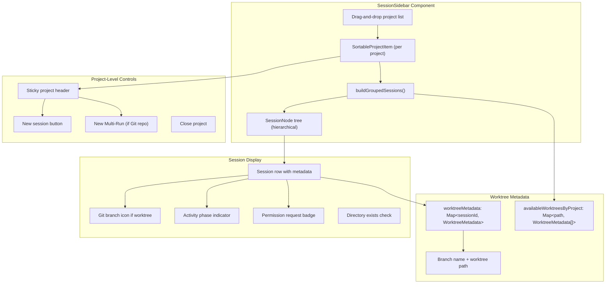

**Sources:** [packages/ui/src/components/session/SessionSidebar.tsx:798-872]()

### Worktree Metadata Structure

```typescript
interface WorktreeMetadata {
  path: string;                    // Absolute worktree path
  branch: string;                  // Branch name
  commit?: string;                 // Current commit hash
  status?: GitWorktreeStatus;      // Git status (clean, modified, etc.)
}
```

Sessions linked to worktrees display:
- Git branch icon (RiGitBranchLine)
- Branch name in session tooltip
- Worktree path in hover tooltip

**Sources:** [packages/ui/src/components/session/SessionSidebar.tsx:105-109](), [packages/ui/src/components/session/SessionSidebar.tsx:1110-1140]()

### Worktree Session Deletion

Deleting a worktree session triggers a confirmation dialog that includes all sessions linked to the same worktree:

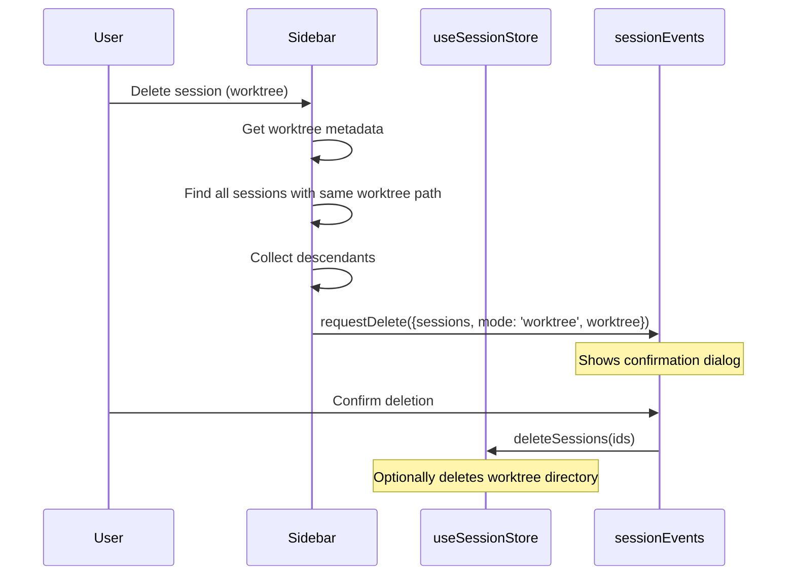

**Sources:** [packages/ui/src/components/session/SessionSidebar.tsx:682-740]()

This ensures users are aware that deleting one worktree session may affect multiple linked sessions.

---

## Model and Variant Selection UI

The multi-run system includes sophisticated model selection components that support duplicates and variants.

### ModelMultiSelect Component

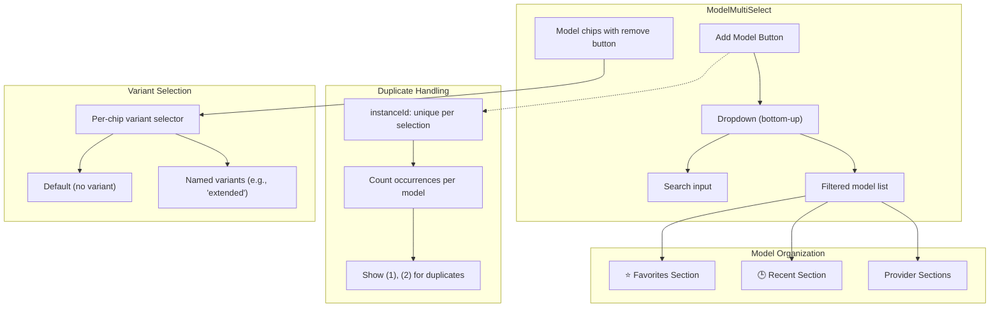

**Sources:** [packages/ui/src/components/multirun/ModelMultiSelect.tsx:105-541]()

### Instance Tracking for Duplicates

Each selected model gets a unique `instanceId` to distinguish duplicates:

```typescript
export interface ModelSelectionWithId {
  providerID: string;
  modelID: string;
  displayName?: string;
  variant?: string;
  instanceId: string;        // UI-only tracking field
}

// Generated on selection
export const generateInstanceId = (): string => {
  return `${Date.now()}-${Math.random().toString(36).substring(2, 9)}`;
};
```

**Sources:** [packages/ui/src/components/multirun/ModelMultiSelect.tsx:18-37]()

The UI displays instance indices only when the same model is selected multiple times:

```typescript
// Chip label generation
const label = totalSameModel > 1 
  ? `${displayName} (${instanceIndex})`  // e.g., "gpt-4o (2)"
  : displayName;                          // e.g., "gpt-4o"
```

**Sources:** [packages/ui/src/components/multirun/ModelMultiSelect.tsx:61-74]()

### Keyboard Navigation

The dropdown supports keyboard navigation across all sections:

| Key | Action |
|-----|--------|
| `ArrowDown` | Move to next model |
| `ArrowUp` | Move to previous model |
| `Enter` | Select highlighted model |
| `Escape` | Close dropdown |

The flat list includes favorites, recents, and all provider models in order, enabling seamless navigation.

**Sources:** [packages/ui/src/components/multirun/ModelMultiSelect.tsx:333-372]()

---

## Configuration File System

OpenChamber uses `.openchamber/openchamber.json` for project-specific configuration including worktree setup commands.

### Configuration File Structure

```json
{
  "worktreeDefaults": {
    "setupCommands": [
      "bun install",
      "ln -sf $ROOT_WORKTREE_PATH/node_modules node_modules",
      "bun run build"
    ]
  }
}
```

Functions for reading and writing:

```typescript
// Read setup commands from config
getWorktreeSetupCommands(projectDirectory: string): Promise<string[]>

// Save setup commands to config
saveWorktreeSetupCommands(projectDirectory: string, commands: string[]): Promise<void>
```

**Sources:** [packages/ui/src/stores/useMultiRunStore.ts:228-233]()

The configuration file is automatically created/updated when:
1. User edits setup commands in MultiRunLauncher
2. Multi-run is created with new setup commands
3. Commands are saved for future worktree creation

---

This page covers the core advanced systems in OpenChamber. For UI component details, see [UI Component Library](#7). For Git operations implementation, see [Git Integration](#8.3). For skills catalog details, see [Skills System](#8.4).

---

