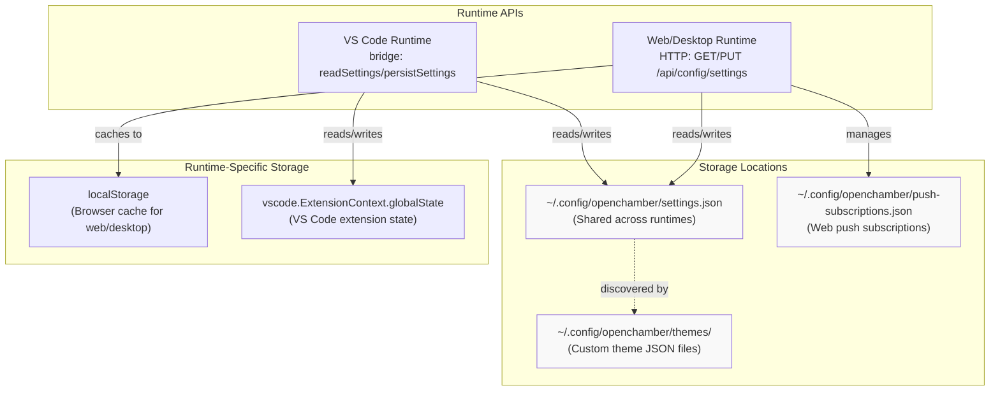
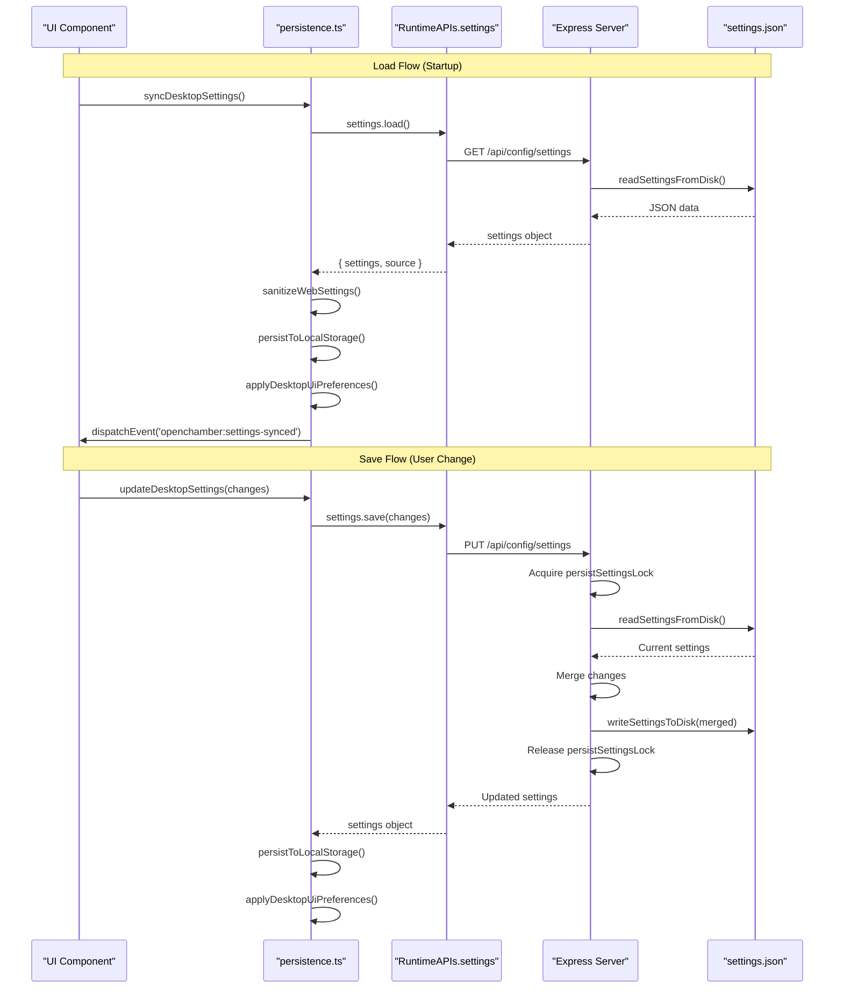
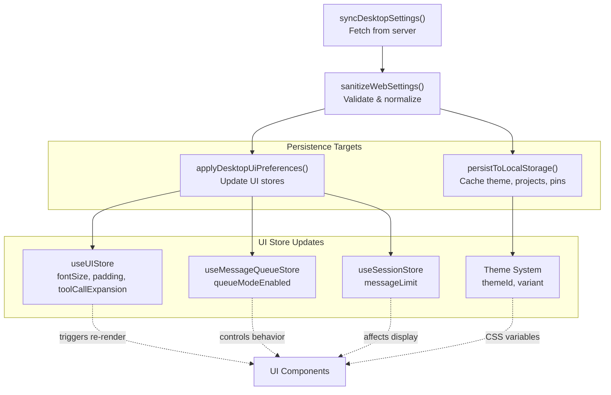

<!-- source: DeepWiki mcp.deepwiki.com · repo btriapitsyn/openchamber · page 8.1 Configuration and Settings · fetched 2026-10-26 -->

# Configuration and Settings

<details>
<summary>Relevant source files</summary>

The following files were used as context for generating this wiki page:

- [packages/desktop/src-tauri/src/main.rs](packages/desktop/src-tauri/src/main.rs)
- [packages/ui/src/App.tsx](packages/ui/src/App.tsx)
- [packages/ui/src/lib/api/types.ts](packages/ui/src/lib/api/types.ts)
- [packages/ui/src/lib/desktop.ts](packages/ui/src/lib/desktop.ts)
- [packages/ui/src/lib/persistence.ts](packages/ui/src/lib/persistence.ts)
- [packages/vscode/src/bridge.ts](packages/vscode/src/bridge.ts)
- [packages/web/server/index.js](packages/web/server/index.js)

</details>


This page documents the configuration and settings system in OpenChamber, including storage locations, synchronization mechanisms, validation, and the runtime-specific implementations across web, desktop, and VS Code environments. For information about state management and UI preferences that are not persisted, see [State Management](#3.4).

---

## Overview

OpenChamber's settings system provides persistent configuration across three runtime environments (web, desktop, VS Code) with a unified storage format. Settings are stored in JSON format and include appearance preferences, project workspaces, AI model defaults, Git identities, notification templates, and custom theme definitions.

**Key characteristics:**
- **Shared storage**: `~/.config/openchamber/settings.json` used by all runtimes
- **Runtime-specific augmentation**: VS Code uses extension globalState, desktop uses localStorage caching
- **Validation layer**: All incoming settings sanitized and normalized before persistence
- **Synchronization**: Settings loaded on startup and merged with runtime-specific state
- **Concurrent write protection**: Lock mechanism prevents race conditions during persistence

Sources: [packages/ui/src/lib/desktop.ts:32-114](), [packages/web/server/index.js:1048-1052](), [packages/vscode/src/bridge.ts:98-103]()

---

## Storage Architecture



**Diagram: Settings storage locations and access patterns**

The settings system uses a file-based approach with platform-specific caching:

- **Shared settings file**: `OPENCHAMBER_DATA_DIR/settings.json` (typically `~/.config/openchamber/settings.json`) stores the canonical settings state
- **Custom themes directory**: `OPENCHAMBER_USER_THEMES_DIR` (typically `~/.config/openchamber/themes/`) contains user-defined theme JSON files
- **Push subscriptions file**: `PUSH_SUBSCRIPTIONS_FILE_PATH` stores web push notification subscriptions separately
- **LocalStorage cache**: Desktop and web runtimes cache settings in browser localStorage for fast access
- **VS Code globalState**: Extension-specific settings stored in VS Code's persistent state

Sources: [packages/web/server/index.js:1048-1053](), [packages/web/server/index.js:80-81](), [packages/vscode/src/bridge.ts:103]()

---

## Settings Schema

The complete settings schema is defined by the `DesktopSettings` type, which encompasses all configurable aspects of the application:

| Category | Fields | Description |
|----------|--------|-------------|
| **Appearance** | `themeId`, `useSystemTheme`, `themeVariant`, `lightThemeId`, `darkThemeId` | Theme selection and variant preferences |
| **Layout** | `fontSize`, `terminalFontSize`, `padding`, `cornerRadius`, `inputBarOffset` | UI dimensions and spacing |
| **Projects** | `projects`, `activeProjectId`, `lastDirectory`, `pinnedDirectories` | Workspace management |
| **AI Models** | `defaultModel`, `defaultVariant`, `defaultAgent`, `favoriteModels`, `recentModels` | Model selection preferences |
| **Notifications** | `nativeNotificationsEnabled`, `notificationMode`, `notifyOnCompletion`, `notificationTemplates` | Notification behavior and templates |
| **Git** | `defaultGitIdentityId`, `autoCreateWorktree`, `gitmojiEnabled` | Git workflow preferences |
| **Editor** | `toolCallExpansion`, `diffLayoutPreference`, `diffViewMode`, `directoryShowHidden` | Editor behavior |
| **Usage Tracking** | `usageAutoRefresh`, `usageDisplayMode`, `usageSelectedModels`, `usageModelGroups` | Model usage preferences |
| **Advanced** | `autoDeleteEnabled`, `autoDeleteAfterDays`, `messageLimit`, `queueModeEnabled` | Advanced features |
| **Skills** | `skillCatalogs` | Custom skills catalog configurations |

Sources: [packages/ui/src/lib/desktop.ts:32-114]()

---

## Settings Lifecycle



**Diagram: Settings load and save flow across application layers**

### Load Flow

1. **Initialization**: On app startup, `syncDesktopSettings()` is called
2. **Fetch**: RuntimeAPI `settings.load()` fetches from server or extension state
3. **Validation**: `sanitizeWebSettings()` validates and normalizes the payload
4. **Cache**: `persistToLocalStorage()` caches validated settings
5. **Apply**: `applyDesktopUiPreferences()` updates UI stores
6. **Notify**: Event `openchamber:settings-synced` dispatched for listeners

### Save Flow

1. **Trigger**: UI calls `updateDesktopSettings(changes)` with partial settings
2. **Persist**: RuntimeAPI `settings.save(changes)` sends to backend
3. **Lock**: Server acquires `persistSettingsLock` to prevent races
4. **Merge**: Current settings read, changes merged (preserving omitted fields)
5. **Write**: `writeSettingsToDisk()` atomically writes merged settings
6. **Unlock**: Lock released, ensuring sequential writes
7. **Apply**: Updated settings cached and applied to UI stores

Sources: [packages/ui/src/lib/persistence.ts:685-767](), [packages/web/server/index.js:1054-1079](), [packages/web/server/index.js:56-57]()

---

## Runtime-Specific Implementations

### Web and Desktop

The web and desktop runtimes share the same HTTP-based settings API:

**Settings API Endpoints:**
- `GET /api/config/settings` - Load current settings from disk
- `PUT /api/config/settings` - Update settings with partial changes

**Server-side operations:**
```javascript
// packages/web/server/index.js
const readSettingsFromDisk = async () => {
  const raw = await fsPromises.readFile(SETTINGS_FILE_PATH, 'utf8');
  return JSON.parse(raw);
};

const writeSettingsToDisk = async (settings) => {
  await fsPromises.mkdir(path.dirname(SETTINGS_FILE_PATH), { recursive: true });
  await fsPromises.writeFile(SETTINGS_FILE_PATH, JSON.stringify(settings, null, 2), 'utf8');
};
```

**Concurrent write protection:**
The server uses a promise-based lock to serialize write operations:
```javascript
let persistSettingsLock = Promise.resolve();
// Each write operation chains onto this lock
```

Sources: [packages/web/server/index.js:1054-1079](), [packages/web/server/index.js:56-57]()

### VS Code Extension

VS Code uses a hybrid storage approach combining extension state with the shared settings file:

**Storage strategy:**
- **Extension globalState**: Stores VS Code-specific settings (most fields)
- **Shared file**: Stores `opencodeBinary` path for cross-runtime compatibility
- **Merge on load**: Reads both sources and merges, with shared file taking precedence for `opencodeBinary`

**Key functions:**
- `readSettings(ctx)` - Merges extension state with shared file
- `persistSettings(changes, ctx)` - Updates both storage locations
- `readSharedSettingsFromDisk()` - Reads `~/.config/openchamber/settings.json`
- `writeSharedSettingsToDisk(changes)` - Writes specific fields to shared file

**Empty-string sentinel**: When a field like `opencodeBinary` is cleared, an empty string `""` is written to the shared file so other runtimes can detect the explicit clear (versus missing field).

Sources: [packages/vscode/src/bridge.ts:98-152](), [packages/vscode/src/bridge.ts:215-254]()

---

## Settings Validation and Sanitization

```mermaid
graph LR
    RawInput["Raw Settings Input<br/>(HTTP/IPC payload)"]
    Sanitize["sanitizeWebSettings()<br/>Type checking & normalization"]
    Validated["Validated Settings<br/>(DesktopSettings)"]
    
    subgraph "Validation Steps"
        TypeCheck["Type Checking<br/>String/boolean/number validation"]
        Normalize["Normalization<br/>Trim strings, resolve paths"]
        Dedupe["Deduplication<br/>Remove duplicate projects/models"]
        Limits["Enforce Limits<br/>favoriteModels ≤64, recentModels ≤16"]
        Sanitizers["Field Sanitizers<br/>sanitizeProjects, sanitizeModelRefs"]
    end
    
    RawInput --> Sanitize
    Sanitize --> TypeCheck
    TypeCheck --> Normalize
    Normalize --> Dedupe
    Dedupe --> Limits
    Limits --> Sanitizers
    Sanitizers --> Validated
    
    Validated --> Apply["applyDesktopUiPreferences()<br/>Update UI stores"]
    Validated --> Cache["persistToLocalStorage()<br/>Cache in browser"]
```



**Diagram: Settings validation and application pipeline**

The `sanitizeWebSettings()` function validates all incoming settings to ensure type safety and data integrity:

### Validation Rules

**Type validation:**
- Strings: Checked for type and trimmed
- Booleans: Exact `true`/`false` values required
- Numbers: Must be finite (not NaN or Infinity)
- Arrays: Filtered to remove invalid elements

**Field-specific sanitization:**
- **Projects**: `sanitizeProjects()` deduplicates by ID and path, normalizes path separators
- **Model refs**: `sanitizeModelRefs()` limits to 64 favorites, 16 recent, deduplicates by `providerID/modelID`
- **Skills catalogs**: `sanitizeSkillCatalogs()` validates id/label/source, deduplicates by ID
- **Paths**: Tilde expansion, trailing slash removal, backslash normalization

**Limits enforced:**
- `favoriteModels`: Maximum 64 entries
- `recentModels`: Maximum 16 entries
- `autoDeleteAfterDays`: Range 1-365
- `fontSize`, `terminalFontSize`, `padding`, etc.: Reasonable numeric ranges

**Normalization examples:**
```typescript
// Path normalization
const normalizedPath = rawPath === '/' ? rawPath : rawPath.replace(/\\/g, '/').replace(/\/+$/, '');

// Empty string clears
if (typeof value === 'string' && value.trim().length === 0) {
  // Field omitted from result (treated as unset)
}
```

Sources: [packages/ui/src/lib/persistence.ts:333-655](), [packages/ui/src/lib/persistence.ts:118-167](), [packages/ui/src/lib/persistence.ts:169-191]()

---

## Custom Themes System

OpenChamber supports user-defined themes stored as JSON files in the themes directory:

**Theme directory structure:**
```
~/.config/openchamber/
├── settings.json
└── themes/
    ├── my-custom-theme.json
    ├── dark-variation.json
    └── light-variation.json
```

**Theme file schema:**
Each theme file must include:
- `metadata`: Theme ID, name, variant (light/dark), version, description, tags
- `colors`: Comprehensive color palette including primary, surface, interactive, status, syntax

**Theme discovery:**
- `readCustomThemesFromDisk()` scans the themes directory on server startup
- Each `.json` file validated via `normalizeThemeJson()`
- Invalid or duplicate theme IDs are skipped with warnings
- Maximum theme file size: 512 KB (`MAX_THEME_JSON_BYTES`)

**Theme validation:**
The `normalizeThemeJson()` function ensures all required color fields are present and valid:
- Primary colors: `base`, `foreground`
- Surface colors: `background`, `foreground`, `muted`, `elevated`, `subtle`
- Interactive colors: `border`, `selection`, `focusRing`, `hover`
- Status colors: `error`, `warning`, `success`, `info` (each with foreground/background/border)
- Syntax colors: `background`, `foreground`, `keyword`, `string`, `number`, `function`, `variable`, `type`, `comment`, `operator`
- Syntax highlights: `diffAdded`, `diffRemoved`, `lineNumber`

**API endpoint:**
- `GET /api/themes/custom` - Returns array of discovered custom themes

Sources: [packages/web/server/index.js:80-237](), [packages/web/server/index.js:83]()

---

## Notification Templates

Notification settings include customizable templates for different event types:

**Template structure:**
```typescript
notificationTemplates: {
  completion: { title: string; message: string };
  error: { title: string; message: string };
  question: { title: string; message: string };
  subtask: { title: string; message: string };
}
```

**Template variables:**
Templates support variable interpolation with `{variable_name}` syntax:
- `{project_name}`: Current project label
- `{session_name}`: Session title
- `{agent_name}`: Agent mode name
- `{model_name}`: Model identifier
- `{branch}`: Git branch name
- `{worktree}`: Worktree directory path
- `{last_message}`: Last AI message text (optionally summarized)

**Variable resolution:**
The `resolveNotificationTemplate()` function replaces template placeholders:
```javascript
const resolveNotificationTemplate = (template, variables) => {
  return template.replace(/\{(\w+)\}/g, (_match, key) => {
    const value = variables[key];
    return value !== undefined && value !== null ? String(value) : '';
  });
};
```

**Message summarization:**
When `summarizeLastMessage` is enabled and the message exceeds `summaryThreshold` characters:
1. Message text extracted from AI response parts
2. Sent to OpenCode Zen API for summarization
3. Target length: `summaryLength` characters
4. Fallback to original text on summarization failure

Sources: [packages/web/server/index.js:569-592](), [packages/web/server/index.js:663-698](), [packages/ui/src/lib/desktop.ts:59-64]()

---

## Projects and Workspaces

The settings system manages multiple project workspaces with persistent metadata:

**Project entry schema:**
```typescript
interface ProjectEntry {
  id: string;                // Unique identifier
  path: string;              // Absolute directory path
  label?: string;            // Display name
  icon?: string | null;      // Icon identifier
  color?: string | null;     // Color code
  addedAt?: number;          // Timestamp (ms)
  lastOpenedAt?: number;     // Last access timestamp
  sidebarCollapsed?: boolean; // Sidebar state
}
```

**Project management:**
- **Deduplication**: Projects deduplicated by both ID and normalized path
- **Path normalization**: Backslashes converted to forward slashes, trailing slashes removed
- **Active project**: `activeProjectId` tracks the currently selected workspace
- **Pinned directories**: `pinnedDirectories` array stores quick-access paths

**Project sanitization:**
The `sanitizeProjects()` function ensures data integrity:
- Validates required fields (id, path)
- Normalizes paths (handles Windows/Unix differences)
- Removes duplicates based on ID and path
- Preserves optional metadata (label, icon, color, timestamps)

**Sidebar collapse state:**
Project sidebar collapse state persisted in two locations:
1. `projects[].sidebarCollapsed` in settings file
2. `localStorage['oc.sessions.projectCollapse']` as ID array for fast lookup

Sources: [packages/ui/src/lib/api/types.ts:486-495](), [packages/ui/src/lib/persistence.ts:118-167](), [packages/ui/src/lib/persistence.ts:52-62]()

---

## Usage Tracking Configuration

Settings include extensive configuration for model usage tracking and display:

**Usage tracking fields:**
- `usageAutoRefresh`: Enable automatic usage polling
- `usageRefreshIntervalMs`: Polling interval (30-300 seconds)
- `usageDisplayMode`: Show usage or remaining quota (`'usage'` | `'remaining'`)
- `usageDropdownProviders`: Providers visible in header dropdown
- `usageSelectedModels`: Map of `providerId → modelName[]` for filtering
- `usageCollapsedFamilies`: Map of `providerId → familyId[]` for collapsed families (UsagePage)
- `usageExpandedFamilies`: Map of `providerId → familyId[]` for expanded families (header dropdown, inverted)
- `usageModelGroups`: Custom grouping configuration per provider

**Model groups configuration:**
```typescript
usageModelGroups: {
  [providerId: string]: {
    customGroups?: Array<{
      id: string;
      label: string;
      models: string[];
      order: number;
    }>;
    modelAssignments?: Record<string, string>; // modelName → groupId
    renamedGroups?: Record<string, string>;    // groupId → custom label
  }
}
```

This allows users to:
- Create custom model groups
- Assign models to specific groups
- Rename default groups
- Control group display order

Sources: [packages/ui/src/lib/desktop.ts:72-83](), [packages/ui/src/lib/persistence.ts:492-586]()

---

## Platform-Specific Settings Paths

Different runtimes resolve settings paths based on their environment:

### Web Runtime (Node.js/Bun)

**Environment variable override:**
```javascript
const OPENCHAMBER_DATA_DIR = process.env.OPENCHAMBER_DATA_DIR
  ? path.resolve(process.env.OPENCHAMBER_DATA_DIR)
  : path.join(os.homedir(), '.config', 'openchamber');
```

**Default paths:**
- Settings: `~/.config/openchamber/settings.json`
- Themes: `~/.config/openchamber/themes/`
- Push subscriptions: `~/.config/openchamber/push-subscriptions.json`

### Desktop Runtime (Tauri)

**Settings resolution:**
Desktop uses the same HTTP API as web runtime but adds:
- LocalStorage cache for fast startup
- `__OPENCHAMBER_HOME__` global for home directory
- Settings sync on app activation

### VS Code Extension

**Storage locations:**
- Extension state: `context.globalState.get('openchamber.settings')`
- Shared file: `~/.config/openchamber/settings.json` (for `opencodeBinary` only)
- Workspace directory: `vscode.workspace.workspaceFolders[0].uri.fsPath` as `lastDirectory`

**Theme variant detection:**
```typescript
const themeVariant =
  vscode.window.activeColorTheme.kind === vscode.ColorThemeKind.Light ||
  vscode.window.activeColorTheme.kind === vscode.ColorThemeKind.HighContrastLight
    ? 'light'
    : 'dark';
```

Sources: [packages/web/server/index.js:1048-1053](), [packages/vscode/src/bridge.ts:103](), [packages/vscode/src/bridge.ts:130-152]()

---

## Settings Persistence Lock

The server implements a promise-based lock to prevent concurrent write conflicts:

**Lock mechanism:**
```javascript
let persistSettingsLock = Promise.resolve();

// Each write operation chains onto the lock
persistSettingsLock = persistSettingsLock.then(async () => {
  await fsPromises.mkdir(path.dirname(SETTINGS_FILE_PATH), { recursive: true });
  const current = await readSettingsFromDisk();
  const next = { ...current, ...changes };
  await writeSettingsToDisk(next);
});
```

**Purpose:**
- Prevents race conditions when multiple UI actions trigger settings updates
- Ensures sequential write operations
- Guarantees settings file integrity under concurrent access

**Usage pattern:**
1. Lock acquired by chaining onto existing promise
2. Current settings read from disk
3. Changes merged with existing settings
4. Merged settings written atomically
5. Lock released when promise resolves

Sources: [packages/web/server/index.js:56-57](), [packages/web/server/index.js:1071-1079]()

---

## Settings Application Flow



**Diagram: Settings application to UI stores and components**

When settings are loaded or updated, they are applied across multiple layers:

### LocalStorage Caching

`persistToLocalStorage()` caches frequently-accessed settings:
- `selectedThemeId`, `selectedThemeVariant`, `lightThemeId`, `darkThemeId`
- `useSystemTheme`, `lastDirectory`, `homeDirectory`
- `projects`, `activeProjectId`, `pinnedDirectories`
- `oc.sessions.projectCollapse` (collapsed project IDs)
- `gitmojiEnabled`, `directoryTreeShowHidden`, `filesViewShowGitignored`, `openInAppId`

### UI Store Application

`applyDesktopUiPreferences()` updates Zustand stores:
- **useUIStore**: `showReasoningTraces`, `autoDeleteEnabled`, `autoDeleteAfterDays`, `messageLimit`, `showTextJustificationActivity`, `nativeNotificationsEnabled`, `notificationMode`, notification triggers/templates, summarization settings, `toolCallExpansion`, `fontSize`, `terminalFontSize`, `padding`, `cornerRadius`, `inputBarOffset`, `favoriteModels`, `recentModels`, `diffLayoutPreference`, `diffViewMode`
- **useMessageQueueStore**: `queueModeEnabled`
- **Global functions**: `setDirectoryShowHidden()`, `setFilesViewShowGitignored()`

### Reactivity

Settings changes trigger UI updates through:
1. **Zustand subscriptions**: Components subscribed to stores re-render automatically
2. **CSS variable updates**: Theme changes update root CSS custom properties
3. **Event dispatch**: `window.dispatchEvent(new CustomEvent('openchamber:settings-synced', { detail: settings }))`

Sources: [packages/ui/src/lib/persistence.ts:9-77](), [packages/ui/src/lib/persistence.ts:203-331](), [packages/ui/src/lib/persistence.ts:685-721]()

---

