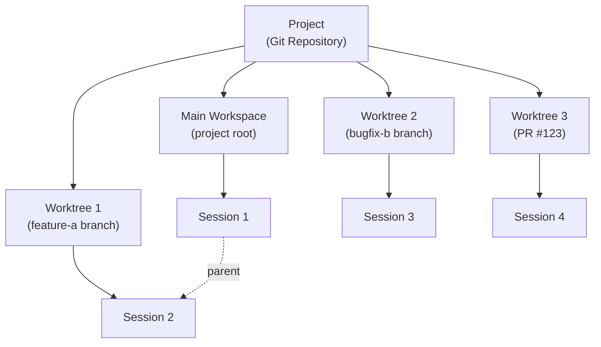
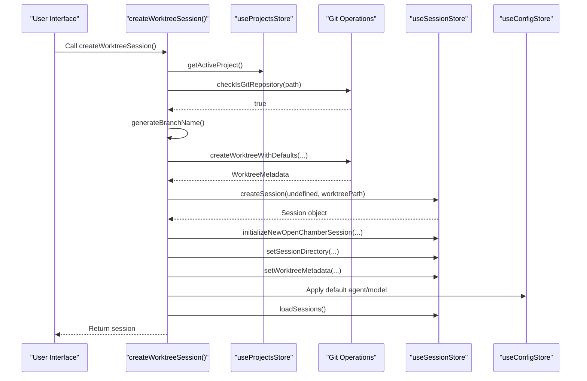
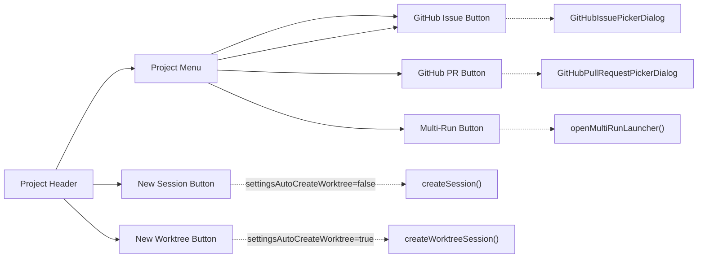
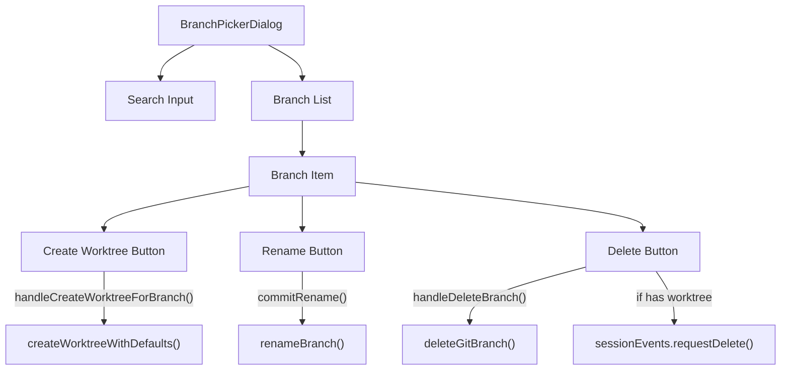
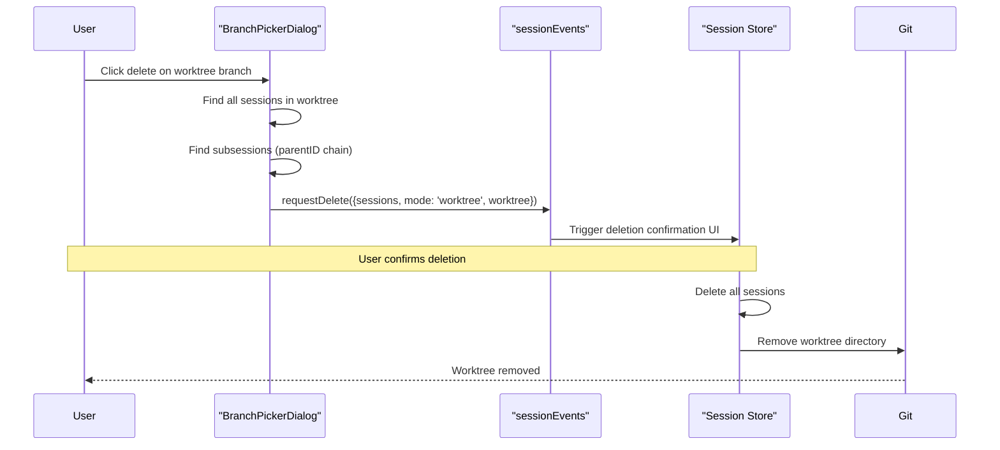
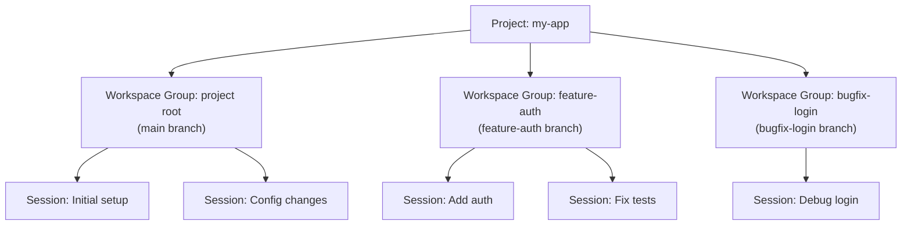
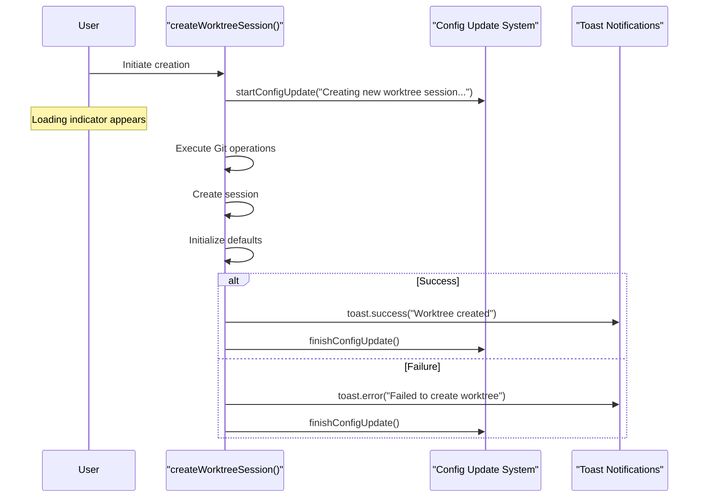

<!-- source: DeepWiki mcp.deepwiki.com · repo btriapitsyn/openchamber · page 8.2 Worktrees and Multi-Run · fetched 2026-10-26 -->

# Worktrees and Multi-Run

<details>
<summary>Relevant source files</summary>

The following files were used as context for generating this wiki page:

- [packages/ui/src/components/session/BranchPickerDialog.tsx](packages/ui/src/components/session/BranchPickerDialog.tsx)
- [packages/ui/src/components/session/SessionSidebar.tsx](packages/ui/src/components/session/SessionSidebar.tsx)
- [packages/ui/src/lib/worktreeSessionCreator.ts](packages/ui/src/lib/worktreeSessionCreator.ts)
- [packages/ui/src/stores/useProjectsStore.ts](packages/ui/src/stores/useProjectsStore.ts)

</details>


This document describes OpenChamber's Git worktree integration and multi-run execution capabilities. Git worktrees enable parallel development on multiple branches within the same project by creating separate working directories for each branch. Sessions can be bound to specific worktrees, allowing concurrent work on different features, bug fixes, or experiments. The multi-run system extends this concept to execute operations across multiple sessions simultaneously.

For general Git operations (commits, branches, status), see [Git Operations](#8.3). For session management concepts, see [Session Management UI](#7.3).

---

## Git Worktrees Overview

Git worktrees allow multiple working directories (worktrees) to coexist for a single repository. Each worktree can have a different branch checked out, enabling parallel development without constantly switching branches or stashing changes.

### Worktree Metadata Structure

OpenChamber tracks worktree metadata for each session:

| Field | Type | Description |
|-------|------|-------------|
| `source` | `'sdk'` | Origin of worktree (currently only SDK-managed) |
| `name` | `string` | Worktree identifier |
| `path` | `string` | Absolute filesystem path to worktree directory |
| `projectDirectory` | `string` | Root project directory |
| `branch` | `string` | Git branch checked out in this worktree |
| `label` | `string` | Display name for UI |
| `createdFromBranch` | `string?` | Source branch used as starting point |
| `kind` | `'standard' \| 'pr'` | Worktree type (normal or pull request) |
| `status` | `WorktreeStatus?` | Current worktree state (clean/dirty) |

**Sources:** [packages/ui/src/components/session/SessionSidebar.tsx:67](), [packages/ui/src/components/session/BranchPickerDialog.tsx:25]()

### Worktree Organization in UI



The UI groups sessions hierarchically by their worktree location. Each worktree appears as a collapsible group in the session sidebar.

**Sources:** [packages/ui/src/components/session/SessionSidebar.tsx:1182-1291]()

---

## Worktree Session Creation

### Primary Creation Functions

OpenChamber provides multiple functions for creating worktree sessions with different initialization strategies:

#### `createWorktreeSession()`

Creates a new session with an auto-generated worktree and branch name.



**Implementation:** The function performs these steps:
1. Validates that an active project exists and is a Git repository
2. Generates a unique branch name using `generateBranchName()`
3. Retrieves setup commands from `.openchamber/config.toml` via `getWorktreeSetupCommands()`
4. Creates the worktree with `createWorktreeWithDefaults()`
5. Creates a session bound to the worktree directory
6. Initializes session with default agent and model preferences
7. Updates directory store to point to new worktree

**Sources:** [packages/ui/src/lib/worktreeSessionCreator.ts:60-226]()

#### `createWorktreeSessionForBranch()`

Creates a worktree session for an existing branch. This is used when checking out remote branches or switching to existing local branches in a new worktree.

Key parameters:
- `projectDirectory`: Root Git repository path
- `branchName`: Target branch name
- `options.existingBranch`: Source branch to checkout (defaults to `branchName`)
- `options.kind`: `'pr'` for pull request branches, `'standard'` otherwise
- `options.setUpstream`: Whether to configure remote tracking
- `options.ensureRemoteName`: Remote name to add if missing
- `options.ensureRemoteUrl`: Remote URL to configure

**Sources:** [packages/ui/src/lib/worktreeSessionCreator.ts:310-487]()

#### `createWorktreeSessionForNewBranch()`

Creates a worktree session starting from a specific Git ref (commit, branch, or tag). The branch name may be auto-modified by the SDK to ensure uniqueness.

**Parameters:**
- `projectDirectory`: Project root path
- `preferredBranchName`: Desired branch name (may be modified for uniqueness)
- `startPoint`: Git ref to start from (defaults to `'HEAD'`)
- `options`: Same upstream/remote options as `createWorktreeSessionForBranch()`

**Sources:** [packages/ui/src/lib/worktreeSessionCreator.ts:493-653]()

#### `createWorktreeOnly()`

Creates a worktree without a session. Used when the user wants to prepare a worktree for manual use or non-session workflows.

**Sources:** [packages/ui/src/lib/worktreeSessionCreator.ts:235-300]()

### Branch Name Generation

The `generateBranchName()` function creates human-readable, collision-resistant branch names:

**Format:** `{adjective}-{noun}-{suffix}`

Example: `rapid-forest-a7k2`

The suffix ensures uniqueness within the repository. This prevents collisions when multiple worktrees are created rapidly.

**Sources:** Referenced in [packages/ui/src/lib/worktreeSessionCreator.ts:97]() via import from `@/lib/git/branchNameGenerator`

### Worktree Setup Commands

Projects can define post-worktree-creation setup commands in `.openchamber/config.toml`:

```toml
[worktree]
setup_commands = [
  "npm install",
  "npm run build"
]
```

These commands run automatically after worktree creation to ensure dependencies are installed and the environment is ready.

**Sources:** [packages/ui/src/lib/worktreeSessionCreator.ts:99-100]()

---

## Worktree Management UI

### Session Sidebar Worktree Controls

The `SessionSidebar` component provides the primary interface for worktree operations:



**UI Behavior:**
- **Primary button** (plus icon): Creates either a basic session or worktree session based on `settingsAutoCreateWorktree` configuration
- **Secondary button** (branch icon): Always creates a worktree session regardless of settings
- **Menu options**: GitHub integration and multi-run launcher

**Sources:** [packages/ui/src/components/session/SessionSidebar.tsx:409-496]()

### Branch Picker Dialog

The `BranchPickerDialog` component provides comprehensive branch and worktree management:

**Features:**
1. **Branch Listing**: Displays all local branches with metadata (commit hash, ahead/behind counts)
2. **Worktree Creation**: Create worktree for any branch with one click
3. **Branch Operations**: Rename and delete branches
4. **Status Indicators**: Shows which branches have attached worktrees
5. **Protection Rules**: Prevents deletion of current branch or project root branch



**Branch Item Actions:**
- **Create Worktree** (split cells icon): Calls `createWorktreeWithDefaults()` for the selected branch
- **Rename** (pencil icon): Inline editing with Git rename operation
- **Delete** (trash icon): Removes branch or triggers session deletion if worktree exists

**Sources:** [packages/ui/src/components/session/BranchPickerDialog.tsx:67-582]()

### Worktree Deletion Flow

When deleting a worktree that has sessions:



The system ensures cascading deletion: when a worktree is removed, all sessions bound to that worktree (including child sessions) are deleted together.

**Sources:** [packages/ui/src/components/session/BranchPickerDialog.tsx:233-285]()

---

## Session Organization by Worktree

### Workspace Grouping

The sidebar organizes sessions into workspace groups based on their directory:



**Grouping Logic:**

1. **Root Group**: Sessions in the project's main directory (typically the default branch)
2. **Worktree Groups**: Sessions in subdirectories that correspond to Git worktrees
3. **Sorting**: Groups can be manually reordered, with order persisted in `localStorage`

**Sources:** [packages/ui/src/components/session/SessionSidebar.tsx:1248-1291]()

### Group Order Persistence

Workspace group order is stored per-project in localStorage using the key `oc.sessions.groupOrder`:

```typescript
// Format: Map<projectId, groupId[]>
{
  "project_abc123": [
    "root",
    "/path/to/worktree/feature-auth",
    "/path/to/worktree/bugfix-login"
  ]
}
```

Groups can be reordered via drag-and-drop using `@dnd-kit/sortable`.

**Sources:** [packages/ui/src/components/session/SessionSidebar.tsx:614-631]()

### Collapsed State Management

Each workspace group has its own collapsed/expanded state, persisted separately:

| Storage Key | Purpose | Format |
|------------|---------|--------|
| `oc.sessions.groupCollapse` | Collapsed workspace groups | `string[]` of group IDs |
| `oc.sessions.projectCollapse` | Collapsed projects | `string[]` of project IDs |
| `oc.sessions.expandedParents` | Expanded parent sessions | `string[]` of session IDs |

**Sources:** [packages/ui/src/components/session/SessionSidebar.tsx:88-93](), [packages/ui/src/components/session/SessionSidebar.tsx:602-613]()

---

## Multi-Run System

The multi-run system allows executing operations across multiple sessions or worktrees concurrently. This is useful for:
- Running tests in multiple branches simultaneously
- Applying refactoring across feature branches
- Comparing AI agent behavior on different code states

### Multi-Run Launcher

The multi-run launcher is accessed via:
1. Project menu → "New Multi-Run"
2. Keyboard shortcut (if configured)

```mermaid
graph LR
    SessionSidebar["SessionSidebar"]
    ProjectMenu["Project Menu Dropdown"]
    MultiRunMenuItem["Multi-Run Menu Item"]
    UIStore["useUIStore"]
    MultiRunLauncher["Multi-Run Launcher UI"]
    
    SessionSidebar --> ProjectMenu
    ProjectMenu --> MultiRunMenuItem
    MultiRunMenuItem -->|"onClick"| OpenAction["openMultiRunLauncher()"]
    OpenAction --> UIStore
    UIStore -.->|"state change"| MultiRunLauncher
```



**Menu Item Location:** The "New Multi-Run" option appears in the project dropdown menu, identified by the `ArrowsMerge` icon.

**Sources:** [packages/ui/src/components/session/SessionSidebar.tsx:434-437](), [packages/ui/src/components/session/SessionSidebar.tsx:60]()

### Multi-Run Architecture

While the launcher invocation is visible in the session sidebar, the actual multi-run implementation is located in other parts of the codebase. The launcher is opened via:

```typescript
openMultiRunLauncher: () => void  // From useUIStore
```

This triggers a UI state change that displays the multi-run configuration dialog where users can:
- Select target sessions/worktrees
- Configure the operation to execute
- Set parallelism limits
- Monitor execution progress

**Sources:** [packages/ui/src/components/session/SessionSidebar.tsx:675]()

---

## Worktree Lifecycle Management

### Creation Lock Mechanism

To prevent race conditions and duplicate worktrees, the system uses a module-level lock:

```typescript
let isCreatingWorktreeSession = false;
```

All creation functions check this flag before proceeding and return early if a worktree creation is in progress.

**Sources:** [packages/ui/src/lib/worktreeSessionCreator.ts:52]()

### Status Updates During Creation

The system provides user feedback during the asynchronous worktree creation process:



**Sources:** [packages/ui/src/lib/worktreeSessionCreator.ts:91-224]()

### Cleanup on Failure

If session creation fails after the worktree has been created, the system performs automatic cleanup:

```typescript
if (!session) {
  await removeProjectWorktree(projectRef, metadata, { deleteLocalBranch: true })
    .catch(() => undefined);
  toast.error('Failed to create session', {
    description: 'Could not create a session for the worktree.',
  });
  return null;
}
```

This prevents orphaned worktrees from accumulating when session initialization fails.

**Sources:** [packages/ui/src/lib/worktreeSessionCreator.ts:122-129]()

---

## Worktree Status Tracking

### Available Worktrees by Project

The session store maintains a mapping of available worktrees per project:

```typescript
availableWorktreesByProject: Map<string, WorktreeMetadata[]>
```

This map is populated by querying Git worktree status and is used to:
- Display worktree groups in the sidebar
- Determine if a branch already has a worktree
- Validate worktree operations

**Sources:** [packages/ui/src/components/session/SessionSidebar.tsx:693]()

### Directory Status Checking

The system probes directory existence asynchronously to detect missing worktrees:

```typescript
directoryStatus: Map<string, 'unknown' | 'exists' | 'missing'>
```

**Probing Strategy:**
1. First attempts `listLocalDirectory()` via OpenCode client
2. If path contains SDK worktree patterns (`.opencode/data/worktree/`), falls back to `probeDirectory()`
3. Updates status map to show warning indicators in UI

This dual-probe approach handles cases where SDK-managed worktrees exist outside the UI runtime's filesystem permissions.

**Sources:** [packages/ui/src/components/session/SessionSidebar.tsx:574-576](), [packages/ui/src/components/session/SessionSidebar.tsx:884-932]()

---

## Integration Points

### Project Store Integration

Worktree operations require an active project. The `useProjectsStore` provides:
- `getActiveProject()`: Returns currently selected project
- `activeProjectId`: Current project identifier
- `projects`: All registered projects with metadata

**Sources:** [packages/ui/src/stores/useProjectsStore.ts:454-460]()

### Session Store Integration

The `useSessionStore` manages session lifecycle for worktree-bound sessions:

**Key Methods:**
- `createSession(undefined, directory)`: Creates session bound to worktree directory
- `setSessionDirectory(sessionId, path)`: Updates session directory
- `setWorktreeMetadata(sessionId, metadata)`: Stores worktree metadata
- `initializeNewOpenChamberSession(sessionId, agents)`: Initializes new session with agents

**Sources:** [packages/ui/src/lib/worktreeSessionCreator.ts:121-137]()

### Context Store Integration

Default agent and model selections are persisted per-session via `useContextStore`:

```typescript
saveSessionAgentSelection(sessionId, agentName)
saveSessionModelSelection(sessionId, providerId, modelId)
saveAgentModelForSession(sessionId, agentName, providerId, modelId)
saveAgentModelVariantForSession(sessionId, agentName, providerId, modelId, variant)
```

This ensures that when switching between worktree sessions, each maintains its own agent/model configuration.

**Sources:** [packages/ui/src/lib/worktreeSessionCreator.ts:158-196]()

### Git API Integration

All Git operations are abstracted through the Git API layer:

| Function | Purpose |
|----------|---------|
| `checkIsGitRepository(path)` | Validates if directory is a Git repo |
| `getGitBranches(path)` | Lists all branches with metadata |
| `deleteGitBranch(path, options)` | Removes a branch |
| `renameBranch(path, oldName, newName)` | Renames a branch |
| `git.worktree.list(path)` | Lists all worktrees in repository |

**Sources:** [packages/ui/src/components/session/BranchPickerDialog.tsx:23]()

---

## Configuration

### Auto-Create Worktree Setting

The `settingsAutoCreateWorktree` configuration determines default behavior:

| Value | Primary Button Behavior | Secondary Button |
|-------|------------------------|------------------|
| `true` | Creates worktree session | Creates basic worktree without session |
| `false` | Creates basic session | Creates worktree session |

This setting is stored in `useConfigStore` and affects the UI flow in the session sidebar.

**Sources:** [packages/ui/src/components/session/SessionSidebar.tsx:676]()

### Worktree Setup Commands

Projects can define post-creation setup commands in `.openchamber/config.toml`:

```toml
[worktree]
setup_commands = [
  "npm install",
  "npm run build",
  "npm test"
]
```

These commands are retrieved via `getWorktreeSetupCommands(projectRef)` and executed after worktree creation.

**Sources:** [packages/ui/src/lib/worktreeSessionCreator.ts:99-100]()

---

## Summary

OpenChamber's worktree system provides:

1. **Parallel Branch Development**: Multiple worktrees enable concurrent work on different features
2. **Session Isolation**: Each worktree has its own sessions with independent agent/model configurations
3. **Automated Setup**: Post-creation commands ensure worktrees are ready for development
4. **GitHub Integration**: Create worktrees directly from issues and pull requests
5. **Multi-Run Execution**: Run operations across multiple worktrees simultaneously
6. **Intuitive Management**: Branch picker and session sidebar provide comprehensive worktree control

The architecture balances automation with control, automatically creating worktrees when beneficial while providing manual controls for advanced workflows.

---

