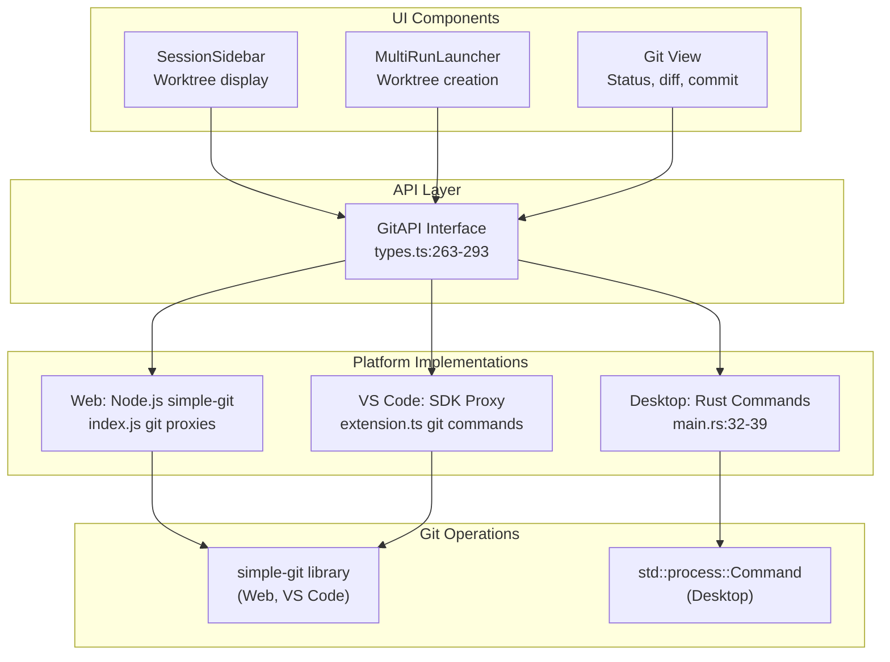
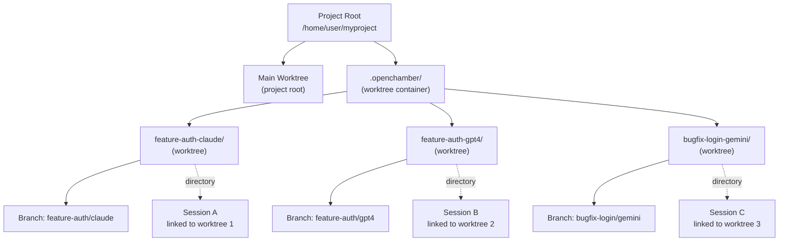
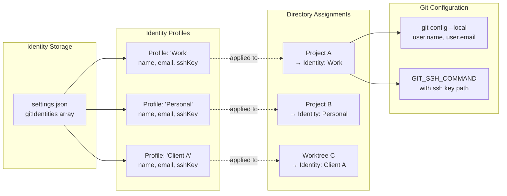
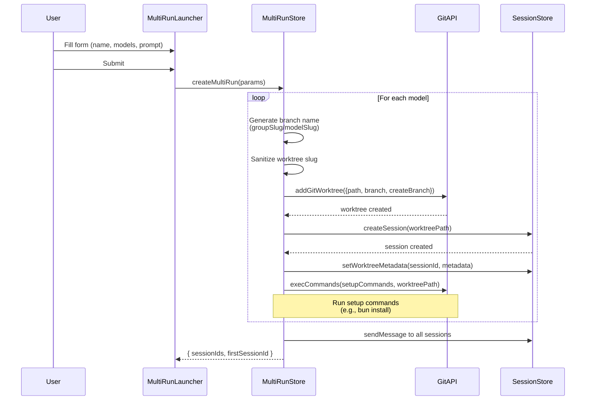
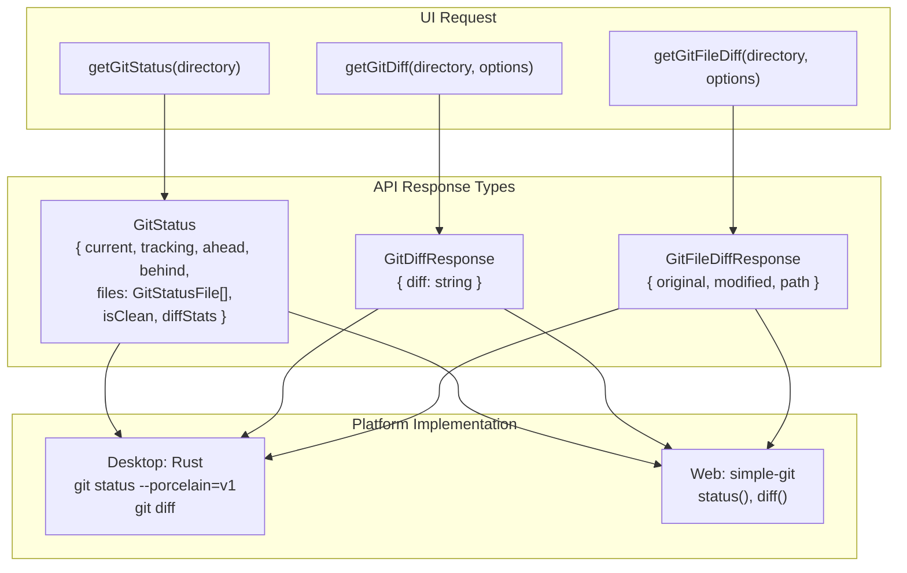
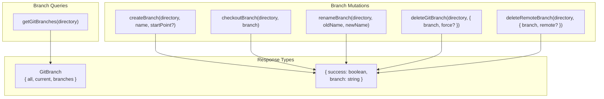
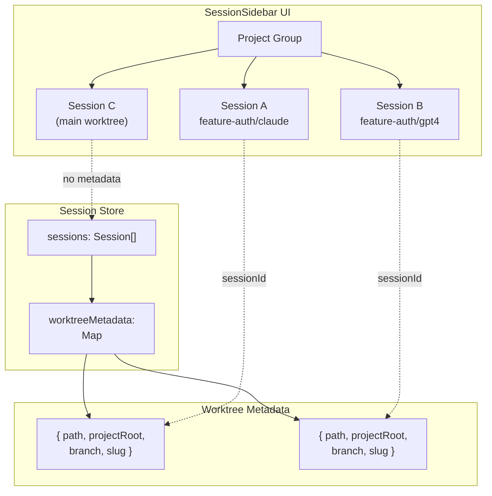

<!-- source: DeepWiki mcp.deepwiki.com · repo btriapitsyn/openchamber · page 8.3 Git Operations · fetched 2026-10-26 -->

# Git Integration

<details>
<summary>Relevant source files</summary>

The following files were used as context for generating this wiki page:

- [packages/desktop/src-tauri/src/main.rs](packages/desktop/src-tauri/src/main.rs)
- [packages/ui/src/App.tsx](packages/ui/src/App.tsx)
- [packages/ui/src/components/views/GitView.tsx](packages/ui/src/components/views/GitView.tsx)
- [packages/ui/src/components/views/git/AIHighlightsBox.tsx](packages/ui/src/components/views/git/AIHighlightsBox.tsx)
- [packages/ui/src/components/views/git/BranchSelector.tsx](packages/ui/src/components/views/git/BranchSelector.tsx)
- [packages/ui/src/components/views/git/CommitInput.tsx](packages/ui/src/components/views/git/CommitInput.tsx)
- [packages/ui/src/components/views/git/CommitSection.tsx](packages/ui/src/components/views/git/CommitSection.tsx)
- [packages/ui/src/components/views/git/GitHeader.tsx](packages/ui/src/components/views/git/GitHeader.tsx)
- [packages/ui/src/components/views/git/PullRequestSection.tsx](packages/ui/src/components/views/git/PullRequestSection.tsx)
- [packages/ui/src/components/views/git/SyncActions.tsx](packages/ui/src/components/views/git/SyncActions.tsx)
- [packages/ui/src/lib/api/types.ts](packages/ui/src/lib/api/types.ts)
- [packages/vscode/src/bridge.ts](packages/vscode/src/bridge.ts)
- [packages/web/server/index.js](packages/web/server/index.js)

</details>


## Purpose and Scope

This document describes OpenChamber's Git integration layer, which provides comprehensive version control operations across all platforms. The system supports standard git operations (status, diff, commit, push/pull), branch management, and an advanced **worktree system** that enables isolated development environments for parallel work. Git integration is foundational to the Multi-Run feature (see [Multi-Run and Worktrees](#8.2)) and powers the session-based worktree isolation UI.

The Git API is exposed consistently across Desktop (Rust), Web (Node.js), and VS Code (Extension SDK) platforms, allowing UI components to work uniformly regardless of runtime.

---

## Git API Interface

All git operations are exposed through a unified `GitAPI` interface defined in the UI package, implemented differently per platform but with identical behavior.



**Sources**: [packages/ui/src/lib/api/types.ts:263-293](), [packages/desktop/src-tauri/src/main.rs:32-39]()

### Core API Methods

| Method | Purpose | Returns |
|--------|---------|---------|
| `checkIsGitRepository` | Verify directory is a git repo | `boolean` |
| `getGitStatus` | Get working directory status | `GitStatus` with files, branch info |
| `getGitDiff` | Get unified diff output | `GitDiffResponse` |
| `getGitFileDiff` | Get original/modified for file | `GitFileDiffResponse` |
| `revertGitFile` | Discard changes to file | `void` |
| `getGitBranches` | List all branches | `GitBranch` with current, tracking |
| `checkoutBranch` | Switch to branch | `{ success, branch }` |
| `createBranch` | Create new branch | `{ success, branch }` |
| `renameBranch` | Rename branch | `{ success, branch }` |
| `deleteGitBranch` | Delete local branch | `{ success }` |
| `deleteRemoteBranch` | Delete remote branch | `{ success }` |

**Sources**: [packages/ui/src/lib/api/types.ts:263-293]()

---

## Worktree System

The worktree system creates isolated Git working directories (`git worktree add`) for parallel development, each with its own branch and OpenCode session. Worktrees are stored in `.openchamber/<slug>` directories within the project root.

### Worktree Directory Structure



**Sources**: [packages/ui/src/stores/useMultiRunStore.ts:36-50](), [packages/ui/src/components/session/SessionSidebar.tsx:797-872]()

### Worktree API Methods

| Method | Purpose | Parameters |
|--------|---------|------------|
| `listGitWorktrees` | List all worktrees in repo | `directory: string` |
| `addGitWorktree` | Create new worktree with branch | `{ path, branch, createBranch?, startPoint? }` |
| `removeGitWorktree` | Remove worktree | `{ path, force? }` |
| `isLinkedWorktree` | Check if directory is worktree | `directory: string` |

**Sources**: [packages/ui/src/lib/api/types.ts:218-234]()

### Worktree Metadata Type

```typescript
interface GitWorktreeInfo {
  worktree: string;    // Absolute path to worktree directory
  head?: string;       // Current commit hash
  branch?: string;     // Branch name (if checked out)
}
```

The UI tracks additional metadata per session:

```typescript
interface WorktreeMetadata {
  path: string;           // Absolute worktree path
  projectRoot: string;    // Project root directory
  branch: string;         // Branch name
  slug: string;           // Sanitized directory name
}
```

**Sources**: [packages/ui/src/lib/api/types.ts:218-222](), [packages/ui/src/types/worktree.ts]()

---

## Git Identity System

The identity system allows users to configure multiple git personas with separate user names, emails, and SSH keys. Each identity can be applied to a directory, enabling different credentials for different projects or worktrees.



**Sources**: [packages/desktop/src-tauri/src/main.rs:32-39](), [packages/ui/src/lib/api/types.ts:171-186]()

### Identity API Methods

| Method | Purpose | Returns |
|--------|---------|---------|
| `getGitIdentities` | List all saved identities | `GitIdentityProfile[]` |
| `createGitIdentity` | Create new identity | `GitIdentityProfile` |
| `updateGitIdentity` | Update existing identity | `GitIdentityProfile` |
| `deleteGitIdentity` | Remove identity | `void` |
| `getCurrentGitIdentity` | Get active identity for directory | `GitIdentitySummary \| null` |
| `setGitIdentity` | Apply identity to directory | `{ success, profile }` |

**Sources**: [packages/ui/src/lib/api/types.ts:287-292]()

### GitIdentityProfile Structure

```typescript
interface GitIdentityProfile {
  id: string;           // Unique identifier
  name: string;         // Display name (e.g., "Work Account")
  userName: string;     // Git user.name
  userEmail: string;    // Git user.email
  sshKey?: string;      // Path to SSH private key
  color?: string;       // UI color indicator
  icon?: string;        // UI icon identifier
}
```

When an identity is set for a directory:
1. **Local git config** is updated: `user.name` and `user.email` are set using `git config --local`
2. **SSH command override**: If `sshKey` is present, `GIT_SSH_COMMAND` environment variable is configured to use the specified key

**Sources**: [packages/ui/src/lib/api/types.ts:171-179]()

---

## Multi-Run Worktree Integration

The Multi-Run feature (see [Multi-Run and Worktrees](#8.2)) automatically creates worktrees for parallel model execution. Each model selection results in a dedicated worktree with its own branch.

### Worktree Creation Flow



**Sources**: [packages/ui/src/stores/useMultiRunStore.ts:101-310](), [packages/ui/src/components/multirun/MultiRunLauncher.tsx:230-280]()

### Branch Naming Convention

Given a group name and model selections, branches are generated as:

```
<groupSlug>/<modelSlug>
```

Where:
- `groupSlug`: Git-safe slug from user-provided group name (e.g., `feature-auth`)
- `modelSlug`: Combination of provider and model IDs (e.g., `anthropic-claude-sonnet`)

For duplicate model selections, an index is appended:
```
<groupSlug>/<modelSlug>/<index>
```

**Example**: Group "feature-auth" with Claude Sonnet selected twice produces:
- `feature-auth/anthropic-claude-sonnet/1`
- `feature-auth/anthropic-claude-sonnet/2`

**Sources**: [packages/ui/src/stores/useMultiRunStore.ts:15-38](), [packages/ui/src/stores/useMultiRunStore.ts:169-183]()

### Worktree Setup Commands

After creating each worktree, setup commands can be executed to prepare the environment (install dependencies, build, etc.). Commands are configured per-project in `.openchamber/config.toml`:

```toml
[worktree]
setupCommands = [
  "bun install",
  "bun run build"
]
```

The special variable `$ROOT_WORKTREE_PATH` is available in commands to reference the project root.

**Sources**: [packages/ui/src/components/multirun/MultiRunLauncher.tsx:375-437](), [packages/ui/src/stores/useMultiRunStore.ts:156-274]()

---

## Git Operations API

### Status and Diff



**Sources**: [packages/ui/src/lib/api/types.ts:87-122](), [packages/desktop/src-tauri/src/main.rs:32-39]()

#### GitStatus Fields

```typescript
interface GitStatus {
  current: string;              // Current branch name
  tracking: string | null;      // Upstream tracking branch
  ahead: number;                // Commits ahead of upstream
  behind: number;               // Commits behind upstream
  files: GitStatusFile[];       // Modified files
  isClean: boolean;             // No uncommitted changes
  diffStats?: Record<string, { insertions: number; deletions: number }>;
}

interface GitStatusFile {
  path: string;                 // File path relative to repo root
  index: string;                // Index status (e.g., "M", "A", "D")
  working_dir: string;          // Working directory status
}
```

**Sources**: [packages/ui/src/lib/api/types.ts:87-101]()

### Commit, Push, Pull

| Operation | Method | Parameters | Returns |
|-----------|--------|------------|---------|
| **Commit** | `createGitCommit` | `message, { addAll?, files? }` | `GitCommitResult` |
| **Push** | `gitPush` | `{ remote?, branch?, options? }` | `GitPushResult` |
| **Pull** | `gitPull` | `{ remote?, branch? }` | `GitPullResult` |
| **Fetch** | `gitFetch` | `{ remote?, branch? }` | `{ success: boolean }` |

**Sources**: [packages/ui/src/lib/api/types.ts:278-281]()

#### Commit Message Generation

The system can generate commit messages using AI analysis of staged changes:

```typescript
generateCommitMessage(directory: string, files: string[]): Promise<{
  message: GeneratedCommitMessage
}>

interface GeneratedCommitMessage {
  subject: string;        // Short summary line
  highlights: string[];   // Bullet points of key changes
}
```

**Sources**: [packages/ui/src/lib/api/types.ts:258-261](), [packages/desktop/src-tauri/src/main.rs:35]()

---

## Branch Management API

### Branch Operations



**Sources**: [packages/ui/src/lib/api/types.ts:271-284]()

### GitBranch Structure

```typescript
interface GitBranch {
  all: string[];                           // All branch names
  current: string;                         // Current branch
  branches: Record<string, GitBranchDetails>;
}

interface GitBranchDetails {
  current: boolean;       // Is current branch
  name: string;           // Branch name
  commit: string;         // HEAD commit hash
  label: string;          // Display label
  tracking?: string;      // Upstream branch (e.g., "origin/main")
  ahead?: number;         // Commits ahead of upstream
  behind?: number;        // Commits behind upstream
}
```

**Sources**: [packages/ui/src/lib/api/types.ts:124-138]()

---

## Git Log and History

### Log Retrieval

```typescript
getGitLog(directory: string, options?: GitLogOptions): Promise<GitLogResponse>

interface GitLogOptions {
  maxCount?: number;    // Limit number of commits
  from?: string;        // Start commit hash
  to?: string;          // End commit hash
  file?: string;        // Filter by file path
}
```

**Sources**: [packages/ui/src/lib/api/types.ts:251-256](), [packages/ui/src/lib/api/types.ts:285]()

### GitLogEntry Structure

```typescript
interface GitLogEntry {
  hash: string;           // Commit hash
  date: string;           // Commit date (ISO)
  message: string;        // Commit message (subject line)
  refs: string;           // Branch/tag refs
  body: string;           // Full commit message body
  author_name: string;
  author_email: string;
  filesChanged: number;   // Number of files changed
  insertions: number;     // Total lines added
  deletions: number;      // Total lines removed
}

interface GitLogResponse {
  all: GitLogEntry[];
  latest: GitLogEntry | null;
  total: number;
}
```

**Sources**: [packages/ui/src/lib/api/types.ts:187-204]()

### Commit File Details

```typescript
getCommitFiles(directory: string, hash: string): Promise<GitCommitFilesResponse>

interface CommitFileEntry {
  path: string;
  insertions: number;
  deletions: number;
  isBinary: boolean;
  changeType: 'A' | 'M' | 'D' | 'R' | 'C' | string;
}
```

**Sources**: [packages/ui/src/lib/api/types.ts:207-216](), [packages/ui/src/lib/api/types.ts:286]()

---

## Platform Implementation Details

### Desktop (Rust)

The Desktop platform implements git operations using Rust's `std::process::Command` to spawn git subprocesses. Git commands are registered as Tauri commands.

**Key Commands**:
- [packages/desktop/src-tauri/src/main.rs:32-39](): Git command imports
- `check_is_git_repository`, `get_git_status`, `get_git_branches`, `checkout_branch`, `create_branch`, `rename_branch`
- `create_git_commit`, `git_push`, `git_pull`, `git_fetch`
- `add_git_worktree`, `remove_git_worktree`, `list_git_worktrees`, `is_linked_worktree`
- `get_current_git_identity`, `set_git_identity`, `get_git_identities`, `create_git_identity`, `update_git_identity`, `delete_git_identity`

Git identities are stored in the settings file and applied using local git config + SSH environment variables.

**Sources**: [packages/desktop/src-tauri/src/main.rs:32-39]()

### Web (Node.js)

The Web platform uses the `simple-git` library wrapped in API endpoints. The Express server proxies git operations, executing commands in the specified directory context.

**Implementation**: Git operations are exposed as REST endpoints that the UI calls via `opencodeClient` with directory context:

```javascript
await opencodeClient.withDirectory(directory, () => 
  opencodeClient.git.getGitStatus(directory)
);
```

**Sources**: [packages/web/server/index.js]() (git-related endpoints)

### VS Code Extension

The VS Code extension uses the `@opencode-ai/sdk/server` to manage git operations, similar to the Web platform but with webview-extension communication bridge.

**Sources**: VS Code extension implementation (not shown in provided files but follows SDK pattern)

---

## Session-Worktree Linking

Sessions can be linked to worktrees, enabling the UI to display worktree context and manage worktree lifecycle alongside sessions.



**Sources**: [packages/ui/src/components/session/SessionSidebar.tsx:370](), [packages/ui/src/stores/useSessionStore.ts]() (worktreeMetadata map)

### Session Sidebar Display

The `SessionSidebar` component groups sessions by project and displays worktree-linked sessions with branch indicators:

1. **Worktree detection**: Sessions with `worktreeMetadata` are identified
2. **Grouping**: Sessions are organized by project root, with worktree sessions nested
3. **Branch display**: Worktree branch name is shown alongside session title
4. **Deletion handling**: Deleting a worktree session prompts for worktree removal

**Sources**: [packages/ui/src/components/session/SessionSidebar.tsx:797-872](), [packages/ui/src/components/session/SessionSidebar.tsx:682-740]()

---

## .openchamber Directory Isolation

Worktrees are created in `.openchamber/<slug>` to keep them isolated from the main project directory. This directory is automatically ignored by git.

### Ensuring .gitignore Entry

The system calls `ensureOpenChamberIgnored(directory)` to add `.openchamber/` to `.gitignore` if not already present. This prevents worktree directories from being accidentally committed.

**Sources**: [packages/ui/src/lib/api/types.ts:277](), [packages/desktop/src-tauri/src/main.rs:33]()

### Directory Structure Example

```
myproject/
├── .git/
├── .gitignore                    # Contains .openchamber/
├── src/
├── package.json
└── .openchamber/                 # Worktree container
    ├── feature-auth-claude/      # Worktree 1
    │   ├── .git -> ...          # Git link file
    │   ├── src/
    │   └── package.json
    ├── feature-auth-gpt4/        # Worktree 2
    │   ├── .git -> ...
    │   ├── src/
    │   └── package.json
    └── bugfix-login-gemini/      # Worktree 3
        ├── .git -> ...
        ├── src/
        └── package.json
```

**Sources**: [packages/ui/src/stores/useMultiRunStore.ts:40-50]()

---

