<!-- source: DeepWiki mcp.deepwiki.com · repo btriapitsyn/openchamber · page 8.4 Notifications and Events · fetched 2026-10-26 -->

# Notifications and Events

<details>
<summary>Relevant source files</summary>

The following files were used as context for generating this wiki page:

- [packages/ui/src/components/sections/openchamber/NotificationSettings.tsx](packages/ui/src/components/sections/openchamber/NotificationSettings.tsx)
- [packages/ui/src/hooks/useEventStream.ts](packages/ui/src/hooks/useEventStream.ts)
- [packages/ui/src/hooks/useServerSessionStatus.ts](packages/ui/src/hooks/useServerSessionStatus.ts)
- [packages/ui/src/lib/appearanceAutoSave.ts](packages/ui/src/lib/appearanceAutoSave.ts)
- [packages/ui/src/lib/desktop.ts](packages/ui/src/lib/desktop.ts)
- [packages/ui/src/lib/opencode/client.ts](packages/ui/src/lib/opencode/client.ts)
- [packages/ui/src/lib/persistence.ts](packages/ui/src/lib/persistence.ts)

</details>


This page documents the event streaming and notification systems that enable real-time communication between the OpenCode backend and the OpenChamber UI. It covers Server-Sent Events (SSE) architecture, session status tracking, native notifications, and user-facing alerts for permissions and questions.

For information about Git operations that may trigger events, see [Git Operations](#8.3). For session management that coordinates with status events, see [Session Management UI](#7.3).

## Purpose and Scope

OpenChamber uses a Server-Sent Events (SSE) architecture to stream real-time updates from the OpenCode backend to the UI. This enables:

- **Real-time message streaming**: AI responses arrive incrementally as they're generated
- **Session status updates**: Track whether sessions are idle, busy, or retrying
- **Permission requests**: Prompt users for tool execution approval
- **Question handling**: Surface AI questions that require user input
- **Background notifications**: Alert users when the application is not focused

The notification system provides configurable native notifications across desktop (Tauri), web (browser), and VS Code environments, with template-based customization and AI-powered message summarization.

---

## Event Streaming Architecture

### Global SSE Connection

The OpenCode backend emits events through a single global SSE endpoint. The `OpencodeService` class maintains this connection and routes events to registered listeners.

**Event Connection Lifecycle Diagram**

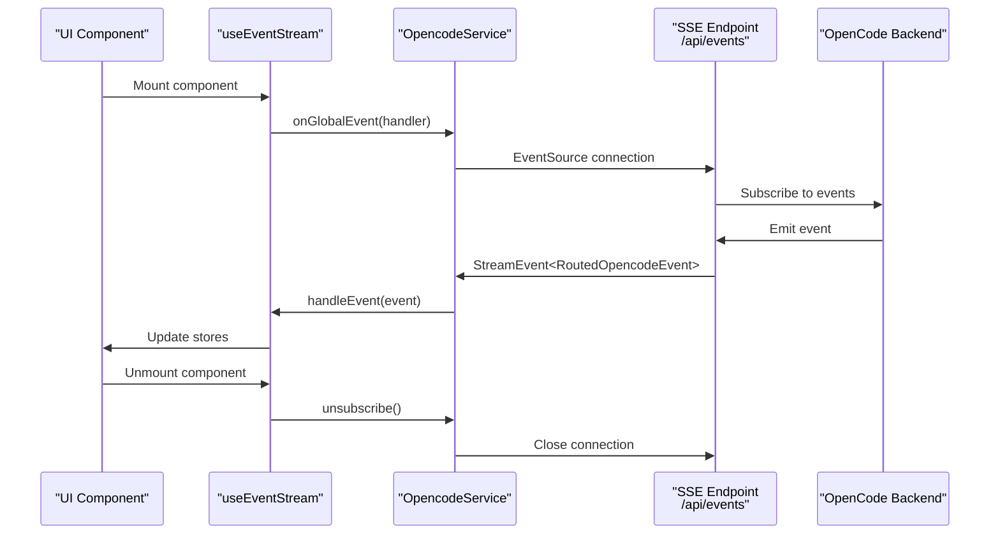

The global SSE connection is managed by [`OpencodeService`]() in [packages/ui/src/lib/opencode/client.ts:136-161]() and exposed through the singleton `opencodeClient`. Event listeners are registered via `onGlobalEvent()` and automatically cleaned up on unmount.

Sources: [packages/ui/src/lib/opencode/client.ts:136-161](), [packages/ui/src/hooks/useEventStream.ts:104-203]()

### Event Types and Routing

Events arrive as `RoutedOpencodeEvent` objects containing a directory scope and event payload. The `useEventStream` hook processes these events and updates relevant Zustand stores.

**Core Event Types**

| Event Type | Payload | Purpose |
|------------|---------|---------|
| `message.part.updated` | `{ info, part, sessionID, messageID }` | Stream individual message parts (text, tool calls, reasoning) |
| `message.updated` | `{ info, parts, sessionID, messageID }` | Signal message completion with final state |
| `session.status` | `{ sessionID, status, metadata }` | Update session status (idle/busy/retry) |
| `openchamber:session-status` | `{ sessionID, status, needsAttention, timestamp }` | Combined status and attention state from web server |
| `permission.request` | `{ requestID, tool, description }` | Request user approval for tool execution |
| `question.request` | `{ requestID, question, options }` | Request user input via "ask" tool |
| `mcp.tools.changed` | `{ directory }` | Notify that MCP tool catalog has changed |
| `server.connected` | `{}` | Backend connection established |
| `global.disposed` | `{}` | Backend instance restarted (trigger full resync) |

Sources: [packages/ui/src/hooks/useEventStream.ts:584-1432]()

### Event Processing Pipeline

The `useEventStream` hook implements the central event dispatcher. It processes events, updates stores, and triggers side effects like notifications.

**Event Processing Flow Diagram**

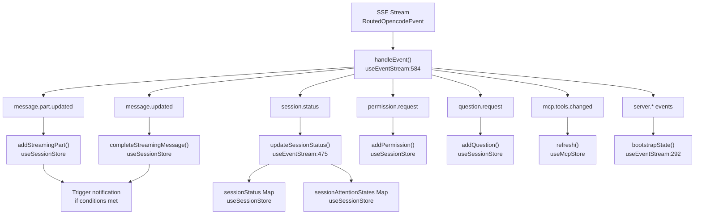

The event handler performs several tasks:

1. **Session metadata extraction**: Extract title and summary from event payload ([packages/ui/src/hooks/useEventStream.ts:596-622]())
2. **Event-specific processing**: Route to appropriate handler based on event type
3. **Store updates**: Update Zustand stores with new data
4. **Notification triggers**: Check conditions and send native notifications
5. **Resync coordination**: Trigger full state resync on connection issues

Sources: [packages/ui/src/hooks/useEventStream.ts:584-1432]()

---

## Session Status Tracking

### Status Types and State Machine

Sessions have three status types managed by the backend and synchronized to the client:

**Session Status Types**

| Status | Description | Typical Transitions |
|--------|-------------|-------------------|
| `idle` | No active model request | → `busy` (user sends message) |
| `busy` | Model processing request | → `idle` (completion), → `retry` (error), → `idle` (abort) |
| `retry` | Retrying after error | → `busy` (retry attempt), → `idle` (give up) |

The `retry` status includes metadata fields:
- `attempt`: Current retry attempt number
- `message`: Human-readable error description
- `next`: Timestamp for next retry attempt (milliseconds)

**Status State Machine**

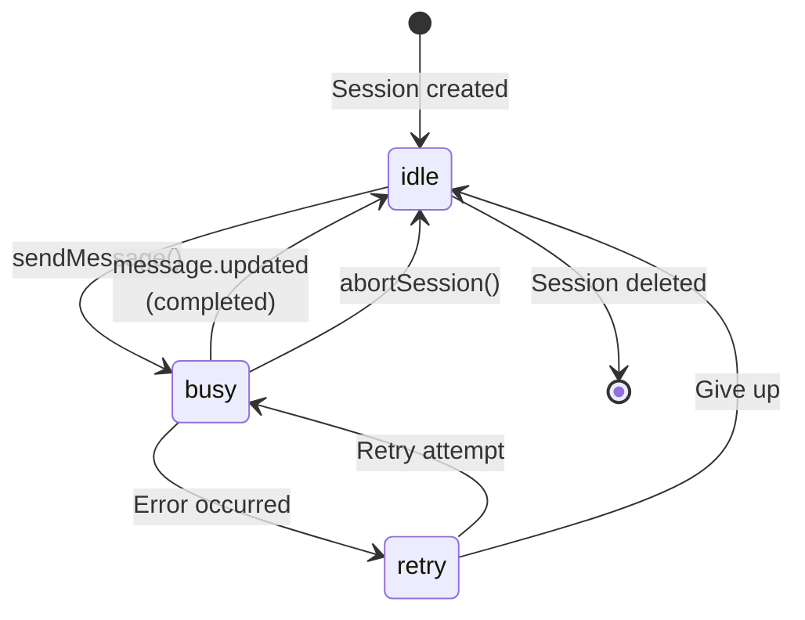

Sources: [packages/ui/src/hooks/useEventStream.ts:468-566](), [packages/ui/src/hooks/useServerSessionStatus.ts:5-21]()

### Server-Authoritative Model

Session status is maintained authoritatively on the server and synchronized to clients through two mechanisms:

1. **SSE Events**: Real-time status updates via `session.status` and `openchamber:session-status` events
2. **Snapshot Polling**: Periodic HTTP polling for full status snapshot

**Status Synchronization Architecture**

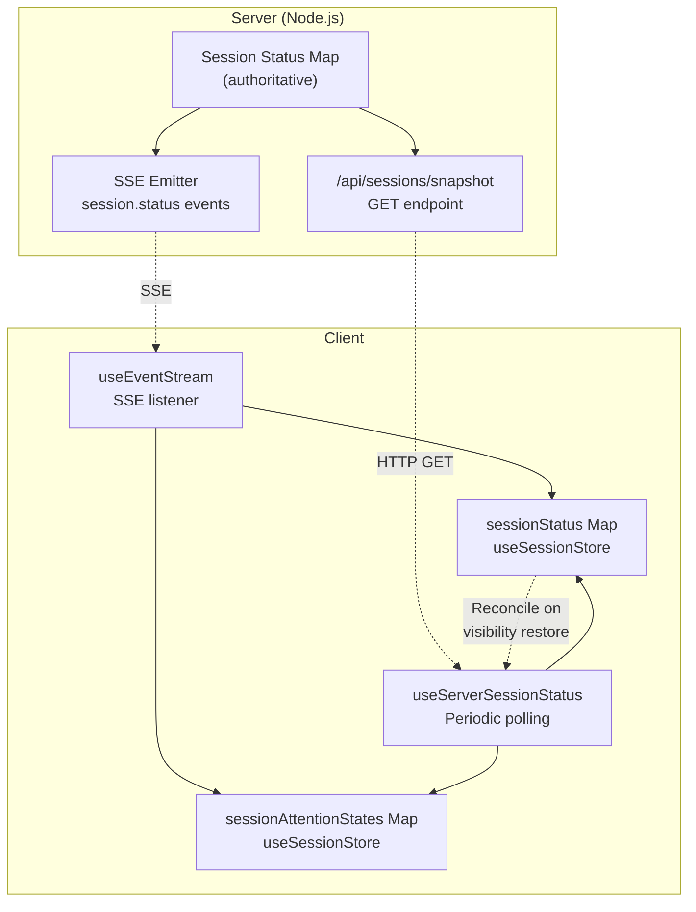

The polling mechanism provides resilience against missed SSE events (e.g., during browser backgrounding). The `useServerSessionStatus` hook polls immediately when:
- Component mounts ([packages/ui/src/hooks/useServerSessionStatus.ts:258-269]())
- Browser tab becomes visible ([packages/ui/src/hooks/useServerSessionStatus.ts:272-283]())
- Externally triggered via `triggerSessionStatusPoll()` ([packages/ui/src/hooks/useServerSessionStatus.ts:36-40]())

Sources: [packages/ui/src/hooks/useServerSessionStatus.ts:48-301](), [packages/ui/src/hooks/useEventStream.ts:475-566]()

### Attention State

The "needs attention" indicator highlights sessions that have completed work while the user was viewing a different session. The server tracks this state based on:

- **Last user message timestamp**: When the user last sent a message in the session
- **Last status change timestamp**: When the session transitioned from busy to idle
- **View tracking**: Whether the user has viewed the session since the status change

**Attention State Structure**

```typescript
interface SessionAttentionState {
  needsAttention: boolean;           // True if session completed while user was away
  lastUserMessageAt: number | null;  // Timestamp of last user message
  lastStatusChangeAt: number;        // Timestamp of last status change
  status: 'idle' | 'busy' | 'retry'; // Current status
  isViewed: boolean;                 // True if user has viewed session since completion
}
```

The `openchamber:session-status` event carries both status and attention state, ensuring atomic updates ([packages/ui/src/hooks/useEventStream.ts:702-741]()).

Sources: [packages/ui/src/hooks/useEventStream.ts:702-741](), [packages/ui/src/hooks/useServerSessionStatus.ts:15-21]()

---

## Notification System

### Platform Support and Delivery

OpenChamber supports native notifications across three runtime environments with different delivery mechanisms:

**Notification Platform Matrix**

| Platform | API | Delivery | Background Support |
|----------|-----|----------|-------------------|
| **Desktop (Tauri)** | [`desktop_notify` IPC command]() | Rust backend via system API | Yes (always running) |
| **Web (Browser)** | [`Notification` API]() | Browser notifications | Optional (via push + service worker) |
| **VS Code** | Extension Host | VS Code's notification system | Yes (extension host) |

**Desktop Notification Flow**

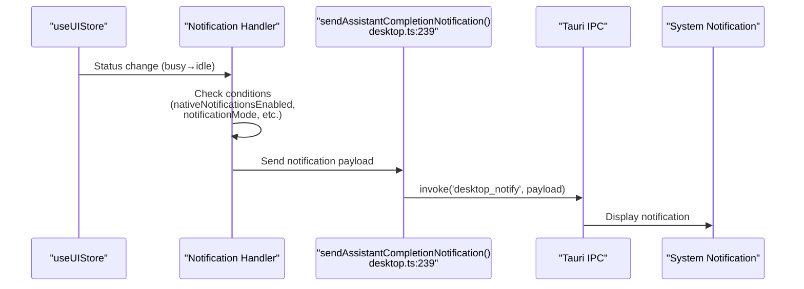

For desktop, notifications use the [`sendAssistantCompletionNotification()`]() helper ([packages/ui/src/lib/desktop.ts:239-260]()), which invokes the `desktop_notify` Tauri command.

**Web Push Notification Flow**

Web push notifications enable background delivery when the browser tab is closed:

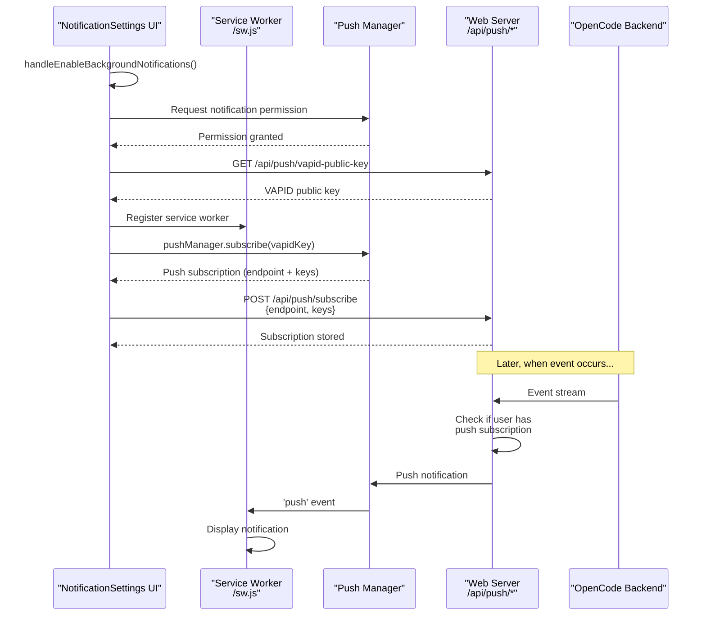

Push notifications require:
1. Browser support for Service Workers and Push API
2. User grants notification permission
3. Service worker registration at `/sw.js`
4. VAPID key pair on server for Web Push protocol

The subscription flow is implemented in [`handleEnableBackgroundNotifications()`]() ([packages/ui/src/components/sections/openchamber/NotificationSettings.tsx:281-378]()).

Sources: [packages/ui/src/lib/desktop.ts:239-260](), [packages/ui/src/components/sections/openchamber/NotificationSettings.tsx:281-409]()

### Notification Triggers

Notifications are triggered based on events and user-configurable settings stored in `useUIStore`:

**Trigger Configuration**

| Setting | Default | Triggers Notification When |
|---------|---------|---------------------------|
| `nativeNotificationsEnabled` | `false` | Master switch; must be `true` for any notifications |
| `notificationMode` | `'hidden-only'` | `'always'`: Always notify<br/>`'hidden-only'`: Only when app not focused |
| `notifyOnCompletion` | `true` | Session status transitions from `busy` to `idle` |
| `notifyOnError` | `true` | Tool execution fails |
| `notifyOnQuestion` | `true` | Agent asks a question via "ask" tool |
| `notifyOnSubtasks` | `false` | Child sessions complete (not just main sessions) |

**Notification Decision Tree**

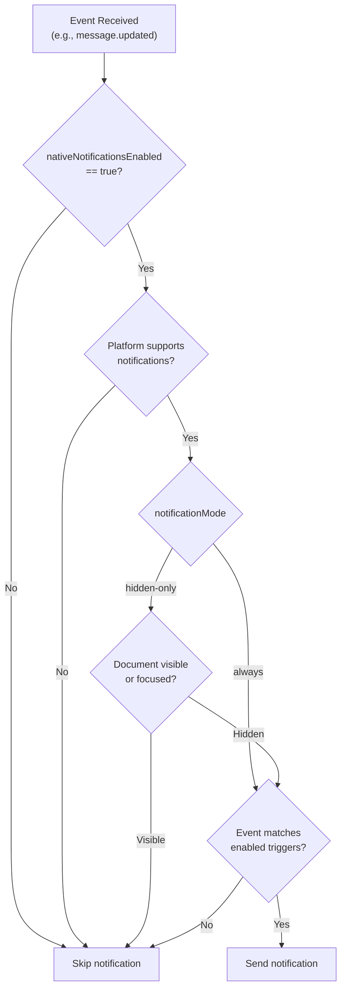

The visibility check uses `document.visibilityState` and `document.hasFocus()` ([packages/ui/src/hooks/useEventStream.ts:364-369]()).

Sources: [packages/ui/src/hooks/useEventStream.ts:123-124, 232-263, 364-369](), [packages/ui/src/lib/persistence.ts:235-257]()

### Template System and Variable Substitution

Notification templates support variable substitution to include dynamic information. Templates are stored per event type in `useUIStore.notificationTemplates`.

**Available Template Variables**

| Variable | Description | Example Value |
|----------|-------------|---------------|
| `{project_name}` | Current project name | `"my-app"` |
| `{worktree}` | Git worktree path | `"~/code/feature-branch"` |
| `{branch}` | Git branch name | `"feature/new-feature"` |
| `{session_name}` | Session title | `"Implement login page"` |
| `{agent_name}` | Agent name | `"Architect"` |
| `{model_name}` | Model display name | `"Claude 3.5 Sonnet"` |
| `{last_message}` | Last message text (truncated) | `"I've implemented the login..."` |

**Default Templates**

```typescript
const DEFAULT_NOTIFICATION_TEMPLATES = {
  completion: { 
    title: '{agent_name} is ready', 
    message: '{model_name} completed the task' 
  },
  error: { 
    title: 'Tool error', 
    message: '{last_message}' 
  },
  question: { 
    title: 'Input needed', 
    message: '{last_message}' 
  },
  subtask: { 
    title: '{agent_name} is ready', 
    message: '{model_name} completed the task' 
  },
};
```

Templates are customizable in the UI via [`NotificationSettings`]() component ([packages/ui/src/components/sections/openchamber/NotificationSettings.tsx:122-134, 539-565]()).

Sources: [packages/ui/src/components/sections/openchamber/NotificationSettings.tsx:10-15, 122-134, 539-565]()

### Message Summarization

The `{last_message}` variable can be automatically summarized using AI when messages exceed a threshold length. This prevents notification text overflow.

**Summarization Settings**

| Setting | Default | Description |
|---------|---------|-------------|
| `summarizeLastMessage` | `false` | Enable AI summarization |
| `summaryThreshold` | `500` | Summarize messages longer than this (characters) |
| `summaryLength` | `100` | Target summary length (characters) |
| `maxLastMessageLength` | `200` | Hard truncation limit when summarization disabled |

**Summarization Flow**

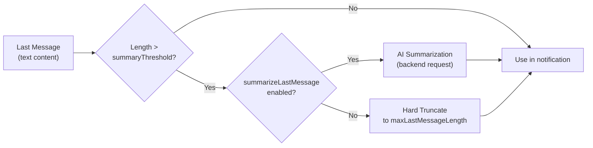

When enabled, the system sends the message text to an AI provider (configured on backend) and requests a summary of `summaryLength` characters. This happens server-side to avoid exposing API keys in the client.

Sources: [packages/ui/src/lib/persistence.ts:258-269](), [packages/ui/src/components/sections/openchamber/NotificationSettings.tsx:35-42, 580-661]()

---

## Permission and Question Events

The OpenCode backend emits special events when tools require user approval or input. These are surfaced in the UI as modal dialogs.

### Permission Requests

Permission requests occur when a tool attempts an action that requires user approval (e.g., file writes, command execution). The backend emits a `permission.request` event and pauses execution.

**Permission Request Flow**

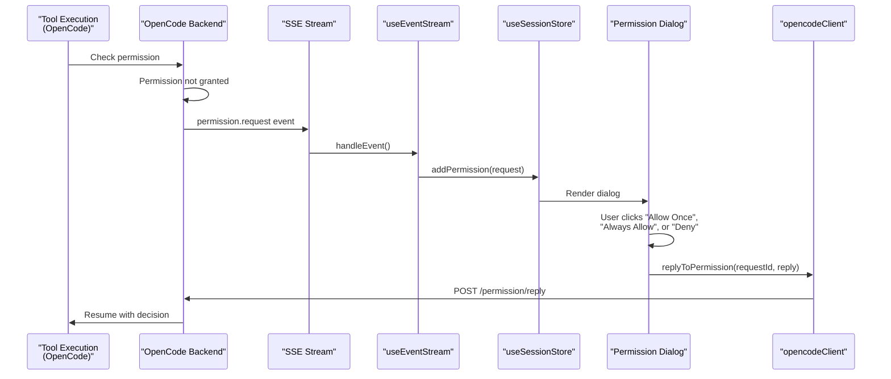

Permission request payloads include:

```typescript
interface PermissionRequest {
  requestID: string;
  tool: string;        // Tool name (e.g., "write_file")
  description: string; // Human-readable description
  sessionID?: string;
  directory?: string;
}
```

The [`replyToPermission()`]() method sends the user's decision ([packages/ui/src/lib/opencode/client.ts:871-883]()):
- `'once'`: Allow this one time
- `'always'`: Always allow for this tool
- `'reject'`: Deny and fail the tool execution

Bootstrap logic fetches pending permissions on mount ([packages/ui/src/hooks/useEventStream.ts:159-172]()) to handle cases where the UI loads while permissions are already pending.

Sources: [packages/ui/src/hooks/useEventStream.ts:159-172](), [packages/ui/src/lib/opencode/client.ts:871-893]()

### Question Requests

Question requests occur when an agent uses the "ask" tool to request user input. Unlike permissions, questions can include multiple input fields and validation.

**Question Request Flow**

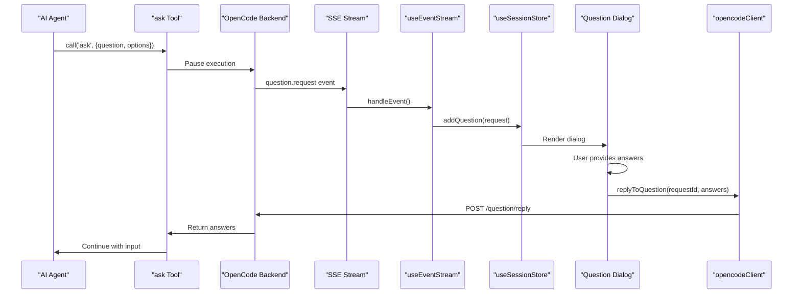

Question request payloads include:

```typescript
interface QuestionRequest {
  requestID: string;
  sessionID: string;
  directory?: string;
  question: string;     // Prompt text
  options?: {
    type?: 'text' | 'select' | 'multiselect';
    choices?: string[];
    required?: boolean;
    multiple?: boolean;  // Allow multiple fields
  };
}
```

Questions can be answered via [`replyToQuestion()`]() with an array of string answers, or rejected via [`rejectQuestion()`]() ([packages/ui/src/lib/opencode/client.ts:896-922]()).

The `question.cancelled` event signals that a question was auto-cancelled (e.g., session aborted) and should be removed from the UI ([packages/ui/src/hooks/useEventStream.ts:1378-1388]()).

Sources: [packages/ui/src/hooks/useEventStream.ts:174-195, 1378-1388](), [packages/ui/src/lib/opencode/client.ts:896-922]()

---

## Implementation Details

### Event Stream Initialization

The `useEventStream` hook initializes on mount and manages the lifecycle of event listeners. It coordinates with multiple stores to update application state.

**Store Coordination Map**

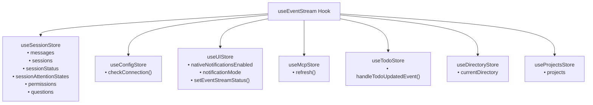

The hook destructures actions from these stores ([packages/ui/src/hooks/useEventStream.ts:105-125]()) and calls them within event handlers to maintain separation of concerns.

Sources: [packages/ui/src/hooks/useEventStream.ts:104-125]()

### Message Streaming and Deduplication

Message parts arrive incrementally via `message.part.updated` events. The system must deduplicate and merge these parts to avoid duplicate UI rendering.

**Message Part Accumulation**

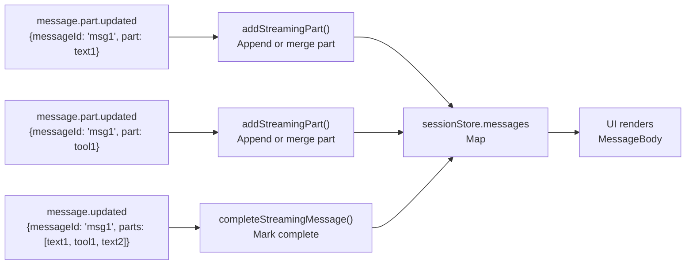

The `addStreamingPart()` action ([packages/ui/src/stores/useSessionStore.ts]()) handles part deduplication by:
1. Finding existing message by ID
2. Checking if part already exists (by part ID or type+index)
3. Either updating existing part or appending new part
4. Marking message as streaming

The `message.updated` event signals completion and provides the final part list, allowing the client to detect any missed parts and trigger a resync if needed ([packages/ui/src/hooks/useEventStream.ts:866-1094]()).

Sources: [packages/ui/src/hooks/useEventStream.ts:743-863, 866-1094]()

### Event Stream Status Tracking

The UI maintains a connection status indicator to inform users about the SSE connection state. Status transitions are logged and exposed via `useUIStore.eventStreamStatus`.

**Connection Status Types**

| Status | Meaning | Typical Causes |
|--------|---------|----------------|
| `idle` | Not connected yet | Initial state before first connection |
| `connecting` | Opening connection | SSE EventSource initializing |
| `connected` | Active connection | Normal operation |
| `reconnecting` | Attempting reconnect | Temporary network issue, SSE error |
| `paused` | Intentionally paused | Browser backgrounded, rate limit |
| `offline` | Network unavailable | `navigator.onLine === false` |
| `error` | Failed to connect | Backend unreachable, authentication failed |

Status updates are published via `publishStatus()` ([packages/ui/src/hooks/useEventStream.ts:235-264]()) which deduplicates consecutive identical status updates to avoid unnecessary re-renders.

The connection automatically reconnects with exponential backoff when disconnected ([packages/ui/src/hooks/useEventStream.ts:1550-1644]()), with special handling for:
- Browser visibility changes (pause when hidden)
- Online/offline transitions
- Server restart events (`global.disposed`)

Sources: [packages/ui/src/hooks/useEventStream.ts:232-264, 1550-1644]()

### Settings Persistence

Notification settings are persisted across sessions through the multi-tier settings synchronization system described in [Configuration and Settings](#8.1).

**Settings Auto-Save Flow**

```mermaid
graph LR
    UI["User changes setting<br/>in NotificationSettings"]
    Store["useUIStore<br/>state updated"]
    AutoSave["startAppearanceAutoSave()<br/>appearanceAutoSave.ts"]
    Debounce["Debounce 150ms"]
    Persist["updateDesktopSettings()"]
    Backend["Runtime Settings API<br/>or /api/config/settings"]
    File["Settings file<br/>~/.config/openchamber/settings.json"]
    
    UI --> Store
    Store --> AutoSave
    AutoSave --> Debounce
    Debounce --> Persist
    Persist --> Backend
    Backend --> File
```

The auto-save mechanism subscribes to `useUIStore` changes and batches updates with a 150ms debounce ([packages/ui/src/lib/appearanceAutoSave.ts:74-89]()). Notification-related settings include:

- `nativeNotificationsEnabled`
- `notificationMode`
- `notifyOnCompletion`, `notifyOnError`, `notifyOnQuestion`, `notifyOnSubtasks`
- `notificationTemplates`
- `summarizeLastMessage`, `summaryThreshold`, `summaryLength`, `maxLastMessageLength`

These settings are validated and sanitized during persistence ([packages/ui/src/lib/persistence.ts:423-463]()) to ensure type safety and prevent injection attacks.

Sources: [packages/ui/src/lib/appearanceAutoSave.ts:38-196](), [packages/ui/src/lib/persistence.ts:235-257, 423-463]()

---

