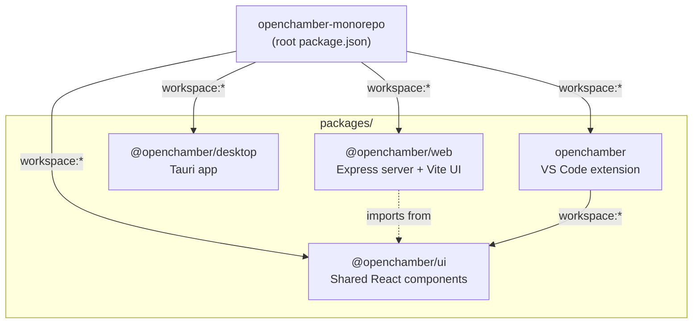
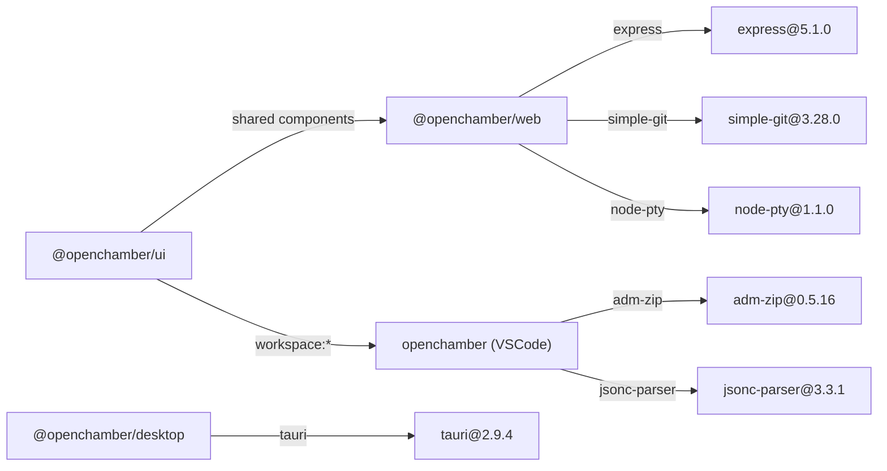
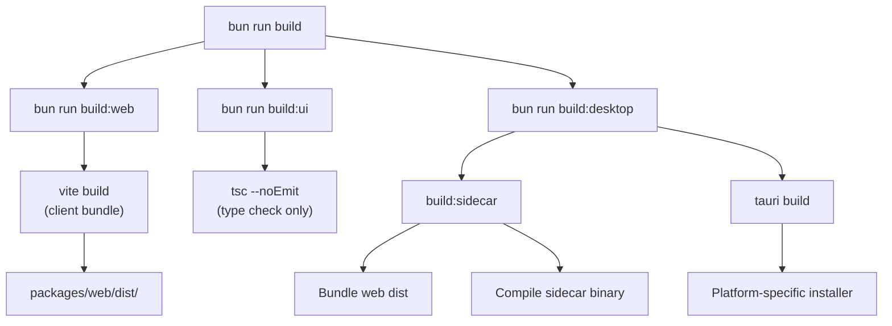
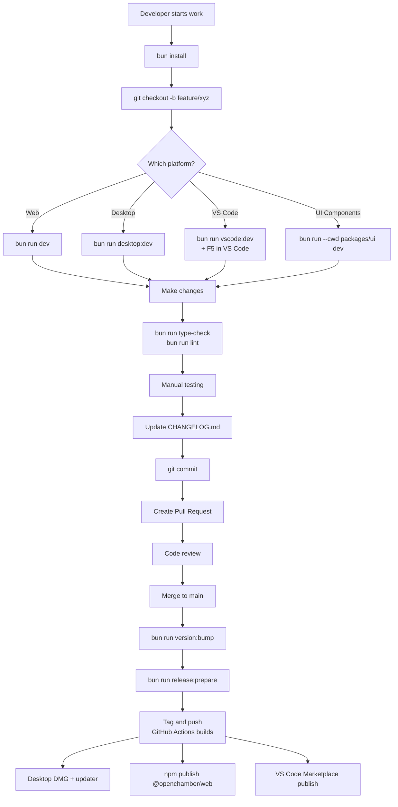

<!-- source: DeepWiki mcp.deepwiki.com · repo btriapitsyn/openchamber · page 9 Development Guide · fetched 2026-10-26 -->

# Development Guide

<details>
<summary>Relevant source files</summary>

The following files were used as context for generating this wiki page:

- [CHANGELOG.md](CHANGELOG.md)
- [bun.lock](bun.lock)
- [package.json](package.json)
- [packages/desktop/package.json](packages/desktop/package.json)
- [packages/desktop/src-tauri/Cargo.lock](packages/desktop/src-tauri/Cargo.lock)
- [packages/desktop/src-tauri/Cargo.toml](packages/desktop/src-tauri/Cargo.toml)
- [packages/desktop/src-tauri/tauri.conf.json](packages/desktop/src-tauri/tauri.conf.json)
- [packages/ui/package.json](packages/ui/package.json)
- [packages/vscode/CHANGELOG.md](packages/vscode/CHANGELOG.md)
- [packages/vscode/package.json](packages/vscode/package.json)
- [packages/web/package.json](packages/web/package.json)

</details>


This document provides technical guidance for developers contributing to or extending the OpenChamber project. It covers the monorepo structure, build system, development workflows, and quality assurance practices.

For information about the overall architecture and deployment patterns, see [Architecture](#3). For package-specific details, see [Desktop Application](#4), [Web Application](#5), [VS Code Extension](#6), and [UI Component Library](#7).

---

## Development Environment Setup

### Prerequisites

OpenChamber requires the following tools:

| Tool | Version | Purpose |
|------|---------|---------|
| Node.js | ≥20.0.0 | JavaScript runtime |
| Bun | 1.3.5+ | Package manager and build tool |
| Rust | stable | Desktop app compilation (Tauri) |
| Cargo | latest | Rust package manager |

**Desktop-specific requirements:**
- macOS: Xcode Command Line Tools
- Tauri CLI: `cargo install tauri-cli@^2`

**Sources:** [package.json:11-12](), [packages/desktop/package.json:6-9]()

### Installation

```bash
# Clone repository
git clone https://github.com/btriapitsyn/openchamber.git
cd openchamber

# Install dependencies (uses Bun workspaces)
bun install

# Apply patches to dependencies
bun run postinstall
```

The `postinstall` script runs `patch-package` to apply necessary patches to third-party dependencies.

**Sources:** [package.json:38]()

### Running Development Servers

#### Web Application

```bash
# Full web stack (server + client hot reload)
bun run dev

# Or run components separately:
bun run dev:web:server  # Express server with nodemon
bun run dev:web         # Vite build watch
```

The `dev` script uses `concurrently` to run the Express server, Vite build watcher, and UI type checker simultaneously.

**Sources:** [package.json:24](), [packages/web/package.json:14-17]()

#### Desktop Application

```bash
# Start development build with DevTools
bun run desktop:dev
```

This spawns the OpenCode CLI in the background and launches Tauri in dev mode with hot reloading.

**Sources:** [package.json:46]()

#### VS Code Extension

```bash
# Build and watch
bun run vscode:dev

# Then press F5 in VS Code to launch Extension Development Host
```

**Sources:** [package.json:50](), [packages/vscode/package.json:213]()

---

## Monorepo Architecture

### Workspace Structure



**Package Organization**

The monorepo uses Bun workspaces with packages defined in [package.json:8-10]():

| Package | Path | Purpose | Published |
|---------|------|---------|-----------|
| `@openchamber/web` | `packages/web/` | Web server and client bundle | Yes (npm) |
| `@openchamber/ui` | `packages/ui/` | Shared React UI components | No (internal) |
| `@openchamber/desktop` | `packages/desktop/` | Tauri desktop application | No (binary) |
| `openchamber` | `packages/vscode/` | VS Code extension | No (VSIX) |

**Sources:** [package.json:1-10](), [packages/web/package.json:2-4](), [packages/ui/package.json:2-4](), [packages/desktop/package.json:2-4](), [packages/vscode/package.json:2-6]()

### Dependency Management

#### Root-Level Dependencies

Common dependencies are hoisted to the root [package.json:60-119]() to reduce duplication:

- **UI Framework:** `react@19.1.1`, `react-dom@19.1.1`
- **State Management:** `zustand@5.0.8`
- **OpenCode Integration:** `@opencode-ai/sdk@1.1.65`
- **Code Editor:** `@codemirror/*` packages
- **Styling:** `tailwindcss@4.0.0`, `@radix-ui/*` primitives

#### Package-Specific Dependencies



**Sources:** [package.json:60-119](), [packages/web/package.json:24-66](), [packages/vscode/package.json:230-238](), [packages/desktop/src-tauri/Cargo.toml:15-29]()

### Version Synchronization

All packages share the same version number (`1.6.9`) maintained through a centralized version bump script:

```bash
# Bump version across all packages
bun run version:bump
```

This updates:
- Root `package.json`
- All workspace `package.json` files
- `packages/desktop/src-tauri/Cargo.toml`
- `packages/desktop/src-tauri/tauri.conf.json`

**Sources:** [package.json:54](), [CHANGELOG.md:7]()

---

## Build System

### Build Scripts Overview



**Sources:** [package.json:25-28](), [packages/web/package.json:18](), [packages/ui/package.json:9](), [packages/desktop/package.json:15]()

### Web Package Build

The web package produces a static client bundle and server-side Node.js code:

**Client Build (Vite):**
- Entry: `packages/web/src/main.tsx`
- Output: `packages/web/dist/` (static assets)
- Config: `packages/web/vite.config.ts`

**Server Code:**
- Entry: `packages/web/server/index.js`
- Runs directly with Node/Bun (no build step)

**PWA Manifest Generation:**
Uses `vite-plugin-pwa` to generate service worker and manifest for Progressive Web App support.

**Sources:** [packages/web/package.json:18-19](), [packages/web/package.json:6-7](), [packages/web/package.json:91]()

### Desktop Package Build

Desktop builds involve multiple stages:

#### 1. Sidecar Binary Compilation

The desktop app bundles the entire web server as a native binary:

```bash
bun run --cwd packages/desktop build:sidecar
```

This runs [packages/desktop/scripts/build-sidecar.mjs]() which:
1. Builds the web package (`bun run build:web`)
2. Copies web dist to `packages/desktop/resources/web-dist/`
3. Uses `bun build` to compile `packages/web/server/index.js` into a standalone binary
4. Outputs to `packages/desktop/src-tauri/sidecars/openchamber-server-{arch}`

#### 2. Tauri Bundle

```bash
bun run --cwd packages/desktop tauri build
```

This invokes the Rust toolchain to:
1. Compile Rust backend ([packages/desktop/src-tauri/src/main.rs]())
2. Bundle sidecar binary as external resource
3. Package web resources
4. Generate platform installer (DMG for macOS)

**Configuration:** [packages/desktop/src-tauri/tauri.conf.json:43-47]()

**Sources:** [packages/desktop/package.json:14-15](), [packages/desktop/src-tauri/tauri.conf.json:1-84]()

### VS Code Extension Build

The extension has two build outputs:

#### Extension Host Code

```bash
bun run build:extension
```

Uses `esbuild` to bundle [packages/vscode/src/extension.ts]() into a single CommonJS file:
- Output: `packages/vscode/dist/extension.js`
- Bundles all dependencies except `vscode` API

#### Webview Code

```bash
bun run build:webview
```

Uses Vite to bundle the React UI:
- Entry: [packages/vscode/webview/main.tsx]()
- Output: `packages/vscode/dist/webview/`
- Environment: Sets `VITE_OPENCODE_URL=/api` for API proxying

**Packaging:**

```bash
bun run vscode:package
```

Uses `@vscode/vsce` to create `.vsix` installer from built artifacts.

**Sources:** [packages/vscode/package.json:209-218](), [packages/vscode/package.json:211-212]()

### Type Checking

Type checking is separate from builds and runs across all packages:

```bash
# Check all packages
bun run type-check

# Or per-package:
bun run type-check:web
bun run type-check:ui
bun run type-check:desktop  # includes Rust via cargo clippy
```

The UI package runs `tsc --noEmit` as its "build" since it's consumed directly by other packages via workspace imports.

**Sources:** [package.json:29-32](), [packages/ui/package.json:9-10]()

---

## Release Process

### Preparation

```bash
# 1. Bump version across all packages
bun run version:bump

# 2. Update CHANGELOG.md manually

# 3. Run full quality check
bun run release:prepare
```

The `release:prepare` script [package.json:55]() runs:
1. `bun run build` - Build all packages
2. `bun run type-check` - Verify TypeScript types
3. `bun run lint` - Run ESLint + Rust linters

**Sources:** [package.json:54-55](), [CHANGELOG.md:1-610]()

### Build Testing

Test release builds locally before publishing:

```bash
# Test desktop build
bun run release:test

# Or test specific architecture:
bun run release:test:intel   # x86_64
bun run release:test:arm     # aarch64
```

These scripts run [scripts/test-release-build.sh]() which builds the desktop app and verifies artifacts.

**Sources:** [package.json:56-58]()

### GitHub Release Workflow

The project uses GitHub Actions for automated releases. Key artifacts:

1. **Desktop Installers:**
   - macOS (Apple Silicon): `OpenChamber_aarch64.dmg`
   - macOS (Intel): `OpenChamber_x86_64.dmg`
   - Auto-update manifest: `latest.json`

2. **Web Package:**
   - Published to npm as `@openchamber/web`

3. **VS Code Extension:**
   - Published to VS Code Marketplace as `fedaykindev.openchamber`

**Desktop Update Mechanism:**

Tauri's auto-updater checks [packages/desktop/src-tauri/tauri.conf.json:78-81]() for updates:
- Endpoint: `https://github.com/btriapitsyn/openchamber/releases/latest/download/latest.json`
- Public key verification using minisign

**Sources:** [packages/desktop/src-tauri/tauri.conf.json:74-82](), [CHANGELOG.md:7-22]()

---

## Testing and Quality

### Testing Strategy

OpenChamber currently has **minimal automated testing**. Quality assurance relies primarily on:

1. **Type Safety:** TypeScript strict mode across all packages
2. **Linting:** ESLint for JavaScript/TypeScript
3. **Format Checking:** Cargo fmt/clippy for Rust
4. **Manual Testing:** Extensive manual QA reflected in [CHANGELOG.md]()

### Type Checking

All packages use TypeScript 5.8.3 with strict mode:

```bash
# Type check all packages
bun run type-check

# Watch mode for UI development
bun run --cwd packages/ui dev
```

**Configuration:**
- Root: [tsconfig.json]()
- Web: [packages/web/tsconfig.json]()
- UI: [packages/ui/tsconfig.json]()
- VS Code: [packages/vscode/tsconfig.json]() + [packages/vscode/tsconfig.webview.json]()

**Sources:** [package.json:29](), [packages/ui/package.json:8]()

### Linting

#### JavaScript/TypeScript

Uses ESLint 9.x with TypeScript plugin:

```bash
# Lint all packages
bun run lint

# Or per-package:
bun run lint:web
bun run lint:ui
bun run lint:desktop  # includes Rust
```

**Configuration:** [eslint.config.js]() (shared flat config)

**Rules:**
- React Hooks rules via `eslint-plugin-react-hooks`
- React Refresh compatibility via `eslint-plugin-react-refresh`

**Sources:** [package.json:33-36](), [packages/web/package.json:21]()

#### Rust (Desktop)

```bash
# Format check
cargo fmt --manifest-path packages/desktop/src-tauri/Cargo.toml -- --check

# Linting (clippy)
cargo clippy --manifest-path packages/desktop/src-tauri/Cargo.toml -- -D warnings
```

These are included in `desktop:lint` and `desktop:type-check` scripts.

**Sources:** [package.json:48-49]()

### Code Quality Tools

| Tool | Purpose | Configuration |
|------|---------|---------------|
| TypeScript | Static type checking | `tsconfig.json` files |
| ESLint | Code linting | `eslint.config.js` |
| Prettier | Code formatting (implicit) | Via ESLint integration |
| Cargo fmt | Rust formatting | Default rustfmt |
| Cargo clippy | Rust linting | Default clippy rules |
| patch-package | Dependency patching | `patches/` directory |

**Sources:** [package.json:68-149](), [bun.lock:1-303]()

### Contribution Guidelines

While no explicit `CONTRIBUTING.md` exists, the development workflow is:

1. **Fork and clone** the repository
2. **Create a feature branch** from `main`
3. **Make changes** following existing code style
4. **Run quality checks:** `bun run type-check && bun run lint`
5. **Test manually** across relevant platforms
6. **Update CHANGELOG.md** with user-facing changes
7. **Submit pull request** with clear description

**Active Contributors:**

Based on [CHANGELOG.md](), active contributors include:
- @wienans - Agent Manager, Git features
- @nelsonPires5 - Usage tracking, mobile UI
- @gsxdsm - Git operations, notifications
- @yulia-ivashko - Worktree flows, macOS polish
- @aptdnfapt - Timeline, permissions
- And many others

**Sources:** [CHANGELOG.md:1-610]()

### Debugging

#### Web Application

```bash
# Enable verbose logging
DEBUG=* bun server/index.js
```

#### Desktop Application

Enable DevTools in development:
```bash
bun run --cwd packages/desktop tauri:dev
```

Access Chrome DevTools via right-click → "Inspect Element"

**Production builds:** DevTools are disabled [packages/desktop/src-tauri/tauri.conf.json:11-13]()

#### VS Code Extension

Use VS Code's Extension Development Host:
1. Open `packages/vscode` in VS Code
2. Press F5 to launch
3. Use Debug Console for extension logs
4. Use Developer Tools (Cmd+Shift+I) for webview logs

**Status Command:**
```
> OpenChamber: Show OpenCode Status
```

Displays OpenCode CLI status and connection diagnostics.

**Sources:** [packages/vscode/package.json:80-82]()

---

## Development Workflow Diagram



**Sources:** [package.json:23-58](), [CHANGELOG.md:1-610]()

---

## Build Output Reference

| Package | Build Command | Output Location | Artifact Type |
|---------|---------------|-----------------|---------------|
| Web | `bun run build:web` | `packages/web/dist/` | Static HTML/JS/CSS |
| UI | `bun run build:ui` | N/A | Type check only |
| Desktop | `bun run desktop:build` | `packages/desktop/src-tauri/target/release/` | Native installer |
| VS Code | `bun run vscode:build` | `packages/vscode/dist/` | Extension bundle |
| Web (npm) | `bun pm pack --cwd packages/web` | `openchamber-web-*.tgz` | npm package |
| VS Code (vsix) | `bun run vscode:package` | `openchamber-*.vsix` | VS Code extension |

**Sources:** [package.json:25-52](), [packages/web/package.json:18](), [packages/desktop/package.json:14-15](), [packages/vscode/package.json:209-218]()

---

