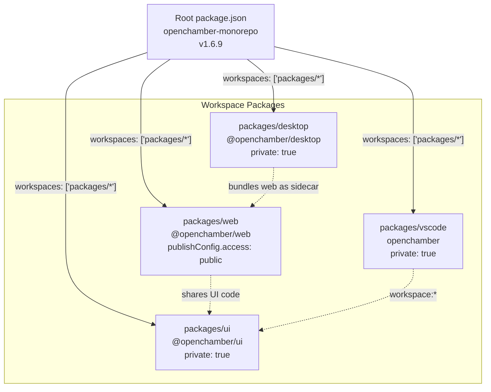
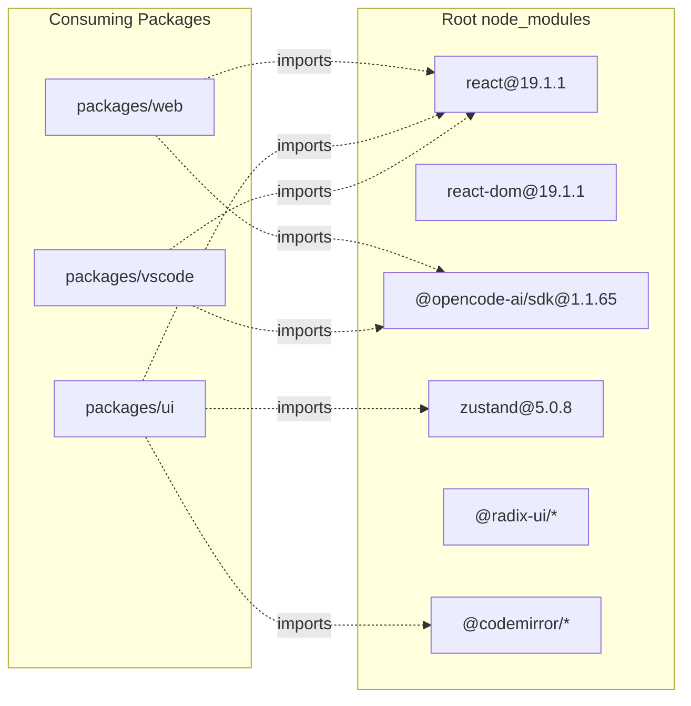
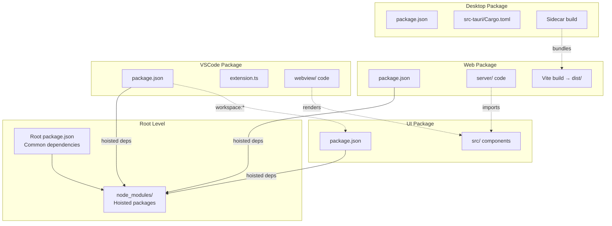
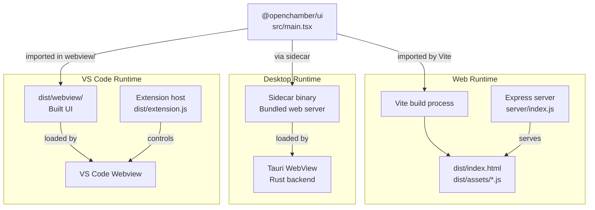
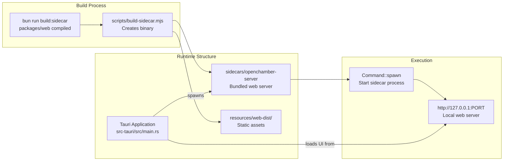
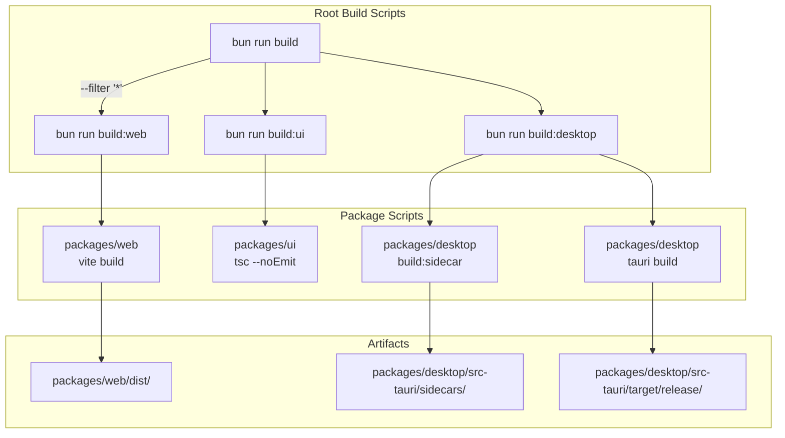

<!-- source: DeepWiki mcp.deepwiki.com · repo btriapitsyn/openchamber · page 9.1 Monorepo Structure · fetched 2026-10-26 -->

# Monorepo Structure

<details>
<summary>Relevant source files</summary>

The following files were used as context for generating this wiki page:

- [CHANGELOG.md](CHANGELOG.md)
- [bun.lock](bun.lock)
- [package.json](package.json)
- [packages/desktop/package.json](packages/desktop/package.json)
- [packages/desktop/src-tauri/Cargo.lock](packages/desktop/src-tauri/Cargo.lock)
- [packages/desktop/src-tauri/Cargo.toml](packages/desktop/src-tauri/Cargo.toml)
- [packages/desktop/src-tauri/tauri.conf.json](packages/desktop/src-tauri/tauri.conf.json)
- [packages/ui/package.json](packages/ui/package.json)
- [packages/vscode/CHANGELOG.md](packages/vscode/CHANGELOG.md)
- [packages/vscode/package.json](packages/vscode/package.json)
- [packages/web/package.json](packages/web/package.json)

</details>


This document describes the organization of the OpenChamber monorepo, including package layout, dependency management, workspace configuration, and inter-package relationships. For build system details and compilation processes, see [Build System](#9.2). For information about the shared UI component library architecture, see [UI Component Library](#7).

## Overview

OpenChamber uses a Bun-based monorepo with four packages organized under a `packages/` directory. The workspace provides shared dependencies, coordinated versioning, and unified build orchestration across three deployment targets: web application, desktop application, and VS Code extension. All packages share a common UI layer implemented in `@openchamber/ui`.

**Sources:** [package.json:1-152](), [bun.lock:1-304]()

## Package Inventory

The monorepo contains four packages with distinct purposes and deployment characteristics:

| Package | Published Name | Type | Entry Point | Purpose |
|---------|---------------|------|-------------|---------|
| `packages/web` | `@openchamber/web` | Public | `server/index.js` | Express server + Vite-built client, published to npm |
| `packages/ui` | `@openchamber/ui` | Private | `src/main.tsx` | Shared React component library, workspace-only |
| `packages/desktop` | `@openchamber/desktop` | Private | `src/main.rs` | Tauri application, distributed as binary |
| `packages/vscode` | `openchamber` | Public | `dist/extension.js` | VS Code extension, published to marketplace |

**Sources:** [package.json:8-10](), [packages/web/package.json:1-12](), [packages/ui/package.json:1-7](), [packages/desktop/package.json:1-5](), [packages/vscode/package.json:1-7]()

## Workspace Configuration



**Workspace Definition**

The root `package.json` declares workspaces using the glob pattern `packages/*`, enabling Bun to resolve cross-package dependencies and hoist shared dependencies to the root `node_modules`. The workspace uses Bun 1.3.5 as specified in the `packageManager` field.

**Sources:** [package.json:7-10](), [package.json:24]()

## Dependency Architecture

### Hoisted Dependencies

The monorepo hoists 66 production dependencies and 14 development dependencies to the root level. This includes fundamental libraries used across multiple packages:



**Key Hoisted Dependencies:**
- **React ecosystem**: `react`, `react-dom` (19.1.1) - Shared UI framework
- **State management**: `zustand` (5.0.8) - Used by `@openchamber/ui`
- **OpenCode integration**: `@opencode-ai/sdk` (1.1.65) - Backend API client
- **UI primitives**: `@radix-ui/*` components - Accessible component primitives
- **Code editing**: `@codemirror/*` packages - Shared editor functionality

**Sources:** [package.json:60-119](), [bun.lock:4-299]()

### Package-Specific Dependencies

Each package maintains dependencies unique to its runtime environment:

**Web Package (`packages/web`)**
- `express` (5.1.0) - HTTP server framework
- `simple-git` (3.28.0) - Git operations backend
- `node-pty` / `bun-pty` - Terminal emulation
- `web-push` (3.6.7) - Push notification support
- `@octokit/rest` (22.0.1) - GitHub API integration

**UI Package (`packages/ui`)**
- `@pierre/diffs` (1.1.0-beta.13) - Diff rendering library
- `ghostty-web` (0.4.0) - Terminal renderer component
- `fuse.js` (7.1.0) - Fuzzy search implementation
- `motion` (12.23.24) - Animation library

**Desktop Package (`packages/desktop`)**
- `@tauri-apps/cli` (^2) - Desktop application framework
- Rust toolchain dependencies (Cargo.toml)

**VS Code Package (`packages/vscode`)**
- `@types/vscode` (1.85.0) - VS Code extension API types
- `esbuild` (0.24.2) - Extension bundle compiler
- `@vscode/vsce` (3.2.1) - Extension packaging tool

**Sources:** [packages/web/package.json:24-66](), [packages/ui/package.json:13-75](), [packages/desktop/package.json:21-24](), [packages/vscode/package.json:230-238]()

### Dependency Resolution Diagram



**Sources:** [package.json:60-119](), [packages/web/package.json:24-66](), [packages/vscode/package.json:231]()

## Cross-Package Relationships

### UI Package as Shared Foundation

The `@openchamber/ui` package serves as the central shared component library, consumed by three runtime environments with different integration mechanisms:



**Integration Methods:**

1. **Web**: UI imported directly into Vite build, served by Express at [packages/web/server/index.js]()
2. **Desktop**: UI included in sidecar web server bundle, loaded by Tauri at [packages/desktop/src-tauri/src/main.rs]()
3. **VS Code**: UI rendered in webview panel, controlled by extension host via message passing at [packages/vscode/src/extension.ts]()

**Sources:** [packages/web/package.json:14-22](), [packages/desktop/package.json:11-18](), [packages/vscode/package.json:209-215]()

### Desktop Sidecar Architecture

The desktop package demonstrates the most complex cross-package relationship by bundling the entire web package as a sidecar binary:



**Sidecar Build Configuration:**

The `tauri.conf.json` specifies the sidecar binary and bundled resources:

```json
{
  "bundle": {
    "externalBin": [
      "sidecars/openchamber-server"
    ],
    "resources": [
      "resources/web-dist/**/*"
    ]
  }
}
```

**Sources:** [packages/desktop/src-tauri/tauri.conf.json:41-48](), [packages/desktop/package.json:15](), [package.json:47]()

### VS Code Workspace Dependency

The VS Code extension uses Bun's workspace protocol to reference the UI package:

```json
{
  "dependencies": {
    "@openchamber/ui": "workspace:*"
  }
}
```

This creates a symlink to `packages/ui` during `bun install`, enabling the webview code to import UI components directly while maintaining version independence from published npm packages.

**Sources:** [packages/vscode/package.json:231](), [bun.lock:199-220]()

## Version Synchronization

All packages maintain synchronized versioning at `1.6.9`, coordinated through a version bump script:

```bash
bun run version:bump
```

This script updates:
- Root `package.json`
- All package `package.json` files
- `packages/desktop/src-tauri/Cargo.toml`
- `packages/desktop/src-tauri/tauri.conf.json`
- Changelog files

**Version Location Mapping:**

| File | Version Field | Format |
|------|--------------|--------|
| `package.json` | `.version` | Semantic version string |
| `packages/web/package.json` | `.version` | Semantic version string |
| `packages/ui/package.json` | `.version` | Semantic version string |
| `packages/desktop/package.json` | `.version` | Semantic version string |
| `packages/vscode/package.json` | `.version` | Semantic version string |
| `packages/desktop/src-tauri/Cargo.toml` | `[package].version` | Semantic version string |
| `packages/desktop/src-tauri/tauri.conf.json` | `.version` | Semantic version string |

**Sources:** [package.json:3](), [package.json:54](), [packages/desktop/src-tauri/Cargo.toml:3](), [packages/desktop/src-tauri/tauri.conf.json:4]()

## Build Orchestration

The root package provides unified scripts for building all packages:



**Script Composition:**

The root build script uses Bun's `--filter` flag to execute builds across packages:

```bash
bun run --filter '*' build
```

Individual package builds:
```bash
bun run --cwd packages/web build     # Vite build
bun run --cwd packages/ui build      # TypeScript check only
bun run --cwd packages/desktop build # No-op placeholder
```

**Sources:** [package.json:25-36](), [packages/web/package.json:18](), [packages/ui/package.json:9](), [packages/desktop/package.json:16]()

## Package Manager Configuration

The monorepo enforces Bun 1.3.5 via the `packageManager` field and uses workspace-specific overrides:

```json
{
  "packageManager": "bun@1.3.5",
  "overrides": {
    "@codemirror/view": "6.39.13"
  }
}
```

The override ensures all packages use a consistent version of `@codemirror/view`, preventing runtime conflicts from mismatched peer dependencies.

**Lockfile Management:**

Bun generates a single `bun.lock` file at the root with entries for all workspace packages and their dependencies. The lockfile format version is 1 as specified in [bun.lock:2]().

**Sources:** [package.json:7](), [package.json:121-123](), [bun.lock:1-3]()

## File Organization Conventions

Each package follows consistent directory structures optimized for its deployment target:

**Web Package Layout:**
```
packages/web/
├── server/          # Express server implementation
├── src/             # Vite-compiled client source
├── public/          # Static assets
├── dist/            # Build output (gitignored)
└── bin/             # CLI entry point
```

**UI Package Layout:**
```
packages/ui/
└── src/
    ├── components/  # React components
    ├── stores/      # Zustand stores
    ├── hooks/       # Custom React hooks
    └── utils/       # Shared utilities
```

**Desktop Package Layout:**
```
packages/desktop/
├── src-tauri/
│   ├── src/         # Rust application code
│   ├── Cargo.toml   # Rust dependencies
│   └── tauri.conf.json
├── scripts/         # Build automation
└── resources/       # Bundled assets
```

**VS Code Package Layout:**
```
packages/vscode/
├── src/             # Extension host code
├── webview/         # Webview UI code
├── dist/
│   ├── extension.js # Bundled extension
│   └── webview/     # Bundled webview
└── assets/          # Extension icons
```

**Sources:** [packages/web/package.json:94-101](), [packages/ui/package.json:6](), [packages/vscode/package.json:35]()

## Development Workflow Scripts

The root package provides convenience scripts for common development tasks:

| Script | Command | Purpose |
|--------|---------|---------|
| `dev` | Multi-package concurrent dev mode | Runs web server, web build watch, and UI type-check |
| `type-check` | `bun run --filter '*' type-check` | Type-check all packages |
| `lint` | `bun run --filter '*' lint` | Lint all packages with shared ESLint config |
| `clean` | `bun run --filter '*' clean` | Remove build artifacts |
| `desktop:dev` | Custom desktop dev mode | Starts OpenCode CLI and Tauri dev server |
| `vscode:dev` | Extension + webview watch | Concurrent esbuild and Vite watch modes |

**Concurrent Development Mode:**

The `dev` script uses `concurrently` to run multiple watch processes:

```bash
concurrently \
  -n "server,web,ui" \
  -c "cyan,magenta,yellow" \
  "bun run --cwd packages/web dev:server:watch" \
  "bun run --cwd packages/web build:watch" \
  "bun run --cwd packages/ui dev"
```

**Sources:** [package.json:24-58](), [packages/vscode/package.json:213-215]()

---

