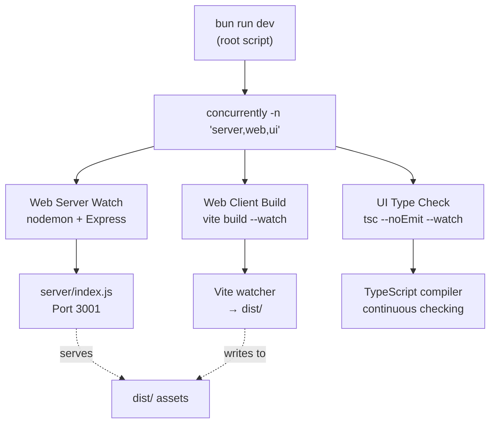
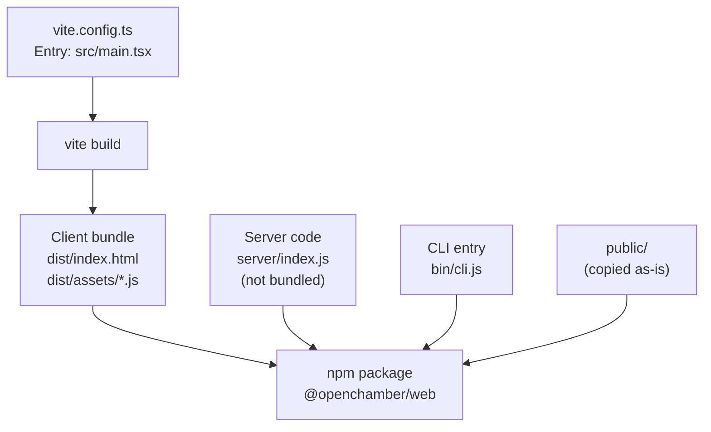
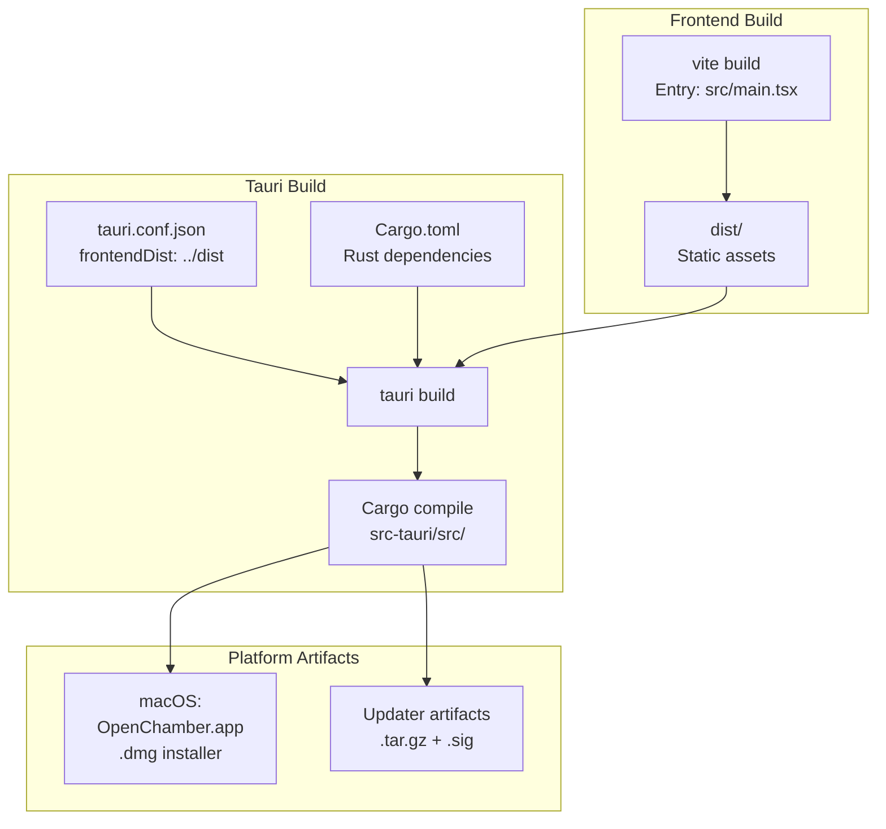
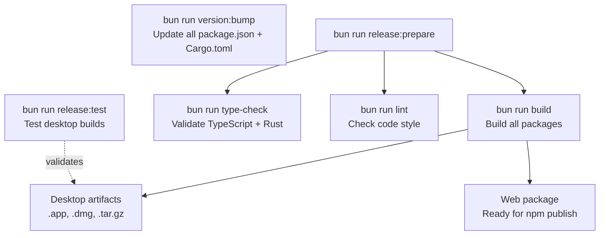

<!-- source: DeepWiki mcp.deepwiki.com · repo btriapitsyn/openchamber · page 9.2 Build System · fetched 2026-10-26 -->

# Build System and Workflow

<details>
<summary>Relevant source files</summary>

The following files were used as context for generating this wiki page:

- [CHANGELOG.md](CHANGELOG.md)
- [bun.lock](bun.lock)
- [package.json](package.json)
- [packages/desktop/package.json](packages/desktop/package.json)
- [packages/desktop/src-tauri/Cargo.lock](packages/desktop/src-tauri/Cargo.lock)
- [packages/desktop/src-tauri/Cargo.toml](packages/desktop/src-tauri/Cargo.toml)
- [packages/desktop/src-tauri/tauri.conf.json](packages/desktop/src-tauri/tauri.conf.json)
- [packages/ui/package.json](packages/ui/package.json)
- [packages/vscode/CHANGELOG.md](packages/vscode/CHANGELOG.md)
- [packages/vscode/package.json](packages/vscode/package.json)
- [packages/web/package.json](packages/web/package.json)

</details>


## Purpose and Scope

This document explains the build pipeline, development scripts, hot reloading mechanisms, and production bundling across all OpenChamber packages. It covers the tools and workflows used during development and release preparation, including watch modes, type checking, and platform-specific build steps.

For information about the workspace organization and package interdependencies, see [Monorepo Structure](#9.2). For contribution guidelines and git workflow, see [Contributing](#9.3).

---

## Package Manager and Tooling

OpenChamber uses **Bun** as the primary package manager and task runner, with **npm/yarn compatibility** maintained for environments where Bun is not available.

### Package Manager Configuration

The monorepo is configured with Bun workspaces at [package.json:1-127]():

```json
{
  "packageManager": "bun@1.3.5",
  "workspaces": ["packages/*"],
  "engines": {
    "node": ">=20.0.0"
  }
}
```

Bun provides faster installation and execution compared to npm/yarn, and includes a native bundler. However, the web package runtime supports both Bun and Node.js for broader deployment compatibility.

### Build Tools Overview

| Tool | Purpose | Packages |
|------|---------|----------|
| **Vite** | Frontend bundling, dev server, HMR | web, desktop, vscode |
| **tsc** | TypeScript type checking | ui, web, desktop, vscode |
| **Tauri CLI** | Native app bundling, Rust backend | desktop |
| **Cargo** | Rust compilation, dependency management | desktop |
| **esbuild** | Extension host bundling | vscode |
| **concurrently** | Parallel script execution | root, web |

**Sources:** [package.json:1-127](), [packages/web/package.json:1-96](), [packages/desktop/package.json:1-40]()

---

## Development Workflow

### Starting Development Servers

The root package provides convenience scripts for concurrent development:

```bash
# Start all development servers (UI type-check + Web build + Web server)
bun run dev

# Start only web package (build watch + server watch)
bun run dev:web:full

# Start desktop development environment
bun run desktop:dev
```

#### Root Development Script Architecture



The `dev` script at [package.json:24]() uses `concurrently` to run three parallel processes with color-coded output.

**Sources:** [package.json:24-41](), [packages/web/package.json:14-19]()

### Package-Specific Development

#### UI Package Development

The UI package only performs type checking during development—no bundling occurs:

```bash
# From root
bun run --cwd packages/ui dev

# From packages/ui
bun run dev   # runs: tsc --noEmit --watch
```

The UI source files at [packages/ui/package.json:6]() are consumed directly by other packages through workspace references. This allows instant changes without rebuild delays.

#### Web Package Development

The web package has dual development modes:

```bash
# Watch mode for client build only
bun run dev:web

# Full development with server auto-restart
bun run dev:web:full
```

The server uses `nodemon` to watch for changes at [packages/web/package.json:17]():

```javascript
nodemon --watch server --ext js --exec "node server/index.js --port 3001"
```

#### Desktop Package Development

Desktop development requires the Tauri CLI and spawns both Vite and Rust compilation:

```bash
# From root
bun run desktop:dev   # runs custom script

# From packages/desktop
bun run dev           # Vite dev server on port 1421
bun run tauri:dev     # Tauri dev with Rust hot-reload
```

The `desktop-dev.mjs` script at [package.json:46]() orchestrates OpenCode CLI lifecycle management during development.

**Sources:** [packages/ui/package.json:7-11](), [packages/web/package.json:14-19](), [packages/desktop/package.json:11-19]()

### Hot Module Replacement

```mermaid
graph LR
    SourceChange["Source file change<br/>(*.tsx, *.ts)"]
    
    ViteWatcher["Vite watcher<br/>detects change"]
    ViteBuild["Vite rebuild<br/>affected modules"]
    HMRUpdate["HMR update<br/>sent via WebSocket"]
    
    BrowserRuntime["Browser runtime<br/>accepts update"]
    ReactRefresh["React Refresh<br/>preserves state"]
    UIRerender["UI re-renders<br/>without full reload"]
    
    SourceChange --> ViteWatcher
    ViteWatcher --> ViteBuild
    ViteBuild --> HMRUpdate
    HMRUpdate --> BrowserRuntime
    BrowserRuntime --> ReactRefresh
    ReactRefresh --> UIRerender
```



Vite provides HMR for all packages using React. The `@vitejs/plugin-react` dependency enables React Fast Refresh, which preserves component state during development.

For the web package, the Express server at [packages/web/package.json:17]() auto-restarts on server-side changes but does not affect the HMR connection.

**Sources:** [package.json:107](), [packages/web/package.json:71]()

---

## Build Pipeline

### Build Orchestration

The root package coordinates builds across all packages:

```bash
# Build all packages in dependency order
bun run build

# Build specific packages
bun run build:web
bun run build:ui
bun run build:desktop
```

The `build` script at [package.json:25]() uses `bun run --filter '*' build`, which executes the `build` script in each package that defines one.

### UI Package Build

The UI package build at [packages/ui/package.json:9]() only validates types:

```bash
tsc --noEmit
```

No output artifacts are generated. Other packages import UI components directly from source at [packages/ui/package.json:6]():

```json
{
  "main": "src/main.tsx"
}
```

This approach eliminates the need for a separate build step and reduces iteration time.

### Web Package Build



The web build at [packages/web/package.json:18]() produces:

1. **Client bundle**: Vite bundles the React application into `dist/`
2. **Server code**: Express server at `server/index.js` is included as-is (not bundled)
3. **CLI entry**: The `openchamber` command at `bin/cli.js` for npm installation

The package is configured for npm publishing at [packages/web/package.json:11-13]():

```json
{
  "publishConfig": {
    "access": "public"
  }
}
```

**Watch mode** is available via [packages/web/package.json:19]():

```bash
vite build --watch
```

**Sources:** [packages/web/package.json:14-23](), [packages/web/package.json:88-95]()

### Desktop Package Build

The desktop build involves two stages: frontend (Vite) and native app (Tauri + Rust).



The desktop build at [packages/desktop/package.json:16-17]() follows this sequence:

```bash
# 1. Build frontend
bun run build    # → dist/

# 2. Build Tauri app (includes Rust compilation)
bun run tauri:build
```

Tauri configuration at [packages/desktop/src-tauri/tauri.conf.json:6-10]() specifies:

```json
{
  "build": {
    "beforeDevCommand": "bun run dev",
    "beforeBuildCommand": "bun run build",
    "devUrl": "http://127.0.0.1:1421",
    "frontendDist": "../dist"
  }
}
```

The **Cargo manifest** at [packages/desktop/src-tauri/Cargo.toml:1-62]() defines Rust dependencies and compilation features. The build produces:

- **macOS**: `.app` bundle, `.dmg` installer
- **Updater artifacts**: `.tar.gz` + signature files for auto-update

The `createUpdaterArtifacts` flag at [packages/desktop/src-tauri/tauri.conf.json:65]() ensures release assets are generated.

**Sources:** [packages/desktop/package.json:11-19](), [packages/desktop/src-tauri/tauri.conf.json:1-75](), [packages/desktop/src-tauri/Cargo.toml:1-62]()

### VS Code Extension Build

Although not detailed in the provided files, the root scripts reference VS Code extension commands:

```bash
bun run vscode:dev        # Development with watch mode
bun run vscode:build      # Production build
bun run vscode:package    # Create .vsix package
```

These scripts are defined at [package.json:50-53]() and delegate to the `packages/vscode` directory.

**Sources:** [package.json:50-53]()

---

## Type Checking and Linting

### Type Checking

Type checking is performed independently of bundling:

```bash
# Check all packages
bun run type-check

# Check specific packages
bun run type-check:web
bun run type-check:ui
bun run type-check:desktop
```

Each package's `type-check` script at [package.json:29-32]() runs:

```bash
tsc --noEmit
```

For the desktop package, type checking also includes Rust checks via [package.json:49]():

```bash
cargo fmt --manifest-path packages/desktop/src-tauri/Cargo.toml -- --check
cargo clippy --manifest-path packages/desktop/src-tauri/Cargo.toml -- -D warnings
```

This ensures Rust code formatting and lint violations are caught.

### Linting

ESLint is configured at the workspace root with shared rules:

```bash
# Lint all packages
bun run lint

# Lint specific packages
bun run lint:web
bun run lint:ui
bun run lint:desktop
```

Each package's lint script at [package.json:33-36]() uses:

```bash
eslint "./src/**/*.{ts,tsx}" --config ../../eslint.config.js
```

The desktop package additionally checks Rust code at [package.json:48]():

```bash
cargo fmt --manifest-path packages/desktop/src-tauri/Cargo.toml -- --check
cargo clippy --manifest-path packages/desktop/src-tauri/Cargo.toml -- -D warnings
```

**Sources:** [package.json:29-49](), [packages/web/package.json:20-21](), [packages/ui/package.json:10-11]()

---

## Production Builds

### Release Preparation Workflow



The release preparation script at [package.json:55]() ensures all checks pass:

```bash
bun run release:prepare
```

This executes:
1. `bun run build` - Build all packages
2. `bun run type-check` - Validate types
3. `bun run lint` - Check code style

### Version Synchronization

The `version:bump` script at [package.json:54]() updates version numbers across:

- Root `package.json`
- All workspace `package.json` files
- `packages/desktop/src-tauri/Cargo.toml`
- `packages/desktop/src-tauri/tauri.conf.json`

Current version: `1.4.7` (as seen across [package.json:3](), [packages/web/package.json:3](), [packages/ui/package.json:3](), [packages/desktop/package.json:3](), [packages/desktop/src-tauri/Cargo.toml:3](), [packages/desktop/src-tauri/tauri.conf.json:4]())

### Testing Release Builds

Desktop release builds can be tested before publishing:

```bash
# Test current architecture
bun run release:test

# Test Intel (x86_64) build
bun run release:test:intel

# Test Apple Silicon (aarch64) build
bun run release:test:arm
```

These scripts at [package.json:56-58]() invoke `./scripts/test-release-build.sh` with optional architecture arguments.

**Sources:** [package.json:54-58](), [CHANGELOG.md:99-100]()

---

## Build Artifacts and Outputs

### Web Package Artifacts

```
packages/web/
├── dist/                  # Vite-built client assets
│   ├── index.html
│   └── assets/
│       ├── index-[hash].js
│       └── index-[hash].css
├── server/                # Server code (not bundled)
│   └── index.js
├── bin/                   # CLI entry point
│   └── cli.js
└── public/                # Static assets (copied)
```

The `files` field at [packages/web/package.json:88-95]() specifies what gets published to npm:

```json
{
  "files": ["dist", "server", "bin", "public", "package.json", "README.md"]
}
```

### Desktop Package Artifacts

Desktop builds produce platform-specific bundles:

```
packages/desktop/src-tauri/target/release/bundle/
├── macos/
│   ├── OpenChamber.app           # Application bundle
│   └── OpenChamber_[version]_[arch].dmg   # Installer
└── macos/
    ├── OpenChamber_[version]_[arch].app.tar.gz      # Update artifact
    └── OpenChamber_[version]_[arch].app.tar.gz.sig  # Signature
```

Separate builds are created for:
- **Apple Silicon**: `aarch64-apple-darwin` (arm64)
- **Intel**: `x86_64-apple-darwin` (x64)

The changelog at [CHANGELOG.md:99-100]() documents Intel Mac support addition.

**Sources:** [packages/web/package.json:88-95](), [CHANGELOG.md:99-100](), [packages/desktop/src-tauri/tauri.conf.json:38-65]()

---

## Development Optimizations

### Preventing Zombie Processes

The changelog at [CHANGELOG.md:101]() notes:

> Improved dev server HMR by reusing a healthy OpenCode process to avoid zombie instances.

During development, the OpenCode CLI process is managed carefully to prevent multiple instances when HMR triggers reloads.

### Watch Mode Efficiency

The UI package uses `tsc --watch` instead of Vite bundling, providing:
- **Instant feedback** on type errors
- **No build artifacts** to clean/manage
- **Direct source imports** for zero-latency changes

The web package separates client build watching from server watching, allowing:
- Client HMR without server restart
- Server restart without client rebuild

### Concurrent Execution

The `concurrently` package enables parallel execution with process isolation. Each sub-process has:
- **Distinct output color** for easy identification
- **Independent failure** (one process crash doesn't kill others)
- **Name-based logging** (`-n` flag at [package.json:24]())

**Sources:** [CHANGELOG.md:101](), [package.json:24](), [packages/ui/package.json:7-11]()

---

## Platform-Specific Considerations

### macOS Requirements

Desktop development on macOS requires:

```json
{
  "desktopPrerequisites": [
    "Rust stable toolchain (via rustup)",
    "Xcode Command Line Tools installed",
    "Tauri CLI installed (cargo install tauri-cli@^2)"
  ]
}
```

From [packages/desktop/package.json:6-9]().

The minimum system version is macOS 14.0 as specified at [packages/desktop/src-tauri/tauri.conf.json:46]().

### Node.js and Bun Compatibility

The web package runtime supports both Node.js and Bun for PTY (pseudo-terminal) operations:

> Web app: terminal backend now supports a faster Bun-based PTY when Bun is available, with automatic fallback for existing Node-only setups.

From [CHANGELOG.md:73](). The web package includes both `node-pty` and `bun-pty` dependencies at [packages/web/package.json:41-50]().

**Sources:** [packages/desktop/package.json:6-9](), [packages/desktop/src-tauri/tauri.conf.json:46](), [CHANGELOG.md:73](), [packages/web/package.json:41-50]()

---

