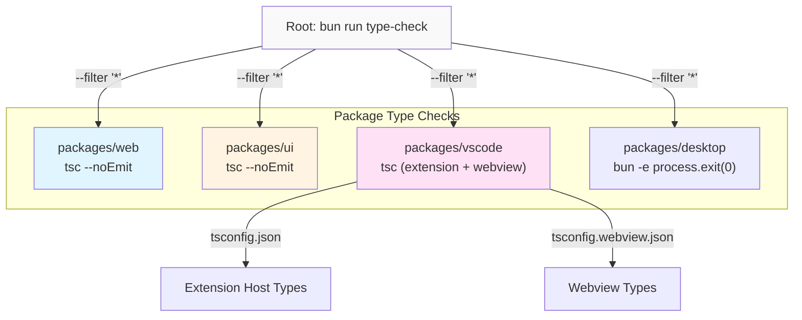
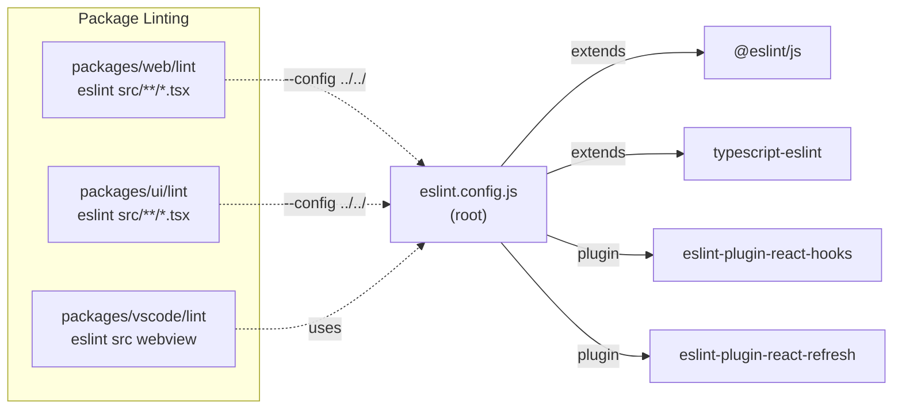
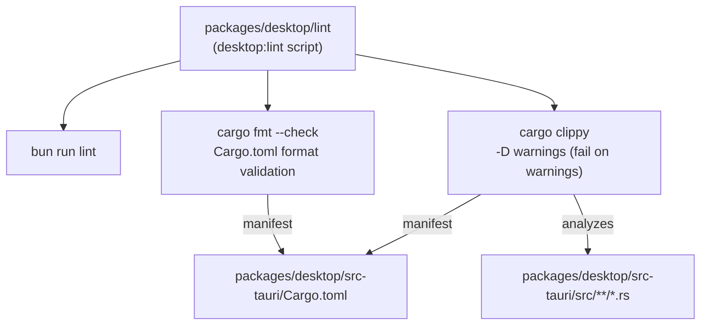
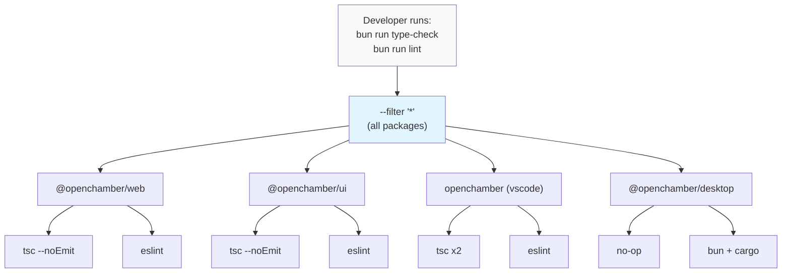
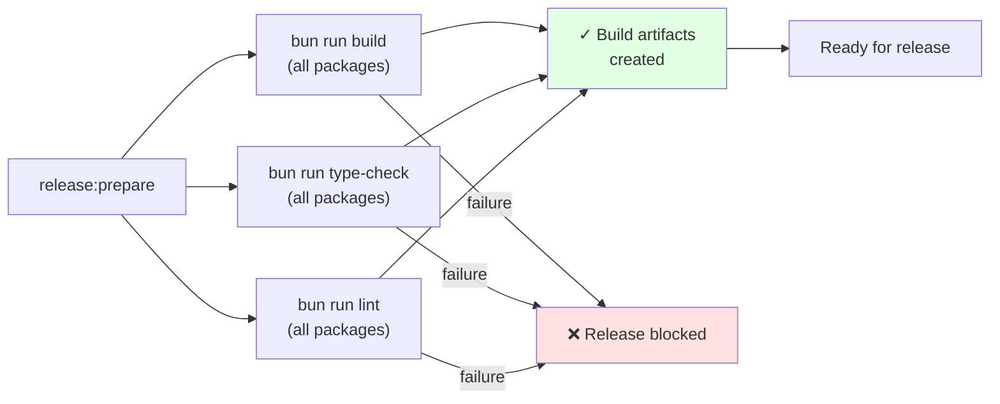
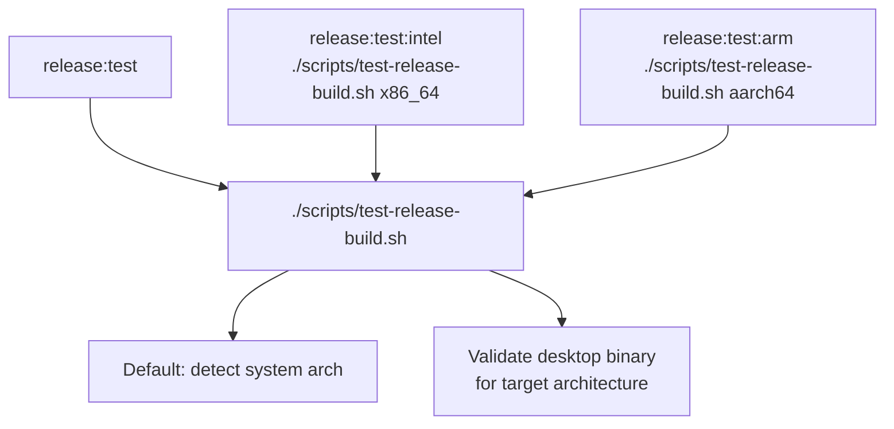
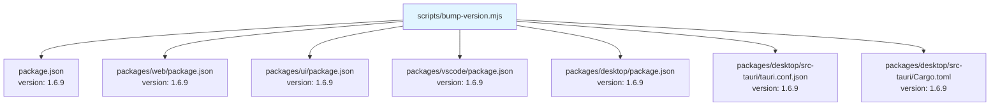
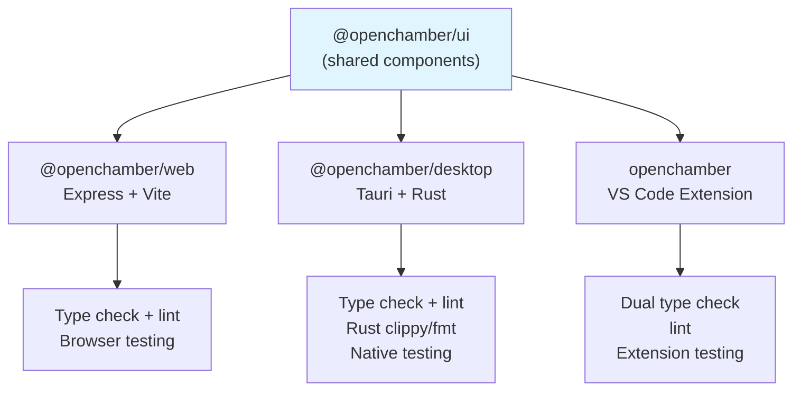

<!-- source: DeepWiki mcp.deepwiki.com · repo btriapitsyn/openchamber · page 9.3 Testing and Quality · fetched 2026-10-26 -->

# Testing and Quality

<details>
<summary>Relevant source files</summary>

The following files were used as context for generating this wiki page:

- [CHANGELOG.md](CHANGELOG.md)
- [bun.lock](bun.lock)
- [package.json](package.json)
- [packages/desktop/package.json](packages/desktop/package.json)
- [packages/desktop/src-tauri/Cargo.lock](packages/desktop/src-tauri/Cargo.lock)
- [packages/desktop/src-tauri/Cargo.toml](packages/desktop/src-tauri/Cargo.toml)
- [packages/desktop/src-tauri/tauri.conf.json](packages/desktop/src-tauri/tauri.conf.json)
- [packages/ui/package.json](packages/ui/package.json)
- [packages/vscode/CHANGELOG.md](packages/vscode/CHANGELOG.md)
- [packages/vscode/package.json](packages/vscode/package.json)
- [packages/web/package.json](packages/web/package.json)

</details>


This document describes the testing strategies, code quality tools, and contribution guidelines used in the OpenChamber monorepo. The project emphasizes static analysis, type safety, and linting over traditional unit testing, with quality checks integrated into the build and release workflows.

For information about the build system and development workflow, see [Build System](#9.2). For monorepo structure and conventions, see [Monorepo Structure](#9.1).

---

## Quality Assurance Approach

OpenChamber employs a quality strategy centered on **static type checking** and **linting** rather than comprehensive unit or integration tests. This approach prioritizes:

- **Type safety** through TypeScript's strict mode across all packages
- **Code consistency** via ESLint and Prettier-style formatting
- **Rust safety** through cargo clippy and cargo fmt for the desktop application
- **Pre-release validation** to catch issues before distribution
- **Incremental validation** during development through watch modes

The absence of traditional test frameworks (Jest, Vitest, Mocha) in the dependencies indicates reliance on manual testing, type checking, and real-world usage validation through frequent releases.

**Sources:** [package.json:23-58](), [CHANGELOG.md:1-611]()

---

## Type Checking System

### TypeScript Configuration

All JavaScript/TypeScript packages use TypeScript with `noEmit` mode for type checking without code generation. Each package defines its own `tsconfig.json` with strict type checking enabled.



**Type Checking Commands per Package**

| Package | Command | Configuration |
|---------|---------|---------------|
| `@openchamber/web` | `tsc --noEmit` | Single tsconfig.json |
| `@openchamber/ui` | `tsc --noEmit` | Shared UI types |
| `openchamber` (vscode) | `tsc --noEmit -p tsconfig.json && tsc --noEmit -p tsconfig.webview.json` | Dual configs for extension vs webview |
| `@openchamber/desktop` | `bun -e "process.exit(0)"` | No-op (uses Tauri/Rust) |

The VS Code extension requires **two separate type checks** because the extension host runs in Node.js while the webview uses browser APIs. This is enforced through separate TypeScript configurations at [packages/vscode/tsconfig.json]() and [packages/vscode/tsconfig.webview.json]().

**Sources:** [package.json:29-33](), [packages/web/package.json:20](), [packages/ui/package.json:10](), [packages/vscode/package.json:216](), [packages/desktop/package.json:17]()

---

## Linting and Code Quality

### ESLint Configuration

The monorepo uses a **shared ESLint configuration** at the root level, enforcing consistent code style across all TypeScript/JavaScript packages.



**ESLint Plugins and Extensions**

The shared configuration uses:
- `@eslint/js` - Core ESLint rules
- `typescript-eslint` - TypeScript-specific linting
- `eslint-plugin-react-hooks` - React Hooks rules enforcement
- `eslint-plugin-react-refresh` - Fast Refresh compatibility checks

Each package runs linting with the command pattern:
```bash
eslint "./src/**/*.{ts,tsx}" --config ../../eslint.config.js
```

**Sources:** [package.json:33-36](), [packages/web/package.json:21](), [packages/ui/package.json:11](), [packages/vscode/package.json:217](), [package.json:69-83]()

### Rust Quality Tools

The desktop application uses **cargo fmt** and **cargo clippy** for Rust code quality:



The `desktop:lint` script at the root level runs:
```bash
bun run --cwd packages/desktop lint && 
cargo fmt --manifest-path packages/desktop/src-tauri/Cargo.toml -- --check && 
cargo clippy --manifest-path packages/desktop/src-tauri/Cargo.toml -- -D warnings
```

The `-D warnings` flag treats all clippy warnings as errors, enforcing strict code quality. This prevents compilation if any lints are triggered.

**Sources:** [package.json:48](), [packages/desktop/src-tauri/Cargo.toml:1-33]()

---

## Monorepo Quality Workflows

### Parallel Quality Checks

The monorepo uses **workspaces** and the `--filter '*'` pattern to run quality checks across all packages in parallel:



The workspace configuration in [package.json:8-10]() defines:
```json
"workspaces": [
  "packages/*"
]
```

This allows commands like `bun run --filter '*' type-check` to execute the `type-check` script in each package concurrently, providing fast feedback during development.

**Sources:** [package.json:8-10](), [package.json:29-36]()

### Watch Mode Development

During development, packages support **watch modes** for incremental validation:

| Package | Watch Command | Purpose |
|---------|--------------|---------|
| `@openchamber/web` | `vite build --watch` | Rebuild UI on changes |
| `@openchamber/ui` | `tsc --noEmit --watch` | Continuous type checking |
| `openchamber` (vscode) | `esbuild ... --watch` | Extension rebuild |

The root-level `dev` script orchestrates multiple watch processes using `concurrently`:
```bash
concurrently -n "server,web,ui" -c "cyan,magenta,yellow" \
  "bun run --cwd packages/web dev:server:watch" \
  "bun run --cwd packages/web build:watch" \
  "bun run --cwd packages/ui dev"
```

**Sources:** [package.json:24](), [packages/web/package.json:14-19](), [packages/ui/package.json:8](), [packages/vscode/package.json:214]()

---

## Release Validation

### Pre-Release Quality Gate

The `release:prepare` script enforces a **quality gate** before releases:



The command at [package.json:55]():
```bash
bun run build && bun run type-check && bun run lint
```

This ensures that:
1. All packages build successfully
2. No type errors exist
3. No linting violations exist

Only after all three checks pass can the release proceed.

**Sources:** [package.json:55]()

### Release Build Testing

The monorepo includes **release build testing scripts** for architecture-specific validation:



These scripts test the **desktop application build** for different CPU architectures, particularly important for macOS which supports both Apple Silicon (aarch64) and Intel (x86_64) builds.

**Sources:** [package.json:56-58](), [CHANGELOG.md:353-354]()

---

## Version Bumping and Consistency

### Synchronized Versioning

The monorepo maintains **version consistency** across all packages using a custom script:



The script at `scripts/bump-version.mjs` ensures that version numbers are synchronized across:
- All `package.json` files in the monorepo
- Tauri configuration at [packages/desktop/src-tauri/tauri.conf.json:4]()
- Rust Cargo manifest at [packages/desktop/src-tauri/Cargo.toml:3]()

This prevents version drift between packages and ensures consistent release numbering.

**Sources:** [package.json:54](), [package.json:3](), [packages/web/package.json:3](), [packages/ui/package.json:3](), [packages/vscode/package.json:5](), [packages/desktop/package.json:3](), [packages/desktop/src-tauri/tauri.conf.json:4](), [packages/desktop/src-tauri/Cargo.toml:3]()

---

## Development Tools and Dependencies

### Quality-Related Dependencies

The monorepo includes the following development dependencies for quality assurance:

**TypeScript Ecosystem**
- `typescript`: ~5.8.3 - Shared across all packages
- `@types/node`, `@types/react`, `@types/react-dom` - Type definitions

**ESLint Ecosystem**
- `eslint`: ^9.33.0
- `@eslint/js`: ^9.33.0
- `typescript-eslint`: ^8.39.1
- `eslint-plugin-react-hooks`: ^5.2.0
- `eslint-plugin-react-refresh`: ^0.4.20
- `globals`: ^16.3.0

**Build and Formatting**
- `prettier` - Not explicitly in deps, but ESLint handles formatting
- `concurrently`: ^9.2.1 - Parallel script execution
- `nodemon`: ^3.1.7 - File watching for server restarts

**Desktop (Rust)**
- `cargo` (system tool) - Build and package management
- `cargo fmt` (rustfmt) - Code formatting
- `cargo clippy` - Linting for Rust

**Sources:** [package.json:68-150](), [packages/web/package.json:68-93](), [packages/ui/package.json:77-103](), [packages/vscode/package.json:220-229]()

---

## Contribution Quality Standards

### Code Quality Expectations

Based on the tooling and release patterns in [CHANGELOG.md](), contributors should follow these practices:

1. **Type Safety**: All code must pass TypeScript type checking with `--noEmit`
2. **Linting**: Code must conform to the shared ESLint configuration
3. **Formatting**: Follow the ESLint-enforced formatting rules
4. **Rust Standards**: Desktop contributions must pass `cargo fmt --check` and `cargo clippy -D warnings`
5. **Build Validation**: Changes must not break any package builds

### Pull Request Validation

While not visible in the provided files, the quality checks likely run in CI/CD based on the `release:prepare` script pattern. Contributors should locally run:

```bash
# Before committing
bun run type-check  # Verify types
bun run lint        # Check code style
bun run build       # Ensure build success

# For desktop changes
cd packages/desktop
cargo fmt --check
cargo clippy -- -D warnings
```

**Sources:** [package.json:55](), [package.json:48]()

---

## Quality Assurance in Practice

### Manual Testing Emphasis

The extensive [CHANGELOG.md]() demonstrates a **release-driven quality approach** with frequent updates (often multiple per day during active development). This suggests:

- Heavy reliance on **manual testing** by maintainers
- **Dogfooding** - developers use the tool themselves
- **Rapid iteration** with quick feedback cycles
- **User-reported issues** driving quality improvements

Example from [CHANGELOG.md:7-22]():
- Version 1.6.9 (2026-02-16) includes 11 distinct improvements
- Many credited to community contributors (`thanks to @user`)
- Features tested across web, desktop, and VS Code simultaneously

### Cross-Platform Quality

The monorepo architecture ensures **quality across three runtimes**:



Changes to shared UI components must work correctly in all three environments, enforced through:
- TypeScript's type system catching incompatibilities
- Monorepo-wide linting preventing platform-specific code
- Runtime API abstractions (see [Architecture](#3) for details)

**Sources:** [package.json:8-10](), [CHANGELOG.md:1-611]()

---

## Quality Metrics and Observability

### Build System Feedback

The build system provides immediate feedback through:

1. **TypeScript compilation errors** - Shown with file/line numbers
2. **ESLint violations** - Reported with rule names and auto-fix suggestions
3. **Cargo clippy warnings** - Rust-specific lints with explanations
4. **Build failures** - Compilation errors from Vite, Tauri, or esbuild

### Version Consistency Checks

The monorepo enforces version alignment through [package.json:54]():
```bash
bun run version:bump
```

This script validates that all packages declare the same version, preventing accidental mismatches that could cause runtime issues or confusing error messages.

**Sources:** [package.json:54](), [package.json:55]()

---

## Summary

OpenChamber's quality strategy prioritizes:

| Aspect | Approach | Tools |
|--------|----------|-------|
| **Type Safety** | Strict TypeScript checking | tsc --noEmit across packages |
| **Code Style** | Shared ESLint config | eslint with React/TS plugins |
| **Rust Quality** | Formatting and linting | cargo fmt, cargo clippy -D warnings |
| **Build Validation** | Pre-release checks | build + type-check + lint |
| **Version Consistency** | Automated synchronization | Custom bump script |
| **Manual Testing** | Frequent releases | Daily/weekly release cadence |

This approach trades comprehensive automated test coverage for **faster iteration** and **immediate static analysis feedback**, suitable for a project with active maintainer involvement and a community of contributors testing in real-world scenarios.

**Sources:** [package.json:23-58](), [CHANGELOG.md:1-611](), [packages/desktop/src-tauri/Cargo.toml:1-33]()