# Page: Overview

# Overview

<details>
<summary>Relevant source files</summary>

The following files were used as context for generating this wiki page:

- [CHANGELOG.md](CHANGELOG.md)
- [bun.lock](bun.lock)
- [package.json](package.json)
- [packages/desktop/package.json](packages/desktop/package.json)
- [packages/desktop/src-tauri/Cargo.lock](packages/desktop/src-tauri/Cargo.lock)
- [packages/desktop/src-tauri/Cargo.toml](packages/desktop/src-tauri/Cargo.toml)
- [packages/desktop/src-tauri/src/main.rs](packages/desktop/src-tauri/src/main.rs)
- [packages/desktop/src-tauri/tauri.conf.json](packages/desktop/src-tauri/tauri.conf.json)
- [packages/ui/package.json](packages/ui/package.json)
- [packages/ui/src/App.tsx](packages/ui/src/App.tsx)
- [packages/ui/src/lib/api/types.ts](packages/ui/src/lib/api/types.ts)
- [packages/vscode/CHANGELOG.md](packages/vscode/CHANGELOG.md)
- [packages/vscode/package.json](packages/vscode/package.json)
- [packages/vscode/src/bridge.ts](packages/vscode/src/bridge.ts)
- [packages/web/package.json](packages/web/package.json)
- [packages/web/server/index.js](packages/web/server/index.js)

</details>


OpenChamber is an AI-powered coding assistant that provides an integrated development environment for interacting with AI models through the OpenCode platform. The system is designed to run in three distinct deployment environments—web browser, native desktop application, and VS Code extension—while sharing a unified React-based user interface codebase.

This document provides a high-level overview of the OpenChamber system architecture, its core components, and how the different runtime environments relate to each other. For detailed information about specific subsystems, see:
- Architecture patterns and design decisions: [Architecture](#3)
- Desktop application implementation: [Desktop Application](#4)
- Web server and client details: [Web Application](#5)
- VS Code extension specifics: [VS Code Extension](#6)
- Shared UI components: [UI Component Library](#7)

## Monorepo Structure

OpenChamber is organized as a monorepo workspace with four primary packages that handle different concerns. The root package orchestrates builds and shared dependencies, while specialized packages implement platform-specific functionality.

### Package Organization

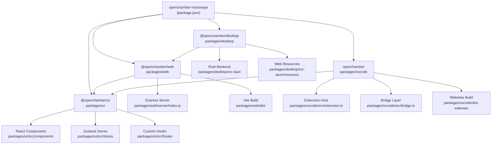

**Sources:** [package.json:1-151](), [packages/web/package.json:1-103](), [packages/ui/package.json:1-104](), [packages/desktop/package.json:1-27](), [packages/vscode/package.json:1-240]()

The monorepo uses Bun as its package manager and workspace orchestrator. Each package declares its own dependencies, but common dependencies like React, Zustand, and the OpenCode SDK are shared at the root level through workspace hoisting.

### Shared Dependencies

| Dependency | Version | Used By | Purpose |
|------------|---------|---------|---------|
| `@opencode-ai/sdk` | ^1.1.65 | All packages | OpenCode API client and types |
| `react` | ^19.1.1 | ui, web, vscode | UI framework |
| `zustand` | ^5.0.8 | ui | State management |
| `@radix-ui/*` | Various | ui, web | Headless UI primitives |
| `simple-git` | ^3.28.0 | web, ui | Git operations |

**Sources:** [package.json:60-119](), [bun.lock:1-300]()

## Runtime Environments

OpenChamber supports three distinct runtime environments, each with its own deployment model and backend architecture. All three runtimes share the same React UI components from `@openchamber/ui`, but differ in how they communicate with the OpenCode backend and handle platform-specific features.

### Runtime Architecture Comparison

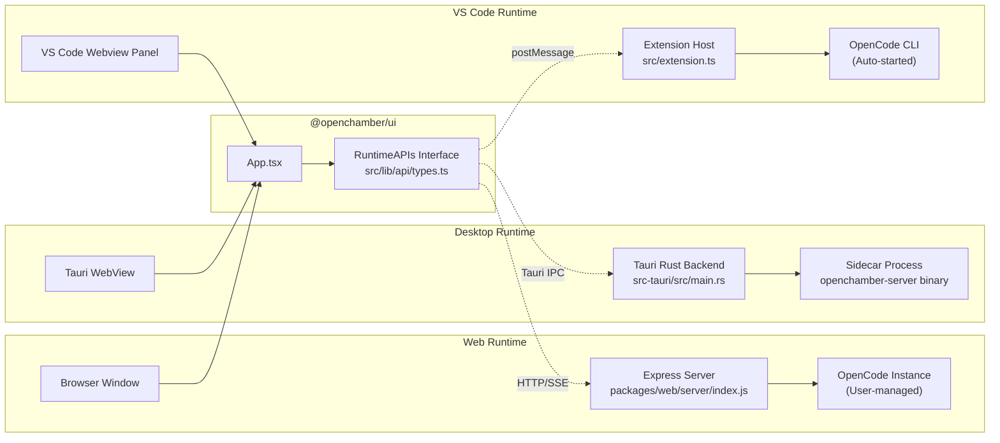

**Sources:** [packages/ui/src/App.tsx:1-328](), [packages/ui/src/lib/api/types.ts:1-20](), [packages/web/server/index.js:1-100](), [packages/desktop/src-tauri/src/main.rs:1-50](), [packages/vscode/src/extension.ts:1-50]()

### Web Runtime

The web runtime deploys as a standalone Express server that serves a Vite-built React application. The server acts as a proxy to an external OpenCode instance and provides additional functionality like terminal sessions, Git operations, and GitHub integration.

**Entry points:**
- Server: [packages/web/server/index.js:1-50]()
- Client: [packages/web/src/main.tsx:1-50]()
- CLI: [packages/web/bin/cli.js:1-50]()

### Desktop Runtime

The desktop runtime uses Tauri to bundle the entire web application as a native executable. It spawns the Express server as a sidecar process and communicates with the UI through Tauri's IPC mechanism. This allows the desktop app to run completely offline without requiring a separate server installation.

**Entry points:**
- Tauri backend: [packages/desktop/src-tauri/src/main.rs:1-100]()
- Sidecar configuration: [packages/desktop/src-tauri/tauri.conf.json:1-85]()

### VS Code Runtime

The VS Code runtime integrates OpenChamber as an extension with a webview-based UI. The extension manages the OpenCode CLI lifecycle and proxies API requests through a message-passing bridge between the webview and extension host.

**Entry points:**
- Extension activation: [packages/vscode/src/extension.ts:1-100]()
- Bridge layer: [packages/vscode/src/bridge.ts:1-100]()
- Webview entry: [packages/vscode/webview/main.tsx:1-50]()

## Core Component Architecture

The OpenChamber UI is built on React with Zustand for state management. The architecture separates concerns into stores, hooks, and presentation components, with a runtime abstraction layer that enables the same UI code to run across all three platforms.

### State Management Structure

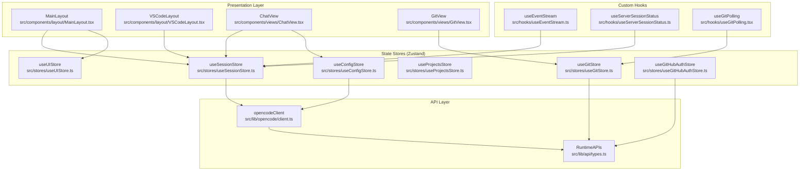

**Sources:** [packages/ui/src/stores/useSessionStore.ts:1-50](), [packages/ui/src/stores/useConfigStore.ts:1-50](), [packages/ui/src/hooks/useEventStream.ts:1-50](), [packages/ui/src/lib/api/types.ts:1-450]()

### Zustand Stores

OpenChamber uses Zustand for global state management with domain-specific stores:

| Store | File | Responsibilities |
|-------|------|-----------------|
| `useSessionStore` | src/stores/useSessionStore.ts | Chat sessions, messages, streaming state |
| `useConfigStore` | src/stores/useConfigStore.ts | Providers, agents, models, MCP tools |
| `useUIStore` | src/stores/useUIStore.ts | UI preferences, theme, layout state |
| `useProjectsStore` | src/stores/useProjectsStore.ts | Workspace projects, active directory |
| `useGitStore` | src/stores/useGitStore.ts | Git status, branches, commit history |
| `useGitHubAuthStore` | src/stores/useGitHubAuthStore.ts | GitHub authentication state |
| `useDirectoryStore` | src/stores/useDirectoryStore.ts | Current directory, switching state |

**Sources:** [packages/ui/src/stores/useSessionStore.ts:1-50](), [packages/ui/src/stores/useConfigStore.ts:1-50](), [packages/ui/src/stores/useUIStore.ts:1-50]()

## OpenCode Integration

OpenChamber integrates with the OpenCode platform through the `@opencode-ai/sdk` package. The SDK provides a typed client for interacting with OpenCode's REST API and Server-Sent Events (SSE) streams.

### OpenCode Client Architecture

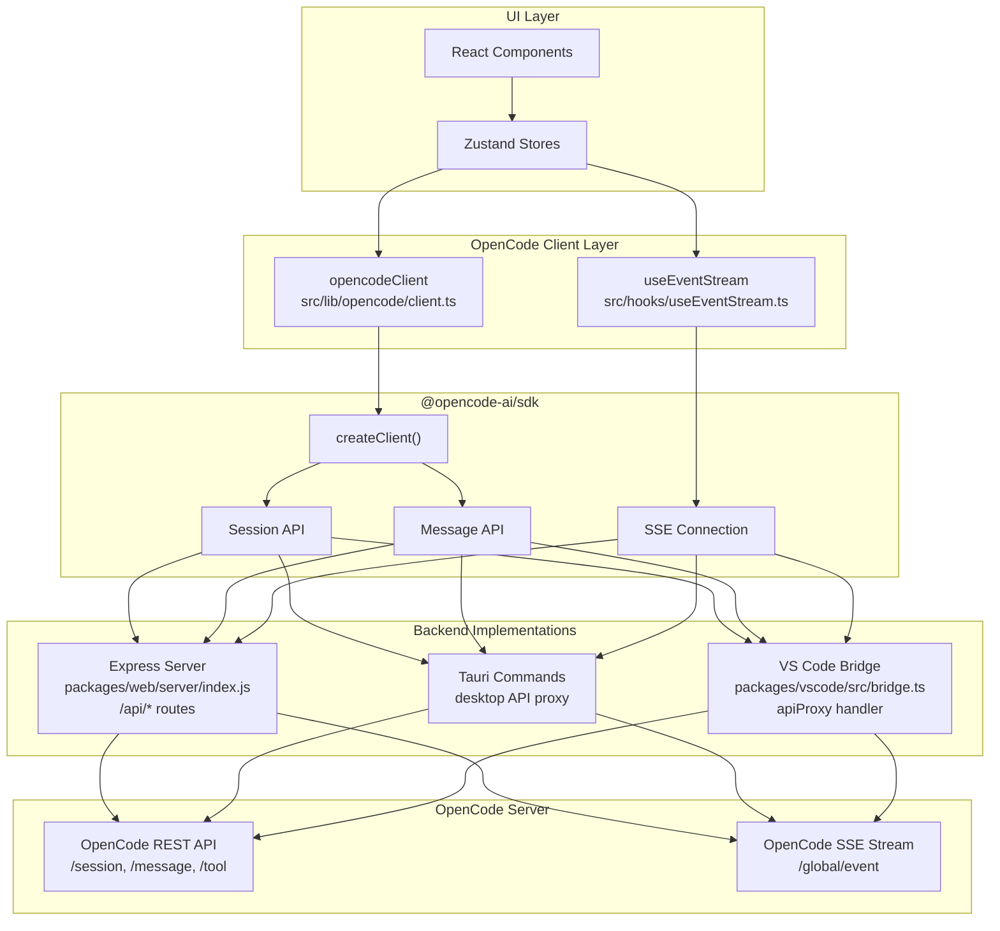

**Sources:** [packages/ui/src/lib/opencode/client.ts:1-50](), [packages/ui/src/hooks/useEventStream.ts:1-50](), [packages/web/server/index.js:1-100](), [packages/vscode/src/bridge.ts:1-100]()

The `opencodeClient` instance is configured with the appropriate base URL and authentication headers for each runtime environment. All API requests flow through the runtime-specific backend implementation, which handles proxying to the actual OpenCode instance.

### Real-Time Communication

OpenChamber uses Server-Sent Events (SSE) to receive real-time updates from the OpenCode server. The `useEventStream` hook establishes an SSE connection and dispatches events to the appropriate Zustand stores based on event type.

**Key event types:**
- `session.created` / `session.updated` — Session lifecycle events
- `message.created` / `message.updated` — Message state changes
- `message.part.updated` — Streaming message chunks
- `tool.call.created` / `tool.call.updated` — Tool execution events
- `permission.request` — Tool permission prompts

**Sources:** [packages/ui/src/hooks/useEventStream.ts:1-100]()

## Build System and Development Workflow

The monorepo uses a coordinated build system that handles dependencies between packages and produces runtime-specific artifacts.

### Build Targets

| Target | Command | Output | Description |
|--------|---------|--------|-------------|
| Web Package | `bun run build:web` | packages/web/dist | Vite-built SPA + server files |
| UI Library | `bun run build:ui` | Type checking only | Shared components (not bundled) |
| Desktop App | `bun run build:desktop` | App bundle (.dmg, .exe) | Tauri-built native executable |
| VS Code Extension | `bun run vscode:package` | openchamber-X.X.X.vsix | Extension package for marketplace |

**Sources:** [package.json:23-58]()

The build system ensures that:
1. Shared UI components are type-checked before runtime builds
2. Desktop builds bundle the web server as a sidecar executable
3. VS Code builds compile both the extension host and webview separately
4. All runtimes use the same React component tree from `@openchamber/ui`

### Development Mode

Development mode runs multiple watchers in parallel:
- `bun run dev` — Runs web server, web build watcher, and UI type-checking
- `bun run desktop:dev` — Runs Tauri dev mode with web server
- `bun run vscode:dev` — Runs extension and webview watchers

**Sources:** [package.json:24](), [package.json:46](), [package.json:50]()

## Key Technologies

OpenChamber is built on the following core technologies:

| Technology | Purpose | Primary Usage |
|------------|---------|---------------|
| React 19 | UI framework | All presentation components |
| Zustand 5 | State management | Global stores and subscriptions |
| Vite 7 | Build tooling | Web and VS Code webview builds |
| Express 5 | HTTP server | Web runtime backend |
| Tauri 2 | Desktop framework | Native desktop application |
| @opencode-ai/sdk | AI integration | OpenCode platform client |
| simple-git | Git operations | Repository management |
| @octokit/rest | GitHub API | Pull request and issue integration |
| CodeMirror 6 | Code editor | File editing and syntax highlighting |
| Radix UI | Headless components | Accessible UI primitives |
| Tailwind CSS 4 | Styling | Utility-first CSS framework |

**Sources:** [package.json:60-119](), [packages/web/package.json:24-67](), [packages/ui/package.json:13-76]()

## File Organization Patterns

OpenChamber follows consistent patterns across packages for organizing code:

### UI Package Structure
```
packages/ui/src/
├── components/          # React components
│   ├── layout/          # Layout components (MainLayout, VSCodeLayout)
│   ├── views/           # Top-level views (ChatView, GitView, FilesView)
│   ├── chat/            # Chat-specific components
│   ├── git/             # Git-specific components
│   └── ui/              # Reusable UI primitives
├── stores/              # Zustand stores
├── hooks/               # Custom React hooks
├── contexts/            # React contexts and providers
├── lib/                 # Utilities and helpers
│   ├── api/             # Runtime API abstraction
│   ├── opencode/        # OpenCode client
│   └── utils.ts         # Shared utilities
└── types/               # TypeScript type definitions
```

**Sources:** [packages/ui/src/App.tsx:1-328](), [packages/ui/src/lib/api/types.ts:1-450]()

### Runtime-Specific Organization

Each runtime package organizes platform-specific code separately from shared UI:

- **Web:** [packages/web/server/]() contains Express routes and middleware
- **Desktop:** [packages/desktop/src-tauri/src/]() contains Rust backend code
- **VS Code:** [packages/vscode/src/]() contains extension host code

**Sources:** [packages/web/server/index.js:1-100](), [packages/desktop/src-tauri/src/main.rs:1-100](), [packages/vscode/src/extension.ts:1-100]()

---

# Page: Getting Started

# Getting Started

<details>
<summary>Relevant source files</summary>

The following files were used as context for generating this wiki page:

- [CHANGELOG.md](CHANGELOG.md)
- [bun.lock](bun.lock)
- [package.json](package.json)
- [packages/desktop/package.json](packages/desktop/package.json)
- [packages/desktop/src-tauri/Cargo.lock](packages/desktop/src-tauri/Cargo.lock)
- [packages/desktop/src-tauri/Cargo.toml](packages/desktop/src-tauri/Cargo.toml)
- [packages/desktop/src-tauri/tauri.conf.json](packages/desktop/src-tauri/tauri.conf.json)
- [packages/ui/package.json](packages/ui/package.json)
- [packages/ui/src/components/layout/VSCodeLayout.tsx](packages/ui/src/components/layout/VSCodeLayout.tsx)
- [packages/vscode/CHANGELOG.md](packages/vscode/CHANGELOG.md)
- [packages/vscode/assets/icon-titlebar.svg](packages/vscode/assets/icon-titlebar.svg)
- [packages/vscode/package.json](packages/vscode/package.json)
- [packages/vscode/src/ChatViewProvider.ts](packages/vscode/src/ChatViewProvider.ts)
- [packages/vscode/src/extension.ts](packages/vscode/src/extension.ts)
- [packages/vscode/src/opencode.ts](packages/vscode/src/opencode.ts)
- [packages/vscode/src/sessionActivityWatcher.ts](packages/vscode/src/sessionActivityWatcher.ts)
- [packages/vscode/webview/api/bridge.ts](packages/vscode/webview/api/bridge.ts)
- [packages/vscode/webview/main.tsx](packages/vscode/webview/main.tsx)
- [packages/web/package.json](packages/web/package.json)

</details>


This guide covers installation and initial setup for all OpenChamber platform variants: web server (with CLI), desktop application, and VS Code extension. Each variant provides a graphical interface to the OpenCode AI coding agent, with platform-specific features while maintaining core functionality consistency.

For detailed architecture information, see [Architecture](#3). For platform-specific implementation details, see [Desktop Application](#4), [Web Application](#5), or [VS Code Extension](#6).

---

## Prerequisites

All OpenChamber variants require the **OpenCode CLI** installed and accessible in your system PATH. OpenChamber acts as a frontend that communicates with the OpenCode backend process via HTTP and Server-Sent Events.

### Common Prerequisites

| Requirement | Minimum Version | Purpose |
|-------------|----------------|---------|
| OpenCode CLI | Latest | AI coding agent backend |
| Node.js | 20.x | Runtime for web server and build tools |

### Platform-Specific Prerequisites

**Desktop Application (macOS)**

- Rust stable toolchain (via `rustup`)
- Xcode Command Line Tools
- Tauri CLI 2.x (`cargo install tauri-cli@^2`)

**Web Server**

- Package manager: pnpm, npm, yarn, or bun

**VS Code Extension**

- Visual Studio Code 1.80+
- No additional prerequisites (downloads from Marketplace)

**Prerequisites Decision Tree**

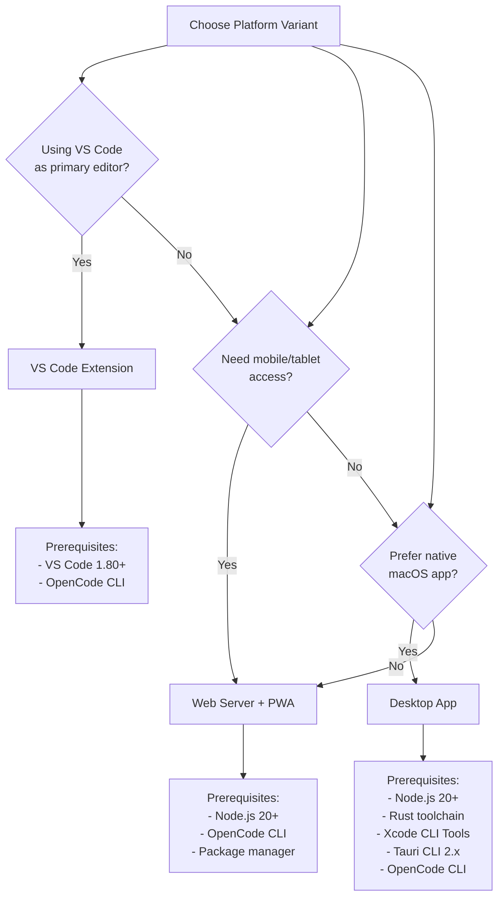

Sources: [README.md:101-105](), [packages/desktop/package.json:6-9]()

---

## Installation

### VS Code Extension

The VS Code extension is the simplest installation option.

**Method 1: VS Code Marketplace (Recommended)**

1. Open VS Code
2. Navigate to Extensions (`Cmd+Shift+X` / `Ctrl+Shift+X`)
3. Search for "OpenChamber"
4. Click **Install** on the extension by `fedaykindev`

**Method 2: Command Line**

```bash
code --install-extension fedaykindev.openchamber
```

The extension includes its webview bundle and communicates with OpenCode CLI via the `@opencode-ai/sdk` client.

Sources: [README.md:74-76]()

### Web Server (CLI Tool)

The web server runs as a Node.js process and can be installed globally via package managers.

**Quick Install (Automatic Package Manager Detection)**

```bash
curl -fsSL https://raw.githubusercontent.com/btriapitsyn/openchamber/main/scripts/install.sh | bash
```

The installation script detects whether you have `pnpm`, `npm`, `yarn`, or `bun` and uses the appropriate command.

**Manual Installation**

```bash
# Using pnpm (recommended)
pnpm add -g @openchamber/web

# Using npm
npm install -g @openchamber/web

# Using yarn
yarn global add @openchamber/web

# Using bun
bun add -g @openchamber/web
```

The package installs the `openchamber` CLI binary defined in [packages/web/package.json:8-10](), which points to `bin/cli.js` as the entry point.

**Web Installation Flow**

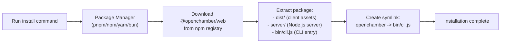

Sources: [README.md:78-95](), [packages/web/package.json:1-10]()

### Desktop Application (macOS)

The desktop application is distributed as a signed `.app` bundle for macOS.

**Installation Steps**

1. Download the latest `.dmg` or `.app.tar.gz` from [GitHub Releases](https://github.com/btriapitsyn/openchamber/releases)
2. If `.dmg`: Open and drag **OpenChamber.app** to Applications folder
3. If `.app.tar.gz`: Extract and move **OpenChamber.app** to Applications folder
4. First launch may require right-click → **Open** to bypass Gatekeeper

The desktop application is built with Tauri 2.9.4 and includes its own embedded HTTP server for communicating with the OpenCode CLI process. The application bundle includes:

- Rust native backend compiled from [packages/desktop/src-tauri/src/]()
- Frontend assets built from [packages/desktop/src/]()
- Tauri configuration from `src-tauri/tauri.conf.json`

**Desktop Installation Components**

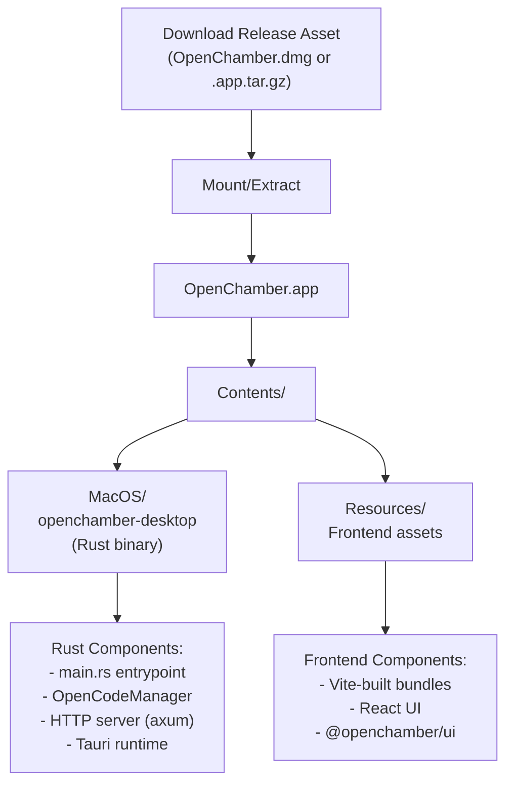

Sources: [README.md:98-99](), [packages/desktop/src-tauri/Cargo.toml:1-59](), [packages/desktop/package.json:1-40]()

---

## First Launch

### VS Code Extension First Launch

1. After installation, click the **OpenChamber** icon in the Activity Bar (left sidebar)
2. The extension opens a webview panel showing the chat interface
3. The extension automatically detects the workspace folder as the working directory
4. If OpenCode CLI is not found, an error message appears in the panel

The extension communicates with OpenCode CLI via the `@opencode-ai/sdk` at version 1.0.133 as specified in the extension's dependencies.

**VS Code Extension Initialization Flow**

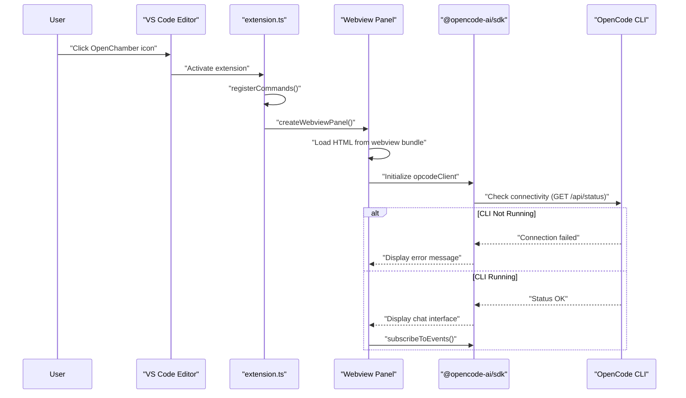

Sources: [README.md:67-70]()

### Web Server First Launch

Start the web server with default settings:

```bash
openchamber
```

This starts the server on port 3000. The CLI tool defined in [packages/web/package.json:8-10]() executes `bin/cli.js`, which spawns the Express server from `server/index.js`.

**Common CLI Options**

```bash
openchamber --port 8080              # Custom port
openchamber --daemon                 # Background process
openchamber --ui-password secret     # Password-protect UI
openchamber stop                     # Stop background server
openchamber update                   # Self-update to latest version
```

**Access Points**

- **Web UI**: http://localhost:3000 (or custom port)
- **PWA**: Open in mobile browser → Add to Home Screen for mobile-optimized interface

**Web Server Startup Flow**

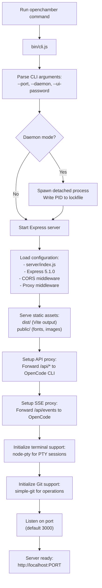

Sources: [README.md:88-95](), [packages/web/package.json:6-23]()

### Desktop Application First Launch

1. Launch **OpenChamber.app** from Applications folder
2. On first launch, a directory picker dialog appears (macOS only)
3. Select your default working directory for coding projects
4. The application checks for OpenCode CLI availability via `OpenCodeManager`
5. If found, it spawns the CLI process and connects
6. Main window appears with chat interface

The desktop application uses the `OpenCodeManager` component (implemented in Rust) to:
- Detect OpenCode CLI location in system PATH
- Spawn the CLI process with appropriate flags
- Monitor process health and restart if needed
- Forward requests to the CLI's HTTP API

**Desktop First Launch Sequence**

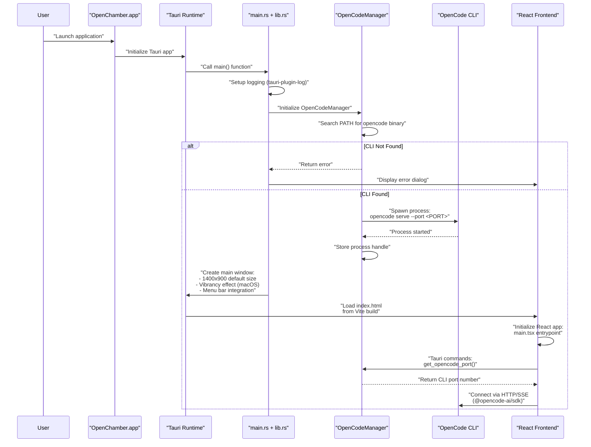

Sources: [README.md:63-65](), [packages/desktop/src-tauri/Cargo.toml:19-52]()

---

## Verification

After installation and first launch, verify that OpenChamber is correctly communicating with OpenCode CLI.

### Verification Steps (All Platforms)

1. **Check OpenCode CLI Status**
   ```bash
   opencode --version
   ```
   Ensure the CLI is accessible and returns version information.

2. **Verify Connection**
   - Send a test message in the chat interface
   - Look for the streaming response indicator (animated dots)
   - Confirm the assistant responds

3. **Test Terminal Integration**
   - Open the Terminal view
   - Execute a simple command like `ls` or `pwd`
   - Verify output appears

4. **Test Git Integration**
   - Navigate to Git view
   - Check if current repository status is displayed
   - Attempt to view uncommitted changes

### Platform-Specific Verification

**Web Server**

Check server logs for successful startup:
```bash
# If running in foreground
# Look for: "Server listening on http://localhost:3000"

# If running as daemon
openchamber logs
```

**Desktop Application**

Check the developer console (if devtools are enabled during development):
1. Window menu → Developer → Toggle Developer Tools
2. Look for successful WebSocket/SSE connection messages
3. Verify no errors related to OpenCode CLI communication

**VS Code Extension**

Check the Output panel:
1. View → Output
2. Select "OpenChamber" from dropdown
3. Look for connection success messages

**Verification Decision Tree**

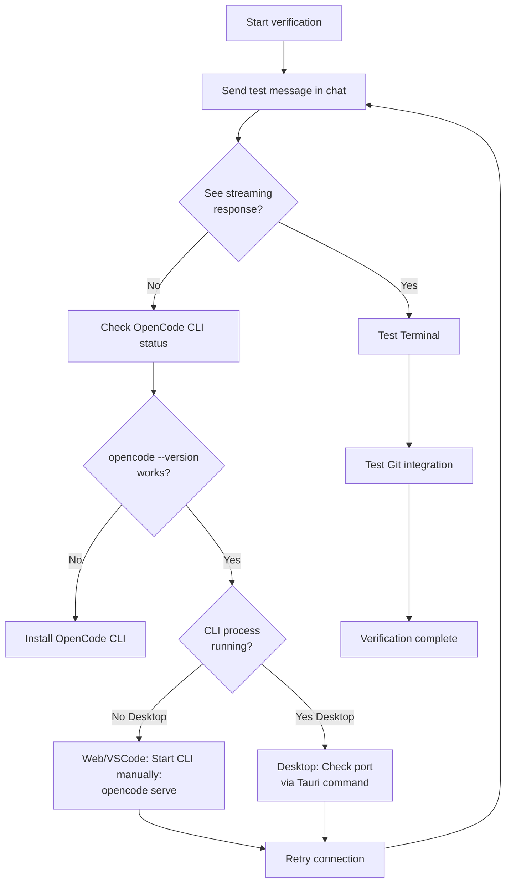

Sources: [README.md:101-104]()

---

## Troubleshooting

### OpenCode CLI Not Found

**Symptom**: Error message "OpenCode CLI not found" or "Failed to connect to OpenCode"

**Solution**:
1. Verify OpenCode CLI is installed: `which opencode`
2. If not found, install from [opencode.ai](https://opencode.ai)
3. Ensure the binary is in your PATH
4. Restart OpenChamber application/server

### Port Already in Use (Web Server)

**Symptom**: `Error: listen EADDRINUSE: address already in use :::3000`

**Solution**:
```bash
# Use a different port
openchamber --port 8080

# Or find and kill the process using port 3000
lsof -ti:3000 | xargs kill -9
```

### Desktop App Won't Launch (macOS)

**Symptom**: "OpenChamber.app is damaged and can't be opened"

**Solution**:
```bash
# Remove quarantine attribute
xattr -cr /Applications/OpenChamber.app

# Then launch normally
```

### Connection Timeouts

**Symptom**: "Reconnecting..." status or timeout errors

**Solution**:
1. Check OpenCode CLI is responsive: `curl http://localhost:PORT/api/status`
2. Verify firewall isn't blocking localhost connections
3. Restart the OpenCode CLI process
4. For desktop: Use Window menu → Force Reload

### VS Code Extension Not Appearing

**Symptom**: Extension installed but icon not visible in Activity Bar

**Solution**:
1. Reload VS Code window: Cmd+Shift+P → "Developer: Reload Window"
2. Check Extensions view for activation errors
3. Verify VS Code version is 1.80 or higher
4. Check Output panel for extension logs

**Common Error Resolution Paths**

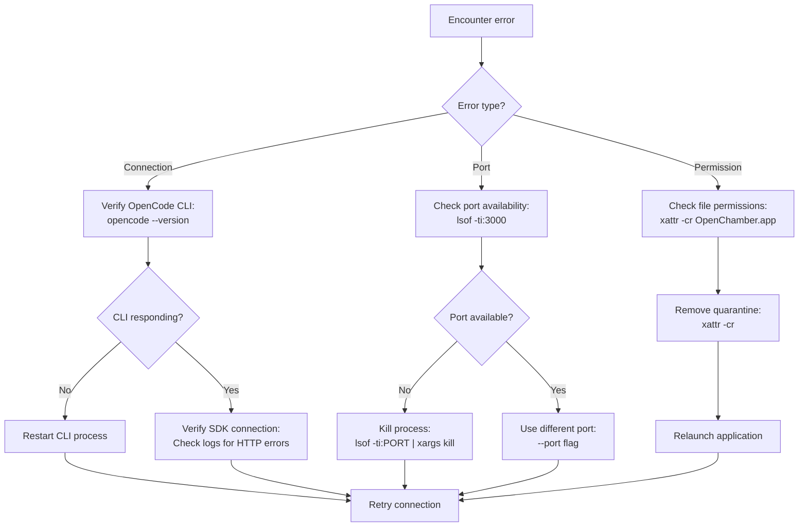

Sources: [README.md:101-105](), [packages/desktop/package.json:6-9](), [packages/web/package.json:14-22]()

---

## Next Steps

After successful installation and verification:

- **Learn the architecture**: See [Architecture](#3) for system design overview
- **Explore features**: Review [UI Component Library](#7) for interface capabilities
- **Customize settings**: Access Settings dialog to configure models, themes, and permissions
- **Mobile access**: Install PWA on mobile devices for cross-device continuity
- **Development**: See [Development Guide](#8) to contribute or build from source

---

# Page: Architecture

# Architecture

<details>
<summary>Relevant source files</summary>

The following files were used as context for generating this wiki page:

- [CHANGELOG.md](CHANGELOG.md)
- [bun.lock](bun.lock)
- [package.json](package.json)
- [packages/desktop/package.json](packages/desktop/package.json)
- [packages/desktop/src-tauri/Cargo.lock](packages/desktop/src-tauri/Cargo.lock)
- [packages/desktop/src-tauri/Cargo.toml](packages/desktop/src-tauri/Cargo.toml)
- [packages/desktop/src-tauri/src/main.rs](packages/desktop/src-tauri/src/main.rs)
- [packages/desktop/src-tauri/tauri.conf.json](packages/desktop/src-tauri/tauri.conf.json)
- [packages/ui/package.json](packages/ui/package.json)
- [packages/ui/src/App.tsx](packages/ui/src/App.tsx)
- [packages/ui/src/lib/api/types.ts](packages/ui/src/lib/api/types.ts)
- [packages/vscode/CHANGELOG.md](packages/vscode/CHANGELOG.md)
- [packages/vscode/package.json](packages/vscode/package.json)
- [packages/vscode/src/bridge.ts](packages/vscode/src/bridge.ts)
- [packages/web/package.json](packages/web/package.json)
- [packages/web/server/index.js](packages/web/server/index.js)

</details>


## Overview

OpenChamber is a multi-platform AI coding assistant that runs as a native desktop application (Tauri), web application (Express + browser), and VS Code extension. All three platforms share the same React UI layer (`@openchamber/ui` package) and integrate with the OpenCode backend for AI agent orchestration.

This page covers the high-level architectural patterns and design decisions. For detailed implementation:

- Multi-platform deployment strategies → [Multi-Platform Deployment](#3.1)
- OpenCode SDK integration and process management → [OpenCode Backend Integration](#3.2)
- SSE streaming and HTTP communication → [Real-Time Communication](#3.3)
- Zustand stores and state persistence → [State Management](#3.4)
- Platform-specific details: [Desktop Application](#4), [Web Application](#5), [VS Code Extension](#6)

## Monorepo Structure

OpenChamber is organized as a Bun workspace with four packages:

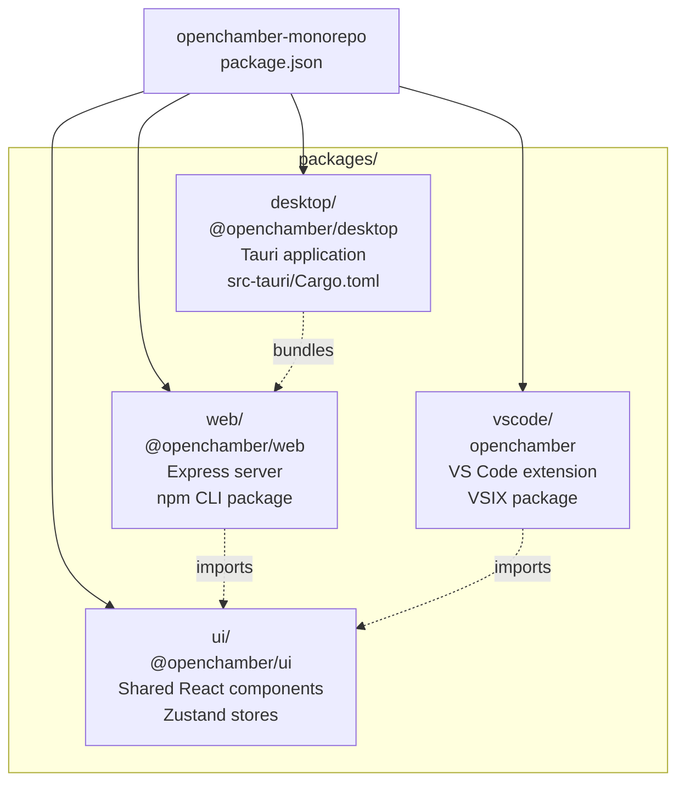

**Package responsibilities:**

| Package | Type | Main Entry | Exports |
|---------|------|------------|---------|
| `@openchamber/ui` | Library | `src/main.tsx` | React components, hooks, stores |
| `@openchamber/web` | Application + CLI | `server/index.js` | Express server, `openchamber` CLI |
| `@openchamber/desktop` | Application | `src-tauri/src/main.rs` | Native installers (.dmg, .app) |
| `openchamber` (vscode) | Extension | `src/extension.ts` | VS Code extension (.vsix) |

**Sources:** [package.json:1-10](), [packages/ui/package.json:1-12](), [packages/web/package.json:1-12](), [packages/desktop/package.json:1-11](), [packages/vscode/package.json:1-40]()

---

## Core Architecture Layers

OpenChamber's architecture consists of three primary layers:

### Layer 1: Platform Runtime

Each platform provides a runtime environment with platform-specific capabilities:

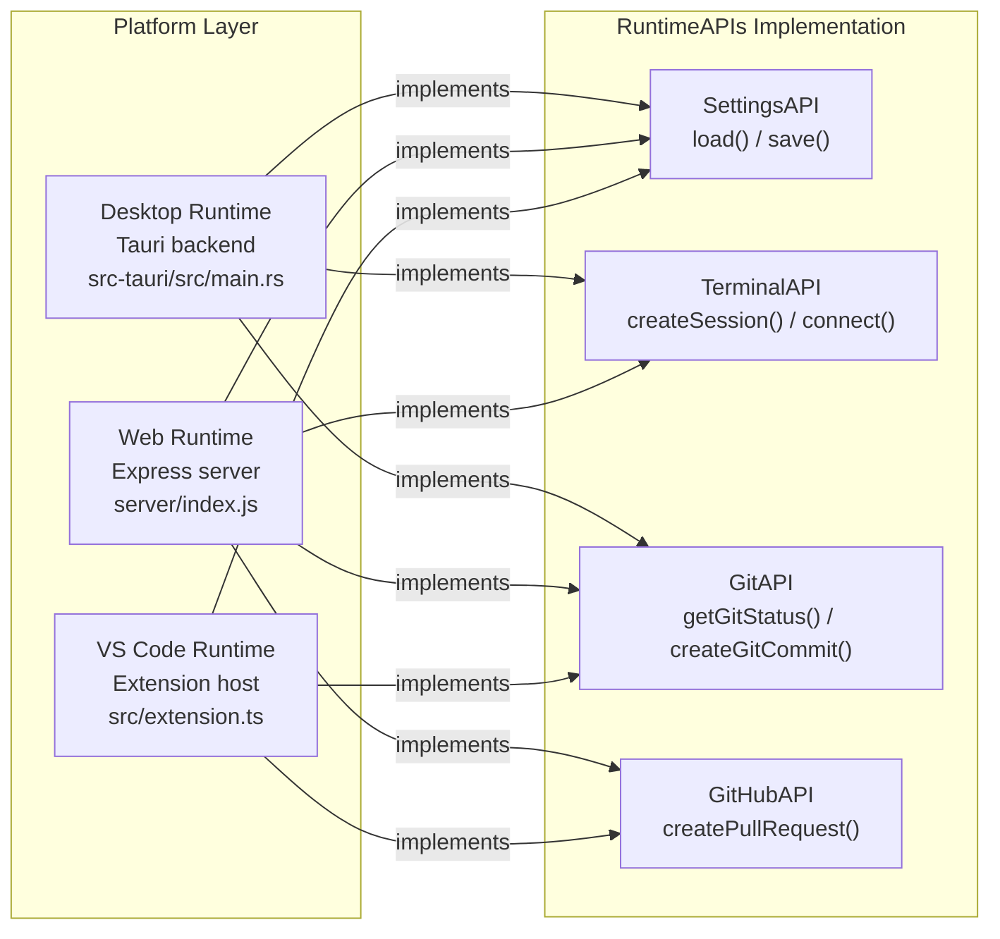

The `RuntimeAPIs` interface defines the contract between the UI and platform-specific functionality. Each platform implements this interface differently based on its capabilities.

**Sources:** [packages/ui/src/lib/api/types.ts:1-50](), [packages/desktop/src-tauri/src/main.rs:378-437](), [packages/web/server/index.js:1-100](), [packages/vscode/src/bridge.ts:1-100]()

### Layer 2: Shared UI Layer

The `@openchamber/ui` package contains all React components and state management logic:

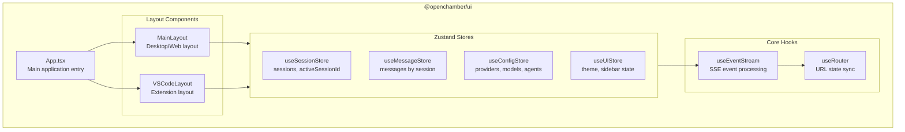

**Key files:**
- Entry point: [packages/ui/src/App.tsx:1-328]()
- Store definitions: `packages/ui/src/stores/`
- Layout components: `packages/ui/src/components/layout/`

**Sources:** [packages/ui/src/App.tsx:1-70](), [packages/ui/package.json:1-30]()

### Layer 3: OpenCode Backend

Each platform spawns and manages its own OpenCode CLI process:

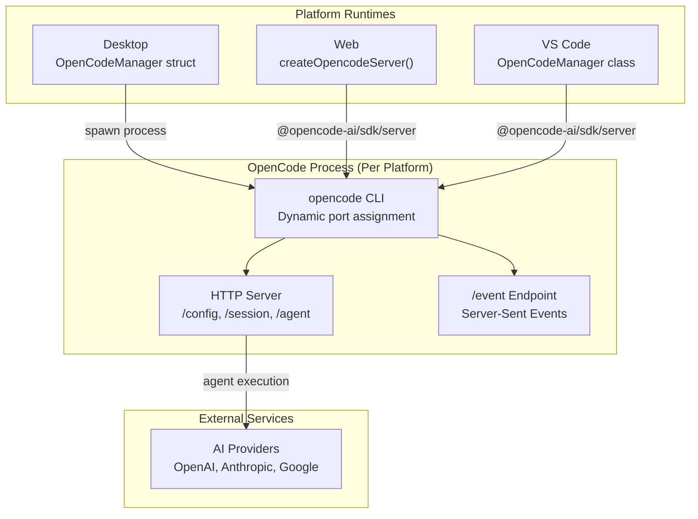

**Sources:** [packages/web/server/index.js:1424-1476](), [packages/desktop/src-tauri/src/main.rs:1-100](), [packages/vscode/src/opencode.ts]() (referenced in extension.ts)

---

## Request Flow Example

Here's how a typical user action flows through the system:

### Example: Send Chat Message

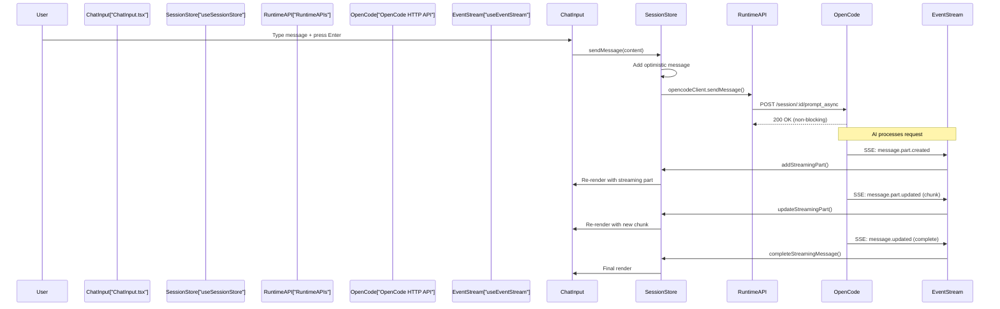

**Key code entities:**
- User interaction: `packages/ui/src/components/chat/ChatInput.tsx`
- Message sending: `useSessionStore.sendMessage()` in stores
- OpenCode client: `packages/ui/src/lib/opencode/client.ts`
- Event processing: [packages/ui/src/hooks/useEventStream.ts]()

**Sources:** [packages/web/server/index.js:1125-1203](), [packages/ui/src/lib/api/types.ts:21-24]()

## Platform Deployment Strategies

OpenChamber runs on three platforms with different deployment and runtime characteristics. See [Multi-Platform Deployment](#3.1) for detailed implementation.

### Platform Comparison

| Platform | Runtime | UI Rendering | OpenCode Integration | Distribution |
|----------|---------|--------------|---------------------|--------------|
| **Desktop** | Tauri + Rust | WebView (WKWebView) | Process spawn via Rust | .dmg / .app bundles |
| **Web** | Node.js/Bun + Express | Browser | `createOpencodeServer()` from SDK | npm package |
| **VS Code** | Extension Host | Webview panel | `createOpencodeServer()` from SDK | .vsix package |

### Runtime Detection

The UI layer detects which platform it's running on using the `RuntimeDescriptor` interface:

```typescript
interface RuntimeDescriptor {
  platform: 'web' | 'desktop' | 'vscode';
  isDesktop: boolean;
  isVSCode: boolean;
  label?: string;
}
```

**Platform-specific code paths:**
- Desktop: [packages/ui/src/App.tsx:58-64]() checks `apis.runtime.isVSCode` and `isDesktopShell()`
- VS Code: [packages/ui/src/App.tsx:271-302]() renders `VSCodeLayout` instead of `MainLayout`
- Web: Default rendering path when neither desktop nor VS Code

**Sources:** [packages/ui/src/lib/api/types.ts:3-13](), [packages/ui/src/App.tsx:46-70]()

## OpenCode Integration Pattern

Each platform spawns its own OpenCode CLI process and manages its lifecycle independently. See [OpenCode Backend Integration](#3.2) for detailed implementation.

### Process Management

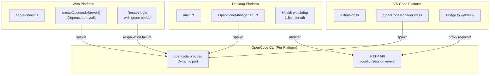

**Key responsibilities per platform:**
- **Desktop**: Direct process management in Rust, no intermediate SDK
- **Web/VS Code**: Use `@opencode-ai/sdk/server` for process spawning and lifecycle
- **All platforms**: Dynamic port detection, health monitoring, automatic restart on crash

**Sources:** [packages/web/server/index.js:1424-1476](), [packages/desktop/src-tauri/src/main.rs:766-820](), [packages/vscode/src/opencode.ts]() (referenced)

## Communication Patterns

OpenChamber uses a dual-channel model: HTTP for commands and SSE for streaming. See [Real-Time Communication](#3.3) for detailed protocol implementation.

### HTTP Request Proxying

Each platform proxies HTTP requests from the UI to OpenCode's HTTP API:

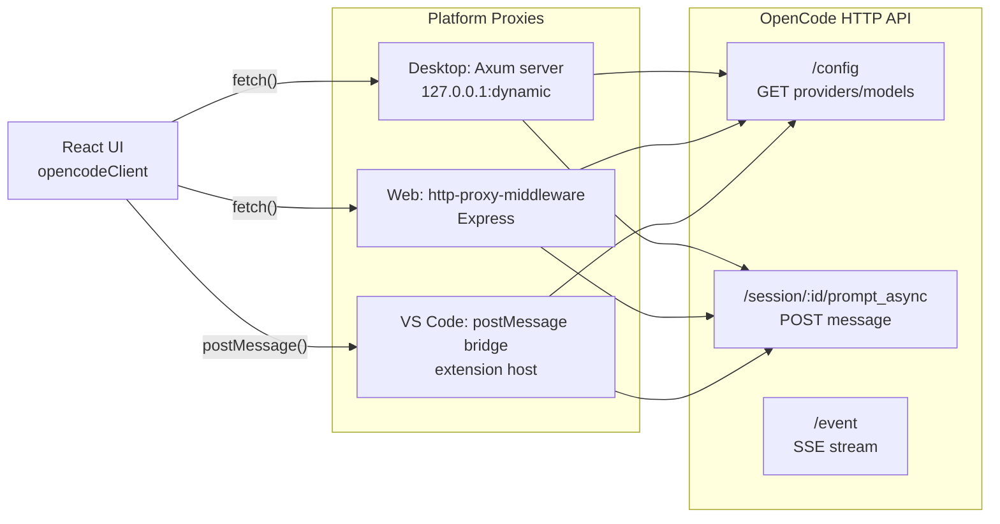

**Key API endpoints:**
- `/config` - Provider and model metadata
- `/session/:id/prompt_async` - Non-blocking message send
- `/session/:id/message` - Message history retrieval
- `/event` - SSE stream for real-time updates

**Sources:** [packages/desktop/src-tauri/src/main.rs:1073-1101](), [packages/web/server/index.js:1760-1868](), [packages/vscode/src/bridge.ts:49-96]()

### SSE Event Processing

The `useEventStream` hook processes SSE events and routes them to appropriate Zustand stores:

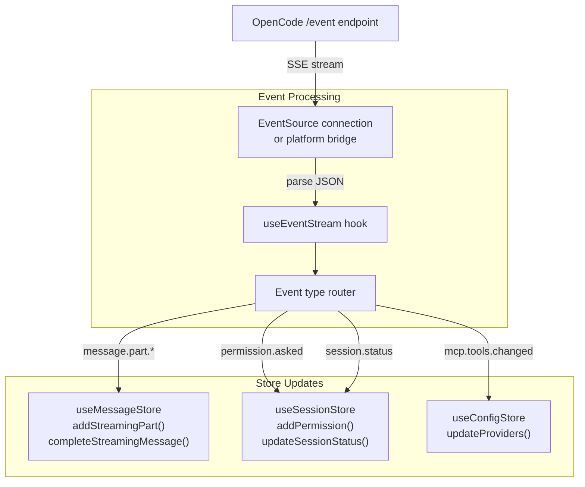

**Event types and handlers:**
- `message.part.created` / `message.part.updated` → Stream message chunks
- `message.updated` → Mark message complete
- `permission.asked` → Show permission dialog
- `session.status` → Update session running/idle state

**Sources:** [packages/web/server/index.js:1125-1203](), [packages/ui/src/hooks/useEventStream.ts]() (referenced)

## State Management Architecture

OpenChamber uses Zustand for state management with domain-specific stores. See [State Management](#3.4) for detailed implementation.

### Store Organization

```mermaid
graph TB
    subgraph Stores["Zustand Stores (packages/ui/src/stores/)"]
        SessionStore["useSessionStore<br/>sessions[], activeSessionId<br/>permissions[]"]
        MessageStore["useMessageStore<br/>messagesBySession<br/>streamingParts"]
        ConfigStore["useConfigStore<br/>providers[], models[]<br/>agents[], defaults"]
        UIStore["useUIStore<br/>theme, sidebarVisible<br/>activeTab"]
        DirectoryStore["useDirectoryStore<br/>currentDirectory<br/>projects[]"]
        GitStore["useGitStore<br/>status, branches<br/>remotes[]"]
    end
    
    subgraph Hooks["Core Hooks"]
        EventStream["useEventStream<br/>SSE event routing"]
        Router["useRouter<br/>URL synchronization"]
    end
    
    subgraph Persistence["Persistence"]
        SettingsAPI["RuntimeAPIs.settings<br/>load() / save()"]
    end
    
    EventStream -->|"update"| SessionStore
    EventStream -->|"update"| MessageStore
    EventStream -->|"update"| ConfigStore
    
    Router -->|"sync URL"| SessionStore
    Router -->|"sync URL"| UIStore
    
    SessionStore -->|"persist"| SettingsAPI
    UIStore -->|"persist"| SettingsAPI
    DirectoryStore -->|"persist"| SettingsAPI
```

**Key stores:**
- `useSessionStore` - Session list, active session, permissions
- `useMessageStore` - Message history, streaming chunks
- `useConfigStore` - Providers, models, agents, MCP tools
- `useUIStore` - Theme, sidebar, dialog state
- `useDirectoryStore` - Active project, workspace switching
- `useGitStore` - Git status, branches, commit history

**Sources:** [packages/ui/src/lib/api/types.ts:353-384](), [packages/ui/src/App.tsx:10-18]()

### State Update Flow

```mermaid
sequenceDiagram
    participant SSE["SSE /event stream"]
    participant Hook["useEventStream"]
    participant Store["Zustand Store"]
    participant Component["React Component"]
    
    SSE->>Hook: Event: message.part.updated
    Hook->>Hook: Parse event type + payload
    Hook->>Store: addStreamingPart(sessionId, part)
    Store->>Store: Update state (immutable)
    Store-->>Component: Trigger re-render
    Component-->>Component: Display new chunk
```

Store updates are immutable and trigger React re-renders via Zustand's subscription mechanism. Components subscribe to specific store slices to minimize unnecessary renders.

**Sources:** [packages/web/server/index.js:1125-1203]()

## Cross-Cutting Concerns

### Configuration Hierarchy

OpenCode backend configuration (agents, models) has a three-tier override system:

1. **Built-in** - Bundled with `opencode` CLI
2. **User-level** - `~/.config/opencode/agents/`, `~/.config/opencode/commands/`
3. **Project-level** - `.opencode/agents/`, `.opencode/commands/`

Application settings (theme, projects, defaults) are persisted per platform via `RuntimeAPIs.settings`:

- **Desktop**: Tauri store plugin
- **Web**: `~/.config/openchamber/settings.json`
- **VS Code**: Extension `globalState`

**Sources:** [packages/ui/src/lib/api/types.ts:353-384](), [packages/web/server/index.js:1054-1079]()

### OpenCode API Prefix Detection

OpenCode can serve its API at different prefixes (`/api`, `/`, etc.). Each platform detects the prefix on startup:

1. Fetch `/doc` and extract `__OPENCODE_API_BASE__` from HTML
2. Fallback: Try `/config`, then `/api/config`
3. Environment override: `OPENCODE_API_PREFIX` env var

**Implementation:**
- Desktop: Rust-based detection in `OpenCodeManager`
- Web: [packages/web/server/index.js:1226-1368]()

**Sources:** [packages/web/server/index.js:940-948](), [packages/web/server/index.js:1059-1079]()

### Health Monitoring

Platforms monitor OpenCode process health and emit status updates:

- **Desktop**: 15s polling interval, emits `openchamber:health-changed` events
- **Web**: HTTP 503 during restart, grace period before marking unhealthy
- **VS Code**: Health checks during API initialization

**Sources:** [packages/desktop/src-tauri/src/main.rs:766-820](), [packages/web/server/index.js:1549-1639]()

---

## Summary

OpenChamber's architecture achieves multi-platform deployment through:

1. **Shared UI Layer**: `@openchamber/ui` package with React components and Zustand stores
2. **Platform Adapters**: Each platform implements `RuntimeAPIs` interface with platform-specific capabilities
3. **Unified Backend**: All platforms integrate with OpenCode via HTTP + SSE
4. **Independent Instances**: Each platform spawns and manages its own OpenCode process
5. **Dynamic Configuration**: API prefix detection and health monitoring for resilient operation

This architecture allows OpenChamber to run natively on macOS (Desktop), in any browser (Web), and integrated into VS Code (Extension), while maintaining a consistent user experience and feature set across all platforms.

---

# Page: Multi-Platform Deployment

# Multi-Platform Deployment

<details>
<summary>Relevant source files</summary>

The following files were used as context for generating this wiki page:

- [packages/desktop/src-tauri/src/main.rs](packages/desktop/src-tauri/src/main.rs)
- [packages/ui/src/App.tsx](packages/ui/src/App.tsx)
- [packages/ui/src/components/layout/VSCodeLayout.tsx](packages/ui/src/components/layout/VSCodeLayout.tsx)
- [packages/ui/src/lib/api/types.ts](packages/ui/src/lib/api/types.ts)
- [packages/ui/src/lib/desktop.ts](packages/ui/src/lib/desktop.ts)
- [packages/ui/src/lib/persistence.ts](packages/ui/src/lib/persistence.ts)
- [packages/vscode/assets/icon-titlebar.svg](packages/vscode/assets/icon-titlebar.svg)
- [packages/vscode/src/ChatViewProvider.ts](packages/vscode/src/ChatViewProvider.ts)
- [packages/vscode/src/bridge.ts](packages/vscode/src/bridge.ts)
- [packages/vscode/src/extension.ts](packages/vscode/src/extension.ts)
- [packages/vscode/src/opencode.ts](packages/vscode/src/opencode.ts)
- [packages/vscode/src/sessionActivityWatcher.ts](packages/vscode/src/sessionActivityWatcher.ts)
- [packages/vscode/webview/api/bridge.ts](packages/vscode/webview/api/bridge.ts)
- [packages/vscode/webview/main.tsx](packages/vscode/webview/main.tsx)
- [packages/web/server/index.js](packages/web/server/index.js)

</details>


## Purpose and Scope

This document explains how OpenChamber deploys as three distinct client platforms—Desktop (Tauri), Web (Express/Node.js), and VS Code Extension—while sharing a common UI component library. It covers the monorepo structure, package organization, build configurations, and platform-specific entry points.

For information about how each platform integrates with the OpenCode backend, see [OpenCode Backend Integration](#3.2). For build system details and development workflows, see [Build System and Workflow](#9.1).

## Monorepo Organization

OpenChamber uses a Bun workspace-based monorepo with four primary packages under `packages/`:

| Package | Purpose | Build Output | Platform |
|---------|---------|--------------|----------|
| `@openchamber/ui` | Shared React components | TypeScript type checking only | All |
| `@openchamber/web` | Web application | Client bundle + Express server + CLI | Browser/Node.js |
| `@openchamber/desktop` | Desktop application | Vite bundle + Tauri native binary | macOS/Linux/Windows |
| `openchamber` (vscode) | VS Code extension | Extension JS + Webview bundle + VSIX | VS Code |

The workspace configuration uses Bun as the package manager ([package.json:7-10]()):

```json
"packageManager": "bun@1.3.5",
"workspaces": [
  "packages/*"
]
```

### Platform Version Synchronization

All packages maintain synchronized version numbers (`1.4.7` as of the latest release). Version updates are coordinated across:
- [package.json:3]() (monorepo root)
- [packages/desktop/package.json:3]()
- [packages/web/package.json:3]()
- [packages/ui/package.json:3]()
- [packages/vscode/package.json:5]()
- [packages/desktop/src-tauri/Cargo.toml:3]()
- [packages/desktop/src-tauri/tauri.conf.json:4]()

**Monorepo Package Structure**

```mermaid
graph TB
    Root["openchamber-monorepo<br/>package.json"]
    
    subgraph "packages/"
        UI["@openchamber/ui<br/>package.json"]
        Web["@openchamber/web<br/>package.json"]
        Desktop["@openchamber/desktop<br/>package.json"]
        VSCode["openchamber (vscode)<br/>package.json"]
    end
    
    subgraph "Shared Dependencies (hoisted)"
        React["react ^19.1.1"]
        SDK["@opencode-ai/sdk ^1.1.8"]
        Zustand["zustand ^5.0.8"]
        Express["express ^5.1.0"]
        Tauri["@tauri-apps/api ^2.9.0"]
    end
    
    Root -->|"workspaces"| UI
    Root -->|"workspaces"| Web
    Root -->|"workspaces"| Desktop
    Root -->|"workspaces"| VSCode
    
    UI -.->|"dependency"| React
    UI -.->|"dependency"| SDK
    UI -.->|"dependency"| Zustand
    
    Web -.->|"workspace:*"| UI
    Web -.->|"dependency"| Express
    Web -.->|"dependency"| SDK
    
    Desktop -.->|"workspace:*"| UI
    Desktop -.->|"devDependency"| Tauri
    
    VSCode -.->|"workspace:*"| UI
    VSCode -.->|"dependency"| SDK
```

Sources: [package.json:1-127](), [packages/ui/package.json:1-81](), [packages/web/package.json:1-96](), [packages/desktop/package.json:1-40](), [packages/vscode/package.json:1-209]()

## Shared UI Package

The `@openchamber/ui` package ([packages/ui/package.json]()) provides all React components, hooks, and stores consumed by the three platforms. It does not produce a distributable bundle; instead, platforms import directly from TypeScript source files.

### Package Configuration

The package entry point references the source directory ([packages/ui/package.json:6]()):

```json
"main": "src/main.tsx"
```

The build script performs type checking only, without transpilation ([packages/ui/package.json:8-9]()):

```bash
"dev": "tsc --noEmit --watch",
"build": "tsc --noEmit"
```

### Key Dependencies

Core dependencies include ([packages/ui/package.json:13-53]()):
- `react` and `react-dom` for component rendering
- `@opencode-ai/sdk` for OpenCode API types
- `zustand` for state management
- `ghostty-web` for terminal rendering
- `@radix-ui/*` for accessible UI primitives
- `@pierre/diffs` for diff visualization
- `react-syntax-highlighter` for code highlighting

### Runtime Adaptation

The UI package uses runtime detection to adapt to different platforms. Platform-specific code is isolated using environment variables and conditional imports, allowing the same components to render appropriately in Desktop (Tauri), Web (browser), and VS Code (webview) contexts.

Sources: [packages/ui/package.json:1-81]()

## Desktop Platform Architecture

The Desktop application combines a Vite-built frontend with a Tauri Rust backend. The application runs as a native binary with embedded web content.

**Desktop Build Pipeline**

```mermaid
graph LR
    subgraph "Frontend Build"
        ViteDev["vite dev<br/>--port 1421"]
        ViteBuild["vite build<br/>→ dist/"]
        DesktopSrc["packages/desktop/src/"]
        UIPackage["@openchamber/ui/src/"]
    end
    
    subgraph "Backend Build"
        CargoToml["src-tauri/Cargo.toml"]
        RustSrc["src-tauri/src/"]
        TauriConf["tauri.conf.json"]
        TauriBuild["tauri build"]
        Binary["OpenChamber.app<br/>.dmg installer"]
    end
    
    DesktopSrc --> ViteDev
    DesktopSrc --> ViteBuild
    UIPackage -.->|"imported by"| DesktopSrc
    
    ViteBuild --> TauriConf
    CargoToml --> TauriBuild
    RustSrc --> TauriBuild
    TauriConf --> TauriBuild
    TauriBuild --> Binary
    
    ViteDev -.->|"dev mode"| TauriConf
```

### Frontend Configuration

The Desktop package uses Vite to bundle the frontend ([packages/desktop/package.json:15-16]()):

```json
"dev": "vite dev --host 127.0.0.1 --port 1421",
"build": "vite build"
```

The Tauri configuration specifies the dev server and build output ([packages/desktop/src-tauri/tauri.conf.json:6-10]()):

```json
"build": {
  "beforeDevCommand": "bun run dev",
  "beforeBuildCommand": "bun run build",
  "devUrl": "http://127.0.0.1:1421",
  "frontendDist": "../dist"
}
```

### Rust Backend Dependencies

The Rust backend ([packages/desktop/src-tauri/Cargo.toml]()) includes:
- `tauri` with `macos-private-api` feature for native integrations ([packages/desktop/src-tauri/Cargo.toml:41]())
- `tauri-plugin-updater` for auto-update functionality ([packages/desktop/src-tauri/Cargo.toml:51]())
- `tauri-plugin-notification` for native notifications ([packages/desktop/src-tauri/Cargo.toml:50]())
- `tauri-plugin-shell` for process management ([packages/desktop/src-tauri/Cargo.toml:45]())
- `portable-pty` for terminal emulation ([packages/desktop/src-tauri/Cargo.toml:33]())
- `reqwest`, `axum`, and `tokio` for HTTP and async runtime ([packages/desktop/src-tauri/Cargo.toml:36,21,46]())

### macOS-Specific Configuration

The application enables macOS private APIs for enhanced window customization ([packages/desktop/src-tauri/tauri.conf.json:36]()):

```json
"macOSPrivateApi": true
```

Window configuration includes transparent background and custom traffic light positioning ([packages/desktop/src-tauri/tauri.conf.json:14-30]()):

```json
"transparent": true,
"hiddenTitle": true,
"titleBarStyle": "Overlay",
"trafficLightPosition": {
  "x": 17,
  "y": 26
}
```

Bundle configuration specifies minimum macOS version and updater artifacts ([packages/desktop/src-tauri/tauri.conf.json:44-65]()):

```json
"macOS": {
  "minimumSystemVersion": "14.0",
  "dmg": { ... }
},
"createUpdaterArtifacts": true
```

Sources: [packages/desktop/package.json:1-40](), [packages/desktop/src-tauri/Cargo.toml:1-62](), [packages/desktop/src-tauri/tauri.conf.json:1-76]()

## Web Platform Architecture

The Web application consists of two distinct builds: a client-side Vite bundle served to browsers and a Node.js Express server that spawns the OpenCode process.

**Web Platform Components**

```mermaid
graph TB
    subgraph "Build Outputs"
        ViteBuild["vite build<br/>src/ → dist/"]
        ClientBundle["dist/index.html<br/>dist/assets/"]
        ServerCode["server/index.js<br/>Express + OpenCode SDK"]
        BinCLI["bin/cli.js<br/>openchamber command"]
    end
    
    subgraph "Runtime Deployment"
        NPMPackage["@openchamber/web<br/>npm package"]
        ExpressServer["Express Server<br/>:3000 default"]
        StaticFiles["Static File Middleware<br/>serves dist/"]
        APIProxy["API Proxy<br/>/api/* → OpenCode"]
        PTYEndpoint["Terminal PTY<br/>/pty WebSocket"]
        OpenCodeProcess["OpenCode CLI<br/>spawned child process"]
    end
    
    ViteBuild --> ClientBundle
    ServerCode --> NPMPackage
    ClientBundle --> NPMPackage
    BinCLI --> NPMPackage
    
    BinCLI -.->|"node server/index.js"| ExpressServer
    ExpressServer --> StaticFiles
    ExpressServer --> APIProxy
    ExpressServer --> PTYEndpoint
    APIProxy --> OpenCodeProcess
    StaticFiles --> ClientBundle
```

### Build Configuration

The Web package uses Vite for client bundling with watch mode support ([packages/web/package.json:18-19]()):

```json
"build": "vite build",
"build:watch": "vite build --watch"
```

The Express server runs independently ([packages/web/package.json:16-17]()):

```json
"dev:server": "node server/index.js --port 3001",
"dev:server:watch": "nodemon --watch server --ext js --exec \"node server/index.js --port 3001\""
```

### Package Distribution

The published package includes both built and runtime files ([packages/web/package.json:88-95]()):

```json
"files": [
  "dist",
  "server",
  "bin",
  "public",
  "package.json",
  "README.md"
]
```

The CLI entry point ([packages/web/package.json:8-9]()):

```json
"bin": {
  "openchamber": "./bin/cli.js"
}
```

### Web-Specific Dependencies

The Web package includes server-side dependencies not needed by other platforms ([packages/web/package.json:24-62]()):
- `express` for HTTP server
- `http-proxy-middleware` for proxying OpenCode API
- `node-pty` and `bun-pty` for terminal emulation
- `qrcode-terminal` for Cloudflare tunnel QR codes
- `adm-zip` for OpenCode binary extraction

Sources: [packages/web/package.json:1-96]()

## VS Code Extension Architecture

The VS Code extension uses a dual-build system: esbuild for the extension host code and Vite for the webview frontend.

**VS Code Extension Build Pipeline**

```mermaid
graph TB
    subgraph "Source Files"
        ExtensionTS["src/extension.ts<br/>Extension Host"]
        WebviewDir["webview/<br/>React Components"]
        UIPackage["@openchamber/ui"]
    end
    
    subgraph "Build Process"
        ESBuild["esbuild<br/>--bundle --external:vscode"]
        ViteBuild["vite build<br/>VITE_OPENCODE_URL=/api"]
    end
    
    subgraph "Build Outputs"
        ExtensionJS["dist/extension.js<br/>CJS bundle"]
        WebviewAssets["dist/webview/<br/>HTML + JS + CSS"]
    end
    
    subgraph "Package"
        VSIXPackage[".vsix Package<br/>vsce package"]
        PackageJSON["package.json<br/>metadata + contributions"]
    end
    
    ExtensionTS --> ESBuild
    WebviewDir --> ViteBuild
    UIPackage -.->|"imported"| WebviewDir
    
    ESBuild --> ExtensionJS
    ViteBuild --> WebviewAssets
    
    ExtensionJS --> VSIXPackage
    WebviewAssets --> VSIXPackage
    PackageJSON --> VSIXPackage
```

### Extension Build Configuration

The extension uses esbuild with VS Code API externalization ([packages/vscode/package.json:180]()):

```bash
esbuild src/extension.ts --bundle --outfile=dist/extension.js --external:vscode --format=cjs --platform=node --minify --main-fields=module,main
```

The webview build uses Vite with a specific API URL prefix ([packages/vscode/package.json:181]()):

```bash
VITE_OPENCODE_URL=/api vite build
```

Concurrent development mode ([packages/vscode/package.json:182]()):

```json
"dev": "concurrently -n \"ext,web\" -c \"cyan,magenta\" \"bun run watch:extension\" \"bun run watch:webview\""
```

### Extension Manifest

The extension contributes a webview view to the activity bar ([packages/vscode/package.json:40-58]()):

```json
"contributes": {
  "viewsContainers": {
    "activitybar": [
      {
        "id": "openchamber",
        "title": "OpenChamber",
        "icon": "assets/icon.svg"
      }
    ]
  },
  "views": {
    "openchamber": [
      {
        "type": "webview",
        "id": "openchamber.chatView",
        "name": "Chat"
      }
    ]
  }
}
```

### Extension Commands

Registered commands include ([packages/vscode/package.json:59-116]()):
- `openchamber.openSidebar` - Open the chat sidebar
- `openchamber.restartApi` - Restart OpenCode connection
- `openchamber.openAgentManager` - Open multi-agent panel
- `openchamber.addToContext` / `explain` / `improveCode` - Context menu actions
- `openchamber.showSettings` - Open settings view

### Extension Dependencies

The extension includes ([packages/vscode/package.json:199-207]()):
- `@openchamber/ui` (workspace dependency)
- `@opencode-ai/sdk` for backend integration
- `adm-zip` for binary extraction
- `jsonc-parser` and `yaml` for configuration parsing

Sources: [packages/vscode/package.json:1-209]()

## Cross-Platform Build System

The monorepo coordinates builds across all platforms using concurrent execution and watch modes.

### Development Scripts

Root-level development scripts ([package.json:24]()):

```bash
bun run dev
# Runs: concurrently -n "server,web,ui" -c "cyan,magenta,yellow" \
#   "bun run --cwd packages/web dev:server:watch" \
#   "bun run --cwd packages/web build:watch" \
#   "bun run --cwd packages/ui dev"
```

This starts three processes simultaneously:
1. Express server with auto-reload ([packages/web/package.json:17]())
2. Vite client build in watch mode ([packages/web/package.json:19]())
3. TypeScript type checking for UI ([packages/ui/package.json:8]())

### Platform-Specific Development

Desktop development ([package.json:46]()):

```bash
bun run desktop:dev
# Executes: node ./packages/desktop/scripts/desktop-dev.mjs
```

VS Code extension development ([package.json:50]()):

```bash
bun run vscode:dev
# Executes: bun run --cwd packages/vscode dev
```

### Production Build Scripts

Full build across all packages ([package.json:25]()):

```bash
bun run build
# Executes: bun run --filter '*' build
```

Individual platform builds:
- Web: `bun run build:web` ([package.json:26]())
- Desktop: `bun run desktop:build` ([package.json:47]())
- VS Code: `bun run vscode:build` ([package.json:51]())

### Type Checking and Linting

Type checking across all packages ([package.json:29]()):

```bash
bun run type-check
# Executes: bun run --filter '*' type-check
```

Desktop includes Rust checks ([package.json:49]()):

```bash
cargo fmt --manifest-path packages/desktop/src-tauri/Cargo.toml -- --check
cargo clippy --manifest-path packages/desktop/src-tauri/Cargo.toml -- -D warnings
```

Sources: [package.json:1-127]()

## Dependency Management

### Shared Dependencies (Hoisted)

Core dependencies are hoisted to the monorepo root to ensure version consistency ([package.json:60-99]()):

| Dependency | Version | Used By |
|------------|---------|---------|
| `react` | ^19.1.1 | All platforms |
| `@opencode-ai/sdk` | ^1.1.8 | All platforms |
| `zustand` | ^5.0.8 | All platforms |
| `express` | ^5.1.0 | Web, UI (types) |
| `ghostty-web` | 0.3.0 | UI (Desktop, Web) |
| `node-pty` / `bun-pty` | ^1.1.0 / ^0.4.5 | Web (terminal) |

### Platform-Specific Dependencies

**Desktop Only:**
- `@tauri-apps/api` - Tauri frontend APIs ([packages/desktop/package.json:31]())
- `@tauri-apps/plugin-*` - Native plugins ([packages/desktop/package.json:22-24]())

**Web Only:**
- `qrcode-terminal` - Cloudflare tunnel QR codes ([packages/web/package.json:51]())
- `adm-zip` - Binary extraction ([packages/web/package.json:40]())

**VS Code Only:**
- `@types/vscode` - VS Code API types ([packages/vscode/package.json:191]())
- `@vscode/vsce` - Extension packaging ([packages/vscode/package.json:193]())

### Workspace Dependencies

All platforms reference the UI package using workspace protocol ([packages/web/package.json:24](), [packages/desktop/package.json:25](), [packages/vscode/package.json:200]()):

```json
"@openchamber/ui": "workspace:*"
```

This ensures they always use the local UI package from the monorepo rather than a published version.

Sources: [package.json:60-99](), [packages/ui/package.json:13-53](), [packages/web/package.json:24-62](), [packages/desktop/package.json:21-27](), [packages/vscode/package.json:199-207]()

## Platform Output Artifacts

**Platform Deployment Artifacts**

```mermaid
graph TB
    subgraph "Desktop Output"
        DesktopDist["packages/desktop/dist/<br/>Vite frontend bundle"]
        DesktopBinary["packages/desktop/src-tauri/target/<br/>OpenChamber.app / .dmg"]
    end
    
    subgraph "Web Output"
        WebDist["packages/web/dist/<br/>Static assets"]
        WebServer["packages/web/server/<br/>Express server"]
        WebBin["packages/web/bin/<br/>CLI entry point"]
        NPMTarball["openchamber-web-1.4.7.tgz<br/>Published package"]
    end
    
    subgraph "VS Code Output"
        VSCodeExtJS["packages/vscode/dist/extension.js<br/>Extension host bundle"]
        VSCodeWebview["packages/vscode/dist/webview/<br/>Webview assets"]
        VSIX["openchamber-1.4.7.vsix<br/>Extension package"]
    end
    
    DesktopDist --> DesktopBinary
    
    WebDist --> NPMTarball
    WebServer --> NPMTarball
    WebBin --> NPMTarball
    
    VSCodeExtJS --> VSIX
    VSCodeWebview --> VSIX
```

### Desktop Artifacts

Desktop builds produce platform-specific installers:
- **macOS**: `.app` bundle and `.dmg` disk image
- **Target directory**: `packages/desktop/src-tauri/target/release/bundle/`
- **Updater artifacts**: `.tar.gz` with signature files for auto-update

### Web Artifacts

Web package includes:
- **Client bundle**: `dist/index.html` and `dist/assets/`
- **Server code**: `server/index.js` (not bundled)
- **CLI tool**: `bin/cli.js`
- **Published to**: npm as `@openchamber/web`

### VS Code Artifacts

Extension produces:
- **Extension bundle**: `dist/extension.js` (CommonJS)
- **Webview bundle**: `dist/webview/` (ES modules + assets)
- **VSIX package**: `openchamber-1.4.7.vsix`
- **Published to**: VS Code Marketplace

Sources: [packages/desktop/src-tauri/tauri.conf.json:38-65](), [packages/web/package.json:88-95](), [packages/vscode/package.json:178-188]()

---

# Page: OpenCode Backend Integration

# OpenCode Backend Integration

<details>
<summary>Relevant source files</summary>

The following files were used as context for generating this wiki page:

- [packages/desktop/src-tauri/src/main.rs](packages/desktop/src-tauri/src/main.rs)
- [packages/ui/src/App.tsx](packages/ui/src/App.tsx)
- [packages/ui/src/components/sections/openchamber/NotificationSettings.tsx](packages/ui/src/components/sections/openchamber/NotificationSettings.tsx)
- [packages/ui/src/hooks/useEventStream.ts](packages/ui/src/hooks/useEventStream.ts)
- [packages/ui/src/hooks/useServerSessionStatus.ts](packages/ui/src/hooks/useServerSessionStatus.ts)
- [packages/ui/src/lib/api/types.ts](packages/ui/src/lib/api/types.ts)
- [packages/ui/src/lib/appearanceAutoSave.ts](packages/ui/src/lib/appearanceAutoSave.ts)
- [packages/ui/src/lib/opencode/client.ts](packages/ui/src/lib/opencode/client.ts)
- [packages/vscode/src/bridge.ts](packages/vscode/src/bridge.ts)
- [packages/web/server/index.js](packages/web/server/index.js)

</details>


This document describes how OpenChamber integrates with the OpenCode SDK to provide AI provider abstraction, session management, and real-time event streaming. The OpenCode SDK serves as the backend layer that handles all AI provider communication, tool execution, and state management across web, desktop, and VS Code runtimes.

For multi-platform deployment architecture, see [Multi-Platform Deployment](#3.1). For real-time event processing details, see [Real-Time Communication](#3.3).

---

## OpenCode SDK Overview

OpenChamber depends on the `@opencode-ai/sdk` package, which provides a unified API for interacting with AI providers (OpenAI, Anthropic, Google, etc.) and managing conversational sessions. The SDK abstracts provider-specific details and handles tool execution, streaming responses, and session persistence.

**Integration Points:**

| Component | SDK Package | Purpose |
|-----------|-------------|---------|
| Client-side UI | `@opencode-ai/sdk/v2` | Type-safe client for API calls |
| Server-side (Web) | `@opencode-ai/sdk/server` | Express middleware and SSE server |
| Desktop Sidecar | `@opencode-ai/sdk` (via spawned process) | Standalone OpenCode instance |
| VS Code Extension | `@opencode-ai/sdk` (managed process) | Extension-managed OpenCode instance |

The SDK provides three core abstractions:

- **Sessions**: Conversational threads with persistent message history
- **Messages**: User prompts and assistant responses with structured parts
- **Events**: Real-time SSE stream for streaming responses and status updates

**Sources:** [packages/ui/src/lib/opencode/client.ts:1-15](), [packages/web/server/index.js:23]()

---

## Client-Side Integration: OpencodeService

The UI layer interacts with OpenCode through the `OpencodeService` class, which wraps the SDK client and provides directory-scoped API access.

### OpencodeService Architecture

```mermaid
graph TB
    subgraph "UI Layer"
        Stores["Zustand Stores<br/>useSessionStore, useConfigStore"]
        Hooks["React Hooks<br/>useEventStream, useServerSessionStatus"]
    end
    
    subgraph "OpencodeService"
        OpencodeService["OpencodeService<br/>packages/ui/src/lib/opencode/client.ts"]
        BaseClient["client: OpencodeClient<br/>createOpencodeClient()"]
        ScopedClients["scopedClients: Map<br/>directory -> OpencodeClient"]
        DirectoryContext["currentDirectory: string"]
    end
    
    subgraph "SDK Client"
        OpencodeClient["@opencode-ai/sdk/v2<br/>OpencodeClient"]
        SessionAPI["session.list/create/get/delete"]
        MessageAPI["session.messages()"]
        ConfigAPI["config.agents/providers/models"]
        PathAPI["path.get()"]
    end
    
    subgraph "Backend"
        ExpressServer["Express Server<br/>or Sidecar/Extension"]
        OpenCodeBinary["OpenCode Process"]
    end
    
    Stores --> OpencodeService
    Hooks --> OpencodeService
    OpencodeService --> BaseClient
    OpencodeService --> ScopedClients
    OpencodeService --> DirectoryContext
    BaseClient --> OpencodeClient
    ScopedClients --> OpencodeClient
    OpencodeClient -->|HTTP/SSE| ExpressServer
    ExpressServer --> OpenCodeBinary
```

**Sources:** [packages/ui/src/lib/opencode/client.ts:136-268]()

### Directory Scoping

OpenCode uses directory context to determine which project/worktree a session belongs to. The `OpencodeService` maintains a `currentDirectory` state that is included in all API calls.

```mermaid
graph LR
    SetDirectory["setDirectory(directory)"]
    WithDirectory["withDirectory(directory, fn)"]
    GetScopedClient["getScopedApiClient(directory)"]
    
    SetDirectory -->|Updates| CurrentDirectory["currentDirectory"]
    WithDirectory -->|Temporary Override| CurrentDirectory
    GetScopedClient -->|Creates| ScopedClient["Scoped OpencodeClient<br/>with directory header"]
    
    CurrentDirectory -->|Included in| APICall["API Request<br/>?directory=..."]
```

**Key Methods:**

- `setDirectory(directory)` - Sets the global directory context for all subsequent API calls
- `withDirectory(directory, fn)` - Temporarily overrides directory context for a specific operation
- `getScopedApiClient(directory)` - Returns a cached SDK client pre-configured with a directory

**Sources:** [packages/ui/src/lib/opencode/client.ts:244-268](), [packages/ui/src/lib/opencode/client.ts:171-181]()

### Session Management API

The `OpencodeService` provides convenience methods for session CRUD operations:

```typescript
// From packages/ui/src/lib/opencode/client.ts

async listSessions(): Promise<Session[]>
async createSession(params?: { parentID?: string; title?: string }): Promise<Session>
async getSession(id: string): Promise<Session>
async deleteSession(id: string): Promise<boolean>
async updateSession(id: string, title?: string): Promise<Session>
async getSessionMessages(id: string, limit?: number): Promise<{ info: Message; parts: Part[] }[]>
```

All methods automatically include the current directory context via the `currentDirectory` property.

**Sources:** [packages/ui/src/lib/opencode/client.ts:358-409]()

---

## Server-Side Integration: Express + createOpencodeServer

The web runtime uses an Express server that integrates with OpenCode via the `createOpencodeServer` helper from `@opencode-ai/sdk/server`.

### Express Server Architecture

```mermaid
graph TB
    subgraph "Express Server"
        ExpressApp["express()<br/>packages/web/server/index.js"]
        OpencodeServer["createOpencodeServer()<br/>@opencode-ai/sdk/server"]
        CustomRoutes["Custom Routes<br/>/api/sessions/snapshot<br/>/api/directory/switch<br/>/api/git/*"]
    end
    
    subgraph "OpenCode Integration"
        OpencodeServer --> MountAPI["Mounts /api routes<br/>/api/session/*<br/>/api/config/*<br/>/api/path/*"]
        OpencodeServer --> SSEEndpoint["SSE Stream<br/>/api/events"]
        OpencodeServer --> ProxyMode["Proxy or Spawn Mode"]
    end
    
    subgraph "OpenCode Process"
        ProxyMode --> ExistingBinary["Existing OpenCode<br/>OPENCODE_URL env"]
        ProxyMode --> SpawnBinary["Spawned OpenCode<br/>opencode binary"]
        SpawnBinary --> BinaryPath["Resolves from:<br/>settings.opencodeBinary<br/>which opencode<br/>npx -y opencode"]
    end
    
    ExpressApp --> OpencodeServer
    ExpressApp --> CustomRoutes
    SSEEndpoint -->|Events| EventRouter["Event Router<br/>Directories"]
```

**Sources:** [packages/web/server/index.js:1-50](), [packages/web/server/index.js:1285-1380]()

### createOpencodeServer Configuration

The server is initialized with directory-specific options:

```javascript
// packages/web/server/index.js:1285-1380

const { server: opencodeServer } = await createOpencodeServer({
  opencode: {
    url: process.env.OPENCODE_URL,
    binary: resolvedBinary,
    args: ['--platform', 'web', '--json'],
    env: { NODE_ENV: 'production' }
  },
  directory: {
    root: baseDirectory || process.cwd(),
    restrict: true  // Prevent access outside root
  },
  events: {
    directory: baseDirectory,
    // Server routes events to UI via SSE
  }
});

app.use('/api', opencodeServer);
```

**Key Configuration:**

- **`opencode.url`** - If set, proxies to existing OpenCode instance instead of spawning
- **`opencode.binary`** - Path to OpenCode CLI binary (resolved from settings or `which opencode`)
- **`directory.root`** - Base directory for project access (home directory or workspace root)
- **`directory.restrict`** - Enforces path sandboxing to prevent directory traversal

**Sources:** [packages/web/server/index.js:1285-1380]()

### Directory Switching Endpoint

The server provides a custom `/api/directory/switch` endpoint that handles directory changes and optionally restarts OpenCode:

```mermaid
sequenceDiagram
    participant UI as UI Store
    participant Endpoint as POST /api/directory/switch
    participant OpenCode as OpenCode Process
    participant Config as Config Refresh
    
    UI->>Endpoint: { directory, restart }
    
    alt restart=true
        Endpoint->>OpenCode: Kill existing process
        Endpoint->>OpenCode: Spawn with new directory
        Endpoint->>Config: Reload agents/providers
        Endpoint-->>UI: { success, restarted, path, agents, providers }
    else restart=false
        Endpoint->>OpenCode: Update directory context
        Endpoint->>Config: Reload agents/providers
        Endpoint-->>UI: { success, restarted=false, path }
    end
```

**Sources:** [packages/web/server/index.js:1612-1695]()

---

## Event Stream Architecture (SSE)

OpenCode uses Server-Sent Events (SSE) to stream real-time updates to the UI. The event stream is the primary mechanism for:

- Streaming AI responses (message parts)
- Session status updates (idle/busy/retry)
- Permission/question requests
- Configuration changes (MCP tools, agents)

### Event Flow

```mermaid
graph TB
    subgraph "OpenCode Backend"
        PromptAsync["POST /session/ID/prompt_async"]
        SSEStream["SSE /api/events?directory=..."]
        SessionEngine["OpenCode Session Engine"]
    end
    
    subgraph "Express Server"
        EventRouter["Event Router<br/>Directory-based routing"]
        GlobalSSE["Global SSE Endpoint<br/>/api/events"]
    end
    
    subgraph "UI Layer"
        UseEventStream["useEventStream()<br/>packages/ui/src/hooks/useEventStream.ts"]
        EventHandlers["Event Handlers<br/>handleEvent()"]
        StoreUpdates["Store Updates<br/>addStreamingPart()<br/>completeStreamingMessage()"]
    end
    
    PromptAsync -->|Non-blocking| SessionEngine
    SessionEngine -->|Emits Events| SSEStream
    SSEStream --> EventRouter
    EventRouter --> GlobalSSE
    GlobalSSE -->|SSE Connection| UseEventStream
    UseEventStream --> EventHandlers
    EventHandlers --> StoreUpdates
```

**Sources:** [packages/ui/src/hooks/useEventStream.ts:104-1074]()

### Event Types

The `useEventStream` hook processes these event types:

| Event Type | Purpose | Store Action |
|------------|---------|--------------|
| `message.part.updated` | Streaming text chunk | `addStreamingPart()` |
| `message.updated` | Message completed | `completeStreamingMessage()` |
| `session.status` | Session state (idle/busy/retry) | Update `sessionStatus` Map |
| `session.updated` | Session metadata (title, summary) | `applySessionMetadata()` |
| `session.created` | New session created | `loadSessions()` |
| `permission.request` | Permission request | `addPermission()` |
| `question.request` | User input needed | `addQuestion()` |
| `mcp.tools.changed` | MCP tools updated | `useMcpStore.refresh()` |
| `server.connected` | OpenCode connected | `checkConnection()` |
| `global.disposed` | OpenCode restarted | `bootstrapState()` |

**Sources:** [packages/ui/src/hooks/useEventStream.ts:584-1074]()

### Message Streaming Implementation

```mermaid
sequenceDiagram
    participant User as User Input
    participant Client as opencodeClient
    participant Backend as OpenCode API
    participant SSE as SSE Stream
    participant Store as useSessionStore
    participant UI as React UI
    
    User->>Client: sendMessage(sessionId, parts)
    Client->>Backend: POST /session/ID/prompt_async
    Backend-->>Client: 200 OK (non-blocking)
    
    loop Streaming Response
        Backend->>SSE: message.part.updated
        SSE->>Store: addStreamingPart(messageId, part)
        Store->>UI: Re-render with new content
    end
    
    Backend->>SSE: message.updated (finish=stop)
    SSE->>Store: completeStreamingMessage(messageId)
    Store->>UI: Final render
```

**Key Methods:**

- `addStreamingPart(messageId, part)` - Appends a text chunk to a streaming message
- `completeStreamingMessage(messageId)` - Marks message as complete, removes from streaming state
- `updateMessageInfo(messageId, updates)` - Updates message metadata (finish status, model, etc.)

**Sources:** [packages/ui/src/hooks/useEventStream.ts:584-920](), [packages/ui/src/stores/useSessionStore.ts]()

---

## Session Status Management

Session status tracking uses a hybrid approach: SSE events for real-time updates, with HTTP polling as a backup for reliability.

### Status Synchronization Architecture

```mermaid
graph TB
    subgraph "Server State (Authoritative)"
        ServerStatusMap["statusSessions: Map<br/>sessionId -> SessionState"]
        ServerAttentionMap["attentionSessions: Map<br/>sessionId -> AttentionState"]
        ServerSnapshot["GET /api/sessions/snapshot"]
    end
    
    subgraph "Client State"
        SessionStore["useSessionStore<br/>sessionStatus: Map<br/>sessionAttentionStates: Map"]
        SSEUpdates["SSE Events<br/>session.status"]
        HTTPPolling["useServerSessionStatus<br/>HTTP Polling"]
    end
    
    subgraph "Update Sources"
        OpenCodeSSE["OpenCode SSE<br/>session.status events"]
        StatusEndpoint["OpenCode Status API<br/>/session/ID/status"]
    end
    
    OpenCodeSSE -->|Primary| SSEUpdates
    StatusEndpoint -->|Fallback| HTTPPolling
    SSEUpdates --> SessionStore
    HTTPPolling --> ServerSnapshot
    ServerSnapshot --> SessionStore
    ServerStatusMap --> ServerSnapshot
    ServerAttentionMap --> ServerSnapshot
```

**Sources:** [packages/ui/src/hooks/useServerSessionStatus.ts:1-303](), [packages/ui/src/hooks/useEventStream.ts:640-700]()

### Status Types

```typescript
// Session execution status
type SessionStatus = {
  type: 'idle' | 'busy' | 'retry';
  confirmedAt?: number;  // Timestamp of last update
  attempt?: number;      // Retry attempt number
  message?: string;      // Retry error message
  next?: number;         // Next retry timestamp
};

// Attention state (needs user review)
type SessionAttentionState = {
  needsAttention: boolean;
  lastUserMessageAt: number | null;
  lastStatusChangeAt: number;
  status: 'idle' | 'busy' | 'retry';
  isViewed: boolean;  // User has viewed the session
};
```

**Server-Side Tracking:**

The server maintains authoritative session state by tracking message events and view tracking endpoints. The `/api/sessions/snapshot` endpoint provides a consistent view of all session states.

**Client-Side Polling:**

The `useServerSessionStatus` hook polls the snapshot endpoint on:
- Initial mount
- Tab visibility change (foreground)
- After SSE reconnection (triggered via `triggerSessionStatusPoll()`)

**Sources:** [packages/ui/src/hooks/useServerSessionStatus.ts:48-297](), [packages/web/server/index.js]()

---

## Desktop Sidecar Integration

The desktop application spawns the entire web server as a sidecar process, bundling both the Express server and the OpenCode binary.

### Sidecar Lifecycle

```mermaid
sequenceDiagram
    participant Tauri as Tauri Rust Backend
    participant Sidecar as Sidecar Process (Express)
    participant OpenCode as OpenCode Binary
    participant UI as Tauri WebView
    
    Tauri->>Tauri: Find available port (3001+)
    Tauri->>Sidecar: spawn() with --port flag
    Sidecar->>OpenCode: Spawn opencode binary
    OpenCode-->>Sidecar: Ready (stdout health check)
    Sidecar-->>Tauri: HTTP server listening
    Tauri->>UI: Set __OPENCHAMBER_DESKTOP_SERVER__
    UI->>Sidecar: API requests to localhost:PORT
    
    Note over Tauri,Sidecar: Health checks every 15s
    
    Tauri->>Tauri: Application shutdown
    Tauri->>Sidecar: Kill sidecar process
    Sidecar->>OpenCode: Kill opencode process
```

**Sources:** [packages/desktop/src-tauri/src/main.rs:1-100](), [packages/web/server/index.js:1285-1380]()

### Port Discovery and Configuration

The desktop app finds an available port and injects the server URL into the UI context:

```rust
// packages/desktop/src-tauri/src/main.rs

fn find_available_port() -> u16 {
  for port in 3001..3100 {
    if let Ok(listener) = TcpListener::bind(("127.0.0.1", port)) {
      drop(listener);
      return port;
    }
  }
  3001 // fallback
}

// Inject into webview context
window.__OPENCHAMBER_DESKTOP_SERVER__ = {
  origin: `http://127.0.0.1:${port}`,
  apiPrefix: '/api'
};
```

The UI detects this context and configures the `OpencodeService` to use the sidecar URL instead of a relative path.

**Sources:** [packages/desktop/src-tauri/src/main.rs](), [packages/ui/src/lib/opencode/client.ts:59-82]()

---

## VS Code Extension Integration

The VS Code extension manages an OpenCode process independently and proxies API calls through the extension host.

### Extension Bridge Architecture

```mermaid
graph TB
    subgraph "Webview (UI)"
        OpencodeClient["OpencodeService"]
        BridgeAPI["Bridge API<br/>postMessage()"]
    end
    
    subgraph "Extension Host"
        BridgeHandler["handleBridgeRequest()<br/>packages/vscode/src/bridge.ts"]
        OpenCodeManager["OpenCodeManager<br/>Manages opencode process"]
    end
    
    subgraph "OpenCode Process"
        OpenCodeBinary["opencode --platform vscode"]
        OpenCodeAPI["HTTP API<br/>localhost:RANDOM_PORT"]
    end
    
    OpencodeClient -->|postMessage| BridgeAPI
    BridgeAPI -->|vscode.postMessage| BridgeHandler
    BridgeHandler --> OpenCodeManager
    BridgeHandler -->|Proxied HTTP| OpenCodeAPI
    OpenCodeManager -->|Spawns/Monitors| OpenCodeBinary
    BridgeHandler -->|Response| BridgeAPI
    BridgeAPI -->|event listener| OpencodeClient
```

**Sources:** [packages/vscode/src/bridge.ts:49-1800]()

### API Proxying

The extension proxies all OpenCode API calls through a bridge message protocol:

```typescript
// packages/vscode/src/bridge.ts

interface BridgeRequest {
  id: string;
  type: string;
  payload?: unknown;
}

// Example: Proxy session list request
{
  id: "req-123",
  type: "apiProxy",
  payload: {
    method: "GET",
    path: "/session",
    headers: { "Accept": "application/json" }
  }
}
```

The extension host receives the message, makes an HTTP request to the local OpenCode instance, and returns the response via the same message channel.

**Sources:** [packages/vscode/src/bridge.ts:63-1800]()

---

## Configuration Management

OpenCode configuration (agents, providers, models) is loaded from YAML files and exposed via the SDK's config API.

### Configuration Flow

```mermaid
graph LR
    subgraph "Configuration Sources"
        UserConfig["~/.opencode/config.yaml"]
        ProjectConfig["PROJECT/.opencode/config.yaml"]
        BuiltinConfig["Builtin Defaults"]
    end
    
    subgraph "OpenCode SDK"
        ConfigMerge["Config Merge<br/>Project > User > Builtin"]
        ConfigAPI["GET /api/config/*"]
    end
    
    subgraph "UI Stores"
        UseConfigStore["useConfigStore<br/>providers, agents, models"]
        UseEventStream["useEventStream<br/>SSE: server.connected"]
    end
    
    UserConfig --> ConfigMerge
    ProjectConfig --> ConfigMerge
    BuiltinConfig --> ConfigMerge
    ConfigMerge --> ConfigAPI
    ConfigAPI --> UseConfigStore
    UseEventStream -->|Triggers| UseConfigStore
```

**Sources:** [packages/ui/src/stores/useConfigStore.ts](), [packages/ui/src/hooks/useEventStream.ts:626-627]()

### Loading Configuration

The `useConfigStore` provides methods to load and manage configuration:

```typescript
// From useConfigStore.ts

checkConnection(): Promise<void>
  // Fetches /api/config/agents, /api/config/providers, /api/config/models
  // Populates providers, agents, models, status

getConfig(): Promise<Config>
  // Full configuration object from SDK

refreshConfig(): Promise<void>
  // Reloads all configuration from disk
```

Configuration is reloaded when:
- The app initializes (`initializeApp()`)
- A `server.connected` SSE event is received (OpenCode restart)
- The user switches directories
- MCP tools change (`mcp.tools.changed` event)

**Sources:** [packages/ui/src/stores/useConfigStore.ts](), [packages/ui/src/hooks/useEventStream.ts:626-638]()

---

## Key Integration Patterns

### Pattern 1: Directory-Scoped Operations

All OpenCode operations are scoped to a directory context. The UI maintains a global `currentDirectory` state that is included in every API call:

```typescript
// Set directory globally
opencodeClient.setDirectory('/path/to/project');
await opencodeClient.listSessions();

// Temporary override
await opencodeClient.withDirectory('/other/path', async () => {
  return await opencodeClient.createSession({ title: 'Test' });
});

// Scoped client (for worktree APIs)
const scopedClient = opencodeClient.getScopedApiClient('/worktree/path');
```

**Sources:** [packages/ui/src/lib/opencode/client.ts:244-264]()

### Pattern 2: Streaming Response Handling

Streaming responses use a two-phase approach:

1. **Optimistic Message Creation** - UI creates a pending message immediately
2. **SSE Part Updates** - Accumulate streaming text chunks via `addStreamingPart()`
3. **Completion** - Mark message complete via `completeStreamingMessage()`

```typescript
// Send message (non-blocking)
await opencodeClient.sendMessage(sessionId, parts);

// SSE events update streaming state
// useEventStream handles:
// - message.part.updated -> addStreamingPart()
// - message.updated -> completeStreamingMessage()
```

**Sources:** [packages/ui/src/hooks/useEventStream.ts:584-920]()

### Pattern 3: Configuration Refresh on Directory Change

When switching directories, configuration must be reloaded to reflect project-specific agents/providers:

```typescript
// useDirectoryStore.switchDirectory()
const result = await fetch('/api/directory/switch', {
  method: 'POST',
  body: JSON.stringify({ directory, restart: true })
});

// Response includes refreshed config
const { agents, providers, models } = await result.json();
useConfigStore.setState({ agents, providers, models });
```

**Sources:** [packages/web/server/index.js:1612-1695](), [packages/ui/src/stores/useDirectoryStore.ts]()

---

# Page: Real-Time Communication

# Real-Time Communication

<details>
<summary>Relevant source files</summary>

The following files were used as context for generating this wiki page:

- [packages/ui/src/components/sections/openchamber/NotificationSettings.tsx](packages/ui/src/components/sections/openchamber/NotificationSettings.tsx)
- [packages/ui/src/hooks/useEventStream.ts](packages/ui/src/hooks/useEventStream.ts)
- [packages/ui/src/hooks/useServerSessionStatus.ts](packages/ui/src/hooks/useServerSessionStatus.ts)
- [packages/ui/src/lib/appearanceAutoSave.ts](packages/ui/src/lib/appearanceAutoSave.ts)
- [packages/ui/src/lib/opencode/client.ts](packages/ui/src/lib/opencode/client.ts)

</details>


This document describes the Server-Sent Events (SSE) based real-time communication system that powers live updates in OpenChamber. This system enables streaming message content, permission requests, session status updates, and other events from the OpenCode backend to the UI without polling.

For information about the broader OpenCode backend integration patterns, see [OpenCode Backend Integration](#3.2). For state management that consumes these events, see [State Management](#3.4).

---

## Purpose and Scope

Real-time communication in OpenChamber is built on Server-Sent Events (SSE), a unidirectional protocol where the server pushes updates to connected clients. The system handles:

- **Message streaming**: AI responses arrive incrementally as `Part` objects
- **Permission requests**: Interactive approval/rejection of tool executions
- **Session status**: Busy/idle state tracking across sessions
- **Question prompts**: Multi-field user input requests from agents
- **Metadata updates**: Session titles, summaries, and compaction events

All three platforms (Desktop, Web, VS Code) consume the same event stream but may implement proxying differently to overcome platform constraints.

**Sources:** [packages/ui/src/hooks/useEventStream.ts:1-120]()

---

## Event Flow Architecture

```mermaid
graph TB
    subgraph "OpenCode Backend"
        OpenCodeAPI["OpenCode HTTP API<br/>/api/session/*<br/>/api/permission/*"]
        SSEEndpoint["SSE Endpoint<br/>/api/event"]
        AgentExecution["Agent Execution Engine"]
        ToolSystem["Tool System"]
    end
    
    subgraph "Platform Layer"
        DesktopDirect["Desktop: Direct SSE<br/>fetch() with EventSource"]
        WebProxy["Web: Express Proxy<br/>Forward SSE stream"]
        VSCodeBridge["VS Code: Extension Bridge<br/>Proxy through webview API"]
    end
    
    subgraph "UI Event Management"
        useEventStream["useEventStream Hook<br/>Event subscription & routing"]
        EventHandlers["Event Handlers<br/>handleEvent()"]
    end
    
    subgraph "State Stores"
        MessageStore["useMessageStore<br/>Message streaming"]
        SessionStore["useSessionStore<br/>Session activity"]
        PermissionStore["usePermissionStore<br/>Permission queue"]
        QuestionStore["useQuestionStore<br/>Question queue"]
    end
    
    AgentExecution -->|"Generates events"| SSEEndpoint
    ToolSystem -->|"Permission/question events"| SSEEndpoint
    
    SSEEndpoint -->|"SSE stream"| DesktopDirect
    SSEEndpoint -->|"SSE stream"| WebProxy
    SSEEndpoint -->|"SSE stream"| VSCodeBridge
    
    DesktopDirect --> useEventStream
    WebProxy --> useEventStream
    VSCodeBridge --> useEventStream
    
    useEventStream --> EventHandlers
    
    EventHandlers -->|"message.part.updated"| MessageStore
    EventHandlers -->|"session.status"| SessionStore
    EventHandlers -->|"permission.asked"| PermissionStore
    EventHandlers -->|"question.asked"| QuestionStore
    
    MessageStore -.->|"Triggers re-render"| ChatUI["Chat UI Components"]
    PermissionStore -.->|"Shows cards"| PermissionCard["PermissionCard"]
    QuestionStore -.->|"Shows prompts"| QuestionCard["QuestionCard"]
```

**Sources:** [packages/ui/src/hooks/useEventStream.ts:120-600](), [packages/ui/src/lib/opencode/client.ts:136-149]()

---

## Event Types and Payloads

The system handles multiple event types, each with specific payload structures:

| Event Type | Purpose | Key Properties | Handler Store |
|------------|---------|----------------|---------------|
| `message.part.updated` | Stream message parts incrementally | `part`, `info`, `sessionID`, `messageID` | `useMessageStore` |
| `message.updated` | Finalize message metadata | `info`, `finish`, `sessionID` | `useMessageStore` |
| `session.status` | Update session busy/idle state | `sessionID`, `status.type` | `useSessionStore` |
| `permission.asked` | Request tool execution approval | `id`, `tool`, `args`, `sessionID` | `usePermissionStore` |
| `question.asked` | Request user input | `id`, `questions`, `sessionID` | `useQuestionStore` |
| `openchamber:session-activity` | Desktop-specific activity tracking | `sessionId`, `phase`, `directory` | `useSessionStore` |
| `mcp.tools.changed` | MCP tool registry updated | `directory` | `useMcpStore` |
| `server.connected` | Backend connection established | — | Config refresh |
| `global.disposed` | Backend instance restarted | — | State bootstrap |

**Sources:** [packages/ui/src/hooks/useEventStream.ts:599-680]()

---

## Event Stream Management

### Connection Lifecycle

The `useEventStream` hook manages the SSE connection lifecycle with automatic reconnection and state synchronization:

```mermaid
stateDiagram-v2
    [*] --> Connecting: Component mount
    Connecting --> Connected: SSE connection open
    Connected --> Reconnecting: Connection lost
    Reconnecting --> Connected: Reconnect success
    Connected --> Paused: Window hidden
    Paused --> Connected: Window visible
    Connected --> [*]: Component unmount
    
    Connected --> Processing: Event received
    Processing --> Connected: Event handled
```

The hook maintains connection status and publishes it to `useUIStore`:

- **idle**: Not yet connected
- **connecting**: Initial connection attempt
- **connected**: Active SSE stream
- **reconnecting**: Attempting to restore connection
- **paused**: Tab backgrounded (optional pause)
- **offline**: Network unavailable
- **error**: Connection failed

**Sources:** [packages/ui/src/hooks/useEventStream.ts:243-275](), [packages/ui/src/stores/useUIStore.ts:1-50]()

### Visibility and Network Handling

The event stream adapts to browser visibility and network status:

```typescript
// Desktop runtime maintains connection in background
const isDesktopRuntimeRef = React.useRef<boolean>(false);
const visibilityStateRef = React.useRef<'visible' | 'hidden'>(resolveVisibilityState());
const onlineStatusRef = React.useRef<boolean>(navigator.onLine);

// Pause/resume logic for web/VS Code
if (!isDesktopRuntimeRef.current && visibilityState === 'hidden') {
  // May pause SSE after timeout to reduce resource usage
  pauseTimeoutRef.current = setTimeout(() => {
    publishStatus('paused', 'Window hidden');
  }, 30000);
}
```

Desktop applications keep the stream active even when backgrounded to support notifications, while web/VS Code may pause after extended inactivity.

**Sources:** [packages/ui/src/hooks/useEventStream.ts:345-378]()

---

## Message Streaming

### Incremental Part Updates

AI responses arrive as a series of `message.part.updated` events, each containing a single `Part` object:

```mermaid
sequenceDiagram
    participant User
    participant UI as ChatInput
    participant Store as useMessageStore
    participant Backend as OpenCode Backend
    participant Agent as AI Agent
    
    User->>UI: Submit prompt
    UI->>Backend: POST /session/:id/prompt
    Backend->>Agent: Execute with tools
    
    loop For each output chunk
        Agent->>Backend: Generate part
        Backend->>Store: SSE: message.part.updated
        Store->>Store: addStreamingPart()
        Note over Store: Batch parts (50ms window)
        Store->>UI: Re-render with accumulated parts
    end
    
    Agent->>Backend: Complete message
    Backend->>Store: SSE: message.updated (finish=stop)
    Store->>Store: completeStreamingMessage()
    Store->>UI: Mark message complete
```

**Sources:** [packages/ui/src/hooks/useEventStream.ts:681-761](), [packages/ui/src/stores/messageStore.ts:348-450]()

### Batching Strategy

To avoid excessive UI thrashing, part updates are batched using a time-based window:

```typescript
// Queue incoming parts
let batchQueue: QueuedPart[] = [];
let flushTimer: ReturnType<typeof setTimeout> | null = null;
const USER_BATCH_WINDOW_MS = 50;

const addStreamingPart = (sessionId: string, messageId: string, part: Part, role?: string) => {
  batchQueue.push({ sessionId, messageId, part, role });
  
  if (!flushTimer) {
    flushTimer = setTimeout(() => {
      const batch = [...batchQueue];
      batchQueue = [];
      flushTimer = null;
      
      // Process entire batch in single state update
      _addStreamingPartImmediate(batch);
    }, USER_BATCH_WINDOW_MS);
  }
};
```

This reduces state updates from potentially hundreds per second to ~20 per second, improving performance without sacrificing perceived responsiveness.

**Sources:** [packages/ui/src/stores/messageStore.ts:32-50]()

### Completion Detection

Messages transition through phases tracked by `MessageStreamLifecycle`:

```typescript
interface MessageStreamLifecycle {
  phase: 'streaming' | 'cooldown' | 'completed';
  startedAt: number;
  lastUpdateAt: number;
  completedAt?: number;
}
```

Completion is detected via:
1. **Explicit signal**: `message.updated` event with `finish: "stop"`
2. **Timeout detection**: No updates for 3 seconds triggers `forceCompleteMessage()`
3. **Cooldown period**: 2-second grace period before fully settled

**Sources:** [packages/ui/src/stores/types/sessionTypes.ts:18-25](), [packages/ui/src/stores/utils/streamingUtils.ts:1-100]()

---

## Session Activity Tracking

### Activity Phases

Each session tracks its execution state as one of three phases:

```mermaid
stateDiagram-v2
    [*] --> idle: New session
    idle --> busy: User sends prompt
    busy --> cooldown: Message completes
    cooldown --> idle: 2 second timer
    busy --> busy: Tool execution continues
    
    note right of busy
      Agent is executing
      or waiting for permission
    end note
    
    note right of cooldown
      Grace period to detect
      multi-message responses
    end note
```

These phases are stored in `sessionActivityPhase` map and drive UI indicators like working spinners and input state.

**Sources:** [packages/ui/src/hooks/useEventStream.ts:453-484]()

### Status Refresh Strategy

The system uses a hybrid push/pull model:

1. **Push (primary)**: `session.status` events update individual sessions
2. **Poll (fallback)**: `refreshSessionActivityStatus()` queries all sessions every 1.5s
3. **Inference**: Missing sessions in status response are assumed idle

```typescript
const refreshSessionActivityStatus = async () => {
  // Fetch global status for all sessions
  const globalStatusMap = await opencodeClient.getGlobalSessionStatus();
  
  Object.entries(globalStatusMap).forEach(([sessionId, status]) => {
    const phase = status.type === 'busy' || status.type === 'retry' ? 'busy' : 'idle';
    updateSessionActivityPhase(sessionId, phase);
  });
  
  // Sessions not in status map are idle (important for recovery)
  currentPhases.forEach((phase, sessionId) => {
    if ((phase === 'busy' || phase === 'cooldown') && !observed.has(sessionId)) {
      updateSessionActivityPhase(sessionId, 'idle');
    }
  });
};
```

This ensures sessions don't get "stuck" in busy state if an event is missed.

**Sources:** [packages/ui/src/hooks/useEventStream.ts:486-581]()

---

## Permission and Question Events

### Permission Request Flow

Tool executions requiring approval emit `permission.asked` events:

```mermaid
sequenceDiagram
    participant Agent as AI Agent
    participant Backend as OpenCode Backend
    participant UI as useEventStream
    participant Store as usePermissionStore
    participant Card as PermissionCard
    participant User
    
    Agent->>Backend: Request tool execution
    Backend->>UI: SSE: permission.asked
    UI->>Store: addPermission(request)
    Store->>Card: Render permission card
    Card->>User: Show approval UI
    
    User->>Card: Click "Allow Once"
    Card->>Backend: POST /permission/:id/reply<br/>{reply: "once"}
    Backend->>Agent: Resume with approval
    Agent->>Backend: Execute tool
    Backend->>UI: SSE: message.part.updated<br/>(tool result)
```

**Sources:** [packages/ui/src/hooks/useEventStream.ts:174-186](), [packages/ui/src/stores/permissionStore.ts:1-100]()

### Question Request Flow

The `question` tool enables agents to request structured user input:

```typescript
interface QuestionRequest {
  id: string;
  sessionID: string;
  questions: Array<{
    key: string;
    question: string;
    type?: 'text' | 'number' | 'boolean';
    options?: string[];
  }>;
  createdAt: number;
}
```

Users provide answers through `QuestionCard`, which submits responses to `/question/:id/reply` with an `answers` array.

**Sources:** [packages/ui/src/types/question.ts:1-20](), [packages/ui/src/stores/questionStore.ts:1-80]()

---

## Platform-Specific SSE Handling

### Desktop: Direct SSE Connection

Desktop applications connect directly to the OpenCode backend using native `fetch()` with `EventSource`-compatible streaming:

```typescript
// Desktop runtime flag
const isDesktopRuntimeRef = React.useRef<boolean>(
  window.__OPENCHAMBER_RUNTIME_APIS__?.runtime?.isDesktop ?? false
);

// Direct SSE URL
const sseUrl = `${opencodeClient.getBaseUrl()}/event`;
```

Desktop maintains persistent connections even when backgrounded to support native notifications.

**Sources:** [packages/ui/src/hooks/useEventStream.ts:371-378]()

### Web: Express Server Proxy

The web server proxies SSE streams to overcome CORS and authentication challenges:

```typescript
// Express server forwards SSE from OpenCode
app.get('/api/event', async (req, res) => {
  const openCodeStream = await openCodeClient.streamEvents();
  
  res.setHeader('Content-Type', 'text/event-stream');
  res.setHeader('Cache-Control', 'no-cache');
  res.setHeader('Connection', 'keep-alive');
  
  openCodeStream.pipe(res);
});
```

**Sources:** [packages/web/index.js:100-150]()

### VS Code: Extension Host Bridge

VS Code webviews cannot make arbitrary network requests, so the extension host acts as a bridge:

```typescript
// Extension host subscribes to events
const eventStream = await openCodeClient.streamEvents();
eventStream.on('data', (event) => {
  // Forward to webview
  webviewPanel.webview.postMessage({
    type: 'sse-event',
    event: event
  });
});

// Webview receives events via message passing
window.addEventListener('message', (event) => {
  if (event.data.type === 'sse-event') {
    handleEvent(event.data.event);
  }
});
```

**Sources:** [packages/vscode/src/extension.ts:200-300](), [packages/vscode/src/webview/index.tsx:50-100]()

---

## Event Deduplication and Ordering

### Message ID Watermarking

To prevent processing trimmed/reverted messages, the system maintains a `trimmedHeadMaxId` watermark per session:

```typescript
const trimmedHeadMaxId = useSessionStore.getState()
  .sessionMemoryState.get(sessionId)?.trimmedHeadMaxId;

if (trimmedHeadMaxId && !isIdNewer(messageId, trimmedHeadMaxId)) {
  // Skip event for already-trimmed message
  console.debug('Skipping event for trimmed message', { messageId, trimmedHeadMaxId });
  break;
}
```

This prevents "ghost" parts from appearing after messages are removed from memory.

**Sources:** [packages/ui/src/hooks/useEventStream.ts:720-732]()

### Duplicate Part Detection

Parts are deduplicated using composite keys to handle retries:

```typescript
const getPartKey = (part: Part): string | undefined => {
  if (part.id) return part.id;
  if (part.type) {
    const reason = part.reason;
    const callId = part.callID;
    return `${part.type}-${reason ?? ''}-${callId ?? ''}`;
  }
  return undefined;
};

const mergePreferExistingParts = (existing: Part[], incoming: Part[]): Part[] => {
  const merged = [...existing];
  const existingKeys = new Set(existing.map(getPartKey));
  
  incoming.forEach((part) => {
    const key = getPartKey(part);
    if (!key || !existingKeys.has(key)) {
      merged.push(part);
    }
  });
  
  return merged;
};
```

**Sources:** [packages/ui/src/stores/messageStore.ts:109-148]()

---

## Bootstrap and Recovery

### Initial State Bootstrap

On mount and reconnection, the system bootstraps state to recover from missed events:

```typescript
const bootstrapState = async (reason: string) => {
  console.info('[useEventStream] Bootstrapping state:', reason);
  
  await Promise.all([
    loadSessions(),                        // Refresh session list
    currentSessionId 
      ? resyncMessages(currentSessionId)   // Reload current session messages
      : Promise.resolve(),
  ]);
};

// Triggered by:
// - Component mount
// - 'server.connected' event
// - 'global.disposed' event (backend restart)
// - Reconnection after network loss
```

**Sources:** [packages/ui/src/hooks/useEventStream.ts:303-318]()

### Pending Request Recovery

Permission and question requests are reloaded on bootstrap to ensure no interactive prompts are lost:

```typescript
React.useEffect(() => {
  const bootstrapPendingPermissions = async () => {
    const pending = await opencodeClient.listPendingPermissions();
    pending.forEach((request) => {
      addPermission(request);
    });
  };
  
  const bootstrapPendingQuestions = async () => {
    const pending = await opencodeClient.listPendingQuestions({ 
      directories: [effectiveDirectory, ...projectDirs, ...sessionDirs] 
    });
    pending.forEach((request) => {
      addQuestion(request);
    });
  };
  
  bootstrapPendingPermissions();
  bootstrapPendingQuestions();
}, []);
```

**Sources:** [packages/ui/src/hooks/useEventStream.ts:171-216]()

---

## Performance Optimizations

### Stale Connection Detection

A background timer detects stale connections and triggers recovery:

```typescript
const lastEventTimestampRef = React.useRef<number>(Date.now());

const maybeBootstrapIfStale = (reason: string) => {
  const now = Date.now();
  if (now - lastEventTimestampRef.current > 25000) {
    // No events for 25 seconds - connection may be stale
    bootstrapState(reason);
    lastEventTimestampRef.current = now;
  }
};

// Check every 30 seconds
staleCheckIntervalRef.current = setInterval(() => {
  maybeBootstrapIfStale('stale_check');
}, 30000);
```

**Sources:** [packages/ui/src/hooks/useEventStream.ts:360-369]()

### Debounced Metadata Refresh

Session metadata (title, summary) refreshes are debounced to avoid excessive API calls:

```typescript
const metadataRefreshTimestampsRef = React.useRef<Map<string, number>>(new Map());

const requestSessionMetadataRefresh = (sessionId: string) => {
  const now = Date.now();
  const lastRefresh = metadataRefreshTimestampsRef.current.get(sessionId);
  
  if (lastRefresh && now - lastRefresh < 3000) {
    return; // Skip if refreshed within last 3 seconds
  }
  
  metadataRefreshTimestampsRef.current.set(sessionId, now);
  
  // Refresh after 100ms delay
  setTimeout(async () => {
    const session = await opencodeClient.getSession(sessionId);
    applySessionMetadata(sessionId, { 
      title: session.title, 
      summary: session.summary 
    });
  }, 100);
};
```

**Sources:** [packages/ui/src/hooks/useEventStream.ts:391-450]()

---

## Debugging and Observability

### Stream Debug Mode

Enable verbose logging by setting `localStorage.openchamber_stream_debug = "1"`:

```typescript
const streamDebugEnabled = (): boolean => {
  try {
    return window.localStorage.getItem('openchamber_stream_debug') === '1';
  } catch {
    return false;
  }
};

if (streamDebugEnabled()) {
  console.debug('[useEventStream] Received event:', event.type, event.properties);
}
```

This logs:
- Event reception with full payload
- Status transitions (connecting, connected, reconnecting)
- Message streaming lifecycle
- Skip reasons (trimmed messages, duplicate parts)

**Sources:** [packages/ui/src/stores/utils/streamDebug.ts:1-20](), [packages/ui/src/hooks/useEventStream.ts:602-604]()

### Event Stream Status UI

The `useUIStore` exposes connection status for UI indicators:

```typescript
interface UIStore {
  eventStreamStatus: 'idle' | 'connecting' | 'connected' | 'reconnecting' | 'paused' | 'offline' | 'error';
  eventStreamStatusHint: string | null;
}

// Usage in components
const { eventStreamStatus } = useUIStore();

<div className={cn(
  'status-indicator',
  eventStreamStatus === 'connected' && 'status-connected',
  eventStreamStatus === 'reconnecting' && 'status-warning'
)}>
  {eventStreamStatus}
</div>
```

**Sources:** [packages/ui/src/stores/useUIStore.ts:15-25]()

---

# Page: State Management

# State Management

<details>
<summary>Relevant source files</summary>

The following files were used as context for generating this wiki page:

- [packages/ui/src/components/chat/ChatContainer.tsx](packages/ui/src/components/chat/ChatContainer.tsx)
- [packages/ui/src/components/chat/MessageList.tsx](packages/ui/src/components/chat/MessageList.tsx)
- [packages/ui/src/components/sections/openchamber/NotificationSettings.tsx](packages/ui/src/components/sections/openchamber/NotificationSettings.tsx)
- [packages/ui/src/hooks/useChatScrollManager.ts](packages/ui/src/hooks/useChatScrollManager.ts)
- [packages/ui/src/hooks/useEventStream.ts](packages/ui/src/hooks/useEventStream.ts)
- [packages/ui/src/hooks/useServerSessionStatus.ts](packages/ui/src/hooks/useServerSessionStatus.ts)
- [packages/ui/src/lib/appearanceAutoSave.ts](packages/ui/src/lib/appearanceAutoSave.ts)
- [packages/ui/src/lib/opencode/client.ts](packages/ui/src/lib/opencode/client.ts)
- [packages/ui/src/stores/messageStore.ts](packages/ui/src/stores/messageStore.ts)
- [packages/ui/src/stores/types/sessionTypes.ts](packages/ui/src/stores/types/sessionTypes.ts)
- [packages/ui/src/stores/useSessionStore.ts](packages/ui/src/stores/useSessionStore.ts)

</details>


This document describes OpenChamber's state management architecture, which coordinates real-time message streaming, session persistence, and UI synchronization across multiple Zustand stores. For information about the event streaming protocol that drives state updates, see [Real-Time Communication](#3.2). For component-level state usage patterns, see [Component Architecture](#7.1).

---

## Overview

OpenChamber uses **Zustand** as its state management solution, organizing application state into specialized stores with a composite pattern. The `useSessionStore` acts as the primary interface, delegating operations to domain-specific stores: `sessionStore` (session metadata), `messageStore` (message streaming), `fileStore` (attachments), `contextStore` (agent context), `permissionStore` (tool permissions), and `questionStore` (user prompts). These stores integrate with Server-Sent Events (SSE) via `useEventStream` to provide real-time updates from the OpenCode backend.

The architecture follows these principles:
- **Composite pattern**: `useSessionStore` provides unified API, delegates to specialized stores
- **Domain separation**: Each internal store manages cohesive state (messages, files, context, permissions)
- **Event-driven updates**: `useEventStream` hook routes SSE events to appropriate store actions
- **Optimistic UI**: Client state updates immediately while awaiting server confirmation
- **Dynamic memory windowing**: Message lists trimmed based on user-configurable limits
- **Selective persistence**: Only `lastUsedProvider` and UI preferences persist across reloads

**Sources**: [packages/ui/src/stores/useSessionStore.ts:1-31](), [packages/ui/src/hooks/useEventStream.ts:1-44](), [packages/ui/src/stores/messageStore.ts:1-32]()

---

## Store Architecture

### Composite Store Pattern

```mermaid
graph TB
    subgraph "Public API"
        useSessionStore["useSessionStore<br/>(Composite Facade)"]
    end
    
    subgraph "Internal Stores"
        sessionStore["sessionStore<br/>loadSessions, createSession<br/>setCurrentSession"]
        messageStore["messageStore<br/>loadMessages, sendMessage<br/>addStreamingPart"]
        fileStore["fileStore<br/>addAttachedFile<br/>removeAttachedFile"]
        contextStore["contextStore<br/>saveSessionAgentSelection<br/>getAgentModelForSession"]
        permissionStore["permissionStore<br/>addPermission<br/>respondToPermission"]
        questionStore["questionStore<br/>addQuestion<br/>respondToQuestion"]
    end
    
    subgraph "Event Processing"
        useEventStream["useEventStream<br/>handleEvent(EventData)"]
        opencodeClient["opencodeClient<br/>sendMessage, getSessionMessages"]
    end
    
    subgraph "Sibling Stores"
        useUIStore["useUIStore<br/>eventStreamStatus<br/>nativeNotificationsEnabled"]
        useConfigStore["useConfigStore<br/>providers, models, agents"]
        useDirectoryStore["useDirectoryStore<br/>currentDirectory"]
        useTodoStore["useTodoStore<br/>handleTodoUpdatedEvent"]
        useMcpStore["useMcpStore<br/>refresh(directory)"]
    end
    
    useSessionStore -->|"delegates to"| sessionStore
    useSessionStore -->|"delegates to"| messageStore
    useSessionStore -->|"delegates to"| fileStore
    useSessionStore -->|"delegates to"| contextStore
    useSessionStore -->|"delegates to"| permissionStore
    useSessionStore -->|"delegates to"| questionStore
    
    useEventStream -->|"addStreamingPart"| useSessionStore
    useEventStream -->|"updateMessageInfo"| useSessionStore
    useEventStream -->|"addPermission"| useSessionStore
    useEventStream -->|"addQuestion"| useSessionStore
    useEventStream -->|"checkConnection"| useConfigStore
    useEventStream -->|"handleTodoUpdatedEvent"| useTodoStore
    useEventStream -->|"refresh"| useMcpStore
    useEventStream -->|"setEventStreamStatus"| useUIStore
    
    opencodeClient -->|"SSE events"| useEventStream
    sessionStore -->|"opencodeClient.listSessions"| opencodeClient
    messageStore -->|"opencodeClient.sendMessage"| opencodeClient
```

The `useSessionStore` acts as a unified facade, exposing a flat API while internally delegating to specialized stores. This pattern allows components to import a single store while maintaining clean separation of concerns internally.

**Sources**: [packages/ui/src/stores/useSessionStore.ts:67-531](), [packages/ui/src/stores/sessionStore.ts:1-50](), [packages/ui/src/stores/messageStore.ts:1-50](), [packages/ui/src/hooks/useEventStream.ts:104-263]()

---

## Core Stores

### Session Store (`useSessionStore`)

The composite store that provides a unified API for all session-related operations. It delegates to internal stores while maintaining shared state maps.

| State | Type | Purpose |
|-------|------|---------|
| `sessions` | `Session[]` | List of all sessions (from `sessionStore`) |
| `currentSessionId` | `string \| null` | Active session identifier |
| `messages` | `Map<string, {info: Message, parts: Part[]}[]>` | Message collections (shared with `messageStore`) |
| `sessionMemoryState` | `Map<string, SessionMemoryState>` | Memory windowing state per session |
| `sessionStatus` | `Map<string, {type: 'idle'\|'busy'\|'retry', confirmedAt?: number}>` | Server-authoritative session status |
| `sessionAttentionStates` | `Map<string, {needsAttention: boolean, isViewed: boolean}>` | Attention tracking for notifications |
| `streamingMessageIds` | `Map<string, string \| null>` | Currently streaming message per session |
| `messageStreamStates` | `Map<string, MessageStreamLifecycle>` | Streaming lifecycle tracking |
| `permissions` | `Map<string, PermissionRequest[]>` | Pending permission requests per session |
| `questions` | `Map<string, QuestionRequest[]>` | Pending question requests per session |
| `attachedFiles` | `AttachedFile[]` | Files staged for next message |
| `worktreeMetadata` | `Map<string, WorktreeMetadata>` | Git worktree paths for sessions |
| `voiceStatus` | `'disconnected' \| 'connecting' \| 'connected' \| 'error'` | Voice connection state |
| `voiceMode` | `'idle' \| 'speaking' \| 'listening'` | Voice interaction mode |
| `newSessionDraft` | `{open: boolean, directoryOverride: string \| null, ...}` | Draft session creation state |

**Key Actions** (Composite Pattern):
- `loadSessions()`: Delegates to `sessionStore.loadSessions()`
- `setCurrentSession(id)`: Coordinates session switch across stores
- `loadMessages(sessionId, limit?)`: Delegates to `messageStore.loadMessages()`
- `sendMessage(content, providerID, modelID, agent, ...)`: Delegates to `messageStore.sendMessage()`
- `createSessionFromAssistantMessage(messageId)`: Creates new session from assistant response
- `updateSessionTitle(id, title)`: Delegates to `sessionStore.updateSessionTitle()`
- `addStreamingPart(sessionId, messageId, part, role)`: Delegates to `messageStore.addStreamingPart()`
- `completeStreamingMessage(sessionId, messageId)`: Delegates to `messageStore.completeStreamingMessage()`
- `addPermission(permission)`: Delegates to `permissionStore.addPermission()`
- `respondToPermission(sessionId, requestId, response)`: Delegates to `permissionStore.respondToPermission()`
- `addQuestion(question)`: Delegates to `questionStore.addQuestion()`
- `respondToQuestion(sessionId, requestId, answers)`: Delegates to `questionStore.respondToQuestion()`
- `addAttachedFile(file)`: Delegates to `fileStore.addAttachedFile()`
- `removeAttachedFile(id)`: Delegates to `fileStore.removeAttachedFile()`

**Sources**: [packages/ui/src/stores/useSessionStore.ts:67-306](), [packages/ui/src/stores/types/sessionTypes.ts:134-305](), [packages/ui/src/components/chat/ChatContainer.tsx:27-47]()

---

### Message Store (`useMessageStore`)

Internal store handling message lifecycle, streaming part accumulation, and memory management. This implements the most complex state logic due to real-time streaming requirements.

| State | Type | Purpose |
|-------|------|---------|
| `messages` | `Map<string, {info: Message, parts: Part[]}[]>` | Message collections per session |
| `sessionMemoryState` | `Map<string, SessionMemoryState>` | Memory window boundaries per session |
| `messageStreamStates` | `Map<string, MessageStreamLifecycle>` | Streaming lifecycle tracking per message |
| `messageSessionIndex` | `Map<string, string>` | Message ID to session ID lookup |
| `streamingMessageIds` | `Map<string, string \| null>` | Currently streaming message ID per session |
| `pendingAssistantParts` | `Map<string, {sessionId, parts}>` | Buffered parts awaiting header message |
| `sessionCompactionUntil` | `Map<string, number>` | Compaction progress timestamps |
| `sessionAbortFlags` | `Map<string, {timestamp, acknowledged}>` | Abort state tracking |
| `pendingUserMessageMetaBySession` | `Map<string, {mode?, providerID?, modelID?, variant?}>` | Metadata for pending user messages |
| `isSyncing` | `boolean` | Background sync in progress flag |

**Key Actions**:
- `loadMessages(sessionId, limit?)`: Fetch messages from `opencodeClient.getSessionMessages()`
- `sendMessage(content, providerID, modelID, agent, currentSessionId?, attachments?, ...)`: Send via `opencodeClient.sendMessage()`
- `_addStreamingPartImmediate(sessionId, messageId, part, role, currentSessionId)`: Immediate part append (bypasses batch queue)
- `addStreamingPart(sessionId, messageId, part, role, currentSessionId)`: Batched part append
- `completeStreamingMessage(sessionId, messageId)`: Finalize message, clear streaming state
- `forceCompleteMessage(sessionId, messageId, source)`: Timeout-triggered completion
- `markMessageStreamSettled(messageId)`: Clear lifecycle timers
- `updateMessageInfo(sessionId, messageId, messageInfo)`: Update message metadata
- `syncMessages(sessionId, messages)`: Bulk message sync
- `abortCurrentOperation(currentSessionId?)`: Cancel in-progress generation via `opencodeClient.abortSession()`
- `trimToViewportWindow(sessionId, targetSize?, currentSessionId?)`: Memory pressure relief
- `evictLeastRecentlyUsed(currentSessionId?)`: Session memory eviction
- `loadMoreMessages(sessionId, direction)`: Paginated history loading

**Streaming Lifecycle States**:
```typescript
interface MessageStreamLifecycle {
  phase: 'streaming' | 'cooldown' | 'completed';
  startedAt: number;
  lastUpdateAt: number;
  completedAt?: number;
}
```

**Sources**: [packages/ui/src/stores/messageStore.ts:338-376](), [packages/ui/src/stores/types/sessionTypes.ts:18-25](), [packages/ui/src/stores/messageStore.ts:396-442]()

---

### UI Store (`useUIStore`)

Manages UI preferences, appearance settings, and runtime state. Many fields persist to localStorage for cross-session consistency.

| State | Type | Persisted | Purpose |
|-------|------|-----------|---------|
| `activeMainTab` | `'chat' \| 'sessions' \| 'settings' \| 'files' \| 'plan' \| 'git' \| 'terminal'` | No | Current view in mobile/vscode layouts |
| `sessionSwitcherOpen` | `boolean` | No | Mobile session drawer visibility |
| `eventStreamStatus` | `'idle' \| 'connecting' \| 'connected' \| 'reconnecting' \| 'paused' \| 'offline' \| 'error'` | No | SSE connection state |
| `eventStreamStatusHint` | `string \| null` | No | Human-readable connection detail |
| `messageLimit` | `number` | Yes | User-configured message window size (default: 200) |
| `showReasoningTraces` | `boolean` | Yes | Toggle reasoning part visibility |
| `showTextJustificationActivity` | `boolean` | Yes | Show activity indicator during text generation |
| `toolCallExpansion` | `'collapsed' \| 'activity' \| 'detailed'` | Yes | Tool rendering mode |
| `nativeNotificationsEnabled` | `boolean` | Yes | Enable system notifications |
| `notificationMode` | `'always' \| 'hidden-only'` | Yes | When to show notifications |
| `notifyOnCompletion` | `boolean` | Yes | Notify on task completion |
| `notifyOnError` | `boolean` | Yes | Notify on tool errors |
| `notifyOnQuestion` | `boolean` | Yes | Notify on user input needed |
| `notifyOnSubtasks` | `boolean` | Yes | Notify on subtask completion |
| `fontSize` | `number` | Yes | Base font size in pixels |
| `padding` | `number` | Yes | UI padding multiplier |
| `cornerRadius` | `number` | Yes | Border radius multiplier |
| `diffLayoutPreference` | `'dynamic' \| 'inline' \| 'side-by-side'` | Yes | Preferred diff layout mode |
| `diffViewMode` | `'single' \| 'stacked'` | Yes | Diff container display mode |

**Key Actions**:
- `setEventStreamStatus(status, hint?)`: Update SSE connection state
- `setMessageLimit(limit)`: Adjust memory window size (affects `getMessageLimit()`)
- `setNativeNotificationsEnabled(enabled)`: Toggle system notifications
- `setToolCallExpansion(mode)`: Change tool rendering verbosity

**Sources**: [packages/ui/src/stores/useUIStore.ts]() (referenced), [packages/ui/src/hooks/useEventStream.ts:232-264](), [packages/ui/src/components/sections/openchamber/NotificationSettings.tsx:21-42]()

---

### Config Store (`useConfigStore`)

Manages application configuration, provider/model metadata, and agent definitions.

| State | Type | Purpose |
|-------|------|---------|
| `providers` | `Provider[]` | Available AI providers (OpenAI, Anthropic, etc) |
| `models` | `Model[]` | Model definitions with capabilities |
| `agents` | `Agent[]` | Agent presets (code, architect, debug) |
| `isInitialized` | `boolean` | Config loaded flag |
| `selectedProvider` | `string \| null` | Active provider ID |
| `selectedModel` | `string \| null` | Active model ID |

**Key Actions**:
- `initializeApp()`: Load config from backend
- `checkConnection()`: Verify backend availability
- `getCurrentModel()`: Get active model metadata
- `setModelSelection(providerId, modelId)`: Change active model

**Sources**: [packages/ui/src/components/layout/VSCodeLayout.tsx:34-36]()

---

### Directory Store (`useDirectoryStore`)

Tracks the working directory context for session isolation.

| State | Type | Purpose |
|-------|------|---------|
| `currentDirectory` | `string \| null` | Active working directory path |
| `homeDirectory` | `string \| null` | User home directory for path display |

**Key Actions**:
- `setDirectory(path)`: Change working directory
- `getDirectoryLabel()`: Format path for display

**Sources**: [packages/ui/src/components/session/SessionSidebar.tsx:134-136]()

---

### Todo Store (`useTodoStore`)

Manages task/todo status synchronized from the backend.

| State | Type | Purpose |
|-------|------|---------|
| `todos` | `Map<string, Todo[]>` | Task lists per session |

**Key Actions**:
- `updateTodos(sessionId, todos)`: Sync todo list from server

**Sources**: [packages/ui/src/hooks/useEventStream.ts:10]()

---

## Event-Driven State Updates

The `useEventStream` hook bridges SSE events from `opencodeClient` to store mutations, implementing the core state synchronization mechanism.

```mermaid
sequenceDiagram
    participant Backend as "OpenCode Backend"
    participant Client as "opencodeClient<br/>globalSseListeners"
    participant Hook as "useEventStream<br/>handleEvent"
    participant SessionStore as "useSessionStore"
    participant MessageStore as "messageStore (internal)"
    participant UI as "React Components"
    
    Backend->>Client: SSE: message.part.updated
    Client->>Hook: handleEvent(event)
    Hook->>Hook: readStringProp(['sessionID', 'sessionId'])<br/>readStringProp(['messageID', 'messageId'])
    Hook->>Hook: Check trimmedHeadMaxId watermark
    Hook->>Hook: Extract part, role from event.properties
    Hook->>SessionStore: addStreamingPart(sessionId, messageId, part, role)
    SessionStore->>MessageStore: _addStreamingPartImmediate(...)
    MessageStore->>MessageStore: normalizeStreamingPart(part)
    MessageStore->>MessageStore: Update messages Map
    MessageStore->>MessageStore: touchStreamingLifecycle(messageId)
    MessageStore->>UI: Trigger re-render
    
    Backend->>Client: SSE: message.updated
    Client->>Hook: handleEvent(event)
    Hook->>Hook: Extract message info, check time.completed
    Hook->>SessionStore: completeStreamingMessage(sessionId, messageId)
    SessionStore->>MessageStore: completeStreamingMessage(...)
    MessageStore->>MessageStore: markMessageStreamSettled(messageId)
    MessageStore->>MessageStore: clearLifecycleTimers(messageId)
    MessageStore->>UI: Trigger re-render
    
    Backend->>Client: SSE: session.status
    Client->>Hook: handleEvent(event)
    Hook->>Hook: Extract status (idle|busy|retry)
    Hook->>Hook: updateSessionStatus(sessionId, status)
    Hook->>SessionStore: Set sessionStatus Map
    SessionStore->>UI: Trigger re-render
    
    Backend->>Client: SSE: openchamber:session-status
    Client->>Hook: handleEvent(event)
    Hook->>Hook: Extract needsAttention, isViewed
    Hook->>SessionStore: Set sessionAttentionStates Map
    SessionStore->>UI: Trigger notification if needed
```

**Event Handling**: [packages/ui/src/hooks/useEventStream.ts:584-741]()

### Event Processing Pipeline

The `handleEvent` function in `useEventStream` processes each SSE event through this pipeline:

1. **Metadata Extraction**: Extract session/message metadata from nested event properties using `readStringProp`
2. **Watermark Validation**: Check `trimmedHeadMaxId` to skip processing of trimmed history
3. **Role Detection**: Determine message role from existing state or event properties
4. **Store Dispatch**: Route event to appropriate store action based on `event.type`
5. **State Update**: Store action mutates state and triggers React re-renders

**Key Event Types**:
- `message.part.updated` → `addStreamingPart()` - Append streaming part to message
- `message.updated` → `updateMessageInfo()` / `completeStreamingMessage()` - Update message metadata
- `session.status` → `updateSessionStatus()` - Update session busy/idle state
- `openchamber:session-status` → Update `sessionAttentionStates` - Track attention needs
- `permission.request` → `addPermission()` - Add tool permission request
- `question.request` → `addQuestion()` - Add user prompt question
- `mcp.tools.changed` → `useMcpStore.refresh()` - Reload MCP tools

**Sources**: [packages/ui/src/hooks/useEventStream.ts:584-863](), [packages/ui/src/lib/opencode/client.ts:136-161]()

### Message Part Streaming

When `message.part.updated` events arrive, the system performs these steps:

1. **Event Property Extraction**: Use `readStringProp` to extract IDs from nested event structure
   ```typescript
   const resolvedSessionId = readStringProp(partExt, ['sessionID', 'sessionId']) ||
                              readStringProp(messageInfo, ['sessionID', 'sessionId']) ||
                              readStringProp(props, ['sessionID', 'sessionId']);
   ```

2. **Watermark Validation**: Check `sessionMemoryState.get(sessionId)?.trimmedHeadMaxId`
   - Skip events for messages before watermark using `isIdNewer(messageId, trimmedHeadMaxId)`
   - Prevents reprocessing trimmed history after Load More

3. **Role Detection**: Determine message role for proper rendering
   ```typescript
   let roleInfo = 'assistant';
   if (messageInfo?.role === 'string') {
     roleInfo = messageInfo.role;
   } else {
     const existingMessage = getMessageFromStore(sessionId, messageId);
     roleInfo = existingMessage?.info?.role ?? 'assistant';
   }
   ```

4. **Part Normalization**: Ensure part has required fields via `normalizeStreamingPart`
   - Add `type` field (default: 'text')
   - Preserve `sessionID`, `messageID` for tracking

5. **Batched Updates**: User messages use 50ms batch window (`USER_BATCH_WINDOW_MS`), assistant messages flush immediately
   - Queue parts in `batchQueue` array
   - Flush timer in `flushTimer` ref
   - Immediate flush for real-time assistant feedback

6. **Deduplication**: Merge duplicate parts by ID
   - Use `getPartKey(part)` to generate unique key from `part.id` or `type-reason-callID`
   - `mergePreferExistingParts` preserves existing parts, appends new ones

**Sources**: [packages/ui/src/hooks/useEventStream.ts:743-863](), [packages/ui/src/stores/messageStore.ts:40-44](), [packages/ui/src/stores/utils/messageUtils.ts]() (referenced)

---

## Message Lifecycle and Streaming

The message lifecycle tracks streaming progress through phases with timeout-based state transitions, managed in `messageStreamStates` map.

```mermaid
stateDiagram-v2
    [*] --> streaming: "message.part.updated<br/>touchStreamingLifecycle(messageId)"
    streaming --> streaming: "Subsequent parts<br/>Update lastUpdateAt"
    streaming --> cooldown: "completeStreamingMessage()<br/>or message.updated with time.completed"
    cooldown --> completed: "Cooldown expiry (2s)"
    completed --> [*]: "clearLifecycleTimers(messageId)"
    
    note right of streaming: "phase: 'streaming'<br/>startedAt: timestamp<br/>lastUpdateAt: timestamp"
    note right of cooldown: "phase: 'cooldown'<br/>completedAt: timestamp<br/>2000ms buffer period"
    note right of completed: "phase: 'completed'<br/>Lifecycle cleared from map"
```

**Lifecycle Management**: [packages/ui/src/stores/types/sessionTypes.ts:18-25](), [packages/ui/src/stores/utils/streamingUtils.ts]() (referenced)

### Streaming Phase Logic

**Streaming Phase**: Parts are accumulating in real-time
- State: `{ phase: 'streaming', startedAt: number, lastUpdateAt: number }`
- Created by: `touchStreamingLifecycle(messageId)` on first `message.part.updated`
- Updated on: Each subsequent `message.part.updated` (updates `lastUpdateAt`)
- No automatic timeout - relies on explicit completion signal

**Cooldown Phase**: Message finalization grace period
- State: `{ phase: 'cooldown', startedAt: number, lastUpdateAt: number, completedAt: number }`
- Triggered by: `completeStreamingMessage()` or `message.updated` with `time.completed`
- Duration: 2000ms (`COOLDOWN_DURATION_MS` in streamingUtils)
- Purpose: Allows UI animations to complete, prevents race conditions with final parts

**Completed Phase**: Message finalized and stable
- State: Entry removed from `messageStreamStates` map
- Triggered by: Cooldown timer expiry
- Cleanup: `clearLifecycleTimers(messageId)` removes all timers
- Ready for: Memory trimming if session exceeds limits

**Force Completion**: Timeout-based fallback
- Triggered by: `forceCompleteMessage(sessionId, messageId, 'timeout' | 'cooldown')`
- Scenarios: Network interruption, backend crash, SSE reconnection
- Behavior: Immediately transitions to cooldown phase

**Sources**: [packages/ui/src/stores/messageStore.ts:359-373](), [packages/ui/src/stores/utils/streamingUtils.ts:10-120]() (referenced)

### Streaming Phase Logic

**Streaming Phase**: Parts are accumulating in real-time
- Activity timer resets on each `message.part.updated` event
- If no activity for 3000ms, transition to `completing`
- Lifecycle tracked in `messageStreamStates` map

**Completing Phase**: Message finalization in progress
- Triggered by timeout or explicit `message.updated` with `time.completed`
- 300ms grace period allows final parts to arrive
- Prevents rendering artifacts from premature completion

**Cooldown Phase**: Post-completion stabilization
- 2000ms buffer after completion
- Session activity indicator shows "cooldown" state
- Allows UI animations to complete

**Completed Phase**: Message finalized and stable
- Lifecycle state cleared from `messageStreamStates`
- Streaming ID removed from `streamingMessageIds`
- Ready for history trimming if memory pressure

**Sources**: [packages/ui/src/stores/utils/streamingUtils.ts]() (referenced), [packages/ui/src/stores/messageStore.ts:344-361]()

---

## Memory Management and Windowing

OpenChamber implements viewport-based memory windowing to handle conversations with thousands of messages without degrading performance.

```mermaid
graph LR
    subgraph "Server History"
        H1["Message 1<br/>(oldest)"]
        H2["Message 2"]
        Hdots["..."]
        H100["Message 100"]
    end
    
    subgraph "Client Memory Window"
        V1["Message 90"]
        V2["Message 91"]
        Vdots["..."]
        V3["Message 100<br/>(newest)"]
    end
    
    subgraph "Memory State"
        Watermark["trimmedHeadMaxId:<br/>Message 89"]
        HasMore["hasMoreAbove: true"]
        Anchor["viewportAnchor: 95"]
    end
    
    H1 -.->|"trimmed"| Watermark
    H2 -.->|"trimmed"| Watermark
    Hdots -.->|"trimmed"| Watermark
    H100 -->|"retained"| V1
    
    Watermark --> V1
    HasMore --> V1
    Anchor --> V2
```

### Memory Limits

Memory limits are now **user-configurable** via UI settings, with dynamic accessors that read from `useUIStore`:

| Accessor | Default | Purpose |
|----------|---------|---------|
| `getMessageLimit()` | 200 | User-configured message window size (also used for Load More chunk size) |
| `getBackgroundTrimLimit()` | `Math.round(getMessageLimit() * 0.6)` | Target size for background trim (auto-calculated) |
| `MEMORY_CONSTANTS.MAX_SESSIONS` | 3 | Sessions in memory before eviction |
| `MEMORY_CONSTANTS.BACKGROUND_STREAMING_BUFFER` | 120 | Buffer size for background streaming sessions |
| `MEMORY_CONSTANTS.ZOMBIE_TIMEOUT` | 10 minutes | Inactive session timeout |

**Dynamic Configuration**:
```typescript
// sessionTypes.ts
export const getMessageLimit = (): number => {
  const state = useUIStore.getState?.();
  return state?.messageLimit ?? DEFAULT_MESSAGE_LIMIT;
};

export const getBackgroundTrimLimit = (): number =>
  Math.round(getMessageLimit() * 0.6);
```

Users can adjust `messageLimit` in Settings → Appearance, affecting all memory management operations immediately.

**Sources**: [packages/ui/src/stores/types/sessionTypes.ts:54-106](), [packages/ui/src/stores/messageStore.ts:396-409]()

### Windowing Algorithm

**Load Messages**: Initial load retrieves last N messages
```typescript
loadMessages(sessionId, limit = 50)
```
- Fetches all messages from server
- Filters messages after `trimmedHeadMaxId` watermark
- Keeps last `limit` messages
- Updates `hasMoreAbove` flag

**Trim to Viewport**: Memory pressure relief
```typescript
trimToViewportWindow(sessionId, targetSize = 30)
```
- Triggered when memory pressure exceeds threshold
- Keeps messages around `viewportAnchor`
- Updates `trimmedHeadMaxId` to highest removed message ID
- Preserves streaming message and active parts

**Load More**: Paginated history loading
```typescript
loadMoreMessages(sessionId, direction = 'up')
```
- Fetches 20 additional messages from server
- Maintains scroll position by adjusting for new content height
- Appends to existing messages without duplication

**Sources**: [packages/ui/src/stores/messageStore.ts:383-442](), [packages/ui/src/stores/messageStore.ts:544-631]()

---

## State Persistence

Selective state persistence ensures user preferences and metadata survive page reloads while avoiding stale data issues.

| Store | Persisted State | Storage | Key |
|-------|----------------|---------|-----|
| MessageStore | `lastUsedProvider` | localStorage | `opencode-message-store` |
| UIStore | `toolCallExpansion`, `showReasoningTraces` | localStorage | `opencode-ui-store` |
| ConfigStore | `selectedProvider`, `selectedModel` | localStorage | `opencode-config-store` |
| SessionStore | None | - | (Always fresh from server) |

**Zustand Persist Middleware**: [packages/ui/src/stores/messageStore.ts:366-369]()
```typescript
persist(
  (set, get) => ({ /* store definition */ }),
  {
    name: 'opencode-message-store',
    storage: createJSONStorage(() => getSafeStorage()),
    partialize: (state) => ({ lastUsedProvider: state.lastUsedProvider })
  }
)
```

**Safe Storage Wrapper**: Handles storage access failures gracefully
- Falls back to in-memory storage if localStorage unavailable
- Catches quota exceeded errors
- Supports SSR environments

**Sources**: [packages/ui/src/stores/messageStore.ts:366-369](), [packages/ui/src/stores/utils/safeStorage.ts]() (referenced)

---

## Deduplication and Conflict Resolution

### Message Deduplication

Multiple events may deliver the same message with different part sets. The store implements merge strategies to avoid duplicates:

**By Message ID**: `dedupeMessagesById` merges messages with identical IDs
- Keeps the version with the longest text content
- Prefers versions with `stop` reason in step-finish parts
- Merges unique parts from both versions

**By Part ID**: `mergePreferExistingParts` combines part arrays
- Preserves existing parts by ID
- Appends new parts not in existing set
- Prevents duplicate tool outputs

**Sources**: [packages/ui/src/stores/messageStore.ts:173-193](), [packages/ui/src/stores/messageStore.ts:119-141]()

### Streaming Conflict Resolution

When server-delivered parts conflict with client-side streaming state:

1. **Text Length Comparison**: Reject updates that would shrink text content by >50 chars
2. **Stop Reason Check**: Allow shrinkage if new version has `stop` reason (user abort)
3. **Desktop Override**: Desktop runtime uses zero-tolerance shrinkage protection
4. **Lifecycle Preservation**: Protect messages in active streaming phases

**Sources**: [packages/ui/src/hooks/useEventStream.ts:616-698]()

---

## State Access Patterns

### Component State Selection

Components use Zustand's `useShallow` hook to prevent unnecessary re-renders:

```typescript
// ChatMessage.tsx
const sessionState = useSessionStore(
  useShallow((state) => ({
    lifecyclePhase: state.messageStreamStates.get(message.info.id)?.phase ?? null,
    isStreamingMessage: (state.streamingMessageIds.get(sessionId) ?? null) === message.info.id,
    currentSessionId: state.currentSessionId,
  }))
);
```

**Sources**: [packages/ui/src/components/chat/ChatMessage.tsx:86-103]()

### Direct Store Access

Actions can access other stores directly for cross-store coordination:

```typescript
// messageStore.ts - accessing sessionStore
const sessionStore = useSessionStore.getState();
const session = sessionStore.sessions.find(s => s.id === sessionId);
```

**Sources**: [packages/ui/src/stores/messageStore.ts:275-291]()

### Event Stream Integration

The event stream hook coordinates updates across multiple stores:

```typescript
// useEventStream.ts
const {
  addStreamingPart,
  updateMessageInfo,
  completeStreamingMessage
} = useSessionStore();

const { checkConnection } = useConfigStore();
```

**Sources**: [packages/ui/src/hooks/useEventStream.ts:84-100]()

---

## Performance Optimizations

### Batched Part Updates

Streaming parts are queued and flushed in batches to reduce render cycles:
- User messages: 50ms batch window
- Assistant messages: Immediate flush (real-time feedback)
- Batch queue cleared on session change

**Sources**: [packages/ui/src/stores/messageStore.ts:28-32]()

### Text Length Caching

Part text length computed once and cached in WeakMap:
```typescript
const textLengthCache = new WeakMap<Part[], number>();
```
Prevents O(n) string concatenation on every comparison.

**Sources**: [packages/ui/src/stores/messageStore.ts:77-91]()

### Lifecycle Timer Management

Streaming lifecycle timers are pooled and reused:
- Activity timers reset on each part arrival
- Completion timers cascade into cooldown timers
- All timers cleared on message completion
- Registry prevents timer leaks

**Sources**: [packages/ui/src/stores/messageStore.ts:34-36]()

### Session Memory Eviction

Least-recently-used session eviction when memory pressure exceeds threshold:
```typescript
evictLeastRecentlyUsed(currentSessionId) {
  const sessions = Array.from(this.messages.keys())
    .filter(id => id !== currentSessionId);
  if (sessions.length > MEMORY_PRESSURE_THRESHOLD) {
    // Evict oldest sessions beyond threshold
  }
}
```

**Sources**: [packages/ui/src/stores/messageStore.ts:639-665]() (referenced pattern)

---

# Page: Desktop Application

# Desktop Application

<details>
<summary>Relevant source files</summary>

The following files were used as context for generating this wiki page:

- [CHANGELOG.md](CHANGELOG.md)
- [bun.lock](bun.lock)
- [package.json](package.json)
- [packages/desktop/package.json](packages/desktop/package.json)
- [packages/desktop/src-tauri/Cargo.lock](packages/desktop/src-tauri/Cargo.lock)
- [packages/desktop/src-tauri/Cargo.toml](packages/desktop/src-tauri/Cargo.toml)
- [packages/desktop/src-tauri/tauri.conf.json](packages/desktop/src-tauri/tauri.conf.json)
- [packages/ui/package.json](packages/ui/package.json)
- [packages/ui/src/lib/desktop.ts](packages/ui/src/lib/desktop.ts)
- [packages/ui/src/lib/persistence.ts](packages/ui/src/lib/persistence.ts)
- [packages/vscode/CHANGELOG.md](packages/vscode/CHANGELOG.md)
- [packages/vscode/package.json](packages/vscode/package.json)
- [packages/web/package.json](packages/web/package.json)

</details>


The Desktop Application is OpenChamber's native client built with Tauri, combining a Rust backend with a React frontend. It provides the most integrated experience with native OS features including process management, system notifications, and direct file system access. This document covers the desktop application's architecture, Rust backend implementation, and platform-specific features.

For information about the shared UI components used in the desktop app, see [UI Component Library](#7). For details on how the desktop app integrates with the OpenCode backend, see [OpenCode Backend Integration](#3.2).

---

## Application Architecture

The desktop application follows Tauri's architecture pattern, separating the frontend (React/Vite) from the backend (Rust). The frontend runs in a WebView while the Rust backend handles native operations, process management, and system integration.

### Tauri Configuration and Structure

```mermaid
graph TB
    subgraph "Desktop Package Structure"
        PackageJSON["package.json<br/>Frontend build scripts"]
        SrcDir["src/<br/>React application"]
        TauriDir["src-tauri/<br/>Rust backend"]
    end
    
    subgraph "Tauri Configuration"
        TauriConf["tauri.conf.json<br/>App configuration"]
        CargoToml["Cargo.toml<br/>Rust dependencies"]
        MainRS["src/main.rs<br/>Entry point"]
        LibRS["src/lib.rs<br/>Command handlers"]
    end
    
    subgraph "Build Pipeline"
        ViteBuild["Vite build<br/>→ dist/"]
        CargoBuild["Cargo build<br/>Rust compilation"]
        TauriBuild["Tauri bundler<br/>Platform binaries"]
    end
    
    PackageJSON -->|"bun run build"| ViteBuild
    TauriConf -->|configures| TauriBuild
    CargoToml -->|defines deps for| CargoBuild
    MainRS --> LibRS
    ViteBuild -->|frontendDist| TauriBuild
    CargoBuild -->|backend| TauriBuild
    TauriBuild -->|produces| AppBundle[".app, .dmg<br/>macOS bundles"]
    
    style PackageJSON fill:#e1f5ff
    style TauriConf fill:#ffc131
    style ViteBuild fill:#61dafb
    style CargoBuild fill:#ce422b
```

**Sources:** [packages/desktop/package.json:1-40](), [packages/desktop/src-tauri/tauri.conf.json:1-75](), [packages/desktop/src-tauri/Cargo.toml:1-62]()

The desktop application is configured through `tauri.conf.json` with key settings:

| Configuration | Value | Purpose |
|--------------|-------|---------|
| `identifier` | `ai.opencode.openchamber` | macOS bundle identifier |
| `transparent` | `true` | Enables window transparency |
| `hiddenTitle` | `true` | Hides default title bar |
| `titleBarStyle` | `Overlay` | Custom title bar styling |
| `macOSPrivateApi` | `true` | Enables private macOS APIs |
| `minimumSystemVersion` | `14.0` | Requires macOS 14.0+ |

The application window is configured with traffic light positioning at `(17, 26)` for proper macOS window chrome integration.

**Sources:** [packages/desktop/src-tauri/tauri.conf.json:13-36]()

### Rust Backend Dependencies

The Rust backend uses a comprehensive set of dependencies for native functionality:

| Crate | Version | Purpose |
|-------|---------|---------|
| `tauri` | `2.9.4` | Core framework with macOS private API support |
| `tokio` | `1.38` | Async runtime for process/network operations |
| `axum` | `0.8.4` | HTTP server for internal APIs |
| `portable-pty` | `0.9.0` | Terminal/PTY management |
| `reqwest` | `0.12.4` | HTTP client for external requests |
| `serde_json` | `1.0.143` | JSON serialization |
| `parking_lot` | `0.12.3` | High-performance synchronization primitives |
| `nix` | `0.28` | Unix system calls and signal handling |

**Sources:** [packages/desktop/src-tauri/Cargo.toml:19-55]()

### Frontend Build Configuration

```mermaid
graph LR
    subgraph "Development Workflow"
        DevScript["bun run dev"]
        ViteDev["Vite dev server<br/>127.0.0.1:1421"]
        TauriDev["tauri dev --features devtools"]
        HotReload["Hot module reload"]
    end
    
    subgraph "Production Build"
        BuildScript["bun run build"]
        ViteBuild["Vite build<br/>→ dist/"]
        TauriBuild["tauri build"]
        BundleOutput["Platform installers"]
    end
    
    DevScript --> ViteDev
    DevScript --> TauriDev
    ViteDev --> HotReload
    
    BuildScript --> ViteBuild
    ViteBuild --> TauriBuild
    TauriBuild --> BundleOutput
    
    style ViteDev fill:#61dafb
    style TauriBuild fill:#ffc131
```

**Sources:** [packages/desktop/package.json:11-16](), [packages/desktop/src-tauri/tauri.conf.json:6-10]()

The frontend development server runs on `127.0.0.1:1421` and is referenced by Tauri during development via the `beforeDevCommand` and `devUrl` configuration. In production, the built assets from `dist/` are bundled into the native application.

---

## Rust Backend Implementation

The Rust backend provides Tauri commands that bridge JavaScript to native functionality. Commands are defined in the library and exposed to the frontend through Tauri's IPC mechanism.

### Command Architecture

```mermaid
graph TB
    subgraph "Frontend - WebView"
        ReactApp["React Application"]
        TauriInvoke["tauri.invoke()<br/>IPC calls"]
    end
    
    subgraph "Rust Backend - src-tauri/src/"
        LibRS["lib.rs<br/>Command registration"]
        Commands["Tauri Commands<br/>#[tauri::command]"]
        
        subgraph "Command Categories"
            FileOps["File System<br/>read/write/exists"]
            ProcessMgmt["Process Management<br/>OpenCode lifecycle"]
            GitOps["Git Operations<br/>branch/commit/worktree"]
            TerminalMgmt["Terminal/PTY<br/>shell sessions"]
            SystemOps["System Integration<br/>notifications/updates"]
        end
    end
    
    subgraph "Native Resources"
        FileSystem["File System"]
        GitRepo["Git Repositories"]
        ChildProcesses["Child Processes<br/>OpenCode CLI"]
        PTY["Pseudo-terminals"]
        MacOSAPIs["macOS Private APIs"]
    end
    
    ReactApp --> TauriInvoke
    TauriInvoke -->|"IPC"| Commands
    LibRS -->|registers| Commands
    
    Commands --> FileOps
    Commands --> ProcessMgmt
    Commands --> GitOps
    Commands --> TerminalMgmt
    Commands --> SystemOps
    
    FileOps --> FileSystem
    ProcessMgmt --> ChildProcesses
    GitOps --> GitRepo
    TerminalMgmt --> PTY
    SystemOps --> MacOSAPIs
    
    style TauriInvoke fill:#61dafb
    style Commands fill:#ce422b
    style LibRS fill:#ffc131
```

**Sources:** [packages/desktop/src-tauri/Cargo.toml:7-9](), [CHANGELOG.md:99]()

Tauri commands are Rust functions decorated with `#[tauri::command]` that can be invoked from the frontend. The library structure uses `lib.rs` as the command registration point and `main.rs` as the entry point for the application binary.

### Core Backend Modules

The backend is organized into functional modules:

**File System Operations**
- Read/write file operations with async I/O
- Directory traversal and existence checks
- Path resolution with home directory expansion (`~`)
- File metadata and permissions handling

**Process Management (OpenCode Integration)**
- Spawn OpenCode CLI as child process
- Monitor process health and lifecycle
- Capture stdout/stderr streams
- Dynamic port detection for API endpoint
- Process cleanup on application exit

**Git Integration**
- Branch creation, deletion, and renaming
- Commit operations with author configuration
- Worktree management for multi-run sessions
- SSH key configuration for per-identity operations
- Diff generation and file status tracking

**Terminal/PTY Management**
- Create pseudo-terminal sessions using `portable-pty`
- Per-directory shell sessions
- Resize handling and terminal control
- Output streaming to frontend
- Process lifecycle tied to session

**System Integration**
- Native notifications via `tauri-plugin-notification`
- Auto-update system via `tauri-plugin-updater`
- Window vibrancy effects on macOS (`window-vibrancy`)
- Dialog APIs via `tauri-plugin-dialog`

**Sources:** [packages/desktop/src-tauri/Cargo.toml:33-51](), [CHANGELOG.md:73-75]()

### Tauri Plugins

The application uses official Tauri plugins for extended functionality:

| Plugin | Package | Purpose |
|--------|---------|---------|
| Notification | `tauri-plugin-notification` | System notifications for agent completion |
| Updater | `tauri-plugin-updater` | GitHub release-based auto-updates |
| Dialog | `tauri-plugin-dialog` | Native file/folder picker dialogs |
| FS | `tauri-plugin-fs` | Enhanced file system operations |
| Shell | `tauri-plugin-shell` | Shell command execution |
| Process | `tauri-plugin-process` | Process management utilities |
| Log | `tauri-plugin-log` | Structured logging to files |

**Sources:** [packages/desktop/src-tauri/Cargo.toml:42-52](), [packages/desktop/package.json:22-25]()

---

## OpenCode Process Management

The desktop application manages the OpenCode CLI process lifecycle directly in Rust, providing the most integrated experience compared to web and VS Code platforms.

### Process Lifecycle

```mermaid
sequenceDiagram
    participant App as Desktop App
    participant Manager as OpenCodeManager<br/>(Rust)
    participant Process as OpenCode CLI<br/>Child Process
    participant API as OpenCode HTTP API
    participant Frontend as React Frontend
    
    App->>Manager: Initialize on startup
    Manager->>Manager: Detect opencode binary<br/>$PATH or ~/.opencode/bin
    Manager->>Process: spawn opencode<br/>with working directory
    Process-->>Manager: stdout/stderr streams
    Manager->>Manager: Parse API endpoint<br/>from output logs
    Manager->>API: GET /config<br/>health check
    API-->>Manager: 200 OK + config
    Manager->>Frontend: Ready event<br/>with API URL
    
    loop Process Monitoring
        Manager->>Process: Check health
        Process-->>Manager: Process status
        alt Process crashed
            Manager->>Manager: Respawn if recoverable
        end
    end
    
    Frontend->>API: API requests<br/>via detected endpoint
    
    App->>Manager: Shutdown signal
    Manager->>Process: SIGTERM
    Process-->>Manager: Exit code
    Manager->>Manager: Cleanup resources
```

**Sources:** [CHANGELOG.md:313-315](), [CHANGELOG.md:320]()

The OpenCode process lifecycle management includes:

1. **Binary Detection**: Searches `$PATH` and fallback to `~/.opencode/bin` for the `opencode` executable
2. **Dynamic Port Allocation**: OpenCode selects an available port at startup
3. **API Prefix Discovery**: Parses the API endpoint from process output (format: `http://localhost:<port>/<prefix>`)
4. **Health Monitoring**: Periodic checks to detect crashes and trigger respawns
5. **Graceful Shutdown**: Sends SIGTERM to allow clean process termination

### Shell Environment Handling

The desktop app must properly detect and propagate shell environment variables to the OpenCode process to ensure tools like `git`, `node`, and language-specific toolchains are available.

**Environment Detection Strategy:**
- Source user's default shell configuration (`~/.zshrc`, `~/.bashrc`, etc.)
- Capture environment variables from interactive shell
- Pass captured environment to spawned OpenCode process
- Handle Nushell support for operations

**Sources:** [CHANGELOG.md:126](), [CHANGELOG.md:326]()

### Process Communication

```mermaid
graph TB
    subgraph "Rust Backend"
        SpawnProcess["tokio::process::Command<br/>spawn opencode"]
        StdoutReader["async stdout reader"]
        StderrReader["async stderr reader"]
        HealthChecker["periodic health checks"]
    end
    
    subgraph "Frontend"
        ReactUI["React UI"]
        APIClient["HTTP client<br/>fetch to API"]
        EventListener["SSE event stream"]
    end
    
    subgraph "OpenCode Process"
        HTTPServer["HTTP API Server<br/>dynamic port"]
        SSEStream["SSE endpoint<br/>/event"]
        SessionAPI["Session endpoints<br/>/session/:id/*"]
    end
    
    SpawnProcess -->|spawns| HTTPServer
    HTTPServer -->|logs endpoint| StdoutReader
    StdoutReader -->|parses URL| HealthChecker
    HealthChecker -->|GET /config| HTTPServer
    
    ReactUI -->|tauri.invoke| SpawnProcess
    APIClient -->|HTTP requests| SessionAPI
    EventListener -->|SSE connection| SSEStream
    
    style SpawnProcess fill:#ce422b
    style ReactUI fill:#61dafb
    style HTTPServer fill:#e8f5e9
```

**Sources:** [CHANGELOG.md:145-147]()

The desktop app has the most direct connection to the OpenCode API compared to other platforms, eliminating the need for proxying while still handling API prefix detection and health checks.

---

## Platform-Specific Features

The desktop application leverages macOS-specific APIs and system integration for enhanced functionality. These features are only available in the desktop version and differentiate it from web and VS Code deployments.

### macOS Private API Integration

The application uses `macOSPrivateApi: true` in Tauri configuration to access private macOS frameworks:

**Window Customization:**
- Custom traffic light positioning for modern macOS window chrome
- Window vibrancy/transparency effects via `window-vibrancy` crate
- Hidden title bar with overlay style for custom header
- Rounded corner radius adaptation for different macOS versions

```mermaid
graph TB
    subgraph "macOS Window Management"
        TauriWindow["Tauri Window"]
        WindowVibrancy["window-vibrancy<br/>NSVisualEffectView"]
        TrafficLights["Traffic light controls<br/>position: 17, 26"]
        TransparentBG["Transparent background<br/>hiddenTitle: true"]
    end
    
    subgraph "macOS Private APIs"
        NSProcessInfo["NSProcessInfo<br/>System version detection"]
        NSVisualEffect["NSVisualEffectView<br/>Vibrancy materials"]
        NSWindow["NSWindow APIs<br/>Custom chrome"]
    end
    
    subgraph "Rust Integration"
        Objc2["objc2 crate<br/>Objective-C bridge"]
        ObjcFoundation["objc2-foundation<br/>Foundation types"]
    end
    
    TauriWindow --> WindowVibrancy
    TauriWindow --> TrafficLights
    TauriWindow --> TransparentBG
    
    WindowVibrancy -->|uses| NSVisualEffect
    TrafficLights -->|positions via| NSWindow
    TransparentBG -->|configures| NSWindow
    
    NSProcessInfo --> Objc2
    NSVisualEffect --> Objc2
    NSWindow --> Objc2
    Objc2 --> ObjcFoundation
    
    style TauriWindow fill:#ffc131
    style Objc2 fill:#ce422b
```

**Sources:** [packages/desktop/src-tauri/tauri.conf.json:36](), [packages/desktop/src-tauri/tauri.conf.json:24-27](), [packages/desktop/src-tauri/Cargo.toml:28-30](), [packages/desktop/src-tauri/Cargo.toml:60-61](), [CHANGELOG.md:314-315]()

The `objc2` and `objc2-foundation` crates provide Rust bindings to Objective-C runtime, enabling direct interaction with macOS Foundation frameworks for system version detection and window manipulation.

### Auto-Update System

The desktop app implements automatic updates using GitHub releases:

```mermaid
sequenceDiagram
    participant App as Desktop App
    participant Updater as tauri-plugin-updater
    participant GitHub as GitHub Releases
    participant User as User
    
    App->>Updater: Check for updates<br/>on startup
    Updater->>GitHub: GET /releases/latest/download/latest.json
    GitHub-->>Updater: Release metadata<br/>+ signature
    Updater->>Updater: Verify signature<br/>with pubkey
    
    alt New version available
        Updater->>User: Show update dialog<br/>with changelog
        User->>Updater: Accept update
        Updater->>GitHub: Download new bundle<br/>(.app.tar.gz.sig)
        GitHub-->>Updater: Signed bundle
        Updater->>Updater: Verify bundle signature
        Updater->>App: Install update
        App->>App: Restart application
    end
```

**Sources:** [packages/desktop/src-tauri/tauri.conf.json:67-73](), [CHANGELOG.md:220](), [CHANGELOG.md:306-307]()

**Update Configuration:**
- **Endpoint**: `https://github.com/btriapitsyn/openchamber/releases/latest/download/latest.json`
- **Signature Verification**: Uses minisign public key for update authenticity
- **Update Artifacts**: Created automatically via `createUpdaterArtifacts: true`
- **User Experience**: Displays changelog from current to new version before update

The update system includes fallback detection for OpenCode CLI in `~/.opencode/bin` and window focus restoration after updates.

**Sources:** [CHANGELOG.md:313-315]()

### Native Notifications

The desktop app uses system notifications to alert users when AI agents complete tasks:

**Notification Triggers:**
- Agent message completion with `finish=stop` event
- Long-running task completion
- Permission requests requiring user input

**Implementation:**
- Uses `tauri-plugin-notification` for native macOS notification center
- Listens to OpenCode SSE stream for completion events
- Only fires when app is not in foreground (inactive state management)

**Sources:** [packages/desktop/src-tauri/Cargo.toml:50](), [packages/desktop/package.json:22](), [CHANGELOG.md:212]()

### Terminal/PTY Integration

The desktop application provides full pseudo-terminal (PTY) support using the `portable-pty` crate:

**Terminal Features:**
- Per-directory shell sessions with automatic creation
- Session restoration and persistence
- Full TUI application support (interactive programs)
- Terminal resizing and control sequences
- Output streaming with backpressure handling

**Implementation:**
```mermaid
graph TB
    subgraph "Frontend Terminal UI"
        GhosttyWeb["ghostty-web<br/>Terminal renderer"]
        TerminalComponent["Terminal component<br/>@openchamber/ui"]
    end
    
    subgraph "Rust PTY Backend"
        PortablePTY["portable-pty crate"]
        ShellProcess["Shell process<br/>zsh/bash/nushell"]
        PTYPair["PTY master/slave pair"]
    end
    
    subgraph "IPC Communication"
        TauriCommand["Tauri commands"]
        OutputStream["Async output stream"]
        InputBuffer["Input buffer"]
    end
    
    TerminalComponent -->|render| GhosttyWeb
    TerminalComponent -->|invoke| TauriCommand
    TauriCommand -->|create_pty| PortablePTY
    PortablePTY -->|spawn| ShellProcess
    ShellProcess <-->|I/O| PTYPair
    PTYPair -->|stdout| OutputStream
    OutputStream -->|events| TerminalComponent
    TerminalComponent -->|stdin| InputBuffer
    InputBuffer -->|write| PTYPair
    
    style GhosttyWeb fill:#61dafb
    style PortablePTY fill:#ce422b
```

**Sources:** [packages/desktop/src-tauri/Cargo.toml:33](), [CHANGELOG.md:73-75]()

The terminal implementation switched to Ghostty-based rendering for improved performance while maintaining compatibility with the existing PTY backend. Sessions are tied to specific directories and survive application restarts.

---

## Build System and Distribution

The desktop application uses a multi-stage build process combining Vite for frontend and Cargo/Tauri for native packaging.

### Build Pipeline

```mermaid
graph TB
    subgraph "Development Build"
        DevCommand["bun run dev"]
        ViteDevServer["Vite dev server<br/>port 1421"]
        TauriDev["tauri dev<br/>--features devtools"]
        DevApp["Development app<br/>with hot reload"]
    end
    
    subgraph "Production Build"
        BuildCommand["bun run build"]
        ViteBuild["vite build<br/>→ dist/"]
        TauriBuildCmd["tauri build"]
        CargoRelease["cargo build --release"]
        Bundler["Tauri bundler"]
    end
    
    subgraph "Build Artifacts"
        AppBundle["OpenChamber.app"]
        DMGInstaller["OpenChamber.dmg"]
        UpdaterJSON["latest.json"]
        SignedBundle["OpenChamber.app.tar.gz.sig"]
    end
    
    DevCommand --> ViteDevServer
    DevCommand --> TauriDev
    ViteDevServer --> TauriDev
    TauriDev --> DevApp
    
    BuildCommand --> ViteBuild
    ViteBuild --> TauriBuildCmd
    TauriBuildCmd --> CargoRelease
    TauriBuildCmd --> Bundler
    CargoRelease --> Bundler
    
    Bundler --> AppBundle
    Bundler --> DMGInstaller
    Bundler --> UpdaterJSON
    Bundler --> SignedBundle
    
    style ViteBuild fill:#61dafb
    style CargoRelease fill:#ce422b
    style Bundler fill:#ffc131
```

**Sources:** [packages/desktop/package.json:11-16](), [packages/desktop/src-tauri/tauri.conf.json:6-10]()

### Platform-Specific Builds

The application supports multiple macOS architectures:

| Architecture | Target | Binary Size | Support |
|-------------|--------|-------------|---------|
| Apple Silicon (arm64) | `aarch64-apple-darwin` | Optimized | macOS 14.0+ |
| Intel Mac (x86_64) | `x86_64-apple-darwin` | Larger binary | macOS 14.0+ |

**Build Workflow:**
- Separate CI jobs for each architecture
- Code signing and notarization for macOS distribution
- DMG installer with custom window layout and positioning
- Universal binary generation for dual-architecture support

**Sources:** [CHANGELOG.md:99-100](), [packages/desktop/src-tauri/tauri.conf.json:50-63]()

### DMG Configuration

The DMG installer is configured with specific visual layout:

```
Application Position: (180, 170)
Applications Folder Link: (480, 170)
Window Size: 660 x 400
```

This creates a standard macOS drag-to-install experience with the app icon on the left and Applications folder on the right.

**Sources:** [packages/desktop/src-tauri/tauri.conf.json:50-63]()

### entitlements and Info.plist

The application uses custom entitlements and Info.plist for macOS permissions:

**Entitlements:**
- File system access (user-selected directories)
- Network access (OpenCode API communication)
- Reduced sandboxing for git/shell operations

**Info.plist Usage Descriptions:**
- Folder access descriptions to reduce permission prompts
- Custom URL scheme handlers
- Document type associations

**Sources:** [packages/desktop/src-tauri/tauri.conf.json:48-49](), [CHANGELOG.md:305-308]()

### Build Prerequisites

Required tools for building the desktop application:

1. **Rust stable toolchain** - Install via `rustup`
2. **Xcode Command Line Tools** - Required for macOS compilation
3. **Tauri CLI** - Install via `cargo install tauri-cli@^2`
4. **Bun** - For frontend build and package management

**Sources:** [packages/desktop/package.json:6-9]()

---

## Desktop-Specific UI Adaptations

The desktop runtime provides unique UI behaviors through the `@openchamber/ui` package's runtime detection:

**Keyboard Shortcuts:**
- Uses `Cmd` key on macOS (vs `Ctrl` on web/Windows)
- Custom menu bar entries for common actions
- Check for updates from Help menu
- Bug/feature request creation from Help menu

**Directory Selection:**
- Native folder picker on first launch
- Reduces repetitive macOS permission prompts
- Stores selected directories for future sessions

**Window Management:**
- Background throttling disabled for continuous agent execution
- Custom traffic light positioning for modern look
- Window vibrancy with theme-aware materials

**Sources:** [CHANGELOG.md:61](), [CHANGELOG.md:195-198](), [CHANGELOG.md:220](), [CHANGELOG.md:305]()

The desktop application represents the most feature-complete deployment of OpenChamber, with direct access to system resources and the tightest integration with the OpenCode backend. Its native process management, terminal support, and platform-specific optimizations make it the preferred choice for local development workflows.

---

# Page: Application Structure

# Application Structure

<details>
<summary>Relevant source files</summary>

The following files were used as context for generating this wiki page:

- [CHANGELOG.md](CHANGELOG.md)
- [bun.lock](bun.lock)
- [package.json](package.json)
- [packages/desktop/package.json](packages/desktop/package.json)
- [packages/desktop/src-tauri/Cargo.lock](packages/desktop/src-tauri/Cargo.lock)
- [packages/desktop/src-tauri/Cargo.toml](packages/desktop/src-tauri/Cargo.toml)
- [packages/desktop/src-tauri/tauri.conf.json](packages/desktop/src-tauri/tauri.conf.json)
- [packages/ui/package.json](packages/ui/package.json)
- [packages/ui/src/lib/desktop.ts](packages/ui/src/lib/desktop.ts)
- [packages/ui/src/lib/persistence.ts](packages/ui/src/lib/persistence.ts)
- [packages/vscode/CHANGELOG.md](packages/vscode/CHANGELOG.md)
- [packages/vscode/package.json](packages/vscode/package.json)
- [packages/web/package.json](packages/web/package.json)

</details>


## Purpose and Scope

This document describes the structure of the OpenChamber Desktop application, a Tauri-based native application that bundles and manages the OpenChamber web server as a sidecar process. Unlike traditional Tauri applications with a bundled frontend, the desktop application spawns the complete web server and loads it in a Tauri webview, providing a standalone experience without requiring separate server installation. This page covers the package configuration, Tauri setup, sidecar bundling, and build pipeline. For details on the Rust backend implementation, see [Rust Backend](#4.2). For sidecar process management specifics, see [Sidecar Process Management](#4.3). For desktop-specific settings persistence, see [Settings and Persistence](#4.4).

**Sources:** [packages/desktop/src-tauri/tauri.conf.json:1-85](), [packages/desktop/package.json:1-26]()

## Monorepo Package Organization

The desktop application resides at `packages/desktop/` within the OpenChamber monorepo. It follows a Tauri 2.x structure with minimal package root configuration and Rust backend code in the `src-tauri/` subdirectory. Unlike typical Tauri applications, it does not include frontend source code, as it bundles and serves the complete `@openchamber/web` package as a sidecar process.

```mermaid
graph TB
    subgraph "packages/desktop/"
        Root["package.json<br/>Build orchestration"]
        Scripts["scripts/<br/>Build scripts"]
        NoopDist["noop-dist/<br/>Minimal placeholder"]
        
        subgraph "src-tauri/"
            CargoToml["Cargo.toml<br/>Rust dependencies"]
            TauriConf["tauri.conf.json<br/>Tauri configuration"]
            RustSrc["src/<br/>Rust source code"]
            Icons["icons/<br/>App icons"]
            Entitlements["entitlements.plist<br/>macOS permissions"]
            InfoPlist["Info.plist<br/>macOS metadata"]
            Sidecars["sidecars/<br/>openchamber-server binary"]
            Resources["resources/web-dist/<br/>Bundled web assets"]
        end
    end
    
    Root --> Scripts
    Root --> NoopDist
    Root --> SrcTauri
    SrcTauri --> CargoToml
    SrcTauri --> TauriConf
    SrcTauri --> RustSrc
    SrcTauri --> Icons
    SrcTauri --> Entitlements
    SrcTauri --> InfoPlist
    SrcTauri --> Sidecars
    SrcTauri --> Resources
    
    NoopDist -.->|"Referenced by frontendDist"| TauriConf
    Sidecars -.->|"Referenced by externalBin"| TauriConf
    Resources -.->|"Referenced by resources"| TauriConf
```

**Directory Structure:**

| Path | Purpose |
|------|---------|
| `scripts/` | Build automation scripts for sidecar preparation |
| `noop-dist/` | Minimal placeholder directory referenced by `frontendDist` |
| `src-tauri/src/` | Rust backend implementation (window management, IPC) |
| `src-tauri/Cargo.toml` | Rust dependencies and package metadata |
| `src-tauri/tauri.conf.json` | Tauri window, bundle, and plugin configuration |
| `src-tauri/icons/` | Application icons for macOS (`.icns`, `.png`) |
| `src-tauri/sidecars/` | Built `openchamber-server` binary (from `@openchamber/web`) |
| `src-tauri/resources/web-dist/` | Complete web application assets bundled into app |

**Sources:** [packages/desktop/package.json:1-26](), [packages/desktop/src-tauri/tauri.conf.json:1-85]()

## Tauri Configuration

The `tauri.conf.json` file at [packages/desktop/src-tauri/tauri.conf.json:1-76]() defines the application's window behavior, bundle settings, and plugin configuration.

### Core Application Metadata

```mermaid
graph LR
    TauriConf["tauri.conf.json"]
    Product["productName: OpenChamber"]
    Version["version: 1.6.9"]
    Identifier["identifier: ai.opencode.openchamber"]
    
    TauriConf --> Product
    TauriConf --> Version
    TauriConf --> Identifier
```

| Key | Value | Purpose |
|-----|-------|---------|
| `productName` | `"OpenChamber"` | Display name in window titles and system menus |
| `version` | `"1.6.9"` | Application version, synchronized with `Cargo.toml` |
| `identifier` | `"ai.opencode.openchamber"` | Bundle identifier for macOS and system registration |

**Sources:** [packages/desktop/src-tauri/tauri.conf.json:2-4]()

### Build Configuration and Sidecar Architecture

The `build` section defines how the web server sidecar is prepared and integrated:

```json
{
  "beforeDevCommand": "node ./scripts/dev-web-server.mjs",
  "beforeBuildCommand": "bun run build:sidecar",
  "devUrl": "http://127.0.0.1:3001",
  "frontendDist": "../noop-dist"
}
```

| Key | Value | Purpose |
|-----|-------|---------|
| `beforeDevCommand` | `"node ./scripts/dev-web-server.mjs"` | Starts the web server in development mode |
| `beforeBuildCommand` | `"bun run build:sidecar"` | Builds and bundles the web server binary and assets |
| `devUrl` | `"http://127.0.0.1:3001"` | URL where the web server runs (default port) |
| `frontendDist` | `"../noop-dist"` | Minimal placeholder directory (sidecar serves actual content) |

**Sidecar Binary Bundling:**

```json
{
  "bundle": {
    "externalBin": [
      "sidecars/openchamber-server"
    ],
    "resources": [
      "resources/web-dist/**/*"
    ]
  }
}
```

| Configuration | Value | Purpose |
|---------------|-------|---------|
| `externalBin` | `["sidecars/openchamber-server"]` | Bundles the web server binary as a sidecar executable |
| `resources` | `["resources/web-dist/**/*"]` | Includes all web application assets (HTML, JS, CSS) |

The `build:sidecar` script (defined at [packages/desktop/package.json:15]()) performs the following:
1. Builds `@openchamber/web` package
2. Copies the web server binary to `src-tauri/sidecars/openchamber-server`
3. Copies the web distribution to `src-tauri/resources/web-dist/`

**Sources:** [packages/desktop/src-tauri/tauri.conf.json:6-11,43-48](), [packages/desktop/package.json:15]()

### Window Configuration

The application defines a single window configuration with macOS-specific customizations. The window is created programmatically by the Rust backend after the sidecar server is ready:

```mermaid
graph TB
    Window["Window: main"]
    
    subgraph "Creation"
        Create["create: false<br/>Created programmatically"]
        Label["label: main"]
    end
    
    subgraph "Visual Configuration"
        Transparent["transparent: false"]
        Decorations["decorations: true"]
        HiddenTitle["hiddenTitle: true"]
        TitleBarStyle["titleBarStyle: Overlay"]
        TrafficLight["trafficLightPosition<br/>x: 17, y: 26"]
    end
    
    subgraph "Behavior"
        Visible["visible: false<br/>Show after sidecar ready"]
        Throttling["backgroundThrottling: disabled<br/>Run in background"]
        DragDrop["dragDropEnabled: false"]
    end
    
    subgraph "Dimensions"
        Width["width: 1280"]
        Height["height: 800"]
        Resizable["resizable: true"]
        Fullscreen["fullscreen: false"]
    end
    
    Window --> Create
    Window --> Label
    Window --> Transparent
    Window --> Decorations
    Window --> HiddenTitle
    Window --> TitleBarStyle
    Window --> TrafficLight
    Window --> Visible
    Window --> Throttling
    Window --> DragDrop
    Window --> Width
    Window --> Height
    Window --> Resizable
    Window --> Fullscreen
```

| Property | Value | Purpose |
|----------|-------|---------|
| `create` | `false` | Window is created programmatically by Rust backend (not at startup) |
| `label` | `"main"` | Identifier for programmatic window access |
| `transparent` | `false` | No window transparency (sidecar serves complete UI) |
| `hiddenTitle` | `true` | Hides default macOS title bar |
| `titleBarStyle` | `"Overlay"` | Custom title bar with traffic lights |
| `trafficLightPosition` | `{x: 17, y: 26}` | Position of macOS window controls |
| `visible` | `false` | Window starts hidden, shown after sidecar initialization |
| `backgroundThrottling` | `"disabled"` | Keeps app responsive when in background |
| `dragDropEnabled` | `false` | Disables file drag-and-drop to window |

**Window Creation Flow:**

The window is not created at application launch. Instead, the Rust backend:
1. Spawns the sidecar server process
2. Waits for server readiness (health check)
3. Creates the window programmatically using `tauri::WindowBuilder`
4. Loads the sidecar URL (`http://127.0.0.1:3001` or dynamic port)

**Sources:** [packages/desktop/src-tauri/tauri.conf.json:13-34]()

### Bundle and Distribution

```mermaid
graph TB
    Bundle["bundle"]
    
    subgraph "Bundled Assets"
        ExternalBin["externalBin:<br/>sidecars/openchamber-server"]
        Resources["resources:<br/>resources/web-dist/**/*"]
    end
    
    subgraph "macOS Bundle"
        Icon["icons/icon.icns, icon.png"]
        MinVersion["minimumSystemVersion: 14.0"]
        Entitlements["entitlements.plist"]
        InfoPlist["Info.plist"]
        DMG["DMG Configuration"]
    end
    
    subgraph "Auto-Update"
        Artifacts["createUpdaterArtifacts: true"]
        Endpoint["GitHub Releases endpoint"]
        Pubkey["Updater public key"]
    end
    
    Bundle --> ExternalBin
    Bundle --> Resources
    Bundle --> Icon
    Bundle --> MinVersion
    Bundle --> Entitlements
    Bundle --> InfoPlist
    Bundle --> DMG
    Bundle --> Artifacts
    Bundle --> Endpoint
    Bundle --> Pubkey
```

| Configuration | Details |
|---------------|---------|
| **External Binary** | `sidecars/openchamber-server` - the complete web server executable |
| **Bundled Resources** | `resources/web-dist/**/*` - all web application assets |
| **Icons** | `icon.icns` and `icon.png` at [packages/desktop/src-tauri/icons/]() |
| **macOS Minimum Version** | macOS 14.0 (Sonoma) |
| **Entitlements** | `entitlements.plist` - file system, network, and process permissions |
| **DMG Layout** | App at (180, 170), Applications folder at (480, 170), 660×400 window |
| **Updater Artifacts** | Generated for GitHub Releases integration |
| **Update Endpoint** | `https://github.com/btriapitsyn/openchamber/releases/latest/download/latest.json` |

The bundler includes the sidecar binary as an external executable that Tauri can spawn, and all web assets as resources that the sidecar serves at runtime.

**Sources:** [packages/desktop/src-tauri/tauri.conf.json:41-74]()

### Plugin Configuration

OpenChamber Desktop uses several Tauri plugins:

| Plugin | Purpose | Configuration |
|--------|---------|---------------|
| `tauri-plugin-updater` | Auto-update from GitHub Releases | Endpoint and public key configured |
| `tauri-plugin-notification` | Native system notifications | Default configuration |
| `tauri-plugin-process` | Process management utilities | Default configuration |
| `tauri-plugin-dialog` | Native file dialogs | Default configuration |
| `tauri-plugin-fs` | File system access | Default configuration |
| `tauri-plugin-shell` | Shell command execution | Default configuration |
| `tauri-plugin-log` | Logging framework | Default configuration |

**Sources:** [packages/desktop/src-tauri/tauri.conf.json:67-74](), [packages/desktop/src-tauri/Cargo.toml:42-52]()

### macOS Private API Access

```json
{
  "app": {
    "macOSPrivateApi": true
  }
}
```

The application enables `macOSPrivateApi` to access system-level features like window appearance customization and notification preferences. This requires special entitlements defined in `entitlements.plist`.

**Sources:** [packages/desktop/src-tauri/tauri.conf.json:36]()

## Rust Backend Configuration

The Rust backend is configured via [packages/desktop/src-tauri/Cargo.toml:1-33](). It defines the package metadata, binary configuration, and dependencies.

### Package Metadata

```toml
[package]
name = "openchamber-desktop"
version = "1.6.9"
edition = "2021"
publish = false
```

| Field | Value | Purpose |
|-------|-------|---------|
| `name` | `"openchamber-desktop"` | Crate name for Cargo |
| `version` | `"1.6.9"` | Synchronized with `tauri.conf.json` version |
| `edition` | `"2021"` | Rust edition for language features |
| `publish` | `false` | Prevents accidental publication to crates.io |

**Sources:** [packages/desktop/src-tauri/Cargo.toml:1-5]()

### Binary Configuration

```mermaid
graph LR
    Package["openchamber-desktop crate"]
    Binary["[[bin]]<br/>name: openchamber-desktop<br/>path: src/main.rs"]
    
    Package --> Binary
```

The package defines a single binary executable:

- **Binary:** `openchamber-desktop` at [packages/desktop/src-tauri/src/main.rs]()

**Sources:** [packages/desktop/src-tauri/Cargo.toml:7-9]()

### Feature Flags

```toml
[features]
default = []
devtools = ["tauri/devtools"]
```

| Feature | Dependencies | Purpose |
|---------|-------------|---------|
| `default` | None | Production build configuration |
| `devtools` | `tauri/devtools` | Enables Chrome DevTools in development |

The `devtools` feature is activated via `cargo tauri dev --features devtools` during development.

**Sources:** [packages/desktop/src-tauri/Cargo.toml:15-17]()

### Key Dependencies

```mermaid
graph TB
    Crate["openchamber-desktop"]
    
    subgraph "Tauri Framework"
        Tauri["tauri 2.9.4<br/>macos-private-api feature"]
        PluginDialog["tauri-plugin-dialog 2.4.2"]
        PluginLog["tauri-plugin-log 2.7.1"]
        PluginShell["tauri-plugin-shell 2.3.3"]
        PluginNotif["tauri-plugin-notification 2.3.3"]
        PluginUpdater["tauri-plugin-updater 2"]
    end
    
    subgraph "Async Runtime"
        Tokio["tokio 1.38<br/>rt-multi-thread, time"]
    end
    
    subgraph "HTTP & Networking"
        Reqwest["reqwest 0.12.4<br/>rustls-tls"]
        Url["url 2.5"]
    end
    
    subgraph "Serialization & Error Handling"
        Serde["serde 1.0.210<br/>derive"]
        SerdeJson["serde_json 1.0.143"]
        Anyhow["anyhow 1.0.86"]
        Base64["base64 0.22.1"]
    end
    
    subgraph "Logging"
        Log["log 0.4.28"]
    end
    
    Crate --> Tauri
    Crate --> PluginDialog
    Crate --> PluginLog
    Crate --> PluginShell
    Crate --> PluginNotif
    Crate --> PluginUpdater
    Crate --> Tokio
    Crate --> Reqwest
    Crate --> Url
    Crate --> Serde
    Crate --> SerdeJson
    Crate --> Anyhow
    Crate --> Base64
    Crate --> Log
```

**Core Dependencies:**

| Dependency | Version | Purpose |
|------------|---------|---------|
| `tauri` | `2.9.4` | Application framework with `macos-private-api` feature |
| `tokio` | `1.38` | Async runtime with multi-thread scheduler and time utilities |
| `reqwest` | `0.12.4` | HTTP client for sidecar health checks, uses rustls for TLS |
| `serde`, `serde_json` | `1.0.210`, `1.0.143` | Serialization for IPC and configuration |
| `anyhow` | `1.0.86` | Error handling and context propagation |
| `url` | `2.5` | URL parsing and manipulation |
| `base64` | `0.22.1` | Base64 encoding/decoding for data serialization |
| `log` | `0.4.28` | Logging facade |

**Tauri Plugins:**

| Plugin | Version | Purpose |
|--------|---------|---------|
| `tauri-plugin-dialog` | `2.4.2` | Native file and folder dialogs |
| `tauri-plugin-log` | `2.7.1` | Logging infrastructure |
| `tauri-plugin-shell` | `2.3.3` | Shell command execution for sidecar management |
| `tauri-plugin-notification` | `2.3.3` | Native system notifications |
| `tauri-plugin-updater` | `2` | Auto-update from GitHub Releases |

**Sources:** [packages/desktop/src-tauri/Cargo.toml:15-29]()

## Build Pipeline

The desktop application uses a multi-stage build process coordinated between npm/bun scripts, Node.js build scripts, and Cargo/Tauri CLI. The build process centers around preparing the web server sidecar and bundling it with the Tauri application.

### Development Workflow

```mermaid
sequenceDiagram
    participant Dev as Developer
    participant Tauri as tauri dev
    participant Script as dev-web-server.mjs
    participant WebServer as @openchamber/web
    participant Rust as Rust Backend
    participant Webview as Tauri Webview
    
    Dev->>Tauri: bun tauri:dev
    Note over Tauri: cargo tauri dev --features devtools
    
    Tauri->>Script: Execute beforeDevCommand
    Note over Script: node ./scripts/dev-web-server.mjs
    
    Script->>WebServer: Start web server in dev mode
    Note over WebServer: Port 3001 (default)
    WebServer-->>Script: Server ready
    
    Tauri->>Rust: Compile Rust backend
    Note over Rust: With devtools feature
    Rust-->>Tauri: Binary ready
    
    Tauri->>Webview: Launch webview
    Note over Webview: devUrl: http://127.0.0.1:3001
    
    Webview->>WebServer: Request assets
    WebServer-->>Webview: Serve with HMR
    
    Note over WebServer,Webview: Hot Module Replacement active
    
    Dev->>WebServer: Edit web code
    WebServer->>Webview: Push HMR update
    
    Dev->>Rust: Edit Rust code
    Rust->>Tauri: Trigger recompile
    Tauri->>Webview: Restart application
```

**Development Commands:**

| Command | Script | Purpose |
|---------|--------|---------|
| `bun tauri:dev` | `tauri dev --features devtools` | Launch Tauri in development mode |
| (beforeDevCommand) | `node ./scripts/dev-web-server.mjs` | Start web server in development mode |

**Development Flow:**
1. `tauri dev` executes `beforeDevCommand` from `tauri.conf.json`
2. `dev-web-server.mjs` starts the `@openchamber/web` server on port 3001
3. Rust backend compiles with `devtools` feature
4. Webview launches pointing to `devUrl` (`http://127.0.0.1:3001`)
5. Web server serves UI with HMR support
6. Changes to web code trigger HMR updates
7. Changes to Rust code require full application restart

**Sources:** [packages/desktop/package.json:13](), [packages/desktop/src-tauri/tauri.conf.json:6-11]()

### Production Build

```mermaid
sequenceDiagram
    participant Dev as Developer
    participant Cargo as cargo tauri build
    participant Script as build-sidecar.mjs
    participant WebBuild as @openchamber/web build
    participant CopySidecar as Copy sidecar binary
    participant CopyAssets as Copy web assets
    participant Rust as Rust Compiler
    participant Bundle as Bundler
    participant Output as src-tauri/target/release
    
    Dev->>Cargo: cargo tauri build
    
    Cargo->>Script: Execute beforeBuildCommand
    Note over Script: bun run build:sidecar
    
    Script->>WebBuild: Build @openchamber/web
    Note over WebBuild: vite build + server bundle
    WebBuild-->>Script: Output to packages/web/dist/
    
    Script->>CopySidecar: Copy server binary
    Note over CopySidecar: To src-tauri/sidecars/openchamber-server
    
    Script->>CopyAssets: Copy web dist assets
    Note over CopyAssets: To src-tauri/resources/web-dist/
    
    Cargo->>Rust: Compile release binary
    Note over Rust: Optimizations enabled
    Rust-->>Cargo: openchamber-desktop binary
    
    Cargo->>Bundle: Create platform artifacts
    Note over Bundle: Include externalBin + resources
    
    Bundle->>Output: OpenChamber.app
    Note over Output: Contains openchamber-server<br/>and resources/web-dist/
    Bundle->>Output: OpenChamber.dmg
    Bundle->>Output: *.app.tar.gz (updater)
    Bundle->>Output: *.app.tar.gz.sig (signature)
    
    Note over Output: createUpdaterArtifacts: true
```

**Production Commands:**

| Command | Script | Purpose |
|---------|--------|---------|
| `bun run build:sidecar` | `node ./scripts/build-sidecar.mjs` | Build and bundle web server + assets |
| `bun tauri:build` | `tauri build` | Build Rust backend and create platform bundles |

**Build Stages:**
1. **Sidecar Preparation:** `build:sidecar` script executes
   - Builds `@openchamber/web` package (server + frontend)
   - Copies server binary to `src-tauri/sidecars/openchamber-server`
   - Copies web distribution to `src-tauri/resources/web-dist/`
2. **Backend Compilation:** Cargo compiles Rust in release mode
   - Binary: `src-tauri/target/release/openchamber-desktop`
   - Optimization level controlled by `Cargo.toml` profile
3. **Bundle Creation:** Tauri bundles all components
   - Includes `openchamber-server` as external binary
   - Includes `resources/web-dist/**/*` as bundled resources
   - macOS: `.app` bundle, `.dmg` installer
   - Updater artifacts: `.tar.gz` and `.tar.gz.sig` files

**Output Artifacts:**

| Artifact | Path | Purpose |
|----------|------|---------|
| `.app` | `src-tauri/target/release/bundle/macos/` | macOS application bundle (contains sidecar + resources) |
| `.dmg` | `src-tauri/target/release/bundle/dmg/` | macOS disk image installer |
| `.tar.gz` | `src-tauri/target/release/bundle/macos/` | Update package |
| `.tar.gz.sig` | `src-tauri/target/release/bundle/macos/` | Update signature |

**Bundled Structure:**

The `.app` bundle contains:
- `Contents/MacOS/openchamber-desktop` - Tauri executable
- `Contents/MacOS/sidecars/openchamber-server` - Web server binary
- `Contents/Resources/resources/web-dist/` - Complete web application

**Sources:** [packages/desktop/package.json:15-16](), [packages/desktop/src-tauri/tauri.conf.json:6-11,43-48,74]()

## No Direct Frontend Configuration

Unlike typical Tauri applications, the desktop package **does not include frontend source code or Vite configuration**. The user interface is provided entirely by the `@openchamber/web` package, which is bundled as a sidecar.

### Package Dependencies

```mermaid
graph TB
    Desktop["@openchamber/desktop"]
    
    subgraph "Development Dependencies"
        TauriCLI["@tauri-apps/cli ^2"]
        TypeScript["typescript ~5.8.3"]
        TypesNode["@types/node ^24.3.1"]
    end
    
    Desktop -.-> TauriCLI
    Desktop -.-> TypeScript
    Desktop -.-> TypesNode
```

| Dependency | Version | Purpose |
|------------|---------|---------|
| `@tauri-apps/cli` | `^2` | Tauri build and development CLI |
| `typescript` | `~5.8.3` | Type checking for build scripts |
| `@types/node` | `^24.3.1` | Type definitions for Node.js in build scripts |

**No Runtime Dependencies:**

The desktop package has **no runtime dependencies** in `package.json`. All UI and frontend logic is provided by the sidecar:
- The sidecar binary (`openchamber-server`) from `@openchamber/web` serves the UI
- The sidecar resources (`resources/web-dist/`) contain all frontend assets
- The Tauri webview loads the UI from the sidecar's HTTP server

**Build Scripts:**

| Script | Purpose |
|--------|---------|
| `build:sidecar` | Builds `@openchamber/web` and copies binary + assets to Tauri directories |

**Sources:** [packages/desktop/package.json:20-25]()

## Version Synchronization

The application version must be synchronized across multiple files to ensure consistency:

```mermaid
graph TB
    Version["Version 1.6.9"]
    
    PackageJson["package.json<br/>version: 1.6.9"]
    TauriConf["tauri.conf.json<br/>version: 1.6.9"]
    CargoToml["Cargo.toml<br/>version: 1.6.9"]
    
    Version --> PackageJson
    Version --> TauriConf
    Version --> CargoToml
    
    PackageJson -.->|Must match| TauriConf
    TauriConf -.->|Must match| CargoToml
```

| File | Location | Field |
|------|----------|-------|
| `package.json` | [packages/desktop/package.json:3]() | `"version": "1.6.9"` |
| `tauri.conf.json` | [packages/desktop/src-tauri/tauri.conf.json:4]() | `"version": "1.6.9"` |
| `Cargo.toml` | [packages/desktop/src-tauri/Cargo.toml:3]() | `version = "1.6.9"` |

Version mismatches can cause build failures or incorrect version reporting in the auto-update system.

**Sources:** [packages/desktop/package.json:3](), [packages/desktop/src-tauri/tauri.conf.json:4](), [packages/desktop/src-tauri/Cargo.toml:3]()

## Integration Points

The desktop application integrates with other systems at several key boundaries:

```mermaid
graph TB
    Frontend["React Frontend<br/>src/"]
    Backend["Rust Backend<br/>src-tauri/src/"]
    
    subgraph "External Dependencies"
        UILib["@openchamber/ui<br/>Shared components"]
        OpenCode["OpenCode CLI<br/>Managed process"]
    end
    
    subgraph "Platform Services"
        macOS["macOS APIs<br/>Private + Public"]
        FileSystem["File System<br/>entitlements.plist"]
        Updates["GitHub Releases<br/>Auto-update"]
    end
    
    Frontend -->|"import components"| UILib
    Frontend -->|"IPC via @tauri-apps/api"| Backend
    
    Backend -->|"spawn/monitor"| OpenCode
    Backend -->|"objc bindings"| macOS
    Backend -->|"tauri-plugin-fs"| FileSystem
    Backend -->|"tauri-plugin-updater"| Updates
    
    UILib -->|"React 19.1.1"| Frontend
    OpenCode -.->|"HTTP API + SSE"| Backend
```

**Key Integration Mechanisms:**

| Integration | Direction | Mechanism |
|-------------|-----------|-----------|
| Frontend → UI Library | Import | ES modules, React components |
| Frontend → Backend | IPC | Tauri commands via `@tauri-apps/api` |
| Backend → OpenCode | Process | `tokio::process::Command` spawn |
| Backend → macOS | FFI | `objc`, `objc2` bindings for private APIs |
| Backend → Auto-Update | Network | `reqwest` + GitHub Releases API |

**Sources:** [packages/desktop/package.json:21-28](), [packages/desktop/src-tauri/Cargo.toml:19-52]()

---

# Page: Rust Backend

# Rust Backend

<details>
<summary>Relevant source files</summary>

The following files were used as context for generating this wiki page:

- [packages/desktop/src-tauri/src/main.rs](packages/desktop/src-tauri/src/main.rs)
- [packages/ui/src/App.tsx](packages/ui/src/App.tsx)
- [packages/ui/src/lib/api/types.ts](packages/ui/src/lib/api/types.ts)
- [packages/ui/src/lib/desktop.ts](packages/ui/src/lib/desktop.ts)
- [packages/ui/src/lib/persistence.ts](packages/ui/src/lib/persistence.ts)
- [packages/vscode/src/bridge.ts](packages/vscode/src/bridge.ts)
- [packages/web/server/index.js](packages/web/server/index.js)

</details>


## Purpose and Scope

This document details the Rust backend implementation of the OpenChamber desktop application, built using the Tauri framework. The backend provides native operating system integration, manages the OpenCode CLI process lifecycle, implements file system and Git operations, and exposes Tauri commands to the frontend webview. For information about the desktop application structure and build configuration, see [Application Structure](#4.1). For OpenCode process management details, see [OpenCode Process Management](#4.3). For platform-specific features like macOS integrations, see [Platform-Specific Features](#4.4).

The Rust backend serves as the bridge between the web-based UI (running in a Tauri webview) and native system capabilities, including spawning and monitoring external processes, accessing the file system with proper sandboxing, executing shell commands, and interfacing with the operating system.

---

## Architecture Overview

The desktop backend is organized around several core subsystems that work together to provide native capabilities to the frontend.

### Core Components

| Component | File | Purpose |
|-----------|------|---------|
| `DesktopRuntime` | [main.rs:150-213]() | Central state container managing all subsystems |
| `OpenCodeManager` | [opencode_manager.rs:32-506]() | Spawns and monitors OpenCode CLI process |
| `ServerState` | [main.rs:216-223]() | HTTP server state for proxying to OpenCode |
| `SettingsStore` | Referenced in main.rs | Persistent settings management |
| `TerminalState` | [main.rs:662]() | PTY session management |
| `WindowStateManager` | [main.rs:666]() | Window geometry persistence |

**Diagram: Desktop Backend Architecture**

```mermaid
graph TB
    subgraph "Tauri Webview"
        Frontend["React Frontend<br/>@openchamber/ui"]
    end
    
    subgraph "Tauri IPC Boundary"
        Commands["Tauri Commands<br/>invoke('command_name')"]
    end
    
    subgraph "Rust Backend - main.rs"
        Runtime["DesktopRuntime<br/>State Container"]
        Handler["Command Handler<br/>tauri::generate_handler!"]
        HttpServer["Axum HTTP Server<br/>spawn_http_server()"]
        MenuSystem["macOS Menu System<br/>build_macos_menu()"]
    end
    
    subgraph "OpenCode Integration"
        Manager["OpenCodeManager<br/>opencode_manager.rs"]
        ChildProcess["OpenCode CLI<br/>Child Process"]
    end
    
    subgraph "Command Modules"
        FilesCmds["files.rs<br/>list_directory<br/>search_files<br/>read_file<br/>write_file"]
        GitCmds["git.rs<br/>git operations"]
        TerminalCmds["terminal.rs<br/>PTY sessions"]
        SettingsCmds["settings.rs<br/>load_settings<br/>save_settings"]
        PermissionsCmds["permissions.rs<br/>directory access"]
        PlatformCmds["Platform Commands<br/>desktop_open_path<br/>desktop_get_installed_apps<br/>desktop_fetch_app_icons"]
        UpdateCmds["Update Commands<br/>desktop_check_for_updates<br/>desktop_download_and_install_update"]
    end
    
    subgraph "Background Tasks"
        Watchdog["Watchdog Loop"]
        HealthMonitor["Health Monitor"]
        Notifications["Assistant Notifications<br/>assistant_notifications.rs"]
        SessionActivity["Session Activity Tracker<br/>session_activity.rs"]
    end
    
    Frontend -->|"invoke()"| Commands
    Commands -->|IPC| Handler
    Handler --> Runtime
    Runtime --> Manager
    Runtime --> HttpServer
    Runtime --> MenuSystem
    
    Handler --> FilesCmds
    Handler --> GitCmds
    Handler --> TerminalCmds
    Handler --> SettingsCmds
    Handler --> PermissionsCmds
    Handler --> PlatformCmds
    Handler --> UpdateCmds
    
    Manager -->|"spawn/monitor"| ChildProcess
    HttpServer -->|"proxy HTTP"| ChildProcess
    
    Runtime --> Watchdog
    Runtime --> HealthMonitor
    Runtime --> Notifications
    Runtime --> SessionActivity
    
    MenuSystem -->|"menu actions"| Handler
```

Sources: [main.rs:131-376](), [main.rs:415-892](), [opencode_manager.rs:32-506]()

---

## Initialization and Startup

The desktop backend initializes in a specific sequence to ensure all subsystems are ready before the UI becomes interactive.

### Startup Sequence

```mermaid
sequenceDiagram
    participant Main as main()
    participant Builder as Tauri Builder
    participant Setup as setup()
    participant Runtime as DesktopRuntime
    participant Manager as OpenCodeManager
    participant Tasks as Background Tasks
    participant UI as Webview

    Main->>Builder: Create builder
    Builder->>Setup: Run setup hook
    Setup->>Runtime: initialize_sync()
    Runtime->>Manager: new_with_directory()
    Runtime->>Setup: Return runtime state
    Setup->>Builder: manage(runtime)
    
    Setup->>UI: Create main window
    Setup->>UI: apply_window_state()
    Setup->>UI: show() + set_focus()
    
    Setup->>Tasks: spawn async startup
    Tasks->>Manager: start_opencode()
    Tasks->>Tasks: restore_bookmarks_on_startup()
    Tasks->>UI: emit("openchamber:runtime-ready")
    
    Tasks->>Tasks: spawn watchdog loop
    Tasks->>Tasks: spawn health monitor
    Tasks->>Tasks: spawn_assistant_notifications()
    Tasks->>Tasks: spawn_session_activity_tracker()
```

Sources: [main.rs:626-826]()

### DesktopRuntime Initialization

The `DesktopRuntime` is constructed synchronously during Tauri's setup phase to ensure all state is available immediately.

**Key initialization steps:**

1. **Settings Store Creation**: [main.rs:160]()
   - Loads persisted settings from disk
   - Establishes default values

2. **OpenCodeManager Creation**: [main.rs:161]()
   - Detects OpenCode CLI binary location
   - Configures environment and working directory
   - Does not spawn process yet

3. **HTTP Server Spawn**: [main.rs:167-177]()
   - Picks unused port via `portpicker`
   - Creates Axum router with proxy middleware
   - Spawns server on background task

4. **Shutdown Coordination**: [main.rs:165]()
   - Creates broadcast channel for coordinated shutdown
   - All background tasks subscribe to this channel

Sources: [main.rs:159-185]()

---

## Tauri Command System

The Rust backend exposes functionality to the frontend through Tauri commands, which are Rust functions annotated with `#[tauri::command]` and registered in the command handler.

### Command Registration

All commands are registered in a single macro invocation:

```rust
.invoke_handler(tauri::generate_handler![
    desktop_server_info,
    desktop_restart_opencode,
    load_settings,
    save_settings,
    list_directory,
    search_files,
    create_directory,
    read_file,
    write_file,
    exec_commands,
    request_directory_access,
    // ... 50+ more commands
])
```

Sources: [main.rs:827-884]()

### Command Invocation Pattern

Frontend invokes commands using the Tauri API:

```typescript
// Frontend calls:
const result = await invoke('list_directory', { path: '/some/path' });
```

The Rust command receives typed parameters and can access Tauri-managed state:

```rust
#[tauri::command]
pub async fn list_directory(
    path: Option<String>,
    state: tauri::State<'_, DesktopRuntime>,
) -> Result<DirectoryListResult, String>
```

Sources: [commands/files.rs:136-215]()

### Command Categories

| Category | Commands | Module |
|----------|----------|--------|
| **File System** | `list_directory`, `search_files`, `create_directory`, `read_file`, `write_file` | [files.rs]() |
| **Command Execution** | `exec_commands` | [files.rs:725-828]() |
| **Git Operations** | `get_git_status`, `get_git_diff`, `create_git_commit`, `git_push`, `add_git_worktree`, etc. | [git.rs]() |
| **Settings** | `load_settings`, `save_settings`, `restart_opencode`, `desktop_set_auto_worktree_menu` | [main.rs:378-413]() |
| **Permissions** | `request_directory_access`, `start_accessing_directory`, `pick_directory` | [permissions.rs]() |
| **Terminal** | `create_terminal_session`, `send_terminal_input`, `resize_terminal`, `close_terminal` | [terminal.rs]() |
| **Diagnostics** | `fetch_desktop_logs` | [logs.rs]() |
| **Notifications** | `desktop_notify` | [main.rs:1016-1045]() |
| **Platform Integration** | `desktop_open_path`, `desktop_filter_installed_apps`, `desktop_get_installed_apps`, `desktop_fetch_app_icons` | [main.rs:415-644]() |
| **Updates** | `desktop_check_for_updates`, `desktop_download_and_install_update`, `desktop_restart` | [main.rs]() |

Sources: [main.rs:378-644](), [main.rs:1016-1045]()

---

## HTTP Server and Proxy Layer

The desktop backend runs an embedded Axum HTTP server to proxy API requests from the frontend to the OpenCode CLI process.

**Diagram: HTTP Request Flow**

```mermaid
graph LR
    Frontend["React Frontend<br/>fetch()"]
    AxumServer["Axum Server<br/>localhost:server_port"]
    ProxyHandler["proxy_handler<br/>line 1145-1336"]
    OpenCode["OpenCode CLI<br/>localhost:opencode_port"]
    
    Frontend -->|"GET /api/config"| AxumServer
    AxumServer -->|route match| ProxyHandler
    ProxyHandler -->|"rewrite_path()<br/>strip /api prefix"| ProxyHandler
    ProxyHandler -->|"GET /config"| OpenCode
    OpenCode -->|JSON response| ProxyHandler
    ProxyHandler -->|forward| AxumServer
    AxumServer -->|JSON response| Frontend
```

Sources: [main.rs:1145-1336]()

### Server Initialization

The HTTP server is spawned during `DesktopRuntime::initialize_sync()`:

```rust
fn spawn_http_server(port: u16, state: ServerState, mut shutdown_rx: broadcast::Receiver<()>) {
    tauri::async_runtime::spawn(async move {
        let listener = TcpListener::bind(("127.0.0.1", port)).await.unwrap();
        
        let app = Router::new()
            .route("/api/*path", any(proxy_handler))
            .route("/health", get(health_handler))
            .route("/api/fs/list", get(fs_list_handler))
            .route("/api/fs/search", get(fs_search_handler))
            // ... more routes
            .layer(CorsLayer::permissive())
            .with_state(state);
        
        axum::serve(listener, app)
            .with_graceful_shutdown(async move {
                let _ = shutdown_rx.recv().await;
            })
            .await
            .unwrap();
    });
}
```

Sources: [main.rs:1066-1143]()

### Proxy Handler

The `proxy_handler` function forwards most API requests to OpenCode after path rewriting:

**Request Transformation:**

1. **Path Rewriting**: [main.rs:1171-1182]()
   - Incoming: `GET /api/session/abc123`
   - Rewritten: `GET /session/abc123` (via `opencode.rewrite_path()`)
   
2. **Header Forwarding**: [main.rs:1183-1195]()
   - Copies headers from incoming request
   - Removes hop-by-hop headers

3. **Body Handling**: [main.rs:1196-1208]()
   - Limits body size to 32MB
   - Converts to `reqwest::Body`

4. **Upstream Request**: [main.rs:1209-1220]()
   - Constructs URL using OpenCode port and API prefix
   - Sends request with timeout

5. **Response Streaming**: [main.rs:1221-1336]()
   - Forwards status code and headers
   - Streams body back to frontend

Sources: [main.rs:1145-1336]()

### Direct Handler Endpoints

Some operations bypass OpenCode and execute directly in Rust:

| Endpoint | Handler | Purpose |
|----------|---------|---------|
| `/health` | `health_handler` | Health check with OpenCode status |
| `/api/fs/list` | `fs_list_handler` | Directory listing with sandboxing |
| `/api/fs/search` | `fs_search_handler` | File search with fuzzy matching |
| `/api/fs/mkdir` | `fs_mkdir_handler` | Create directory |
| `/api/fs/home` | `fs_home_handler` | Get home directory |
| `/api/settings` | `settings_get_handler` | Load settings |
| `/api/settings` (POST) | `settings_post_handler` | Save settings |
| `/api/models-metadata` | `models_metadata_handler` | Fetch models.dev API with caching |

These handlers provide faster response times and tighter integration with native OS features.

Sources: [main.rs:1338-1923]()

---

## File System Operations

File system commands implement security sandboxing to restrict access to approved project directories.

### Security Model

**Diagram: File System Access Control**

```mermaid
graph TD
    Request["Command Request<br/>path parameter"]
    ResolveRoots["resolve_workspace_roots()<br/>line 452-514"]
    Settings["SettingsStore<br/>activeProjectId<br/>projects array"]
    ResolvePath["resolve_sandboxed_path()<br/>line 373-412"]
    Canonicalize["fs::canonicalize()<br/>resolve symlinks"]
    BoundaryCheck["Check path starts with<br/>approved root"]
    Execute["Execute operation"]
    Error["Return access denied"]
    
    Request --> ResolveRoots
    ResolveRoots --> Settings
    Settings --> ResolvePath
    ResolvePath --> Canonicalize
    Canonicalize --> BoundaryCheck
    BoundaryCheck -->|"within bounds"| Execute
    BoundaryCheck -->|"outside bounds"| Error
```

Sources: [commands/files.rs:373-514]()

### Directory Listing

The `list_directory` command enumerates directory contents with metadata:

**Implementation Flow:**

1. **Resolve Workspace Roots**: [files.rs:140]()
   - Loads active project from settings
   - Collects all approved project paths

2. **Path Resolution**: [files.rs:141-143]()
   - Expands tilde (`~`) to home directory
   - Makes path absolute
   - Canonicalizes to resolve symlinks

3. **Boundary Check**: [files.rs:154-160]()
   - Verifies resolved path is within approved roots
   - Returns `OutsideWorkspace` error if violation detected

4. **Read Directory**: [files.rs:163-208]()
   - Iterates directory entries
   - Resolves symlinks to determine if directory
   - Collects metadata (size, modified time)

5. **Return Result**: [files.rs:210-214]()
   - Returns `DirectoryListResult` with normalized paths

Sources: [commands/files.rs:136-215]()

### File Search

The `search_files` command implements breadth-first traversal with fuzzy matching.

**Algorithm:**

1. **Collect Limit Calculation**: [files.rs:239-243]()
   - For empty query: collect `limit` files
   - For fuzzy match: collect `limit * 3` or 200 (whichever is larger)

2. **BFS Traversal**: [files.rs:246-320]()
   - Uses `VecDeque` as queue
   - Processes `FILE_SEARCH_MAX_CONCURRENCY` (5) directories concurrently
   - Skips excluded directories: `node_modules`, `.git`, `dist`, etc.

3. **Fuzzy Matching**: [files.rs:305-309]()
   - Calls `fuzzy_match_score()` for each file
   - Scores based on:
     - Substring match position (earlier is better)
     - Consecutive character matches (bonus)
     - Word boundary matches (bonus)
     - Path length (shorter is better)

4. **Sorting**: [files.rs:323-333]()
   - Sort by score descending
   - Tie-break by path length
   - Tie-break alphabetically

5. **Truncation**: [files.rs:335-340]()
   - Return top `limit` results

**Fuzzy Match Scoring:**

The scoring function balances multiple factors:

| Factor | Weight | Location |
|--------|--------|----------|
| Exact substring | +100 base | [files.rs:547-558]() |
| Match at start | +20 bonus | [files.rs:550]() |
| Match after separator | +15 bonus | [files.rs:553]() |
| Character match | +10 per char | [files.rs:590]() |
| Near start | +18 - index | [files.rs:591]() |
| Consecutive match | +12 | [files.rs:604]() |
| Word boundary | +10 or +12 | [files.rs:596-602]() |
| Shorter path | +24 - len/3 | [files.rs:611]() |
| Gap penalty | -gap (max 10) | [files.rs:592]() |

Sources: [commands/files.rs:222-345](), [commands/files.rs:534-614]()

### Command Execution

The `exec_commands` command executes shell commands with sandboxing:

**Implementation:**

1. **Resolve Working Directory**: [files.rs:740-743]()
   - Validates `cwd` is within workspace roots
   - Canonicalizes path

2. **Shell Detection**: [files.rs:753-759]()
   - Uses `$SHELL` environment variable
   - Defaults to `/bin/sh` on Unix, `cmd.exe` on Windows

3. **Sequential Execution**: [files.rs:765-820]()
   - Iterates commands array
   - Spawns each command in blocking task
   - Captures stdout/stderr
   - Records exit code

4. **Result Aggregation**: [files.rs:822-827]()
   - Returns all results
   - `success` field is true only if all commands succeeded

Sources: [commands/files.rs:725-828]()

---

## OpenCode Integration

The `OpenCodeManager` is responsible for spawning, monitoring, and communicating with the OpenCode CLI process. For detailed information on the lifecycle management, see [OpenCode Process Management](#4.3).

### Manager Structure

```rust
pub struct OpenCodeManager {
    binary: Option<String>,              // Path to opencode binary
    args: Vec<String>,                   // CLI arguments
    env: HashMap<String, String>,        // Environment variables
    working_dir: Arc<RwLock<PathBuf>>,   // Process working directory
    desired_port: u16,                   // Port (0 = random)
    child: Arc<Mutex<Option<Child>>>,    // Process handle
    port: Arc<RwLock<Option<u16>>>,      // Detected port
    api_prefix: Arc<RwLock<String>>,     // Detected API prefix
    is_ready: Arc<AtomicBool>,           // Ready state
    shutting_down: Arc<AtomicBool>,      // Shutdown flag
    http_client: Client,                 // For health checks
}
```

Sources: [opencode_manager.rs:32-44]()

### Binary Discovery

The manager attempts to locate the `opencode` binary in multiple locations:

**Discovery Order:**

1. **Environment Override**: [opencode_manager.rs:521-528]()
   - `$OPENCODE_BINARY` if set and file exists

2. **Shell Environment**: [opencode_manager.rs:532-541]()
   - Execute login shell to get environment
   - Check `$OPENCODE_BINARY` from shell

3. **PATH Search**: [opencode_manager.rs:543-551]()
   - Search each directory in augmented PATH
   - Look for `opencode` executable

4. **Fallback Location**: [opencode_manager.rs:553-562]()
   - Check `~/.opencode/bin/opencode`

5. **Not Found**: [opencode_manager.rs:564]()
   - App runs in limited mode without OpenCode

Sources: [opencode_manager.rs:516-566]()

### Process Spawning

The `spawn_process()` method configures and launches the OpenCode CLI:

**Steps:**

1. **Command Construction**: [opencode_manager.rs:278-290]()
   - Binary path from discovery
   - Args: `["serve", "--port", "{port}"]`
   - Optional `--config` if `$OPENCHAMBER_OPENCODE_CONFIG` set

2. **Environment Augmentation**: [opencode_manager.rs:288-290]()
   - Merge login shell PATH with current environment
   - Preserve all existing environment variables

3. **Process Spawn**: [opencode_manager.rs:292-301]()
   - Set working directory
   - Pipe stdout and stderr
   - `kill_on_drop(false)` to allow graceful shutdown

4. **Port Detection**: [opencode_manager.rs:304-306]()
   - If `desired_port > 0`, set immediately
   - Otherwise, wait for port in stdout logs

5. **Output Readers**: [opencode_manager.rs:311-323]()
   - Spawn background tasks for stdout/stderr
   - First line triggers "signal received" callback
   - Parse logs for port and API prefix

6. **First Signal Wait**: [opencode_manager.rs:326-335]()
   - Wait up to 750ms for first stdout/stderr line
   - Confirms process started successfully
   - Returns error if process exits immediately

Sources: [opencode_manager.rs:272-338]()

### Health Checking

Multiple mechanisms verify OpenCode is operational:

**Port Detection**: [opencode_manager.rs:384-396]()
- Parses stdout logs for `http://...:{port}` URLs
- Extracts port number and API prefix
- Timeout: 15 seconds

**Endpoint Polling**: [opencode_manager.rs:398-427]()
- Calls `/config` and `/agent` endpoints
- Retries every 400ms
- Timeout: 20 seconds
- Validates JSON response (not HTML)

**API Prefix Detection**: [opencode_manager.rs:191-224]()
- Tries candidates: `""` (root), `"/api"`
- First successful `/config` response wins
- Normalizes prefix (removes trailing slash)

Sources: [opencode_manager.rs:191-451]()

---

## Background Tasks

The desktop backend spawns several long-running background tasks to monitor system health and deliver real-time updates.

### Watchdog Loop

Monitors OpenCode process and restarts if it exits unexpectedly:

```mermaid
sequenceDiagram
    participant Watchdog as Watchdog Loop
    participant Manager as OpenCodeManager
    participant UI as Frontend
    
    loop Every 1-8 seconds
        Watchdog->>Manager: is_child_running()
        
        alt Process Running
            Manager-->>Watchdog: true
            Note over Watchdog: Reset backoff to 1s
        else Process Dead
            Manager-->>Watchdog: false
            Watchdog->>UI: emit("server.instance.disposed")
            Watchdog->>Manager: ensure_running()
            
            alt Restart Success
                Manager-->>Watchdog: Ok
                Note over Watchdog: Reset backoff to 1s
            else Restart Failed
                Manager-->>Watchdog: Err
                Note over Watchdog: Backoff *= 2 (max 8s)
            end
        else Check Failed
            Manager-->>Watchdog: Err
            Note over Watchdog: Backoff *= 2 (max 8s)
        end
    end
```

Sources: [main.rs:723-764]()

**Implementation Details:**

- **Shutdown Coordination**: [main.rs:730-732]()
  - Checks `opencode_manager().is_shutting_down()` before restart
  - Exits loop on shutdown signal

- **Exponential Backoff**: [main.rs:728, 761]()
  - Starts at 1 second
  - Doubles on each failure
  - Caps at 8 seconds

- **Event Emission**: [main.rs:742]()
  - Emits `server.instance.disposed` to notify frontend
  - Frontend can show reconnection UI

### Health Monitor

Periodically checks OpenCode health and emits status updates:

**Monitored Properties:**

| Property | Source | Event Trigger |
|----------|--------|---------------|
| `ok` | `opencode.is_ready()` | Status change |
| `port` | `opencode.current_port()` | Port change |
| `api_prefix` | `opencode.api_prefix()` | Prefix change |
| `cli_available` | `check_cli_exists()` | Availability change |

**Emission Logic**: [main.rs:798-811]()
- Compares current snapshot with previous
- Emits `openchamber:health-changed` if any field changed
- Initial snapshot always emits

**Wake Detection**: [main.rs:813-815]()
- If gap between ticks exceeds 15 seconds, emit `openchamber:wake`
- Indicates system sleep/resume
- Frontend can refresh data

Sources: [main.rs:766-820]()

### Assistant Notifications

Monitors OpenCode SSE events and displays native OS notifications when AI agents complete tasks:

**Connection Strategy:**

The notification system attempts three SSE endpoints in order:

1. **Global Events**: [assistant_notifications.rs:176-186]()
   - URL: `/global/event`
   - Receives all events across all projects
   - Preferred if available

2. **Root Events**: [assistant_notifications.rs:188-199]()
   - URL: `/event`
   - Receives events for unspecified directory
   - Fallback if global unavailable

3. **Directory-Scoped Events**: [assistant_notifications.rs:201-214]()
   - URL: `/event?directory={path}`
   - Receives events for specific project
   - Final fallback using active project from settings

**Event Filtering**: [assistant_notifications.rs:243-277]()

Only notifies when all conditions met:
- Event type is `message.updated`
- Message role is `assistant`
- Finish reason is `stop`
- Message ID not already notified (deduplication)

**Notification Conditions**: [assistant_notifications.rs:293-301]()

Shows notification only if:
- Window is not focused, OR
- Window is minimized

**Message Formatting**: [assistant_notifications.rs:289-292]()
- Title: `"{mode} agent is ready"`
- Body: `"{model} completed the task"`
- Uses `format_mode()` and `format_model_id()` for capitalization

Sources: [assistant_notifications.rs:33-312]()

### Session Activity Tracker

Tracks which sessions are currently active (executing prompts) and emits state changes to the frontend. Details not shown in provided files but referenced at [main.rs:823]().

---

## Platform-Specific Features

The Rust backend implements platform-specific integrations to provide native OS features. For detailed information on macOS-specific features, see [Platform-Specific Features](#4.4).

### macOS Integrations

**Menu System**: [main.rs:131-376]()
- Native macOS menu bar via `build_macos_menu()`
- Menu items with keyboard shortcuts
- Items include:
  - About, Check for Updates, Settings (Cmd+,)
  - Command Palette (Cmd+K), New Session, New Worktree
  - Tab shortcuts: Git (Cmd+G), Diff (Cmd+E), Terminal (Cmd+T)
  - Theme selection (Light, Dark, System)
  - Toggle sidebar (Cmd+L), Memory Debug (Cmd+Shift+D)
  - Diagnostics (Cmd+Shift+L), Help dialog (Cmd+.)
- Dynamic shortcut updates via `desktop_set_auto_worktree_menu` based on auto-worktree setting

**App Discovery and Icons**: [main.rs:464-892]()
- Discovers installed macOS applications via multiple methods:
  - Standard paths: `/Applications`, `/System/Applications`, `~/Applications`
  - Spotlight search using `mdfind` command
- Extracts app icons from `.app` bundles:
  - Reads `Info.plist` for `CFBundleIconFile`
  - Uses `mdls` command to query icon file
  - Converts `.icns` to PNG using `sips` command (32x32)
  - Encodes as base64 data URLs for frontend display
- Caches discovered apps to disk at `~/.config/openchamber/discovered-apps.json`
- Cache TTL: 24 hours
- Commands:
  - `desktop_filter_installed_apps`: Quick check if apps are installed
  - `desktop_get_installed_apps`: Full scan with icons, async refresh
  - `desktop_fetch_app_icons`: On-demand icon fetching

**Path Opening**: [main.rs:415-437]()
- `desktop_open_path` command opens files/directories in macOS applications
- Uses `open` command with optional `-a` flag to specify app
- Example: `open -a "Visual Studio Code" /path/to/file`

**Window Management**:
- Window vibrancy and traffic light positioning (implementation in truncated section)
- App nap prevention (implementation in truncated section)

Sources: [main.rs:131-376](), [main.rs:415-892]()

### Cross-Platform Abstractions

**Shell Detection**: [opencode_manager.rs:598-624]()
- macOS: Uses `dscl` to read user shell from directory service
- Linux: Reads `$SHELL` environment variable
- Windows: Returns `None`

**Shell Environment Loading**: [opencode_manager.rs:627-649]()
- Bash: Sources `~/.bashrc`, runs `-lic` mode
- Zsh: Runs `-lic` mode
- Nushell: Uses `-l -i -c` with special PATH syntax
- Exports `__PATH__` and `__OPENCODE_BINARY__` markers

Sources: [opencode_manager.rs:598-710]()

---

## Error Handling and Resilience

The Rust backend implements multiple layers of error handling to ensure robustness.

### Error Types

**File System Errors**: [files.rs:73-123]()

```rust
enum FsCommandError {
    NotFound,           // ENOENT
    AccessDenied,       // EPERM
    NotDirectory,       // Path exists but isn't directory
    OutsideWorkspace,   // Sandbox violation
    Other(String),      // All other errors
}
```

Each error type has context-specific messages:
- `to_list_message()`: For directory listing
- `to_search_message()`: For file search
- `to_create_message()`: For directory creation

**Command Result Pattern**: [files.rs:641-657]()

```rust
pub struct CommandResult {
    command: String,
    success: bool,
    exit_code: Option<i32>,
    stdout: Option<String>,
    stderr: Option<String>,
    error: Option<String>,
}
```

Allows frontend to handle partial failures gracefully.

### Graceful Degradation

**Missing CLI**: [opencode_manager.rs:516-566]()
- If OpenCode binary not found, log warning
- App continues in "limited mode"
- Frontend commands return appropriate errors
- No crash or panic

**Process Spawn Failure**:
- `ensure_running()` returns `Result<()>`
- Caller logs error but doesn't crash
- Watchdog will retry with backoff

**Health Check Timeout**: [opencode_manager.rs:398-427]()
- If endpoints don't respond within 20s, return error
- Process is killed and retry scheduled
- Error bubbles up to UI as "OpenCode not available"

**Platform Feature Fallbacks**: [main.rs:490-598]()
- macOS-specific commands return errors on other platforms
- Example: `desktop_filter_installed_apps` returns error on non-macOS
- Frontend checks platform before invoking platform-specific commands

Sources: [opencode_manager.rs:121-154](), [files.rs:73-133](), [main.rs:490-598]()

---

## Key Implementation Patterns

### Async/Await with Tokio

All I/O operations use Tokio async runtime:

```rust
#[tauri::command]
pub async fn list_directory(
    path: Option<String>,
    state: tauri::State<'_, DesktopRuntime>,
) -> Result<DirectoryListResult, String> {
    // Async filesystem operations
    let metadata = fs::metadata(&resolved_path).await?;
    let mut dir_entries = fs::read_dir(&resolved_path).await?;
    while let Some(entry) = dir_entries.next_entry().await? {
        // ...
    }
}
```

**Blocking Operations**: [files.rs:784-818]()

CPU-intensive or blocking operations run in dedicated thread pool:

```rust
let result = tokio::task::spawn_blocking(move || {
    Command::new(&shell_clone)
        .arg(shell_flag)
        .arg(&cmd_clone)
        .current_dir(&cwd_clone)
        .output()
}).await
```

Sources: [commands/files.rs:136-215](), [commands/files.rs:784-818]()

### State Management with Arc and RwLock

Shared state uses atomic reference counting and read-write locks:

```rust
pub struct OpenCodeManager {
    port: Arc<RwLock<Option<u16>>>,      // Multiple readers, single writer
    api_prefix: Arc<RwLock<String>>,     
    is_ready: Arc<AtomicBool>,           // Lock-free atomic operations
    shutting_down: Arc<AtomicBool>,
}
```

**Read Access**: [opencode_manager.rs:227-232]()
```rust
pub fn current_port(&self) -> Option<u16> {
    *self.port.read()  // Read lock, returns copy
}
```

**Write Access**: [opencode_manager.rs:372-373]()
```rust
*self.port.write() = Some(port_match);  // Write lock
```

Sources: [opencode_manager.rs:32-44](), [opencode_manager.rs:227-232]()

### Event Emission to Frontend

Tauri's event system broadcasts updates from Rust to JavaScript:

```rust
let _ = app_handle.emit("openchamber:health-changed", &snapshot);
```

**Common Events:**

| Event | Payload | Trigger |
|-------|---------|---------|
| `openchamber:runtime-ready` | `()` | Desktop runtime initialized |
| `openchamber:health-changed` | `HealthSnapshot` | OpenCode status changed |
| `openchamber:wake` | `()` | System resumed from sleep |
| `server.instance.disposed` | `()` | OpenCode process died |
| `openchamber:installed-apps-updated` | `Vec<InstalledAppInfo>` | App discovery refresh completed |
| `openchamber:menu-action` | `String` | Menu item clicked (action name) |
| `openchamber:check-for-updates` | `()` | User triggered update check |
| `openchamber:update-progress` | `UpdateProgress` | Update download progress |

**Menu Action Dispatch**: [main.rs:55-72]()

Menu items emit `openchamber:menu-action` event and dispatch JavaScript `CustomEvent` to focused window:

```rust
fn dispatch_menu_action<R: tauri::Runtime>(app: &tauri::AppHandle<R>, action: &str) {
    let _ = app.emit("openchamber:menu-action", action);
    
    let event = serde_json::to_string("openchamber:menu-action").unwrap();
    let detail = serde_json::to_string(action).unwrap();
    let script = format!("window.dispatchEvent(new CustomEvent({event}, {{ detail: {detail} }}));");
    eval_in_focused_window(app, &script);
}
```

Actions include: `"new-session"`, `"worktree-creator"`, `"settings"`, `"command-palette"`, etc.

Sources: [main.rs:55-72](), [main.rs:756-762]()

---

## Performance Considerations

### Concurrent File Search

File search uses controlled concurrency:

**Parameters**: [files.rs:14]()
- `FILE_SEARCH_MAX_CONCURRENCY = 5`: Max directories read simultaneously
- Balances speed vs. system load

**Batching**: [files.rs:253-258]()
```rust
while !queue.is_empty() && candidates.len() < collect_limit {
    for _ in 0..FILE_SEARCH_MAX_CONCURRENCY {
        let Some(dir) = queue.pop_front() else { break };
        // Read directory...
    }
}
```

Processes up to 5 directories per iteration, then yields.

### Models Metadata Caching

The `/api/models-metadata` endpoint caches responses from models.dev:

**Cache Structure**: [main.rs:225-229]()
```rust
struct ModelsMetadataCache {
    payload: Option<Value>,
    fetched_at: Option<Instant>,
}
```

**Cache Logic**: [main.rs:1895-1923]()
- TTL: 5 minutes
- Request timeout: 8 seconds
- Cache hit: Return immediately
- Cache miss: Fetch, cache, return

Sources: [main.rs:225-229](), [main.rs:1895-1923]()

### Path Normalization

All paths are normalized to use forward slashes for consistency:

```rust
fn normalize_path(path: &Path) -> String {
    path.to_string_lossy().replace('\\', "/")
}
```

This ensures Windows paths are consistent with Unix-style paths used in frontend.

Sources: [commands/files.rs:616-618]()

---

## Security Model

### Sandboxing

File operations are restricted to approved project directories:

**Approval Sources**: [files.rs:452-514]()
1. Active project from settings (`activeProjectId`)
2. All projects in settings (`projects` array)
3. Legacy `lastDirectory` setting

**Enforcement**: [files.rs:403-409]()
```rust
if !workspace_roots.is_empty()
    && !workspace_roots.iter().any(|root| canonicalized.starts_with(root))
{
    return Err(FsCommandError::OutsideWorkspace);
}
```

**Path Canonicalization**: [files.rs:399-401]()
- Resolves symlinks
- Converts to absolute path
- Prevents traversal attacks (e.g., `../../etc/passwd`)

Sources: [commands/files.rs:373-514]()

### macOS Security-Scoped Bookmarks

On macOS, the app uses security-scoped bookmarks to maintain persistent directory access across app launches:

**Restoration**: [main.rs:715-718]()
```rust
if let Err(e) = restore_bookmarks_on_startup(
    app_handle.state::<DesktopRuntime>().clone()
).await {
    warn!("Failed to restore bookmarks on startup: {}", e);
}
```

Details of bookmark creation and storage are in the permissions module (not shown in provided files).

Sources: [main.rs:715-718]()

---

## Summary

The Rust backend provides a robust foundation for the OpenChamber desktop application, implementing:

1. **Process Management**: Spawns and monitors OpenCode CLI with health checking and auto-restart
2. **HTTP Proxy**: Axum server proxies frontend requests to OpenCode with path rewriting
3. **File System**: Sandboxed operations with fuzzy search and parallel traversal
4. **Native Integration**: Platform-specific features via Tauri (menus, notifications, window effects)
5. **Background Tasks**: Watchdog, health monitor, and SSE event streaming
6. **Security**: Path sandboxing, canonicalization, and security-scoped bookmarks

The architecture balances performance (async I/O, concurrent operations) with safety (Rust type system, sandboxing) while maintaining a clean separation between frontend and backend concerns.

Sources: [main.rs:1-1923](), [opencode_manager.rs:1-711](), [commands/files.rs:1-829](), [assistant_notifications.rs:1-364]()

---

# Page: Sidecar Process Management

# Sidecar Process Management

<details>
<summary>Relevant source files</summary>

The following files were used as context for generating this wiki page:

- [packages/desktop/src-tauri/src/main.rs](packages/desktop/src-tauri/src/main.rs)
- [packages/ui/src/App.tsx](packages/ui/src/App.tsx)
- [packages/ui/src/lib/api/types.ts](packages/ui/src/lib/api/types.ts)
- [packages/vscode/src/bridge.ts](packages/vscode/src/bridge.ts)
- [packages/web/server/index.js](packages/web/server/index.js)

</details>


This document explains how the OpenChamber desktop application spawns and manages the Express server as a sidecar process. The sidecar architecture enables the desktop app to bundle a complete web server and OpenCode integration into a standalone native application.

For information about the overall desktop application structure, see [Application Structure](#4.1). For details on Tauri commands and IPC mechanisms, see [Rust Backend](#4.2). For the Express server itself, see [Server Architecture](#5.1).

---

## Architecture Overview

The desktop application uses a **sidecar process pattern** where the Tauri Rust backend spawns the Express server (from `packages/web`) as a child process. This architecture allows the desktop app to:

- Bundle a complete backend server without requiring external dependencies
- Manage the server lifecycle programmatically
- Allocate ports dynamically to avoid conflicts
- Provide seamless integration between the native shell and web-based UI

```mermaid
graph TB
    subgraph "Tauri Native Shell"
        TauriMain["main.rs<br/>Application Entry"]
        SidecarState["SidecarState<br/>Mutex&lt;CommandChild&gt;<br/>Mutex&lt;url&gt;"]
        HealthPoller["wait_for_health()<br/>Periodic Health Checks"]
    end
    
    subgraph "Sidecar Process"
        SidecarBinary["openchamber-server<br/>(packages/web/dist)"]
        ExpressServer["Express Server<br/>index.js"]
        HealthEndpoint["/health<br/>Health Check Endpoint"]
    end
    
    subgraph "External Dependencies"
        OpenCodeCLI["OpenCode CLI<br/>Spawned by Express"]
    end
    
    TauriMain -->|"spawn_sidecar()"| SidecarBinary
    SidecarBinary -->|"Runs"| ExpressServer
    TauriMain -->|"Stores process handle"| SidecarState
    HealthPoller -->|"HTTP GET"| HealthEndpoint
    ExpressServer -->|"spawn"| OpenCodeCLI
    SidecarState -->|"Tracks"| SidecarBinary
    
    WebviewWindow["WebView Window"] -->|"Injected URL"| ExpressServer
```

**Sources:** [packages/desktop/src-tauri/src/main.rs:927-945](), [packages/desktop/src-tauri/src/main.rs:1178-1266]()

---

## Sidecar Binary Bundling

The sidecar binary is built from the web server package and bundled into the Tauri application during the build process. The binary name is defined as a constant and referenced in Tauri's configuration.

**Binary Identity:**
- Binary name: `"openchamber-server"` ([main.rs:927]())
- Source package: `packages/web/server/index.js`
- Bundled location: Resolved by Tauri's sidecar API at runtime

**Tauri Configuration:**
The sidecar is registered in the Tauri configuration file, which tells Tauri to include the binary and make it available via the shell API.

**Sources:** [packages/desktop/src-tauri/src/main.rs:927]()

---

## Process Lifecycle Management

### Spawning the Sidecar

The `spawn_sidecar` function orchestrates the complete startup sequence:

```mermaid
sequenceDiagram
    participant App as Tauri App
    participant Spawn as spawn_sidecar()
    participant Port as find_available_port()
    participant Shell as Tauri Shell
    participant Health as wait_for_health()
    participant Sidecar as Express Server
    
    App->>Spawn: Initialize desktop
    Spawn->>Port: Allocate port
    Port-->>Spawn: Available port (e.g., 57123)
    Spawn->>Shell: spawn("openchamber-server", ["--port", port])
    Shell-->>Spawn: CommandChild handle
    Spawn->>Health: Poll health endpoint
    
    loop Every 250ms for 20s
        Health->>Sidecar: GET /health
        alt Sidecar not ready
            Sidecar-->>Health: Connection refused
        else Sidecar ready
            Sidecar-->>Health: 200 OK
            Health-->>Spawn: Healthy
        end
    end
    
    Spawn-->>App: Sidecar URL
```

**Key Steps:**

1. **Port Allocation** ([main.rs:1178-1204]()): 
   - Reads user-configured port from settings (`desktopLocalPort`)
   - Falls back to `DEFAULT_DESKTOP_PORT` (57123) if not configured
   - Uses `TcpListener` to verify port availability
   - Stores allocated port back to settings for next run

2. **Process Spawning** ([main.rs:1206-1231]()): 
   - Uses `app.shell().sidecar("openchamber-server")` API
   - Passes `--port` argument with allocated port
   - Captures stdout/stderr for monitoring
   - Stores `CommandChild` handle in `SidecarState`

3. **Health Check Polling** ([main.rs:1233-1251]()): 
   - Calls `wait_for_health()` to verify startup
   - Waits up to 20 seconds with 250ms intervals
   - Returns sidecar URL on success

**Sources:** [packages/desktop/src-tauri/src/main.rs:1178-1266](), [packages/desktop/src-tauri/src/main.rs:941-945]()

---

### Health Check Protocol

The `wait_for_health` function implements a polling-based health check to ensure the sidecar is ready before the UI attempts to connect.

**Health Check Configuration:**
```rust
const HEALTH_TIMEOUT: Duration = Duration::from_secs(20);
const HEALTH_POLL_INTERVAL: Duration = Duration::from_millis(250);
```

**Health Check Logic** ([main.rs:1268-1299]()):
1. Constructs health URL: `http://127.0.0.1:{port}/health`
2. Attempts HTTP GET request with 5-second timeout
3. Retries every 250ms until success or 20-second timeout
4. Returns `Ok(())` on first successful response
5. Returns `Err` if timeout exceeded

**Health Endpoint Requirements:**
The Express server must implement a `/health` endpoint that returns HTTP 200 when ready. The endpoint should verify:
- Server is accepting connections
- OpenCode backend is available (if applicable)
- Database/storage is accessible

**Sources:** [packages/desktop/src-tauri/src/main.rs:929-930](), [packages/desktop/src-tauri/src/main.rs:1268-1299]()

---

### Stopping the Sidecar

The `stop_sidecar` function gracefully terminates the sidecar process during application shutdown or restart.

**Shutdown Sequence** ([main.rs:1301-1351]()):

| Step | Action | Timeout | Fallback |
|------|--------|---------|----------|
| 1 | Send `SIGTERM` signal | N/A | Continue to step 2 |
| 2 | Wait for graceful exit | 10 seconds | Force kill |
| 3 | Verify process terminated | N/A | Log warning |
| 4 | Clear state mutexes | N/A | N/A |

**State Cleanup:**
```rust
// Clear process handle
*state.child.lock().expect("sidecar child mutex") = None;

// Clear sidecar URL
*state.url.lock().expect("sidecar url mutex") = None;
```

**Graceful Shutdown:**
The function attempts to use `CommandChild::kill()` which sends SIGTERM on Unix and terminates the process tree on Windows. The `SHUTDOWN_TIMEOUT` (10 seconds) allows the Express server to:
- Flush logs and buffered data
- Close database connections
- Terminate child processes (e.g., OpenCode CLI)
- Clean up temporary files

**Sources:** [packages/desktop/src-tauri/src/main.rs:1301-1351](), [packages/desktop/src-tauri/src/main.rs:33]()

---

### Restart Command

The `restart_opencode` Tauri command provides a way for the UI to trigger a sidecar restart, useful for:
- Applying configuration changes
- Recovering from errors
- Clearing corrupted state

**Restart Implementation** ([main.rs:1353-1380]()):

```mermaid
graph LR
    UI["UI Restart Button"]
    Command["restart_opencode<br/>Tauri Command"]
    Stop["stop_sidecar()"]
    Delay["Delay 800ms"]
    Spawn["spawn_sidecar()"]
    Reload["Client Reload Event"]
    
    UI --> Command
    Command --> Stop
    Stop --> Delay
    Delay --> Spawn
    Spawn --> Reload
```

**Restart Sequence:**
1. Acquire `SidecarState` from Tauri managed state
2. Call `stop_sidecar()` to terminate existing process
3. Wait 800ms (`CLIENT_RELOAD_DELAY_MS`) for cleanup
4. Call `spawn_sidecar()` to start new process
5. Emit `"openchamber:opencode-restarted"` event to UI
6. Return new sidecar URL to caller

**Client-Side Reload:**
The UI listens for the restart event and reloads the page or reconnects to the new sidecar URL, ensuring a seamless transition.

**Sources:** [packages/desktop/src-tauri/src/main.rs:1353-1380](), [packages/desktop/src-tauri/src/main.rs:36]()

---

## State Management

### SidecarState Structure

The `SidecarState` struct maintains the runtime state of the sidecar process using thread-safe mutexes:

```rust
#[derive(Default)]
struct SidecarState {
    child: Mutex<Option<CommandChild>>,
    url: Mutex<Option<String>>,
}
```

**State Fields:**

| Field | Type | Purpose |
|-------|------|---------|
| `child` | `Mutex<Option<CommandChild>>` | Process handle for sending signals and checking status |
| `url` | `Mutex<Option<String>>` | Base URL for HTTP communication (e.g., `http://127.0.0.1:57123`) |

**Thread Safety:**
Both fields use `Mutex` to allow safe access from multiple threads:
- Tauri commands (may be called from different threads)
- Event handlers and lifecycle hooks
- Health check polling loops

**Tauri Managed State:**
The state is registered with Tauri at application startup:
```rust
.manage(SidecarState::default())
```

This allows any Tauri command to access the state via dependency injection:
```rust
fn some_command(state: tauri::State<SidecarState>) -> Result<(), String> {
    let url = state.url.lock().expect("sidecar url mutex");
    // Use url...
}
```

**Sources:** [packages/desktop/src-tauri/src/main.rs:941-945]()

---

### Port Allocation and Persistence

Port allocation ensures the sidecar can bind to an available port and remembers that port across restarts.

**Port Selection Strategy** ([main.rs:1178-1204]()):

1. **Read from settings:**
   ```rust
   let stored_port = read_desktop_local_port_from_disk();
   ```
   Checks `~/.config/openchamber/settings.json` for `desktopLocalPort` field

2. **Validate availability:**
   ```rust
   if TcpListener::bind(("127.0.0.1", stored_port)).is_ok() {
       return stored_port;
   }
   ```
   Verifies port is not already in use

3. **Find alternative:**
   If stored port is unavailable, calls `find_available_port()` which tries ports starting from `DEFAULT_DESKTOP_PORT` (57123) until it finds one available

4. **Persist selection:**
   ```rust
   write_desktop_local_port_to_disk(chosen_port)?;
   ```
   Saves the chosen port for next application start

**Port Range:**
The system iterates through ports 57123-58123 (1000 ports) before giving up. This range avoids conflicts with common services while providing enough options for multiple instances.

**Sources:** [packages/desktop/src-tauri/src/main.rs:932](), [packages/desktop/src-tauri/src/main.rs:1062-1094](), [packages/desktop/src-tauri/src/main.rs:1178-1204]()

---

## Desktop UI Integration

### WebView Initialization

Once the sidecar is healthy, the desktop application creates a WebView window and injects initialization code to configure the UI.

**Initialization Script Injection** ([main.rs:1415-1621]()):

The `build_desktop_ui_injection_script` function generates JavaScript that:
1. Defines the base URL for the sidecar server
2. Configures `window.OPENCHAMBER_BASE_URL`
3. Overrides `fetch()` to route requests to the sidecar
4. Sets up desktop-specific runtime flags

**WebView Configuration:**

```mermaid
graph TB
    Spawn["spawn_sidecar()"]
    Script["build_desktop_ui_injection_script()"]
    Window["WebviewWindowBuilder"]
    Inject["window.eval(script)"]
    UI["React UI Loads"]
    
    Spawn -->|"Returns URL"| Script
    Script -->|"Generates script"| Window
    Window -->|"Creates webview"| Inject
    Inject -->|"Configures globals"| UI
```

**Desktop Runtime Flags:**
The injected script sets `window.__OPENCHAMBER_RUNTIME__ = "desktop"` to inform the UI it's running in desktop mode, enabling desktop-specific features like:
- Tauri IPC for file system access
- Native window controls
- Desktop-only keyboard shortcuts

**Sources:** [packages/desktop/src-tauri/src/main.rs:1415-1621](), [packages/ui/src/lib/desktop.ts]()

---

## Health Check API

The desktop application provides a `desktop_opencode_health` Tauri command that the UI can invoke to check sidecar status.

**Command Implementation** ([main.rs:1382-1454]()):

```rust
#[tauri::command]
fn desktop_opencode_health(
    state: tauri::State<SidecarState>,
) -> Result<serde_json::Value, String>
```

**Response Structure:**

| Field | Type | Description |
|-------|------|-------------|
| `sidecarRunning` | `bool` | Whether sidecar process is alive |
| `sidecarUrl` | `string?` | Sidecar base URL if running |
| `openCodeRunning` | `bool` | Whether OpenCode backend is available |
| `lastOpenCodeError` | `string?` | Last error from OpenCode spawn attempts |

**Health Check Flow:**

```mermaid
sequenceDiagram
    participant UI as React UI
    participant Command as desktop_opencode_health
    participant State as SidecarState
    participant HTTP as Fetch /health
    participant Sidecar as Express Server
    
    UI->>Command: Check health
    Command->>State: Lock child mutex
    
    alt Sidecar process exists
        State-->>Command: Some(CommandChild)
        Command->>HTTP: GET {url}/health
        HTTP->>Sidecar: Request
        Sidecar-->>HTTP: Response
        HTTP-->>Command: Status + Body
        
        alt Response OK
            Command-->>UI: { sidecarRunning: true, openCodeRunning: true }
        else Response has error
            Command-->>UI: { sidecarRunning: true, openCodeRunning: false, error }
        end
    else No sidecar process
        State-->>Command: None
        Command-->>UI: { sidecarRunning: false }
    end
```

**OpenCode Status Detection:**
The Express server's `/health` endpoint includes `openCodeRunning` and `lastOpenCodeError` fields that indicate whether the OpenCode backend successfully started. This allows the UI to distinguish between:
- Sidecar not running (need to spawn)
- Sidecar running but OpenCode failed (configuration issue)
- Both healthy (normal operation)

**Sources:** [packages/desktop/src-tauri/src/main.rs:1382-1454](), [packages/web/server/index.js:32]()

---

## Error Handling and Recovery

### Common Failure Modes

| Issue | Detection | Recovery |
|-------|-----------|----------|
| Port already in use | `TcpListener::bind()` fails | Try next available port |
| Sidecar spawn fails | `CommandChild` creation error | Show error dialog, retry |
| Health check timeout | No response after 20s | Kill process, show error |
| Sidecar crashes during runtime | Process handle becomes invalid | Auto-restart on next window open |
| OpenCode CLI not found | Health endpoint reports error | Show onboarding screen |

**Startup Error Handling** ([main.rs:1178-1266]()):

The `spawn_sidecar` function returns `Result<String, anyhow::Error>`, allowing the caller to:
- Display error messages to the user
- Attempt alternative ports
- Fall back to manual configuration
- Log errors for diagnostics

**Runtime Monitoring:**

The desktop app doesn't actively monitor the sidecar process after startup. Instead, it relies on:
- Health endpoint polling triggered by UI interactions
- Implicit failure detection when HTTP requests fail
- User-initiated restart command

**Onboarding Flow for Missing CLI:**

When the sidecar reports `lastOpenCodeError` indicating OpenCode CLI is not found, the UI displays an onboarding screen ([App.tsx:260-268]()) that guides users through:
1. Downloading the OpenCode CLI
2. Installing it to a location in PATH
3. Configuring the binary path in settings
4. Restarting the application

**Sources:** [packages/desktop/src-tauri/src/main.rs:1178-1266](), [packages/web/server/index.js:1382-1454](), [packages/ui/src/App.tsx:227-253]()

---

## Monitoring and Diagnostics

### Process Output Capture

The sidecar spawn captures stdout and stderr for debugging:

**Output Event Handlers** ([main.rs:1214-1229]()):
```rust
command.on_stdout(|line| {
    if !line.trim().is_empty() {
        log::info!("[sidecar stdout] {}", line);
    }
});

command.on_stderr(|line| {
    if !line.trim().is_empty() {
        log::warn!("[sidecar stderr] {}", line);
    }
});
```

**Log Destinations:**
- Tauri's logging system (visible in console during development)
- Application logs directory (for production debugging)
- Can be collected via diagnostics API

**Desktop Notification Integration:**

The Express server can trigger desktop notifications by printing special prefixes to stdout:
- `"[OpenChamberDesktopNotify]"` prefix ([main.rs:30]())
- Parsed by notification handlers in the main process
- Used for agent completion alerts and important events

**Sources:** [packages/desktop/src-tauri/src/main.rs:1214-1229](), [packages/desktop/src-tauri/src/main.rs:30](), [packages/web/server/index.js:928]()

---

## Security Considerations

### Localhost-Only Binding

The sidecar server binds exclusively to `127.0.0.1` to prevent network exposure:
- No external access possible
- Safe to run without authentication on localhost
- Port randomization adds minor security through obscurity

### Process Isolation

The sidecar runs as a separate process with:
- Independent memory space
- No access to Tauri's secure storage APIs
- Limited file system access based on user permissions

### IPC Security

Communication between Tauri and the sidecar uses:
- HTTP over localhost (no encryption needed)
- WebView CSP policies to prevent XSS
- Tauri's allowlist system for IPC commands

**Sources:** [packages/desktop/src-tauri/src/main.rs:1178-1204]()

---

# Page: Settings and Persistence

# Settings and Persistence

<details>
<summary>Relevant source files</summary>

The following files were used as context for generating this wiki page:

- [packages/desktop/src-tauri/src/main.rs](packages/desktop/src-tauri/src/main.rs)
- [packages/ui/src/App.tsx](packages/ui/src/App.tsx)
- [packages/ui/src/lib/api/types.ts](packages/ui/src/lib/api/types.ts)
- [packages/ui/src/lib/desktop.ts](packages/ui/src/lib/desktop.ts)
- [packages/ui/src/lib/persistence.ts](packages/ui/src/lib/persistence.ts)
- [packages/vscode/src/bridge.ts](packages/vscode/src/bridge.ts)
- [packages/web/server/index.js](packages/web/server/index.js)

</details>


This document describes how OpenChamber manages user settings and persists configuration across the web server, desktop application, and VS Code extension. Settings are stored in `~/.config/openchamber/settings.json` and synchronized across all three runtime environments.

For runtime API abstraction patterns, see [Multi-Platform Deployment](#3.1). For state management in the UI layer, see [State Management](#3.4).

---

## Overview

OpenChamber uses a three-tier settings architecture:

| Layer | Implementation | Purpose |
|-------|----------------|---------|
| **Disk Storage** | `~/.config/openchamber/settings.json` | Persistent storage shared across all runtimes |
| **Runtime APIs** | `SettingsAPI` interface in web/desktop/VS Code | Platform-specific read/write operations |
| **UI Stores** | Zustand stores (`useUIStore`, `useConfigStore`) | In-memory state with change tracking |

Settings are validated and sanitized when loaded, then applied to UI stores to drive rendering and behavior.

Sources: [packages/ui/src/lib/persistence.ts:1-800](), [packages/web/server/index.js:1048-1079](), [packages/vscode/src/bridge.ts:98-254]()
</thinking>

---

## Settings File Location

All three runtime environments persist settings to the same file path:

```
~/.config/openchamber/settings.json
```

This shared location enables cross-runtime synchronization. When a user changes a setting in the desktop app, it immediately becomes available to the web server and VS Code extension.

**Constants defining the path:**

- **Web server**: `SETTINGS_FILE_PATH = path.join(OPENCHAMBER_DATA_DIR, 'settings.json')` [packages/web/server/index.js:1051]()
- **VS Code**: `OPENCHAMBER_SHARED_SETTINGS_PATH = path.join(os.homedir(), '.config', 'openchamber', 'settings.json')` [packages/vscode/src/bridge.ts:103]()
- **Desktop**: Settings are accessed via Tauri commands that read/write to the same path [packages/desktop/src-tauri/src/main.rs]() (inferred from command names)

Sources: [packages/web/server/index.js:1048-1051](), [packages/vscode/src/bridge.ts:103]()
</thinking>

---

## Settings Schema

The `DesktopSettings` interface defines the complete settings schema:

```typescript
interface DesktopSettings {
  // Theme preferences
  themeId?: string;
  useSystemTheme?: boolean;
  themeVariant?: 'light' | 'dark';
  lightThemeId?: string;
  darkThemeId?: string;
  
  // Project management
  projects?: ProjectEntry[];
  activeProjectId?: string;
  lastDirectory?: string;
  homeDirectory?: string;
  pinnedDirectories?: string[];
  
  // OpenCode binary path
  opencodeBinary?: string;
  
  // UI preferences
  showReasoningTraces?: boolean;
  showTextJustificationActivity?: boolean;
  toolCallExpansion?: 'collapsed' | 'activity' | 'detailed';
  fontSize?: number;
  terminalFontSize?: number;
  padding?: number;
  cornerRadius?: number;
  inputBarOffset?: number;
  
  // Notification settings
  nativeNotificationsEnabled?: boolean;
  notificationMode?: 'always' | 'hidden-only';
  notifyOnCompletion?: boolean;
  notifyOnError?: boolean;
  notifyOnQuestion?: boolean;
  notificationTemplates?: {
    completion: { title: string; message: string };
    error: { title: string; message: string };
    question: { title: string; message: string };
    subtask: { title: string; message: string };
  };
  
  // Session management
  autoDeleteEnabled?: boolean;
  autoDeleteAfterDays?: number;
  messageLimit?: number;
  
  // Model preferences
  defaultModel?: string;
  defaultVariant?: string;
  defaultAgent?: string;
  favoriteModels?: Array<{ providerID: string; modelID: string }>;
  recentModels?: Array<{ providerID: string; modelID: string }>;
  
  // Git preferences
  defaultGitIdentityId?: string;
  autoCreateWorktree?: boolean;
  gitmojiEnabled?: boolean;
  
  // Other features
  queueModeEnabled?: boolean;
  diffLayoutPreference?: 'dynamic' | 'inline' | 'side-by-side';
  diffViewMode?: 'single' | 'stacked';
  directoryShowHidden?: boolean;
  filesViewShowGitignored?: boolean;
  openInAppId?: string;
  zenModel?: string;
  skillCatalogs?: SkillCatalogConfig[];
  
  // Desktop-specific
  securityScopedBookmarks?: string[];
  approvedDirectories?: string[];
}
```

Sources: [packages/ui/src/lib/desktop.ts:32-114](), [packages/ui/src/lib/api/types.ts:497-532]()

---

## Web Server Settings Persistence

The web server implements settings read/write operations using Node.js filesystem APIs.

### Settings Read/Write Functions

**Read Operation Flow:**

```mermaid
graph TB
    APIEndpoint["GET /api/config/settings"] --> readSettingsFromDisk["readSettingsFromDisk()"]
    readSettingsFromDisk --> fsPromises["fs.promises.readFile()"]
    fsPromises --> ParseJSON["JSON.parse()"]
    ParseJSON --> ValidateObject["Check typeof === 'object'"]
    ValidateObject -->|Valid| ReturnSettings["Return settings object"]
    ValidateObject -->|Invalid| ReturnEmpty["Return {}"]
    fsPromises -->|ENOENT| ReturnEmpty
    
    readSettingsFromDisk -.->|"Path"| SettingsPath["~/.config/openchamber/settings.json<br/>SETTINGS_FILE_PATH"]
```

Sources: [packages/web/server/index.js:1054-1069]()

**Write Operation Flow:**

```mermaid
graph TB
    APIEndpoint["PUT /api/config/settings"] --> persistSettingsLock["Acquire persistSettingsLock"]
    persistSettingsLock --> readSettingsFromDisk["readSettingsFromDisk()"]
    readSettingsFromDisk --> MergeChanges["Merge current + changes"]
    MergeChanges --> writeSettingsToDisk["writeSettingsToDisk()"]
    writeSettingsToDisk --> CreateDir["fs.promises.mkdir(dirname, {recursive: true})"]
    CreateDir --> WriteFile["fs.promises.writeFile()<br/>JSON.stringify(settings, null, 2)"]
    WriteFile --> ReturnUpdated["Return updated settings"]
```

Sources: [packages/web/server/index.js:1071-1079](), [packages/web/server/index.js:56-57]()

### Lock-Based Concurrency Control

The web server uses a promise chain to serialize write operations:

```javascript
let persistSettingsLock = Promise.resolve();

// In save operation:
persistSettingsLock = persistSettingsLock.then(async () => {
  await fsPromises.mkdir(path.dirname(SETTINGS_FILE_PATH), { recursive: true });
  const current = await readSettingsFromDisk();
  const next = mutate(current);
  await writeSettingsToDisk(next);
});
```

This prevents race conditions when multiple clients update settings concurrently.

Sources: [packages/web/server/index.js:56-57]()

---

## VS Code Settings Persistence

The VS Code extension stores settings in two locations:

1. **Extension-specific settings**: VS Code's `globalState` API
2. **Shared settings file**: `~/.config/openchamber/settings.json`

### Dual Storage Architecture

```mermaid
graph TB
    subgraph "VS Code Extension Storage"
        GlobalState["vscode.ExtensionContext.globalState"]
        SettingsKey["'openchamber.settings' key"]
        GlobalState --> SettingsKey
    end
    
    subgraph "Shared Disk Storage"
        SharedFile["~/.config/openchamber/settings.json"]
        ReadShared["readSharedSettingsFromDisk()"]
        WriteShared["writeSharedSettingsToDisk()"]
        SharedFile --> ReadShared
        WriteShared --> SharedFile
    end
    
    subgraph "Merged Settings"
        ReadSettings["readSettings(ctx)"]
        GlobalState --> ReadSettings
        ReadShared --> ReadSettings
        ReadSettings --> MergedResult["Merged settings object"]
    end
    
    subgraph "Save Operation"
        PersistSettings["persistSettings(changes, ctx)"]
        MergedResult --> PersistSettings
        PersistSettings --> GlobalState
        PersistSettings --> WriteShared
    end
```

Sources: [packages/vscode/src/bridge.ts:98-254]()

### Settings Read Logic

The `readSettings()` function merges two sources:

```typescript
const readSettings = (ctx?: BridgeContext) => {
  // 1. Read from VS Code globalState
  const stored = ctx?.context?.globalState.get<Record<string, unknown>>(SETTINGS_KEY) || {};
  const restStored = { ...stored };
  delete restStored.lastDirectory;  // Special handling
  
  // 2. Read from shared file (~/.config/openchamber/settings.json)
  const shared = readSharedSettingsFromDisk();
  const sharedOpencodeBinary = typeof shared.opencodeBinary === 'string' 
    ? shared.opencodeBinary.trim() : '';
  
  // 3. Merge with VS Code environment context
  const workspaceFolder = vscode.workspace.workspaceFolders?.[0]?.uri.fsPath || '';
  const themeVariant = vscode.window.activeColorTheme.kind === vscode.ColorThemeKind.Light
    ? 'light' : 'dark';
  
  // 4. Return merged settings with precedence: stored > shared > defaults
  return {
    themeVariant,
    lastDirectory: workspaceFolder,
    ...restStored,
    opencodeBinary: typeof restStored.opencodeBinary === 'string'
      ? String(restStored.opencodeBinary).trim()
      : (sharedOpencodeBinary || undefined),
  };
};
```

This ensures:
- `lastDirectory` always reflects the current VS Code workspace
- `themeVariant` matches the active VS Code color theme
- `opencodeBinary` can be set in either location
- Extension-specific settings take precedence over shared settings

Sources: [packages/vscode/src/bridge.ts:130-152]()

### Settings Write Logic

The `persistSettings()` function saves changes to both storage locations:

```typescript
const persistSettings = async (changes: Record<string, unknown>, ctx?: BridgeContext) => {
  const current = readSettings(ctx);
  const restChanges = { ...changes };
  delete restChanges.lastDirectory;  // Never persist lastDirectory
  
  // Normalize empty-string clears to key removal
  const keysToClear = new Set<string>();
  for (const key of ['defaultModel', 'defaultVariant', 'defaultAgent', 'defaultGitIdentityId', 'opencodeBinary']) {
    const value = restChanges[key];
    if (typeof value === 'string' && value.trim().length === 0) {
      keysToClear.add(key);
      delete restChanges[key];
    }
  }
  
  // Merge and save to VS Code globalState
  const merged = { ...current, ...restChanges, lastDirectory: current.lastDirectory };
  for (const key of keysToClear) {
    delete merged[key];
  }
  await ctx?.context?.globalState.update(SETTINGS_KEY, merged);
  
  // Update shared file for opencodeBinary
  if (keysToClear.has('opencodeBinary')) {
    await writeSharedSettingsToDisk({ opencodeBinary: '' });
  } else if (typeof restChanges.opencodeBinary === 'string') {
    await writeSharedSettingsToDisk({ opencodeBinary: restChanges.opencodeBinary.trim() });
  }
  
  return merged;
};
```

The write operation:
1. Excludes `lastDirectory` (always derived from VS Code workspace)
2. Clears keys when set to empty string (matches web/desktop behavior)
3. Saves all settings to VS Code `globalState`
4. Writes `opencodeBinary` to shared file for cross-runtime access

Sources: [packages/vscode/src/bridge.ts:215-254]()

---

## Desktop Settings Persistence

The desktop application uses Tauri commands to read and write settings through the Rust backend.

### Settings Commands Architecture

```mermaid
graph TB
    subgraph "Frontend API [main.tsx:123-244]"
        GetSettings["getSettings()"]
        UpdateSettings["updateSettings(changes)"]
    end
    
    subgraph "Tauri Commands [main.rs]"
        LoadSettings["load_settings"]
        SaveSettings["save_settings"]
    end
    
    subgraph "Settings Store [main.rs]"
        SettingsStore["SettingsStore struct"]
        Path["path: PathBuf"]
        Guard["guard: Arc<Mutex<()>>"]
        SettingsStore --> Path
        SettingsStore --> Guard
    end
    
    subgraph "Disk Operations"
        ReadFile["fs::read(settings.json)"]
        WriteFile["fs::write(settings.json)"]
        JSONParse["serde_json::from_slice()"]
        JSONSerialize["serde_json::to_vec()"]
    end
    
    GetSettings --> LoadSettings
    UpdateSettings --> SaveSettings
    
    LoadSettings --> SettingsStore
    SaveSettings --> SettingsStore
    
    SettingsStore --> ReadFile
    ReadFile --> JSONParse
    
    SettingsStore --> WriteFile
    JSONSerialize --> WriteFile
```

Sources: [packages/desktop/src/main.tsx:123-244](), [packages/desktop/src-tauri/src/main.rs]() (inferred from command structure)

### Desktop-Specific Settings

The desktop app stores additional fields not used by web or VS Code:

| Field | Type | Purpose |
|-------|------|---------|
| `securityScopedBookmarks` | `Record<string, string>` | Base64-encoded macOS security bookmarks for persistent directory access |
| `approvedDirectories` | `string[]` | List of directories the user has explicitly granted access to |
| `windowState` | `{ x, y, width, height, maximized }` | Window position and size for restore on launch |

These fields are excluded when settings are synchronized to the web server or VS Code.

Sources: [packages/ui/src/lib/desktop.ts:44-46]()

---

## Settings Synchronization Flow

The UI layer implements a complete synchronization system that loads settings from the runtime API, validates them, and applies them to Zustand stores.

### Sync Architecture

```mermaid
graph TB
    subgraph "Entry Points"
        AppInit["App.tsx initialization"]
        DesktopInit["Desktop app launch"]
        ManualSync["Manual sync trigger"]
    end
    
    subgraph "Sync Function [persistence.ts:685-721]"
        SyncDesktopSettings["syncDesktopSettings()"]
        FetchWebSettings["fetchWebSettings()"]
        GetRuntimeAPI["getRuntimeSettingsAPI()"]
    end
    
    subgraph "Fetch Layer [persistence.ts:657-683]"
        LoadAPI["runtimeSettings.load()"]
        FetchHTTP["fetch('/api/config/settings')"]
        SanitizeWebSettings["sanitizeWebSettings()"]
    end
    
    subgraph "Apply Layer [persistence.ts:9-331]"
        PersistLocalStorage["persistToLocalStorage()"]
        ApplyDesktopUiPreferences["applyDesktopUiPreferences()"]
        UpdateStores["useUIStore.setState()"]
        UpdateQueueStore["useMessageQueueStore.setState()"]
    end
    
    subgraph "Validation [persistence.ts:333-655]"
        SanitizeWebSettings
        SanitizeProjects["sanitizeProjects()"]
        SanitizeModelRefs["sanitizeModelRefs()"]
        SanitizeSkillCatalogs["sanitizeSkillCatalogs()"]
    end
    
    AppInit --> SyncDesktopSettings
    DesktopInit --> SyncDesktopSettings
    ManualSync --> SyncDesktopSettings
    
    SyncDesktopSettings --> GetRuntimeAPI
    GetRuntimeAPI -->|"Available"| LoadAPI
    GetRuntimeAPI -->|"Fallback"| FetchHTTP
    
    LoadAPI --> SanitizeWebSettings
    FetchHTTP --> SanitizeWebSettings
    
    SanitizeWebSettings --> SanitizeProjects
    SanitizeWebSettings --> SanitizeModelRefs
    SanitizeWebSettings --> SanitizeSkillCatalogs
    
    SanitizeWebSettings --> PersistLocalStorage
    SanitizeWebSettings --> ApplyDesktopUiPreferences
    
    ApplyDesktopUiPreferences --> UpdateStores
    ApplyDesktopUiPreferences --> UpdateQueueStore
```

Sources: [packages/ui/src/lib/persistence.ts:685-721](), [packages/ui/src/lib/persistence.ts:657-683](), [packages/ui/src/lib/persistence.ts:9-331]()

### Synchronization Steps

The `syncDesktopSettings()` function performs these operations:

1. **Fetch settings** from runtime API or HTTP endpoint
2. **Sanitize and validate** all fields using type guards
3. **Persist to localStorage** for client-side cache
4. **Apply to Zustand stores** to update UI state
5. **Dispatch event** to notify other components

```typescript
export const syncDesktopSettings = async (): Promise<void> => {
  // 1. Fetch from runtime API or HTTP
  const webSettings = await fetchWebSettings();
  if (!webSettings) return;
  
  // 2. Apply settings (includes sanitization)
  const applySettings = (settings: DesktopSettings) => {
    persistToLocalStorage(settings);      // 3. Cache locally
    applyDesktopUiPreferences(settings);  // 4. Update stores
    
    // 5. Notify listeners
    window.dispatchEvent(
      new CustomEvent<DesktopSettings>('openchamber:settings-synced', { 
        detail: settings 
      })
    );
  };
  
  applySettings(webSettings);
};
```

Sources: [packages/ui/src/lib/persistence.ts:685-721]()

---

## Settings Validation and Sanitization

All settings loaded from disk are validated and sanitized before use. This prevents corrupted or malicious data from breaking the application.

### Validation Functions

**`sanitizeWebSettings(payload)` - Main validation entry point**

```mermaid
graph TB
    Input["Raw settings payload<br/>(from disk or API)"]
    SanitizeWebSettings["sanitizeWebSettings()"]
    
    subgraph "Type Validation"
        CheckObject["Check typeof === 'object'"]
        CheckFields["Validate each field type"]
    end
    
    subgraph "Nested Validators"
        SanitizeProjects["sanitizeProjects()"]
        SanitizeModelRefs["sanitizeModelRefs()"]
        SanitizeSkillCatalogs["sanitizeSkillCatalogs()"]
    end
    
    subgraph "Output"
        ValidSettings["DesktopSettings object"]
        NullOutput["null (invalid)"]
    end
    
    Input --> SanitizeWebSettings
    SanitizeWebSettings --> CheckObject
    CheckObject -->|"Invalid"| NullOutput
    CheckObject -->|"Valid"| CheckFields
    
    CheckFields --> SanitizeProjects
    CheckFields --> SanitizeModelRefs
    CheckFields --> SanitizeSkillCatalogs
    
    SanitizeProjects --> ValidSettings
    SanitizeModelRefs --> ValidSettings
    SanitizeSkillCatalogs --> ValidSettings
```

Sources: [packages/ui/src/lib/persistence.ts:333-655]()

### Project Validation

The `sanitizeProjects()` function ensures project entries are valid and deduplicated:

```typescript
const sanitizeProjects = (value: unknown): DesktopSettings['projects'] | undefined => {
  if (!Array.isArray(value)) return undefined;
  
  const result: NonNullable<DesktopSettings['projects']> = [];
  const seenIds = new Set<string>();
  const seenPaths = new Set<string>();
  
  for (const entry of value) {
    if (!entry || typeof entry !== 'object') continue;
    
    const id = typeof entry.id === 'string' ? entry.id.trim() : '';
    const rawPath = typeof entry.path === 'string' ? entry.path.trim() : '';
    if (!id || !rawPath) continue;
    
    // Normalize path: remove trailing slashes, convert backslashes
    const normalizedPath = rawPath === '/' 
      ? rawPath 
      : rawPath.replace(/\\/g, '/').replace(/\/+$/, '');
    if (!normalizedPath) continue;
    
    // Deduplicate by ID and path
    if (seenIds.has(id) || seenPaths.has(normalizedPath)) continue;
    seenIds.add(id);
    seenPaths.add(normalizedPath);
    
    result.push({
      id,
      path: normalizedPath,
      label: typeof entry.label === 'string' ? entry.label.trim() : undefined,
      addedAt: typeof entry.addedAt === 'number' ? entry.addedAt : undefined,
      lastOpenedAt: typeof entry.lastOpenedAt === 'number' ? entry.lastOpenedAt : undefined,
      sidebarCollapsed: typeof entry.sidebarCollapsed === 'boolean' 
        ? entry.sidebarCollapsed 
        : undefined,
    });
  }
  
  return result.length > 0 ? result : undefined;
};
```

This validation:
- Rejects non-array values
- Requires both `id` and `path` fields
- Normalizes paths (backslash → forward slash, remove trailing slashes)
- Deduplicates by both ID and path
- Validates optional fields with type guards

Sources: [packages/ui/src/lib/persistence.ts:118-167]()

---

## Settings Update Flow

When settings are changed in the UI, the changes are persisted through the `updateDesktopSettings()` function.

### Update Architecture

```mermaid
sequenceDiagram
    participant UI as "UI Component"
    participant Store as "Zustand Store"
    participant UpdateFn as "updateDesktopSettings()"
    participant RuntimeAPI as "RuntimeAPIs.settings"
    participant Backend as "Backend<br/>(web/desktop/VS Code)"
    participant Disk as "~/.config/openchamber/settings.json"
    
    UI->>Store: setState({ newValue })
    Store->>UpdateFn: updateDesktopSettings({ field: newValue })
    
    alt Runtime API available
        UpdateFn->>RuntimeAPI: save(changes)
        RuntimeAPI->>Backend: Platform-specific save
        Backend->>Disk: Write settings file
        Backend-->>RuntimeAPI: Updated settings
        RuntimeAPI-->>UpdateFn: Updated settings
    else Fallback to HTTP
        UpdateFn->>Backend: PUT /api/config/settings
        Backend->>Disk: Write settings file
        Backend-->>UpdateFn: 200 OK + updated settings
    end
    
    UpdateFn->>UpdateFn: persistToLocalStorage(updated)
    UpdateFn->>UpdateFn: applyDesktopUiPreferences(updated)
    UpdateFn->>Store: Update in-memory state
```

Sources: [packages/ui/src/lib/persistence.ts:723-767]()

### Update Implementation

The `updateDesktopSettings()` function tries the runtime API first, then falls back to HTTP:

```typescript
export const updateDesktopSettings = async (changes: Partial<DesktopSettings>): Promise<void> => {
  const runtimeSettings = getRuntimeSettingsAPI();
  
  // Try runtime API first
  if (runtimeSettings) {
    try {
      const updated = await runtimeSettings.save(changes);
      if (updated) {
        persistToLocalStorage(updated);
        applyDesktopUiPreferences(updated);
      }
      return;
    } catch (error) {
      console.warn('Failed to update settings via runtime settings API:', error);
    }
  }
  
  // Fallback to HTTP endpoint
  try {
    const response = await fetch('/api/config/settings', {
      method: 'PUT',
      headers: {
        'Content-Type': 'application/json',
        Accept: 'application/json',
      },
      body: JSON.stringify(changes),
    });
    
    if (!response.ok) {
      console.warn('Failed to update settings via API:', response.status);
      return;
    }
    
    const updated = await response.json();
    if (updated) {
      persistToLocalStorage(updated);
      applyDesktopUiPreferences(updated);
    }
  } catch (error) {
    console.warn('Failed to update settings via API:', error);
  }
};
```

The function:
1. Checks for a registered `RuntimeAPIs.settings` instance
2. Uses `save(changes)` if available (desktop/VS Code)
3. Falls back to `PUT /api/config/settings` (web)
4. Updates localStorage and Zustand stores on success

Sources: [packages/ui/src/lib/persistence.ts:723-767]()

---

## Runtime Settings API Interface

All three runtime environments implement the `SettingsAPI` interface to provide consistent settings access.

### SettingsAPI Interface

```typescript
interface SettingsAPI {
  load(): Promise<SettingsLoadResult>;
  save(changes: Partial<SettingsPayload>): Promise<SettingsPayload>;
  restartOpenCode?: () => Promise<{ restarted: boolean }>;
}

interface SettingsLoadResult {
  settings: SettingsPayload;
  source: 'desktop' | 'web';
}

interface SettingsPayload {
  themeId?: string;
  useSystemTheme?: boolean;
  projects?: ProjectEntry[];
  activeProjectId?: string;
  nativeNotificationsEnabled?: boolean;
  // ... (see DesktopSettings for complete list)
  [key: string]: unknown;
}
```

Sources: [packages/ui/src/lib/api/types.ts:497-544]()

### Implementation Comparison

| Runtime | `load()` | `save()` | `restartOpenCode()` |
|---------|----------|----------|---------------------|
| **Web** | `GET /api/config/settings` | `PUT /api/config/settings` | `POST /api/config/restart-opencode` |
| **Desktop** | `invoke('load_settings')` | `invoke('save_settings')` | `invoke('restart_opencode')` |
| **VS Code** | `readSettings(ctx)` from bridge | `persistSettings(changes, ctx)` | Not implemented |

The web server and desktop implementations read/write `~/.config/openchamber/settings.json`. VS Code reads from both `globalState` and the shared file, writing to both on save.

Sources: [packages/ui/src/lib/api/types.ts:539-544]()

---

## Settings Persistence Initialization

Settings are loaded and synchronized during application startup.

### Initialization Flow

```mermaid
sequenceDiagram
    participant App as "App.tsx"
    participant SyncFn as "syncDesktopSettings()"
    participant InitAppearance as "initializeAppearancePreferences()"
    participant Stores as "Zustand Stores"
    participant LocalStorage as "localStorage"
    
    App->>App: useEffect() on mount
    
    par Load Settings
        App->>SyncFn: syncDesktopSettings()
        SyncFn->>SyncFn: fetchWebSettings()
        SyncFn->>SyncFn: sanitizeWebSettings()
        SyncFn->>LocalStorage: persistToLocalStorage()
        SyncFn->>Stores: applyDesktopUiPreferences()
    and Load Appearance
        App->>InitAppearance: initializeAppearancePreferences()
        InitAppearance->>InitAppearance: loadAppearancePreferences()
        InitAppearance->>Stores: applyAppearancePreferences()
    end
    
    Note over App,Stores: UI now reflects persisted settings
```

Sources: [packages/ui/src/App.tsx:1-328]() (inferred from typical React app initialization)

The initialization happens in two phases:

1. **Settings sync**: Loads user preferences from disk and applies to stores
2. **Appearance init**: Loads theme and appearance settings separately for faster rendering

Both operations use the persist API to wait for Zustand hydration before applying changes:

```typescript
const persistApi = getPersistApi();

const applySettings = (settings: DesktopSettings) => {
  const apply = () => applyDesktopUiPreferences(settings);
  
  if (persistApi?.hasHydrated?.()) {
    apply();  // Stores already hydrated
  } else {
    apply();  // Apply now
    if (persistApi?.onFinishHydration) {
      const unsubscribe = persistApi.onFinishHydration(() => {
        unsubscribe?.();
        apply();  // Re-apply after hydration
      });
    }
  }
};
```

This ensures settings are applied correctly whether Zustand hydration completes before or after settings are loaded.

Sources: [packages/ui/src/lib/persistence.ts:685-721](), [packages/ui/src/lib/persistence.ts:769-799]()

---

## Platform Detection and Conditional Compilation

The codebase uses Rust's `cfg` attributes to conditionally compile macOS-specific code:

```rust
#[cfg(target_os = "macos")]
use window_vibrancy::{apply_vibrancy, NSVisualEffectMaterial};

#[cfg(target_os = "macos")]
static NEEDS_TRAFFIC_LIGHT_FIX: AtomicBool = AtomicBool::new(false);

#[cfg(target_os = "macos")]
fn get_macos_major_version() -> isize { ... }

#[cfg(target_os = "macos")]
fn adjust_traffic_lights_position<R: tauri::Runtime>(...) { ... }

#[cfg(target_os = "macos")]
fn prevent_app_nap() { ... }
```

And in dependencies:

```toml
[target.'cfg(target_os = "macos")'.dependencies]
window-vibrancy = "0.7.1"
```

This ensures that macOS-specific code and dependencies are only included when building for macOS, keeping binaries lean for other platforms.

Sources: [packages/desktop/src-tauri/src/main.rs:67-74](), [packages/desktop/src-tauri/src/main.rs:84-330](), [packages/desktop/src-tauri/Cargo.toml:57-58]()

---

## Desktop Feature Summary

| Feature | Implementation | Availability |
|---------|----------------|--------------|
| **Native Menu Bar** | `build_macos_menu()` with 25+ menu items | macOS only |
| **Window Vibrancy** | `window-vibrancy` crate, `NSVisualEffectMaterial::Sidebar` | macOS only |
| **Traffic Light Positioning** | `adjust_traffic_lights_position()` using objc2 | macOS < 15 |
| **App Nap Prevention** | `NSProcessInfo.beginActivityWithOptions_reason()` | macOS only |
| **Security Bookmarks** | NSURL security-scoped bookmarks | macOS only |
| **Directory Picker** | First-launch prompt, `@tauri-apps/plugin-dialog` | All desktop |
| **Native Notifications** | `@tauri-apps/plugin-notification` | All desktop |
| **Dock Badge** | `window.set_badge_count()` | macOS only |
| **Auto-Updates** | `@tauri-apps/plugin-updater`, Ed25519 signatures | All desktop |
| **Window State** | Position/size persistence in `SettingsStore` | All desktop |

These platform-specific features combine to create a native-quality experience that leverages macOS capabilities while maintaining cross-platform compatibility where appropriate.

---

# Page: Web Application

# Web Application

<details>
<summary>Relevant source files</summary>

The following files were used as context for generating this wiki page:

- [packages/desktop/src-tauri/src/main.rs](packages/desktop/src-tauri/src/main.rs)
- [packages/ui/src/App.tsx](packages/ui/src/App.tsx)
- [packages/ui/src/lib/api/types.ts](packages/ui/src/lib/api/types.ts)
- [packages/vscode/src/bridge.ts](packages/vscode/src/bridge.ts)
- [packages/web/server/index.js](packages/web/server/index.js)

</details>


## Purpose and Scope

The Web Application is the Express-based server and Vite-bundled client that provide the primary deployment mode for OpenChamber. This document covers the high-level architecture, server structure, client application, and how the web runtime integrates with the OpenCode backend. For detailed information about Express middleware, routing patterns, and endpoint implementations, see [Server Architecture](#5.1). For specifics on API endpoint design, SSE streaming, and directory scoping mechanisms, see [API Endpoints and Proxying](#5.2).

## Architecture Overview

The web application consists of two primary components: an Express server that handles backend operations and API proxying, and a Vite-bundled React application that provides the user interface. The server acts as an intermediary between the UI and the OpenCode SDK, managing file operations, Git integration, settings persistence, and real-time event streaming.

```mermaid
graph TB
    subgraph "Web Application Package"
        Server["Express Server<br/>(packages/web/server/index.js)"]
        ViteUI["Vite Dev Server<br/>(Development)"]
        StaticUI["Static UI Assets<br/>(Production)"]
    end
    
    subgraph "External Dependencies"
        OpenCodeSDK["@opencode-ai/sdk<br/>createOpencodeServer()"]
        OpenCodeCLI["OpenCode CLI Process<br/>(spawned by server)"]
    end
    
    subgraph "UI Layer"
        ReactApp["React Application<br/>(packages/ui)"]
        RuntimeAPIs["RuntimeAPIs Implementation<br/>(web runtime)"]
    end
    
    Browser["Web Browser<br/>(Chrome, Firefox, Safari)"]
    
    Browser -->|"HTTP/SSE"| Server
    Server -->|"Development"| ViteUI
    Server -->|"Production"| StaticUI
    ViteUI --> ReactApp
    StaticUI --> ReactApp
    ReactApp --> RuntimeAPIs
    RuntimeAPIs -->|"fetch() API calls"| Server
    Server --> OpenCodeSDK
    OpenCodeSDK -->|"manages"| OpenCodeCLI
    Server -->|"file I/O, git ops"| FileSystem["File System<br/>Local Disk"]
```

**Sources:** [packages/web/server/index.js:1-27](), [packages/ui/src/App.tsx:1-50]()

The server operates on a configurable port (default 3000, configurable via `DEFAULT_PORT`) and can be accessed either directly via browser or bundled as a sidecar process in the desktop application. The architecture supports both development mode (with Vite HMR) and production mode (serving pre-built static assets).

## Server Structure

The Express server is implemented in a single monolithic file that handles initialization, middleware setup, routing, and integration with external services. The server follows a functional programming style with explicit state management through closures and module-level variables.

### Core Server Components

```mermaid
graph LR
    subgraph "Express Application"
        App["express()<br/>HTTP Server"]
        Middleware["Middleware Stack<br/>CORS, Body Parsing"]
        Routes["Route Handlers<br/>API Endpoints"]
    end
    
    subgraph "State Management"
        SettingsCache["Settings File Cache<br/>~/.config/openchamber/settings.json"]
        SessionCache["Session Title Cache<br/>sessionTitleCache Map"]
        ModelsCache["Models Metadata Cache<br/>MODELS_METADATA_CACHE_TTL"]
        ThemesCache["Custom Themes Cache<br/>readCustomThemesFromDisk()"]
    end
    
    subgraph "External Services"
        OpenCodeServer["OpenCode Server<br/>createOpencodeServer()"]
        CloudflareTunnel["Cloudflare Tunnel<br/>(optional)"]
        WebSocketServer["WebSocket Server<br/>Terminal Input Protocol"]
    end
    
    App --> Middleware
    Middleware --> Routes
    Routes --> SettingsCache
    Routes --> SessionCache
    Routes --> ModelsCache
    Routes --> ThemesCache
    App --> OpenCodeServer
    App --> CloudflareTunnel
    App --> WebSocketServer
```

**Sources:** [packages/web/server/index.js:1-100](), [packages/web/server/index.js:1048-1080]()

The server manages several categories of functionality:

| Category | Key Constants/Functions | Purpose |
|----------|------------------------|---------|
| **Settings Persistence** | `SETTINGS_FILE_PATH`, `readSettingsFromDisk()`, `writeSettingsToDisk()` | Load and save user preferences to disk |
| **File Operations** | `searchFilesystemFiles()`, `resolveWorkspacePath()`, `resolveWorkspacePathFromWorktrees()` | Directory listing, file search with fuzzy matching, workspace boundary enforcement |
| **Git Integration** | `normalizeDirectoryPath()`, `simpleGit()` integration | Git operations via `simple-git` library |
| **Theme Management** | `OPENCHAMBER_USER_THEMES_DIR`, `readCustomThemesFromDisk()`, `normalizeThemeJson()` | Custom theme loading and validation |
| **Notification System** | `prepareNotificationLastMessage()`, `buildTemplateVariables()` | Desktop and web push notification preparation |

**Sources:** [packages/web/server/index.js:1048-1113](), [packages/web/server/index.js:59-246](), [packages/web/server/index.js:413-550]()

### Request Flow Architecture

```mermaid
sequenceDiagram
    participant Browser
    participant Express as "Express Server"
    participant OpenCode as "OpenCode SDK"
    participant FileSystem as "File System"
    
    Browser->>Express: GET /api/files/list?path=/project
    Express->>Express: resolveWorkspacePath()
    Express->>FileSystem: readdir()
    Express->>Express: apply gitignore filter (optional)
    FileSystem-->>Express: directory entries
    Express-->>Browser: JSON response
    
    Browser->>Express: POST /api/session/:id/prompt_async
    Express->>OpenCode: sendMessage()
    OpenCode-->>Express: 200 OK (non-blocking)
    Express-->>Browser: 200 OK
    
    Note over Browser,OpenCode: Parallel SSE stream
    OpenCode->>Express: SSE events (message.part.updated)
    Express->>Browser: Forward SSE events
```

**Sources:** [packages/web/server/index.js:413-550](), [packages/web/server/index.js:239-315]()

The server enforces workspace boundaries through path resolution functions that prevent directory traversal attacks while supporting Git worktree scenarios where legitimate project paths may exist outside the primary workspace root.

## Client Application

The client application is a Vite-bundled React application located in `packages/ui` that is shared across all runtime environments (web, desktop, VS Code). For the web runtime, the application communicates with the Express server via standard HTTP and SSE connections.

### Web Runtime Implementation

The web runtime provides implementations of the `RuntimeAPIs` interface that use `fetch()` for HTTP requests and `EventSource` for SSE connections. The runtime abstraction allows the same UI code to operate across different platforms without modification.

```mermaid
graph TB
    subgraph "UI Components"
        ChatInput["ChatInput Component"]
        SessionSidebar["SessionSidebar Component"]
        FilesView["FilesView Component"]
        GitView["GitView Component"]
    end
    
    subgraph "Store Layer"
        SessionStore["useSessionStore<br/>(Zustand)"]
        ConfigStore["useConfigStore<br/>(Zustand)"]
        GitStore["useGitStore<br/>(Zustand)"]
    end
    
    subgraph "Runtime APIs (Web)"
        SettingsAPI["settings.load()<br/>settings.save()"]
        FilesAPI["files.listDirectory()<br/>files.search()"]
        GitAPI["git.getGitStatus()<br/>git.createGitCommit()"]
        TerminalAPI["terminal.createSession()<br/>terminal.connect()"]
    end
    
    subgraph "Server Endpoints"
        SettingsEndpoint["/api/config/settings"]
        FilesEndpoint["/api/fs/list<br/>/api/fs/search"]
        GitEndpoint["/api/git/*"]
        TerminalEndpoint["/api/terminal/*"]
    end
    
    ChatInput --> SessionStore
    SessionSidebar --> SessionStore
    FilesView --> GitStore
    GitView --> GitStore
    
    SessionStore --> SettingsAPI
    SessionStore --> FilesAPI
    GitStore --> GitAPI
    
    SettingsAPI -->|"fetch()"| SettingsEndpoint
    FilesAPI -->|"fetch()"| FilesEndpoint
    GitAPI -->|"fetch()"| GitEndpoint
    TerminalAPI -->|"WebSocket/SSE"| TerminalEndpoint
```

**Sources:** [packages/ui/src/lib/api/types.ts:1-100](), [packages/ui/src/App.tsx:46-70]()

The `RuntimeAPIs` interface defines platform-agnostic contracts for:

| API Surface | Key Methods | Implementation Location |
|-------------|-------------|------------------------|
| **RuntimeDescriptor** | `platform`, `isDesktop`, `isVSCode` | [packages/ui/src/lib/api/types.ts:4-13]() |
| **SettingsAPI** | `load()`, `save()`, `restartOpenCode()` | [packages/ui/src/lib/api/types.ts:539-544]() |
| **FilesAPI** | `listDirectory()`, `search()`, `readFile()`, `writeFile()` | [packages/ui/src/lib/api/types.ts:474-484]() |
| **GitAPI** | `getGitStatus()`, `createGitCommit()`, `gitPush()`, `listGitWorktrees()` | [packages/ui/src/lib/api/types.ts:383-432]() |
| **TerminalAPI** | `createSession()`, `connect()`, `sendInput()`, `resize()` | [packages/ui/src/lib/api/types.ts:88-96]() |
| **GitHubAPI** | `authStatus()`, `prCreate()`, `prMerge()`, `issuesList()` | [packages/ui/src/lib/api/types.ts:880-904]() |

**Sources:** [packages/ui/src/lib/api/types.ts:1-1038]()

### Application Initialization Flow

```mermaid
sequenceDiagram
    participant Browser
    participant App as "App.tsx"
    participant ConfigStore as "useConfigStore"
    participant RuntimeAPIs as "RuntimeAPIs"
    participant Server as "Express Server"
    
    Browser->>App: Mount React application
    App->>App: registerRuntimeAPIs(apis)
    App->>ConfigStore: initializeApp()
    ConfigStore->>RuntimeAPIs: settings.load()
    RuntimeAPIs->>Server: GET /api/config/settings
    Server-->>RuntimeAPIs: settings JSON
    RuntimeAPIs-->>ConfigStore: settings object
    ConfigStore->>ConfigStore: Apply theme, fonts, preferences
    ConfigStore->>RuntimeAPIs: git.checkIsGitRepository()
    RuntimeAPIs->>Server: POST /api/git/check
    Server-->>RuntimeAPIs: { isRepo: boolean }
    RuntimeAPIs-->>ConfigStore: repository status
    App->>App: Hide loading screen
    App->>App: Dispatch "openchamber:app-ready" event
```

**Sources:** [packages/ui/src/App.tsx:127-169](), [packages/ui/src/App.tsx:62-93]()

The initialization process loads settings from persistent storage, applies theme and font preferences, checks Git repository status, and configures the OpenCode SDK client with the active workspace directory. The web runtime differs from desktop and VS Code runtimes in that it performs initialization immediately on mount, whereas VS Code waits for the OpenCode manager to report "connected" status.

## Runtime Abstraction

The web runtime is one of three platform implementations (web, desktop, VS Code) that provide concrete implementations of the `RuntimeAPIs` interface. This abstraction allows the shared UI codebase to operate seamlessly across different execution environments.

### Multi-Runtime Architecture

```mermaid
graph TB
    subgraph "Shared UI Layer (packages/ui)"
        Components["React Components"]
        Stores["Zustand Stores"]
        RuntimeContext["RuntimeAPIProvider"]
    end
    
    subgraph "Runtime Implementations"
        WebRuntime["Web Runtime<br/>fetch() + EventSource"]
        DesktopRuntime["Desktop Runtime<br/>Tauri IPC"]
        VSCodeRuntime["VS Code Runtime<br/>postMessage bridge"]
    end
    
    subgraph "Backend Services"
        WebServer["Express Server<br/>(web/desktop)"]
        VSCodeBridge["Extension Host<br/>(VS Code)"]
    end
    
    subgraph "OpenCode Backend"
        OpenCodeSDK["OpenCode SDK<br/>Session Management"]
    end
    
    Components --> RuntimeContext
    Stores --> RuntimeContext
    RuntimeContext -->|"platform: 'web'"| WebRuntime
    RuntimeContext -->|"platform: 'desktop'"| DesktopRuntime
    RuntimeContext -->|"platform: 'vscode'"| VSCodeRuntime
    
    WebRuntime -->|"HTTP/SSE"| WebServer
    DesktopRuntime -->|"Tauri Commands"| WebServer
    VSCodeRuntime -->|"postMessage"| VSCodeBridge
    
    WebServer --> OpenCodeSDK
    VSCodeBridge --> OpenCodeSDK
```

**Sources:** [packages/ui/src/lib/api/types.ts:3-13](), [packages/ui/src/App.tsx:46-68](), [packages/vscode/src/bridge.ts:49-96]()

The runtime abstraction provides several key benefits:

1. **Platform Detection**: The `RuntimeDescriptor` interface exposes boolean flags (`isDesktop`, `isVSCode`) that allow UI components to conditionally render platform-specific features
2. **API Consistency**: All platforms implement the same `RuntimeAPIs` contract, ensuring consistent behavior across deployments
3. **Transport Abstraction**: Network transport details (HTTP, IPC, WebSockets) are hidden behind async function interfaces
4. **Feature Availability**: Optional API surfaces (e.g., `editor?.openFile()`, `vscode?.executeCommand()`) allow graceful degradation when features are unavailable

**Sources:** [packages/ui/src/lib/api/types.ts:906-921]()

The web runtime is unique in that:
- It communicates directly with the Express server over standard HTTP/HTTPS
- It supports optional Cloudflare Tunnel for remote access
- It has no native OS integrations (file system access is mediated through the server)
- It can be deployed as a standalone service or embedded in the desktop application

## OpenCode Integration

The web server integrates with the OpenCode SDK through the `createOpencodeServer()` factory function, which manages the lifecycle of an OpenCode CLI process and provides an HTTP API for session management, message sending, and event streaming.

### SDK Integration Architecture

```mermaid
graph TB
    subgraph "Express Server"
        ServerInit["Server Initialization<br/>packages/web/server/index.js"]
        ProxyEndpoints["Proxy Endpoints<br/>/api/session/*"]
        EventProxy["SSE Event Proxy<br/>/event, /global/event"]
    end
    
    subgraph "OpenCode SDK"
        CreateServer["createOpencodeServer()<br/>@opencode-ai/sdk/server"]
        ProcessManager["OpenCode CLI Manager"]
        APIServer["OpenCode HTTP API<br/>Port allocation"]
    end
    
    subgraph "OpenCode CLI Process"
        CLIBinary["opencode binary<br/>(Node.js/Bun)"]
        SessionManager["Session Management"]
        AIProviders["AI Provider Integrations"]
    end
    
    ServerInit -->|"import + invoke"| CreateServer
    CreateServer --> ProcessManager
    ProcessManager -->|"spawn"| CLIBinary
    CLIBinary --> APIServer
    ProxyEndpoints -->|"fetch()"| APIServer
    EventProxy -->|"EventSource"| APIServer
    CLIBinary --> SessionManager
    SessionManager --> AIProviders
```

**Sources:** [packages/web/server/index.js:23](), [packages/web/server/index.js:1-27]()

The OpenCode SDK handles:

| Responsibility | Implementation | Notes |
|---------------|----------------|-------|
| **Process Spawning** | `createOpencodeServer()` spawns OpenCode CLI | Automatically finds available port, manages process lifecycle |
| **Health Monitoring** | Periodic `/health` checks with `HEALTH_CHECK_INTERVAL` | 15-second interval, triggers graceful shutdown on failure |
| **API Proxying** | Express routes forward requests to OpenCode HTTP API | Preserves headers, handles authentication, manages timeouts |
| **Event Streaming** | SSE connections multiplexed through Express | Maintains persistent connections, handles reconnection logic |
| **Error Handling** | Captures stderr output, exposes via `/health` endpoint | Enables debugging of OpenCode startup failures |

**Sources:** [packages/web/server/index.js:32-38]()

The web server does not implement AI provider logic directly; instead, it delegates all session management, message handling, and AI interactions to the OpenCode backend. This separation of concerns allows the web application to remain stateless with respect to AI operations.

### Directory Context Management

The OpenCode SDK requires a working directory context for file-based operations and Git integration. The web server manages this through:

```mermaid
graph LR
    Request["API Request<br/>with ?directory= param"]
    Normalize["normalizeDirectoryPath()<br/>Expand ~ tilde"]
    Resolve["resolveWorkspacePath()<br/>Boundary enforcement"]
    Validate["Path validation<br/>isPathWithinRoot()"]
    OpenCodeCall["OpenCode API call<br/>with resolved path"]
    
    Request --> Normalize
    Normalize --> Resolve
    Resolve --> Validate
    Validate -->|"Valid"| OpenCodeCall
    Validate -->|"Invalid"| Error["403 Forbidden<br/>Path outside workspace"]
```

**Sources:** [packages/web/server/index.js:59-78](), [packages/web/server/index.js:239-268]()

Directory resolution supports:
- **Tilde Expansion**: `~/project` resolves to `$HOME/project`
- **Relative Paths**: Resolved relative to active workspace directory
- **Worktree Awareness**: Paths in Git worktrees are allowed even if outside primary workspace
- **Config Root Access**: `~/.config/openchamber` paths are permitted for per-project settings

**Sources:** [packages/web/server/index.js:239-315]()

## Development and Production Modes

The web server supports two operational modes that affect how the UI is served and how the OpenCode backend is managed.

### Development Mode

In development mode, the Express server runs alongside a Vite development server that provides Hot Module Replacement (HMR) for the React application. The server proxies UI requests to Vite while handling API requests directly.

```mermaid
graph LR
    Browser["Browser<br/>http://localhost:3000"]
    Express["Express Server<br/>Port 3000"]
    Vite["Vite Dev Server<br/>Port 5173"]
    OpenCode["OpenCode CLI<br/>Dynamic Port"]
    
    Browser -->|"API requests /api/*"| Express
    Browser -->|"UI requests /*"| Express
    Express -->|"Proxy /api/*"| OpenCode
    Express -->|"Proxy UI /*"| Vite
    Vite -->|"HMR WebSocket"| Browser
```

**Sources:** [packages/web/server/index.js:1-27]()

Development mode characteristics:
- Vite serves unbundled ES modules with on-demand transpilation
- Changes to React components trigger instant browser updates
- Source maps are available for debugging
- OpenCode CLI is spawned with verbose logging enabled
- CORS is relaxed to allow cross-origin requests from Vite

### Production Mode

In production mode, the Express server serves pre-built static assets directly from the `dist/` directory while continuing to handle API requests and OpenCode proxying.

```mermaid
graph LR
    Browser["Browser<br/>http://localhost:3000"]
    Express["Express Server<br/>Port 3000"]
    StaticDir["dist/ Directory<br/>Pre-built Assets"]
    OpenCode["OpenCode CLI<br/>Dynamic Port"]
    
    Browser -->|"API requests /api/*"| Express
    Browser -->|"UI requests /*"| Express
    Express -->|"serve static"| StaticDir
    Express -->|"Proxy /api/*"| OpenCode
```

**Sources:** [packages/web/server/index.js:1-27]()

Production mode characteristics:
- UI assets are bundled, minified, and optimized by Vite build process
- Single-page application routing handled by Express catch-all route
- OpenCode CLI runs in production mode with reduced logging
- Optional Cloudflare Tunnel support for remote access
- Graceful shutdown handling with `SHUTDOWN_TIMEOUT` for in-flight requests

**Sources:** [packages/web/server/index.js:32-38](), [packages/web/server/index.js:11]()

The server automatically detects which mode to operate in based on the presence of the `dist/` directory and environment variables.

---

# Page: Server Architecture

# Server Architecture

<details>
<summary>Relevant source files</summary>

The following files were used as context for generating this wiki page:

- [packages/desktop/src-tauri/src/main.rs](packages/desktop/src-tauri/src/main.rs)
- [packages/ui/src/App.tsx](packages/ui/src/App.tsx)
- [packages/ui/src/lib/api/types.ts](packages/ui/src/lib/api/types.ts)
- [packages/vscode/src/bridge.ts](packages/vscode/src/bridge.ts)
- [packages/web/server/index.js](packages/web/server/index.js)

</details>


This page documents the Express-based web server architecture in `packages/web`, which serves as the HTTP backend for OpenChamber's web deployment and as the sidecar process for the desktop application. For client-side communication patterns, see [Real-Time Communication](#3.3). For VS Code extension architecture, see [Extension Architecture](#6.1). For desktop sidecar lifecycle management, see [Sidecar Process Management](#4.3).

---

## Overview

The OpenChamber web server is an Express application that provides:
- HTTP API endpoints for UI interactions
- Proxying and orchestration for OpenCode SDK calls
- File system operations with directory scoping
- Git operations and GitHub API integration
- Server-Sent Events (SSE) for real-time streaming
- WebSocket support for terminal I/O
- Settings persistence and synchronization
- Web push notifications

The server runs either as a standalone web service or as a sidecar process bundled with the Tauri desktop application.

**Sources**: [packages/web/server/index.js:1-50]()

---

## Server Bootstrap and Initialization

The server initialization sequence establishes the Express application, validates the OpenCode CLI, starts the OpenCode backend, and configures routes.

```mermaid
sequenceDiagram
    participant Runtime as "Node/Bun Runtime"
    participant Express as "Express App"
    participant OpenCodeSDK as "createOpencodeServer()"
    participant PortManager as "findAvailablePort()"
    participant Routes as "Route Handlers"
    
    Runtime->>Express: "Initialize Express instance"
    Express->>Express: "Load middleware (cors, json, urlencoded)"
    Express->>PortManager: "Find available port"
    PortManager-->>Express: "Port number"
    Express->>OpenCodeSDK: "createOpencodeServer(config)"
    OpenCodeSDK->>OpenCodeSDK: "Validate opencode binary"
    OpenCodeSDK->>OpenCodeSDK: "Spawn opencode CLI process"
    OpenCodeSDK-->>Express: "SDK instance + API URL"
    Express->>Routes: "Register route handlers"
    Routes-->>Express: "Routes mounted"
    Express->>Express: "Start HTTP listener"
    Express-->>Runtime: "Server ready"
```

**Port Selection**: The server uses `DEFAULT_PORT` (3000) or finds an available port. For desktop mode, it reads `desktopLocalPort` from settings to maintain a stable endpoint across restarts.

**OpenCode Validation**: At startup, the server attempts to locate the OpenCode CLI binary. If the binary path is configured in settings (`opencodeBinary`), it uses that path; otherwise, it searches the system PATH. A grace period (`OPEN_CODE_READY_GRACE_MS`) allows the CLI to initialize before serving requests.

**Sources**: [packages/web/server/index.js:1-100](), [packages/web/server/index.js:2400-2600]()

---

## Express Application Structure

The server is organized into logical layers: middleware, route handlers, OpenCode integration, and utility functions.

```mermaid
graph TB
    subgraph "Express Layers"
        Middleware["Middleware Layer"]
        Routes["Route Handlers"]
        OpenCode["OpenCode SDK Integration"]
        Utils["Utility Functions"]
    end
    
    subgraph "Middleware Components"
        CORS["cors()"]
        JSON["express.json()"]
        URLEncoded["express.urlencoded()"]
        StaticFiles["express.static()"]
    end
    
    subgraph "Route Categories"
        APIRoutes["API Routes (/api/*)"]
        ProxyRoutes["OpenCode Proxy (/*opencode*)"]
        FileRoutes["File Operations (/api/fs/*)"]
        GitRoutes["Git Operations (/api/git/*)"]
        SettingsRoutes["Settings (/api/config/*)"]
        GitHubRoutes["GitHub Integration (/api/github/*)"]
        TerminalRoutes["Terminal (/api/terminal/*)"]
        NotificationRoutes["Notifications (/api/push/*)"]
    end
    
    Middleware --> CORS
    Middleware --> JSON
    Middleware --> URLEncoded
    Middleware --> StaticFiles
    
    Routes --> APIRoutes
    Routes --> ProxyRoutes
    Routes --> FileRoutes
    Routes --> GitRoutes
    Routes --> SettingsRoutes
    Routes --> GitHubRoutes
    Routes --> TerminalRoutes
    Routes --> NotificationRoutes
    
    OpenCode --> Routes
    Utils --> Routes
```

**Middleware Stack**:
- **CORS**: Configured to allow cross-origin requests from desktop/web clients
- **Body Parsers**: `express.json()` and `express.urlencoded()` for request parsing
- **Static Files**: Serves Vite-built UI from `dist/` directory

**Sources**: [packages/web/server/index.js:2300-2450]()

---

## OpenCode SDK Integration

The server uses `@opencode-ai/sdk/server` to manage the OpenCode CLI lifecycle and provide a stable HTTP API for session management, message streaming, and tool invocation.

```mermaid
graph LR
    subgraph "Server Process"
        ExpressApp["Express Server"]
        SDKInstance["createOpencodeServer()"]
        CLIProcess["OpenCode CLI Subprocess"]
    end
    
    subgraph "OpenCode SDK"
        SDKConfig["SDK Config"]
        CLISpawn["CLI Spawner"]
        HealthCheck["Health Monitor"]
        APIProxy["API Proxy Layer"]
    end
    
    ExpressApp -->|"Initialize with config"| SDKInstance
    SDKInstance --> SDKConfig
    SDKConfig --> CLISpawn
    CLISpawn -->|"spawn()"| CLIProcess
    CLIProcess -->|"Health pings"| HealthCheck
    HealthCheck -->|"API URL"| APIProxy
    APIProxy -->|"Proxy requests"| CLIProcess
```

**Configuration**: The SDK accepts:
- `opencodeBinary`: Path to the OpenCode CLI executable
- `port`: Port for the OpenCode HTTP server (auto-assigned if not specified)
- `directory`: Active project directory for session context

**API URL**: Once the OpenCode CLI is ready, the SDK provides a base URL (e.g., `http://localhost:57124`) that the Express server proxies to. This URL is used for all OpenCode session operations.

**Health Monitoring**: The SDK periodically checks the CLI process health and restarts it if it crashes. The server responds with `503 Service Unavailable` if OpenCode is not running.

**Sources**: [packages/web/server/index.js:23](), [packages/web/server/index.js:2400-2500]()

---

## Request Routing Architecture

The server implements a multi-layered routing strategy with OpenCode proxying, API endpoints, and static file serving.

```mermaid
graph TD
    IncomingRequest["Incoming HTTP Request"]
    
    IncomingRequest --> RouteCheck{"Route Type?"}
    
    RouteCheck -->|"/api/fs/*"| FileAPI["File System API"]
    RouteCheck -->|"/api/git/*"| GitAPI["Git Operations API"]
    RouteCheck -->|"/api/config/*"| SettingsAPI["Settings API"]
    RouteCheck -->|"/api/github/*"| GitHubAPI["GitHub API"]
    RouteCheck -->|"/api/terminal/*"| TerminalAPI["Terminal API"]
    RouteCheck -->|"/api/push/*"| PushAPI["Push Notification API"]
    RouteCheck -->|"/opencode/*"| OpencodeProxy["OpenCode Proxy"]
    RouteCheck -->|"/session/*"| SessionProxy["Session API Proxy"]
    RouteCheck -->|"/event"| SSEEndpoint["SSE Event Stream"]
    RouteCheck -->|"static files"| StaticHandler["express.static()"]
    
    FileAPI --> DirectoryScope["resolveWorkspacePath()"]
    GitAPI --> DirectoryScope
    SessionProxy --> OpencodeProxy
    OpencodeProxy --> OpenCodeBackend["OpenCode CLI"]
    SSEEndpoint --> OpenCodeBackend
```

**Routing Precedence**:
1. **API Routes** (`/api/*`): Direct server-side operations
2. **OpenCode Proxy** (`/opencode/*`, `/session/*`, `/event`): Forwarded to OpenCode CLI
3. **Static Files**: UI assets served from `dist/`

**Route Handler Structure**: Each route validates input, performs directory scoping (if applicable), executes the operation, and returns a JSON response. Error responses include descriptive messages and appropriate HTTP status codes.

**Sources**: [packages/web/server/index.js:2300-2800]()

---

## Directory Scoping and Security

The server enforces strict directory scoping to prevent unauthorized file system access. All file and git operations are validated against the active project directory.

```mermaid
graph TD
    UserRequest["User Request with Path"]
    
    UserRequest --> NormalizePath["normalizeDirectoryPath()"]
    NormalizePath --> ExpandTilde["Expand ~ to homedir"]
    ExpandTilde --> ResolveAbsolute["path.resolve()"]
    ResolveAbsolute --> ValidateScope{"isPathWithinRoot()?"}
    
    ValidateScope -->|"Yes"| AllowedOp["Execute Operation"]
    ValidateScope -->|"No"| CheckWorktree["resolveWorkspacePathFromWorktrees()"]
    CheckWorktree --> QueryWorktrees["git worktree list"]
    QueryWorktrees --> CheckWorktreeScope{"Path in worktree?"}
    CheckWorktreeScope -->|"Yes"| AllowedOp
    CheckWorktreeScope -->|"No"| CheckConfig["Check OPENCHAMBER_USER_CONFIG_ROOT"]
    CheckConfig -->|"In config dir"| AllowedOp
    CheckConfig -->|"Outside all scopes"| RejectRequest["403 Forbidden"]
```

**Key Functions**:
- **`normalizeDirectoryPath(value)`**: Expands `~` to home directory, normalizes slashes
- **`resolveWorkspacePath(targetPath, baseDirectory)`**: Validates path is within `baseDirectory` or OpenChamber config directory
- **`resolveWorkspacePathFromWorktrees(targetPath, baseDirectory)`**: Extends validation to include git worktrees
- **`isPathWithinRoot(resolvedPath, rootPath)`**: Uses `path.relative()` to check containment

**Special Cases**:
- Paths under `~/.config/openchamber/` are allowed for per-project configuration
- Git worktrees linked to the main repository are considered valid scopes
- Symlinks are resolved before validation

**Sources**: [packages/web/server/index.js:59-315]()

---

## File System Operations

The server provides comprehensive file system APIs with gitignore-aware filtering and fuzzy search capabilities.

### Directory Listing

**Endpoint**: `GET /api/fs/list?path=<path>&respectGitignore=<bool>`

The listing operation reads directory entries and optionally filters ignored files using `git check-ignore`.

```mermaid
sequenceDiagram
    participant Client
    participant Server as "Server Handler"
    participant FS as "fs.promises"
    participant Git as "git check-ignore"
    
    Client->>Server: "GET /api/fs/list?path=/src&respectGitignore=true"
    Server->>Server: "resolveWorkspacePath(/src)"
    Server->>FS: "readdir(resolvedPath)"
    FS-->>Server: "entries[]"
    Server->>Server: "Extract entry names"
    Server->>Git: "check-ignore -- names[]"
    Git-->>Server: "ignoredNames[]"
    Server->>Server: "Filter entries"
    Server-->>Client: "{ entries: filtered, directory }"
```

**Gitignore Integration**: When `respectGitignore=true`, the server spawns `git check-ignore` with entry names and filters results. This ensures the UI respects `.gitignore` patterns.

**Sources**: [packages/web/server/index.js:333-339](), [packages/web/server/index.js:2800-2900]()

### File Search

**Endpoint**: `POST /api/fs/search`

File search implements fuzzy matching with gitignore filtering and configurable result limits.

```mermaid
graph TD
    SearchRequest["Search Request (query, limit)"]
    SearchRequest --> InitQueue["Initialize BFS Queue"]
    InitQueue --> BatchProcess["Process Directory Batch"]
    BatchProcess --> ReadDir["readdir() + stat()"]
    ReadDir --> CheckIgnore["git check-ignore"]
    CheckIgnore --> FilterEntries["Filter ignored entries"]
    FilterEntries --> MatchFiles["Fuzzy Match Files"]
    MatchFiles --> AddCandidates["Add to candidates[]"]
    AddCandidates --> CheckLimit{"candidates.length >= limit?"}
    CheckLimit -->|"No"| BatchProcess
    CheckLimit -->|"Yes"| SortResults["Sort by score"]
    SortResults --> ReturnTop["Return top N"]
```

**Fuzzy Matching Algorithm** (`fuzzyMatchScoreNormalized`):
- Exact substring match: High score with position bonus
- Character-by-character fuzzy match: Score based on gaps, consecutive matches, and word boundaries
- Scoring factors: Match position, path length, consecutive characters, word boundary alignment

**Performance Optimizations**:
- Parallel directory traversal (`FILE_SEARCH_MAX_CONCURRENCY = 5`)
- Early termination at `collectLimit` (3x requested limit for fuzzy queries)
- Excluded directories: `node_modules`, `.git`, `dist`, `build`, etc.

**Sources**: [packages/web/server/index.js:340-550]()

---

## Settings Management

Settings are persisted to `~/.config/openchamber/settings.json` and synchronized across all runtime environments.

```mermaid
graph LR
    subgraph "Settings Flow"
        Client["Client Request"]
        ReadDisk["readSettingsFromDisk()"]
        WriteDisk["writeSettingsToDisk()"]
        PersistLock["persistSettingsLock"]
        SettingsFile["settings.json"]
    end
    
    Client -->|"GET /api/config/settings"| ReadDisk
    ReadDisk --> SettingsFile
    SettingsFile --> ReadDisk
    ReadDisk --> Client
    
    Client -->|"POST /api/config/settings"| PersistLock
    PersistLock --> WriteDisk
    WriteDisk --> SettingsFile
    WriteDisk --> Client
```

**Key Settings**:
- `projects`: Array of project entries with path, label, icon, color
- `activeProjectId`: Currently selected project
- `themeId`, `lightThemeId`, `darkThemeId`: Theme preferences
- `opencodeBinary`: Path to OpenCode CLI executable
- `defaultModel`, `defaultAgent`, `defaultVariant`: AI model defaults
- `autoDeleteEnabled`, `autoDeleteAfterDays`: Auto-cleanup configuration
- `nativeNotificationsEnabled`, `notificationMode`: Notification preferences

**Concurrency Control**: `persistSettingsLock` ensures writes are serialized to prevent race conditions during rapid setting updates.

**Validation**: The server validates settings structure before persisting. Invalid entries are filtered or rejected with descriptive error messages.

**Sources**: [packages/web/server/index.js:1054-1079](), [packages/web/server/index.js:2600-2700]()

---

## GitHub Integration

The server provides GitHub OAuth device flow authentication and REST API operations for pull requests, issues, and repository management.

### OAuth Device Flow

```mermaid
sequenceDiagram
    participant Client as "UI Client"
    participant Server as "Express Server"
    participant GitHub as "GitHub OAuth API"
    
    Client->>Server: "POST /api/github/auth/start"
    Server->>GitHub: "POST /login/device/code"
    GitHub-->>Server: "{ device_code, user_code, verification_uri }"
    Server-->>Client: "{ deviceCode, userCode, verificationUri }"
    Client->>Client: "Display user_code + open verificationUri"
    
    loop Polling
        Client->>Server: "POST /api/github/auth/complete"
        Server->>GitHub: "POST /login/oauth/access_token"
        GitHub-->>Server: "{ access_token } or { error: 'pending' }"
        Server-->>Client: "{ connected, user, scope }"
    end
```

**Multi-Account Support**: The server maintains a list of authenticated accounts in settings (`githubAccounts`). Each account has:
- `accountId`: Unique identifier
- `user`: GitHub user profile (`login`, `id`, `avatarUrl`)
- `scope`: OAuth scopes granted
- `current`: Boolean indicating active account

**Token Storage**: Access tokens are stored in memory (for web) or in the desktop application's secure storage. The server never logs tokens.

**Sources**: [packages/web/server/index.js:3500-3700]()

### Pull Request Operations

**Key Endpoints**:
- `GET /api/github/pr/status?directory=<path>&branch=<name>`: Check if PR exists for branch
- `POST /api/github/pr/create`: Create new pull request
- `PUT /api/github/pr/update`: Update PR title/body
- `POST /api/github/pr/merge`: Merge pull request
- `GET /api/github/prs/list`: List repository pull requests
- `GET /api/github/pr/context`: Fetch PR details with comments, files, checks

**PR Creation Flow**:
1. Extract owner/repo from git remote URL
2. Validate branch exists and has commits
3. Call GitHub API `POST /repos/:owner/:repo/pulls`
4. Return PR number and URL

**Sources**: [packages/web/server/index.js:3700-4200]()

---

## Notification System

The server implements a dual notification system: native desktop notifications and web push notifications.

### Desktop Notifications

For desktop mode, the server emits special log prefixes that the Tauri backend intercepts:

```javascript
console.log(`${DESKTOP_NOTIFY_PREFIX}${JSON.stringify({
  title: "Agent Completed",
  body: messageText
})}`);
```

The Tauri process monitors stderr/stdout, detects `[OpenChamberDesktopNotify]` prefix, and triggers native OS notifications.

### Web Push Notifications

**Endpoint**: `POST /api/push/subscribe`

```mermaid
graph TD
    Client["Client ServiceWorker"]
    Server["Express Server"]
    VAPID["VAPID Keys"]
    SubscriptionStore["push-subscriptions.json"]
    WebPush["web-push Library"]
    
    Client -->|"Subscribe with endpoint + keys"| Server
    Server --> VAPID
    VAPID --> SubscriptionStore
    SubscriptionStore -->|"Store by sessionId"| Server
    
    Server -->|"On message.updated event"| BuildPayload["buildTemplateVariables()"]
    BuildPayload --> FetchMessage["fetchLastAssistantMessageText()"]
    FetchMessage --> ResolveTemplate["resolveNotificationTemplate()"]
    ResolveTemplate --> WebPush
    WebPush -->|"sendNotification()"| Client
```

**VAPID Keys**: Generated once at server startup using `web-push.generateVAPIDKeys()` and stored in memory. Desktop mode persists keys across restarts.

**Subscription Management**: Each subscription is associated with a session ID. When a session completes, the server:
1. Fetches the last assistant message via OpenCode API
2. Builds template variables (project name, branch, session title, agent name)
3. Resolves notification template (configurable in settings)
4. Sends push notification to all registered endpoints for that session

**Visibility Tracking**: The client can call `POST /api/push/visibility` to signal when the app is visible/hidden. The server suppresses notifications when the app is active.

**Sources**: [packages/web/server/index.js:1082-1250](), [packages/web/server/index.js:4500-4800]()

---

## Terminal Support

The server provides WebSocket-based terminal I/O for integrated terminal sessions, with fallback HTTP support.

### Terminal Session Flow

```mermaid
sequenceDiagram
    participant Client
    participant Server as "Express Server"
    participant PTY as "node-pty"
    participant Shell as "Shell Process"
    
    Client->>Server: "POST /api/terminal/create"
    Server->>PTY: "spawn(shell, args, { cwd, cols, rows })"
    PTY-->>Server: "ptyProcess + sessionId"
    Server-->>Client: "{ sessionId, cols, rows, capabilities }"
    
    Client->>Server: "WebSocket: /terminal/input/ws/:sessionId"
    Server->>Server: "Upgrade to WebSocket"
    Server-->>Client: "WebSocket established"
    
    loop Data Flow
        Client->>Server: "WS: send(inputText)"
        Server->>PTY: "write(inputText)"
        PTY->>Shell: "stdin"
        Shell->>PTY: "stdout/stderr"
        PTY->>Server: "on('data', chunk)"
        Server->>Client: "WS: send({ type: 'data', data: chunk })"
    end
    
    Shell->>PTY: "exit"
    PTY->>Server: "on('exit', code)"
    Server->>Client: "WS: send({ type: 'exit', exitCode })"
```

**WebSocket Protocol**: The server uses a custom protocol (`TERMINAL_INPUT_WS_PATH`) for terminal input. Control frames indicate session binding, and data frames carry terminal I/O.

**Fallback HTTP**: If WebSocket is unavailable, the client can use `POST /api/terminal/input` to send input as HTTP requests.

**PTY Backend**: The server uses `node-pty` (Node.js) or `pty-rs` (Bun) to spawn pseudo-terminal processes. The shell is determined by `$SHELL` environment variable.

**Sources**: [packages/web/server/index.js:13-22](), [packages/web/server/index.js:5000-5500]()

---

## SSE Event Streaming

The server proxies Server-Sent Events from the OpenCode CLI to the client for real-time message streaming.

```mermaid
graph LR
    Client["UI Client"]
    ExpressProxy["Express /event Endpoint"]
    OpenCodeCLI["OpenCode CLI /event"]
    
    Client -->|"GET /event (Accept: text/event-stream)"| ExpressProxy
    ExpressProxy -->|"Forward with headers"| OpenCodeCLI
    OpenCodeCLI -->|"SSE: event: message.part.updated"| ExpressProxy
    ExpressProxy -->|"Stream chunks"| Client
    Client -->|"useEventStream() processes"| Client
    
    OpenCodeCLI -->|"SSE: event: session.updated"| ExpressProxy
    ExpressProxy -->|"Stream chunks"| Client
    
    OpenCodeCLI -->|"SSE: event: permission.request"| ExpressProxy
    ExpressProxy -->|"Stream chunks"| Client
```

**Event Types**:
- `message.part.updated`: Incremental message content streaming
- `message.updated`: Message finalization
- `session.updated`: Session metadata changes
- `session.status`: Session execution status
- `permission.request`: File/directory access requests
- `mcp.tools.changed`: MCP tool catalog updates

**Connection Management**: The server maintains long-lived HTTP connections for SSE. If the OpenCode CLI restarts, the client automatically reconnects via exponential backoff retry logic (implemented in `useEventStream`).

**Desktop Notification Trigger**: The server monitors `message.updated` events with `finish: 'stop'` to trigger notification dispatch.

**Sources**: [packages/web/server/index.js:2500-2600](), [packages/ui/src/hooks/useEventStream.ts:1-200]()

---

## API Endpoint Reference

### File System Endpoints

| Endpoint | Method | Description |
|----------|--------|-------------|
| `/api/fs/list` | GET | List directory entries with optional gitignore filtering |
| `/api/fs/search` | POST | Fuzzy file search with gitignore support |
| `/api/fs/read` | POST | Read file contents as UTF-8 text |
| `/api/fs/write` | POST | Write file contents with directory creation |
| `/api/fs/delete` | POST | Delete file or directory recursively |
| `/api/fs/rename` | POST | Rename/move file or directory |
| `/api/fs/mkdir` | POST | Create directory with parents |
| `/api/fs/home` | GET | Get user home directory path |
| `/api/files/pick` | POST | File picker (desktop-only, triggers native dialog) |

### Git Endpoints

| Endpoint | Method | Description |
|----------|--------|-------------|
| `/api/git/status` | POST | Get repository status (staged, unstaged, ahead/behind) |
| `/api/git/diff` | POST | Get unified diff for file or staging area |
| `/api/git/filediff` | POST | Get original/modified content for diff view |
| `/api/git/branches` | POST | List branches with tracking info |
| `/api/git/commit` | POST | Create commit with message |
| `/api/git/push` | POST | Push commits to remote |
| `/api/git/pull` | POST | Pull changes from remote |
| `/api/git/fetch` | POST | Fetch from remote without merge |
| `/api/git/checkout` | POST | Checkout branch |
| `/api/git/worktrees` | POST | List git worktrees |
| `/api/git/worktree/create` | POST | Create new worktree with branch |
| `/api/git/worktree/delete` | POST | Delete worktree |

### GitHub Endpoints

| Endpoint | Method | Description |
|----------|--------|-------------|
| `/api/github/auth/status` | GET | Check authentication status |
| `/api/github/auth/start` | POST | Start OAuth device flow |
| `/api/github/auth/complete` | POST | Complete device flow and exchange token |
| `/api/github/auth/disconnect` | POST | Revoke access token |
| `/api/github/pr/status` | GET | Check PR status for branch |
| `/api/github/pr/create` | POST | Create pull request |
| `/api/github/pr/update` | PUT | Update PR title/body |
| `/api/github/pr/merge` | POST | Merge pull request |
| `/api/github/prs/list` | GET | List repository pull requests |
| `/api/github/pr/context` | GET | Get PR details (comments, files, checks) |

**Sources**: [packages/web/server/index.js:2300-5000]()

---

## Error Handling and Health Monitoring

The server implements comprehensive error handling and health checks for operational reliability.

### Health Check Endpoint

**Endpoint**: `GET /health`

Returns server status including OpenCode availability:

```json
{
  "ok": true,
  "openCodeRunning": true,
  "apiUrl": "http://localhost:57124",
  "lastOpenCodeError": null
}
```

### Error Response Format

All API endpoints return consistent error responses:

```json
{
  "error": "Path is outside of active workspace",
  "code": "INVALID_PATH",
  "details": { "path": "/etc/passwd" }
}
```

### OpenCode Unavailability

When OpenCode CLI is not running, the server returns:
- **Status**: `503 Service Unavailable`
- **Error**: `"OpenCode API unavailable"`

The client displays a connection status indicator and retries with exponential backoff.

**Sources**: [packages/web/server/index.js:2200-2300]()

---

# Page: API Endpoints and Proxying

# API and Proxying

<details>
<summary>Relevant source files</summary>

The following files were used as context for generating this wiki page:

- [packages/desktop/src-tauri/src/main.rs](packages/desktop/src-tauri/src/main.rs)
- [packages/ui/src/App.tsx](packages/ui/src/App.tsx)
- [packages/ui/src/lib/api/types.ts](packages/ui/src/lib/api/types.ts)
- [packages/vscode/src/bridge.ts](packages/vscode/src/bridge.ts)
- [packages/web/server/index.js](packages/web/server/index.js)

</details>


## Purpose and Scope

This document details the API architecture and proxying mechanisms in the web application's Express server. It covers how the server handles incoming HTTP requests, proxies them to the OpenCode backend, manages SSE (Server-Sent Events) streaming, and provides custom endpoints for web-specific functionality.

For information about the overall web server architecture, see [Server Architecture](#5.1). For details on OpenCode backend integration patterns across platforms, see [OpenCode Backend Integration](#3.2).

## API Architecture Overview

The Express server at [packages/web/server/index.js]() implements a dual-mode API architecture: **custom endpoints** for web-specific operations and **proxied endpoints** that forward requests to the OpenCode backend. All API routes use the `/api` prefix.

```mermaid
graph TB
    Client["Client Request<br/>/api/*"]
    
    subgraph "Express Server"
        HealthCheck["/health"]
        CustomRoutes["Custom Endpoints<br/>/api/config/settings<br/>/api/config/agents<br/>/api/fs/*<br/>/api/git/*"]
        ProxyMiddleware["http-proxy-middleware<br/>createProxyMiddleware()"]
    end
    
    subgraph "OpenCode Backend"
        OpenCodeAPI["OpenCode HTTP API<br/>localhost:port + apiPrefix"]
        SSEStream["SSE Event Stream<br/>/event"]
    end
    
    Client -->|"1. Check path"| HealthCheck
    Client -->|"2. Check custom routes"| CustomRoutes
    Client -->|"3. Proxy remaining"| ProxyMiddleware
    
    ProxyMiddleware -->|"Path rewrite<br/>API prefix handling"| OpenCodeAPI
    ProxyMiddleware -->|"SSE forwarding"| SSEStream
    
    HealthCheck -.->|"Status response"| Client
    CustomRoutes -.->|"Direct response"| Client
    OpenCodeAPI -.->|"Proxied response"| Client
    SSEStream -.->|"Event stream"| Client
```

**Sources:** [packages/web/server/index.js:1760-1877](), [packages/web/server/index.js:1970-2010]()

### Request Routing Decision Tree

```mermaid
graph TD
    Request["Incoming Request<br/>/api/*"]
    
    CheckHealth{"/health?"}
    CheckSettings{"/api/config/settings/*?"}
    CheckAgents{"/api/config/agents/*?"}
    CheckSkills{"/api/config/skills/*?"}
    CheckFS{"/api/fs/*?"}
    CheckGit{"/api/git/*?"}
    CheckOpenCodeReady{"OpenCode ready?"}
    
    HealthHandler["health_handler()<br/>Return server status"]
    SettingsHandler["Settings CRUD<br/>persistSettings()"]
    AgentsHandler["Agent config<br/>opencode_config"]
    SkillsHandler["Skills management"]
    FSHandler["File operations<br/>searchFilesystemFiles()"]
    GitHandler["Git operations<br/>Repository commands"]
    
    Return503["503 Service Unavailable<br/>OpenCode restarting"]
    ProxyToOpenCode["Proxy to OpenCode<br/>http-proxy-middleware"]
    
    Request --> CheckHealth
    CheckHealth -->|Yes| HealthHandler
    CheckHealth -->|No| CheckSettings
    CheckSettings -->|Yes| SettingsHandler
    CheckSettings -->|No| CheckAgents
    CheckAgents -->|Yes| AgentsHandler
    CheckAgents -->|No| CheckSkills
    CheckSkills -->|Yes| SkillsHandler
    CheckSkills -->|No| CheckFS
    CheckFS -->|Yes| FSHandler
    CheckFS -->|No| CheckGit
    CheckGit -->|Yes| GitHandler
    CheckGit -->|No| CheckOpenCodeReady
    CheckOpenCodeReady -->|No| Return503
    CheckOpenCodeReady -->|Yes| ProxyToOpenCode
```

**Sources:** [packages/web/server/index.js:1770-1795](), [packages/web/server/index.js:1996-2004]()

## OpenCode Proxy Configuration

The proxy middleware is configured in `setupProxy()` at [packages/web/server/index.js:1760-1877](). It uses `http-proxy-middleware` to forward requests to the dynamically discovered OpenCode port.

### Proxy Middleware Setup

```mermaid
graph LR
    subgraph "Proxy Configuration"
        Target["target:<br/>http://localhost:port"]
        Router["router:<br/>Dynamic port resolution"]
        PathRewrite["pathRewrite:<br/>API prefix handling"]
        WS["ws: true<br/>WebSocket support"]
        Handlers["Event Handlers:<br/>onError<br/>onProxyReq<br/>onProxyRes"]
    end
    
    subgraph "Request Processing"
        IncomingReq["/api/session"]
        StripApi["Remove /api prefix<br/>/session"]
        AddPrefix["Add OpenCode prefix<br/>apiPrefix + /session"]
        FinalPath["Final: {prefix}/session"]
    end
    
    Target --> Router
    Router --> PathRewrite
    PathRewrite --> WS
    WS --> Handlers
    
    IncomingReq --> StripApi
    StripApi --> AddPrefix
    AddPrefix --> FinalPath
```

**Sources:** [packages/web/server/index.js:1819-1876]()

Key configuration details:

| Configuration | Implementation | Location |
|--------------|----------------|----------|
| **Target** | `http://localhost:${openCodePort}` | [index.js:1820-1826]() |
| **Path Rewrite** | Strips `/api` prefix and adds OpenCode API prefix | [index.js:1828-1840]() |
| **WebSocket** | `ws: true` for SSE support | [index.js:1841]() |
| **Error Handling** | `onError` returns 503 on failures | [index.js:1842-1847]() |
| **SSE Headers** | Special handling for `text/event-stream` | [index.js:1848-1856]() |

### API Prefix Detection

OpenCode may serve its API at different path prefixes (e.g., `/api`, `/`, or custom). The server implements automatic prefix detection:

```mermaid
sequenceDiagram
    participant Server
    participant Detection as "detectOpenCodeApiPrefix()"
    participant Doc as "OpenAPI Documentation<br/>/doc"
    participant Candidates as "Candidate Prefixes<br/>['', '/api']"
    participant OpenCode
    
    Server->>Detection: Port detected, discover prefix
    Detection->>Doc: Try /doc endpoint
    Doc->>OpenCode: GET /doc
    OpenCode-->>Doc: HTML with __OPENCODE_API_BASE__
    Doc->>Detection: Extract prefix from document
    
    alt Documentation method succeeded
        Detection-->>Server: Set openCodeApiPrefix
    else Try candidates
        Detection->>Candidates: Iterate prefixes
        loop Each candidate
            Candidates->>OpenCode: GET {prefix}/config
            alt Success
                OpenCode-->>Candidates: 200 OK
                Candidates->>Detection: Found valid prefix
            end
        end
        Detection-->>Server: Set openCodeApiPrefix or schedule retry
    end
```

**Sources:** [packages/web/server/index.js:1226-1368](), [packages/web/server/index.js:1036-1111]()

The detection algorithm:
1. **Documentation Extraction**: Attempts to read `/doc` endpoint and extract `__OPENCODE_API_BASE__` global variable ([index.js:1326-1368]())
2. **Candidate Probing**: Tests known prefixes (`''`, `'/api'`) by calling `/config` endpoint ([index.js:1226-1257]())
3. **Retry Scheduling**: Uses exponential backoff if detection fails ([index.js:1307-1324]())
4. **State Tracking**: Maintains `openCodeApiPrefixDetected` flag and `openCodeApiPrefix` value ([index.js:869-870]())

### Path Rewriting Logic

The `pathRewrite` function in the proxy configuration transforms paths:

```javascript
pathRewrite: (path) => {
  if (!path.startsWith('/api')) {
    return path;  // Pass through non-API paths
  }

  const suffix = path.slice(4) || '/';  // Remove '/api' prefix

  if (!openCodeApiPrefixDetected || openCodeApiPrefix === '') {
    return suffix;  // No prefix, return suffix only
  }

  return `${openCodeApiPrefix}${suffix}`;  // Add OpenCode prefix
}
```

**Example transformations:**

| Incoming Path | OpenCode Prefix | Rewritten Path |
|--------------|-----------------|----------------|
| `/api/session` | `''` | `/session` |
| `/api/session` | `/api` | `/api/session` |
| `/api/config` | `/v1` | `/v1/config` |
| `/api/agent` | `''` | `/agent` |

**Sources:** [packages/web/server/index.js:1828-1840]()

## SSE Event Streaming

Server-Sent Events (SSE) enable real-time updates from OpenCode to the client. The proxy handles SSE specially to ensure proper streaming behavior.

### SSE Proxy Flow

```mermaid
sequenceDiagram
    participant Client
    participant Express as "Express Middleware"
    participant Proxy as "http-proxy-middleware"
    participant OpenCode
    
    Client->>Express: GET /api/event?sessionId=xyz
    Note over Client,Express: Accept: text/event-stream
    
    Express->>Proxy: Forward with SSE detection
    Note over Express,Proxy: Check accept header
    
    Proxy->>Proxy: onProxyReq handler
    Note over Proxy: Set SSE headers:<br/>Accept: text/event-stream<br/>Cache-Control: no-cache<br/>Connection: keep-alive
    
    Proxy->>OpenCode: GET /event?sessionId=xyz
    
    OpenCode-->>Proxy: 200 OK (SSE stream)
    Note over OpenCode,Proxy: Content-Type: text/event-stream
    
    Proxy->>Proxy: onProxyRes handler
    Note over Proxy: Add CORS headers<br/>X-Accel-Buffering: no<br/>X-Content-Type-Options: nosniff
    
    Proxy-->>Express: Stream response
    Express-->>Client: SSE events
    
    loop Real-time events
        OpenCode->>Client: data: {"type":"message.part.create",...}
        OpenCode->>Client: data: {"type":"session.status",...}
    end
```

**Sources:** [packages/web/server/index.js:1848-1873]()

### SSE-Specific Headers

The proxy applies special headers for SSE connections:

| Header | Value | Purpose |
|--------|-------|---------|
| `Accept` | `text/event-stream` | Request SSE format |
| `Cache-Control` | `no-cache` | Prevent caching |
| `Connection` | `keep-alive` | Maintain persistent connection |
| `X-Accel-Buffering` | `no` | Disable nginx buffering |
| `X-Content-Type-Options` | `nosniff` | Security header |
| `Access-Control-Allow-*` | `*` | CORS support |

**Sources:** [packages/web/server/index.js:1850-1868]()

### SSE Event Types

OpenCode emits various event types through the SSE stream. The proxy forwards these transparently:

```mermaid
graph TB
    subgraph "SSE Event Types"
        MessageCreated["message.part.create<br/>New message part"]
        MessageUpdated["message.updated<br/>Message completion"]
        SessionStatus["session.status<br/>Busy/idle state"]
        PermissionAsked["permission.asked<br/>Tool approval needed"]
        SessionIdle["session.idle<br/>Session ready"]
    end
    
    subgraph "Client Processing"
        EventStream["useEventStream hook"]
        MessageStore["useMessageStore"]
        SessionStore["useSessionStore"]
        PermissionUI["PermissionCard UI"]
    end
    
    MessageCreated --> EventStream
    MessageUpdated --> EventStream
    SessionStatus --> EventStream
    PermissionAsked --> EventStream
    SessionIdle --> EventStream
    
    EventStream --> MessageStore
    EventStream --> SessionStore
    EventStream --> PermissionUI
```

**Sources:** [packages/web/server/index.js:1125-1203]()

## Custom Endpoints

The server provides custom endpoints that bypass the proxy and implement web-specific functionality.

### Settings Management

Settings are persisted to `~/.config/openchamber/settings.json` (or `OPENCHAMBER_DATA_DIR`).

```mermaid
graph LR
    subgraph "Settings Endpoints"
        GetSettings["GET /api/config/settings"]
        SaveSettings["POST /api/config/settings"]
        ReloadConfig["POST /api/config/reload"]
    end
    
    subgraph "Storage Layer"
        SettingsFile["~/.config/openchamber/<br/>settings.json"]
        ReadDisk["readSettingsFromDisk()"]
        WriteDisk["writeSettingsToDisk()"]
        Migrate["migrateSettingsFromLegacy()"]
    end
    
    subgraph "State Management"
        Sanitize["sanitizeSettingsUpdate()"]
        Merge["mergePersistedSettings()"]
        Validate["validateProjectEntries()"]
        Lock["persistSettingsLock<br/>Concurrency control"]
    end
    
    GetSettings --> ReadDisk
    ReadDisk --> Migrate
    Migrate --> SettingsFile
    
    SaveSettings --> Lock
    Lock --> Sanitize
    Sanitize --> Merge
    Merge --> Validate
    Validate --> WriteDisk
    WriteDisk --> SettingsFile
    
    ReloadConfig --> RestartOpenCode["restartOpenCode()"]
```

**Sources:** [packages/web/server/index.js:290-320](), [packages/web/server/index.js:522-842](), [packages/web/server/index.js:2800-3000]()

Key functions:

| Function | Purpose | Location |
|----------|---------|----------|
| `readSettingsFromDisk()` | Load settings JSON from disk | [index.js:295-310]() |
| `writeSettingsToDisk()` | Save settings JSON to disk | [index.js:312-320]() |
| `sanitizeSettingsUpdate()` | Validate and clean settings payload | [index.js:522-621]() |
| `mergePersistedSettings()` | Merge changes with current settings | [index.js:623-679]() |
| `persistSettings()` | Atomic save with locking | [index.js:808-842]() |

### File System Operations

File search and directory operations are implemented server-side:

```mermaid
graph TB
    subgraph "File Search API"
        SearchEndpoint["POST /api/fs/search"]
        Query["FileSearchQuery<br/>directory, query, maxResults"]
    end
    
    subgraph "Search Algorithm"
        SearchFiles["searchFilesystemFiles()"]
        FuzzyMatch["fuzzyMatchScore()<br/>Scoring algorithm"]
        DirectoryWalk["BFS directory traversal<br/>FILE_SEARCH_MAX_CONCURRENCY"]
        Collect["Collect candidates<br/>limit * 3"]
        Sort["Sort by score<br/>and path length"]
        Limit["Return top N results"]
    end
    
    subgraph "Exclusions"
        ExcludeDirs["FILE_SEARCH_EXCLUDED_DIRS<br/>node_modules, .git, dist,<br/>build, .next, .turbo, etc."]
        SkipHidden["Skip .* files/dirs"]
    end
    
    SearchEndpoint --> Query
    Query --> SearchFiles
    SearchFiles --> DirectoryWalk
    DirectoryWalk --> FuzzyMatch
    DirectoryWalk --> ExcludeDirs
    DirectoryWalk --> SkipHidden
    DirectoryWalk --> Collect
    Collect --> Sort
    Sort --> Limit
```

**Sources:** [packages/web/server/index.js:26-40](), [packages/web/server/index.js:71-87](), [packages/web/server/index.js:89-257](), [packages/web/server/index.js:2400-2500]()

The fuzzy matching algorithm ([index.js:94-159]()):
- **Exact substring match**: Highest score with bonuses for word boundaries
- **Fuzzy match**: All query characters must appear in order
- **Scoring factors**: Character position, gaps, consecutive matches, path length
- **Performance**: Breadth-first search with concurrency limit of 5

### Git Operations Proxy

Git operations are handled through Tauri commands on desktop, but the web server implements direct Git integration:

```mermaid
graph LR
    subgraph "Git Endpoints"
        Status["POST /api/git/status"]
        Diff["POST /api/git/diff"]
        Commit["POST /api/git/commit"]
        Branch["POST /api/git/branch"]
        Worktrees["POST /api/git/worktrees"]
    end
    
    subgraph "Git Implementation"
        SimpleGit["simple-git library"]
        ChildProcess["child_process.spawn"]
        Identity["Git identity support<br/>SSH key config"]
    end
    
    subgraph "Directory Resolution"
        ResolveDir["resolveProjectDirectory()"]
        HeaderCheck["x-opencode-directory header"]
        QueryCheck["?directory= parameter"]
        Settings["Active project from settings"]
    end
    
    Status --> ResolveDir
    Diff --> ResolveDir
    Commit --> ResolveDir
    Branch --> ResolveDir
    Worktrees --> ResolveDir
    
    ResolveDir --> HeaderCheck
    ResolveDir --> QueryCheck
    ResolveDir --> Settings
    
    Status --> SimpleGit
    Diff --> SimpleGit
    Commit --> SimpleGit
    Branch --> ChildProcess
    Worktrees --> ChildProcess
    
    SimpleGit --> Identity
    ChildProcess --> Identity
```

**Sources:** [packages/web/server/index.js:357-390](), [packages/web/server/index.js:2600-2800]()

Directory resolution priority ([index.js:357-390]()):
1. `x-opencode-directory` HTTP header
2. `?directory=` query parameter
3. Active project from settings (`activeProjectId`)
4. First project in projects list
5. Legacy `lastDirectory` setting

## Request/Response Lifecycle

### Complete Request Flow

```mermaid
sequenceDiagram
    participant Client
    participant Express as "Express App"
    participant Middleware
    participant Health as "Health Endpoint"
    participant CustomAPI as "Custom Endpoints"
    participant ProxyMW as "Proxy Middleware"
    participant OpenCode
    
    Client->>Express: HTTP Request
    
    Express->>Middleware: Logging middleware
    Note over Middleware: Log timestamp + method + path
    
    alt Health check
        Express->>Health: /health
        Health-->>Client: Status JSON
    else Custom endpoint
        Express->>CustomAPI: /api/config/*<br/>/api/fs/*<br/>/api/git/*
        CustomAPI->>CustomAPI: Process directly
        CustomAPI-->>Client: JSON response
    else Proxied endpoint
        Express->>Middleware: Check OpenCode ready
        alt Not ready
            Middleware-->>Client: 503 Service Unavailable<br/>{"error":"OpenCode is restarting"}
        else Ready
            Middleware->>ProxyMW: Detect API prefix
            ProxyMW->>ProxyMW: ensureOpenCodeApiPrefix()
            ProxyMW->>OpenCode: Forward request
            OpenCode-->>ProxyMW: Response
            ProxyMW-->>Client: Proxied response
        end
    end
```

**Sources:** [packages/web/server/index.js:1770-1877](), [packages/web/server/index.js:1996-2010]()

### Error Handling Strategy

```mermaid
graph TB
    Request["Incoming Request"]
    
    CheckPort{"openCodePort<br/>available?"}
    CheckReady{"isOpenCodeReady?"}
    CheckGrace{"Within grace period?<br/>OPEN_CODE_READY_GRACE_MS"}
    
    Return503Ready["503: OpenCode is restarting<br/>restarting: true"]
    Return503Port["503: OpenCode service unavailable"]
    ProxyRequest["Proxy to OpenCode"]
    
    ProxyError{"Proxy error?"}
    OnError["onError handler"]
    Return503Error["503: OpenCode service unavailable"]
    
    Request --> CheckPort
    CheckPort -->|No| Return503Port
    CheckPort -->|Yes| CheckReady
    CheckReady -->|No| CheckGrace
    CheckGrace -->|Within grace| Return503Ready
    CheckGrace -->|After grace| ProxyRequest
    CheckReady -->|Yes| ProxyRequest
    
    ProxyRequest --> ProxyError
    ProxyError -->|Yes| OnError
    OnError --> Return503Error
    ProxyError -->|No| Client["Forward response"]
```

**Sources:** [packages/web/server/index.js:1770-1795](), [packages/web/server/index.js:1842-1847]()

Constants for health monitoring:

| Constant | Value | Purpose |
|----------|-------|---------|
| `HEALTH_CHECK_INTERVAL` | 30000ms | How often to check OpenCode health |
| `OPEN_CODE_READY_GRACE_MS` | 12000ms | Grace period after restart before 503s |
| `CLIENT_RELOAD_DELAY_MS` | 800ms | Client reload delay after config change |
| `LONG_REQUEST_TIMEOUT_MS` | 240000ms | Timeout for long-running requests |

**Sources:** [packages/web/server/index.js:18-24]()

### HMR State Preservation

The server uses global state to survive Vite Hot Module Replacement (HMR) reloads:

```mermaid
graph TB
    subgraph "HMR State Management"
        GlobalThis["globalThis.__openchamberHmrState"]
        
        subgraph "Preserved State"
            ProcessRef["openCodeProcess<br/>SDK server instance"]
            Port["openCodePort<br/>Dynamic port number"]
            WorkDir["openCodeWorkingDirectory<br/>CWD for process"]
            ShutdownFlag["isShuttingDown"]
            SignalsFlag["signalsAttached"]
        end
        
        subgraph "Operations"
            SyncTo["syncToHmrState()<br/>Save to global"]
            SyncFrom["syncFromHmrState()<br/>Restore from global"]
            HealthCheck["isOpenCodeProcessHealthy()<br/>Test if alive"]
        end
    end
    
    ModuleReload["Module Reload (HMR)"]
    
    GlobalThis --> ProcessRef
    GlobalThis --> Port
    GlobalThis --> WorkDir
    GlobalThis --> ShutdownFlag
    GlobalThis --> SignalsFlag
    
    ProcessRef --> SyncTo
    Port --> SyncTo
    WorkDir --> SyncTo
    
    ModuleReload --> SyncFrom
    SyncFrom --> HealthCheck
    HealthCheck -->|Alive| ReuseProcess["Reuse existing process"]
    HealthCheck -->|Dead| StartNew["Start new process"]
```

**Sources:** [packages/web/server/index.js:844-927]()

Key HMR functions:

- `getHmrState()`: Initialize or retrieve global state object ([index.js:847-858]())
- `syncToHmrState()`: Save current values to global ([index.js:882-888]())
- `syncFromHmrState()`: Restore values from global ([index.js:891-897]())
- `isOpenCodeProcessHealthy()`: Test if process is responsive ([index.js:911-926]())

This prevents zombie OpenCode processes when the development server hot-reloads.

**Sources:** [packages/web/server/index.js:844-927]()

---

# Page: VS Code Extension

# VS Code Extension

<details>
<summary>Relevant source files</summary>

The following files were used as context for generating this wiki page:

- [packages/ui/src/components/layout/VSCodeLayout.tsx](packages/ui/src/components/layout/VSCodeLayout.tsx)
- [packages/vscode/assets/icon-titlebar.svg](packages/vscode/assets/icon-titlebar.svg)
- [packages/vscode/src/ChatViewProvider.ts](packages/vscode/src/ChatViewProvider.ts)
- [packages/vscode/src/extension.ts](packages/vscode/src/extension.ts)
- [packages/vscode/src/opencode.ts](packages/vscode/src/opencode.ts)
- [packages/vscode/src/sessionActivityWatcher.ts](packages/vscode/src/sessionActivityWatcher.ts)
- [packages/vscode/webview/api/bridge.ts](packages/vscode/webview/api/bridge.ts)
- [packages/vscode/webview/main.tsx](packages/vscode/webview/main.tsx)

</details>


The VS Code extension integrates OpenChamber into Visual Studio Code as a sidebar webview and editor panels. It manages the OpenCode CLI process, bridges communication between webviews and the extension host, and provides editor commands for code interaction.

This page provides an architectural overview. For implementation details, see:
- [Extension Architecture](#6.1) - Activation, commands, and lifecycle management
- [Bridge Communication](#6.2) - Message-based IPC and API proxying
- [Webview Integration](#6.3) - Webview lifecycle and UI rendering

For shared UI components, see [UI Component Library](#7). For OpenCode integration patterns, see [OpenCode Backend Integration](#3.2).

---

## Overview

The VS Code extension operates in three distinct contexts:

| Context | Runtime | Purpose |
|---------|---------|---------|
| **Extension Host** | Node.js process | CLI management, command registration, bridge handling |
| **Webview (Sidebar)** | Isolated JavaScript | Chat interface using `VSCodeLayout` component |
| **Webview (Editor Panel)** | Isolated JavaScript | Session editor using `SessionEditorPanelProvider` |

The extension spawns and manages the OpenCode CLI process via `@opencode-ai/sdk`, proxies HTTP/SSE traffic between webviews and OpenCode, and exposes VS Code commands for editor integration.

**Extension Package Structure**

```mermaid
graph TB
    subgraph "packages/vscode/"
        ExtensionTS["src/extension.ts<br/>Extension entry point"]
        OpenCodeTS["src/opencode.ts<br/>OpenCodeManager"]
        ChatProvider["src/ChatViewProvider.ts<br/>Sidebar chat view"]
        SessionProvider["src/SessionEditorPanelProvider.ts<br/>Editor panel"]
        AgentProvider["src/AgentManagerPanelProvider.ts<br/>Agent manager panel"]
        BridgeTS["src/bridge.ts<br/>handleBridgeMessage()"]
        
        WebviewMain["webview/main.tsx<br/>Webview bootstrap"]
        BridgeClient["webview/api/bridge.ts<br/>sendBridgeMessage()"]
        CreateAPIs["webview/api/index.ts<br/>createVSCodeAPIs()"]
    end
    
    ExtensionTS --> OpenCodeTS
    ExtensionTS --> ChatProvider
    ExtensionTS --> SessionProvider
    ExtensionTS --> AgentProvider
    
    ChatProvider --> BridgeTS
    SessionProvider --> BridgeTS
    AgentProvider --> BridgeTS
    
    ChatProvider --> WebviewMain
    SessionProvider --> WebviewMain
    AgentProvider --> WebviewMain
    
    WebviewMain --> BridgeClient
    WebviewMain --> CreateAPIs
```

**Sources:**
- [packages/vscode/src/extension.ts:1-573]()
- [packages/vscode/src/opencode.ts:1-638]()
- [packages/vscode/src/ChatViewProvider.ts:1-577]()
- [packages/vscode/webview/main.tsx:1-700]()

---

## Multi-Platform Context

The VS Code extension is one of three OpenChamber deployment targets, each using the shared `@openchamber/ui` package with platform-specific runtime adapters.

**Runtime Comparison**

| Feature | Web | Desktop | **VS Code** |
|---------|-----|---------|-------------|
| **Backend** | External Express server | Sidecar binary (Tauri) | Managed CLI (`@opencode-ai/sdk`) |
| **UI Container** | Browser window | Tauri WebView | VS Code Webview |
| **Communication** | Direct HTTP/SSE | Tauri IPC commands | postMessage bridge |
| **Layout** | `MainLayout` | `MainLayout` | `VSCodeLayout` |
| **Session UI** | Full views | Full views | Compact sidebar + editor panels |
| **Settings Storage** | localStorage + backend | Desktop file + backend | VS Code globalState |

The VS Code extension uses `VSCodeLayout` ([packages/ui/src/components/layout/VSCodeLayout.tsx:1-692]()) which provides a responsive interface that adapts to sidebar width constraints and supports both sidebar and editor panel view modes.

**Sources:**
- [packages/ui/src/components/layout/VSCodeLayout.tsx:1-692]()
- [packages/vscode/webview/main.tsx:58-69]()

---

## Architecture Layers

**High-Level Architecture**

```mermaid
graph TB
    subgraph "Extension Host Process"
        ExtActivate["activate()<br/>packages/vscode/src/extension.ts"]
        OCManager["OpenCodeManager<br/>packages/vscode/src/opencode.ts"]
        Providers["ChatViewProvider<br/>SessionEditorPanelProvider<br/>AgentManagerPanelProvider"]
        Bridge["handleBridgeMessage()<br/>packages/vscode/src/bridge.ts"]
        Commands["13 registered commands<br/>vscode.commands.registerCommand()"]
    end
    
    subgraph "VS Code APIs"
        ExtensionAPI["vscode.ExtensionContext"]
        WebviewAPI["vscode.WebviewView<br/>vscode.WebviewPanel"]
        WorkspaceAPI["vscode.workspace"]
        CommandAPI["vscode.commands"]
    end
    
    subgraph "Webview Contexts"
        Bootstrap["webview/main.tsx<br/>Bootstrap & config injection"]
        UIComponents["@openchamber/ui components<br/>VSCodeLayout, ChatView, etc."]
        BridgeClient["sendBridgeMessage()<br/>webview/api/bridge.ts"]
        RuntimeAPIs["createVSCodeAPIs()<br/>Platform adapter"]
    end
    
    subgraph "OpenCode Backend"
        CLI["opencode serve<br/>Spawned process"]
        HTTPAPI["HTTP API<br/>Sessions, messages, config"]
        SSE["SSE streams<br/>/event, /global/event"]
    end
    
    ExtActivate -->|"creates"| OCManager
    ExtActivate -->|"registers"| Providers
    ExtActivate -->|"registers"| Commands
    
    Providers -->|"resolves"| WebviewAPI
    Providers -->|"handles messages"| Bridge
    
    Bridge -->|"API calls"| OCManager
    Bridge -->|"file ops"| WorkspaceAPI
    
    OCManager -->|"spawns"| CLI
    
    Providers -->|"serves HTML"| Bootstrap
    Bootstrap -->|"renders"| UIComponents
    UIComponents -->|"uses"| RuntimeAPIs
    RuntimeAPIs -->|"calls"| BridgeClient
    BridgeClient -->|"postMessage"| Providers
    
    Bridge -->|"proxies"| HTTPAPI
    Providers -->|"streams"| SSE
```

**Sources:**
- [packages/vscode/src/extension.ts:34-561]()
- [packages/vscode/src/opencode.ts:308-637]()
- [packages/vscode/src/ChatViewProvider.ts:8-389]()

### Extension Host Layer

The extension host runs in Node.js and has full access to VS Code APIs and the file system. Key responsibilities:

- **Lifecycle Management**: `activate()` and `deactivate()` functions manage extension setup and teardown
- **OpenCode Manager**: `createOpenCodeManager()` spawns and monitors the OpenCode CLI process
- **Webview Providers**: Instantiate webview views (sidebar) and panels (editor)
- **Command Registry**: Register VS Code commands for editor integration
- **Bridge Handler**: Process webview requests for API calls, file operations, and settings

See [Extension Architecture](#6.1) for detailed lifecycle and command information.

**Sources:**
- [packages/vscode/src/extension.ts:34-561]()
- [packages/vscode/src/opencode.ts:308-637]()

### Bridge Communication Layer

The bridge enables bidirectional communication between isolated webview contexts and the extension host using VS Code's `postMessage` API.

**Bridge Request/Response Pattern**

```mermaid
sequenceDiagram
    participant UI as "UI Component"
    participant RuntimeAPI as "RuntimeAPIs.vscode"
    participant Bridge as "bridge.ts<br/>sendBridgeMessage()"
    participant Provider as "ChatViewProvider"
    participant Handler as "handleBridgeMessage()"
    
    UI->>RuntimeAPI: executeCommand('openchamber.restart')
    RuntimeAPI->>Bridge: sendBridgeMessage('vscode:command', ...)
    Bridge->>Bridge: Generate id, store promise
    Bridge->>Provider: postMessage({ id, type, payload })
    Provider->>Handler: handleBridgeMessage(message)
    Handler-->>Provider: BridgeResponse
    Provider->>Bridge: postMessage(response)
    Bridge->>Bridge: Resolve promise
    Bridge-->>RuntimeAPI: Result
    RuntimeAPI-->>UI: Result
```

The bridge uses promise-based request-response with:
- Unique request IDs (`req_<counter>_<timestamp>`)
- Timeout management (default 30s, configurable)
- Typed message payloads for different operation types

See [Bridge Communication](#6.2) for protocol details, SSE proxying, and message types.

**Sources:**
- [packages/vscode/webview/api/bridge.ts:61-91]()
- [packages/vscode/src/bridge.ts:1-300]()

### Webview Integration Layer

Webviews run in isolated JavaScript contexts with limited access to VS Code APIs. The webview bootstrap process:

1. **Config Injection**: `window.__VSCODE_CONFIG__` provides initial state (workspace, theme, connection status)
2. **Runtime Adapter**: `createVSCodeAPIs()` implements the `RuntimeAPIs` interface for platform abstraction
3. **UI Rendering**: React components from `@openchamber/ui` render using `VSCodeLayout`
4. **Bridge Setup**: Event listeners handle messages from extension host

See [Webview Integration](#6.3) for webview lifecycle, theme synchronization, and activity monitoring.

**Sources:**
- [packages/vscode/webview/main.tsx:48-277]()
- [packages/vscode/webview/api/index.ts:1-200]()
- [packages/ui/src/components/layout/VSCodeLayout.tsx:1-692]()

---

## Key Components

### OpenCode Manager

The `OpenCodeManager` ([packages/vscode/src/opencode.ts:37-48]()) provides an interface for managing the OpenCode CLI lifecycle:

| Method | Purpose |
|--------|---------|
| `start(workdir?)` | Spawns OpenCode CLI process, waits for health check |
| `stop()` | Terminates CLI process and cleanup |
| `restart()` | Stop and start sequence |
| `getStatus()` | Returns connection status: `connecting`, `connected`, `error`, `disconnected` |
| `getApiUrl()` | Returns detected or configured API URL |
| `getWorkingDirectory()` | Returns OpenCode working directory |
| `isCliAvailable()` | Indicates if CLI binary was found |
| `getDebugInfo()` | Returns diagnostics for troubleshooting |
| `onStatusChange(callback)` | Subscribe to status change events |

The manager uses `@opencode-ai/sdk`'s `createOpencodeServer()` to spawn the CLI with dynamic port allocation and automatic health checking ([packages/vscode/src/opencode.ts:427-433]()).

**Sources:**
- [packages/vscode/src/opencode.ts:37-637]()

### Webview Providers

Three webview providers serve different UI contexts:

| Provider | Type | View Type / Title | Purpose |
|----------|------|-------------------|---------|
| `ChatViewProvider` | WebviewView | `openchamber.chatView` | Sidebar chat interface |
| `SessionEditorPanelProvider` | WebviewPanel | `OpenChamber Session` | Editor panel for session focus |
| `AgentManagerPanelProvider` | WebviewPanel | `OpenChamber Agent Manager` | Agent configuration interface |

All providers share common functionality:
- HTML generation with config injection
- Theme synchronization
- Connection status broadcasting
- SSE proxying for real-time events
- Bridge message handling

The sidebar view uses `retainContextWhenHidden: true` to preserve state when hidden ([packages/vscode/src/extension.ts:129]()).

**Sources:**
- [packages/vscode/src/ChatViewProvider.ts:8-577]()
- [packages/vscode/src/SessionEditorPanelProvider.ts:8-400]()
- [packages/vscode/src/AgentManagerPanelProvider.ts:8-352]()

### Command System

The extension registers 13 commands for editor and sidebar integration:

| Command | Trigger | Action |
|---------|---------|--------|
| `openchamber.openSidebar` | Command palette | Opens and focuses chat sidebar |
| `openchamber.focusChat` | Keybinding | Focuses chat view |
| `openchamber.openActiveSessionInEditor` | Title bar button | Opens current session in editor panel |
| `openchamber.openNewSessionInEditor` | Command palette | Creates new session in editor panel |
| `openchamber.newSession` | Sidebar button | Creates new chat session |
| `openchamber.addToContext` | Editor context menu | Adds selection to chat input |
| `openchamber.explain` | Editor context menu | Creates explanation session |
| `openchamber.improveCode` | Editor context menu | Creates code improvement session |
| `openchamber.restartApi` | Command palette | Restarts OpenCode CLI |
| `openchamber.showOpenCodeStatus` | Command palette | Shows diagnostic information |
| `openchamber.showSettings` | Settings button | Opens settings view |
| `openchamber.openAgentManager` | Command palette | Opens agent manager panel |
| `openchamber.setActiveSession` | Internal | Tracks active session for title bar |

Commands are registered during activation and remain available for the extension lifetime.

**Sources:**
- [packages/vscode/src/extension.ts:134-334]()
- [packages/vscode/package.json:59-164]()

---

## Configuration

The extension supports configuration via VS Code settings and OpenCode CLI discovery:

### VS Code Settings

| Setting | Type | Purpose |
|---------|------|---------|
| `openchamber.apiUrl` | string | External OpenCode server URL (bypasses CLI management) |
| `openchamber.opencodeBinary` | string | Path to OpenCode CLI binary or directory |

**Sources:**
- [packages/vscode/package.json:169-184]()

### CLI Discovery

The `resolveOpencodeCliPath()` function ([packages/vscode/src/opencode.ts:86-226]()) searches for the OpenCode CLI in this order:

1. Configured `openchamber.opencodeBinary` setting
2. Shared OpenChamber settings file: `~/.config/openchamber/settings.json`
3. Environment variables: `OPENCODE_BINARY`, `OPENCODE_PATH`, `OPENCHAMBER_OPENCODE_PATH`
4. Standard installation directories: `~/.opencode/bin`, `~/.bun/bin`, `~/.local/bin`
5. System PATH lookup via `where` (Windows) or shell `command -v` (Unix)

If the CLI is not found, the extension displays an error with a link to the OpenCode repository.

**Sources:**
- [packages/vscode/src/opencode.ts:86-226]()
- [packages/vscode/src/opencode.ts:466-481]()

---

## Integration Points

### VS Code Workspace

The extension integrates with VS Code workspace APIs:

- **Workspace Folders**: First folder becomes OpenCode working directory ([packages/vscode/src/ChatViewProvider.ts:376]())
- **Active Editor**: Commands read selections and file paths ([packages/vscode/src/extension.ts:231-262]())
- **File System**: Bridge provides file operations for webview ([packages/vscode/src/bridge.ts:50-150]())
- **Settings**: Uses `vscode.workspace.getConfiguration()` for extension settings ([packages/vscode/src/opencode.ts:335-349]())

### Theme System

The extension synchronizes VS Code themes with the webview:

1. Listens for `onDidChangeActiveColorTheme` and `onDidChangeConfiguration` events
2. Sends theme kind (`light`, `dark`, `high-contrast`) to webviews
3. Optionally includes Shiki syntax highlighting themes
4. Webview reads CSS variables from `--vscode-*` properties to reconstruct theme

Theme updates use double `requestAnimationFrame` to ensure CSS variables are updated before reading ([packages/vscode/webview/main.tsx:223-230]()).

**Sources:**
- [packages/vscode/src/extension.ts:516-537]()
- [packages/vscode/webview/main.tsx:188-249]()

### Session Activity Monitoring

The extension monitors OpenCode SSE streams to track session activity phases:

| Phase | Trigger |
|-------|---------|
| `busy` | `session.status` event with `type: "busy"` or `"retry"` |
| `cooldown` | `message.updated` with `role: "assistant"`, `finish: "stop"` |
| `idle` | `session.status` with other types, or after 2s cooldown |

Activity events are injected into SSE streams and broadcast to webviews for UI updates (e.g., loading indicators).

**Sources:**
- [packages/vscode/src/ChatViewProvider.ts:391-480]()
- [packages/vscode/src/sessionActivityWatcher.ts:1-281]()

---

## Deployment

The extension is packaged as a `.vsix` file using `@vscode/vsce`:

1. Webview assets are built with Vite: `webview/main.tsx` → `dist/webview.js`
2. Extension code is compiled with TypeScript: `src/**/*.ts` → `dist/extension.js`
3. Package metadata from `package.json` includes contribution points (commands, views, menus)
4. Assets include icon SVGs and README

The extension can be installed via:
- VS Code Marketplace (when published)
- Local `.vsix` file: `code --install-extension openchamber-<version>.vsix`
- Extension sidebar: "Install from VSIX..."

**Sources:**
- [packages/vscode/package.json:1-200]()
- [packages/vscode/vite.config.ts:1-50]()

---

## Extension Lifecycle

The extension activates when the user opens the OpenChamber sidebar or invokes a command. The `activate()` function sets up all providers, registers commands, and starts the OpenCode manager asynchronously to avoid blocking webview resolution.

**Extension Activation Sequence**

```mermaid
sequenceDiagram
    participant VSCode as "VS Code"
    participant Ext as "extension.ts<br/>activate()"
    participant OCM as "OpenCodeManager"
    participant ChatProvider as "ChatViewProvider"
    participant AgentProvider as "AgentManagerPanelProvider"
    participant Webview as "Webview"
    
    VSCode->>Ext: activate(context)
    Ext->>Ext: createOutputChannel()
    Ext->>Ext: Migration: clear legacy apiUrl
    
    Ext->>OCM: createOpenCodeManager(context)
    OCM-->>Ext: openCodeManager instance
    
    Ext->>ChatProvider: new ChatViewProvider(context, uri, manager)
    Ext->>VSCode: registerWebviewViewProvider(chatView)
    
    Ext->>AgentProvider: new AgentManagerPanelProvider(context, uri, manager)
    
    Ext->>VSCode: registerCommand(...) x13
    Note over Ext,VSCode: Commands: openSidebar, focusChat,<br/>restartApi, addToContext, explain,<br/>improveCode, newSession, showSettings, etc.
    
    Ext->>Ext: maybeMoveChatToRightSidebar()
    Note over Ext: Attempts to move chat to right sidebar<br/>on first activation (not on Cursor)
    
    Ext->>OCM: manager.onStatusChange(callback)
    Note over Ext,OCM: Broadcasts status to webviews
    
    Ext->>OCM: manager.start()
    Note over OCM: Spawns OpenCode CLI<br/>(non-blocking)
    
    OCM-->>ChatProvider: onStatusChange(connected)
    OCM-->>AgentProvider: onStatusChange(connected)
    
    ChatProvider->>Webview: postMessage(connectionStatus)
    AgentProvider->>Webview: postMessage(connectionStatus)
```

**Sources:**
- [packages/vscode/src/extension.ts:28-470]()

The `activate()` function performs several setup tasks:

1. **Output Channel Creation** ([extension.ts:29]()): Creates a diagnostic output channel for logging.

2. **Legacy Settings Migration** ([extension.ts:106-110]()): Clears auto-assigned API URLs from older extension versions that used ports 47680-47689.

3. **OpenCode Manager Creation** ([extension.ts:113]()): Instantiates the manager from `@opencode-ai/sdk` which handles CLI process lifecycle.

4. **Webview Provider Registration** ([extension.ts:117-125]()): Registers `ChatViewProvider` as a webview view provider with `retainContextWhenHidden: true` to preserve state.

5. **Command Registration** ([extension.ts:128-434]()): Registers 13 commands including sidebar navigation, context menu actions, and API restart.

6. **Right Sidebar Auto-Move** ([extension.ts:82-102]()): On first activation, attempts to move the chat view to the secondary sidebar if supported by the VS Code host.

7. **Status Change Subscription** ([extension.ts:460-465]()): Listens for OpenCode connection status changes and broadcasts to all webviews.

8. **Non-Blocking Start** ([extension.ts:469]()): Starts OpenCode manager without blocking activation to avoid delaying webview resolution.

---

## Webview Provider System

The extension uses two webview providers: `ChatViewProvider` for the sidebar chat interface, and `AgentManagerPanelProvider` for the standalone agent configuration panel.

**Webview Provider Class Structure**

```mermaid
graph TB
    subgraph "ChatViewProvider"
        CVP_resolveWebviewView["resolveWebviewView(webviewView)<br/>Called by VS Code when view is shown"]
        CVP_getHtmlForWebview["_getHtmlForWebview(webview)<br/>Generates HTML with scripts"]
        CVP_updateTheme["updateTheme(kind)<br/>Sends theme to webview"]
        CVP_updateConnectionStatus["updateConnectionStatus(status)<br/>Caches and broadcasts status"]
        CVP_addTextToInput["addTextToInput(text)<br/>Command: add to context"]
        CVP_createNewSession["createNewSessionWithPrompt(prompt)<br/>Command: explain/improve"]
        CVP_startSseProxy["_startSseProxy(message)<br/>Proxies SSE stream"]
        CVP_stopSseProxy["_stopSseProxy(message)<br/>Stops SSE stream"]
        CVP_cache["_cachedStatus, _cachedError<br/>Connection state cache"]
        CVP_sseStreams["_sseStreams Map<br/>AbortController tracking"]
    end
    
    subgraph "AgentManagerPanelProvider"
        AMP_createOrShow["createOrShow()<br/>Creates or reveals panel"]
        AMP_getHtmlForWebview["_getHtmlForWebview(webview)<br/>Generates HTML with panelType"]
        AMP_updateTheme["updateTheme(kind)<br/>Sends theme to webview"]
        AMP_updateConnectionStatus["updateConnectionStatus(status)<br/>Caches and broadcasts status"]
        AMP_startSseProxy["_startSseProxy(message)<br/>Proxies SSE stream"]
        AMP_stopSseProxy["_stopSseProxy(message)<br/>Stops SSE stream"]
        AMP_panel["_panel: WebviewPanel<br/>Standalone panel instance"]
    end
    
    CVP_resolveWebviewView --> CVP_getHtmlForWebview
    CVP_resolveWebviewView --> CVP_updateTheme
    CVP_resolveWebviewView --> CVP_updateConnectionStatus
    
    AMP_createOrShow --> AMP_getHtmlForWebview
    AMP_createOrShow --> AMP_updateTheme
    AMP_createOrShow --> AMP_updateConnectionStatus
```

**Sources:**
- [packages/vscode/src/ChatViewProvider.ts:8-383]()
- [packages/vscode/src/AgentManagerPanelProvider.ts:8-352]()

### ChatViewProvider

`ChatViewProvider` implements `vscode.WebviewViewProvider` to display the chat interface in the sidebar. Key characteristics:

- **View Type**: `openchamber.chatView` ([ChatViewProvider.ts:9]())
- **Retention**: Webview context is retained when hidden ([extension.ts:123]())
- **Visibility Tracking**: `isVisible()` method checks `_view?.visible` ([ChatViewProvider.ts:13-15]())
- **Connection State Caching**: Stores `_cachedStatus` and `_cachedError` to send to webview when it resolves after connection is ready ([ChatViewProvider.ts:18-19]())
- **SSE Stream Management**: Maintains `_sseStreams` Map for AbortController tracking and `_sseHeartbeats` for 30-second keep-alive timers ([ChatViewProvider.ts:21-22]())

The `resolveWebviewView()` method ([ChatViewProvider.ts:30-73]()):

1. Configures webview options with script enablement and local resource roots
2. Generates HTML via `_getHtmlForWebview()` with embedded configuration
3. Sends cached theme including optional Shiki theme JSON
4. Broadcasts cached connection status
5. Sets up message handler for bridge requests, SSE proxy commands, and API restart

### AgentManagerPanelProvider

`AgentManagerPanelProvider` creates a standalone webview panel for managing agents. It differs from the chat provider by:

- **Panel Creation**: Uses `vscode.window.createWebviewPanel()` instead of view provider registration ([AgentManagerPanelProvider.ts:36-45]())
- **On-Demand Instantiation**: Panel is created only when `createOrShow()` is invoked ([AgentManagerPanelProvider.ts:26-31]())
- **Panel Type Hint**: Passes `panelType: 'agentManager'` to webview HTML to conditionally render agent UI ([AgentManagerPanelProvider.ts:349]())
- **Disposal Handling**: Cleans up SSE streams and heartbeats when panel is closed ([AgentManagerPanelProvider.ts:56-69]())

Both providers share identical SSE proxying logic and bridge message handling patterns.

---

## Bridge Communication

The bridge system enables bidirectional communication between the extension host (Node.js) and the webview (isolated JavaScript context) using `postMessage` and promise-based request-response patterns.

**Bridge Request-Response Flow**

```mermaid
sequenceDiagram
    participant UI as "Webview UI<br/>React Components"
    participant Bridge as "webview/api/bridge.ts<br/>sendBridgeMessage()"
    participant VSCodeAPI as "acquireVsCodeApi()<br/>postMessage()"
    participant Provider as "ChatViewProvider<br/>onDidReceiveMessage()"
    participant Handler as "bridge.ts<br/>handleBridgeMessage()"
    participant Manager as "OpenCodeManager"
    
    UI->>Bridge: sendBridgeMessage('api:proxy', payload)
    Bridge->>Bridge: Generate request ID
    Bridge->>Bridge: Store promise in pendingRequests Map
    Bridge->>VSCodeAPI: postMessage({ id, type, payload })
    VSCodeAPI->>Provider: Message event
    
    alt SSE Proxy Commands
        Provider->>Provider: _startSseProxy() or _stopSseProxy()
        Provider-->>VSCodeAPI: postMessage({ id, type, success, data })
    else Bridge Handler
        Provider->>Handler: handleBridgeMessage(message, context)
        Handler->>Manager: API call or file operation
        Manager-->>Handler: Result
        Handler-->>Provider: BridgeResponse
        Provider-->>VSCodeAPI: postMessage(response)
    end
    
    VSCodeAPI->>Bridge: window.message event
    Bridge->>Bridge: Resolve promise from pendingRequests
    Bridge-->>UI: Return data
```

**Sources:**
- [packages/vscode/webview/api/bridge.ts:1-171]()
- [packages/vscode/src/ChatViewProvider.ts:49-72]()

### Bridge Request Format

Requests from webview to extension host use a typed message structure ([bridge.ts:25-29]()):

```
{
  id: "req_<counter>_<timestamp>",
  type: "api:proxy" | "api:sse:start" | "api:fs:list" | ...,
  payload?: { method, path, headers, bodyBase64, ... }
}
```

### Bridge Response Format

Responses from extension host to webview ([bridge.ts:31-37]()):

```
{
  id: "<matching request id>",
  type: "<matching request type>",
  success: boolean,
  data?: unknown,
  error?: string
}
```

### Request Lifecycle

1. **Promise Creation** ([bridge.ts:70-77]()): `sendBridgeMessage()` generates unique request ID and stores promise callbacks in `pendingRequests` Map.

2. **Timeout Management** ([bridge.ts:79-87]()): Default 30-second timeout; configurable via `sendBridgeMessageWithOptions()`.

3. **Message Dispatch** ([bridge.ts:89]()): Posts request to extension host via `acquireVsCodeApi().postMessage()`.

4. **Response Handling** ([bridge.ts:46-59]()): Window message listener resolves or rejects promise based on response success flag.

### Bridge Message Types

The bridge supports multiple message types handled by different layers:

| Type | Handler | Purpose |
|------|---------|---------|
| `api:proxy` | `handleBridgeMessage()` | HTTP request proxying to OpenCode API |
| `api:sse:start` | `ChatViewProvider._startSseProxy()` | SSE stream initialization |
| `api:sse:stop` | `ChatViewProvider._stopSseProxy()` | SSE stream termination |
| `api:fs:list` | Webview `main.tsx` | File system browsing (local handler) |
| `api:fs:search` | Webview `main.tsx` | File search (local handler) |
| `api:config/agents` | `handleBridgeMessage()` | Agent CRUD operations |
| `api:config/settings:get` | `handleBridgeMessage()` | Settings retrieval |
| `vscode:command` | `handleBridgeMessage()` | Execute VS Code commands |
| `restartApi` | Direct provider handling | Restart OpenCode manager |

**Sources:**
- [packages/vscode/webview/main.tsx:336-560]()
- [packages/vscode/src/ChatViewProvider.ts:49-72]()

---

## OpenCode Integration

The extension integrates with the OpenCode backend using `@opencode-ai/sdk`'s `createOpenCodeManager()` which handles CLI process lifecycle, health monitoring, and API URL detection.

**OpenCode Manager Integration**

```mermaid
graph TB
    subgraph "Extension Host"
        ExtActivate["extension.ts<br/>activate()"]
        OCM["OpenCodeManager<br/>from @opencode-ai/sdk"]
        ChatProvider["ChatViewProvider"]
        StatusCallback["onStatusChange()<br/>callback"]
    end
    
    subgraph "OpenCode SDK"
        CreateManager["createOpenCodeManager(context)"]
        StartProcess["start()<br/>Spawns opencode CLI"]
        GetApiUrl["getApiUrl()<br/>Returns detected API URL"]
        GetStatus["getStatus()<br/>Returns connection status"]
        GetWorkingDir["getWorkingDirectory()<br/>Returns workspace folder"]
        Restart["restart()<br/>Stops and restarts CLI"]
        GetDebugInfo["getDebugInfo()<br/>Returns diagnostics"]
    end
    
    subgraph "OpenCode CLI Process"
        CLIProcess["opencode serve"]
        DynamicPort["Binds to dynamic port"]
        APIPrefix["Detects API prefix"]
        HealthCheck["Health check endpoint"]
    end
    
    subgraph "Configuration"
        VSCodeSettings["vscode.workspace.getConfiguration()<br/>'openchamber.apiUrl'"]
        WorkspaceFolders["vscode.workspace.workspaceFolders"]
    end
    
    ExtActivate -->|"creates"| CreateManager
    CreateManager -->|"returns"| OCM
    ExtActivate -->|"subscribes"| StatusCallback
    OCM -->|"emits"| StatusCallback
    StatusCallback -->|"broadcasts"| ChatProvider
    
    ExtActivate -->|"calls"| StartProcess
    StartProcess -->|"spawns"| CLIProcess
    CLIProcess --> DynamicPort
    CLIProcess --> APIPrefix
    CLIProcess --> HealthCheck
    
    OCM -->|"reads"| VSCodeSettings
    OCM -->|"reads"| WorkspaceFolders
    
    OCM --> GetApiUrl
    OCM --> GetStatus
    OCM --> GetWorkingDir
    OCM --> Restart
    OCM --> GetDebugInfo
```

**Sources:**
- [packages/vscode/src/extension.ts:113-469]()

### Configuration Sources

The OpenCode manager respects configuration from multiple sources:

1. **External API URL** ([extension.ts:106-110](), [package.json:169-173]()): Setting `openchamber.apiUrl` disables local CLI spawning and connects to external OpenCode server.

2. **Workspace Folder** ([ChatViewProvider.ts:370]()): First workspace folder becomes the working directory for OpenCode CLI.

3. **CLI Availability** ([ChatViewProvider.ts:373]()): `isCliAvailable()` method indicates whether SDK found the `opencode` CLI binary.

### Connection Status Flow

The manager emits status changes through the `onStatusChange` callback ([extension.ts:460-465]()):

```
connecting → connected | error | disconnected
```

Status updates trigger webview broadcasts via `updateConnectionStatus()` methods in both providers ([ChatViewProvider.ts:87-94](), [AgentManagerPanelProvider.ts:110-117]()).

### Diagnostic Information

The `showOpenCodeStatus` command ([extension.ts:285-434]()) collects comprehensive diagnostics:

- Extension and VS Code versions
- Workspace folders
- Configured and resolved API URLs
- OpenCode server URL, mode, CLI path
- Detected port and API prefix
- Connection timestamps and durations
- Last exit code and errors
- API endpoint probes (config, providers, agents, sessions)

This information is written to the OpenChamber output channel for troubleshooting.

---

## SSE Streaming

Both webview providers implement SSE (Server-Sent Events) proxying to stream real-time updates from the OpenCode backend to the webview. VS Code's webview security model requires proxying through the extension host.

**SSE Proxy Architecture**

```mermaid
graph LR
    subgraph "Webview"
        UseEventStream["useEventStream()<br/>@openchamber/ui"]
        StartSse["startSseProxy()<br/>bridge.ts"]
        SseBuffer["Client-side SSE buffer"]
    end
    
    subgraph "Extension Host"
        StartProxy["_startSseProxy()<br/>ChatViewProvider"]
        FetchSSE["fetch(targetUrl)<br/>SSE connection"]
        StreamReader["response.body.getReader()"]
        ChunkAccumulator["sseBuffer += chunk"]
        BlockSplitter["split on \\n\\n"]
        ActivityInjector["expandSseBlocksWithActivity()"]
        HeartbeatTimer["setInterval 30s"]
    end
    
    subgraph "OpenCode Backend"
        EventEndpoint["/event or /global/event"]
        SSEStream["Server-Sent Events"]
        SessionStatus["session.status events"]
        MessageUpdated["message.updated events"]
    end
    
    UseEventStream -->|"api:sse:start"| StartSse
    StartSse -->|"postMessage"| StartProxy
    StartProxy -->|"GET"| EventEndpoint
    EventEndpoint --> SSEStream
    SSEStream --> FetchSSE
    FetchSSE --> StreamReader
    
    StreamReader -->|"read chunks"| ChunkAccumulator
    ChunkAccumulator --> BlockSplitter
    BlockSplitter -->|"complete blocks"| ActivityInjector
    ActivityInjector -->|"injects activity events"| UseEventStream
    
    HeartbeatTimer -->|"30s heartbeat"| UseEventStream
    
    SessionStatus -->|"derives activity"| ActivityInjector
    MessageUpdated -->|"derives activity"| ActivityInjector
```

**Sources:**
- [packages/vscode/src/ChatViewProvider.ts:175-348]()
- [packages/vscode/src/ChatViewProvider.ts:385-571]()

### SSE Proxy Lifecycle

1. **Stream Initiation** ([ChatViewProvider.ts:175-196]()): Webview sends `api:sse:start` with path and headers. Provider generates unique `streamId` and creates `AbortController`.

2. **Target URL Resolution** ([ChatViewProvider.ts:195-196]()): Constructs target URL from `apiBaseUrl` and requested path (`/event` or `/global/event`).

3. **Fallback Handling** ([ChatViewProvider.ts:212-222]()): If `/global/event` fails, falls back to `/event` and wraps events in global envelope format.

4. **Stream Reading** ([ChatViewProvider.ts:266-296]()): Reads SSE chunks with `TextDecoder`, accumulates into buffer, splits on `\n\n` to forward complete event blocks.

5. **Activity Injection** ([ChatViewProvider.ts:287-292](), [ChatViewProvider.ts:560-570]()): Analyzes SSE events to derive session activity phases (idle, busy, cooldown) and injects synthetic `openchamber:session-activity` events.

6. **Heartbeat Timer** ([ChatViewProvider.ts:256-263]()): Emits 30-second heartbeat events to keep connection alive and signal UI that stream is active.

7. **Stream Termination** ([ChatViewProvider.ts:322-335]()): Releases reader, posts `api:sse:end` message, removes from tracking map, clears heartbeat timer.

### Activity Injection System

The SSE proxy injects synthetic activity events by analyzing event payloads:

**Activity Derivation Logic** ([ChatViewProvider.ts:427-474]()):

| Event Type | Condition | Activity Phase |
|------------|-----------|----------------|
| `session.status` | `status.type` is `"busy"` or `"retry"` | `busy` |
| `session.status` | `status.type` is other | `idle` |
| `message.updated` | `role="assistant"` and `finish="stop"` | `cooldown` |
| `message.part.updated` | `role="assistant"` and `finish="stop"` | `cooldown` |
| `session.idle` | Always | `idle` |

Injected events follow this format ([ChatViewProvider.ts:476-484]()):

```
data: {
  "type": "openchamber:session-activity",
  "properties": {
    "sessionId": "<session id>",
    "phase": "idle" | "busy" | "cooldown"
  }
}
```

### Global Event Wrapping

For OpenCode versions without `/global/event`, the proxy wraps single-directory events into the global format ([ChatViewProvider.ts:539-558]()):

```
// Original: data: { type: "...", properties: {...} }
// Wrapped:  data: { directory: "/workspace/path", payload: {...} }
```

This enables VS Code extension (single-workspace) to use multi-workspace event APIs when available, with graceful fallback.

---

## Command System

The extension registers 13 VS Code commands that integrate OpenChamber functionality with the editor and context menus.

**Command Registration Summary**

```mermaid
graph TB
    subgraph "Sidebar Commands"
        OpenSidebar["openchamber.openSidebar<br/>Opens chat view in sidebar"]
        FocusChat["openchamber.focusChat<br/>Focuses chat view"]
        RestartApi["openchamber.restartApi<br/>Restarts OpenCode manager"]
        ShowStatus["openchamber.showOpenCodeStatus<br/>Logs diagnostics to output"]
    end
    
    subgraph "Session Commands"
        NewSession["openchamber.newSession<br/>Creates new chat session"]
        ShowSettings["openchamber.showSettings<br/>Opens settings view"]
    end
    
    subgraph "Agent Management"
        OpenAgentManager["openchamber.openAgentManager<br/>Opens agent manager panel"]
    end
    
    subgraph "Editor Context Menu"
        AddToContext["openchamber.addToContext<br/>Adds selection to chat input"]
        Explain["openchamber.explain<br/>Creates session with explanation prompt"]
        ImproveCode["openchamber.improveCode<br/>Creates session with improvement prompt"]
    end
    
    subgraph "Registered in package.json"
        Commands["contributes.commands[]<br/>13 command definitions"]
        Menus["contributes.menus<br/>editor/context, view/title"]
    end
    
    Commands --> OpenSidebar
    Commands --> FocusChat
    Commands --> RestartApi
    Commands --> ShowStatus
    Commands --> NewSession
    Commands --> ShowSettings
    Commands --> OpenAgentManager
    Commands --> AddToContext
    Commands --> Explain
    Commands --> ImproveCode
    
    Menus -->|"Submenu"| AddToContext
    Menus -->|"Submenu"| Explain
    Menus -->|"Submenu"| ImproveCode
```

**Sources:**
- [packages/vscode/package.json:59-164]()
- [packages/vscode/src/extension.ts:128-283]()

### Sidebar Navigation Commands

**`openchamber.openSidebar`** ([extension.ts:129-144]()): Opens the OpenChamber activity bar container and focuses the chat view. Executes two commands: `workbench.view.extension.openchamber` (container) and `openchamber.chatView.focus` (view).

**`openchamber.focusChat`** ([extension.ts:146-150]()): Directly focuses the chat view without opening the container.

**`openchamber.restartApi`** ([extension.ts:164-172]()): Calls `openCodeManager.restart()` to stop and restart the OpenCode CLI process. Shows informational or error messages via `vscode.window.showInformationMessage()`.

**`openchamber.showOpenCodeStatus`** ([extension.ts:285-434]()): Collects diagnostic information including connection status, API URLs, OpenCode server details, and probe results from multiple endpoints. Writes report to the OpenChamber output channel.

### Session Management Commands

**`openchamber.newSession`** ([extension.ts:272-276]()): Posts command to webview to create new session: `chatViewProvider.createNewSession()`.

**`openchamber.showSettings`** ([extension.ts:278-282]()): Posts command to webview to show settings view: `chatViewProvider.showSettings()`.

**`openchamber.openAgentManager`** ([extension.ts:158-161]()): Opens or reveals the agent manager panel via `agentManagerProvider.createOrShow()`.

### Editor Context Menu Commands

These commands appear in the editor context menu under an "OpenChamber" submenu ([package.json:118-164]()).

**`openchamber.addToContext`** ([extension.ts:175-208]()): Captures selected text with file path and line numbers, formats as markdown code block, and sends to chat input. Example format:

```
src/example.ts:10-15
```typescript
<selected code>
```
```

**`openchamber.explain`** ([extension.ts:210-240]()): Creates new session with explanation prompt. If text is selected, includes it in a code block. Otherwise, references the entire file path.

**`openchamber.improveCode`** ([extension.ts:242-270]()): Similar to explain but with "Improve the following Code:" prompt. Requires text selection.

### Automatic Sidebar Positioning

On first activation, the extension attempts to move the chat view to the right sidebar ([extension.ts:82-102](), [extension.ts:152]()):

1. Queries available commands to find the "move to secondary sidebar" command (naming varies by VS Code build)
2. Focuses the chat view
3. Executes the move command
4. Stores `openchamber.sidebarAutoMoveAttempted` in `globalState` to avoid repeating
5. Skips this behavior on Cursor (detected via `vscode.env.appName`)

---

## Theme Synchronization

The extension synchronizes VS Code's color theme with the webview by reading CSS variables from the webview context and reconstructing a theme object compatible with the UI library.

**Theme Synchronization Flow**

```mermaid
sequenceDiagram
    participant VSCode as "VS Code"
    participant Ext as "extension.ts"
    participant Provider as "ChatViewProvider"
    participant ShikiThemes as "shikiThemes.ts<br/>getWebviewShikiThemes()"
    participant Webview as "webview/main.tsx"
    participant Adapter as "vscode/adapter.ts<br/>buildVSCodeThemeFromPalette()"
    participant UI as "@openchamber/ui"
    
    VSCode->>Ext: onDidChangeActiveColorTheme(theme)
    Ext->>Provider: updateTheme(theme.kind)
    Provider->>ShikiThemes: getWebviewShikiThemes()
    ShikiThemes-->>Provider: { light, dark }
    
    Provider->>Webview: postMessage({ type: 'themeChange', theme: { kind, shikiThemes } })
    
    Webview->>Webview: onThemeChange(payload)
    Webview->>Webview: scheduleThemeRecompute()
    Note over Webview: requestAnimationFrame x2<br/>Wait for CSS vars to update
    
    Webview->>Adapter: readVSCodeThemePalette(kind)
    Note over Adapter: Reads --vscode-* CSS variables<br/>from document.documentElement
    
    Adapter-->>Webview: VSCodeThemePalette
    Webview->>Adapter: buildVSCodeThemeFromPalette(palette)
    Adapter-->>Webview: VSCodeTheme
    
    Webview->>Webview: window.__OPENCHAMBER_VSCODE_THEME__ = theme
    Webview->>Webview: dispatchEvent('openchamber:vscode-theme')
    Webview->>UI: Theme applied to components
```

**Sources:**
- [packages/vscode/src/extension.ts:437-457]()
- [packages/vscode/src/ChatViewProvider.ts:75-85]()
- [packages/vscode/webview/main.tsx:206-247]()

### Theme Kind Detection

VS Code theme kind is determined by `vscode.window.activeColorTheme.kind` ([extension.ts:438](), [extension.ts:453]()):

- `vscode.ColorThemeKind.Light` (1) → `"light"`
- `vscode.ColorThemeKind.Dark` (2) → `"dark"`
- `vscode.ColorThemeKind.HighContrast` (3) → `"high-contrast"`

The extension listens for two theme change events:

1. **`onDidChangeActiveColorTheme`** ([extension.ts:437]()): Triggered immediately when theme changes.
2. **`onDidChangeConfiguration`** ([extension.ts:447]()): Triggered when `workbench.colorTheme`, `workbench.preferredLightColorTheme`, or `workbench.preferredDarkColorTheme` settings change.

Both events call `updateTheme()` on all webview providers to ensure synchronization.

### Shiki Theme Integration

The `getWebviewShikiThemes()` function retrieves syntax highlighting themes for code blocks:

1. Reads the active VS Code theme name from `vscode.workspace.getConfiguration('workbench').get('colorTheme')`
2. Searches for theme JSON in VS Code's extensions directory
3. Returns `{ light?: ThemeJSON, dark?: ThemeJSON }`
4. Falls back to `null` if theme cannot be loaded

This payload is sent alongside the theme kind in the `themeChange` message ([ChatViewProvider.ts:78-83]()).

### CSS Variable Reading

The webview reads VS Code-provided CSS variables after theme changes ([webview/main.tsx:206-217]()):

```javascript
const palette = readVSCodeThemePalette(preferredKind);
const theme = buildVSCodeThemeFromPalette(palette);
```

This occurs in `requestAnimationFrame` callbacks to ensure VS Code has updated the CSS variables before reading.

### Async Theme Update Timing

Theme recomputation is deferred using double `requestAnimationFrame` ([webview/main.tsx:224-227]()):

```javascript
requestAnimationFrame(() => {
  emitVSCodeTheme(kind);
  requestAnimationFrame(() => emitVSCodeTheme(kind));
});
```

This pattern ensures CSS variables are read after VS Code asynchronously updates webview styles following theme changes.

---

## Settings Management

The extension persists settings in VS Code's `globalState` storage, which provides JSON-serializable key-value storage that survives VS Code restarts.

**Settings Storage Architecture**

```mermaid
graph TB
    subgraph "Extension Host"
        GlobalState["ExtensionContext.globalState<br/>VS Code Memento API"]
        SettingsKey["Key: 'openchamber.settings'<br/>Value: JSON object"]
        GetSettings["globalState.get(key)"]
        SaveSettings["globalState.update(key, value)"]
    end
    
    subgraph "Bridge Handlers"
        GetHandler["api:config/settings:get<br/>Retrieves settings"]
        SaveHandler["api:config/settings:save<br/>Updates settings"]
    end
    
    subgraph "Webview"
        ConfigStore["useConfigStore<br/>@openchamber/ui"]
        InitSettings["initializeApp()<br/>Loads settings from API"]
        UpdateSettings["updateSettings()<br/>Saves settings via API"]
    end
    
    ConfigStore -->|"GET /api/config/settings"| GetHandler
    GetHandler -->|"reads"| GetSettings
    GetSettings --> GlobalState
    GlobalState --> SettingsKey
    
    ConfigStore -->|"POST /api/config/settings"| SaveHandler
    SaveHandler -->|"writes"| SaveSettings
    SaveSettings --> GlobalState
    
    GlobalState -->|"Persisted across restarts"| VSCodeStorage["VS Code Storage<br/>~/.vscode/globalStorage"]
```

**Sources:**
- [packages/vscode/src/extension.ts:378]()
- [packages/vscode/webview/main.tsx:552-560]()

### Settings Key Structure

Settings are stored under the key `'openchamber.settings'` ([extension.ts:11]()) as a JSON object. The bridge handlers filter out the `lastDirectory` key when returning settings to the webview ([extension.ts:379]()).

### Settings API Endpoints

**GET `/api/config/settings`** ([webview/main.tsx:552-556]()): Returns settings from `globalState.get(SETTINGS_KEY)`, excluding `lastDirectory`.

**POST `/api/config/settings`** ([webview/main.tsx:557-560]()): Merges request body with existing settings and saves via `globalState.update(SETTINGS_KEY, updated)`.

### Workspace Folder Persistence

The extension stores the active workspace folder in `localStorage` ([webview/main.tsx:249-267]()):

```javascript
window.__OPENCHAMBER_HOME__ = normalizedWorkspaceFolder;
window.localStorage.setItem('lastDirectory', normalizedWorkspaceFolder);
window.localStorage.setItem('homeDirectory', normalizedWorkspaceFolder);
```

This ensures the UI layer uses the correct working directory for API requests.

### Settings Migration

The extension includes migration logic for legacy settings ([extension.ts:106-110]()):

```javascript
const legacyApiUrl = config.get<string>('apiUrl') || '';
if (/^https?:\/\/localhost:4768\d\/?$/.test(legacyApiUrl.trim())) {
  await config.update('apiUrl', '', vscode.ConfigurationTarget.Global);
}
```

This clears auto-assigned API URLs from older extension versions (ports 47680-47689).

---

## Webview HTML Generation

Both webview providers generate HTML using the `getWebviewHtml()` utility function, which injects scripts, styles, and configuration.

**HTML Structure**

```
<!DOCTYPE html>
<html>
  <head>
    <meta charset="UTF-8">
    <meta name="viewport" content="width=device-width, initial-scale=1.0">
    <meta http-equiv="Content-Security-Policy" content="...">
    <title>OpenChamber</title>
    <style>/* Initial loading screen styles */</style>
  </head>
  <body>
    <div id="initial-loading">/* Loading spinner and status */</div>
    <div id="root"></div>
    <script>
      window.__VSCODE_CONFIG__ = {
        apiUrl: "...",
        workspaceFolder: "...",
        theme: "light" | "dark" | "high-contrast",
        connectionStatus: "connecting" | "connected" | "error",
        cliAvailable: true | false,
        panelType: "chat" | "agentManager"
      };
    </script>
    <script type="module" src="webview.js"></script>
  </body>
</html>
```

**Sources:**
- [packages/vscode/src/ChatViewProvider.ts:369-382]()
- [packages/vscode/src/AgentManagerPanelProvider.ts:339-351]()

### Configuration Injection

The `__VSCODE_CONFIG__` global provides initial state:

- `apiUrl`: Empty (managed by SDK) or configured external URL
- `workspaceFolder`: First workspace folder path ([ChatViewProvider.ts:370]())
- `theme`: Theme kind name (`"light"`, `"dark"`, `"high-contrast"`)
- `connectionStatus`: Cached status from manager ([ChatViewProvider.ts:372]())
- `cliAvailable`: Whether SDK found `opencode` CLI ([ChatViewProvider.ts:373]())
- `panelType`: `"chat"` or `"agentManager"` to conditionally render UI ([AgentManagerPanelProvider.ts:349]())

### Content Security Policy

The CSP meta tag restricts resource loading to approved sources:

- Scripts: `'self'` and webview origin
- Styles: `'unsafe-inline'` (required for React inline styles)
- Images: `'self'`, `https:`, `data:`
- Fonts: `'self'`
- Connect: `'self'` and `https:` (for API requests)

### Loading Screen

The initial loading screen ([ChatViewProvider.ts:369-382]()) displays:

- OpenChamber logo (SVG)
- Animated spinner
- Status text: "Starting OpenCode API..." (updated via `setLoadingStatusText()`)
- Fade-out animation when bootstrap completes ([webview/main.tsx:75-86]())

The loading screen remains visible until:

1. React UI mounts to `#root` ([webview/main.tsx:99-123]())
2. OpenCode connection status is `"connected"` ([webview/main.tsx:152]())
3. Bootstrap data loads (providers and agents) ([webview/main.tsx:159-162]())

If connection fails, the error message is displayed in red, and the screen fades out to reveal the UI ([webview/main.tsx:171-174]()).

---

# Page: Extension Architecture

# Extension Architecture

<details>
<summary>Relevant source files</summary>

The following files were used as context for generating this wiki page:

- [packages/ui/src/components/layout/VSCodeLayout.tsx](packages/ui/src/components/layout/VSCodeLayout.tsx)
- [packages/vscode/assets/icon-titlebar.svg](packages/vscode/assets/icon-titlebar.svg)
- [packages/vscode/src/ChatViewProvider.ts](packages/vscode/src/ChatViewProvider.ts)
- [packages/vscode/src/extension.ts](packages/vscode/src/extension.ts)
- [packages/vscode/src/opencode.ts](packages/vscode/src/opencode.ts)
- [packages/vscode/src/sessionActivityWatcher.ts](packages/vscode/src/sessionActivityWatcher.ts)
- [packages/vscode/webview/api/bridge.ts](packages/vscode/webview/api/bridge.ts)
- [packages/vscode/webview/main.tsx](packages/vscode/webview/main.tsx)

</details>


## Purpose and Scope

This page documents the architecture of the VS Code extension (`packages/vscode`), which provides OpenChamber as a native VS Code panel with webview-based UI. The extension manages the OpenCode backend server lifecycle, bridges communication between the webview and extension host, and exposes VS Code commands for quick actions.

For information about the shared UI components used across all platforms, see [UI Component Library](#7). For details on the runtime API abstraction layer, see [Multi-Platform Deployment](#3.1). For backend communication patterns specific to other platforms, see [Web Application](#5) and [Desktop Application](#4).

---

## Extension Activation and Entry Points

The extension activates through `activate()` in [packages/vscode/src/extension.ts:34-561]() and registers multiple view providers and commands. Activation is non-blocking to avoid delaying webview resolution while OpenCode starts up.

### Activation Lifecycle

```mermaid
graph TB
    VSCode["VS Code Host"]
    Activate["activate()<br/>(extension.ts:34)"]
    OpenCodeMgr["createOpenCodeManager()<br/>(opencode.ts:308)"]
    ChatView["ChatViewProvider"]
    AgentMgr["AgentManagerPanelProvider"]
    SessionEditor["SessionEditorPanelProvider"]
    Commands["Command Registration"]
    StartServer["openCodeManager.start()"]
    
    VSCode --> Activate
    Activate --> OpenCodeMgr
    Activate --> ChatView
    Activate --> AgentMgr
    Activate --> SessionEditor
    Activate --> Commands
    Activate --> StartServer
    
    OpenCodeMgr --> |"spawns"| OpencodeServer["OpenCode CLI Process"]
    ChatView --> |"registers"| WebviewView["vscode.window.registerWebviewViewProvider()"]
    
    style Activate fill:#f9f9f9
    style OpenCodeMgr fill:#f9f9f9
```

**Key Activation Steps:**

| Step | Component | Purpose |
|------|-----------|---------|
| 1 | Legacy API URL cleanup | Clears obsolete auto-assigned ports [extension.ts:111-116]() |
| 2 | OpenCode manager creation | Initializes server lifecycle manager [extension.ts:119]() |
| 3 | View provider registration | Registers `ChatViewProvider` with retainContextWhenHidden [extension.ts:123-131]() |
| 4 | Command registration | Registers 15+ VS Code commands [extension.ts:134-337]() |
| 5 | Theme listeners | Subscribes to color theme changes [extension.ts:515-538]() |
| 6 | Status change handler | Connects OpenCode status to webviews [extension.ts:541-556]() |
| 7 | Server start | Spawns OpenCode server asynchronously [extension.ts:560]() |

**Sources:** [packages/vscode/src/extension.ts:34-561]()

---

## OpenCode Manager

The `OpenCodeManager` interface manages the OpenCode server lifecycle, providing `start()`, `stop()`, and `restart()` methods. The implementation (`createOpenCodeManager`) handles CLI detection, process spawning via the SDK, and health checking.

### OpenCode Manager Architecture

```mermaid
graph TB
    subgraph "Extension Host"
        Manager["OpenCodeManager<br/>(opencode.ts:308-637)"]
        Config["VS Code Configuration<br/>openchamber.apiUrl<br/>openchamber.opencodeBinary"]
    end
    
    subgraph "Server Process"
        SDK["@opencode-ai/sdk/v2/server<br/>createOpencodeServer()"]
        CLI["opencode serve"]
        Health["/global/health"]
    end
    
    subgraph "CLI Detection"
        Resolve["resolveOpencodeCliPath()<br/>(opencode.ts:86-226)"]
        ConfigPath["VS Code Setting"]
        SharedSettings["~/.config/openchamber/settings.json"]
        EnvVars["Environment Variables<br/>OPENCODE_BINARY<br/>OPENCODE_PATH"]
        Fallbacks["Platform Fallbacks<br/>~/.opencode/bin<br/>~/.bun/bin<br/>~/.local/bin"]
    end
    
    Manager --> Config
    Manager --> Resolve
    Manager --> SDK
    SDK --> CLI
    Manager --> Health
    
    Resolve --> ConfigPath
    Resolve --> SharedSettings
    Resolve --> EnvVars
    Resolve --> Fallbacks
    
    style Manager fill:#f9f9f9
    style SDK fill:#f9f9f9
```

### CLI Resolution Strategy

The extension resolves the OpenCode CLI path through multiple fallback strategies in [packages/vscode/src/opencode.ts:86-226]():

1. **VS Code configuration**: `openchamber.opencodeBinary` setting
2. **Shared settings**: Reads `~/.config/openchamber/settings.json` (shared with desktop app)
3. **Environment variables**: `OPENCODE_BINARY`, `OPENCODE_PATH`, etc.
4. **Platform-specific fallbacks**: `~/.opencode/bin`, `~/.bun/bin`, `~/.local/bin`, npm/Chocolatey/Scoop paths
5. **Shell PATH lookup**: Spawns login shell to resolve `command -v opencode`

### Server Lifecycle

The manager maintains connection status (`connecting`, `connected`, `error`, `disconnected`) and notifies listeners via `onStatusChange()` [opencode.ts:631-635](). Health checking uses `/global/health` endpoint with automatic fallback to root path detection [opencode.ts:261-306]().

**Key Methods:**

| Method | Purpose | Implementation |
|--------|---------|----------------|
| `start(workdir?)` | Spawns OpenCode server from workspace directory | [opencode.ts:536-550]() |
| `stop()` | Kills server and port-bound processes | [opencode.ts:552-566]() |
| `restart()` | Stop + delay + start | [opencode.ts:568-579]() |
| `getApiUrl()` | Returns base URL (configured or detected) | [opencode.ts:362-376]() |
| `getDebugInfo()` | Returns diagnostic information | [opencode.ts:608-630]() |

**Sources:** [packages/vscode/src/opencode.ts:1-637](), [packages/vscode/src/extension.ts:119-227]()

---

## View Providers

The extension provides three webview-based panels: chat sidebar, agent manager, and session editor. Each implements VS Code's webview provider pattern with message-based communication.

### View Provider Types

```mermaid
graph LR
    subgraph "View Providers"
        ChatView["ChatViewProvider<br/>(ChatViewProvider.ts)"]
        AgentMgr["AgentManagerPanelProvider<br/>(AgentManagerPanelProvider.ts)"]
        SessionEdit["SessionEditorPanelProvider<br/>(SessionEditorPanelProvider.ts)"]
    end
    
    subgraph "VS Code Registration"
        WebviewView["WebviewView<br/>(sidebar panel)"]
        WebviewPanel["WebviewPanel<br/>(editor tab)"]
    end
    
    subgraph "View Modes"
        Sidebar["Sidebar Mode<br/>viewMode: 'sidebar'"]
        Editor["Editor Mode<br/>viewMode: 'editor'"]
    end
    
    ChatView --> WebviewView
    AgentMgr --> WebviewPanel
    SessionEdit --> WebviewPanel
    
    ChatView --> Sidebar
    SessionEdit --> Editor
    
    style ChatView fill:#f9f9f9
    style AgentMgr fill:#f9f9f9
    style SessionEdit fill:#f9f9f9
```

### ChatViewProvider

`ChatViewProvider` is the primary interface, registered as `openchamber.chatView` [ChatViewProvider.ts:8-9](). It provides:

- **Webview resolution**: Generates HTML with script tags for bundled React app [ChatViewProvider.ts:30-73]()
- **Connection status broadcasting**: Posts `connectionStatus` messages on OpenCode state changes [ChatViewProvider.ts:87-94]()
- **Command handling**: Processes commands like `addToContext`, `createSessionWithPrompt` [ChatViewProvider.ts:96-144]()
- **SSE proxying**: Proxies Server-Sent Events through extension host [ChatViewProvider.ts:55-65]()
- **Theme synchronization**: Sends theme changes with Shiki syntax themes [ChatViewProvider.ts:75-85]()

**Key Features:**

| Feature | Purpose | Implementation |
|---------|---------|----------------|
| SSE proxy | Streams OpenCode events to webview | [ChatViewProvider.ts:181-354]() |
| Message bridge | Routes bridge requests to handlers | [ChatViewProvider.ts:49-72]() |
| Activity injection | Injects session activity events into SSE stream | [ChatViewProvider.ts:289-320]() |
| Global event wrapping | Wraps `/event` as `/global/event` for older OpenCode versions | [ChatViewProvider.ts:206-228]() |

**Sources:** [packages/vscode/src/ChatViewProvider.ts:1-577](), [packages/vscode/src/extension.ts:123-131]()

---

## Webview Initialization

The webview entry point [packages/vscode/webview/main.tsx:1-689]() bootstraps the React application and establishes the bridge communication layer.

### Webview Bootstrap Flow

```mermaid
sequenceDiagram
    participant VS as "VS Code Extension"
    participant WV as "Webview (main.tsx)"
    participant UI as "React App"
    participant Store as "Zustand Stores"
    
    VS->>WV: Load HTML with __VSCODE_CONFIG__
    WV->>WV: createVSCodeAPIs()
    WV->>WV: bootstrapConnectionStatus()
    WV->>WV: emitVSCodeTheme()
    WV->>WV: Set __OPENCHAMBER_HOME__
    WV->>UI: Render VSCodeLayout
    UI->>Store: initializeConfig()
    UI->>Store: loadSessions()
    VS->>WV: connectionStatus message
    WV->>UI: openchamber:connection-status event
    UI->>UI: Hide loading overlay
```

### Configuration Injection

The extension host injects configuration via `__VSCODE_CONFIG__` [main.tsx:18-28]():

```typescript
interface Window {
  __VSCODE_CONFIG__?: {
    apiUrl?: string;              // Configured API URL (if external mode)
    workspaceFolder: string;      // Primary workspace folder path
    theme: string;                // 'light' | 'dark' | 'high-contrast'
    connectionStatus: string;     // Initial connection status
    cliAvailable?: boolean;       // Whether OpenCode CLI was found
    panelType?: 'chat' | 'agentManager';  // Panel type for conditional rendering
    viewMode?: 'sidebar' | 'editor';       // Sidebar or editor tab
    initialSessionId?: string | null;     // Session to open (editor mode)
  };
}
```

### Local Request Handling

The webview intercepts certain API paths and handles them locally without proxying to OpenCode [main.tsx:376-689]():

| Path Pattern | Handler | Purpose |
|-------------|---------|---------|
| `/health`, `/api/health` | Returns connection status | [main.tsx:380-392]() |
| `/api/fs/list` | Bridge message: `api:fs:list` | File listing [main.tsx:394-399]() |
| `/api/fs/search` | Bridge message: `api:fs:search` | File search [main.tsx:401-417]() |
| `/api/config/agents/:name` | Bridge message: `api:config/agents` | Agent CRUD [main.tsx:435-468]() |
| `/api/config/skills/*` | Bridge message: `api:config/skills` | Skills management [main.tsx:574-597]() |
| `/api/quota/:provider` | Bridge message: `api:quota:get` | Quota fetching [main.tsx:650-658]() |
| `/auth/session` | Returns `authenticated: true` | VS Code host is trusted [main.tsx:624-632]() |

**Sources:** [packages/vscode/webview/main.tsx:1-689]()

---

## Bridge Communication

The bridge provides message-based IPC between the webview (untrusted context) and extension host (trusted Node.js context). It uses VS Code's `postMessage` API with promise-based request/response correlation.

### Bridge Message Flow

```mermaid
sequenceDiagram
    participant Webview as "Webview<br/>(bridge.ts)"
    participant ExtHost as "Extension Host<br/>(bridge.ts handler)"
    participant OpenCode as "OpenCode API"
    participant FS as "File System"
    
    Webview->>ExtHost: BridgeRequest<br/>{id, type, payload}
    ExtHost->>ExtHost: handleBridgeMessage()
    alt API Proxy
        ExtHost->>OpenCode: HTTP Request
        OpenCode-->>ExtHost: HTTP Response
    else File System
        ExtHost->>FS: readFile/writeFile
        FS-->>ExtHost: Result
    else VS Code Command
        ExtHost->>ExtHost: vscode.commands.executeCommand()
    end
    ExtHost-->>Webview: BridgeResponse<br/>{id, type, success, data}
    Webview->>Webview: Resolve promise
```

### Bridge Request Types

The bridge handles multiple request types defined in [packages/vscode/webview/api/bridge.ts:1-180]() and [packages/vscode/src/bridge.ts:1-766]():

| Request Type | Purpose | Handler Location |
|--------------|---------|------------------|
| `api:proxy` | Proxies HTTP requests to OpenCode | [bridge.ts:42-115]() |
| `api:session:message` | Direct proxy for session messages (lower latency) | [bridge.ts:117-160]() |
| `api:sse:start` | Starts SSE stream proxy | [ChatViewProvider.ts:181-354]() |
| `api:sse:stop` | Stops SSE stream | [ChatViewProvider.ts:356-373]() |
| `api:fs:list` | Lists directory contents | [bridge.ts:291-347]() |
| `api:fs:search` | Searches files | [bridge.ts:349-416]() |
| `api:config/agents` | Agent CRUD operations | [bridge.ts:550-602]() |
| `api:git:*` | Git operations (status, commit, etc.) | [bridge.ts:659-755]() |
| `vscode:command` | Executes VS Code commands | [bridge.ts:162-168]() |

### Promise Correlation

Requests are correlated using unique IDs [bridge.ts:61-91]():

```typescript
const pendingRequests = new Map<string, {
  resolve: (value: unknown) => void;
  reject: (reason: Error) => void;
}>();

export function sendBridgeMessage<T>(type: string, payload?: unknown): Promise<T> {
  return new Promise((resolve, reject) => {
    const id = `req_${++requestIdCounter}_${Date.now()}`;
    pendingRequests.set(id, { resolve, reject });
    
    setTimeout(() => {
      if (pendingRequests.has(id)) {
        pendingRequests.delete(id);
        reject(new Error(`Request ${type} timed out`));
      }
    }, 30000);
    
    vscodeApi.postMessage({ id, type, payload });
  });
}
```

**Sources:** [packages/vscode/webview/api/bridge.ts:1-180](), [packages/vscode/src/bridge.ts:1-766]()

---

## SSE Proxying

Server-Sent Events cannot be consumed directly in webviews due to cross-origin restrictions. The extension host proxies SSE streams through the bridge, with special handling for activity injection and global event wrapping.

### SSE Proxy Architecture

```mermaid
graph LR
    subgraph "Webview"
        SSERequest["startSseProxy()<br/>(bridge.ts:126-131)"]
        SSEListener["SSE Message Handler"]
    end
    
    subgraph "Extension Host"
        ProxyStart["_startSseProxy()<br/>(ChatViewProvider.ts:181-354)"]
        Fetch["fetch(targetUrl)"]
        Reader["ReadableStream Reader"]
        Buffer["SSE Block Buffer"]
    end
    
    subgraph "Processing"
        ActivityInject["expandSseBlocksWithActivity()<br/>(ChatViewProvider.ts:566-576)"]
        GlobalWrap["wrapSseBlocksAsGlobal()<br/>(ChatViewProvider.ts:545-564)"]
        Heartbeat["Heartbeat Timer<br/>(30s interval)"]
    end
    
    subgraph "OpenCode"
        EventEndpoint["/event or /global/event"]
    end
    
    SSERequest --> ProxyStart
    ProxyStart --> Fetch
    Fetch --> EventEndpoint
    EventEndpoint --> Reader
    Reader --> Buffer
    Buffer --> ActivityInject
    Buffer --> GlobalWrap
    ActivityInject --> SSEListener
    GlobalWrap --> SSEListener
    Heartbeat --> SSEListener
    
    style ProxyStart fill:#f9f9f9
    style ActivityInject fill:#f9f9f9
```

### Stream Management

Each SSE stream is assigned a unique `streamId` and tracked in `_sseStreams` map with an `AbortController` [ChatViewProvider.ts:199-256](). The extension reads chunks from the response body and forwards complete SSE blocks (delimited by `\n\n`) to reduce webview message pressure [ChatViewProvider.ts:272-342]().

### Activity Injection

The extension injects synthetic `openchamber:session-activity` events into the SSE stream by parsing events for session status changes [ChatViewProvider.ts:566-576]():

```mermaid
graph TD
    Block["SSE Block"]
    Parse["parseSseDataPayload()<br/>(ChatViewProvider.ts:398-431)"]
    Derive["deriveSessionActivity()<br/>(ChatViewProvider.ts:433-480)"]
    Inject["buildActivityEventBlock()<br/>(ChatViewProvider.ts:482-490)"]
    
    Block --> Parse
    Parse --> Derive
    Derive --> |"session.status<br/>message.updated<br/>message.part.updated"| Inject
    Inject --> |"openchamber:session-activity"| Output["Webview"]
    
    style Derive fill:#f9f9f9
```

**Detected Activity Events:**

| OpenCode Event | Detected Activity | Condition |
|----------------|-------------------|-----------|
| `session.status` | `busy` or `idle` | `statusType === 'busy'` or `'retry'` |
| `message.updated` | `cooldown` | `role === 'assistant'` and `finish === 'stop'` |
| `message.part.updated` | `cooldown` | Same as above |
| `session.idle` | `idle` | Explicit idle event |

### Heartbeat Timer

For activity-enabled streams (main event stream), the extension injects heartbeat events every 30 seconds to keep webview responsive [ChatViewProvider.ts:262-269]():

```typescript
const heartbeatTimer = setInterval(() => {
  if (controller.signal.aborted) return;
  const heartbeatChunk = `${buildHeartbeatEventBlock()}\n\n`;
  this._view?.webview.postMessage({ type: 'api:sse:chunk', streamId, chunk: heartbeatChunk });
}, 30000);
```

**Sources:** [packages/vscode/src/ChatViewProvider.ts:181-577](), [packages/vscode/webview/api/bridge.ts:126-135]()

---

## Session Activity Tracking

The extension tracks session activity phases (`idle`, `busy`, `cooldown`) by subscribing to the global event stream, mirroring the behavior of web and desktop platforms.

### Activity Watcher Flow

```mermaid
graph TB
    Manager["OpenCodeManager"]
    Watcher["startGlobalEventWatcher()<br/>(sessionActivityWatcher.ts:159-257)"]
    Stream["/global/event SSE"]
    Parse["parseSseDataPayload()<br/>(sessionActivityWatcher.ts:105-133)"]
    Derive["deriveSessionActivity()<br/>(sessionActivityWatcher.ts:66-103)"]
    SetPhase["setSessionActivityPhase()<br/>(sessionActivityWatcher.ts:18-64)"]
    Cooldown["Cooldown Timer<br/>(2000ms)"]
    Webview["ChatViewProvider.postMessage()"]
    
    Manager --> Watcher
    Watcher --> |"fetch()"| Stream
    Stream --> Parse
    Parse --> Derive
    Derive --> SetPhase
    SetPhase --> |"phase: 'cooldown'"| Cooldown
    SetPhase --> Webview
    Cooldown --> |"transition to 'idle'"| SetPhase
    
    style Watcher fill:#f9f9f9
    style SetPhase fill:#f9f9f9
```

### Activity Phase Transitions

The watcher maintains a `Map<sessionId, { phase, updatedAt }>` [sessionActivityWatcher.ts:11-13]() and broadcasts phase changes via `openchamber:session-activity` messages:

| From | To | Trigger | Delay |
|------|----|---------| ------|
| Any | `busy` | `session.status` with `statusType === 'busy'` | Immediate |
| Any | `cooldown` | `message.updated` or `message.part.updated` with `finish === 'stop'` | Immediate |
| `cooldown` | `idle` | Timer expires | 2000ms |
| Any | `idle` | `session.status` with `statusType === 'idle'` | Immediate |

### Connection Lifecycle

The watcher starts when OpenCode connects [extension.ts:549-551]() and stops on disconnect [extension.ts:552-554]():

```typescript
openCodeManager.onStatusChange((status, error) => {
  chatViewProvider?.updateConnectionStatus(status, error);
  
  if (status === 'connected' && chatViewProvider && openCodeManager) {
    setChatViewProvider(chatViewProvider);
    void startGlobalEventWatcher(openCodeManager, chatViewProvider);
  } else if (status === 'disconnected' || status === 'error') {
    stopGlobalEventWatcher();
  }
});
```

**Sources:** [packages/vscode/src/sessionActivityWatcher.ts:1-281](), [packages/vscode/src/extension.ts:540-556]()

---

## VS Code Layout Integration

The UI package provides `VSCodeLayout` component [packages/ui/src/components/layout/VSCodeLayout.tsx:49-421]() which adapts the shared UI to VS Code's webview constraints.

### View Modes and Layout Variants

```mermaid
graph TD
    Config["__VSCODE_CONFIG__"]
    Mode{View Mode?}
    Width{Container Width?}
    
    Config --> Mode
    Mode --> |"viewMode: 'sidebar'"| Sidebar["Sidebar Layout"]
    Mode --> |"viewMode: 'editor'"| EditorMode["Editor Layout"]
    
    Sidebar --> Width
    Width --> |"< 1400px"| Compact["Compact Layout<br/>(drill-down)"]
    Width --> |">= 1400px"| Expanded["Expanded Layout<br/>(sidebar + chat)"]
    
    EditorMode --> |"Always"| ChatOnly["Chat Only<br/>(no session list)"]
    
    style Mode fill:#f9f9f9
    style Width fill:#f9f9f9
```

### Layout Configurations

| Layout | Width Threshold | Structure | Use Case |
|--------|----------------|-----------|----------|
| Editor Mode | N/A | Chat view only | Dedicated editor tab for single session |
| Expanded Sidebar | >= 1400px | Sessions sidebar + Chat view | Wide sidebar with side-by-side layout |
| Compact Sidebar | < 1400px | Drill-down between Sessions/Chat | Narrow sidebar with view switching |
| Mobile Settings | < 550px | Single-column settings | Settings view on narrow panels |

### Bootstrap Sequence

The layout waits for OpenCode connection before loading data [VSCodeLayout.tsx:183-245]():

1. Listen for `openchamber:connection-status` event
2. When `status === 'connected'`, call `initializeConfig()`
3. Load providers and agents from OpenCode
4. Load sessions list
5. Mark bootstrap complete when core datasets present
6. Hide loading overlay and render UI

### Initial Session Handling

In editor mode, the layout applies `initialSessionId` from config [VSCodeLayout.tsx:247-271]():

```typescript
React.useEffect(() => {
  if (viewMode !== 'editor') return;
  if (hasAppliedInitialSession.current) return;
  if (!hasInitializedOnce || connectionStatus !== 'connected') return;
  
  // No initialSessionId means open a new session draft
  if (!initialSessionId) {
    hasAppliedInitialSession.current = true;
    openNewSessionDraft();
    return;
  }
  
  if (!sessions.some((session) => session.id === initialSessionId)) return;
  
  hasAppliedInitialSession.current = true;
  void useSessionStore.getState().setCurrentSession(initialSessionId);
}, [connectionStatus, hasInitializedOnce, initialSessionId, openNewSessionDraft, sessions, viewMode]);
```

**Sources:** [packages/ui/src/components/layout/VSCodeLayout.tsx:1-692]()

---

## Command Registration

The extension registers 15+ commands for quick actions and integration with VS Code's command palette [extension.ts:134-337]().

### Command Categories

```mermaid
graph LR
    subgraph "Navigation Commands"
        OpenSidebar["openchamber.openSidebar"]
        FocusChat["openchamber.focusChat"]
        ShowSettings["openchamber.showSettings"]
    end
    
    subgraph "Session Commands"
        NewSession["openchamber.newSession"]
        OpenEditor["openchamber.openActiveSessionInEditor"]
        OpenSession["openchamber.openSessionInEditor"]
        NewEditor["openchamber.openNewSessionInEditor"]
    end
    
    subgraph "Context Commands"
        AddContext["openchamber.addToContext"]
        Explain["openchamber.explain"]
        Improve["openchamber.improveCode"]
    end
    
    subgraph "System Commands"
        RestartApi["openchamber.restartApi"]
        ShowStatus["openchamber.showOpenCodeStatus"]
    end
    
    style AddContext fill:#f9f9f9
    style Explain fill:#f9f9f9
    style Improve fill:#f9f9f9
```

### Key Commands

| Command ID | Purpose | Keybinding | Implementation |
|------------|---------|------------|----------------|
| `openchamber.openSidebar` | Opens container and focuses chat view | Custom | [extension.ts:135-150]() |
| `openchamber.addToContext` | Adds selected text to chat input | Right-click menu | [extension.ts:229-263]() |
| `openchamber.explain` | Creates session with "Explain..." prompt | Right-click menu | [extension.ts:265-295]() |
| `openchamber.improveCode` | Creates session with "Improve..." prompt | Right-click menu | [extension.ts:297-325]() |
| `openchamber.restartApi` | Restarts OpenCode server | Command palette | [extension.ts:218-227]() |
| `openchamber.showOpenCodeStatus` | Logs diagnostic info to output channel | Command palette | [extension.ts:339-513]() |
| `openchamber.openActiveSessionInEditor` | Opens current session in dedicated editor tab | Custom | [extension.ts:183-191]() |

### Context Menu Integration

Three commands appear in editor context menus when text is selected:

1. **Add to Context**: Formats selection as `file:lineRange` with code block and sends to chat input [extension.ts:229-263]()
2. **Explain**: Creates new session with prompt `"Explain the following Code / Text:\n\n{file:lineRange}\n```{lang}\n{code}\n```"` [extension.ts:265-295]()
3. **Improve Code**: Same format as Explain but with "Improve..." prompt [extension.ts:297-325]()

**Sources:** [packages/vscode/src/extension.ts:134-337]()

---

## Diagnostic Tools

The extension provides detailed diagnostic information through `openchamber.showOpenCodeStatus` command [extension.ts:339-513]().

### Status Report Contents

The status report logs to output channel and includes:

| Category | Information | Source |
|----------|-------------|--------|
| Version | OpenChamber version, OpenCode version, VS Code version | [extension.ts:448-452]() |
| Workspace | Workspace folders, primary workspace path | [extension.ts:453]() |
| Connection | Status, working directory, API URL | [extension.ts:454-461]() |
| Configuration | Configured API URL, OpenCode binary path | [extension.ts:457-458]() |
| Server | CLI path, detected port, API prefix, mode (managed/external) | [extension.ts:461-475]() |
| Timing | Last start time, last connected time, connected duration | [extension.ts:476-491]() |
| Health | Ready elapsed time, ready attempts, start attempts, last exit code | [extension.ts:479-492]() |
| API Probes | Health, config, providers, agents, commands, project, sessions | [extension.ts:417-442]() |

### API Health Probes

The status command probes multiple OpenCode endpoints to diagnose connection issues [extension.ts:417-442]():

```typescript
const probeTargets: Array<{ label: string; path: string; includeDirectory?: boolean; timeoutMs?: number }> = [
  { label: 'health', path: '/global/health', includeDirectory: false },
  { label: 'config', path: '/config', includeDirectory: true },
  { label: 'providers', path: '/config/providers', includeDirectory: true },
  { label: 'agents', path: '/agent', includeDirectory: true, timeoutMs: 12000 },
  { label: 'commands', path: '/command', includeDirectory: true, timeoutMs: 10000 },
  { label: 'project', path: '/project/current', includeDirectory: true },
  { label: 'sessions', path: '/session', includeDirectory: true, timeoutMs: 12000 },
  { label: 'sessionStatus', path: '/session/status', includeDirectory: true },
];
```

Each probe reports status code, elapsed time, response summary, and error messages.

**Sources:** [packages/vscode/src/extension.ts:339-513]()

---

## Summary

The VS Code extension architecture consists of:

- **Extension activation**: Non-blocking startup with deferred OpenCode server initialization
- **OpenCode manager**: Multi-strategy CLI detection, health checking, and lifecycle management
- **View providers**: Three webview panels (chat, agent manager, session editor) with shared UI
- **Bridge communication**: Promise-based IPC with request correlation and timeout handling
- **SSE proxying**: Stream forwarding with activity injection, global wrapping, and heartbeat timers
- **Session activity tracking**: Phase monitoring (idle/busy/cooldown) with cooldown transitions
- **VS Code layout**: Responsive layout with sidebar/editor modes and width-based adaptation
- **Command registration**: 15+ commands for navigation, context actions, and system control
- **Diagnostic tools**: Comprehensive status reporting with API health probes

The extension provides deep VS Code integration while reusing the shared UI package, maintaining consistency with web and desktop platforms through the RuntimeAPIs abstraction layer.

---

# Page: Bridge Communication

# Bridge Communication

<details>
<summary>Relevant source files</summary>

The following files were used as context for generating this wiki page:

- [packages/ui/src/components/layout/VSCodeLayout.tsx](packages/ui/src/components/layout/VSCodeLayout.tsx)
- [packages/vscode/assets/icon-titlebar.svg](packages/vscode/assets/icon-titlebar.svg)
- [packages/vscode/src/ChatViewProvider.ts](packages/vscode/src/ChatViewProvider.ts)
- [packages/vscode/src/extension.ts](packages/vscode/src/extension.ts)
- [packages/vscode/src/opencode.ts](packages/vscode/src/opencode.ts)
- [packages/vscode/src/sessionActivityWatcher.ts](packages/vscode/src/sessionActivityWatcher.ts)
- [packages/vscode/webview/api/bridge.ts](packages/vscode/webview/api/bridge.ts)
- [packages/vscode/webview/main.tsx](packages/vscode/webview/main.tsx)

</details>


## Purpose and Scope

This document describes the message-passing bridge that enables communication between VS Code webviews and the extension host in the OpenChamber VS Code extension. The bridge facilitates API proxying, file system operations, configuration management, and VS Code integration.

For information about how webviews are created and managed, see [Webview Integration](#6.3). For details on the extension's overall architecture, see [Extension Architecture](#6.1).

---

## System Architecture

The bridge implements a request-response messaging pattern between two isolated contexts: the extension host (Node.js) and webviews (sandboxed browser environment). The extension host has full system access and manages the OpenCode backend, while webviews run the React UI with restricted capabilities.

### Bridge Message Flow

```mermaid
graph TB
    subgraph "Webview Context (Browser)"
        WebviewUI["React UI Components"]
        BridgeClient["sendBridgeMessage()<br/>packages/vscode/webview/api/bridge.ts"]
        VSCodeAPI["acquireVsCodeApi()"]
    end
    
    subgraph "Extension Host (Node.js)"
        MessageHandler["webview.onDidReceiveMessage"]
        BridgeServer["handleBridgeMessage()<br/>packages/vscode/src/bridge.ts"]
        OpenCodeMgr["OpenCodeManager"]
        FileSystem["VS Code File System API"]
        GitService["gitService"]
        ConfigOps["opencodeConfig"]
        SkillsCatalog["skillsCatalog"]
    end
    
    subgraph "External Systems"
        OpenCodeAPI["OpenCode Backend<br/>HTTP + SSE"]
        VSCodeFS["Workspace Files"]
        GitRepos["Git Repositories"]
    end
    
    WebviewUI -->|"1. UI Action"| BridgeClient
    BridgeClient -->|"2. BridgeRequest"| VSCodeAPI
    VSCodeAPI -->|"3. postMessage"| MessageHandler
    MessageHandler -->|"4. Route by type"| BridgeServer
    
    BridgeServer -->|"api:proxy"| OpenCodeMgr
    BridgeServer -->|"api:fs:*"| FileSystem
    BridgeServer -->|"api:git:*"| GitService
    BridgeServer -->|"api:config/*"| ConfigOps
    BridgeServer -->|"api:config/skills:catalog"| SkillsCatalog
    
    OpenCodeMgr --> OpenCodeAPI
    FileSystem --> VSCodeFS
    GitService --> GitRepos
    
    BridgeServer -->|"5. BridgeResponse"| MessageHandler
    MessageHandler -->|"6. postMessage"| VSCodeAPI
    VSCodeAPI -->|"7. Event handler"| BridgeClient
    BridgeClient -->|"8. Resolve Promise"| WebviewUI
```

**Sources:** [packages/vscode/src/bridge.ts:405-1430](), [packages/vscode/webview/api/bridge.ts:61-91](), [packages/vscode/src/ChatViewProvider.ts:49-72]()

---

## Message Protocol

### Request-Response Pattern

The bridge uses a request-response pattern with Promise-based message handling. Each request is assigned a unique ID, and responses are matched to pending requests.

#### BridgeRequest Structure

```typescript
interface BridgeRequest {
  id: string;           // Unique request ID
  type: string;         // Message type (route selector)
  payload?: unknown;    // Type-specific payload
}
```

#### BridgeResponse Structure

```typescript
interface BridgeResponse {
  id: string;           // Matches request ID
  type: string;         // Echo of request type
  success: boolean;     // Operation result
  data?: unknown;       // Response payload
  error?: string;       // Error message if failed
}
```

**Sources:** [packages/vscode/src/bridge.ts:15-27](), [packages/vscode/webview/api/bridge.ts:25-37]()

### Message Handling Flow

```mermaid
sequenceDiagram
    participant UI as React Component
    participant Client as sendBridgeMessage()
    participant Pending as pendingRequests Map
    participant VSCode as acquireVsCodeApi()
    participant Handler as onDidReceiveMessage
    participant Bridge as handleBridgeMessage()
    participant System as System APIs
    
    UI->>Client: Call with type + payload
    Client->>Client: Generate unique ID
    Client->>Pending: Store Promise callbacks
    Client->>VSCode: postMessage(request)
    VSCode->>Handler: Message event
    Handler->>Bridge: Route by type
    Bridge->>System: Perform operation
    System-->>Bridge: Return result
    Bridge-->>Handler: BridgeResponse
    Handler->>VSCode: postMessage(response)
    VSCode->>Client: Message event
    Client->>Pending: Lookup by ID
    Client->>Pending: Remove entry
    Client->>UI: Resolve/reject Promise
```

**Sources:** [packages/vscode/webview/api/bridge.ts:39-91](), [packages/vscode/src/ChatViewProvider.ts:49-72]()

---

## API Proxying

The bridge proxies HTTP and SSE requests to the OpenCode backend, enabling the webview to communicate with the API without direct network access.

### HTTP Request Proxying

The `api:proxy` message type forwards HTTP requests to OpenCode and returns the response.

#### Request Flow

```mermaid
graph LR
    Webview["Webview<br/>fetch() intercept"]
    ProxyReq["api:proxy request<br/>method, path, headers, bodyBase64"]
    Bridge["handleBridgeMessage()"]
    OpenCode["OpenCode API<br/>http://127.0.0.1:port"]
    ProxyResp["api:proxy response<br/>status, headers, bodyBase64"]
    
    Webview -->|"1. Encoded request"| ProxyReq
    ProxyReq --> Bridge
    Bridge -->|"2. fetch()"| OpenCode
    OpenCode -->|"3. HTTP response"| Bridge
    Bridge -->|"4. Encoded response"| ProxyResp
    ProxyResp --> Webview
```

The request body and response body are encoded as base64 to handle binary data safely across the message boundary.

**Implementation:** [packages/vscode/src/bridge.ts:410-473]()

#### ApiProxyRequestPayload

| Field | Type | Description |
|-------|------|-------------|
| `method` | `string` | HTTP method (GET, POST, etc.) |
| `path` | `string` | API path (e.g., `/session/123`) |
| `headers` | `Record<string, string>` | Request headers |
| `bodyBase64` | `string` | Base64-encoded request body |

#### ApiProxyResponsePayload

| Field | Type | Description |
|-------|------|-------------|
| `status` | `number` | HTTP status code |
| `headers` | `Record<string, string>` | Response headers |
| `bodyBase64` | `string` | Base64-encoded response body |

**Sources:** [packages/vscode/src/bridge.ts:29-40]()

### SSE Stream Proxying

Server-Sent Events (SSE) require special handling because they are long-lived streaming connections. The bridge manages active SSE streams and forwards chunks to the webview.

#### SSE Lifecycle

```mermaid
stateDiagram-v2
    [*] --> Starting: api:sse:start
    Starting --> Connected: streamId assigned
    Connected --> Streaming: Reading chunks
    Streaming --> Streaming: api:sse:chunk events
    Streaming --> Ended: api:sse:end
    Streaming --> Stopped: api:sse:stop
    Ended --> [*]
    Stopped --> [*]
    
    note right of Starting
        Bridge sends fetch() to OpenCode
        Assigns unique streamId
    end note
    
    note right of Streaming
        Reads stream chunks
        Forwards to webview
        Heartbeat every 30s
    end note
```

**Sources:** [packages/vscode/src/ChatViewProvider.ts:175-348]()

#### SSE Message Types

| Type | Direction | Purpose |
|------|-----------|---------|
| `api:sse:start` | Webview → Extension | Start SSE stream |
| `api:sse:chunk` | Extension → Webview | Forward data chunk |
| `api:sse:end` | Extension → Webview | Stream completed |
| `api:sse:stop` | Webview → Extension | Abort stream |

#### SSE Activity Injection

For `/event` and `/global/event` endpoints, the bridge injects synthetic `openchamber:session-activity` events derived from `message.updated` and `session.status` events. This provides session activity indicators without modifying the backend.

**Sources:** [packages/vscode/src/ChatViewProvider.ts:385-570]()

---

## File System Operations

The bridge exposes file system operations that respect VS Code's workspace boundaries and security model.

### Directory Listing

The `api:fs:list` message type lists directory contents with metadata.

```typescript
// Request payload
{ path: string }

// Response data
{
  directory: string,     // Normalized path
  path: string,          // Normalized path (alias)
  entries: FileEntry[]   // Directory contents
}

interface FileEntry {
  name: string;
  path: string;
  isDirectory: boolean;
}
```

**Implementation:** [packages/vscode/src/bridge.ts:511-518]()

### File Search

The `api:fs:search` message type performs fuzzy file search within a directory.

```mermaid
graph TB
    Request["api:fs:search<br/>directory, query, limit"]
    Resolve["resolveUserPath()<br/>Expand ~ and relative paths"]
    Search["searchFilesystemFiles()<br/>BFS traversal"]
    FuzzyMatch["fuzzyMatchScore()<br/>Score each candidate"]
    Sort["Sort by score DESC"]
    Limit["Take top N results"]
    Response["files array"]
    
    Request --> Resolve
    Resolve --> Search
    Search --> FuzzyMatch
    FuzzyMatch --> Sort
    Sort --> Limit
    Limit --> Response
```

The search algorithm:
1. Performs breadth-first traversal with concurrent directory reads
2. Skips excluded directories: `node_modules`, `.git`, `dist`, `build`, `.next`, `.turbo`, `.cache`, `coverage`, `tmp`, `logs`
3. Collects 3x the requested limit for fuzzy matching
4. Scores candidates using fuzzy matching algorithm
5. Sorts by score (descending), path length (ascending), alphabetically
6. Returns top N results

**Implementation:** [packages/vscode/src/bridge.ts:231-374](), [packages/vscode/src/bridge.ts:520-524]()

#### Fuzzy Match Scoring

The `fuzzyMatchScore` function implements a weighted scoring algorithm:

| Condition | Score Modifier |
|-----------|---------------|
| Exact substring match | +100 |
| Match at start | +20 bonus |
| Match after separator (`/`, `.`, `-`, `_`, space) | +15 bonus |
| Each character match | +10 |
| Character near start | +18 - position |
| Consecutive matches | +12 per consecutive |
| Gap between matches | -gap (max -10) |
| Short path bonus | +24 - (length / 3) |

**Sources:** [packages/vscode/src/bridge.ts:165-229]()

### File Operations

| Message Type | Purpose | Payload | Response |
|--------------|---------|---------|----------|
| `api:fs:read` | Read file contents | `{ path: string }` | `{ content: string, path: string }` |
| `api:fs:write` | Write file contents | `{ path: string, content: string }` | `{ success: boolean, path: string }` |
| `api:fs:mkdir` | Create directory | `{ path: string }` | `{ success: boolean, path: string }` |
| `api:fs:exec` | Execute shell commands | `{ commands: string[], cwd: string }` | `{ success: boolean, results: [] }` |

**Implementation:** [packages/vscode/src/bridge.ts:543-657]()

### File Picker Integration

The `api:files/pick` message type displays the native VS Code file picker and returns selected files with their contents encoded as data URLs.

```typescript
// Request payload
{ allowMany?: boolean }

// Response data
{
  files: Array<{
    name: string,
    mimeType: string,
    size: number,
    dataUrl: string   // data:mime;base64,content
  }>,
  skipped: Array<{
    name: string,
    reason: string    // e.g., "File exceeds 10MB limit"
  }>
}
```

Files larger than 10MB are skipped with a reason message.

**Sources:** [packages/vscode/src/bridge.ts:659-727]()

---

## Configuration Management

The bridge provides CRUD operations for OpenCode configuration entities: agents, commands, and skills.

### Configuration Entity Operations

```mermaid
graph TB
    subgraph "Message Types"
        AgentMsg["api:config/agents"]
        CommandMsg["api:config/commands"]
        SkillMsg["api:config/skills"]
    end
    
    subgraph "HTTP Methods"
        GET["GET<br/>Read entity"]
        POST["POST<br/>Create entity"]
        PATCH["PATCH<br/>Update entity"]
        DELETE["DELETE<br/>Delete entity"]
    end
    
    subgraph "Config Operations"
        GetSources["getAgentSources()<br/>getCommandSources()<br/>getSkillSources()"]
        Create["createAgent()<br/>createCommand()<br/>createSkill()"]
        Update["updateAgent()<br/>updateCommand()<br/>updateSkill()"]
        Delete["deleteAgent()<br/>deleteCommand()<br/>deleteSkill()"]
    end
    
    subgraph "Side Effects"
        Restart["OpenCodeManager.restart()"]
        Reload["Client reload trigger"]
    end
    
    AgentMsg --> GET
    AgentMsg --> POST
    AgentMsg --> PATCH
    AgentMsg --> DELETE
    CommandMsg --> GET
    CommandMsg --> POST
    CommandMsg --> PATCH
    CommandMsg --> DELETE
    SkillMsg --> GET
    SkillMsg --> POST
    SkillMsg --> PATCH
    SkillMsg --> DELETE
    
    GET --> GetSources
    POST --> Create
    PATCH --> Update
    DELETE --> Delete
    
    Create --> Restart
    Update --> Restart
    Delete --> Restart
    Restart --> Reload
```

**Sources:** [packages/vscode/src/bridge.ts:745-903](), [packages/vscode/src/opencodeConfig.ts:1-400]()

### Agent/Command Configuration Flow

Agents and commands require an OpenCode restart after modification because they are loaded into memory at startup.

#### Request Payload

```typescript
{
  method: 'GET' | 'POST' | 'PATCH' | 'DELETE',
  name: string,           // Entity name
  body?: {                // For POST/PATCH
    scope?: 'project' | 'user',
    content?: string,     // Markdown content
    // ... other fields
  },
  directory?: string      // Target directory for scope resolution
}
```

#### Response Payload (POST/PATCH/DELETE)

```typescript
{
  success: true,
  requiresReload: true,
  message: string,        // e.g., "Agent foo updated successfully. Reloading interface…"
  reloadDelayMs: 800      // Delay before client reload
}
```

**Sources:** [packages/vscode/src/bridge.ts:745-823](), [packages/vscode/src/bridge.ts:825-903]()

### Skill Configuration Flow

Skills do not require an OpenCode restart because they are loaded on-demand. The response sets `requiresReload: false`.

**Sources:** [packages/vscode/src/bridge.ts:905-979]()

### Skills Catalog

The `api:config/skills:catalog` message type fetches the skills catalog from ClawdHub and user-configured sources.

```typescript
// Request payload
{ refresh?: boolean }

// Response data
{
  sources: SkillsCatalogSource[],
  catalog: SkillEntry[]
}
```

The bridge:
1. Reads `skillCatalogs` from settings
2. Calls `getSkillsCatalog()` with additional sources
3. Optionally refreshes cached catalog data

**Implementation:** [packages/vscode/src/bridge.ts:981-1021]()

---

## Settings Persistence

Settings are persisted to VS Code's `globalState` storage, separate from workspace settings.

### Settings Operations

| Message Type | Purpose |
|--------------|---------|
| `api:config/settings:get` | Read all settings |
| `api:config/settings:save` | Update settings |

#### Settings Structure

```typescript
{
  themeVariant: 'light' | 'dark',    // Derived from VS Code theme
  lastDirectory: string,              // Workspace folder (not persisted)
  defaultModel?: string,              // User preferences
  defaultVariant?: string,
  defaultAgent?: string,
  skillCatalogs?: SkillsCatalogSourceConfig[]
}
```

The `readSettings()` function merges persisted values with runtime context (theme, workspace folder).

**Sources:** [packages/vscode/src/bridge.ts:61-95](), [packages/vscode/src/bridge.ts:729-738]()

---

## Git Integration

The bridge exposes Git operations through the `api:git:*` message namespace.

### Git Operations

```mermaid
graph TB
    GitMsg["api:git:* messages"]
    GitService["gitService module"]
    
    subgraph "Git Commands"
        Status["getStatus()"]
        Branch["getBranches()<br/>getCurrentBranch()"]
        Worktree["listWorktrees()<br/>addWorktree()<br/>removeWorktree()"]
        Clone["cloneRepository()"]
        Config["getIdentities()<br/>setIdentity()"]
    end
    
    GitMsg --> GitService
    GitService --> Status
    GitService --> Branch
    GitService --> Worktree
    GitService --> Clone
    GitService --> Config
```

Git operations are delegated to the `gitService` module, which executes `git` commands via VS Code's process APIs.

**Sources:** [packages/vscode/src/bridge.ts:1023-1253](), [packages/vscode/src/gitService.ts:1-500]()

---

## Provider Authentication

The `api:provider/auth:remove` message type removes stored authentication credentials for AI providers.

```typescript
// Request payload
{ providerID: string }

// Response data
{ success: boolean }
```

This delegates to `removeProviderAuth()` which deletes the provider's credential file.

**Sources:** [packages/vscode/src/bridge.ts:1255-1264](), [packages/vscode/src/opencodeAuth.ts:1-100]()

---

## Implementation Details

### Path Resolution

The bridge uses `resolveUserPath()` to normalize file paths:
1. Expand tilde (`~`) to home directory
2. Resolve relative paths against workspace root
3. Normalize path separators to forward slashes

**Sources:** [packages/vscode/src/bridge.ts:97-125]()

### Directory Exclusions

File operations skip common build and dependency directories to improve performance:

```typescript
const FILE_SEARCH_EXCLUDED_DIRS = new Set([
  'node_modules', '.git', 'dist', 'build', 
  '.next', '.turbo', '.cache', 'coverage', 'tmp', 'logs'
]);
```

**Sources:** [packages/vscode/src/bridge.ts:137-148]()

### Timeout Handling

The webview-side bridge sets a default 30-second timeout on requests. SSE operations disable the timeout (`timeoutMs: 0`) to allow long-lived connections.

**Sources:** [packages/vscode/webview/api/bridge.ts:65-91]()

### Error Handling

All bridge operations return a successful response with structured error information rather than throwing exceptions across the message boundary:

```typescript
// Error response example
{
  id: "req_123",
  type: "api:fs:read",
  success: false,
  error: "File not found"
}
```

**Sources:** [packages/vscode/src/bridge.ts:405-1430]()

---

# Page: Webview Integration

# Webview Integration

<details>
<summary>Relevant source files</summary>

The following files were used as context for generating this wiki page:

- [packages/ui/src/components/layout/VSCodeLayout.tsx](packages/ui/src/components/layout/VSCodeLayout.tsx)
- [packages/vscode/assets/icon-titlebar.svg](packages/vscode/assets/icon-titlebar.svg)
- [packages/vscode/src/ChatViewProvider.ts](packages/vscode/src/ChatViewProvider.ts)
- [packages/vscode/src/extension.ts](packages/vscode/src/extension.ts)
- [packages/vscode/src/opencode.ts](packages/vscode/src/opencode.ts)
- [packages/vscode/src/sessionActivityWatcher.ts](packages/vscode/src/sessionActivityWatcher.ts)
- [packages/vscode/webview/api/bridge.ts](packages/vscode/webview/api/bridge.ts)
- [packages/vscode/webview/main.tsx](packages/vscode/webview/main.tsx)

</details>


This document describes how VS Code webviews are created, managed, and synchronized with the extension host in the OpenChamber VS Code extension. It covers the provider patterns, message-passing bridge, SSE proxying, and theme synchronization mechanisms that enable the React-based UI to communicate with the extension backend.

For information about the extension architecture and activation lifecycle, see [Extension Architecture](#6.1). For details on the bridge communication protocol and API proxying, see [Bridge Communication](#6.2).

## Overview

The VS Code extension uses two distinct webview patterns to embed the OpenChamber UI:

- **WebviewView**: A sidebar view (`ChatViewProvider`) that provides persistent chat interface
- **WebviewPanel**: A standalone panel (`AgentManagerPanelProvider`) for agent management

Both webview types load the same React application bundle but render different components based on the `panelType` configuration. The webviews communicate with the extension host through a message-passing bridge and receive SSE events proxied through the extension to work around webview security restrictions.

## Webview Provider Architecture

The extension registers two webview providers that manage lifecycle, HTML generation, and communication with the webview content.

### Provider Class Hierarchy

```mermaid
graph TB
    ExtensionActivate["extension.ts:activate()"]
    ChatProvider["ChatViewProvider"]
    AgentProvider["AgentManagerPanelProvider"]
    ViewAPI["vscode.WebviewViewProvider"]
    PanelCustom["Custom Panel Manager"]
    
    ExtensionActivate -->|"registerWebviewViewProvider"| ChatProvider
    ExtensionActivate -->|"instantiates"| AgentProvider
    
    ChatProvider -.->|"implements"| ViewAPI
    AgentProvider -.->|"custom logic"| PanelCustom
    
    ChatProvider -->|"resolveWebviewView()"| WebviewView["vscode.WebviewView"]
    AgentProvider -->|"createWebviewPanel()"| WebviewPanel["vscode.WebviewPanel"]
    
    WebviewView -->|"webview.html"| HTMLContent["HTML + React Bundle"]
    WebviewPanel -->|"webview.html"| HTMLContent
    
    HTMLContent -->|"loads"| ReactApp["React Application<br/>main.tsx"]
    ReactApp -->|"renders"| VSCodeLayout["VSCodeLayout.tsx"]
    ReactApp -->|"or renders"| AgentManagerView["AgentManagerView.tsx"]
```

**Sources:** [packages/vscode/src/extension.ts:28-470](), [packages/vscode/src/ChatViewProvider.ts:8-383](), [packages/vscode/src/AgentManagerPanelProvider.ts:8-352]()

### ChatViewProvider Implementation

The `ChatViewProvider` implements VS Code's `WebviewViewProvider` interface for sidebar integration:

| Method | Purpose | Key Actions |
|--------|---------|-------------|
| `resolveWebviewView()` | Called when view becomes visible | Sets webview options, generates HTML, registers message handlers |
| `updateTheme()` | Synchronizes VS Code theme | Fetches Shiki themes, posts theme change message |
| `updateConnectionStatus()` | Broadcasts OpenCode status | Caches status, sends to webview if resolved |
| `addTextToInput()` | Injects text into chat input | Reveals view, posts command message |
| `createNewSessionWithPrompt()` | Creates session with initial prompt | Reveals view, posts command with payload |

**Sources:** [packages/vscode/src/ChatViewProvider.ts:8-383]()

### AgentManagerPanelProvider Implementation

The `AgentManagerPanelProvider` uses a custom panel management approach:

| Method | Purpose | Key Actions |
|--------|---------|-------------|
| `createOrShow()` | Creates or reveals panel | Creates `WebviewPanel` if needed, otherwise reveals existing |
| `updateTheme()` | Synchronizes theme | Posts theme change with Shiki themes |
| `updateConnectionStatus()` | Updates connection state | Caches and broadcasts status |

The panel pattern differs from the view pattern in that it creates a standalone editor tab rather than a sidebar view, using `vscode.window.createWebviewPanel()` directly.

**Sources:** [packages/vscode/src/AgentManagerPanelProvider.ts:8-352]()

## Webview Lifecycle and State Management

### Initialization Sequence

```mermaid
sequenceDiagram
    participant Ext as "extension.ts"
    participant Provider as "ChatViewProvider"
    participant VSCode as "VS Code"
    participant Webview as "Webview Content"
    participant Main as "main.tsx"
    participant Layout as "VSCodeLayout.tsx"
    
    Ext->>Provider: new ChatViewProvider(context, uri, manager)
    Ext->>VSCode: registerWebviewViewProvider(viewType, provider)
    
    Note over VSCode: User opens sidebar
    
    VSCode->>Provider: resolveWebviewView(webviewView)
    Provider->>Provider: Set webview options
    Provider->>Provider: Generate HTML with initial state
    Provider->>VSCode: webviewView.webview.html = html
    Provider->>Provider: Register onDidReceiveMessage handler
    Provider->>Provider: Send cached connection status
    
    VSCode->>Webview: Load HTML + scripts
    Webview->>Main: Execute main.tsx
    Main->>Main: bootstrapConnectionStatus()
    Main->>Main: Intercept fetch() for API routing
    Main->>Main: Register command handlers
    Main->>Main: Import @/main (React app)
    Main->>Layout: Render VSCodeLayout
    
    Layout->>Layout: Initialize state from window globals
    Layout->>Layout: Listen for connection status events
    Layout->>Layout: Bootstrap config when connected
```

**Sources:** [packages/vscode/src/extension.ts:115-126](), [packages/vscode/src/ChatViewProvider.ts:30-73](), [packages/vscode/webview/main.tsx:35-810](), [packages/ui/src/components/layout/VSCodeLayout.tsx:16-234]()

### State Caching Pattern

Both provider classes cache connection status and errors to handle the case where the webview is resolved after the OpenCode backend connects:

```mermaid
graph LR
    OpenCodeMgr["OpenCodeManager"]
    OnStatusChange["onStatusChange callback"]
    Provider["ChatViewProvider<br/>AgentManagerPanelProvider"]
    Cache["_cachedStatus<br/>_cachedError"]
    Webview["Webview"]
    
    OpenCodeMgr -->|"emits"| OnStatusChange
    OnStatusChange -->|"calls"| Provider
    Provider -->|"stores"| Cache
    Provider -->|"if resolved"| Webview
    
    ResolveWebview["resolveWebviewView()"]
    ResolveWebview -->|"reads"| Cache
    ResolveWebview -->|"sends initial state"| Webview
```

This pattern ensures the webview receives the correct connection state regardless of initialization order.

**Sources:** [packages/vscode/src/ChatViewProvider.ts:18-19,87-94,146-156](), [packages/vscode/src/AgentManagerPanelProvider.ts:14-15,110-129](), [packages/vscode/src/extension.ts:459-465]()

## HTML Generation and Configuration

### HTML Template Structure

The webview HTML is generated by `getWebviewHtml()` which injects configuration and scripts:

```mermaid
graph TB
    GetHtml["getWebviewHtml()"]
    
    GetHtml -->|"reads"| ExtensionUri["extensionUri"]
    GetHtml -->|"reads"| WorkspaceFolder["workspaceFolder"]
    GetHtml -->|"reads"| InitialStatus["initialStatus"]
    GetHtml -->|"reads"| PanelType["panelType"]
    
    GetHtml -->|"generates"| CSP["Content Security Policy"]
    GetHtml -->|"generates"| Config["__VSCODE_CONFIG__<br/>inline script"]
    GetHtml -->|"generates"| StyleLinks["CSS link tags"]
    GetHtml -->|"generates"| ScriptTags["JS script tags"]
    
    Config -->|"contains"| WorkspaceFolderData["workspaceFolder path"]
    Config -->|"contains"| ConnectionData["connectionStatus"]
    Config -->|"contains"| PanelTypeData["panelType: 'chat'|'agentManager'"]
    Config -->|"contains"| CLIData["cliAvailable flag"]
    
    ScriptTags -->|"loads"| MainBundle["main.js<br/>(webview entry point)"]
```

**Sources:** [packages/vscode/src/ChatViewProvider.ts:369-382](), [packages/vscode/src/AgentManagerPanelProvider.ts:339-351]()

### Configuration Injection

The `__VSCODE_CONFIG__` global is read by [packages/vscode/webview/main.tsx:19-33]() to bootstrap the webview:

| Property | Type | Purpose |
|----------|------|---------|
| `workspaceFolder` | `string` | Root directory for OpenCode operations |
| `connectionStatus` | `'connecting' \| 'connected' \| 'error' \| 'disconnected'` | Initial OpenCode backend status |
| `cliAvailable` | `boolean` | Whether OpenCode CLI is installed |
| `panelType` | `'chat' \| 'agentManager'` | Determines which UI to render |
| `theme` | `string` | Initial VS Code theme kind |

**Sources:** [packages/vscode/webview/main.tsx:19-57]()

## Message Passing and Commands

### Webview-to-Extension Communication

The webview uses the bridge API to send structured requests to the extension host:

```mermaid
graph TB
    WebviewCode["Webview Code"]
    SendBridge["sendBridgeMessage(type, payload)"]
    VSCodeAPI["acquireVsCodeApi().postMessage()"]
    
    WebviewCode -->|"calls"| SendBridge
    SendBridge -->|"generates request ID"| RequestObj["BridgeRequest<br/>{id, type, payload}"]
    RequestObj -->|"stores in pendingRequests"| PendingMap["Map<id, {resolve, reject}>"]
    RequestObj -->|"posts via"| VSCodeAPI
    
    VSCodeAPI -->|"sends to"| ExtensionHost["Extension Host"]
    ExtensionHost -->|"handles via"| MessageHandler["onDidReceiveMessage"]
    MessageHandler -->|"routes to"| HandleBridge["handleBridgeMessage()"]
    HandleBridge -->|"returns"| Response["BridgeResponse<br/>{id, type, success, data}"]
    Response -->|"postMessage back"| WebviewReceive["window.addEventListener('message')"]
    WebviewReceive -->|"resolves promise"| PendingMap
```

**Sources:** [packages/vscode/webview/api/bridge.ts:61-91](), [packages/vscode/src/ChatViewProvider.ts:49-72]()

### Extension-to-Webview Commands

The extension can send commands to the webview to trigger UI actions:

```mermaid
graph LR
    ExtCmd["Extension Command Handler"]
    PostMsg["webview.postMessage()"]
    OnCmd["onCommand() listener"]
    Handler["Command Handler"]
    
    ExtCmd -->|"example: openchamber.addToContext"| PostMsg
    PostMsg -->|"{ type: 'command', command, payload }"| OnCmd
    OnCmd -->|"dispatches to"| Handler
    
    Handler -->|"addToContext"| InputUpdate["Update pendingInputText"]
    Handler -->|"createSessionWithPrompt"| SessionCreate["Create session + send"]
    Handler -->|"newSession"| DraftOpen["Open new session draft"]
    Handler -->|"showSettings"| Navigate["Navigate to settings view"]
```

The command system enables VS Code commands (like "Explain" and "Improve Code") to interact with the webview without coupling to its internal state management.

**Sources:** [packages/vscode/webview/api/bridge.ts:132-148](), [packages/vscode/webview/main.tsx:731-797](), [packages/vscode/src/ChatViewProvider.ts:96-144]()

## SSE Event Proxying

Webviews cannot directly connect to the OpenCode SSE endpoints due to VS Code's security restrictions. The providers implement SSE proxying to forward events through the extension host.

### SSE Proxy Architecture

```mermaid
sequenceDiagram
    participant UI as "UI (useEventStream)"
    participant Fetch as "Intercepted fetch()"
    participant Bridge as "startSseProxy()"
    participant Provider as "ChatViewProvider"
    participant OpenCode as "OpenCode Backend"
    
    UI->>Fetch: fetch('/api/event')
    Fetch->>Bridge: startSseProxy({path, headers})
    Bridge->>Provider: postMessage('api:sse:start')
    
    Provider->>Provider: Generate streamId
    Provider->>Provider: Create AbortController
    Provider->>OpenCode: fetch(apiUrl + path)
    
    OpenCode-->>Provider: Response with body stream
    Provider->>Provider: Start heartbeat timer (30s)
    Provider->>UI: BridgeResponse {streamId, status, headers}
    
    loop For each SSE chunk
        OpenCode-->>Provider: Stream chunk
        Provider->>Provider: Buffer until complete blocks
        Provider->>Provider: Inject session activity events
        Provider->>UI: postMessage('api:sse:chunk', {streamId, chunk})
    end
    
    Note over Provider: Stream ends or aborts
    Provider->>Provider: Clear heartbeat timer
    Provider->>UI: postMessage('api:sse:end', {streamId})
```

**Sources:** [packages/vscode/src/ChatViewProvider.ts:175-348](), [packages/vscode/webview/main.tsx:644-706]()

### SSE Event Injection

The providers inject synthetic events into the SSE stream to enhance the UI:

| Event Type | Purpose | Trigger |
|------------|---------|---------|
| `openchamber:session-activity` | Session busy/idle state | Derived from `session.status` and `message.updated` events |
| `openchamber:heartbeat` | Keep connection alive | Every 30 seconds during active streams |

The activity injection is performed by [packages/vscode/src/ChatViewProvider.ts:560-570]() which parses each SSE block, derives session activity state, and appends synthetic events.

**Sources:** [packages/vscode/src/ChatViewProvider.ts:385-570]()

### SSE Buffering Strategy

To reduce message passing overhead through the webview postMessage channel, the provider buffers SSE chunks and only forwards complete event blocks (delimited by `\n\n`):

```mermaid
graph LR
    ReadChunk["Read stream chunk"]
    AppendBuffer["Append to sseBuffer"]
    SplitBlocks["Split by '\\n\\n'"]
    PopRemainder["Pop incomplete block"]
    ProcessBlocks["Process complete blocks"]
    InjectActivity["Inject activity events"]
    PostMessage["postMessage to webview"]
    
    ReadChunk --> AppendBuffer
    AppendBuffer --> SplitBlocks
    SplitBlocks --> PopRemainder
    SplitBlocks --> ProcessBlocks
    ProcessBlocks --> InjectActivity
    InjectActivity --> PostMessage
    PopRemainder --> AppendBuffer
```

This optimization is critical for performance when streaming large message parts or tool executions.

**Sources:** [packages/vscode/src/ChatViewProvider.ts:266-295]()

## Theme Synchronization

The webview adapts to VS Code theme changes in real-time, including syntax highlighting themes for code blocks.

### Theme Change Flow

```mermaid
sequenceDiagram
    participant VSCode as "VS Code"
    participant Ext as "extension.ts"
    participant Provider as "ChatViewProvider"
    participant ShikiLoader as "getWebviewShikiThemes()"
    participant Webview as "webview/main.tsx"
    participant ThemeAdapter as "VSCode Theme Adapter"
    
    VSCode->>Ext: onDidChangeActiveColorTheme
    Ext->>Provider: updateTheme(theme.kind)
    Provider->>ShikiLoader: Load Shiki theme JSON files
    ShikiLoader-->>Provider: {light, dark} theme objects
    Provider->>Webview: postMessage('themeChange', {kind, shikiThemes})
    
    Webview->>Webview: onThemeChange handler
    Webview->>Webview: Store in __OPENCHAMBER_VSCODE_SHIKI_THEMES__
    Webview->>Webview: scheduleThemeRecompute()
    
    Webview->>ThemeAdapter: readVSCodeThemePalette()
    Note over ThemeAdapter: Reads CSS variables from :root
    ThemeAdapter-->>Webview: Color palette
    
    Webview->>ThemeAdapter: buildVSCodeThemeFromPalette()
    ThemeAdapter-->>Webview: Complete theme object
    
    Webview->>Webview: Store in __OPENCHAMBER_VSCODE_THEME__
    Webview->>Webview: dispatchEvent('openchamber:vscode-theme')
    Webview->>Webview: Apply theme classes to <html>
```

**Sources:** [packages/vscode/src/extension.ts:437-457](), [packages/vscode/src/ChatViewProvider.ts:75-85](), [packages/vscode/webview/main.tsx:206-247]()

### Theme Palette Extraction

VS Code exposes its theme colors as CSS variables on the webview's `:root` element. The theme adapter reads these variables to build a complete theme object:

```mermaid
graph TB
    ReadPalette["readVSCodeThemePalette()"]
    
    ReadPalette -->|"reads CSS variable"| Foreground["--vscode-foreground"]
    ReadPalette -->|"reads CSS variable"| Background["--vscode-editor-background"]
    ReadPalette -->|"reads CSS variable"| Border["--vscode-panel-border"]
    ReadPalette -->|"reads CSS variable"| InputBG["--vscode-input-background"]
    
    ReadPalette -->|"builds"| Palette["VSCodeColorPalette<br/>{foreground, background, ...}"]
    
    BuildTheme["buildVSCodeThemeFromPalette()"]
    Palette -->|"maps to"| BuildTheme
    
    BuildTheme -->|"generates"| Theme["Theme Object<br/>{colors, metadata, shiki}"]
    Theme -->|"includes"| ShikiThemes["Shiki themes from extension"]
```

The theme recomputation is scheduled across multiple animation frames to ensure CSS variables have updated after VS Code applies theme changes.

**Sources:** [packages/vscode/webview/main.tsx:206-247]()

## Webview Visibility and Retention

### WebviewView Context Retention

The chat view is registered with `retainContextWhenHidden: true` to preserve state when the sidebar is collapsed:

```typescript
vscode.window.registerWebviewViewProvider(
  ChatViewProvider.viewType,
  chatViewProvider,
  { webviewOptions: { retainContextWhenHidden: true } }
)
```

This ensures:
- React state persists across visibility changes
- SSE connections remain active when sidebar is hidden
- No re-initialization overhead when re-opening the view

**Sources:** [packages/vscode/src/extension.ts:119-125]()

### Panel Disposal Cleanup

The `AgentManagerPanelProvider` registers a disposal handler to clean up SSE streams and timers:

```mermaid
graph TB
    PanelDispose["panel.onDidDispose()"]
    
    PanelDispose -->|"abort all"| Controllers["AbortController instances"]
    PanelDispose -->|"clear"| StreamsMap["_sseStreams Map"]
    PanelDispose -->|"clear all"| Heartbeats["_sseHeartbeats Map"]
    PanelDispose -->|"set to undefined"| PanelRef["_panel reference"]
    
    Controllers -->|"stops"| FetchRequests["Active fetch() requests"]
    Heartbeats -->|"stops"| Timers["setInterval timers"]
```

This cleanup prevents memory leaks and ensures the panel can be cleanly recreated.

**Sources:** [packages/vscode/src/AgentManagerPanelProvider.ts:56-69]()

## Global Event Bus Integration

The webview uses CustomEvents on the window object to coordinate between the bridge layer and React components:

| Event Name | Payload | Purpose |
|------------|---------|---------|
| `openchamber:connection-status` | `{status, error}` | Broadcast OpenCode connection changes |
| `openchamber:navigate` | `{view}` | Navigate between chat/sessions/settings |
| `openchamber:vscode-theme` | `{theme, palette}` | Theme updates from adapter |
| `openchamber:vscode-shiki-themes` | `{shikiThemes}` | Syntax highlighting theme updates |

This decouples the bridge communication layer from React state management, allowing main.tsx to intercept and transform messages before they reach the UI components.

**Sources:** [packages/vscode/webview/main.tsx:59-95](), [packages/ui/src/components/layout/VSCodeLayout.tsx:58-95]()

## Bootstrap and Loading States

### Multi-Phase Initialization

The webview displays a loading overlay that hides after both the UI mounts and OpenCode connects:

```mermaid
stateDiagram-v2
    [*] --> LoadingScreen: HTML loads
    LoadingScreen --> WaitingForUI: main.tsx executes
    WaitingForUI --> WaitingForConnection: React mounts
    WaitingForConnection --> WaitingForData: OpenCode connects
    WaitingForData --> Ready: Providers & agents loaded
    Ready --> [*]: Fade out loading screen
    
    LoadingScreen --> Error: Connection error
    WaitingForData --> PartialReady: Bootstrap fetch failed
    Error --> [*]: Show error, fade out
    PartialReady --> [*]: Show error, fade out
```

The loading logic tracks:
- `uiMounted`: Set to true after React renders
- `bootstrapProvidersReady`: Set when `/api/config/providers` succeeds
- `bootstrapAgentsReady`: Set when `/api/agent` succeeds
- `bootstrapFailed`: Set if any critical fetch fails

**Sources:** [packages/vscode/webview/main.tsx:99-184]()

### Bootstrap Fetch Tracking

The webview intercepts `fetch()` calls and records bootstrap progress:

```mermaid
graph LR
    Fetch["window.fetch()"]
    Record["recordBootstrapFetch()"]
    
    Fetch -->|"pathname starts with /api/"| Record
    
    Record -->|"if /api/config/providers"| SetProviders["bootstrapProvidersReady = true"]
    Record -->|"if /api/agent"| SetAgents["bootstrapAgentsReady = true"]
    Record -->|"if not ok"| SetFailed["bootstrapFailed = true"]
    
    SetProviders -->|"triggers"| MaybeHide["maybeHideLoadingOverlay()"]
    SetAgents -->|"triggers"| MaybeHide
    SetFailed -->|"triggers"| MaybeHide
```

This ensures the loading screen remains visible until the UI has the data it needs to render the initial view.

**Sources:** [packages/vscode/webview/main.tsx:130-143,631-636]()

---

# Page: UI Component Library

# UI Component Library

<details>
<summary>Relevant source files</summary>

The following files were used as context for generating this wiki page:

- [packages/ui/src/components/chat/ChatInput.tsx](packages/ui/src/components/chat/ChatInput.tsx)
- [packages/ui/src/components/chat/MobileSessionStatusBar.tsx](packages/ui/src/components/chat/MobileSessionStatusBar.tsx)
- [packages/ui/src/components/chat/ModelControls.tsx](packages/ui/src/components/chat/ModelControls.tsx)
- [packages/ui/src/components/layout/Header.tsx](packages/ui/src/components/layout/Header.tsx)
- [packages/ui/src/components/layout/MainLayout.tsx](packages/ui/src/components/layout/MainLayout.tsx)
- [packages/ui/src/components/layout/Sidebar.tsx](packages/ui/src/components/layout/Sidebar.tsx)
- [packages/ui/src/index.css](packages/ui/src/index.css)

</details>


This document describes the shared React component library (`packages/ui`) that provides the user interface across all OpenChamber platforms: web, desktop (Tauri), and VS Code extension. For information about platform-specific deployment and initialization, see [Multi-Platform Deployment](#3.1). For state management patterns, see [State Management](#3.4).

## Package Structure

The UI package is organized as a standalone, platform-agnostic React application that adapts to different runtime environments through the `RuntimeAPIs` abstraction layer.

**Core Directory Structure:**

```
packages/ui/src/
├── components/          # React components
│   ├── layout/         # Layout and navigation
│   ├── chat/           # Chat interface components
│   ├── session/        # Session management UI
│   ├── views/          # Full-page views
│   ├── ui/             # Reusable UI primitives
│   └── ...
├── stores/             # Zustand state stores
├── hooks/              # Custom React hooks
├── lib/                # Utility functions
├── contexts/           # React contexts
└── styles/             # Global styles
```

The package exports components that are imported by the platform-specific entry points in `packages/web`, `packages/desktop`, and `packages/vscode`.

**Sources:** [packages/ui/src/components/layout/MainLayout.tsx:1-25](), overview diagram

## Component Hierarchy

The component tree is organized into distinct layers: layout containers, view components, and interactive controls.

```mermaid
graph TB
    subgraph "Layout Layer"
        MainLayout["MainLayout<br/>(MainLayout.tsx)"]
        Header["Header<br/>(Header.tsx)"]
        Sidebar["Sidebar<br/>(Sidebar.tsx)"]
        RightSidebar["RightSidebar"]
        BottomTerminalDock["BottomTerminalDock"]
    end
    
    subgraph "View Layer"
        ChatView["ChatView"]
        FilesView["FilesView"]
        GitView["GitView"]
        PlanView["PlanView"]
        TerminalView["TerminalView"]
        DiffView["DiffView"]
        SettingsView["SettingsView"]
    end
    
    subgraph "Session Components"
        SessionSidebar["SessionSidebar"]
        SessionDialogs["SessionDialogs"]
        MobileSessionStatusBar["MobileSessionStatusBar<br/>(MobileSessionStatusBar.tsx)"]
    end
    
    subgraph "Chat Components"
        ChatInput["ChatInput<br/>(ChatInput.tsx)<br/>importance: 42.08"]
        ModelControls["ModelControls<br/>(ModelControls.tsx)<br/>importance: 28.37"]
        MessageList["MessageList"]
        MessageBody["MessageBody"]
    end
    
    MainLayout --> Header
    MainLayout --> Sidebar
    MainLayout --> RightSidebar
    MainLayout --> BottomTerminalDock
    MainLayout --> ChatView
    MainLayout --> FilesView
    MainLayout --> GitView
    MainLayout --> PlanView
    MainLayout --> TerminalView
    MainLayout --> DiffView
    MainLayout --> SettingsView
    
    Sidebar --> SessionSidebar
    ChatView --> ChatInput
    ChatView --> ModelControls
    ChatView --> MessageList
    MessageList --> MessageBody
    ChatView --> MobileSessionStatusBar
```

**Sources:** [packages/ui/src/components/layout/MainLayout.tsx:24-612](), [packages/ui/src/components/layout/Header.tsx:1-139](), overview Diagram 5

## MainLayout and Responsive Design

The `MainLayout` component ([MainLayout.tsx:45-613]()) provides the root layout structure and implements responsive behavior for both mobile and desktop environments.

### Desktop Layout Structure

On desktop, the layout uses a nested flexbox structure with resizable panels:

```mermaid
graph LR
    subgraph "Desktop Layout"
        Header_D["Header<br/>(fixed height)"]
        Sidebar_D["Sidebar<br/>(resizable 300-500px)"]
        Main_D["Main Content<br/>(flex-1)"]
        RightSidebar_D["RightSidebar<br/>(resizable)"]
        BottomTerminal_D["BottomTerminalDock<br/>(resizable height)"]
    end
    
    Header_D -.-> Sidebar_D
    Header_D -.-> Main_D
    Header_D -.-> RightSidebar_D
    Sidebar_D -.-> Main_D
    Main_D -.-> RightSidebar_D
    Main_D -.-> BottomTerminal_D
```

Key layout features:
- **Header:** Fixed height, always visible, contains navigation tabs and project selector
- **Sidebar:** Left panel with sessions list, resizable width (300-500px), toggleable
- **Main content:** Central area displaying active view (chat, files, git, etc.)
- **RightSidebar:** Context panel and Git tools, auto-hides below 1140px viewport width
- **BottomTerminalDock:** Terminal view, auto-hides below 640px viewport height

**Responsive Auto-Hiding:** [MainLayout.tsx:142-202]()

```typescript
const RIGHT_SIDEBAR_AUTO_CLOSE_WIDTH = 1140;
const BOTTOM_TERMINAL_AUTO_CLOSE_HEIGHT = 640;
```

The layout tracks viewport size and automatically closes/reopens panels, remembering whether the closure was user-initiated or automatic.

### Mobile Layout Structure

On mobile, the layout switches to a drill-down pattern with full-screen views:

```mermaid
graph TD
    Header_M["Header<br/>(fixed at top)"]
    SessionSwitcher_M["Session Switcher<br/>(full screen drill-down)"]
    MainContent_M["Main Content<br/>(full screen)"]
    Settings_M["Settings View<br/>(full screen overlay)"]
    
    Header_M -->|"tap sessions button"| SessionSwitcher_M
    Header_M -->|"tap settings button"| Settings_M
    SessionSwitcher_M -->|"select session"| MainContent_M
```

Mobile-specific behavior ([MainLayout.tsx:504-549]()):
- Header remains visible but session sidebar overlays full screen when opened
- Settings and multi-run launcher render as full-screen overlays
- No resizable panels or sidebars
- Edge swipe gestures enabled via `useEdgeSwipe` hook

**Sources:** [packages/ui/src/components/layout/MainLayout.tsx:45-613](), [packages/ui/src/components/layout/Sidebar.tsx:1-266]()

## Visual Viewport and Keyboard Handling

The layout implements sophisticated mobile keyboard avoidance ([MainLayout.tsx:231-469]()):

```typescript
// CSS custom properties set by viewport handler
--oc-visual-viewport-offset-top   // Top offset when keyboard appears
--oc-keyboard-inset                // Keyboard height (stable step function)
--oc-keyboard-home-indicator       // iOS home indicator adjustment (34px when keyboard open)
--oc-keyboard-avoid-offset         // Per-element translateY offset
```

**Keyboard Detection Algorithm:**
1. Monitors `window.visualViewport` resize/scroll events
2. Calculates inset as `layoutHeight - (viewport.height + viewport.offsetTop)`
3. Uses step function: treats inset as keyboard only if > 120px (focused input) or > 180px (unfocused)
4. Immediately drops to 0 when keyboard closing detected (height increasing while inset non-zero)
5. Applies translateY offset to elements marked with `data-keyboard-avoid` attribute

**Sources:** [packages/ui/src/components/layout/MainLayout.tsx:231-469]()

## Header Component

The `Header` component ([Header.tsx:139-803]()) provides navigation, project management, and system status displays.

### Desktop Header Structure

```mermaid
graph LR
    subgraph "Header Layout"
        LeftSection["Left Section"]
        ProjectTabs["Project Tabs<br/>(desktop only)"]
        NavTabs["Navigation Tabs<br/>(AnimatedTabs)"]
        RightSection["Right Section"]
    end
    
    LeftSection --> ProjectTabs
    ProjectTabs --> NavTabs
    NavTabs --> RightSection
    
    subgraph "Left Actions"
        ToggleSidebar["Toggle Sidebar"]
        AddProject["Add Project"]
    end
    
    subgraph "Right Actions"
        ContextUsage["Context Usage Display"]
        McpDropdown["MCP Servers"]
        GitHubAuth["GitHub Auth"]
        UsageQuota["Usage/Rate Limits"]
        MoreMenu["More Menu"]
    end
    
    LeftSection --> LeftActions
    RightSection --> RightActions
```

**Key Features:**

**Project Tabs** ([Header.tsx:280-497]()): 
- Only visible on desktop (non-VS Code)
- Drag-to-reorder using pointer events
- Per-project activity indicators (streaming sessions, attention states)
- Custom label, icon, and color metadata
- Overflow scroll with fade indicators

**Navigation Tabs** ([Header.tsx:591-709]()):
- Chat, Plan, Git, Diff, Terminal, Files
- Badge counts (e.g., diff file count)
- Responsive label hiding via container queries

**Context Usage Display** ([Header.tsx:242-260]()):
- Shows token usage percentage for current session
- Displays normalized output tokens vs limits
- Stable reference to prevent flicker (only updates when tokens change)

**Sources:** [packages/ui/src/components/layout/Header.tsx:139-803]()

### Usage and Rate Limits Dropdown

The header includes a comprehensive usage tracking UI ([Header.tsx:599-693]()):

```mermaid
graph TB
    subgraph "Rate Limit Display"
        QuotaResults["useQuotaStore.results"]
        ProviderGroups["Provider Groups<br/>(OpenAI, Anthropic, etc.)"]
        ModelFamilies["Model Families<br/>(groupModelsByFamily)"]
        Windows["Usage Windows<br/>(day, hour, minute)"]
    end
    
    QuotaResults --> ProviderGroups
    ProviderGroups --> ModelFamilies
    ModelFamilies --> Windows
    
    subgraph "Display Modes"
        UsageMode["Usage Mode<br/>(consumed tokens)"]
        RemainingMode["Remaining Mode<br/>(tokens left)"]
    end
    
    Windows --> UsageMode
    Windows --> RemainingMode
```

**Data Flow:**
1. `useQuotaStore` fetches quota data from OpenCode API
2. `rateLimitGroups` memoized calculation groups by provider and model family
3. Collapsible sections per provider, showing per-model usage windows
4. Toggle between "usage" and "remaining" display modes
5. Persisted to desktop settings via `updateDesktopSettings`

**Sources:** [packages/ui/src/components/layout/Header.tsx:599-714]()

## ChatInput Component

The `ChatInput` component ([ChatInput.tsx:70-1957]()) is the primary message composition interface with importance score 42.08.

### Component Architecture

```mermaid
graph TB
    subgraph "ChatInput State"
        LocalState["Local State<br/>message, attachedFiles, drafts"]
        MessageHistory["Message History<br/>(up/down arrow navigation)"]
        AutocompleteState["Autocomplete State<br/>(files, commands, agents, skills)"]
    end
    
    subgraph "Store Integration"
        SessionStore["useSessionStore<br/>sendMessage, abortCurrentOperation"]
        ConfigStore["useConfigStore<br/>currentAgent, currentModel"]
        UIStore["useUIStore<br/>isMobile, queueModeEnabled"]
        MessageQueueStore["useMessageQueueStore<br/>queuedMessages, addToQueue"]
        FileStore["useFileStore<br/>attachedFiles"]
        InlineCommentDraftStore["useInlineCommentDraftStore<br/>drafts, consumeDrafts"]
    end
    
    subgraph "UI Elements"
        Textarea["Textarea<br/>(auto-sizing, max 8 lines)"]
        AttachmentsList["AttachedFilesList"]
        QueuedChips["QueuedMessageChips"]
        Autocomplete["Autocomplete Components<br/>(file, command, agent, skill)"]
        MobileControls["UnifiedControlsDrawer<br/>(mobile only)"]
    end
    
    LocalState --> SessionStore
    LocalState --> ConfigStore
    LocalState --> UIStore
    LocalState --> MessageQueueStore
    LocalState --> FileStore
    LocalState --> InlineCommentDraftStore
    
    LocalState --> UI Elements
```

### Message Queue System

The chat input supports queuing multiple messages when the assistant is busy ([ChatInput.tsx:133-144]()):

**Queue Mode Behavior:**
- **Enabled:** Enter key queues message, Ctrl+Enter sends immediately
- **Disabled:** Enter key sends message, Ctrl+Enter queues

**Auto-Send Logic** ([ChatInput.tsx:675-703]()):
- When session transitions from busy→idle, queued messages auto-send
- Skips auto-send if session was recently aborted (within 2 seconds)
- Uses `queuedOnly: true` flag to send queued messages without current input

**Sources:** [packages/ui/src/components/chat/ChatInput.tsx:133-703]()

### Message Composition Features

**Draft Persistence** ([ChatInput.tsx:59-264]()):
- Saves input to `localStorage` under key `openchamber_chat_input_draft`
- Controlled by `persistChatDraft` user setting
- Clears draft on session switch if setting disabled
- Auto-selects restored draft text on mount

**Inline Comments** ([ChatInput.tsx:146-158]()):
- Integrates with `useInlineCommentDraftStore` for code review comments
- Appends drafts to message using `appendInlineComments` function
- Consumes drafts when message sent (removes from store)

**File Attachments** ([ChatInput.tsx:112-115]()):
- Managed by `useFileStore.attachedFiles`
- Drag-and-drop zone with `isDragging` state
- Server file picker for directory-scoped selection
- Restored on send failure for retry

**Agent Mentions** ([ChatInput.tsx:29-30]()):
- Parses `@agentName` syntax using `parseAgentMentions`
- Sets agent selection for message if mention found
- Supports switching agent mid-session

**Message History Navigation** ([ChatInput.tsx:93-95, 748-792]()):
- Up/Down arrow keys cycle through previous user messages
- Only when cursor at start (up) or end (down) of input
- Preserves current draft when entering history mode
- Filters to text-only messages from current session

**Sources:** [packages/ui/src/components/chat/ChatInput.tsx:59-792]()

### Autocomplete System

The input provides four types of autocomplete ([ChatInput.tsx:21-24]()):

```mermaid
graph LR
    subgraph "Autocomplete Types"
        FileMention["File Mention<br/>@file<br/>FileMentionAutocomplete"]
        Command["Slash Command<br/>/command<br/>CommandAutocomplete"]
        Agent["Agent Mention<br/>@agentName<br/>AgentMentionAutocomplete"]
        Skill["Skill<br/>skill:name<br/>SkillAutocomplete"]
    end
    
    subgraph "Activation"
        AtSymbol["@ character"]
        SlashSymbol["/ at line start"]
        AtSymbol2["@ character"]
        SkillPrefix["skill: prefix"]
    end
    
    AtSymbol --> FileMention
    SlashSymbol --> Command
    AtSymbol2 --> Agent
    SkillPrefix --> Skill
```

**Keyboard Navigation:**
- Enter/Tab: Accept selected item
- Up/Down: Navigate options
- Escape: Close autocomplete
- Prevents default textarea behavior when autocomplete open

**Update Logic** ([ChatInput.tsx:899-990]()):
- Detects trigger patterns after cursor position changes
- Extracts query text after trigger character
- Shows/hides appropriate autocomplete component
- Tab key cycles between autocomplete types when multiple available

**Sources:** [packages/ui/src/components/chat/ChatInput.tsx:81-990]()

### Mobile-Specific Adaptations

**Touch Input Handling** ([ChatInput.tsx:271-313]()):
- Prevents iOS default scroll-to-reveal behavior
- Forces scroll to top before focusing textarea
- Uses `preventScroll: true` focus option
- Sets cursor to end of text after focus

**Mobile Controls Drawer** ([ChatInput.tsx:315-361]()):
- Full-screen overlay for model/agent selection
- Opens with keyboard blur to prevent layout shift
- Separate panels: unified controls, model selector, agent selector
- Close button returns to unified controls

**Sources:** [packages/ui/src/components/chat/ChatInput.tsx:271-361]()

## ModelControls Component

The `ModelControls` component ([ModelControls.tsx:284-1709]()) provides model, agent, and variant selection with importance score 28.37.

### Component Structure

```mermaid
graph TB
    subgraph "Desktop Layout"
        AgentButton["Agent Button<br/>(dropdown)"]
        ModelButton["Model Button<br/>(dropdown + Ctrl+M)"]
        VariantButton["Variant Button<br/>(optional)"]
        EditToggle["Edit Mode Toggle<br/>(permission control)"]
    end
    
    subgraph "Mobile Layout"
        AgentButton_M["Agent Button<br/>(opens panel)"]
        ModelButton_M["Model Button<br/>(opens panel)"]
        VariantButton_M["Variant Button"]
        EditToggle_M["Edit Toggle"]
    end
    
    subgraph "State Sources"
        ConfigStore["useConfigStore<br/>providers, models, agents"]
        SessionStore["useSessionStore<br/>per-session selections"]
        ContextStore["useContextStore<br/>edit mode preferences"]
        UIStore["useUIStore<br/>favorites, recent models"]
    end
    
    AgentButton --> ConfigStore
    ModelButton --> ConfigStore
    AgentButton --> SessionStore
    ModelButton --> SessionStore
    EditToggle --> ContextStore
    
    AgentButton_M --> ConfigStore
    ModelButton_M --> ConfigStore
```

### Model Selection UI

**Desktop Dropdown** ([ModelControls.tsx:1196-1506]()):
- Searchable list with fuzzy matching (`fuzzyMatch` utility)
- Keyboard navigation (up/down arrows, enter to select)
- Grouped by provider with collapsible sections
- Shows favorites, recent models, and all models
- Displays model metadata: capabilities, modalities, pricing, token limits

**Mobile Panel** ([ModelControls.tsx:1509-1709]()):
- Full-screen `MobileOverlayPanel` component
- Provider-level expansion (only current provider expanded by default)
- Touch-optimized spacing and interactions
- Long-press on model shows tooltip with details

**Model Metadata Display** ([ModelControls.tsx:233-274]()):
- **Capabilities:** Tool calling, reasoning (icons with tooltips)
- **Modalities:** Text, image, video, audio, PDF input/output icons
- **Cost:** Formatted as "In $X · Out $Y" per token
- **Limits:** Context and output token limits (compact notation)
- **Knowledge cutoff:** Formatted date range

**Sources:** [packages/ui/src/components/chat/ModelControls.tsx:233-1709]()

### Agent Selection and Edit Permissions

**Agent Selection Logic** ([ModelControls.tsx:326-356]()):
1. Checks for per-session saved agent selection
2. Falls back to sticky reference (prevents flicker during server-driven switches)
3. Uses global `currentAgentName` as final fallback

**Edit Mode Control** ([ModelControls.tsx:489-533]()):
- Three modes: `ask` (require approval), `allow` (auto-approve), `deny` (reject), `full` (unrestricted)
- Resolved from agent's `permission` ruleset using `resolveWildcardPermissionAction`
- Per-session preference via `setSessionAgentEditMode`
- Toggle only available when agent's default is `ask`
- Displays icon indicating current mode with themed colors

**Model Initialization** ([ModelControls.tsx:619-823]()):
- Attempts to restore saved per-session model selection on mount
- Falls back to inference from existing messages (via `analyzeAndSaveExternalSessionChoices`)
- Sets default agent and model if no saved selection
- Handles provider/model missing cases gracefully

**Sources:** [packages/ui/src/components/chat/ModelControls.tsx:326-823]()

## MobileSessionStatusBar Component

The `MobileSessionStatusBar` component ([MobileSessionStatusBar.tsx:456-535]()) displays session status and activity at the top of the mobile chat view.

### Display Modes

```mermaid
graph TB
    subgraph "Collapsed Mode"
        CurrentTitle_C["Current Session Title"]
        RunningCount_C["Running Count<br/>(spinner icon + count)"]
        UnreadCount_C["Unread Count<br/>(dot + count)"]
        NewButton_C["New Button"]
    end
    
    subgraph "Expanded Mode"
        CurrentTitle_E["Current Session Title"]
        SessionList["Session List<br/>(up to 3 preview, then 'More')"]
        RunningCount_E["Running Count"]
        UnreadCount_E["Unread Count"]
        NewButton_E["New Button"]
        MoreButton["More/Less Button"]
    end
    
    CollapsedMode["Collapsed<br/>(tap to expand)"] --> Expanded Mode
    ExpandedMode["Expanded<br/>(tap header to collapse)"] --> CollapsedMode
```

**Session Grouping Algorithm** ([MobileSessionStatusBar.tsx:22-115]()):
1. Builds parent-child map from session `parentID` field
2. Filters to top-level sessions (no parent or parent not in list)
3. Enriches with status: `busy`, `retry`, or `idle`
4. Calculates running children count per parent
5. Sorts into two buckets: running/needs-attention first, then viewed (by updated time)
6. Limits child indicators to 3 per parent, shows "+N" for overflow

**Status Indicators:**
- Running: Spinning loader icon (`RiLoader4Line`) in info color
- Needs attention: Red dot indicator (server-authoritative from `sessionAttentionStates`)
- Idle: Empty circle outline

**Sources:** [packages/ui/src/components/chat/MobileSessionStatusBar.tsx:1-535]()

## Styling System

The UI package uses a comprehensive CSS-based design system ([index.css:1-1013]()).

### Design System Variables

All colors and dimensions use CSS custom properties defined in `styles/design-system.css`:

```css
/* Core semantic colors */
--background
--foreground
--primary
--primary-foreground
--secondary
--secondary-foreground
--accent
--accent-foreground
--muted
--muted-foreground
--border
--destructive

/* Surface variants */
--surface
--surface-foreground
--surface-muted
--surface-mutedForeground
--sidebar
--sidebar-foreground

/* Interactive states */
--interactive-hover
--interactive-selection
--interactive-selection-foreground
--interactive-border

/* Status colors */
--status-success
--status-error
--status-warning
--status-info
```

**Typography System** (`styles/typography.css`):
- `--font-sans`: IBM Plex Sans
- `--font-mono`: IBM Plex Mono
- Font size variables: `--text-markdown`, `--text-code`, etc.
- Typography classes: `typography-micro`, `typography-meta`, etc.

**Sources:** [packages/ui/src/index.css:1-13]()

### Platform-Specific Adaptations

**VS Code Runtime** ([index.css:173-662]()):
- Detects `.vscode-runtime` class on root element
- Overrides placeholder colors using VS Code theme variables
- Forces semantic font sizes on tool cards to override syntax themes
- Collapses model/agent labels earlier via container queries

**Mobile Optimizations** ([index.css:939-1012]()):
- Terminal font ligatures disabled for performance
- Reduced motion animations for accessibility
- Touch-optimized spacing and hit targets

**Scrollbar Styling** ([index.css:391-520]()):
- Custom WebKit scrollbar thumb with design system colors
- Overlay scrollbar mode for chat (hidden native, custom overlay)
- Firefox fallback using `scrollbar-width` and `scrollbar-color`
- `.scrollbar-hidden` utility class for completely hidden scrollbars

**Sources:** [packages/ui/src/index.css:173-1012]()

### Syntax Highlighting

The CSS includes fallback syntax highlighting rules for CodeMirror ([index.css:36-171]()):

**Token Categories:**
- Comments: `tok-comment`, `tok-docComment`, `tok-meta`
- Keywords: `tok-keyword`, `tok-controlKeyword`, `tok-modifier`
- Operators: `tok-operator`, `tok-operatorKeyword`, etc.
- Strings: `tok-string`, `tok-escape`, `tok-regexp`
- Numbers: `tok-number`, `tok-bool`, `tok-atom`
- Functions: `tok-function.tok-variableName`
- Variables: `tok-variableName`, `tok-propertyName`
- Types: `tok-className`, `tok-typeName`

Each category maps to a design system variable (e.g., `var(--syntax-comment)`), ensuring consistency with the active theme.

**Sources:** [packages/ui/src/index.css:36-171]()

### Streamdown Content Styling

Markdown rendering via Streamdown library ([index.css:614-865]()):

**Font Configuration:**
- Text content: IBM Plex Sans at `--text-markdown` size
- Code blocks: IBM Plex Mono at `--text-code` size
- Tool cards: Render at code size to match typography

**Semantic Color Overrides:**
- Inline code background: `--markdown-inline-code-bg`
- Headings: `--markdown-heading1` through `--markdown-heading4`
- Links: `--markdown-link`, `--markdown-link-hover`
- Blockquotes: `--markdown-blockquote`, `--markdown-blockquote-border`

**List Styling Fix** ([index.css:840-854]()):
- Restores default list markers (disc for `ul`, decimal for `ol`)
- Sets `list-style-position: outside` for proper indentation
- Required to override Tailwind reset

**Virtualization Disabled** ([index.css:862-865]()):
- Forces `content-visibility: visible` on code blocks
- Prevents late height changes that break scroll-to-bottom behavior

**Sources:** [packages/ui/src/index.css:614-865]()

## Container Query System

The UI uses CSS container queries for responsive component adaptations without media queries ([index.css:639-709]()):

### Model Controls Responsiveness

```css
@container model-controls (max-width: 11rem) {
  .model-controls__agent-label { display: none; }
}
@container model-controls (max-width: 9rem) {
  .model-controls__model-label { display: none; }
}
```

Labels hide progressively as component width shrinks, independent of viewport size.

### Commit Actions Collapse

```css
@container commit-actions (max-width: 28rem) {
  .commit-actions__label--long { display: none; }
}
@container commit-actions (max-width: 22rem) {
  .commit-actions__label { display: none; }
  .commit-actions__btn { padding-inline: 0.5rem; }
}
```

### Animated Tabs Adaptation

```css
@container animated-tabs (max-width: 23rem) {
  .animated-tabs__label { display: none; }
  .animated-tabs__button {
    padding-inline: 0.5rem;
    gap: 0;
  }
}
```

These queries allow components to adapt to their container size rather than global viewport, enabling consistent behavior when components appear in different layout contexts (e.g., main view vs. sidebar).

**Sources:** [packages/ui/src/index.css:639-709]()

## Component Export Strategy

The UI package serves as a shared library with explicit exports for platform-specific entry points:

```typescript
// Platform-specific imports
import { MainLayout } from '@openchamber/ui';
import { RuntimeAPIs } from '@openchamber/ui/hooks/useRuntimeAPIs';

// Web: Direct React rendering
ReactDOM.createRoot(el).render(<MainLayout />)

// Desktop: Wrapped in Tauri context
<MainLayout /> inside Tauri WebView

// VS Code: Wrapped in webview messaging
<MainLayout /> inside vscode.postMessage context
```

The `RuntimeAPIs` abstraction provides platform-specific implementations for file system access, Git operations, GitHub authentication, and settings persistence, allowing the UI code to remain platform-agnostic.

**Key Abstraction Points:**
- `useRuntimeAPIs()` hook returns platform-specific API implementations
- `isDesktopShell()`, `isVSCodeRuntime()`, `isTauriShell()` platform detection utilities
- Conditional rendering based on runtime (e.g., mobile controls, VS Code adaptations)

**Sources:** [packages/ui/src/components/layout/MainLayout.tsx:1-25](), [packages/ui/src/components/chat/ModelControls.tsx:42-43]()

---

# Page: Layout and Navigation

# Layout and Navigation

<details>
<summary>Relevant source files</summary>

The following files were used as context for generating this wiki page:

- [packages/ui/src/components/layout/Header.tsx](packages/ui/src/components/layout/Header.tsx)
- [packages/ui/src/components/layout/MainLayout.tsx](packages/ui/src/components/layout/MainLayout.tsx)
- [packages/ui/src/components/layout/Sidebar.tsx](packages/ui/src/components/layout/Sidebar.tsx)
- [packages/ui/src/index.css](packages/ui/src/index.css)

</details>


This document describes the main application layout structure, navigation systems, and responsive behavior across different platforms. It covers the `Header`, `MainLayout`, `Sidebar`, and related components that provide the primary navigation and window management interface.

For information about specific view implementations (Chat, Files, Git, etc.), see [UI Component Library](#7). For state management of UI preferences, see [State Management](#3.4).

---

## Layout Structure

OpenChamber uses a hierarchical layout system that adapts between desktop and mobile form factors. The root layout component manages viewport dimensions, panel visibility, and keyboard interactions.

### Component Hierarchy

```mermaid
graph TB
    MainLayout["MainLayout"]
    Header["Header"]
    Sidebar["Sidebar"]
    SessionSidebar["SessionSidebar"]
    MainContent["Main Content Area"]
    ChatView["ChatView"]
    SecondaryViews["Secondary Views<br/>(Plan, Files, Git, Diff, Terminal)"]
    RightSidebar["RightSidebar"]
    RightSidebarTabs["RightSidebarTabs"]
    BottomTerminalDock["BottomTerminalDock"]
    TerminalView["TerminalView"]
    ContextPanel["ContextPanel"]
    
    MainLayout --> Header
    MainLayout --> Sidebar
    MainLayout --> MainContent
    MainLayout --> RightSidebar
    MainLayout --> BottomTerminalDock
    
    Sidebar --> SessionSidebar
    MainContent --> ChatView
    MainContent --> SecondaryViews
    MainContent --> ContextPanel
    RightSidebar --> RightSidebarTabs
    BottomTerminalDock --> TerminalView
```

**Sources:** [packages/ui/src/components/layout/MainLayout.tsx:1-614]()

### Desktop Layout Pattern

On desktop, the layout uses a three-column design with collapsible panels:

```mermaid
graph LR
    subgraph "Desktop Layout"
        LeftSidebar["Left Sidebar<br/>(Sessions)"]
        Main["Main Content<br/>(Chat/Views)"]
        RightSide["Right Sidebar<br/>(Files/Git)"]
    end
    
    LeftSidebar --> Main
    Main --> RightSide
    
    subgraph "Below Main Row"
        BottomTerm["Bottom Terminal Dock<br/>(Optional)"]
    end
```

The layout structure is defined in [packages/ui/src/components/layout/MainLayout.tsx:554-600]():

- **Header**: Fixed at top, always visible
- **Sidebar**: Left panel containing `SessionSidebar`, width 300-500px
- **Main content**: Center area showing active tab view
- **RightSidebar**: Right panel for files/git operations
- **BottomTerminalDock**: Optional terminal below main content

**Sources:** [packages/ui/src/components/layout/MainLayout.tsx:45-613]()

### Mobile Layout Pattern

Mobile uses a drill-down navigation pattern where panels replace each other:

```mermaid
stateDiagram-v2
    [*] --> SessionList: isSessionSwitcherOpen=true
    [*] --> MainView: isSessionSwitcherOpen=false
    
    SessionList --> MainView: Select session
    MainView --> SessionList: Tap menu button
    
    state MainView {
        [*] --> Chat
        Chat --> Files: Tap Files tab
        Chat --> Git: Tap Git tab
        Chat --> Diff: Tap Diff tab
        Chat --> Terminal: Tap Terminal tab
        Files --> Chat
        Git --> Chat
        Diff --> Chat
        Terminal --> Chat
    }
```

Mobile layout implementation: [packages/ui/src/components/layout/MainLayout.tsx:504-549]()

**Sources:** [packages/ui/src/components/layout/MainLayout.tsx:504-549]()

---

## Header Component

The `Header` component provides the primary navigation interface, including tab switching, project management, and utility controls.

### Header Sections

```mermaid
graph LR
    subgraph "Header Layout"
        Left["Menu Button<br/>Session Switcher"]
        ProjectTabs["Project Tabs<br/>(Desktop only)"]
        MainTabs["Main Tabs<br/>(Chat, Plan, etc.)"]
        Controls["Controls<br/>(Usage, Settings, MCP)"]
    end
    
    Left --> ProjectTabs
    ProjectTabs --> MainTabs
    MainTabs --> Controls
```

The header contains several distinct functional areas:

1. **Session Switcher Button**: Opens left sidebar (desktop) or drill-down (mobile) - [packages/ui/src/components/layout/Header.tsx:870-877]()
2. **Project Tabs**: Desktop-only project switcher with drag-reorder - [packages/ui/src/components/layout/Header.tsx:280-496]()
3. **Main Tabs**: View navigation (Chat, Plan, Files, etc.) - [packages/ui/src/components/layout/Header.tsx:974-1006]()
4. **Context Usage Display**: Shows token usage for current session - [packages/ui/src/components/layout/Header.tsx:283]()
5. **Service Dropdowns**: Usage stats, MCP tools, GitHub auth - [packages/ui/src/components/layout/Header.tsx:1014-1024]()
6. **Settings Button**: Opens settings dialog - [packages/ui/src/components/layout/Header.tsx:879-885]()

**Sources:** [packages/ui/src/components/layout/Header.tsx:139-1548]()

### Main Tab Configuration

The tab system is dynamic based on context and device type:

| Tab ID | Label | Icon | Visibility |
|--------|-------|------|------------|
| `chat` | Chat | `RiChat4Line` | Always visible |
| `plan` | Plan | `RiFileTextLine` | When plan file exists |
| `diff` | Diff | `DiffIcon` | Mobile only |
| `files` | Files | `RiFolder6Line` | Mobile only |
| `terminal` | Terminal | `RiTerminalBoxLine` | Mobile only |
| `git` | Git | `RiGitBranchLine` | Mobile only |

Tab configuration: [packages/ui/src/components/layout/Header.tsx:974-1006]()

The active tab is stored in `useUIStore` state as `activeMainTab` and controls which view is rendered in the main content area.

**Sources:** [packages/ui/src/components/layout/Header.tsx:974-1006](), [packages/ui/src/stores/useUIStore.ts]()

---

## Project Tabs System

Desktop users can open multiple projects simultaneously. The header displays project tabs with drag-to-reorder support and session indicators.

### Project Tab Features

```mermaid
graph TB
    ProjectTab["Project Tab"]
    Label["Label/Directory Name"]
    Icon["Icon (Optional)"]
    Color["Color Badge (Optional)"]
    Indicators["Session Indicators"]
    Menu["Dropdown Menu"]
    
    ProjectTab --> Label
    ProjectTab --> Icon
    ProjectTab --> Color
    ProjectTab --> Indicators
    ProjectTab --> Menu
    
    Indicators --> Streaming["Streaming Dot<br/>(Busy session)"]
    Indicators --> Attention["Attention Dot<br/>(Needs response)"]
    
    Menu --> Edit["Edit (Label/Icon/Color)"]
    Menu --> Close["Close Project"]
```

**Sources:** [packages/ui/src/components/layout/Header.tsx:280-436](), [packages/ui/src/components/layout/Header.tsx:1219-1402]()

### Project Tab Drag Reorder

Users can reorder projects by dragging tabs. The implementation uses pointer events with a dead zone to distinguish drags from clicks:

**Drag State Management** [packages/ui/src/components/layout/Header.tsx:296-317]():
- `dragStateRef`: Tracks drag operation state (projectId, overlay, virtual layout)
- `draggingProjectId`: Visible state for UI feedback
- `dragCurrentOrder`: Current order during drag

**Drag Flow** [packages/ui/src/components/layout/Header.tsx:1160-1402]():

1. **PointerDown**: Capture pointer, initialize drag state with 5px dead zone
2. **PointerMove**: After dead zone, create visual overlay and compute virtual layout
3. **Virtual Layout**: Pure computation (no DOM reads) of tab positions using cached widths
4. **Swap Detection**: Check if drag crosses another tab's center point
5. **PointerUp**: Commit order change via `reorderProjects(fromIndex, toIndex)`

The virtual layout system [packages/ui/src/components/layout/Header.tsx:318-330]() avoids layout thrashing by computing all positions from immutable width measurements taken once at drag start.

**Sources:** [packages/ui/src/components/layout/Header.tsx:296-330](), [packages/ui/src/components/layout/Header.tsx:1108-1158](), [packages/ui/src/components/layout/Header.tsx:1160-1402]()

### Project Session Indicators

Each project tab displays indicators for active sessions:

```mermaid
graph LR
    Project["Project Root"]
    Worktrees["Worktree Directories"]
    Sessions["Sessions in Directories"]
    
    Project --> Worktrees
    Worktrees --> Sessions
    
    Sessions --> Streaming["Streaming Indicator<br/>(status='busy'/'retry')"]
    Sessions --> Attention["Attention Indicator<br/>(needsAttention=true)"]
```

Indicator computation: [packages/ui/src/components/layout/Header.tsx:376-435]()

The system checks:
1. Sessions in project root directory
2. Sessions in associated git worktree directories
3. Session status (busy/retry → streaming dot)
4. Attention state (needsAttention → attention dot)

**Sources:** [packages/ui/src/components/layout/Header.tsx:376-435]()

---

## Responsive Panel Management

The layout automatically opens/closes panels based on viewport dimensions to maintain usability at different screen sizes.

### Auto-Open/Close Thresholds

```mermaid
graph TD
    subgraph "Right Sidebar Behavior"
        RightOpen["Open<br/>(width ≥ 1220px)"]
        RightClosed["Closed<br/>(width < 1140px)"]
        RightManual["Manual State<br/>(1140-1220px)"]
    end
    
    subgraph "Bottom Terminal Behavior"
        TermOpen["Open<br/>(height ≥ 700px)"]
        TermClosed["Closed<br/>(height < 640px)"]
        TermManual["Manual State<br/>(640-700px)"]
    end
```

Threshold constants: [packages/ui/src/components/layout/MainLayout.tsx:46-49]()

```typescript
RIGHT_SIDEBAR_AUTO_CLOSE_WIDTH = 1140;
RIGHT_SIDEBAR_AUTO_OPEN_WIDTH = 1220;
BOTTOM_TERMINAL_AUTO_CLOSE_HEIGHT = 640;
BOTTOM_TERMINAL_AUTO_OPEN_HEIGHT = 700;
```

**Auto-Close Logic** [packages/ui/src/components/layout/MainLayout.tsx:154-165]():
- When viewport shrinks below close threshold, panel closes automatically
- System sets `rightSidebarAutoClosedRef.current = true` to track auto-close

**Auto-Open Logic** [packages/ui/src/components/layout/MainLayout.tsx:162-165]():
- When viewport grows above open threshold, panel reopens only if it was auto-closed
- Manual user closes are respected (auto-open disabled)

**Manual Override Detection** [packages/ui/src/components/layout/MainLayout.tsx:209-224]():
- When user manually toggles panel in the reopenable range, auto-close flag clears
- Prevents unwanted reopening when user explicitly closed panel

**Sources:** [packages/ui/src/components/layout/MainLayout.tsx:46-49](), [packages/ui/src/components/layout/MainLayout.tsx:142-202](), [packages/ui/src/components/layout/MainLayout.tsx:204-229]()

---

## Sidebar Components

### Left Sidebar

The left sidebar contains the session list and project management interface. It is resizable on desktop.

**Resize Implementation** [packages/ui/src/components/layout/Sidebar.tsx:88-113]():
- Min width: 300px
- Max width: 500px
- Drag handle: 4px wide on right edge
- Resize state prevents transitions during drag

**Desktop Backdrop** [packages/ui/src/components/layout/Sidebar.tsx:145-148]():
```css
bg-[color:var(--sidebar-overlay-strong)] backdrop-blur
supports-[backdrop-filter]:bg-[color:var(--sidebar-overlay-soft)]
```

The desktop app uses a semi-transparent backdrop with blur effect for visual depth.

**Footer Controls** [packages/ui/src/components/layout/Sidebar.tsx:182-249]():
- Settings button: Opens settings dialog
- Update button: Shown when desktop app update available
- About button: Shows app info (web only)
- Help button: Opens keyboard shortcuts

**Sources:** [packages/ui/src/components/layout/Sidebar.tsx:1-266]()

### Right Sidebar

The right sidebar displays contextual tools and information based on the selected tab. It uses the same resize pattern as the left sidebar.

Content is provided by `RightSidebarTabs` component, which typically includes:
- File browser and editor
- Git status and operations
- Diff viewer

**Sources:** [packages/ui/src/components/layout/MainLayout.tsx:577-579]()

---

## Mobile Layout Specifics

Mobile layout uses distinct patterns optimized for touch interaction and limited screen space.

### Drill-Down Navigation

```mermaid
stateDiagram-v2
    direction LR
    
    state "Session List" as SessionList
    state "Main Content" as MainContent
    
    [*] --> SessionList: Initial state
    SessionList --> MainContent: User selects session
    MainContent --> SessionList: User taps menu button
    
    state MainContent {
        [*] --> ChatView
        ChatView --> FilesView: Tap Files tab
        ChatView --> GitView: Tap Git tab
        ChatView --> DiffView: Tap Diff tab
        ChatView --> TerminalView: Tap Terminal tab
        FilesView --> ChatView: Tap Chat tab
        GitView --> ChatView
        DiffView --> ChatView
        TerminalView --> ChatView
    }
```

Implementation: [packages/ui/src/components/layout/MainLayout.tsx:516-528]()

Only one panel is visible at a time:
- When `isSessionSwitcherOpen=true`: Show `SessionSidebar` with `mobileVariant` prop
- When `isSessionSwitcherOpen=false`: Show main content with tab navigation

**Sources:** [packages/ui/src/components/layout/MainLayout.tsx:504-549]()

### Mobile Keyboard Handling

Mobile devices require special handling for virtual keyboard (soft keyboard) interactions to prevent layout issues and ensure text inputs remain visible.

```mermaid
graph TD
    VisualViewport["Visual Viewport<br/>(Browser API)"]
    
    VisualViewport --> Height["viewport.height<br/>Changes when keyboard shows"]
    VisualViewport --> OffsetTop["viewport.offsetTop<br/>Browser chrome offset"]
    
    Height --> Inset["Keyboard Inset<br/>--oc-keyboard-inset"]
    OffsetTop --> TopOffset["Top Offset<br/>--oc-visual-viewport-offset-top"]
    
    Inset --> Threshold{"Inset ≥ threshold?<br/>(120px focused,<br/>180px unfocused)"}
    Threshold -->|Yes| KeyboardOpen["Keyboard Open<br/>setKeyboardOpen(true)"]
    Threshold -->|No| KeyboardClosed["Keyboard Closed<br/>setKeyboardOpen(false)"]
    
    KeyboardOpen --> AvoidLogic["Keyboard Avoid Logic"]
    AvoidLogic --> TranslateY["translateY active input<br/>--oc-keyboard-avoid-offset"]
```

**Visual Viewport Tracking** [packages/ui/src/components/layout/MainLayout.tsx:290-390]():

The system monitors `window.visualViewport` for height changes:
1. Calculate raw inset: `layoutHeight - (viewport.height + viewport.offsetTop)`
2. Apply threshold: 120px when input focused, 180px when unfocused
3. Use sticky state to prevent flicker during keyboard animation
4. Detect closing by height increase while keyboard open

**Keyboard Avoidance** [packages/ui/src/components/layout/MainLayout.tsx:356-378]():

Elements with `data-keyboard-avoid` attribute automatically translate upward when keyboard obscures focused input:
- Target resolution: Check for explicit `data-keyboard-avoid-target-id` or closest `[data-keyboard-avoid]`
- Overlap calculation: Compare input bottom with viewport bottom
- Translation: Set `--oc-keyboard-avoid-offset` CSS variable

**Opt-Out**: Components can use `data-keyboard-avoid="none"` to disable automatic translation (e.g., CodeMirror handles its own scrolling).

**Focus Tracking** [packages/ui/src/components/layout/MainLayout.tsx:411-455]():
- `focusin`: Reset ignore flag, allow keyboard detection when input focused
- `focusout`: Defer keyboard close until next frame to handle focus transitions
- Check visual viewport is actually at zero height before closing

**Sources:** [packages/ui/src/components/layout/MainLayout.tsx:231-469]()

---

## Keyboard Navigation

The header implements keyboard shortcuts for efficient navigation.

### Navigation Shortcuts

```mermaid
graph LR
    Modifier["Cmd/Ctrl + Number"]
    
    subgraph "Desktop (No Projects)"
        Tab1["Cmd+1 → Chat"]
        Tab2["Cmd+2 → Plan"]
        Tab3["Cmd+3 → (Next tab)"]
    end
    
    subgraph "Desktop (With Projects)"
        Proj1["Cmd+1 → Project 1"]
        Proj2["Cmd+2 → Project 2"]
        Proj3["Cmd+3 → Project 3"]
    end
    
    Modifier --> Tab1
    Modifier --> Tab2
    Modifier --> Proj1
    Modifier --> Proj2
```

Keyboard handling: [packages/ui/src/components/layout/Header.tsx:1033-1056]()

**Logic**:
1. If `showProjectTabs=true`: Numbers 1-9 switch between projects
2. If `showProjectTabs=false`: Numbers 1-9 switch between main tabs
3. Only primary modifier (Cmd/Ctrl) without Shift/Alt

**Sources:** [packages/ui/src/components/layout/Header.tsx:1033-1056]()

---

## Platform-Specific Adaptations

### VS Code Runtime

VS Code extension uses a simplified layout:

```mermaid
graph TB
    VSCode["VS Code Webview"]
    
    VSCode --> NoProjects["No Project Tabs<br/>(Workspace already selected)"]
    VSCode --> Header["Header with Main Tabs"]
    VSCode --> Content["Main Content Area"]
    
    Content --> ChatView["ChatView"]
    Content --> OtherViews["Other Views<br/>(Inline, no sidebar)"]
```

Adaptations:
- Project tabs hidden: [packages/ui/src/components/layout/Header.tsx:282]() checks `!isVSCodeRuntime()`
- Context usage always shown: [packages/ui/src/components/layout/Header.tsx:283]()
- Simplified responsive breakpoints: [packages/ui/src/index.css:651-662]()

**Sources:** [packages/ui/src/components/layout/Header.tsx:281-283](), [packages/ui/src/index.css:651-662]()

### Desktop App

Desktop (Tauri) adds native window features:

**Window Dragging** [packages/ui/src/components/layout/Header.tsx:952-972]():
- Header uses `app-region-drag` CSS class
- Interactive elements use `app-region-no-drag` to prevent conflicts
- Implements `getCurrentWindow().startDragging()` on mousedown

**macOS Traffic Lights** [packages/ui/src/components/layout/Header.tsx:889-908]():
- Header reserves 5.5rem left padding for traffic lights
- Height varies by macOS version:
  - macOS 15 Sequoia+: 56px (`h-14`)
  - macOS 11-14: Default height
  - macOS 10 Big Sur+: 48px (`h-12`)

**Instance Switcher** [packages/ui/src/components/layout/Header.tsx:524-577]():
Desktop can connect to multiple OpenCode backends. The header shows current instance label and provides switcher dialog.

**Sources:** [packages/ui/src/components/layout/Header.tsx:189-234](), [packages/ui/src/components/layout/Header.tsx:889-908](), [packages/ui/src/components/layout/Header.tsx:952-972](), [packages/ui/src/components/layout/Header.tsx:524-577]()

---

## CSS Architecture

Layout styling uses CSS custom properties for dynamic dimensions.

### Key CSS Variables

| Variable | Purpose | Set By |
|----------|---------|--------|
| `--oc-header-height` | Header height in pixels | [packages/ui/src/components/layout/Header.tsx:910-946]() |
| `--oc-visual-viewport-offset-top` | Browser chrome offset | [packages/ui/src/components/layout/MainLayout.tsx:296]() |
| `--oc-keyboard-inset` | Virtual keyboard height | [packages/ui/src/components/layout/MainLayout.tsx:349]() |
| `--oc-keyboard-avoid-offset` | Input translation offset | [packages/ui/src/components/layout/MainLayout.tsx:375]() |
| `--oc-keyboard-home-indicator` | iOS home indicator height | [packages/ui/src/components/layout/MainLayout.tsx:353-354]() |

**Header Height Calculation** [packages/ui/src/components/layout/Header.tsx:910-946]():
- Uses `ResizeObserver` to track header dimensions
- Updates `--oc-header-height` on resize, orientation change
- Allows main content to use `padding-top: var(--oc-header-height)`

**Responsive Label Hiding** [packages/ui/src/index.css:592-609]():
```css
@media (max-width: 940px) {
  .header-tab-label { display: none; }
  .header-open-label { display: none; }
}
```

Tab labels collapse to icons-only on narrow screens.

**Sources:** [packages/ui/src/components/layout/Header.tsx:910-950](), [packages/ui/src/components/layout/MainLayout.tsx:231-469](), [packages/ui/src/index.css:592-609]()

---

## Context Panel Integration

The `ContextPanel` is a special right-side panel that temporarily replaces the left sidebar when opened.

**Auto-Close Left Sidebar** [packages/ui/src/components/layout/MainLayout.tsx:126-140]():
```typescript
if (isContextPanelOpen) {
  if (currentlyOpen) {
    setSidebarOpen(false);
    leftSidebarAutoClosedByContextRef.current = true;
  }
}
```

When context panel opens, left sidebar auto-closes and tracks the state for later restoration.

**Auto-Reopen Logic** [packages/ui/src/components/layout/MainLayout.tsx:136-139]():
When context panel closes, left sidebar reopens if it was auto-closed (not manually closed by user).

**Sources:** [packages/ui/src/components/layout/MainLayout.tsx:69-140]()

---

## Full-Screen Overlays

Settings and multi-run launcher use full-screen overlays with different patterns on mobile vs desktop.

### Mobile Full-Screen Pattern

```mermaid
graph TD
    NormalView["Normal View<br/>(Header + Content)"]
    SettingsView["Settings View<br/>(Full screen overlay)"]
    MultiRun["Multi-Run Launcher<br/>(Full screen overlay)"]
    
    NormalView -->|setSettingsDialogOpen| SettingsView
    NormalView -->|setMultiRunLauncherOpen| MultiRun
    SettingsView -->|onClose| NormalView
    MultiRun -->|onCreated/onCancel| NormalView
```

Mobile implementation: [packages/ui/src/components/layout/MainLayout.tsx:532-549]()

Both overlays:
- Use `absolute inset-0 z-10` positioning
- Include `header-safe-area` class for status bar offset
- Hide normal content with conditional rendering

### Desktop Windowed Pattern

Desktop uses windowed dialogs:
- Settings: `SettingsWindow` component with blur backdrop [packages/ui/src/components/layout/MainLayout.tsx:603-606]()
- Multi-run: Inline full-screen overlay [packages/ui/src/components/layout/MainLayout.tsx:589-599]()

**Sources:** [packages/ui/src/components/layout/MainLayout.tsx:504-607]()

---

## Edge Swipe Navigation

Mobile uses edge swipe gestures for sidebar navigation.

The `useEdgeSwipe` hook [packages/ui/src/hooks/useEdgeSwipe.ts]() detects horizontal swipes from screen edges:
- Left edge swipe: Open session sidebar
- Right edge swipe: Close session sidebar (when open)

Enabled in MainLayout: [packages/ui/src/components/layout/MainLayout.tsx:81]()

**Sources:** [packages/ui/src/components/layout/MainLayout.tsx:81](), [packages/ui/src/hooks/useEdgeSwipe.ts]()

---

# Page: Chat Interface

# Chat Interface

<details>
<summary>Relevant source files</summary>

The following files were used as context for generating this wiki page:

- [packages/ui/src/components/chat/ChatInput.tsx](packages/ui/src/components/chat/ChatInput.tsx)
- [packages/ui/src/components/chat/MobileSessionStatusBar.tsx](packages/ui/src/components/chat/MobileSessionStatusBar.tsx)
- [packages/ui/src/components/chat/ModelControls.tsx](packages/ui/src/components/chat/ModelControls.tsx)

</details>


## Purpose and Scope

This document describes the chat input interface components that enable users to compose and send messages to AI assistants. The chat interface includes text input, autocomplete systems, file attachment handling, message queuing, and mobile-specific interactions.

For information about how messages are displayed after being sent, see [Message Rendering](#7.4). For details on agent and model selection controls, see [Model and Agent Controls](#7.5). For session management and switching, see [Session Management UI](#7.3).

## Component Architecture

The chat interface consists of three primary components that work together to provide the message composition experience:

```mermaid
graph TB
    ChatInput["ChatInput<br/>(packages/ui/src/components/chat/ChatInput.tsx)"]
    ModelControls["ModelControls<br/>(packages/ui/src/components/chat/ModelControls.tsx)"]
    StatusRow["StatusRow / MobileSessionStatusBar"]
    
    subgraph "Input Components"
        Textarea["Textarea<br/>Auto-resizing text area"]
        AttachedFilesList["AttachedFilesList<br/>File attachment display"]
        QueuedMessageChips["QueuedMessageChips<br/>Queued message display"]
    end
    
    subgraph "Autocomplete Systems"
        CommandAutocomplete["CommandAutocomplete<br/>Slash commands"]
        AgentMentionAutocomplete["AgentMentionAutocomplete<br/>Hash mentions"]
        FileMentionAutocomplete["FileMentionAutocomplete<br/>At mentions"]
        SkillAutocomplete["SkillAutocomplete<br/>Skill selection"]
    end
    
    subgraph "Mobile Components"
        UnifiedControlsDrawer["UnifiedControlsDrawer<br/>Mobile controls panel"]
        MobileAgentButton["MobileAgentButton"]
        MobileModelButton["MobileModelButton"]
        MobileSessionStatusBar["MobileSessionStatusBar"]
    end
    
    ChatInput --> Textarea
    ChatInput --> AttachedFilesList
    ChatInput --> QueuedMessageChips
    ChatInput --> CommandAutocomplete
    ChatInput --> AgentMentionAutocomplete
    ChatInput --> FileMentionAutocomplete
    ChatInput --> SkillAutocomplete
    ChatInput --> UnifiedControlsDrawer
    ChatInput --> ModelControls
    ChatInput --> StatusRow
    
    UnifiedControlsDrawer --> MobileAgentButton
    UnifiedControlsDrawer --> MobileModelButton
    
    ModelControls --> MobileSessionStatusBar
```

**Sources:** [packages/ui/src/components/chat/ChatInput.tsx:1-100](), [packages/ui/src/components/chat/ModelControls.tsx:1-60]()

## Text Input and Auto-sizing

### Textarea Component

The chat input uses a dynamically resizing textarea that adjusts its height based on content up to a maximum of 8 visible lines:

| Feature | Implementation | Location |
|---------|---------------|----------|
| Auto-resize | `adjustTextareaHeight()` recalculates height on content change | [packages/ui/src/components/chat/ChatInput.tsx:861-893]() |
| Max height | `MAX_VISIBLE_TEXTAREA_LINES = 8` lines with scrolling | [packages/ui/src/components/chat/ChatInput.tsx:51]() |
| Draft persistence | Saves to `localStorage` with key `openchamber_chat_input_draft` | [packages/ui/src/components/chat/ChatInput.tsx:59-264]() |
| Mobile focus | Prevents scroll jumping with `preventScroll: true` option | [packages/ui/src/components/chat/ChatInput.tsx:234-242]() |

### Draft Persistence

The input automatically saves drafts to localStorage when the `persistChatDraft` setting is enabled:

```mermaid
stateDiagram-v2
    [*] --> CheckSetting
    CheckSetting --> SaveDraft: persistChatDraft enabled
    CheckSetting --> ClearDraft: persistChatDraft disabled
    SaveDraft --> localStorage: message changed
    ClearDraft --> localStorage: remove draft
    localStorage --> [*]
```

**Sources:** [packages/ui/src/components/chat/ChatInput.tsx:244-264]()

### Message History Navigation

Users can navigate through their previous messages using arrow keys:

```mermaid
graph LR
    Idle["historyIndex = -1<br/>Normal editing"]
    History0["historyIndex = 0<br/>Most recent message"]
    History1["historyIndex = 1<br/>Older message"]
    HistoryN["historyIndex = N<br/>Oldest message"]
    
    Idle -->|ArrowUp at start| History0
    History0 -->|ArrowUp| History1
    History1 -->|ArrowUp| HistoryN
    History0 -->|ArrowDown| Idle
    History1 -->|ArrowDown| History0
    
    Idle -->|Save current| draftMessage["draftMessage store"]
    Idle <-->|Restore| draftMessage
```

The implementation maintains two state variables:
- `historyIndex`: Current position in history (-1 = not browsing)
- `draftMessage`: Preserves current input when entering history mode

**Sources:** [packages/ui/src/components/chat/ChatInput.tsx:93-96](), [packages/ui/src/components/chat/ChatInput.tsx:757-792]()

## Autocomplete Systems

The chat input provides four context-sensitive autocomplete systems triggered by special characters:

### Trigger Characters and State Management

```mermaid
graph TB
    UserInput["User types in textarea"]
    UpdateState["updateAutocompleteState()"]
    
    CommandCheck{{"Starts with /"}}
    AgentCheck{{"Contains # at word boundary"}}
    SkillCheck{{"Contains / at word boundary"}}
    FileCheck{{"Contains @ symbol"}}
    
    CommandAC["showCommandAutocomplete = true<br/>commandQuery updated"]
    AgentAC["showAgentAutocomplete = true<br/>agentQuery updated"]
    SkillAC["showSkillAutocomplete = true<br/>skillQuery updated"]
    FileAC["showFileMention = true<br/>mentionQuery updated"]
    
    UserInput --> UpdateState
    UpdateState --> CommandCheck
    CommandCheck -->|Yes| CommandAC
    CommandCheck -->|No| AgentCheck
    AgentCheck -->|Yes| AgentAC
    AgentCheck -->|No| SkillCheck
    SkillCheck -->|Yes| SkillAC
    SkillCheck -->|No| FileCheck
    FileCheck -->|Yes| FileAC
```

**Sources:** [packages/ui/src/components/chat/ChatInput.tsx:899-975]()

### Autocomplete Reference Table

| Symbol | Component | Purpose | Handler Ref | State Variables |
|--------|-----------|---------|-------------|-----------------|
| `/` | `CommandAutocomplete` | Slash commands | `commandRef` | `showCommandAutocomplete`, `commandQuery` |
| `#` | `AgentMentionAutocomplete` | Agent mentions | `agentRef` | `showAgentAutocomplete`, `agentQuery` |
| `/` (word boundary) | `SkillAutocomplete` | Skill selection | `skillRef` | `showSkillAutocomplete`, `skillQuery` |
| `@` | `FileMentionAutocomplete` | File mentions | `mentionRef` | `showFileMention`, `mentionQuery` |

**Sources:** [packages/ui/src/components/chat/ChatInput.tsx:81-102]()

### Command Autocomplete

Commands are triggered when the input starts with `/`. Examples include:
- `/undo` - Reverts to last message and populates input
- `/redo` - Unrevert or partial redo
- `/timeline` - Opens timeline dialog
- `/compact` - Calls SDK summarize endpoint

Commands are handled locally before sending to the assistant:

**Sources:** [packages/ui/src/components/chat/ChatInput.tsx:546-596]()

### Mobile Tab Selection

On mobile, users can switch between autocomplete types using tabs:

```mermaid
graph LR
    Commands["'commands' tab<br/>applyAutocompletePrefix('/')"]
    Agents["'agents' tab<br/>applyAutocompletePrefix('#')"]
    Files["'files' tab<br/>applyAutocompletePrefix('@')"]
    
    Commands -->|Tab switch| Agents
    Agents -->|Tab switch| Files
    Files -->|Tab switch| Commands
```

**Sources:** [packages/ui/src/components/chat/ChatInput.tsx:995-1027]()

## File Attachments

The chat input supports multiple methods of attaching files to messages:

### Attachment Methods

```mermaid
graph TB
    subgraph "Browser/Web"
        DragDrop["Drag & Drop<br/>handleDrop()"]
        Paste["Clipboard Paste<br/>handlePaste()"]
        Manual["Manual Selection<br/>ServerFilePicker"]
    end
    
    subgraph "Desktop (Tauri)"
        NativeDrag["Native File Drop<br/>onDragDropEvent"]
        TauriRead["desktop_read_file command"]
    end
    
    subgraph "Processing"
        AddFile["addAttachedFile()"]
        FileStore["useFileStore<br/>attachedFiles array"]
    end
    
    DragDrop --> AddFile
    Paste --> AddFile
    Manual --> AddFile
    NativeDrag --> TauriRead
    TauriRead --> AddFile
    AddFile --> FileStore
```

**Sources:** [packages/ui/src/components/chat/ChatInput.tsx:1096-1149](), [packages/ui/src/components/chat/ChatInput.tsx:1392-1424](), [packages/ui/src/components/chat/ChatInput.tsx:1427-1528]()

### Drag and Drop Implementation

The component maintains drag state and handles different data transfer types:

| State | Purpose | Trigger |
|-------|---------|---------|
| `isDragging` | Visual feedback during drag | `handleDragEnter`, `handleDragOver` |
| `canAcceptDropRef` | Validates drop target | Updated when `currentSessionId` changes |

For desktop (Tauri) environments, the component uses native file drop events and handles retina display coordinate scaling:

**Sources:** [packages/ui/src/components/chat/ChatInput.tsx:1427-1528]()

### Paste Handler

The paste handler processes both text and images from the clipboard:

```mermaid
sequenceDiagram
    participant User
    participant handlePaste
    participant Clipboard as "e.clipboardData"
    participant FileMap as "Map<string, File>"
    participant Store as "useSessionStore"
    
    User->>handlePaste: Paste (Ctrl+V)
    handlePaste->>Clipboard: Get files and items
    Clipboard->>FileMap: Deduplicate images
    handlePaste->>Clipboard: Get text
    alt Has text
        handlePaste->>handlePaste: insertTextAtSelection()
    end
    loop For each image
        handlePaste->>Store: addAttachedFile(file)
    end
    handlePaste->>User: Toast: "Attached N images"
```

**Sources:** [packages/ui/src/components/chat/ChatInput.tsx:1096-1149]()

### Server File Picker

The `ServerFilePicker` component allows manual file selection from the project directory:

**Sources:** [packages/ui/src/components/chat/ChatInput.tsx:26](), [packages/ui/src/components/chat/ChatInput.tsx:114]()

## Message Queue

The message queue allows users to compose multiple messages while the assistant is working:

### Queue State Management

```mermaid
graph TB
    QueueStore["useMessageQueueStore"]
    
    subgraph "State per Session"
        Enabled["queueModeEnabled: boolean"]
        Messages["queuedMessages: Map<sessionId, QueuedMessage[]>"]
    end
    
    subgraph "Actions"
        Add["addToQueue()"]
        Clear["clearQueue()"]
        Send["handleSubmit({ queuedOnly: true })"]
    end
    
    QueueStore --> Enabled
    QueueStore --> Messages
    QueueStore --> Add
    QueueStore --> Clear
    QueueStore --> Send
    
    Add --> Messages
    Clear --> Messages
    Send --> Messages
```

**Sources:** [packages/ui/src/components/chat/ChatInput.tsx:133-144]()

### Queue Mode Behavior

The queue mode changes the behavior of Enter and Ctrl+Enter:

| Queue Mode | Enter | Ctrl+Enter | Condition |
|------------|-------|------------|-----------|
| Enabled | Add to queue | Send all | `queueModeEnabled = true` |
| Disabled | Send | Add to queue | `queueModeEnabled = false` |

**Sources:** [packages/ui/src/components/chat/ChatInput.tsx:794-823]()

### Auto-Send Queued Messages

The component automatically sends queued messages when the session transitions from busy to idle:

```mermaid
stateDiagram-v2
    [*] --> Busy: Session working
    Busy --> CheckQueue: Session idle
    CheckQueue --> SendQueued: Has queued messages
    CheckQueue --> Wait: No queued messages
    SendQueued --> [*]
    Wait --> [*]
    
    note right of CheckQueue
        Skips if recently aborted
        (within 2 seconds)
    end note
```

**Sources:** [packages/ui/src/components/chat/ChatInput.tsx:675-703]()

## Message Submission Flow

### Primary Submission Path

```mermaid
sequenceDiagram
    participant User
    participant ChatInput
    participant Parse as "parseAgentMentions()"
    participant Drafts as "useInlineCommentDraftStore"
    participant Queue as "useMessageQueueStore"
    participant Session as "useSessionStore.sendMessage()"
    
    User->>ChatInput: Submit (Enter/Button)
    ChatInput->>Parse: Extract agent mentions
    ChatInput->>Drafts: consumeDrafts()
    Drafts-->>ChatInput: InlineCommentDraft[]
    ChatInput->>ChatInput: appendInlineComments()
    ChatInput->>Queue: Get queuedMessages
    
    alt Has queued messages
        ChatInput->>ChatInput: First queued = primary
        ChatInput->>ChatInput: Rest = additionalParts
    end
    
    ChatInput->>ChatInput: Add current input to parts
    ChatInput->>Session: sendMessage(text, provider, model, agent, files, parts)
    ChatInput->>ChatInput: Clear queue and input
```

**Sources:** [packages/ui/src/components/chat/ChatInput.tsx:427-661]()

### Message Parts Structure

Messages can consist of multiple parts for queued messages and inline comments:

| Field | Type | Purpose |
|-------|------|---------|
| `primaryText` | `string` | First message text |
| `primaryAttachments` | `AttachedFile[]` | Files for first message |
| `additionalParts` | `Array<{text, attachments?, synthetic?}>` | Queued messages and conflict resolutions |
| `agentMentionName` | `string \| undefined` | Agent override from `#mention` |

**Sources:** [packages/ui/src/components/chat/ChatInput.tsx:445-524]()

### Error Recovery

When message sending fails, the component attempts to restore attachments:

```mermaid
graph TB
    SendFail["sendMessage() throws error"]
    CheckError["Analyze error message"]
    
    PayloadTooLarge{{"413 Payload Too Large"}}
    SoftNetworkError{{"Timeout or fetch failed"}}
    OtherError{{"Other error"}}
    
    RestoreFiles["Restore attachedFiles to store"]
    ShowToast["Show error toast"]
    
    SendFail --> CheckError
    CheckError --> PayloadTooLarge
    CheckError --> SoftNetworkError
    CheckError --> OtherError
    
    PayloadTooLarge --> RestoreFiles
    PayloadTooLarge --> ShowToast
    SoftNetworkError --> RestoreFiles
    SoftNetworkError --> ShowToast
    OtherError --> RestoreFiles
    OtherError --> ShowToast
```

**Sources:** [packages/ui/src/components/chat/ChatInput.tsx:614-656]()

## Mobile Interface

### Mobile Controls Architecture

The mobile interface uses drawer panels for controls that are displayed inline on desktop:

```mermaid
graph TB
    MobileButton["Input bar buttons<br/>(agent, model, attach)"]
    UnifiedControlsDrawer["UnifiedControlsDrawer<br/>Bottom sheet panel"]
    
    subgraph "Panel Types (mobileControlsPanel)"
        AgentPanel["'agent'<br/>Agent selection"]
        ModelPanel["'model'<br/>Model selection"]
        FilesPanel["'files'<br/>File picker"]
    end
    
    MobileButton -->|handleOpenMobilePanel()| UnifiedControlsDrawer
    UnifiedControlsDrawer --> AgentPanel
    UnifiedControlsDrawer --> ModelPanel
    UnifiedControlsDrawer --> FilesPanel
```

**Sources:** [packages/ui/src/components/chat/ChatInput.tsx:28](), [packages/ui/src/components/chat/ChatInput.tsx:342-361]()

### Mobile Session Status Bar

On mobile devices, the `MobileSessionStatusBar` displays session information at the top of the chat view:

```mermaid
graph TB
    StatusBar["MobileSessionStatusBar"]
    
    subgraph "Collapsed View"
        CurrentSession["Current session title"]
        RunningBadge["Running count badge"]
        UnreadBadge["Unread count badge"]
        NewButton["New session button"]
    end
    
    subgraph "Expanded View"
        SessionList["List of all sessions"]
        SessionItem["SessionItem per session"]
        StatusIndicator["Status/attention indicators"]
        ChildIndicators["Running child session badges"]
    end
    
    StatusBar -->|isMobileSessionStatusBarCollapsed = true| CurrentSession
    StatusBar -->|isMobileSessionStatusBarCollapsed = false| SessionList
    
    SessionList --> SessionItem
    SessionItem --> StatusIndicator
    SessionItem --> ChildIndicators
```

**Sources:** [packages/ui/src/components/chat/MobileSessionStatusBar.tsx:1-535]()

### Session Grouping Logic

The mobile status bar groups sessions into running and idle categories:

| Category | Criteria | Sort Order |
|----------|----------|------------|
| Running | `statusType !== 'idle'` OR has running children OR needs attention | Most recent first |
| Idle | No activity | Most recent first |

**Sources:** [packages/ui/src/components/chat/MobileSessionStatusBar.tsx:64-105]()

### Touch Interactions

Mobile-specific touch handling prevents iOS scroll behavior issues:

```mermaid
sequenceDiagram
    participant User
    participant Textarea
    participant Handler as "handleTextareaPointerDownCapture"
    
    User->>Textarea: Touch (not focused)
    Textarea->>Handler: onPointerDownCapture
    Handler->>Handler: preventDefault()
    Handler->>Handler: Scroll to top
    Handler->>Textarea: focus({ preventScroll: true })
    Handler->>Textarea: Set cursor to end
```

**Sources:** [packages/ui/src/components/chat/ChatInput.tsx:271-313]()

## Keyboard Interactions

### Keyboard Shortcut Reference

| Key Combination | Context | Action |
|----------------|---------|--------|
| `Enter` | Queue mode off | Send message |
| `Ctrl/Cmd + Enter` | Queue mode off | Add to queue |
| `Enter` | Queue mode on | Add to queue |
| `Ctrl/Cmd + Enter` | Queue mode on | Send all |
| `Shift + Enter` | Always | New line |
| `Tab` | No autocomplete | Cycle to next agent |
| `Tab` | Autocomplete open | Navigate autocomplete |
| `ArrowUp` | Cursor at start | Navigate to older message |
| `ArrowDown` | In history mode | Navigate to newer message |
| `Escape` | Autocomplete open | Close autocomplete |

**Sources:** [packages/ui/src/components/chat/ChatInput.tsx:705-824]()

### IME Composition Handling

The component properly handles Input Method Editor (IME) composition for international keyboards:

```mermaid
graph TB
    KeyDown["keyDown event"]
    IMECheck{{"isIMECompositionEvent()"}}
    EarlyReturn["Return early"]
    HandleKey["Process keyboard shortcut"]
    
    KeyDown --> IMECheck
    IMECheck -->|Yes, composing| EarlyReturn
    IMECheck -->|No| HandleKey
```

**Sources:** [packages/ui/src/components/chat/ChatInput.tsx:705-708](), [packages/ui/src/components/chat/ChatInput.tsx:40]()

## State Management Integration

The chat input integrates with multiple Zustand stores:

### Store Dependencies

```mermaid
graph TB
    ChatInput["ChatInput Component"]
    
    subgraph "Core Stores"
        SessionStore["useSessionStore<br/>- sendMessage()<br/>- attachedFiles<br/>- currentSessionId<br/>- abortCurrentOperation()"]
        ConfigStore["useConfigStore<br/>- currentProviderId<br/>- currentModelId<br/>- currentAgentName<br/>- getVisibleAgents()"]
        UIStore["useUIStore<br/>- isMobile<br/>- persistChatDraft<br/>- setTimelineDialogOpen()"]
    end
    
    subgraph "Specialized Stores"
        QueueStore["useMessageQueueStore<br/>- queuedMessages<br/>- addToQueue()<br/>- clearQueue()"]
        DraftStore["useInlineCommentDraftStore<br/>- drafts<br/>- consumeDrafts()"]
        MessageStore["useMessageStore<br/>- messages per session<br/>- User message history"]
        FileStore["useFileStore<br/>- attachedFiles<br/>- Error recovery"]
    end
    
    ChatInput --> SessionStore
    ChatInput --> ConfigStore
    ChatInput --> UIStore
    ChatInput --> QueueStore
    ChatInput --> DraftStore
    ChatInput --> MessageStore
    ChatInput --> FileStore
```

**Sources:** [packages/ui/src/components/chat/ChatInput.tsx:12-39](), [packages/ui/src/components/chat/ChatInput.tsx:104-159]()

### Session Store Actions

| Action | Purpose | Return Type |
|--------|---------|-------------|
| `sendMessage()` | Submit message with parts to OpenCode | `Promise<void>` |
| `addAttachedFile()` | Add file to attachments | `Promise<void>` |
| `addServerFile()` | Add file from server path | `void` |
| `clearAttachedFiles()` | Remove all attachments | `void` |
| `abortCurrentOperation()` | Cancel running operation | `Promise<void>` |
| `consumePendingInputText()` | Get text from undo/redo | `{text: string, mode: 'replace' \| 'append'} \| null` |

**Sources:** [packages/ui/src/components/chat/ChatInput.tsx:104-120]()

## Abort and Status Handling

### Abort Flow

```mermaid
stateDiagram-v2
    [*] --> Idle: Not working
    Idle --> Working: Send message
    Working --> AbortRequested: User clicks abort
    AbortRequested --> Aborting: abortCurrentOperation()
    Aborting --> ShowStatus: startAbortIndicator()
    ShowStatus --> HideStatus: After 1.8s timeout
    HideStatus --> Idle: acknowledgeSessionAbort()
    
    note right of ShowStatus
        showAbortStatus = true
        Displays "Stopping..." indicator
    end note
```

**Sources:** [packages/ui/src/components/chat/ChatInput.tsx:826-845]()

### Session Abort Flags

The component tracks recent aborts to prevent auto-sending queued messages immediately after an abort:

**Sources:** [packages/ui/src/components/chat/ChatInput.tsx:681-686]()

## Component Props and Configuration

### ChatInput Props

| Prop | Type | Purpose |
|------|------|---------|
| `onOpenSettings` | `() => void` (optional) | Callback to open settings panel |
| `scrollToBottom` | `(options?: {instant?, force?}) => void` (optional) | Scroll chat to bottom |

**Sources:** [packages/ui/src/components/chat/ChatInput.tsx:54-57]()

### ModelControls Props

| Prop | Type | Purpose |
|------|------|---------|
| `className` | `string` (optional) | CSS classes for container |
| `mobilePanel` | `MobileControlsPanel` (optional) | External mobile panel state |
| `onMobilePanelChange` | `(panel: MobileControlsPanel) => void` (optional) | Mobile panel state setter |
| `onMobilePanelSelection` | `() => void` (optional) | Callback after selection |
| `onAgentPanelSelection` | `() => void` (optional) | Agent-specific selection callback |

**Sources:** [packages/ui/src/components/chat/ModelControls.tsx:276-282]()

### MobileSessionStatusBar Props

| Prop | Type | Purpose |
|------|------|---------|
| `onSessionSwitch` | `(sessionId: string) => void` (optional) | Callback when session changes |
| `cornerRadius` | `number` (optional) | Border radius for styling |

**Sources:** [packages/ui/src/components/chat/MobileSessionStatusBar.tsx:10-13]()

---

# Page: Session Management UI

# Session Management UI

<details>
<summary>Relevant source files</summary>

The following files were used as context for generating this wiki page:

- [packages/ui/src/components/session/BranchPickerDialog.tsx](packages/ui/src/components/session/BranchPickerDialog.tsx)
- [packages/ui/src/components/session/SessionSidebar.tsx](packages/ui/src/components/session/SessionSidebar.tsx)
- [packages/ui/src/lib/worktreeSessionCreator.ts](packages/ui/src/lib/worktreeSessionCreator.ts)
- [packages/ui/src/stores/useProjectsStore.ts](packages/ui/src/stores/useProjectsStore.ts)

</details>


This document describes the UI components responsible for organizing and managing sessions in the OpenChamber interface. It covers the session sidebar, session list display, project organization, worktree integration UI, and related dialogs.

For information about the underlying session state management and data storage, see [State Management](#3.4). For details about Git worktree operations and multi-run execution, see [Worktrees and Multi-Run](#8.2).

## Overview

Session management UI provides a hierarchical interface for organizing AI conversations within projects. The primary component is `SessionSidebar`, which displays:

- **Project-based organization**: Sessions grouped by project directory
- **Workspace groups**: Sessions organized by Git worktrees within projects
- **Hierarchical sessions**: Parent-child session relationships with expand/collapse
- **Session metadata**: Date labels, worktree indicators, file change statistics
- **Interactive actions**: Rename, delete, share, pin sessions
- **Drag-and-drop**: Project reordering with persistence

Supporting components include `BranchPickerDialog` for branch management, `GitHubIssuePickerDialog` and `GitHubPullRequestPickerDialog` for GitHub-based session creation, and `ProjectNotesTodoPanel` for project notes.

## Component Architecture

The session management UI is built from several interconnected components that work with Zustand stores to manage project and session data.

### Core Components Diagram

```mermaid
graph TB
    SessionSidebar["SessionSidebar<br/>Main container component"]
    
    subgraph "Project Display"
        SortableProjectItem["SortableProjectItem<br/>Drag-and-drop project header"]
        ProjectDragOverlay["ProjectDragOverlay<br/>Visual feedback during drag"]
    end
    
    subgraph "Session Display"
        SortableGroupItem["SortableGroupItem<br/>Workspace group container"]
        GroupDragOverlay["GroupDragOverlay<br/>Visual feedback for group drag"]
        renderSessionNode["renderSessionNode()<br/>Recursive session tree renderer"]
    end
    
    subgraph "Dialog Components"
        BranchPickerDialog["BranchPickerDialog<br/>Branch management UI"]
        GitHubIssuePickerDialog["GitHubIssuePickerDialog<br/>Create session from issue"]
        GitHubPullRequestPickerDialog["GitHubPullRequestPickerDialog<br/>Create session from PR"]
        ProjectNotesTodoPanel["ProjectNotesTodoPanel<br/>Project notes editor"]
    end
    
    subgraph "State Stores"
        useSessionStore["useSessionStore<br/>sessions, worktreeMetadata"]
        useProjectsStore["useProjectsStore<br/>projects, activeProjectId"]
        useDirectoryStore["useDirectoryStore<br/>currentDirectory"]
        useUIStore["useUIStore<br/>UI preferences"]
        useGitStore["useGitStore<br/>Git status, branches"]
    end
    
    SessionSidebar --> SortableProjectItem
    SessionSidebar --> SortableGroupItem
    SessionSidebar --> renderSessionNode
    SessionSidebar --> ProjectDragOverlay
    SessionSidebar --> GroupDragOverlay
    
    SessionSidebar --> BranchPickerDialog
    SessionSidebar --> GitHubIssuePickerDialog
    SessionSidebar --> GitHubPullRequestPickerDialog
    SessionSidebar --> ProjectNotesTodoPanel
    
    SessionSidebar --> useSessionStore
    SessionSidebar --> useProjectsStore
    SessionSidebar --> useDirectoryStore
    SessionSidebar --> useUIStore
    SessionSidebar --> useGitStore
```

**Sources**: [packages/ui/src/components/session/SessionSidebar.tsx:1-81](), [packages/ui/src/components/session/SessionSidebar.tsx:246-537](), [packages/ui/src/components/session/SessionSidebar.tsx:559-2075]()

## SessionSidebar Component

The `SessionSidebar` component is the primary interface for browsing and managing sessions, displayed in the left sidebar of the application. It renders a hierarchical view of projects, workspace groups, and sessions.

### Data Flow and Rendering Pipeline

```mermaid
graph TB
    subgraph "Input Data"
        projects["projects[]<br/>useProjectsStore"]
        sessions["sessions[]<br/>useSessionStore"]
        worktreeMetadata["worktreeMetadata<br/>Map<sessionId, WorktreeMetadata>"]
        availableWorktrees["availableWorktreesByProject<br/>Map<projectId, WorktreeMetadata[]>"]
    end
    
    subgraph "Processing"
        normalizePath["normalizePath()<br/>Normalize project paths"]
        buildGroupedSessions["buildGroupedSessions()<br/>Group sessions by worktree/root"]
        buildNode["buildNode(session)<br/>Build SessionNode tree"]
        sortedSessions["Sort by pinned + time"]
    end
    
    subgraph "Rendering"
        DndContext["DndContext<br/>@dnd-kit/core"]
        SortableContext["SortableContext<br/>Project list ordering"]
        SortableProjectItem["SortableProjectItem<br/>Project header + menu"]
        SortableGroupItem["SortableGroupItem<br/>Workspace group header"]
        renderSessionNode["renderSessionNode()<br/>Session tree renderer"]
    end
    
    projects --> normalizePath
    sessions --> sortedSessions
    sortedSessions --> buildNode
    worktreeMetadata --> buildGroupedSessions
    availableWorktrees --> buildGroupedSessions
    
    normalizePath --> buildGroupedSessions
    buildNode --> buildGroupedSessions
    
    buildGroupedSessions --> DndContext
    DndContext --> SortableContext
    SortableContext --> SortableProjectItem
    SortableProjectItem --> SortableGroupItem
    SortableGroupItem --> renderSessionNode
```

**Sources**: [packages/ui/src/components/session/SessionSidebar.tsx:664-806](), [packages/ui/src/components/session/SessionSidebar.tsx:848-862](), [packages/ui/src/components/session/SessionSidebar.tsx:1169-1180](), [packages/ui/src/components/session/SessionSidebar.tsx:1182-1298]()

### Project Organization

Projects are displayed as collapsible sections with sticky headers. Each project shows its directory path, sessions, and workspace groups.

| Project Feature | Implementation | Source |
|----------------|----------------|--------|
| Sticky headers | IntersectionObserver on sentinel div | Lines 1592-1638 |
| Collapse state | `collapsedProjects` Set, persisted to localStorage | Lines 579, 756-765 |
| Drag-and-drop | `@dnd-kit/core` with `SortableProjectItem` | Lines 246-506, 1437-1475 |
| Context menu | DropdownMenu with rename, close, new session | Lines 391-452 |

### Project Actions

| Action | UI Element | Handler | Store Method |
|--------|-----------|---------|--------------|
| Add Project | "+" button in header | `handleOpenDirectoryDialog()` | `addProject()` |
| Remove Project | Context menu "Close Project" | Menu item → `onClose` prop | `removeProject()` |
| Rename Project | Context menu "Rename" | Inline input form | `renameProject()` |
| New Session | "+" button on project header | `onNewSession` prop | `openNewSessionDraft()` |
| New Worktree Session | Branch icon button (if git repo) | `onNewWorktreeSession` prop | Calls `createWorktreeSession()` |
| New from Issue | Context menu (if git repo) | Opens `GitHubIssuePickerDialog` | Dialog callback |
| New from PR | Context menu (if git repo) | Opens `GitHubPullRequestPickerDialog` | Dialog callback |
| Manage Branches | Context menu (if git repo) | Opens `BranchPickerDialog` | Dialog operations |
| Multi-Run | Context menu (if git repo) | `openMultiRunLauncher()` | Opens launcher dialog |

**Sources**: [packages/ui/src/components/session/SessionSidebar.tsx:1126-1166](), [packages/ui/src/components/session/SessionSidebar.tsx:391-452](), [packages/ui/src/components/session/SessionSidebar.tsx:454-496]()

### Drag-and-Drop Implementation

Projects and workspace groups can be reordered using `@dnd-kit/core`:

#### Project Reordering

```mermaid
graph TB
    DndContext["DndContext<br/>closestCenter collision"]
    SortableContext["SortableContext<br/>items=projectIds<br/>verticalListSortingStrategy"]
    
    subgraph "Per Project"
        SortableProjectItem["SortableProjectItem<br/>useSortable({id: projectId})"]
        listeners["...listeners<br/>Drag handle"]
        transform["CSS.Transform<br/>Visual feedback"]
    end
    
    DragOverlay["DragOverlay<br/>modifiers=[centerDragOverlay]"]
    ProjectDragOverlay["ProjectDragOverlay<br/>Shows project label"]
    
    onDragStart["onDragStart(event)<br/>setActiveDragId(event.active.id)"]
    onDragEnd["onDragEnd(event)<br/>arrayMove + reorderProjects()"]
    
    DndContext --> SortableContext
    SortableContext --> SortableProjectItem
    SortableProjectItem --> listeners
    SortableProjectItem --> transform
    
    DndContext --> DragOverlay
    DragOverlay --> ProjectDragOverlay
    
    DndContext --> onDragStart
    DndContext --> onDragEnd
```

**Sources**: [packages/ui/src/components/session/SessionSidebar.tsx:6-22](), [packages/ui/src/components/session/SessionSidebar.tsx:176-187](), [packages/ui/src/components/session/SessionSidebar.tsx:278-283](), [packages/ui/src/components/session/SessionSidebar.tsx:1437-1475]()

#### Workspace Group Reordering

Workspace groups within a project can also be reordered:

```mermaid
graph LR
    GroupContext["DndContext<br/>Per-project context"]
    GroupSortable["SortableContext<br/>items=groupIds"]
    SortableGroupItem["SortableGroupItem<br/>useSortable({id: groupId})"]
    
    handleGroupDragEnd["handleGroupDragEnd()<br/>arrayMove(groupOrder)<br/>setGroupOrderByProject()"]
    
    GroupContext --> GroupSortable
    GroupSortable --> SortableGroupItem
    GroupContext --> handleGroupDragEnd
```

The group order is persisted to localStorage under `'oc.sessions.groupOrder'`.

**Sources**: [packages/ui/src/components/session/SessionSidebar.tsx:508-537](), [packages/ui/src/components/session/SessionSidebar.tsx:1477-1525](), [packages/ui/src/components/session/SessionSidebar.tsx:89]()

## Session Grouping and Display

Sessions are organized into a three-level hierarchy: projects → workspace groups → sessions.

### Workspace Groups (SessionGroup Type)

Sessions are grouped by their worktree directory within each project:

```typescript
type SessionGroup = {
  id: string;                    // 'root' or group identifier
  label: string;                 // Display label
  branch: string | null;         // Git branch name
  description: string | null;    // Full path description
  isMain: boolean;              // True for project root group
  worktree: WorktreeMetadata | null;
  directory: string | null;     // Normalized directory path
  sessions: SessionNode[];      // Session tree roots
};
```

**Sources**: [packages/ui/src/components/session/SessionSidebar.tsx:202-211]()

### Session Grouping Algorithm

The `buildGroupedSessions()` function groups sessions by their worktree:

```mermaid
graph TB
    Input["Input: projectSessions[]<br/>availableWorktrees[]<br/>projectRoot"]
    
    subgraph "Step 1: Build Maps"
        SessionMap["sessionMap<br/>Map sessions by ID"]
        ChildrenMap["childrenMap<br/>Map parentID → children[]"]
        WorktreeMap["worktreeByPath<br/>Map normalized path → WorktreeMetadata"]
    end
    
    subgraph "Step 2: Identify Roots"
        FindRoots["Find root sessions<br/>(no parent or parent not in project)"]
    end
    
    subgraph "Step 3: Group Sessions"
        GetGroupKey["getGroupKey(session)<br/>Returns worktree path or projectRoot"]
        GroupNodes["groupedNodes<br/>Map<string, SessionNode[]>"]
    end
    
    subgraph "Step 4: Build Groups"
        RootGroup["Create 'root' group<br/>isMain: true"]
        WorktreeGroups["Create worktree groups<br/>From availableWorktrees[]"]
        ApplyOrder["Apply saved group order<br/>groupOrderByProject"]
    end
    
    Output["Output: SessionGroup[]<br/>Sorted by saved order"]
    
    Input --> SessionMap
    Input --> ChildrenMap
    Input --> WorktreeMap
    
    SessionMap --> FindRoots
    ChildrenMap --> FindRoots
    
    FindRoots --> GetGroupKey
    WorktreeMap --> GetGroupKey
    GetGroupKey --> GroupNodes
    
    GroupNodes --> RootGroup
    GroupNodes --> WorktreeGroups
    WorktreeGroups --> ApplyOrder
    ApplyOrder --> Output
```

**Sources**: [packages/ui/src/components/session/SessionSidebar.tsx:1182-1298]()

### Session Node Rendering

Each session is rendered recursively by `renderSessionNode()`:

```mermaid
graph TB
    renderSessionNode["renderSessionNode(node, depth)"]
    
    subgraph "Session Display Elements"
        Container["div.session-item<br/>Hover state, click handler"]
        Icon["Session icon<br/>RiPencilAiLine"]
        Title["Session title<br/>Editable inline form"]
        DateLabel["Date label<br/>formatDateLabel()"]
        
        subgraph "Metadata Badges"
            WorktreeBadge["Worktree badge<br/>RiGitBranchLine + branch"]
            SharedBadge["Shared badge<br/>RiShare2Line"]
            PinnedBadge["Pinned badge<br/>RiPushpinLine"]
        end
        
        Stats["Summary stats<br/>+additions/-deletions"]
        AttentionDiamond["Attention diamond<br/>Animated grid"]
    end
    
    subgraph "Context Menu Actions"
        Rename["Rename"]
        Pin["Pin/Unpin"]
        Share["Share/Unshare"]
        Delete["Delete"]
    end
    
    subgraph "Recursive Children"
        ExpandButton["Expand/collapse button<br/>RiArrowDownSLine"]
        ChildrenContainer["Indented children<br/>renderSessionNode(child, depth+1)"]
    end
    
    renderSessionNode --> Container
    Container --> Icon
    Container --> Title
    Container --> DateLabel
    Container --> WorktreeBadge
    Container --> SharedBadge
    Container --> PinnedBadge
    Container --> Stats
    Container --> AttentionDiamond
    
    Container --> Rename
    Container --> Pin
    Container --> Share
    Container --> Delete
    
    Container --> ExpandButton
    ExpandButton --> ChildrenContainer
    ChildrenContainer --> renderSessionNode
```

**Sources**: [packages/ui/src/components/session/SessionSidebar.tsx:1300-1591]()

### Session Node Features

| Feature | Implementation | State Storage |
|---------|----------------|---------------|
| Title editing | Inline form with save/cancel | `editingId`, `editTitle` |
| Date labels | `formatDateLabel()` - Today/Yesterday/Date | Computed from `session.time.updated` |
| Expand/collapse | Toggle button, recursive children | `expandedParents` Set, localStorage |
| Pinned sessions | Pin icon badge, sort priority | `pinnedSessionIds` Set, localStorage |
| Worktree badge | Branch icon + tooltip with path | From `worktreeMetadata` Map |
| Shared badge | Share icon, copy URL on click | From `session.share` property |
| Summary stats | "+5/-3" format | From `session.summary` property |
| Attention state | Animated diamond grid | From `sessionAttentionStates` Map |

**Sources**: [packages/ui/src/components/session/SessionSidebar.tsx:1007-1060](), [packages/ui/src/components/session/SessionSidebar.tsx:82-86](), [packages/ui/src/components/session/SessionSidebar.tsx:590-601](), [packages/ui/src/components/session/SessionSidebar.tsx:1133-1145]()

## Worktree Session Creation

The UI provides multiple entry points for creating worktree-based sessions:

### Creation Methods

| Method | UI Trigger | Function Called | Notes |
|--------|-----------|-----------------|-------|
| New Worktree Session | Branch icon button on project | `createWorktreeSession()` | Auto-generates branch name |
| New from GitHub Issue | Context menu → GitHub icon | `createWorktreeSessionForNewBranch()` | Branch from issue data |
| New from GitHub PR | Context menu → PR icon | `createWorktreeSessionForBranch()` | Checks out PR branch |
| Branch Picker | Context menu → Manage Branches | Creates worktree for existing branch | Via `BranchPickerDialog` |

**Sources**: [packages/ui/src/components/session/SessionSidebar.tsx:1126-1166](), [packages/ui/src/lib/worktreeSessionCreator.ts:60-226](), [packages/ui/src/lib/worktreeSessionCreator.ts:310-487]()

### Worktree Session Creation Flow

```mermaid
sequenceDiagram
    participant UI as SessionSidebar
    participant Creator as worktreeSessionCreator
    participant Git as createWorktreeWithDefaults
    participant OpenCode as opencodeClient
    participant SessionStore as useSessionStore
    participant ConfigStore as useConfigStore
    
    UI->>Creator: createWorktreeSession()
    Creator->>Creator: Check if git repo
    Creator->>Creator: generateBranchName()
    Creator->>Creator: getWorktreeSetupCommands()
    Creator->>Git: createWorktreeWithDefaults(projectRef, options)
    Git-->>Creator: WorktreeMetadata
    
    Creator->>OpenCode: createSession(undefined, worktreePath)
    OpenCode-->>Creator: Session
    
    Creator->>SessionStore: initializeNewOpenChamberSession(sessionId, agents)
    Creator->>SessionStore: setSessionDirectory(sessionId, path)
    Creator->>SessionStore: setWorktreeMetadata(sessionId, metadata)
    
    Creator->>ConfigStore: Get default agent/model
    Creator->>Creator: Apply default settings
    
    Creator->>SessionStore: loadSessions()
    Creator-->>UI: Return session
```

**Sources**: [packages/ui/src/lib/worktreeSessionCreator.ts:60-226]()

## Branch Picker Dialog

The `BranchPickerDialog` component provides a UI for managing Git branches and their associated worktrees.

### Branch Management Features

```mermaid
graph TB
    BranchPickerDialog["BranchPickerDialog"]
    
    subgraph "Data Display"
        BranchList["Local branches list"]
        SearchFilter["Search input filter"]
        BranchDetails["Branch details<br/>commit, ahead/behind"]
        CurrentBadge["'HEAD' badge for current"]
        WorktreeBadge["'worktree' badge if attached"]
    end
    
    subgraph "Actions Per Branch"
        CreateWorktree["Create worktree<br/>RiSplitCellsHorizontal"]
        Rename["Rename branch<br/>RiPencilLine"]
        Delete["Delete branch<br/>RiDeleteBinLine"]
        RemoveWorktree["Delete worktree<br/>(if attached)"]
    end
    
    subgraph "State Management"
        branches["branches: GitBranch"]
        worktrees["worktrees: GitWorktreeInfo[]"]
        rootBranchName["rootBranchName: string"]
    end
    
    BranchPickerDialog --> BranchList
    BranchList --> SearchFilter
    BranchList --> BranchDetails
    BranchList --> CurrentBadge
    BranchList --> WorktreeBadge
    
    BranchList --> CreateWorktree
    BranchList --> Rename
    BranchList --> Delete
    BranchList --> RemoveWorktree
    
    BranchPickerDialog --> branches
    BranchPickerDialog --> worktrees
    BranchPickerDialog --> rootBranchName
```

**Sources**: [packages/ui/src/components/session/BranchPickerDialog.tsx:1-583]()

### Branch Operations

| Operation | Implementation | Confirmation |
|-----------|----------------|--------------|
| Create worktree | Calls `createWorktreeWithDefaults()` | None |
| Rename | Calls `renameBranch()`, inline edit form | Confirm button |
| Delete | Calls `deleteGitBranch()`, force if not merged | Double-confirm for force |
| Delete worktree | Calls `sessionEvents.requestDelete()` with worktree metadata | External confirmation dialog |

The dialog protects the project root branch from rename/delete operations.

**Sources**: [packages/ui/src/components/session/BranchPickerDialog.tsx:143-166](), [packages/ui/src/components/session/BranchPickerDialog.tsx:168-195](), [packages/ui/src/components/session/BranchPickerDialog.tsx:197-231](), [packages/ui/src/components/session/BranchPickerDialog.tsx:233-285]()

## GitHub Integration Dialogs

Two dialog components enable creating sessions from GitHub issues and pull requests.

### GitHub Issue Picker

`GitHubIssuePickerDialog` displays a searchable list of repository issues:

- Fetches issues via `runtimeApis.github.getIssues()`
- Shows issue number, title, author, labels, status
- On selection, creates worktree with branch name `issue-{number}-{slug}`
- Calls `createWorktreeSessionForNewBranch()` with issue details in initial message

**Sources**: [packages/ui/src/components/session/GitHubIssuePickerDialog.tsx:1-500]() (inferred from imports in SessionSidebar.tsx:77)

### GitHub Pull Request Picker

`GitHubPullRequestPickerDialog` displays a searchable list of pull requests:

- Fetches PRs via `runtimeApis.github.getPullRequests()`
- Shows PR number, title, author, branch, status
- On selection, creates worktree checking out the PR head branch
- Calls `createWorktreeSessionForBranch()` with PR metadata
- Sets upstream to PR head for easy push

**Sources**: [packages/ui/src/components/session/GitHubPullRequestPickerDialog.tsx:1-600]() (inferred from imports in SessionSidebar.tsx:78)

## Session Actions

The sidebar provides several actions for managing sessions through context menus and inline controls.

### Session Selection

Clicking a session triggers `handleSessionSelect()`:

```mermaid
sequenceDiagram
    participant User
    participant SessionSidebar
    participant Stores as "State Stores"
    
    User->>SessionSidebar: Click session item
    SessionSidebar->>SessionSidebar: handleSessionSelect(sessionId, sessionDirectory, disabled, projectId)
    
    alt disabled = true
        SessionSidebar->>User: Return early (no action)
    end
    
    alt projectId !== activeProjectId
        SessionSidebar->>Stores: setActiveProjectIdOnly(projectId)
    end
    
    alt sessionDirectory !== currentDirectory
        SessionSidebar->>Stores: setDirectory(sessionDirectory, {showOverlay: false})
    end
    
    alt mobileVariant = true
        SessionSidebar->>Stores: setActiveMainTab('chat')
        SessionSidebar->>Stores: setSessionSwitcherOpen(false)
    end
    
    alt sessionId === currentSessionId && !allowReselect
        SessionSidebar->>User: onSessionSelected callback (optional)
        SessionSidebar->>User: Return early
    end
    
    SessionSidebar->>Stores: setCurrentSession(sessionId)
    SessionSidebar->>User: onSessionSelected callback (optional)
```

**Sources**: [packages/ui/src/components/session/SessionSidebar.tsx:950-993]()

### Session Context Menu Actions

| Action | Handler | Implementation | State Update |
|--------|---------|----------------|--------------|
| Rename | `handleSaveEdit()` | Inline input form, calls `updateSessionTitle()` | `editingId`, `editTitle` |
| Pin/Unpin | `togglePinnedSession()` | Toggle in `pinnedSessionIds` Set | Persisted to localStorage |
| Share | `handleShareSession()` | Calls `shareSession()`, returns share URL | Updates `session.share` |
| Copy Link | `handleCopyShareUrl()` | `navigator.clipboard.writeText()` | Shows toast |
| Unshare | `handleUnshareSession()` | Calls `unshareSession()` | Removes `session.share` |
| Delete | `handleDeleteSession()` | Checks for worktree/descendants | Calls `deleteSession()` or `deleteSessions()` |

**Sources**: [packages/ui/src/components/session/SessionSidebar.tsx:1000-1011](), [packages/ui/src/components/session/SessionSidebar.tsx:791-801](), [packages/ui/src/components/session/SessionSidebar.tsx:1026-1068](), [packages/ui/src/components/session/SessionSidebar.tsx:1089-1124]()

### Session Deletion Logic

```mermaid
graph TB
    handleDeleteSession["handleDeleteSession(session)"]
    
    CheckWorktree{"session has<br/>worktreeMetadata?"}
    
    subgraph "Worktree Deletion"
        FindWorktreeSessions["Find all sessions with<br/>same worktree path"]
        FindDescendants["For each: collectDescendants(id)"]
        BuildDeleteList["Build list: sessions + descendants"]
        RequestWorktreeDelete["sessionEvents.requestDelete()<br/>{sessions, mode: 'worktree', worktree}"]
    end
    
    subgraph "Regular Deletion"
        CheckChildren{"Has<br/>descendants?"}
        DeleteSingle["deleteSession(id)"]
        DeleteMultiple["deleteSessions([id, ...descendantIds])"]
    end
    
    handleDeleteSession --> CheckWorktree
    
    CheckWorktree -->|Yes| FindWorktreeSessions
    FindWorktreeSessions --> FindDescendants
    FindDescendants --> BuildDeleteList
    BuildDeleteList --> RequestWorktreeDelete
    
    CheckWorktree -->|No| CheckChildren
    CheckChildren -->|No| DeleteSingle
    CheckChildren -->|Yes| DeleteMultiple
```

The worktree deletion path uses `sessionEvents.requestDelete()` to show a confirmation dialog before deletion.

**Sources**: [packages/ui/src/components/session/SessionSidebar.tsx:1089-1124](), [packages/ui/src/components/session/SessionSidebar.tsx:1070-1084]()

### Session Sharing Workflow

```mermaid
sequenceDiagram
    participant User
    participant ContextMenu as "Context Menu"
    participant Handler as "handleShareSession()"
    participant Store as "useSessionStore"
    participant API as "OpenCode API"
    
    User->>ContextMenu: Click "Share"
    ContextMenu->>Handler: shareSession(sessionId)
    Handler->>Store: shareSession(sessionId)
    Store->>API: POST /session/:id/share
    API-->>Store: {share: {url, expiresAt}}
    Store-->>Handler: result
    
    alt Success
        Handler->>User: Toast: "Session shared"
        Handler->>ContextMenu: Menu shows "Copy share link"
    else Failure
        Handler->>User: Toast: "Unable to share"
    end
    
    User->>ContextMenu: Click "Copy share link"
    ContextMenu->>Handler: handleCopyShareUrl(url, sessionId)
    Handler->>Handler: navigator.clipboard.writeText(url)
    Handler->>User: Show checkmark icon (2s)
```

**Sources**: [packages/ui/src/components/session/SessionSidebar.tsx:1026-1056](), [packages/ui/src/components/session/SessionSidebar.tsx:1040-1056](), [packages/ui/src/components/session/SessionSidebar.tsx:1058-1068]()

## Sticky Headers and Scroll Behavior

On desktop runtime, project headers become sticky when scrolling, providing visual context.

### Sticky Header Implementation

```mermaid
graph TB
    subgraph "Per Project"
        Sentinel["Sentinel div<br/>position: absolute, top: 0"]
        Header["Project header<br/>position: sticky, top: 0"]
    end
    
    subgraph "Intersection Observer"
        Observer["IntersectionObserver<br/>threshold: 0"]
        Callback["Callback function<br/>Check entry.isIntersecting"]
        UpdateState["setStuckProjectHeaders()<br/>Add/remove projectId"]
    end
    
    subgraph "Styling"
        StuckState["stuckProjectHeaders Set"]
        ConditionalBg["isStuck ? 'var(--sidebar-stuck-bg)' : 'transparent'"]
    end
    
    Sentinel --> Observer
    Observer --> Callback
    Callback --> UpdateState
    UpdateState --> StuckState
    
    StuckState --> ConditionalBg
    ConditionalBg --> Header
```

When the sentinel div scrolls out of view (exits intersection), the header is marked as "stuck" and receives a background color.

**Sources**: [packages/ui/src/components/session/SessionSidebar.tsx:1592-1638](), [packages/ui/src/components/session/SessionSidebar.tsx:294-299](), [packages/ui/src/components/session/SessionSidebar.tsx:307-316]()

## State Management Integration

The session management UI relies on several Zustand stores for coordinated state updates:

### Store Dependencies

```mermaid
graph TB
    SessionSidebar["SessionSidebar Component"]
    
    subgraph "Read-Only State"
        sessions["useSessionStore<br/>sessions, currentSessionId"]
        sessionMeta["useSessionStore<br/>worktreeMetadata, sessionsByDirectory"]
        sessionStatus["useSessionStore<br/>sessionStatus, sessionAttentionStates"]
        projects["useProjectsStore<br/>projects, activeProjectId"]
        directory["useDirectoryStore<br/>currentDirectory, homeDirectory"]
        ui["useUIStore<br/>setActiveMainTab, setSessionSwitcherOpen"]
        config["useConfigStore<br/>settingsAutoCreateWorktree"]
        git["useGitStore<br/>directories (git status)"]
    end
    
    subgraph "State Mutations"
        setCurrentSession["setCurrentSession(id)"]
        updateSessionTitle["updateSessionTitle(id, title)"]
        deleteSession["deleteSession(id)"]
        shareSession["shareSession(id)"]
        setActiveProject["setActiveProject(id)"]
        setDirectory["setDirectory(path)"]
        addProject["addProject(path)"]
        removeProject["removeProject(id)"]
        renameProject["renameProject(id, label)"]
    end
    
    SessionSidebar --> sessions
    SessionSidebar --> sessionMeta
    SessionSidebar --> sessionStatus
    SessionSidebar --> projects
    SessionSidebar --> directory
    SessionSidebar --> ui
    SessionSidebar --> config
    SessionSidebar --> git
    
    SessionSidebar --> setCurrentSession
    SessionSidebar --> updateSessionTitle
    SessionSidebar --> deleteSession
    SessionSidebar --> shareSession
    SessionSidebar --> setActiveProject
    SessionSidebar --> setDirectory
    SessionSidebar --> addProject
    SessionSidebar --> removeProject
    SessionSidebar --> renameProject
```

**Sources**: [packages/ui/src/components/session/SessionSidebar.tsx:660-696]()

## Directory Status Checking

The sidebar continuously checks if project and session directories still exist on the file system:

### Directory Validation Flow

```mermaid
graph TB
    useEffect["useEffect([sessions, projects, directoryStatus])"]
    
    subgraph "Collection"
        CollectSessionDirs["Extract session.directory<br/>from all sessions"]
        CollectProjectPaths["Extract project.path<br/>from all projects"]
        UnionSet["Union of all directories"]
    end
    
    subgraph "Check Logic"
        CheckKnown{"directoryStatus<br/>has entry?"}
        CheckInProgress{"checkingDirectories<br/>has entry?"}
        ListDir["opencodeClient.listLocalDirectory(dir)"]
        ProbeSDK["opencodeClient.probeDirectory(dir)<br/>(for SDK worktrees)"]
    end
    
    subgraph "State Updates"
        SetExists["setDirectoryStatus(dir, 'exists')"]
        SetMissing["setDirectoryStatus(dir, 'missing')"]
    end
    
    useEffect --> CollectSessionDirs
    useEffect --> CollectProjectPaths
    CollectSessionDirs --> UnionSet
    CollectProjectPaths --> UnionSet
    
    UnionSet --> CheckKnown
    CheckKnown -->|No| CheckInProgress
    CheckInProgress -->|No| ListDir
    
    ListDir -->|Success| SetExists
    ListDir -->|Error| ProbeSDK
    ProbeSDK -->|Success| SetExists
    ProbeSDK -->|Error| SetMissing
```

Sessions in missing directories display a warning icon (`RiErrorWarningLine`) with tooltip "Directory not found".

**Sources**: [packages/ui/src/components/session/SessionSidebar.tsx:863-932](), [packages/ui/src/components/session/SessionSidebar.tsx:1445-1467]()

## State Persistence

Several aspects of session management UI state persist across application restarts:

### Persistence Keys and Storage

| State | Storage Key | Storage Location | Data Type | Content |
|-------|-------------|------------------|-----------|---------|
| Collapsed projects | `'oc.sessions.projectCollapse'` | localStorage (web) or settings file (desktop) | `string[]` | Project IDs |
| Expanded sessions | `'oc.sessions.expandedParents'` | localStorage | `string[]` | Session IDs (parent sessions) |
| Pinned sessions | `'oc.sessions.pinned'` | localStorage | `string[]` | Session IDs |
| Group order | `'oc.sessions.groupOrder'` | localStorage | `Record<projectId, string[]>` | Workspace group order per project |
| Group collapse | `'oc.sessions.groupCollapse'` | localStorage | `string[]` | Collapsed workspace group IDs |
| Active session by project | `'oc.sessions.activeSessionByProject'` | localStorage | `Record<projectId, sessionId>` | Last active session per project |

**Sources**: [packages/ui/src/components/session/SessionSidebar.tsx:88-93](), [packages/ui/src/components/session/SessionSidebar.tsx:590-649](), [packages/ui/src/components/session/SessionSidebar.tsx:748-789]()

### Desktop Settings Persistence

On desktop runtime, project collapse state is persisted to the desktop settings file (not just localStorage):

```mermaid
graph LR
    UserAction["User collapses/expands project"]
    UpdateState["setCollapsedProjects()"]
    Schedule["scheduleCollapsedProjectsPersist()<br/>Debounce 700ms"]
    Flush["flushCollapsedProjectsPersist()"]
    UpdateSettings["updateDesktopSettings()<br/>{projects: [...updated]}"]
    
    UserAction --> UpdateState
    UpdateState --> Schedule
    Schedule --> Flush
    Flush --> UpdateSettings
```

This ensures project collapse state survives app restarts on desktop.

**Sources**: [packages/ui/src/components/session/SessionSidebar.tsx:702-746]()

## Platform-Specific Behaviors

### Desktop Runtime (`isDesktopShell()`)

| Feature | Implementation | Source |
|---------|----------------|--------|
| Sticky headers | IntersectionObserver with `--sidebar-stuck-bg` | Lines 1592-1638 |
| Directory picker | `requestDirectoryAccess()` via Tauri IPC | Lines 1126-1152 |
| Settings persistence | `updateDesktopSettings()` to config file | Lines 702-736 |

**Sources**: [packages/ui/src/components/session/SessionSidebar.tsx:1592-1638](), [packages/ui/src/components/session/SessionSidebar.tsx:1126-1152](), [packages/ui/src/components/session/SessionSidebar.tsx:702-736]()

### VS Code Extension (`isVSCodeRuntime()`)

| Feature | Behavior | Reason |
|---------|----------|--------|
| Single project | Only workspace folder shown | VS Code scopes to single workspace |
| No project persistence | Settings not persisted to desktop file | Extension uses VS Code state storage |
| Simplified worktree UI | May hide worktree features | Depends on workspace config |

**Sources**: [packages/ui/src/components/session/SessionSidebar.tsx:700](), [packages/ui/src/stores/useProjectsStore.ts:182-230]()

### Mobile Variant (`mobileVariant` prop)

| Feature | Implementation | Source |
|---------|----------------|--------|
| Auto-switch to chat | `setActiveMainTab('chat')` on session select | Line 966 |
| Close switcher | `setSessionSwitcherOpen(false)` on select | Line 967 |
| Always-visible menus | No opacity:0 on project/session menu buttons | Lines 400, 1363 |
| Overlay panel | `MobileOverlayPanel` wrapper component | Lines 1680-1804 |

**Sources**: [packages/ui/src/components/session/SessionSidebar.tsx:966-967](), [packages/ui/src/components/session/SessionSidebar.tsx:1680-1804]()

## Error Handling

The multi-run system includes comprehensive error handling:

```mermaid
graph TB
    ValidateInput["Validate input<br/>name, prompt, models"]
    CheckGit{"Is git<br/>repository?"}
    CreateWorktree["Create worktree<br/>for each model"]
    CreateSession["Create session<br/>in worktree"]
    
    BestEffort["Best-effort approach<br/>Continue on partial failure"]
    
    ErrorState["set({error, isLoading: false})"]
    SuccessState["set({isLoading: false})<br/>Return result"]
    
    ValidateInput -->|Invalid| ErrorState
    CheckGit -->|No| ErrorState
    CreateWorktree -->|Error| BestEffort
    CreateSession -->|Error| BestEffort
    
    BestEffort --> SuccessState
    CreateSession --> SuccessState
```

Errors are displayed in the launcher UI and stored in `useMultiRunStore.error`.

**Sources**: [packages/ui/src/stores/useMultiRunStore.ts:101-311](), [packages/ui/src/components/multirun/MultiRunLauncher.tsx:546-551]()

---

# Page: Message Rendering

# Message Rendering

<details>
<summary>Relevant source files</summary>

The following files were used as context for generating this wiki page:

- [packages/ui/src/components/chat/ChatContainer.tsx](packages/ui/src/components/chat/ChatContainer.tsx)
- [packages/ui/src/components/chat/ChatMessage.tsx](packages/ui/src/components/chat/ChatMessage.tsx)
- [packages/ui/src/components/chat/MessageList.tsx](packages/ui/src/components/chat/MessageList.tsx)
- [packages/ui/src/components/chat/hooks/useTurnGrouping.ts](packages/ui/src/components/chat/hooks/useTurnGrouping.ts)
- [packages/ui/src/components/chat/message/MessageBody.tsx](packages/ui/src/components/chat/message/MessageBody.tsx)
- [packages/ui/src/hooks/useChatScrollManager.ts](packages/ui/src/hooks/useChatScrollManager.ts)
- [packages/ui/src/stores/messageStore.ts](packages/ui/src/stores/messageStore.ts)
- [packages/ui/src/stores/types/sessionTypes.ts](packages/ui/src/stores/types/sessionTypes.ts)
- [packages/ui/src/stores/useSessionStore.ts](packages/ui/src/stores/useSessionStore.ts)

</details>


This page documents how messages are rendered in the OpenChamber UI, including the message structure, turn grouping system, part rendering pipeline, and real-time streaming animations. For information about composing and sending messages, see [Chat Interface](#7.2). For session organization, see [Session Management](#7.3).

## Overview

Message rendering in OpenChamber handles the display of conversational exchanges between users and AI assistants. The system supports multi-part messages, real-time streaming updates, turn-based grouping, and specialized visualizations for tool executions and reasoning traces. Messages are organized into turns (user prompt + assistant response(s)), with support for activity grouping that progressively reveals tool executions and reasoning steps as they complete.

## Message Structure

### Core Data Model

Messages follow a structured format consisting of metadata and content parts:

```mermaid
graph TB
    Message["Message Object"]
    Info["info: Message<br/>(metadata)"]
    Parts["parts: Part[]<br/>(content)"]
    
    Message --> Info
    Message --> Parts
    
    Info --> Role["role: 'user' | 'assistant'"]
    Info --> ID["id: string"]
    Info --> Time["time: { created, completed }"]
    Info --> Finish["finish?: 'stop' | 'error'"]
    Info --> Error["error?: ErrorInfo"]
    
    Parts --> TextPart["TextPart<br/>type: 'text'"]
    Parts --> ToolPart["ToolPart<br/>type: 'tool'"]
    Parts --> ReasoningPart["ReasoningPart<br/>type: 'reasoning'"]
    Parts --> FilePart["FilePart<br/>type: 'file'"]
    Parts --> AgentPart["AgentPart<br/>type: 'agent'"]
```

**Sources:** [packages/ui/src/components/chat/ChatMessage.tsx:52-69](), [packages/ui/src/components/chat/message/MessageBody.tsx:107-138]()

### Part Types

The system supports multiple part types, each with distinct rendering logic:

| Part Type | Purpose | Rendered By |
|-----------|---------|-------------|
| `text` | User/assistant text content | `UserTextPart`, `AssistantTextPart` |
| `tool` | Tool execution (bash, edit, etc.) | `ToolPart` |
| `reasoning` | Model reasoning traces | `ReasoningPart` |
| `file` | File attachments | `MessageFilesDisplay` |
| `agent` | Agent mentions (`#agent-name`) | Inline in `UserTextPart` |
| `compaction` | Memory compaction markers | Filtered or displayed as `/compact` |

**Sources:** [packages/ui/src/components/chat/message/MessageBody.tsx:359-366](), [packages/ui/src/components/chat/ChatMessage.tsx:139-151]()

## Message Rendering Pipeline

### Component Hierarchy

```mermaid
graph TD
    MessageList["MessageList<br/>packages/ui/src/components/chat/MessageList.tsx"]
    ChatMessage["ChatMessage<br/>packages/ui/src/components/chat/ChatMessage.tsx"]
    MessageHeader["MessageHeader<br/>message/MessageHeader.tsx"]
    MessageBody["MessageBody<br/>message/MessageBody.tsx"]
    
    UserBody["UserMessageBody<br/>MessageBody.tsx:140-323"]
    AssistantBody["AssistantMessageBody<br/>MessageBody.tsx:325-1015"]
    
    UserTextPart["UserTextPart<br/>parts/UserTextPart.tsx"]
    AssistantTextPart["AssistantTextPart<br/>parts/AssistantTextPart.tsx"]
    ToolPart["ToolPart<br/>parts/ToolPart.tsx"]
    ReasoningPart["ReasoningPart<br/>parts/ReasoningPart.tsx"]
    ProgressiveGroup["ProgressiveGroup<br/>parts/ProgressiveGroup.tsx"]
    
    MessageList --> ChatMessage
    ChatMessage --> MessageHeader
    ChatMessage --> MessageBody
    
    MessageBody --> UserBody
    MessageBody --> AssistantBody
    
    UserBody --> UserTextPart
    AssistantBody --> AssistantTextPart
    AssistantBody --> ToolPart
    AssistantBody --> ReasoningPart
    AssistantBody --> ProgressiveGroup
    
    ProgressiveGroup --> ToolPart
    ProgressiveGroup --> ReasoningPart
```

**Sources:** [packages/ui/src/components/chat/MessageList.tsx:26-117](), [packages/ui/src/components/chat/ChatMessage.tsx:71-79](), [packages/ui/src/components/chat/message/MessageBody.tsx:107-1015]()

### Rendering Decisions

The rendering pipeline makes several key decisions based on message state:

```typescript
// Message role determination
const messageRole = deriveMessageRole(message.info)
const isUser = messageRole.isUser

// Completion state affects part visibility
const isMessageCompleted = Boolean(messageCompletedAt && messageCompletedAt > 0)
const displayParts = isUser ? visibleParts : (isMessageCompleted ? visibleParts : [])
```

Assistant messages are only fully rendered when `message.info.time.completed` is set, enabling coordinated reveal of text and tool parts. User messages render immediately.

**Sources:** [packages/ui/src/components/chat/ChatMessage.tsx:136-327](), [packages/ui/src/components/chat/message/messageRole.ts]()

## Turn Grouping System

### Turn Detection

The `useTurnGrouping` hook organizes messages into conversational turns, where each turn consists of one user message followed by zero or more assistant messages:

```mermaid
graph LR
    Turn1["Turn 1"]
    User1["User Message<br/>(turnId)"]
    Asst1A["Assistant Message 1"]
    Asst1B["Assistant Message 2"]
    
    Turn2["Turn 2"]
    User2["User Message<br/>(turnId)"]
    Asst2A["Assistant Message 1"]
    
    Turn1 --> User1
    User1 --> Asst1A
    Asst1A --> Asst1B
    
    Turn2 --> User2
    User2 --> Asst2A
```

The turn ID is derived from the user message ID. Multiple assistant messages in a turn occur when agents request additional information or when multi-step reasoning occurs.

**Sources:** [packages/ui/src/components/chat/hooks/useTurnGrouping.ts:86-106]()

### Activity Parts

Each turn analyzes assistant message parts to identify "activity" that should be grouped:

```typescript
interface TurnActivityPart {
    id: string;           // Part ID or synthetic ID
    turnId: string;       // User message ID
    messageId: string;    // Assistant message containing this part
    kind: 'tool' | 'reasoning' | 'justification';
    part: Part;           // Original part data
    endedAt?: number;     // Timestamp when part completed
}
```

Activity parts are segmented into groups based on `task` tool boundaries, enabling progressive disclosure as the agent works through subtasks.

**Sources:** [packages/ui/src/components/chat/hooks/useTurnGrouping.ts:17-76](), [packages/ui/src/components/chat/hooks/useTurnGrouping.ts:185-263]()

### Turn Grouping Context

Each assistant message receives a `TurnGroupingContext` that controls rendering behavior:

| Property | Type | Purpose |
|----------|------|---------|
| `turnId` | string | User message ID for this turn |
| `isFirstAssistantInTurn` | boolean | Controls header display |
| `isLastAssistantInTurn` | boolean | Used for UI state decisions |
| `headerMessageId` | string | Message that should display the header |
| `activityParts` | TurnActivityPart[] | All activity in turn |
| `activityGroupSegments` | TurnActivityGroup[] | Segmented activity groups |
| `isWorking` | boolean | Whether agent is currently active |
| `isGroupExpanded` | boolean | User toggle state |
| `previewedPartIds` | Set\<string\> | Parts already shown to user |

**Sources:** [packages/ui/src/components/chat/hooks/useTurnGrouping.ts:41-61](), [packages/ui/src/components/chat/hooks/useTurnGrouping.ts:464-510]()

## Part Rendering

### Text Parts

Text parts are rendered differently for user and assistant messages:

**User Text Parts:**
- Rendered immediately as markdown
- Support agent mentions (e.g., `#agent-name`) with highlighting
- Copy button appears on hover
- Minimal formatting to preserve user intent

**Assistant Text Parts:**
- Coordinated reveal with tool parts
- Streaming animation during message composition
- Syntax highlighting for code blocks
- Copy button for entire message

**Sources:** [packages/ui/src/components/chat/message/parts/UserTextPart.tsx](), [packages/ui/src/components/chat/message/parts/AssistantTextPart.tsx]()

### Tool Part Rendering

Tool parts display the input, output, and state of tool executions:

```mermaid
graph TB
    ToolPart["ToolPart Component"]
    
    Header["Tool Header<br/>icon + name + description"]
    Status["Status Badge<br/>pending/running/completed/error"]
    Duration["Duration Display<br/>LiveDuration component"]
    
    Input["Input Section<br/>formatInputForDisplay()"]
    Output["Output Section<br/>Tool-specific renderer"]
    
    ToolPart --> Header
    Header --> Status
    Header --> Duration
    
    ToolPart --> Input
    ToolPart --> Output
    
    Output --> BashOutput["Bash: Terminal output"]
    Output --> EditOutput["Edit: Diff preview"]
    Output --> WriteOutput["Write: File content"]
    Output --> ListOutput["List: File tree"]
    Output --> SearchOutput["Grep: Search results"]
    Output --> WebOutput["Web search: Results"]
```

Each tool type has specialized rendering logic in [packages/ui/src/components/chat/message/toolRenderers.ts]().

**Sources:** [packages/ui/src/components/chat/message/parts/ToolPart.tsx:31-40](), [packages/ui/src/components/chat/message/parts/ToolPart.tsx:174-214]()

### Tool States

Tool parts transition through multiple states:

```mermaid
stateDiagram-v2
    [*] --> pending
    pending --> running: Execution starts
    running --> completed: Success
    running --> error: Failure
    completed --> [*]
    error --> [*]
```

The status is extracted from `part.state.status`, and rendering adapts based on the current state (e.g., showing live duration for running tools, error messages for failed tools).

**Sources:** [packages/ui/src/components/chat/message/parts/ToolPart.tsx:392-408]()

### Reasoning Parts

Reasoning parts display the model's internal thought process:

- Only shown when `showReasoningTraces` is enabled in UI settings
- Rendered as collapsible markdown sections
- Included in activity groups when present
- Uses `ReasoningPart` component with syntax highlighting

**Sources:** [packages/ui/src/components/chat/message/parts/ReasoningPart.tsx](), [packages/ui/src/components/chat/message/MessageBody.tsx:430-442]()

## Streaming and Animation

### Message Streaming Lifecycle

Messages stream in real-time via Server-Sent Events, managed by `useEventStream`:

```mermaid
sequenceDiagram
    participant Backend as OpenCode Backend
    participant Stream as useEventStream
    participant Store as useSessionStore
    participant UI as MessageBody
    
    Backend->>Stream: message.part.updated
    Stream->>Store: addStreamingPart()
    Store->>UI: Re-render with new part
    
    Backend->>Stream: message.updated (finish=stop)
    Stream->>Store: completeStreamingMessage()
    Store->>Store: Set time.completed
    Store->>UI: Trigger coordinated reveal
```

The streaming system batches rapid updates to prevent UI thrashing while maintaining responsiveness.

**Sources:** [packages/ui/src/hooks/useEventStream.ts:681-761](), [packages/ui/src/hooks/useEventStream.ts:763-967]()

### Coordinated Rendering

Assistant messages coordinate the reveal of text and tool parts to avoid premature display:

```typescript
// Hold assistant text until tools and reasoning complete
const shouldHoldAssistantText = 
    awaitingMessageCompletion ||
    (shouldCoordinateRendering && (!assistantTextReady || !allToolsFinalized)) ||
    shouldHoldForReasoning

// Hold tools until they're finalized
const shouldHoldTools = 
    awaitingMessageCompletion ||
    (hasTools && (hasPendingTools || hasOpenStep || !allToolsFinalized))
```

This ensures users see a coherent message rather than partial content flickering in.

**Sources:** [packages/ui/src/components/chat/message/MessageBody.tsx:452-467]()

### Animation System

Messages support fade-in animations for freshness detection:

```typescript
const shouldAnimateMessage = MessageFreshnessDetector.getInstance()
    .shouldAnimateMessage(message.info, currentSessionId)
```

The `FadeInOnReveal` wrapper applies CSS transitions to new content. Animation is disabled for historical messages and re-renders.

**Sources:** [packages/ui/src/components/chat/ChatMessage.tsx:439-443](), [packages/ui/src/components/chat/message/FadeInOnReveal.tsx]()

## Activity Organization

### Progressive Groups

The `ProgressiveGroup` component manages activity visualization with progressive disclosure:

```mermaid
graph TB
    PG["ProgressiveGroup"]
    
    Collapsed["Collapsed State<br/>Shows summary only"]
    Expanded["Expanded State<br/>Shows all activity"]
    
    Preview["Preview Animation<br/>1 second delay"]
    Migration["Migration Animation<br/>300ms transition"]
    
    PG --> Collapsed
    PG --> Expanded
    
    Collapsed --> Preview
    Preview --> Migration
    Migration --> Expanded
```

When the agent is working (`isWorking: true`), new activity parts preview briefly before migrating into the expanded activity group.

**Sources:** [packages/ui/src/components/chat/message/parts/ProgressiveGroup.tsx](), [packages/ui/src/components/chat/message/MessageBody.tsx:673-733]()

### Migration Timer

The migration timer delays activity reveal to reduce UI churn:

```typescript
const useMigrationTimer = (
    turnGroupingContext: TurnGroupingContext | undefined,
    previewablePartIds: Set<string>
): { isAnimating: boolean } => {
    // Wait 1000ms before starting migration
    // Then animate for 300ms
    // Finally mark parts as previewed
}
```

This creates a smooth transition where tools appear briefly in their standalone position before joining the activity group.

**Sources:** [packages/ui/src/components/chat/message/MessageBody.tsx:31-99]()

### Activity Segmentation

Activity is segmented based on `task` tool boundaries:

```mermaid
graph LR
    Start["Start Segment"]
    Task1["task tool 1"]
    Segment1["Activity Segment 1"]
    Task2["task tool 2"]
    Segment2["Activity Segment 2"]
    
    Start --> Segment1
    Segment1 --> Task1
    Task1 --> Segment2
    Segment2 --> Task2
```

Each segment has an `anchorMessageId` and `afterToolPartId` that determines where it renders relative to the task tools.

**Sources:** [packages/ui/src/components/chat/hooks/useTurnGrouping.ts:264-361]()

## Tool Visualization

### Edit and MultiEdit Tools

Edit tools display unified diff previews:

```mermaid
graph TB
    DiffPreview["DiffPreview Component"]
    
    Parser["parseDiffToUnified()<br/>Parse diff format"]
    Hunks["Diff Hunks<br/>File + line ranges"]
    Lines["Colored Lines<br/>+added, -removed, context"]
    
    DiffPreview --> Parser
    Parser --> Hunks
    Hunks --> Lines
```

The diff is parsed into hunks showing the file path, line numbers, and color-coded changes. Syntax highlighting is applied based on file extension.

**Sources:** [packages/ui/src/components/chat/message/parts/ToolPart.tsx:378-445](), [packages/ui/src/components/chat/message/toolRenderers.ts]()

### Bash Tool

Bash tool output renders terminal content with ANSI color support:

- Exit code displayed in header
- Live duration counter while running
- Output scrollable with max-height constraints
- Command shown in monospace with syntax highlighting

**Sources:** [packages/ui/src/components/chat/message/parts/ToolPart.tsx:560-650]()

### Task Tool

Task tools (sub-agent executions) show a summary of completed work:

```typescript
interface TaskToolSummaryEntry {
    id?: string;
    tool?: string;
    state?: {
        status?: string;
        title?: string;
    };
}
```

The summary lists all completed tools within the task, with an option to open the sub-agent's session.

**Sources:** [packages/ui/src/components/chat/message/parts/ToolPart.tsx:242-376]()

### List, Grep, and Glob Tools

Search and file listing tools have specialized formatters:

| Tool | Renderer | Output Format |
|------|----------|---------------|
| `list` | `renderListOutput()` | Hierarchical file tree |
| `grep` | `renderGrepOutput()` | File:line matches with context |
| `glob` | `renderGlobOutput()` | File path list with counts |
| `web-search` | `renderWebSearchOutput()` | Markdown result summaries |

**Sources:** [packages/ui/src/components/chat/message/toolRenderers.ts](), [packages/ui/src/components/chat/message/parts/ToolPart.tsx:662-800]()

### Tool Icons

Each tool type has an associated icon from Remix Icons:

```typescript
export const getToolIcon = (toolName: string) => {
    // Maps tool names to appropriate icons
    // e.g., 'edit' -> RiPencilLine
    //       'bash' -> RiTerminalBoxLine
    //       'read' -> RiFileTextLine
}
```

**Sources:** [packages/ui/src/components/chat/message/parts/ToolPart.tsx:43-96]()

## Real-Time Updates

### Event Stream Integration

The `useEventStream` hook processes SSE events and updates message state:

```typescript
// Handle incoming part updates
case 'message.part.updated': {
    const part = props.part as Part
    const sessionId = resolvedSessionId
    const messageId = resolvedMessageId
    
    addStreamingPart(sessionId, messageId, messagePart, roleInfo)
    break
}

// Handle message completion
case 'message.updated': {
    const finish = message.finish
    updateMessageInfo(sessionId, messageId, message as Message)
    
    if (hasCompletedTimestamp) {
        completeStreamingMessage(sessionId, messageId)
    }
    break
}
```

**Sources:** [packages/ui/src/hooks/useEventStream.ts:681-967]()

### Message Completion Detection

Message completion is detected via multiple signals:

1. `message.info.time.completed` timestamp set
2. `message.info.finish` status equals `"stop"`
3. All parts have `time.end` timestamps

The completion state triggers the coordinated reveal of assistant message content.

**Sources:** [packages/ui/src/components/chat/ChatMessage.tsx:298-311](), [packages/ui/src/components/chat/message/MessageBody.tsx:420-428]()

### Scroll Management

The scroll manager coordinates with message rendering to maintain scroll position:

```typescript
interface AnimationHandlers {
    onAnimationStart?: () => void;
    onAnimationComplete?: () => void;
    onContentReady?: () => void;
}
```

These callbacks notify the scroll system when content appears, enabling smooth auto-scroll to new messages and scroll restoration when loading older messages.

**Sources:** [packages/ui/src/hooks/useChatScrollManager.ts](), [packages/ui/src/components/chat/ChatMessage.tsx:642-722]()

---

**Sources:** [packages/ui/src/components/chat/message/MessageBody.tsx](), [packages/ui/src/components/chat/ChatMessage.tsx](), [packages/ui/src/components/chat/MessageList.tsx](), [packages/ui/src/components/chat/hooks/useTurnGrouping.ts](), [packages/ui/src/hooks/useEventStream.ts](), [packages/ui/src/components/chat/message/parts/ToolPart.tsx](), [packages/ui/src/lib/toolHelpers.ts]()

---

# Page: Model and Agent Controls

# Model and Agent Controls

<details>
<summary>Relevant source files</summary>

The following files were used as context for generating this wiki page:

- [packages/ui/src/components/chat/ChatInput.tsx](packages/ui/src/components/chat/ChatInput.tsx)
- [packages/ui/src/components/chat/MobileSessionStatusBar.tsx](packages/ui/src/components/chat/MobileSessionStatusBar.tsx)
- [packages/ui/src/components/chat/ModelControls.tsx](packages/ui/src/components/chat/ModelControls.tsx)

</details>


This document describes the model and agent selection interface in OpenChamber, which allows users to choose AI models, agents, and configure permission modes. This component is the primary control surface for configuring which model and agent to use in a conversation session.

For information about how these selections integrate with the chat input and message sending, see [Chat Interface](#7.2). For details on session management and persistence, see [Session Management](#7.3).

## Purpose and Scope

The Model and Agent Controls system provides:
- Model selection from configured providers
- Agent selection with mode-specific filtering
- Variant selection for models with multiple versions
- Permission mode configuration (edit, bash, webfetch)
- Session-level preference persistence and restoration
- Model metadata display (capabilities, modalities, costs, limits)
- Favorites and recent model tracking
- Search and filtering across providers and models

The system adapts its UI based on runtime environment (Desktop, Web, VS Code) and device type (mobile vs desktop).

Sources: [packages/ui/src/components/chat/ModelControls.tsx:1-1800]()

## Component Architecture

The `ModelControls` component serves as the main orchestrator for model and agent selection. It integrates with multiple state stores and renders different UI patterns based on the runtime environment.

### Core Component Structure

```mermaid
graph TB
    ModelControls["ModelControls Component<br/>(ModelControls.tsx:272)"]
    
    subgraph "State Stores"
        ConfigStore["useConfigStore<br/>providers, models, agents<br/>metadata"]
        SessionStore["useSessionStore<br/>session selections<br/>agent/model mappings"]
        UIStore["useUIStore<br/>favorites, recent<br/>UI state"]
        ContextStore["useContextStore<br/>hydration state"]
    end
    
    subgraph "UI Variants"
        DesktopUI["Desktop Dropdown<br/>DropdownMenu (line 1887)"]
        MobileUI["Mobile Panels<br/>MobileOverlayPanel (line 1076)"]
        VSCodeUI["VSCode Compact<br/>adjusted sizing (line 462)"]
    end
    
    subgraph "Selection Logic"
        ModelSelection["handleProviderAndModelChange<br/>(line 963)"]
        AgentSelection["handleAgentChange<br/>(line 947)"]
        VariantSelection["handleVariantSelect<br/>(line 926)"]
        PermissionSelection["handleEditPermissionSelect<br/>(line 488)"]
    end
    
    ModelControls --> ConfigStore
    ModelControls --> SessionStore
    ModelControls --> UIStore
    ModelControls --> ContextStore
    
    ModelControls --> DesktopUI
    ModelControls --> MobileUI
    ModelControls --> VSCodeUI
    
    ModelControls --> ModelSelection
    ModelControls --> AgentSelection
    ModelControls --> VariantSelection
    ModelControls --> PermissionSelection
    
    SessionStore --> ModelSelection
    SessionStore --> AgentSelection
    SessionStore --> VariantSelection
    SessionStore --> PermissionSelection
```

**Diagram: ModelControls Component Architecture**

The component uses runtime detection to determine which UI variant to render:
- `useIsDesktopRuntime()` - Tauri desktop application
- `useIsVSCodeRuntime()` - VS Code extension webview
- `useDeviceInfo().isMobile` - Mobile browser detection

Sources: [packages/ui/src/components/chat/ModelControls.tsx:272-334](), [packages/ui/src/components/chat/ModelControls.tsx:462-468]()

## State Management

The component coordinates multiple Zustand stores to manage selection state at different scopes:

### Store Responsibilities

| Store | Purpose | Key Methods |
|-------|---------|-------------|
| `useConfigStore` | Global configuration | `setProvider()`, `setModel()`, `setAgent()`, `getModelMetadata()` |
| `useSessionStore` | Session-specific selections | `saveAgentModelForSession()`, `getSessionAgentSelection()`, `setSessionAgentEditMode()` |
| `useUIStore` | UI state and preferences | `toggleFavoriteModel()`, `addRecentModel()`, `setModelSelectorOpen()` |
| `useContextStore` | Hydration status | `hasHydrated` flag |

Sources: [packages/ui/src/components/chat/ModelControls.tsx:273-309]()

### State Flow Diagram

```mermaid
graph TB
    User["User Action"]
    
    subgraph "Selection Handlers"
        HandleModel["handleProviderAndModelChange<br/>(line 963)"]
        HandleAgent["handleAgentChange<br/>(line 947)"]
        HandleVariant["handleVariantSelect<br/>(line 926)"]
    end
    
    subgraph "Store Updates"
        GlobalUpdate["ConfigStore.setModel()<br/>ConfigStore.setAgent()"]
        SessionUpdate["SessionStore.saveAgentModelForSession()<br/>SessionStore.saveSessionAgentSelection()"]
        UIUpdate["UIStore.addRecentModel()"]
    end
    
    subgraph "Persistence"
        SessionStorage["Session-Agent Mappings<br/>(session storage)"]
        UIStorage["Favorites & Recent<br/>(UI storage)"]
    end
    
    User --> HandleModel
    User --> HandleAgent
    User --> HandleVariant
    
    HandleModel --> GlobalUpdate
    HandleModel --> SessionUpdate
    HandleModel --> UIUpdate
    
    HandleAgent --> GlobalUpdate
    HandleAgent --> SessionUpdate
    
    HandleVariant --> GlobalUpdate
    HandleVariant --> SessionUpdate
    
    SessionUpdate --> SessionStorage
    UIUpdate --> UIStorage
```

**Diagram: State Management Flow**

Sources: [packages/ui/src/components/chat/ModelControls.tsx:947-988]()

## Model Selection System

Model selection involves choosing a provider and model combination. The system maintains a two-level hierarchy: providers contain models.

### Provider and Model Data Structure

```mermaid
graph LR
    Provider["Provider<br/>{id, name, models[]}"]
    Model["Model<br/>{id, name, metadata}"]
    Metadata["ModelMetadata<br/>capabilities, modalities<br/>cost, limits"]
    
    Provider -->|"contains"| Model
    Model -->|"enriched with"| Metadata
    
    GetMetadata["getModelMetadata()<br/>(ConfigStore)"]
    Model --> GetMetadata
    GetMetadata --> Metadata
```

**Diagram: Provider-Model Hierarchy**

Sources: [packages/ui/src/components/chat/ModelControls.tsx:498-503]()

### Model Selection Handler

The `handleProviderAndModelChange` function handles model selection with validation:

```typescript
// Simplified flow from line 963
handleProviderAndModelChange(providerId: string, modelId: string) {
  1. Call tryApplyModelSelection() to validate and apply
  2. If 'applied':
     - Add to recent models via UIStore.addRecentModel()
     - Close selection menu
     - Restore focus to chat input
  3. If 'provider-missing' or 'model-missing':
     - Log error and abort
}
```

The `tryApplyModelSelection` helper (line 538) performs validation:
1. Check provider exists in providers list
2. Check model exists in provider's models array
3. Update ConfigStore with `setProvider()` and `setModel()`
4. Save to SessionStore if session is active

Sources: [packages/ui/src/components/chat/ModelControls.tsx:538-565](), [packages/ui/src/components/chat/ModelControls.tsx:963-988]()

### Model Filtering and Search

Both mobile and desktop variants support search filtering:

**Desktop**: Query stored in `desktopModelQuery` state (line 336), filtered in render loop (line 1988)

**Mobile**: Query stored in `mobileModelQuery` state (line 319), filtered via `filteredProviders` computation (line 1290)

The filtering uses `fuzzyMatch()` utility to match against:
- Provider names and IDs
- Model names and IDs

Sources: [packages/ui/src/components/chat/ModelControls.tsx:1287-1305](), [packages/ui/src/components/chat/ModelControls.tsx:1988-2026]()

## Agent Selection and Management

Agents represent different AI personas with specific configurations, permissions, and default models.

### Agent Data Structure

Agents contain:
- `name` - Unique identifier
- `description` - Human-readable description
- `mode` - Visibility mode: `'primary'`, `'subagent'`, `'all'`
- `model` - Optional default provider/model configuration
- `permission` - Permission ruleset (edit, bash, webfetch)
- `prompt` - Optional custom system prompt
- `temperature`, `topP` - Optional sampling parameters

Sources: [packages/ui/src/components/chat/ModelControls.tsx:386-409]()

### Agent Selection Flow

```mermaid
graph TB
    UserSelectAgent["User Selects Agent"]
    HandleAgentChange["handleAgentChange()<br/>(line 947)"]
    
    subgraph "Updates"
        SetAgent["ConfigStore.setAgent()"]
        SaveSession["SessionStore.saveSessionAgentSelection()"]
    end
    
    subgraph "Side Effects"
        LoadModel["Load Agent's Default Model<br/>(useEffect line 821)"]
        TryApply["tryApplyModelSelection()"]
        CheckPersisted["Check persisted model<br/>getAgentModelForSession()"]
    end
    
    UserSelectAgent --> HandleAgentChange
    HandleAgentChange --> SetAgent
    HandleAgentChange --> SaveSession
    SetAgent --> LoadModel
    LoadModel --> CheckPersisted
    CheckPersisted -->|"if found"| TryApply
    CheckPersisted -->|"if not found"| AgentDefault["Use agent.model defaults"]
    AgentDefault --> TryApply
```

**Diagram: Agent Selection Flow**

The agent change effect (line 821) implements a priority system:
1. Check session-specific model override for this agent
2. If not found, use agent's default model configuration
3. Apply using `tryApplyModelSelection()`

Sources: [packages/ui/src/components/chat/ModelControls.tsx:821-866](), [packages/ui/src/components/chat/ModelControls.tsx:947-961]()

### Visible Agent Filtering

The component uses `getVisibleAgents()` from ConfigStore (line 292) which filters based on:
- Excludes internal/hidden agents
- Returns agents with `mode` matching UI context

Sources: [packages/ui/src/components/chat/ModelControls.tsx:292]()

## Permission Mode Configuration

Permission modes control how the AI agent can execute tools and file operations. The system supports four modes with cascading defaults.

### Permission Mode Hierarchy

```mermaid
graph TB
    AgentDefault["Agent Default Permission<br/>resolveWildcardPermissionAction()<br/>(line 82, 392)"]
    SessionOverride["Session-Level Override<br/>getSessionAgentEditMode()<br/>(line 421)"]
    EffectiveMode["Effective Edit Mode<br/>(line 435)"]
    
    AgentDefault -->|"cascade if available"| SessionOverride
    SessionOverride --> EffectiveMode
    
    subgraph "Permission Modes"
        Ask["'ask'<br/>Prompt before each edit"]
        Allow["'allow'<br/>Auto-approve edit tools"]
        Full["'full'<br/>Auto-approve all tools"]
        Deny["'deny'<br/>No editing allowed"]
    end
    
    EffectiveMode --> Ask
    EffectiveMode --> Allow
    EffectiveMode --> Full
    EffectiveMode --> Deny
```

**Diagram: Permission Mode Resolution**

Sources: [packages/ui/src/components/chat/ModelControls.tsx:388-443]()

### Permission Ruleset Format

Agents define permissions using a ruleset array of rules:

```typescript
// From line 59
type PermissionRule = {
  permission: string;  // 'edit', 'bash', 'webfetch', or '*'
  pattern: string;     // file pattern or '*' for wildcard
  action: 'allow' | 'ask' | 'deny';
}
```

The `resolveWildcardPermissionAction()` function (line 82) resolves the action for a given permission by:
1. Searching rules in reverse order (last rule wins)
2. Matching specific permission with wildcard pattern
3. Falling back to wildcard permission with wildcard pattern

Sources: [packages/ui/src/components/chat/ModelControls.tsx:59-103]()

### Permission UI State Calculation

The `calculateEditPermissionUIState()` function determines which modes are available:

| Input | Output |
|-------|--------|
| Agent default edit mode | `cascadeDefaultMode` - baseline mode |
| Webfetch permission | Used to determine if 'full' mode is available |
| Bash permission | Used to determine if 'full' mode is available |

The function returns:
- `cascadeDefaultMode` - The default mode to use
- `modeAvailability` - Boolean flags for each mode
- `autoApproveAvailable` - Whether any auto-approve mode is available

Sources: [packages/ui/src/components/chat/ModelControls.tsx:411-417]()

### Permission Mode Toggle

```mermaid
sequenceDiagram
    participant User
    participant Toggle["Permission Toggle Button<br/>(line 2157)"]
    participant Handler["handleEditPermissionSelect<br/>(line 488)"]
    participant Store["SessionStore"]
    
    User->>Toggle: Click mode option
    Toggle->>Handler: Call with mode
    Handler->>Handler: Validate not disabled
    Handler->>Store: setSessionAgentEditMode()
    Handler->>Handler: Close menus
    Note over Store: Persists session-agent-mode mapping
```

**Diagram: Permission Mode Selection Sequence**

Sources: [packages/ui/src/components/chat/ModelControls.tsx:488-496]()

## Session State Persistence

The component implements a sophisticated session initialization system that restores model and agent selections when switching sessions or opening existing conversations.

### Session Initialization Flow

```mermaid
graph TB
    SessionChange["Session ID Changes<br/>(useEffect line 567)"]
    
    CheckState["Check initialization state<br/>sessionInitializationRef"]
    
    subgraph "Resolution Steps"
        ApplySaved["applySavedSelections()<br/>(line 599)"]
        AnalyzeMessages["analyzeAndSaveExternalSessionChoices()<br/>(line 683)"]
        FallbackAgent["applyFallbackAgent()<br/>(line 643)"]
    end
    
    subgraph "Saved Selection Types"
        DirectSave["Direct session agent save<br/>getSessionAgentSelection()"]
        AgentModelSave["Per-agent model save<br/>getAgentModelForSession()"]
        MessageAnalysis["Extract from message history<br/>(external sessions)"]
    end
    
    SessionChange --> CheckState
    CheckState -->|"not resolved"| ApplySaved
    ApplySaved --> DirectSave
    ApplySaved --> AgentModelSave
    ApplySaved -->|"not found"| AnalyzeMessages
    AnalyzeMessages --> MessageAnalysis
    AnalyzeMessages -->|"nothing found"| FallbackAgent
```

**Diagram: Session Initialization Process**

Sources: [packages/ui/src/components/chat/ModelControls.tsx:567-766]()

### Session Initialization Reference

The component uses a ref to track initialization state per session:

```typescript
// From line 532
sessionInitializationRef = {
  sessionId: string;    // Current session being initialized
  resolved: boolean;    // Whether initialization completed
  inFlight: boolean;    // Whether async analysis is running
}
```

This prevents duplicate initialization when the effect reruns due to dependency changes.

Sources: [packages/ui/src/components/chat/ModelControls.tsx:532-598]()

### External Session Analysis

For sessions with existing messages but no saved selections, the component analyzes message history:

1. Call `analyzeAndSaveExternalSessionChoices()` (line 683)
2. Extract provider/model from message metadata
3. Discover multiple agents used in the session
4. Select the most recently used agent
5. Apply the discovered model selection

This enables seamless import of sessions from external sources (e.g., OpenCode sessions created outside the UI).

Sources: [packages/ui/src/components/chat/ModelControls.tsx:676-737]()

### Preference Persistence Points

| Trigger | Saved Data | Store Method |
|---------|-----------|--------------|
| Agent selection | Session → Agent mapping | `saveSessionAgentSelection()` |
| Model selection | Session → Agent → Provider/Model | `saveAgentModelForSession()` |
| Variant selection | Session → Agent → Provider/Model → Variant | `saveAgentModelVariantForSession()` |
| Permission mode change | Session → Agent → Edit Mode | `setSessionAgentEditMode()` |

Sources: [packages/ui/src/components/chat/ModelControls.tsx:947-954](), [packages/ui/src/components/chat/ModelControls.tsx:963-988](), [packages/ui/src/components/chat/ModelControls.tsx:926-945](), [packages/ui/src/components/chat/ModelControls.tsx:488-496]()

## Variant Selection System

Variants allow models to have multiple versions (e.g., different context lengths or optimization profiles).

### Variant Resolution Logic

```mermaid
graph TB
    VariantEffect["Variant Effect<br/>(useEffect line 868)"]
    
    CheckVariants["Check availableVariants<br/>getCurrentModelVariants()"]
    
    subgraph "Resolution Steps"
        ValidateCurrent["Validate currentVariant<br/>in available list"]
        CheckSession["Check session storage<br/>getAgentModelVariantForSession()"]
        CheckSettings["Check settings default<br/>settingsDefaultVariant"]
        SetVariant["setCurrentVariant()"]
    end
    
    VariantEffect --> CheckVariants
    CheckVariants -->|"no variants"| Clear["setCurrentVariant(undefined)"]
    CheckVariants -->|"has variants"| ValidateCurrent
    ValidateCurrent -->|"invalid"| CheckSession
    ValidateCurrent -->|"valid"| Keep["Keep current"]
    CheckSession -->|"found in session"| SetVariant
    CheckSession -->|"not in session"| CheckSettings
    CheckSettings --> SetVariant
```

**Diagram: Variant Resolution Flow**

The system resolves variants in priority order:
1. Current selection if valid
2. Session-saved variant for this agent/model
3. Settings default variant if available
4. `undefined` (no variant selected)

Sources: [packages/ui/src/components/chat/ModelControls.tsx:868-924]()

### Variant UI Rendering

Variants appear as a secondary dropdown next to the model selector when `availableVariants.length > 0`:

**Desktop**: Rendered as separate `DropdownMenu` component (line 2081)

**Mobile**: Rendered as `MobileOverlayPanel` with variant list (line 2474)

Sources: [packages/ui/src/components/chat/ModelControls.tsx:507-514](), [packages/ui/src/components/chat/ModelControls.tsx:2081-2106]()

## Mobile vs Desktop Rendering

The component implements separate UI patterns for mobile and desktop environments.

### Rendering Strategy

```mermaid
graph TB
    Render["ModelControls Render"]
    
    CheckRuntime["Check runtime environment<br/>isMobile, isVSCodeRuntime"]
    
    subgraph "Desktop UI (line 1887)"
        DesktopDropdown["DropdownMenu<br/>with search input<br/>keyboard navigation"]
        DesktopTooltip["Tooltip hover<br/>for model metadata"]
    end
    
    subgraph "Mobile UI (line 1286)"
        MobilePanel["MobileOverlayPanel<br/>full-screen takeover"]
        MobileLongPress["Long-press tooltip<br/>(line 1049)"]
    end
    
    subgraph "Shared"
        ModelList["Model list rendering<br/>with metadata"]
        AgentList["Agent list rendering<br/>with description"]
    end
    
    Render --> CheckRuntime
    CheckRuntime -->|"mobile"| MobilePanel
    CheckRuntime -->|"desktop/vscode"| DesktopDropdown
    MobilePanel --> MobileLongPress
    MobilePanel --> ModelList
    MobilePanel --> AgentList
    DesktopDropdown --> DesktopTooltip
    DesktopDropdown --> ModelList
    DesktopDropdown --> AgentList
```

**Diagram: UI Rendering Strategy**

Sources: [packages/ui/src/components/chat/ModelControls.tsx:462-468](), [packages/ui/src/components/chat/ModelControls.tsx:1286-1431]()

### Mobile-Specific Features

**Panel Navigation**: Mobile uses `activeMobilePanel` state (line 317) to track which panel is open:
- `'model'` - Model selection panel
- `'agent'` - Agent selection panel
- `'variant'` - Variant selection panel
- `null` - All panels closed

**Long-Press Tooltips**: Mobile devices can long-press controls to view detailed metadata (line 1049):
- Model tooltip shows capabilities, modalities, limits, metadata
- Agent tooltip shows description, mode, model config, permissions

**Provider Expansion**: Mobile collapses providers by default, tracking expansion in `expandedMobileProviders` Set (line 323)

Sources: [packages/ui/src/components/chat/ModelControls.tsx:317-330](), [packages/ui/src/components/chat/ModelControls.tsx:1049-1062](), [packages/ui/src/components/chat/ModelControls.tsx:1037-1047]()

### Desktop-Specific Features

**Dropdown Menu**: Uses shadcn/ui `DropdownMenu` component with nested menus for providers (line 1887)

**Keyboard Navigation**: Supports arrow keys and Enter for model selection (line 2358):
- Up/Down arrows navigate model list
- Enter selects highlighted model
- Escape closes menu

**Search Focus**: Automatically focuses search input when menu opens (line 2360)

Sources: [packages/ui/src/components/chat/ModelControls.tsx:1887-2400](), [packages/ui/src/components/chat/ModelControls.tsx:2358-2399]()

### Size Variant Calculation

The component calculates size classes based on runtime (line 462):

```typescript
sizeVariant = isMobile ? 'mobile' : isVSCodeRuntime ? 'vscode' : 'default';
buttonHeight = sizeVariant === 'mobile' ? 'h-9' : sizeVariant === 'vscode' ? 'h-6' : 'h-8';
iconSize = sizeVariant === 'mobile' ? 'h-5 w-5' : 'h-4 w-4';
```

This ensures appropriate sizing across different environments.

Sources: [packages/ui/src/components/chat/ModelControls.tsx:462-468]()

## Model Metadata Display System

The component displays rich metadata about models to help users make informed selections.

### Metadata Categories

```mermaid
graph LR
    ModelMetadata["ModelMetadata Object"]
    
    subgraph "Capabilities (line 129)"
        ToolCall["tool_call: boolean<br/>RiToolsLine icon"]
        Reasoning["reasoning: boolean<br/>RiBrainAi3Line icon"]
    end
    
    subgraph "Modalities (line 157)"
        InputModalities["input: string[]<br/>text, image, video, audio, pdf"]
        OutputModalities["output: string[]<br/>text, image, video, audio"]
    end
    
    subgraph "Limits (line 516)"
        Context["context: number<br/>max context tokens"]
        Output["output: number<br/>max output tokens"]
    end
    
    subgraph "Cost (line 516)"
        InputCost["input: number<br/>$ per 1M tokens"]
        OutputCost["output: number<br/>$ per 1M tokens"]
        CacheRead["cache_read: number"]
        CacheWrite["cache_write: number"]
    end
    
    subgraph "Metadata (line 233)"
        Knowledge["knowledge: string<br/>YYYY-MM format"]
        ReleaseDate["release_date: string<br/>ISO date"]
    end
    
    ModelMetadata --> ToolCall
    ModelMetadata --> Reasoning
    ModelMetadata --> InputModalities
    ModelMetadata --> OutputModalities
    ModelMetadata --> Context
    ModelMetadata --> Output
    ModelMetadata --> InputCost
    ModelMetadata --> OutputCost
    ModelMetadata --> CacheRead
    ModelMetadata --> CacheWrite
    ModelMetadata --> Knowledge
    ModelMetadata --> ReleaseDate
```

**Diagram: Model Metadata Structure**

Sources: [packages/ui/src/components/chat/ModelControls.tsx:122-266]()

### Capability Icons

Capabilities are rendered as icon badges using definitions (line 129):

```typescript
CAPABILITY_DEFINITIONS = [
  {
    key: 'tool_call',
    icon: RiToolsLine,
    label: 'Tool calling',
    isActive: (metadata) => metadata?.tool_call === true
  },
  {
    key: 'reasoning',
    icon: RiBrainAi3Line,
    label: 'Reasoning',
    isActive: (metadata) => metadata?.reasoning === true
  }
]
```

Active capabilities are filtered using `getCapabilityIcons()` (line 225) and rendered as small icon badges.

Sources: [packages/ui/src/components/chat/ModelControls.tsx:129-142](), [packages/ui/src/components/chat/ModelControls.tsx:225-231]()

### Modality Icons

Input and output modalities are mapped to icons (line 157):

| Modality | Icon | Label |
|----------|------|-------|
| `text` | `RiText` | Text |
| `image` | `RiFileImageLine` | Image |
| `video` | `RiFileVideoLine` | Video |
| `audio` | `RiFileMusicLine` | Audio |
| `pdf` | `RiFilePdfLine` | PDF |

The `getModalityIcons()` function (line 167) extracts unique modalities from metadata and maps them to icon definitions.

Sources: [packages/ui/src/components/chat/ModelControls.tsx:157-188]()

### Formatters

The component includes specialized formatters for metadata display:

**Token Formatter** (line 204):
- Uses compact notation (K, M, B suffixes)
- Removes trailing `.0` decimals
- Returns `'—'` for invalid values

**Cost Formatter** (line 217):
- Formats as USD currency
- Shows up to 4 decimal places
- Returns `'—'` for invalid values

**Knowledge Date Formatter** (line 233):
- Parses `YYYY-MM` format
- Displays as `MMM YYYY` (e.g., "Oct 2024")
- Falls back to raw string if invalid

**Release Date Formatter** (line 251):
- Parses ISO date strings
- Displays as `MMM DD, YYYY`
- Falls back to raw string if invalid

Sources: [packages/ui/src/components/chat/ModelControls.tsx:204-266]()

## Favorites and Recent Models

The component integrates with `useUIStore` to track user preferences for models.

### Favorites System

```mermaid
graph TB
    ToggleFavorite["toggleFavoriteModel()<br/>(UIStore)"]
    IsFavorite["isFavoriteModel()<br/>(UIStore)"]
    
    FavoriteButton["Star Button<br/>(line 1527)"]
    FavoriteSection["Favorites Section<br/>(line 1343 mobile)<br/>(line 1929 desktop)"]
    
    FavoriteButton --> ToggleFavorite
    IsFavorite --> FavoriteButton
    
    subgraph "Storage"
        FavoritesList["favoriteModelsList<br/>useModelLists() hook<br/>(line 310)"]
    end
    
    ToggleFavorite --> FavoritesList
    FavoritesList --> FavoriteSection
```

**Diagram: Favorites System Flow**

Favorites appear in a dedicated section at the top of model selection lists when not searching. Users can toggle favorites by clicking the star icon next to each model.

Sources: [packages/ui/src/components/chat/ModelControls.tsx:309-310](), [packages/ui/src/components/chat/ModelControls.tsx:1343-1386](), [packages/ui/src/components/chat/ModelControls.tsx:1527-1543]()

### Recent Models System

Recent models are automatically tracked when a model is selected (line 975):

```typescript
addRecentModel(providerId, modelId);  // Called after successful selection
```

The recent models section appears below favorites (when not searching) showing the most recently used models in reverse chronological order.

Sources: [packages/ui/src/components/chat/ModelControls.tsx:975](), [packages/ui/src/components/chat/ModelControls.tsx:1389-1431]()

## Keyboard Navigation and Shortcuts

The desktop variant implements comprehensive keyboard navigation for power users.

### Keyboard Event Handling

```mermaid
graph TB
    KeyDown["Keyboard Event<br/>(onKeyDown line 2358)"]
    
    subgraph "Navigation Keys"
        ArrowDown["ArrowDown<br/>increment selectedIndex"]
        ArrowUp["ArrowUp<br/>decrement selectedIndex"]
        Enter["Enter<br/>select highlighted model"]
        Escape["Escape<br/>close menu"]
    end
    
    subgraph "State"
        SelectedIndex["modelSelectedIndex<br/>(line 337)"]
        ModelRefs["modelItemRefs<br/>(line 338)"]
    end
    
    KeyDown --> ArrowDown
    KeyDown --> ArrowUp
    KeyDown --> Enter
    KeyDown --> Escape
    
    ArrowDown --> SelectedIndex
    ArrowUp --> SelectedIndex
    SelectedIndex --> ModelRefs
    ModelRefs -->|"scrollIntoView"| Visual["Visual highlight"]
    Enter -->|"trigger selection"| HandleModel["handleProviderAndModelChange()"]
```

**Diagram: Keyboard Navigation Flow**

The component maintains:
- `modelSelectedIndex` state tracking currently highlighted item
- `modelItemRefs` array of DOM element refs for scrolling
- Auto-scroll to keep highlighted item visible

Sources: [packages/ui/src/components/chat/ModelControls.tsx:337-338](), [packages/ui/src/components/chat/ModelControls.tsx:2358-2399]()

### Focus Management

The component implements automatic focus restoration:

1. **On Menu Open**: Focus search input (line 2360)
2. **On Menu Close**: Restore focus to chat input (line 372-377)
3. **On Model Select**: Restore focus to chat input (line 980-984)

This ensures keyboard users maintain efficient workflow without mouse interaction.

Sources: [packages/ui/src/components/chat/ModelControls.tsx:362-379](), [packages/ui/src/components/chat/ModelControls.tsx:980-984](), [packages/ui/src/components/chat/ModelControls.tsx:2360]()

### Global Shortcuts

The model selector can be opened via global keyboard shortcut (Ctrl+M / Cmd+M) by setting `isModelSelectorOpen` in UIStore. The component uses this global state (line 332):

```typescript
const agentMenuOpen = isModelSelectorOpen;
const setAgentMenuOpen = setModelSelectorOpen;
```

This allows the keyboard shortcut handler (defined elsewhere) to open the model selector without direct component reference.

Sources: [packages/ui/src/components/chat/ModelControls.tsx:332-333]()

---

# Page: File Management

# File Management

<details>
<summary>Relevant source files</summary>

The following files were used as context for generating this wiki page:

- [packages/ui/src/components/ui/CodeMirrorEditor.tsx](packages/ui/src/components/ui/CodeMirrorEditor.tsx)
- [packages/ui/src/components/views/FilesView.tsx](packages/ui/src/components/views/FilesView.tsx)
- [packages/ui/src/components/views/PierreDiffViewer.tsx](packages/ui/src/components/views/PierreDiffViewer.tsx)
- [packages/ui/src/components/views/PlanView.tsx](packages/ui/src/components/views/PlanView.tsx)
- [packages/ui/src/hooks/useLongPress.ts](packages/ui/src/hooks/useLongPress.ts)
- [packages/ui/src/lib/messages/inlineComments.ts](packages/ui/src/lib/messages/inlineComments.ts)
- [packages/ui/src/stores/useFilesViewTabsStore.ts](packages/ui/src/stores/useFilesViewTabsStore.ts)
- [packages/ui/src/stores/useInlineCommentDraftStore.ts](packages/ui/src/stores/useInlineCommentDraftStore.ts)

</details>


This document describes OpenChamber's file browsing, editing, and diff viewing capabilities. The file management system provides a tree-based file browser, integrated code editor, and diff viewer with inline commenting support across web, desktop, and VS Code environments.

For Git-specific operations like commits and branches, see [Git Interface](#7.7). For session-level project directory management, see [Session Management UI](#7.3).

---

## Overview

The file management system consists of three primary components:

1. **FilesView** - File browser with integrated editor
2. **PierreDiffViewer** - Diff viewer for code changes
3. **Inline Comment System** - Annotation layer for code review

```mermaid
graph TB
    subgraph "File Management Components"
        FilesView["FilesView<br/>(packages/ui/src/components/views/FilesView.tsx)"]
        PierreDiff["PierreDiffViewer<br/>(packages/ui/src/components/views/PierreDiffViewer.tsx)"]
        PlanView["PlanView<br/>(packages/ui/src/components/views/PlanView.tsx)"]
    end
    
    subgraph "Editor Layer"
        CodeMirror["CodeMirrorEditor<br/>(packages/ui/src/components/ui/CodeMirrorEditor.tsx)"]
        PierreDiffs["@pierre/diffs<br/>External library"]
    end
    
    subgraph "State Management"
        FilesViewTabs["useFilesViewTabsStore<br/>(packages/ui/src/stores/useFilesViewTabsStore.ts)"]
        CommentDrafts["useInlineCommentDraftStore<br/>(packages/ui/src/stores/useInlineCommentDraftStore.ts)"]
    end
    
    subgraph "File Operations"
        RuntimeAPIs["RuntimeAPIs.files<br/>readFile, writeFile, listDirectory"]
        GitStore["useGitStore<br/>Git status integration"]
    end
    
    FilesView --> CodeMirror
    FilesView --> FilesViewTabs
    FilesView --> RuntimeAPIs
    FilesView --> GitStore
    FilesView --> CommentDrafts
    
    PierreDiff --> PierreDiffs
    PierreDiff --> CommentDrafts
    
    PlanView --> CodeMirror
    PlanView --> CommentDrafts
```

**Sources:** [packages/ui/src/components/views/FilesView.tsx:1-100](), [packages/ui/src/stores/useFilesViewTabsStore.ts:1-50]()

---

## File Browser Architecture

### FilesView Component

The `FilesView` component ([packages/ui/src/components/views/FilesView.tsx]()) provides a dual-pane interface with a file tree on the left and editor on the right (or editor-only mode on mobile).

```mermaid
graph TB
    subgraph "FilesView Structure"
        Root["FilesView root<br/>mode: 'full' | 'editor-only'"]
        
        subgraph "Left Pane (mode='full')"
            TreePanel["File Tree Panel"]
            SearchInput["Search Input<br/>useFileSearchStore"]
            TreeView["Recursive Tree View"]
            FileRow["FileRow component<br/>per file/directory"]
        end
        
        subgraph "Right Pane"
            EditorTabs["Editor Tabs<br/>horizontal scroll"]
            EditorContent["Editor Content Area"]
            ImageViewer["Image Viewer<br/>for image files"]
            MarkdownPreview["Markdown Preview<br/>SimpleMarkdownRenderer"]
        end
    end
    
    Root --> TreePanel
    Root --> EditorContent
    TreePanel --> SearchInput
    TreePanel --> TreeView
    TreeView --> FileRow
    EditorContent --> EditorTabs
    EditorContent --> ImageViewer
    EditorContent --> MarkdownPreview
```

**Sources:** [packages/ui/src/components/views/FilesView.tsx:489-493](), [packages/ui/src/components/views/FilesView.tsx:327-487]()

### Path Normalization

All file paths are normalized using `normalizePath()` to handle cross-platform path differences:

| Function | Purpose | Lines |
|----------|---------|-------|
| `normalizePath` | Converts backslashes to forward slashes, handles UNC paths, removes trailing slashes | [packages/ui/src/components/views/FilesView.tsx:96-114]() |
| `isAbsolutePath` | Detects absolute paths (Unix `/`, Windows `C:/`, UNC `//`) | [packages/ui/src/components/views/FilesView.tsx:116-118]() |
| `toComparablePath` | Case-insensitive comparison for Windows paths | [packages/ui/src/components/views/FilesView.tsx:120-125]() |
| `isPathWithinRoot` | Validates path is within project root | [packages/ui/src/components/views/FilesView.tsx:127-135]() |

**Sources:** [packages/ui/src/components/views/FilesView.tsx:96-135]()

### Tree Structure and Loading

The file tree uses lazy loading with on-demand directory expansion:

```mermaid
sequenceDiagram
    participant User
    participant FilesView
    participant LoadedDirs["loadedDirsRef<br/>Set<string>"]
    participant RuntimeAPI["files.listDirectory"]
    participant Store["useFilesViewTabsStore"]
    
    User->>FilesView: Click directory
    FilesView->>LoadedDirs: Check if loaded
    alt Not loaded
        FilesView->>RuntimeAPI: listDirectory(path, {respectGitignore})
        RuntimeAPI-->>FilesView: Array of entries
        FilesView->>FilesView: mapDirectoryEntries()
        FilesView->>LoadedDirs: Mark as loaded
        FilesView->>Store: expandPath(root, path)
    end
    FilesView->>User: Display children
```

**Sources:** [packages/ui/src/components/views/FilesView.tsx:762-808](), [packages/ui/src/components/views/FilesView.tsx:567-569]()

### File Operations

File operations are provided through the `RuntimeAPIs.files` interface with platform-specific implementations:

| Operation | Method | Desktop | Web | Lines |
|-----------|--------|---------|-----|-------|
| Create File | `files.writeFile(path, content)` | Tauri command | POST `/api/fs/write` | [packages/ui/src/components/views/FilesView.tsx:894-906]() |
| Create Folder | `files.createDirectory(path)` | Tauri command | POST `/api/fs/create-directory` | [packages/ui/src/components/views/FilesView.tsx:907-917]() |
| Rename | `files.rename(oldPath, newPath)` | Tauri command | POST `/api/fs/rename` | [packages/ui/src/components/views/FilesView.tsx:918-948]() |
| Delete | `files.delete(path)` | Tauri command | POST `/api/fs/delete` | [packages/ui/src/components/views/FilesView.tsx:949-974]() |

**Sources:** [packages/ui/src/components/views/FilesView.tsx:888-981]()

### Context Menu and Dialogs

File operations are initiated through context menus (desktop) or button menus (mobile):

```mermaid
graph LR
    FileRow["FileRow<br/>component"]
    
    subgraph "Interaction"
        RightClick["Right-click<br/>(desktop)"]
        MenuButton["Menu button<br/>(mobile)"]
    end
    
    subgraph "Menu Items"
        Rename["Rename"]
        CopyPath["Copy Path"]
        NewFile["New File"]
        NewFolder["New Folder"]
        Delete["Delete"]
    end
    
    subgraph "Dialogs"
        InputDialog["Dialog with Input<br/>for name entry"]
        ConfirmDialog["Confirmation Dialog<br/>for delete"]
    end
    
    FileRow --> RightClick
    FileRow --> MenuButton
    RightClick --> Rename
    RightClick --> CopyPath
    MenuButton --> NewFile
    Rename --> InputDialog
    Delete --> ConfirmDialog
```

**Sources:** [packages/ui/src/components/views/FilesView.tsx:327-487](), [packages/ui/src/components/views/FilesView.tsx:594-615]()

### File Status Indicators

Files display status dots based on editor state and Git status:

| Status | Color Variable | Condition | Lines |
|--------|----------------|-----------|-------|
| `open` | `--status-info` | File is open in tab | [packages/ui/src/components/views/FilesView.tsx:162]() |
| `modified` | `--status-warning` | Unsaved editor changes | [packages/ui/src/components/views/FilesView.tsx:163]() |
| `git-modified` | `--status-warning` | Git working tree changes | [packages/ui/src/components/views/FilesView.tsx:164]() |
| `git-added` | `--status-success` | Staged for commit | [packages/ui/src/components/views/FilesView.tsx:165]() |
| `git-deleted` | `--status-error` | Deleted in working tree | [packages/ui/src/components/views/FilesView.tsx:166]() |

**Sources:** [packages/ui/src/components/views/FilesView.tsx:158-170]()

### File Icons

File type detection uses extension-based categorization:

```mermaid
graph TB
    GetIcon["getFileIcon(extension)"]
    
    CODE["CODE_EXTENSIONS<br/>js, ts, py, etc.<br/>200+ extensions"]
    DATA["DATA_EXTENSIONS<br/>json, yaml, xml, etc."]
    IMAGE["IMAGE_EXTENSIONS<br/>png, jpg, svg, etc."]
    DOCUMENT["DOCUMENT_EXTENSIONS<br/>md, txt, pdf, etc."]
    
    CodeIcon["RiCodeLine<br/>text-status-info"]
    DataIcon["RiCodeLine<br/>text-status-warning"]
    ImageIcon["RiFileImageLine<br/>text-status-success"]
    DocIcon["RiFileTextLine<br/>text-muted-foreground"]
    
    GetIcon --> CODE
    GetIcon --> DATA
    GetIcon --> IMAGE
    GetIcon --> DOCUMENT
    
    CODE --> CodeIcon
    DATA --> DataIcon
    IMAGE --> ImageIcon
    DOCUMENT --> DocIcon
```

**Sources:** [packages/ui/src/components/views/FilesView.tsx:187-319](), [packages/ui/src/components/views/FilesView.tsx:303-319]()

---

## Code Editor Integration

### CodeMirror Configuration

The `CodeMirrorEditor` component ([packages/ui/src/components/ui/CodeMirrorEditor.tsx]()) wraps CodeMirror 6 with custom extensions:

| Extension | Purpose | Lines |
|-----------|---------|-------|
| `lineNumbers` | Gutter with interactive line numbers | [packages/ui/src/components/ui/CodeMirrorEditor.tsx:199]() |
| `history` | Undo/redo support | [packages/ui/src/components/ui/CodeMirrorEditor.tsx:200]() |
| `indentUnit` | 2-space indentation | [packages/ui/src/components/ui/CodeMirrorEditor.tsx:201]() |
| `keymap` | Default bindings + tab for indent | [packages/ui/src/components/ui/CodeMirrorEditor.tsx:202]() |
| `EditorView.editable` | Read-only mode control | [packages/ui/src/components/ui/CodeMirrorEditor.tsx:214]() |
| `highlightLines` | Visual line selection highlight | [packages/ui/src/components/ui/CodeMirrorEditor.tsx:216]() |
| `blockWidgets` | Inline comment rendering | [packages/ui/src/components/ui/CodeMirrorEditor.tsx:217]() |
| `search` | Find/replace panel | [packages/ui/src/components/ui/CodeMirrorEditor.tsx:218]() |

**Sources:** [packages/ui/src/components/ui/CodeMirrorEditor.tsx:19-33](), [packages/ui/src/components/ui/CodeMirrorEditor.tsx:194-220]()

### Theme Integration

Editor themes are generated from the active UI theme using `createFlexokiCodeMirrorTheme()`:

```mermaid
graph LR
    ThemeSystem["useThemeSystem<br/>currentTheme"]
    Generator["createFlexokiCodeMirrorTheme"]
    CMTheme["CodeMirror EditorView.theme"]
    Syntax["languageByExtension<br/>syntax highlighting"]
    
    ThemeSystem --> Generator
    Generator --> CMTheme
    Syntax --> CMTheme
    CMTheme --> Editor["CodeMirrorEditor"]
```

**Sources:** [packages/ui/src/components/views/FilesView.tsx:495-496](), [packages/ui/src/components/views/FilesView.tsx:44-46]()

### Line Selection for Comments

Interactive line numbers support click-and-drag selection for inline comments:

```mermaid
sequenceDiagram
    participant User
    participant LineGutter["Line Number Gutter"]
    participant SelectionState["lineSelection state"]
    participant CommentUI["InlineCommentInput"]
    
    User->>LineGutter: mousedown on line
    LineGutter->>SelectionState: setLineSelection({start, end})
    LineGutter->>SelectionState: isSelectingRef.current = true
    
    loop While dragging
        User->>LineGutter: mouseover other lines
        LineGutter->>SelectionState: Update {start, end} range
    end
    
    User->>LineGutter: mouseup
    LineGutter->>SelectionState: isSelectingRef.current = false
    SelectionState->>CommentUI: Render comment input
```

**Sources:** [packages/ui/src/components/views/FilesView.tsx:617-642](), [packages/ui/src/components/views/FilesView.tsx:1283-1319]()

### Block Widgets for Comments

The editor uses CodeMirror's block widget system to inject React components at specific lines:

```mermaid
graph TB
    Widgets["blockWidgets prop<br/>BlockWidgetDef[]"]
    Compartment["blockWidgetsCompartment"]
    StateField["StateField.define<br/>DecorationSet"]
    
    WidgetMap["Map<id, HTMLElement><br/>widgetContainersRef"]
    BlockWidget["BlockWidget extends WidgetType<br/>toDOM() returns container"]
    Portal["createPortal(content, container)"]
    
    Widgets --> Compartment
    Compartment --> StateField
    StateField --> BlockWidget
    BlockWidget --> WidgetMap
    WidgetMap --> Portal
```

**Sources:** [packages/ui/src/components/ui/CodeMirrorEditor.tsx:13-17](), [packages/ui/src/components/ui/CodeMirrorEditor.tsx:51-77](), [packages/ui/src/components/ui/CodeMirrorEditor.tsx:305-312]()

---

## Diff Viewer (PierreDiffViewer)

### Pierre Diffs Integration

The `PierreDiffViewer` component uses the `@pierre/diffs` library for high-performance diff rendering:

```mermaid
graph TB
    subgraph "PierreDiffViewer"
        Props["Props<br/>original, modified, language<br/>renderSideBySide, wrapLines"]
        Options["FileDiffOptions<br/>theme, diffStyle, overflow"]
        Instance["PierreFileDiff | VirtualizedFileDiff"]
    end
    
    subgraph "Pierre Library"
        FileDiff["@pierre/diffs<br/>FileDiff class"]
        VirtualDiff["@pierre/diffs<br/>VirtualizedFileDiff"]
        Virtualizer["Virtualizer<br/>scroll optimization"]
        WorkerPool["DiffWorkerProvider<br/>Web Workers"]
    end
    
    subgraph "Rendering"
        ShadowDOM["Shadow DOM<br/><diffs-container>"]
        Shiki["Shiki syntax highlighting<br/>theme-based"]
        LineAnnotations["DiffLineAnnotation<br/>inline comments"]
    end
    
    Props --> Options
    Options --> Instance
    Instance --> FileDiff
    Instance --> VirtualDiff
    VirtualDiff --> Virtualizer
    FileDiff --> WorkerPool
    Instance --> ShadowDOM
    ShadowDOM --> Shiki
    ShadowDOM --> LineAnnotations
```

**Sources:** [packages/ui/src/components/views/PierreDiffViewer.tsx:30-38](), [packages/ui/src/components/views/PierreDiffViewer.tsx:196-204](), [packages/ui/src/components/views/PierreDiffViewer.tsx:622-687]()

### Diff Configuration

Key options passed to Pierre:

| Option | Value | Purpose | Lines |
|--------|-------|---------|-------|
| `diffStyle` | `'split'` or `'unified'` | Side-by-side vs unified view | [packages/ui/src/components/views/PierreDiffViewer.tsx:556]() |
| `lineDiffType` | `'none'` | Disabled word-level diffs for performance | [packages/ui/src/components/views/PierreDiffViewer.tsx:560]() |
| `overflow` | `'wrap'` or `'scroll'` | Line wrapping behavior | [packages/ui/src/components/views/PierreDiffViewer.tsx:564]() |
| `enableLineSelection` | `true` | Allow user line selection | [packages/ui/src/components/views/PierreDiffViewer.tsx:566]() |
| `onLineSelected` | callback | Handler for selection changes | [packages/ui/src/components/views/PierreDiffViewer.tsx:568]() |
| `renderAnnotation` | function | Custom annotation renderer | [packages/ui/src/components/views/PierreDiffViewer.tsx:570]() |

**Sources:** [packages/ui/src/components/views/PierreDiffViewer.tsx:550-571]()

### Line Selection in Diffs

Diff line selection includes side information (`deletions` vs `additions`):

```typescript
type SelectedLineRange = {
  start: number;
  end: number;
  side?: 'deletions' | 'additions'; // Pierre terminology
}

// Maps to storage as:
type StoredSide = 'original' | 'modified'; // Store terminology
```

**Sources:** [packages/ui/src/components/views/PierreDiffViewer.tsx:7-10](), [packages/ui/src/components/views/PierreDiffViewer.tsx:408-413]()

### Shadow DOM Integration

Pierre renders into a Shadow DOM, requiring special handling for comments:

```mermaid
graph TB
    DiffContainer["<diffs-container><br/>Custom element"]
    ShadowRoot["Shadow DOM root"]
    DiffPre["<pre> with diff"]
    
    LightDOM["Light DOM<br/>(React app)"]
    AnnotationMarker["Annotation marker<br/>(invisible div)"]
    FloatingComment["Floating comment<br/>(absolute positioned)"]
    
    DiffContainer --> ShadowRoot
    ShadowRoot --> DiffPre
    DiffContainer --> LightDOM
    LightDOM --> AnnotationMarker
    LightDOM --> FloatingComment
    
    FindLine["findLineElement(shadowRoot, lineNum)"]
    GetPos["getAnchorPositions(wrapper, shadowRoot, range)"]
    
    FloatingComment -.->|"positioned relative to"| DiffPre
    FindLine --> GetPos
    GetPos --> FloatingComment
```

**Sources:** [packages/ui/src/components/views/PierreDiffViewer.tsx:296-328](), [packages/ui/src/components/views/PierreDiffViewer.tsx:335-381]()

### Theme Synchronization

Diff themes are synchronized with the app theme using CSS custom properties:

**Sources:** [packages/ui/src/components/views/PierreDiffViewer.tsx:477-547]()

---

## Inline Comment System

### Comment Draft Storage

Inline comments are stored per session in `useInlineCommentDraftStore`:

```mermaid
graph TB
    subgraph "InlineCommentDraft"
        ID["id: string<br/>unique identifier"]
        SessionKey["sessionKey: string<br/>sessionId or 'draft'"]
        Source["source: 'diff' | 'plan' | 'file'"]
        Location["fileLabel: string<br/>startLine, endLine: number"]
        DiffSide["side?: 'original' | 'modified'<br/>(diff only)"]
        Content["code: string<br/>language: string<br/>text: string"]
    end
    
    Store["useInlineCommentDraftStore<br/>drafts: Record<sessionKey, Draft[]>"]
    
    Store --> ID
    Store --> SessionKey
    Store --> Source
    Store --> Location
    Store --> DiffSide
    Store --> Content
```

**Sources:** [packages/ui/src/stores/useInlineCommentDraftStore.ts:5-19]()

### Comment Actions

| Action | Purpose | Lines |
|--------|---------|-------|
| `addDraft(draft)` | Create new comment with generated ID | [packages/ui/src/stores/useInlineCommentDraftStore.ts:44-63]() |
| `updateDraft(sessionKey, id, updates)` | Edit existing comment text/range | [packages/ui/src/stores/useInlineCommentDraftStore.ts:65-85]() |
| `removeDraft(sessionKey, id)` | Delete single comment | [packages/ui/src/stores/useInlineCommentDraftStore.ts:87-105]() |
| `consumeDrafts(sessionKey)` | Retrieve and clear all drafts for session | [packages/ui/src/stores/useInlineCommentDraftStore.ts:119-134]() |

**Sources:** [packages/ui/src/stores/useInlineCommentDraftStore.ts:25-34]()

### Comment Formatting

Comments are formatted into structured text when sent to the AI:

```typescript
// Diff format (includes side):
"Comment on `file.ts` lines 10-15 (modified):
```typescript
code content here
```

User comment text"

// File/Plan format (no side):
"Comment on `file.ts` lines 10-15:
```typescript
code content here
```

User comment text"
```

**Sources:** [packages/ui/src/lib/messages/inlineComments.ts:7-17]()

### Floating Comment UI

Comments render as floating elements positioned absolutely relative to code lines:

```mermaid
sequenceDiagram
    participant Viewer["FilesView/DiffViewer"]
    participant Store["useInlineCommentDraftStore"]
    participant Hook["useFloatingComments"]
    participant DOM["CodeMirror/Pierre DOM"]
    
    Viewer->>Store: Get drafts for file
    Viewer->>Hook: Pass drafts, editorView, selection
    Hook->>DOM: Find line elements
    DOM-->>Hook: Line element positions
    Hook->>Hook: Calculate {top, flipUp}
    Hook->>Viewer: Render positioned components
    
    Note over Hook,Viewer: InlineCommentCard (saved)<br/>InlineCommentInput (new/editing)
```

**Sources:** [packages/ui/src/components/views/FilesView.tsx:1320-1355](), [packages/ui/src/components/views/PierreDiffViewer.tsx:310-328]()

### Mobile Comment Interactions

Mobile uses tap-to-extend selection behavior:

```mermaid
graph TB
    FirstTap["First tap on line"]
    Selection["lineSelection = {start, end}"]
    SecondTap["Second tap on same side"]
    
    FirstTap --> Selection
    Selection --> SecondTap
    
    Extend["Extend range:<br/>start = min(prev.start, new)<br/>end = max(prev.end, new)"]
    
    SecondTap --> Extend
    Extend --> Selection
```

**Sources:** [packages/ui/src/components/views/PierreDiffViewer.tsx:242-265](), [packages/ui/src/components/views/FilesView.tsx:1283-1319]()

---

## Tab Management

### useFilesViewTabsStore Structure

The tab store manages per-root state with LRU eviction:

```mermaid
graph TB
    subgraph "Store State"
        ByRoot["byRoot: Record<root, RootTabsState>"]
    end
    
    subgraph "RootTabsState"
        OpenPaths["openPaths: string[]<br/>opened file tabs"]
        SelectedPath["selectedPath: string | null<br/>active editor tab"]
        ExpandedPaths["expandedPaths: string[]<br/>expanded directories"]
        TouchedAt["touchedAt: number<br/>LRU timestamp"]
    end
    
    ByRoot --> OpenPaths
    ByRoot --> SelectedPath
    ByRoot --> ExpandedPaths
    ByRoot --> TouchedAt
    
    MaxRoots["clampRoots(byRoot, 20)<br/>Keep 20 most recent"]
    TouchedAt --> MaxRoots
```

**Sources:** [packages/ui/src/stores/useFilesViewTabsStore.ts:6-15](), [packages/ui/src/stores/useFilesViewTabsStore.ts:139-151]()

### Tab Operations

| Action | Purpose | Lines |
|--------|---------|-------|
| `addOpenPath(root, path)` | Open file in new tab | [packages/ui/src/stores/useFilesViewTabsStore.ts:166-193]() |
| `removeOpenPath(root, path)` | Close single tab | [packages/ui/src/stores/useFilesViewTabsStore.ts:195-226]() |
| `removeOpenPathsByPrefix(root, prefix)` | Close tabs matching path prefix (for delete/rename) | [packages/ui/src/stores/useFilesViewTabsStore.ts:228-263]() |
| `setSelectedPath(root, path)` | Switch active tab | [packages/ui/src/stores/useFilesViewTabsStore.ts:265-293]() |
| `toggleExpandedPath(root, path)` | Expand/collapse directory | [packages/ui/src/stores/useFilesViewTabsStore.ts:314-342]() |

**Sources:** [packages/ui/src/stores/useFilesViewTabsStore.ts:17-26]()

### Path Sanitization

All paths undergo normalization and validation on load:

```mermaid
graph LR
    Persisted["Persisted State<br/>localStorage"]
    Migrate["migrate() function"]
    Sanitize["sanitizeByRoot()"]
    
    Normalize["normalizePath<br/>forward slashes, no trailing /"]
    Validate["isPathWithinRoot<br/>security check"]
    Dedupe["Array.from(new Set())<br/>remove duplicates"]
    
    Persisted --> Migrate
    Migrate --> Sanitize
    Sanitize --> Normalize
    Sanitize --> Validate
    Sanitize --> Dedupe
```

**Sources:** [packages/ui/src/stores/useFilesViewTabsStore.ts:67-137](), [packages/ui/src/stores/useFilesViewTabsStore.ts:404-414]()

---

## Search Functionality

### File Search Implementation

File search uses fuzzy matching with scoring:

```mermaid
sequenceDiagram
    participant User
    participant Input["Search Input<br/>debounced 200ms"]
    participant Store["useFileSearchStore"]
    participant API["searchFiles(dir, query, limit)"]
    participant Fuzzy["fuzzyScore(query, candidate)"]
    
    User->>Input: Type query
    Input->>Store: debouncedSearchQuery
    Store->>API: Search request
    API->>Fuzzy: Score each file path
    Fuzzy-->>API: Scores (null if no match)
    API->>API: Sort by score descending
    API-->>Store: Top N results
    Store->>User: Display filtered list
```

**Sources:** [packages/ui/src/components/views/FilesView.tsx:506-508](), [packages/ui/src/components/views/FilesView.tsx:983-1031](), [packages/ui/src/components/views/FilesView.tsx:1033-1093]()

### Fuzzy Scoring Algorithm

The fuzzy matcher awards points for:
- Character match (+10)
- Early position (+18 - index)
- Start of string (+12)
- After delimiter (+10 for `/`, `_`, `-`, `.`, ` `)
- Consecutive matches (+12 per consecutive)
- Shorter strings (+24 - length/3)

**Sources:** [packages/ui/src/components/views/FilesView.tsx:983-1031]()

---

## Mobile Adaptations

### Responsive Layout

On mobile (`isMobile` from `useDeviceInfo`), FilesView switches between tree and editor views:

| State | Displays | Trigger |
|-------|----------|---------|
| `showMobilePageContent = false` | File tree only | Default state |
| `showMobilePageContent = true` | Editor only | File selection |

**Sources:** [packages/ui/src/components/views/FilesView.tsx:510](), [packages/ui/src/components/views/FilesView.tsx:1402-1422]()

### Touch Interactions

Mobile-specific behaviors:

1. **Long Press** - Uses `useLongPress` hook for context menu trigger ([packages/ui/src/hooks/useLongPress.ts:1-100]())
2. **Tap-to-Extend** - Second tap on selected range extends rather than replaces
3. **Menu Buttons** - Always-visible menu buttons instead of hover-only
4. **Auto-scroll** - Comment inputs scroll into view on creation

**Sources:** [packages/ui/src/components/views/FilesView.tsx:1357-1367](), [packages/ui/src/components/views/PierreDiffViewer.tsx:250-257]()

### Mobile Line Selection

Mobile line number interaction bypasses drag behavior:

```mermaid
graph TB
    Tap["Mobile tap on line"]
    HasSelection{"Existing selection?"}
    Extend["Extend range to tapped line"]
    New["Create single-line selection"]
    
    Tap --> HasSelection
    HasSelection -->|Yes| Extend
    HasSelection -->|No| New
```

**Sources:** [packages/ui/src/components/views/PlanView.tsx:539-548]()

---

## Image and Markdown Support

### Image Viewing

Images are detected by extension and rendered natively:

```mermaid
graph LR
    IsImage["isImageFile(path)<br/>IMAGE_EXTENSIONS check"]
    Desktop["Desktop: Base64 data URI<br/>getImageBase64(path)"]
    Web["Web: Blob URL<br/>fetch + URL.createObjectURL"]
    
    IsImage -->|Desktop| Desktop
    IsImage -->|Web| Web
    Desktop --> Img[" element"]
    Web --> Img
```

**Sources:** [packages/ui/src/components/views/FilesView.tsx:280-284](), [packages/ui/src/components/views/FilesView.tsx:1179-1213]()

### Markdown Preview

Markdown files (`.md`, `.markdown`) support preview mode:

| Component | Preview Implementation | Lines |
|-----------|----------------------|-------|
| FilesView | `SimpleMarkdownRenderer` with preview toggle | [packages/ui/src/components/views/FilesView.tsx:1464-1476]() |
| PlanView | Same renderer for plan files | [packages/ui/src/components/views/PlanView.tsx:498-512]() |

Preview mode preference is persisted in localStorage with key `openchamber:files:md-viewer-mode`.

**Sources:** [packages/ui/src/components/views/FilesView.tsx:856-881](), [packages/ui/src/components/views/PlanView.tsx:136-158]()

---

# Page: Git Interface

# Git Interface

<details>
<summary>Relevant source files</summary>

The following files were used as context for generating this wiki page:

- [packages/ui/src/components/views/GitView.tsx](packages/ui/src/components/views/GitView.tsx)
- [packages/ui/src/components/views/git/AIHighlightsBox.tsx](packages/ui/src/components/views/git/AIHighlightsBox.tsx)
- [packages/ui/src/components/views/git/BranchSelector.tsx](packages/ui/src/components/views/git/BranchSelector.tsx)
- [packages/ui/src/components/views/git/CommitInput.tsx](packages/ui/src/components/views/git/CommitInput.tsx)
- [packages/ui/src/components/views/git/CommitSection.tsx](packages/ui/src/components/views/git/CommitSection.tsx)
- [packages/ui/src/components/views/git/GitHeader.tsx](packages/ui/src/components/views/git/GitHeader.tsx)
- [packages/ui/src/components/views/git/PullRequestSection.tsx](packages/ui/src/components/views/git/PullRequestSection.tsx)
- [packages/ui/src/components/views/git/SyncActions.tsx](packages/ui/src/components/views/git/SyncActions.tsx)

</details>


## Purpose and Scope

This page documents the Git Interface UI components that provide visual controls for Git operations within OpenChamber. The Git Interface encompasses repository status display, file staging, commit creation, branch management, and GitHub pull request integration. These components are rendered within the `GitView` component and its sub-components.

For backend Git operations and worktree management, see [Git Operations](#8.3). For worktree session creation, see [Worktrees and Multi-Run](#8.2).

## Overview

The Git Interface is implemented as a collection of React components that interact with Git through the `RuntimeAPIs.git` interface. The primary component is `GitView`, which coordinates state management through `useGitStore` and renders specialized sub-components for different Git workflows.

**Key Capabilities:**
- Real-time repository status monitoring
- Visual file staging and selection
- AI-powered commit message generation with gitmoji support
- Branch creation, checkout, and management
- GitHub pull request creation and status tracking
- Git identity profile management
- Fetch, pull, push operations with remote selection

Sources: [packages/ui/src/components/views/GitView.tsx:1-220]()

## Component Architecture

### Component Hierarchy

```mermaid
graph TB
    GitView["GitView<br/>(Main Orchestrator)"]
    GitHeader["GitHeader<br/>(Branch & Identity)"]
    ChangesSection["ChangesSection<br/>(File Staging)"]
    CommitSection["CommitSection<br/>(Commit UI)"]
    BranchIntegration["BranchIntegrationSection<br/>(Merge/Rebase)"]
    PullRequestSection["PullRequestSection<br/>(GitHub PR)"]
    HistorySection["HistorySection<br/>(Commit Log)"]
    
    BranchSelector["BranchSelector<br/>(Branch Picker)"]
    SyncActions["SyncActions<br/>(Fetch/Pull/Push)"]
    CommitInput["CommitInput<br/>(Message Textarea)"]
    AIHighlightsBox["AIHighlightsBox<br/>(AI Highlights)"]
    
    ConflictDialog["ConflictDialog<br/>(Merge Conflicts)"]
    StashDialog["StashDialog<br/>(Stash Prompt)"]
    BranchPickerDialog["BranchPickerDialog<br/>(Worktree Branches)"]
    
    GitView --> GitHeader
    GitView --> ChangesSection
    GitView --> CommitSection
    GitView --> BranchIntegration
    GitView --> PullRequestSection
    GitView --> HistorySection
    
    GitView --> ConflictDialog
    GitView --> StashDialog
    GitView --> BranchPickerDialog
    
    GitHeader --> BranchSelector
    GitHeader --> SyncActions
    
    CommitSection --> CommitInput
    CommitSection --> AIHighlightsBox
```

**Sources:** [packages/ui/src/components/views/GitView.tsx:48-62]()

### State Management Integration

```mermaid
graph LR
    GitView["GitView Component"]
    useGitStore["useGitStore"]
    useSessionStore["useSessionStore"]
    useConfigStore["useConfigStore"]
    useGitIdentitiesStore["useGitIdentitiesStore"]
    useGitHubAuthStore["useGitHubAuthStore"]
    
    RuntimeAPIs["RuntimeAPIs.git"]
    GitAPI["Git Backend<br/>(simple-git)"]
    GitHubAPI["RuntimeAPIs.github<br/>(Octokit)"]
    
    GitView --> useGitStore
    GitView --> useSessionStore
    GitView --> useConfigStore
    GitView --> useGitIdentitiesStore
    GitView --> useGitHubAuthStore
    
    useGitStore --> RuntimeAPIs
    RuntimeAPIs --> GitAPI
    
    GitView --> GitHubAPI
    
    useGitStore -.->|"fetchStatus<br/>fetchBranches<br/>fetchLog"| GitView
```

**Sources:** [packages/ui/src/components/views/GitView.tsx:221-247](), [packages/ui/src/stores/useGitStore.tsx]()

## GitView Component

The `GitView` component serves as the main orchestrator for all Git UI functionality. It manages local state for UI interactions while coordinating with `useGitStore` for Git data.

### Component Props

| Prop | Type | Default | Description |
|------|------|---------|-------------|
| `mode` | `'full' \| 'sidebar'` | `'full'` | Display mode affecting layout and spacing |

**Sources:** [packages/ui/src/components/views/GitView.tsx:216-218]()

### Core State Management

The component maintains several categories of local state:

**File Selection State:**
- `selectedPaths: Set<string>` - Files selected for staging
- `hasUserAdjustedSelection: boolean` - Whether user manually changed selection
- `revertingPaths: Set<string>` - Files currently being reverted

**Commit State:**
- `commitMessage: string` - Current commit message text
- `generatedHighlights: string[]` - AI-generated bullet points
- `isGeneratingMessage: boolean` - AI generation in progress

**Operation State:**
- `syncAction: SyncAction` - Active sync operation (`'fetch'`, `'pull'`, `'push'`, or `null`)
- `commitAction: CommitAction` - Active commit operation (`'commit'`, `'commitAndPush'`, or `null`)
- `branchOperation: BranchOperation` - Active branch operation (`'merge'`, `'rebase'`, or `null`)

**Sources:** [packages/ui/src/components/views/GitView.tsx:304-411]()

### Snapshot Persistence

`GitView` persists user state across directory changes using a `Map<string, GitViewSnapshot>`:

```typescript
type GitViewSnapshot = {
  directory?: string;
  selectedPaths: string[];
  commitMessage: string;
  generatedHighlights: string[];
};
```

State is saved to `gitViewSnapshots` whenever `commitMessage`, `selectedPaths`, or `generatedHighlights` change, and restored when the component mounts with a previously-visited directory.

**Sources:** [packages/ui/src/components/views/GitView.tsx:76-82](), [packages/ui/src/components/views/GitView.tsx:536-544]()

### Active Directory Synchronization

When `currentDirectory` changes, `GitView` updates `useGitStore` and triggers data fetching:

```typescript
React.useEffect(() => {
  if (currentDirectory) {
    setActiveDirectory(currentDirectory);
    
    const dirState = useGitStore.getState().directories.get(currentDirectory);
    if (!dirState?.status) {
      fetchAll(currentDirectory, git, { force: true });
    }
  }
}, [currentDirectory, setActiveDirectory, fetchAll, git]);
```

**Sources:** [packages/ui/src/components/views/GitView.tsx:612-621]()

## Branch Management

### BranchSelector Component

The `BranchSelector` provides a dropdown UI for viewing, switching, and creating branches. It displays local branches, remote branches, and ahead/behind counts.

#### Branch Switching Flow

```mermaid
sequenceDiagram
    participant User
    participant BranchSelector
    participant GitView
    participant git["RuntimeAPIs.git"]
    participant useGitStore
    
    User->>BranchSelector: Select branch
    BranchSelector->>GitView: onCheckoutBranch(branch)
    GitView->>git: checkoutBranch(directory, branch)
    git-->>GitView: Success
    GitView->>useGitStore: fetchStatus()
    GitView->>useGitStore: fetchBranches()
    GitView->>useGitStore: fetchLog()
    useGitStore-->>GitView: Updated state
    GitView->>User: Toast success
```

**Sources:** [packages/ui/src/components/views/GitView.tsx:917-935](), [packages/ui/src/components/views/git/BranchSelector.tsx:96-104]()

#### Branch Creation Flow

When creating a new branch, the flow differs based on remote count:

1. **Single Remote:** Create branch, checkout, push with `--set-upstream`
2. **Multiple Remotes:** Show remote selection dialog before pushing

```typescript
const handleCreateBranch = async (branchName: string, remote?: GitRemote) => {
  await git.createBranch(currentDirectory, branchName, checkoutBase ?? 'HEAD');
  await git.checkoutBranch(currentDirectory, branchName);
  
  try {
    await git.gitPush(currentDirectory, {
      remote: remoteName,
      branch: branchName,
      options: ['--set-upstream'],
    });
    pushSucceeded = true;
  } catch (pushError) {
    // Branch created locally, upstream setup failed
  }
};
```

**Sources:** [packages/ui/src/components/views/GitView.tsx:855-900]()

#### Branch Name Sanitization

Branch names are sanitized using `sanitizeBranchNameInput`:
- Trim whitespace
- Replace spaces with hyphens
- Remove invalid characters (keep alphanumeric, `._/-`)
- Collapse multiple consecutive hyphens/slashes
- Remove leading/trailing hyphens/slashes

**Sources:** [packages/ui/src/components/views/git/BranchSelector.tsx:45-56]()

### WorktreeBranchDisplay Component

In worktree mode (`isWorktreeMode === true`), `GitView` renders `WorktreeBranchDisplay` instead of `BranchSelector`. This component shows the current branch with an optional rename capability but disables checkout operations.

**Sources:** [packages/ui/src/components/views/git/GitHeader.tsx:291-307]()

## Commit Interface

### CommitSection Component

The `CommitSection` component provides the UI for creating commits. It accepts the following props:

| Prop | Type | Description |
|------|------|-------------|
| `selectedCount` | `number` | Number of files selected for commit |
| `commitMessage` | `string` | Current commit message |
| `generatedHighlights` | `string[]` | AI-generated highlights |
| `onGenerateMessage` | `() => void` | Trigger AI message generation |
| `onCommit` | `() => void` | Execute commit |
| `onCommitAndPush` | `() => void` | Execute commit then push |
| `gitmojiEnabled` | `boolean` | Show gitmoji picker button |
| `variant` | `'framed' \| 'plain'` | Visual style variant |

**Sources:** [packages/ui/src/components/views/git/CommitSection.tsx:21-37]()

### Commit Flow

```mermaid
sequenceDiagram
    participant User
    participant CommitSection
    participant GitView
    participant git["RuntimeAPIs.git"]
    participant useGitStore
    
    User->>CommitSection: Enter message
    CommitSection->>GitView: onCommitMessageChange(msg)
    User->>CommitSection: Click "Commit & Push"
    CommitSection->>GitView: onCommitAndPush()
    
    GitView->>git: createGitCommit(directory, message, {files})
    git-->>GitView: Success
    
    GitView->>useGitStore: refreshStatusAndBranches()
    
    GitView->>git: gitPush(directory)
    git-->>GitView: Success
    
    GitView->>useGitStore: refreshStatusAndBranches()
    GitView->>useGitStore: refreshLog()
    
    GitView->>User: Toast success + fireworks
```

**Sources:** [packages/ui/src/components/views/GitView.tsx:765-810]()

### AI Commit Message Generation

The `handleGenerateCommitMessage` function requests AI-generated commit messages from the backend:

```typescript
const { message } = await git.generateCommitMessage(
  currentDirectory,
  Array.from(selectedPaths),
  zenModel ? { zenModel } : undefined
);

const subject = message.subject?.trim() ?? '';
const highlights = Array.isArray(message.highlights) ? message.highlights : [];
```

If gitmoji is enabled (`settingsGitmojiEnabled`), the function attempts to match the subject against conventional commit prefixes and prepend an appropriate emoji code.

**Sources:** [packages/ui/src/components/views/GitView.tsx:812-853]()

### Gitmoji Integration

Gitmoji support is implemented with the following features:

1. **Caching:** Gitmoji list is fetched from GitHub and cached in `localStorage` with a 7-day TTL
2. **Keyword Mapping:** Conventional commit types (feat, fix, etc.) are mapped to emoji codes
3. **Auto-prefixing:** Generated messages are automatically prefixed with matching emoji
4. **Manual Selection:** Users can open a picker dialog to browse and insert emoji

The keyword map includes:

| Keyword | Emoji Code |
|---------|------------|
| `feat`, `feature`, `add`, `create` | `:sparkles:` |
| `fix`, `bug` | `:bug:` |
| `docs` | `:memo:` |
| `refactor` | `:recycle:` |
| `perf`, `optimize` | `:zap:` |
| `test` | `:white_check_mark:` |

**Sources:** [packages/ui/src/components/views/GitView.tsx:95-139](), [packages/ui/src/components/views/GitView.tsx:185-209]()

## Git Identity Management

### Identity Profile System

Git identity management allows users to configure name/email per repository. The system supports multiple identity profiles stored in `useGitIdentitiesStore`.

```mermaid
graph TB
    GitHeader["GitHeader Component"]
    IdentityDropdown["IdentityDropdown"]
    useGitIdentitiesStore["useGitIdentitiesStore"]
    GitView["GitView"]
    git["RuntimeAPIs.git"]
    
    GitView -->|"availableIdentities"| GitHeader
    GitView -->|"activeIdentityProfile"| GitHeader
    GitHeader --> IdentityDropdown
    
    useGitIdentitiesStore -->|"profiles[]"| GitView
    useGitIdentitiesStore -->|"globalIdentity"| GitView
    
    GitView -->|"setGitIdentity(dir, profileId)"| git
    GitView -->|"fetchIdentity(dir)"| useGitStore["useGitStore"]
```

**Sources:** [packages/ui/src/components/views/GitView.tsx:229-231](), [packages/ui/src/components/views/git/GitHeader.tsx:102-190]()

### Identity Profile Structure

```typescript
type GitIdentityProfile = {
  id: string;
  name: string;
  userName: string;
  userEmail: string;
  authType: 'ssh' | 'token';
  host?: string;  // For filtering token-based profiles by repo host
  icon?: string;  // Icon identifier
  color?: string; // Color token
};
```

**Sources:** [packages/ui/src/lib/api/types.ts]()

### Auto-Apply Default Identity

`GitView` automatically applies the default identity profile to new repositories if no local identity exists:

```typescript
React.useEffect(() => {
  if (!defaultGitIdentityId || defaultGitIdentityId === 'global') return;
  if (isGitRepo !== true) return;
  
  const previousAttempt = autoAppliedDefaultRef.current.get(currentDirectory);
  if (previousAttempt === defaultId) return;
  
  const hasLocal = await git.hasLocalIdentity?.(currentDirectory);
  if (hasLocal === true) return;
  
  await git.setGitIdentity(currentDirectory, defaultId);
}, [currentDirectory, defaultGitIdentityId, isGitRepo]);
```

**Sources:** [packages/ui/src/components/views/GitView.tsx:653-690]()

### Identity Icon and Color System

Identity profiles support visual customization through icon and color tokens:

**Icon Map:**
- `branch` → `RiGitBranchLine`
- `briefcase` → `RiBriefcaseLine`
- `house` → `RiHomeLine`
- `graduation` → `RiGraduationCapLine`
- `code` → `RiCodeLine`
- `heart` → `RiHeartLine`
- `user` → `RiUser3Line`

**Color Token Map:**
- `keyword`, `error`, `string`, `function`, `type`, `success`, `info`, `warning` → Mapped to CSS variables

**Sources:** [packages/ui/src/components/views/git/GitHeader.tsx:55-84]()

## Sync Operations

### SyncActions Component

The `SyncActions` component renders fetch, pull, and push buttons with loading states and ahead/behind counters.

```mermaid
graph LR
    SyncActions["SyncActions Component"]
    
    FetchBtn["Fetch Button<br/>(RiRefreshLine)"]
    PullBtn["Pull Button<br/>(RiArrowDownLine)"]
    PushBtn["Push Button<br/>(RiArrowUpLine)"]
    
    RemoteDropdown["Remote Dropdown<br/>(Multiple remotes)"]
    
    SyncActions --> FetchBtn
    SyncActions --> PullBtn
    SyncActions --> PushBtn
    
    FetchBtn -.->|"hasMultipleRemotes"| RemoteDropdown
    PullBtn -.->|"hasMultipleRemotes"| RemoteDropdown
```

**Sources:** [packages/ui/src/components/views/git/SyncActions.tsx:1-216]()

### Fetch, Pull, Push Operations

Each sync operation follows a similar pattern:

**Fetch:**
```typescript
await git.gitFetch(currentDirectory, { remote: remote.name });
toast.success(`Fetched from ${remote.name}`);
await refreshStatusAndBranches(false);
await refreshLog();
```

**Pull:**
```typescript
const result = await git.gitPull(currentDirectory, { remote: remote.name });
toast.success(`Pulled ${result.files.length} file(s) from ${remote.name}`);
await refreshStatusAndBranches(false);
await refreshLog();
```

**Push:**
```typescript
await git.gitPush(currentDirectory);
toast.success('Pushed to upstream');
await refreshStatusAndBranches(false);
await refreshLog();
```

**Sources:** [packages/ui/src/components/views/GitView.tsx:728-763]()

### Remote Selection

When multiple remotes exist, `SyncActions` renders dropdown menus instead of direct buttons. Each remote displays its name and fetch URL:

```typescript
{remotes.map((remote) => (
  <DropdownMenuItem key={remote.name} onSelect={() => onSelect(remote)}>
    <span className="typography-ui-label">{remote.name}</span>
    <span className="typography-meta">{remote.fetchUrl}</span>
  </DropdownMenuItem>
))}
```

**Sources:** [packages/ui/src/components/views/git/SyncActions.tsx:146-159]()

## GitHub Pull Request Integration

### PullRequestSection Component

The `PullRequestSection` component provides a complete GitHub PR workflow, including creation, status monitoring, check tracking, and merge operations.

#### Component Props

| Prop | Type | Description |
|------|------|-------------|
| `directory` | `string` | Repository directory path |
| `branch` | `string` | Current branch name |
| `baseBranch` | `string` | Target base branch |
| `trackingBranch` | `string?` | Upstream tracking branch |
| `remotes` | `GitRemote[]` | Available remotes |
| `remoteBranches` | `string[]` | Remote branch names |
| `variant` | `'framed' \| 'plain'` | Visual style |

**Sources:** [packages/ui/src/components/views/git/PullRequestSection.tsx:267-276]()

### PR Discovery and Status Polling

The component implements automatic PR discovery and status polling:

```mermaid
sequenceDiagram
    participant PullRequestSection
    participant github["RuntimeAPIs.github"]
    participant GitHubAPI["GitHub API"]
    
    Note over PullRequestSection: Initial mount
    PullRequestSection->>github: prStatus(directory, branch)
    github->>GitHubAPI: GET repos/:owner/:repo/pulls
    GitHubAPI-->>github: Pull request data
    github-->>PullRequestSection: GitHubPullRequestStatus
    
    Note over PullRequestSection: Poll every 30s
    loop Every PR_REVALIDATE_INTERVAL_MS
        PullRequestSection->>github: prStatus(directory, branch)
        github-->>PullRequestSection: Updated status
    end
    
    Note over PullRequestSection: Discovery poll every 5min
    loop Every PR_DISCOVERY_INTERVAL_MS
        Note over PullRequestSection: Force refresh even if PR exists
    end
```

**Constants:**
- `PR_REVALIDATE_TTL_MS = 90_000` (90 seconds)
- `PR_REVALIDATE_INTERVAL_MS = 30_000` (30 seconds)
- `PR_DISCOVERY_INTERVAL_MS = 300_000` (5 minutes)

**Sources:** [packages/ui/src/components/views/git/PullRequestSection.tsx:67-69]()

### PR Creation Flow

```mermaid
sequenceDiagram
    participant User
    participant PullRequestSection
    participant github["RuntimeAPIs.github"]
    participant useGitStore
    
    User->>PullRequestSection: Enter title & body
    User->>PullRequestSection: Click "Create PR"
    
    PullRequestSection->>github: createPullRequest(directory, {<br/>  title, body, draft,<br/>  sourceBranch, targetBranch<br/>})
    
    github->>GitHub: POST repos/:owner/:repo/pulls
    GitHub-->>github: PR data
    
    github-->>PullRequestSection: Success
    PullRequestSection->>useGitStore: fetchStatus()
    PullRequestSection->>PullRequestSection: Refresh PR status
    PullRequestSection->>User: Toast success + open PR URL
```

**Sources:** [packages/ui/src/components/views/git/PullRequestSection.tsx:867-932]()

### AI-Powered PR Description Generation

The component can generate PR descriptions using AI:

```typescript
const generated = await generatePullRequestDescription({
  directory,
  branch,
  baseBranch: targetBaseBranch,
  additionalContext,
  zenModel: useConfigStore.getState().settingsZenModel,
});

setTitle(generated.title || branchToTitle(branch));
setBody(generated.description || '');
```

The `generatePullRequestDescription` function is provided by the backend and analyzes the diff between branches.

**Sources:** [packages/ui/src/components/views/git/PullRequestSection.tsx:1023-1055]()

### PR Status Display

The component calculates a visual state from the PR status:

| Visual State | Conditions |
|--------------|------------|
| `'merged'` | `pr.state === 'merged'` |
| `'closed'` | `pr.state === 'closed'` |
| `'draft'` | `pr.draft === true` |
| `'blocked'` | Checks failed or not mergeable |
| `'open'` | Default open state |

**Sources:** [packages/ui/src/components/views/git/PullRequestSection.tsx:84-104]()

### Check Runs and Status

The component displays GitHub check runs with detailed information:

**Check Run Display:**
- App name and check name
- Status and conclusion
- Annotations (errors, warnings)
- Job steps with expandable details
- External links to check details

**Sources:** [packages/ui/src/components/views/git/PullRequestSection.tsx:667-795]()

### Chat Integration

The PR section supports sending PR context to chat:

**Failed Checks to Chat:**
```typescript
const visibleText = 'Review these PR failed checks and propose likely fixes.';
const instructionsText = `Summarize what is failing, identify root causes, propose fixes.`;
const payloadText = `GitHub PR failed checks (JSON)\n${JSON.stringify({
  repo: context.repo,
  pr: context.pr,
  failedChecks: failed,
  failedAnnotations,
})}`;

dispatchSyntheticPrompt(target, visibleText, instructionsText, payloadText);
```

**Comments to Chat:**
```typescript
const visibleText = `Review ${timelineComments.length} PR comment(s) and propose responses.`;
const payloadText = `GitHub PR comments (JSON)\n${JSON.stringify({
  repo, pr,
  issueComments: commentsDetails.issueComments,
  reviewComments: commentsDetails.reviewComments,
})}`;

dispatchSyntheticPrompt(target, visibleText, instructionsText, payloadText);
```

**Sources:** [packages/ui/src/components/views/git/PullRequestSection.tsx:797-892]()

### PR Merge Operations

The component supports three merge methods:

| Method | Description |
|--------|-------------|
| `'merge'` | Standard merge commit |
| `'squash'` | Squash all commits into one |
| `'rebase'` | Rebase and fast-forward |

```typescript
await github.mergePullRequest(directory, pr.number, {
  method: mergeMethod,
});
```

**Sources:** [packages/ui/src/components/views/git/PullRequestSection.tsx:934-971]()

## Branch Integration Operations

### BranchIntegrationSection Component

This component handles merge and rebase operations with conflict detection and resolution support.

```mermaid
graph TB
    User["User Action"]
    BranchIntegration["BranchIntegrationSection"]
    GitView["GitView"]
    git["RuntimeAPIs.git"]
    
    User -->|"Select branch + operation"| BranchIntegration
    BranchIntegration -->|"onMerge / onRebase"| GitView
    
    GitView -->|"gitMerge / gitRebase"| git
    
    git -.->|"Success"| GitView
    git -.->|"Conflict"| ConflictDetection["Conflict Detection"]
    git -.->|"Uncommitted changes"| StashPrompt["Stash Prompt"]
    
    ConflictDetection -->|"setConflictFiles()"| ConflictDialog["ConflictDialog"]
    StashPrompt -->|"setStashDialogOpen()"| StashDialog["StashDialog"]
```

**Sources:** [packages/ui/src/components/views/GitView.tsx:59]()

### Conflict Resolution Flow

When conflicts occur during merge or rebase, the state is persisted to `localStorage`:

```typescript
const persistConflictState = (
  directory: string,
  files: string[],
  operation: 'merge' | 'rebase'
) => {
  const payload = { directory, conflictFiles: files, operation };
  window.localStorage.setItem(conflictStorageKey, JSON.stringify(payload));
};
```

On mount, `GitView` restores conflict state if it matches the current directory:

```typescript
React.useEffect(() => {
  const raw = window.localStorage.getItem(conflictStorageKey);
  if (!raw) return;
  
  const parsed = JSON.parse(raw);
  if (parsed.directory !== currentDirectory) {
    window.localStorage.removeItem(conflictStorageKey);
    return;
  }
  
  setConflictFiles(parsed.conflictFiles);
  setConflictOperation(parsed.operation);
  setConflictDialogOpen(true);
}, [conflictStorageKey, currentDirectory]);
```

**Sources:** [packages/ui/src/components/views/GitView.tsx:413-470]()

## Empty State and Loading States

### GitEmptyState Component

When not in a Git repository (`isGitRepo === false`), `GitView` renders `GitEmptyState`, which displays a message indicating the current directory is not a Git repository.

**Sources:** [packages/ui/src/components/views/git/GitEmptyState.tsx]()

### Loading Indicators

The component displays loading states during:
- `isLoading` - Git status fetch in progress
- `isLogLoading` - Git log fetch in progress
- `syncAction !== null` - Fetch/pull/push in progress
- `commitAction !== null` - Commit in progress
- `isGeneratingMessage` - AI message generation in progress
- `isSettingIdentity` - Identity profile application in progress

**Sources:** [packages/ui/src/components/views/GitView.tsx:237-238](), [packages/ui/src/components/views/GitView.tsx:309-311]()

## Responsive and Mobile Adaptations

The Git Interface adapts to different screen sizes and input methods:

### Two-Row Header Layout

When `isSidebarMode` or `isMobile` is true, `GitHeader` switches to a two-row layout:
- **Row 1:** Branch selector
- **Row 2:** Sync buttons, management buttons, identity control

**Sources:** [packages/ui/src/components/views/git/GitHeader.tsx:220-320]()

### Icon-Only Buttons

In sidebar mode, several buttons switch to icon-only display with tooltips:
- Sync actions (fetch, pull, push)
- History button
- Branch management button

**Sources:** [packages/ui/src/components/views/git/GitHeader.tsx:230-257](), [packages/ui/src/components/views/git/SyncActions.tsx:40-41]()

### Touch Input Handling

The `CommitInput` component adapts to touch devices:

```typescript
<Textarea
  autoCorrect={hasTouchInput ? 'on' : 'off'}
  autoCapitalize={hasTouchInput ? 'sentences' : 'off'}
  spellCheck={hasTouchInput ? true : false}
/>
```

**Sources:** [packages/ui/src/components/views/git/CommitInput.tsx:44-46]()

## Component Communication Patterns

### Callback Props Pattern

All interactive components use callback props for communicating actions to `GitView`:

```typescript
<CommitSection
  onCommit={handleCommit}
  onCommitAndPush={() => handleCommit({ pushAfter: true })}
  onGenerateMessage={handleGenerateCommitMessage}
/>

<BranchSelector
  onCheckout={handleCheckoutBranch}
  onCreate={handleCreateBranch}
/>

<SyncActions
  onFetch={handleSyncAction}
  onPull={handleSyncAction}
  onPush={handleSyncAction}
/>
```

**Sources:** [packages/ui/src/components/views/GitView.tsx:1-2196]()

### Async Operation Pattern

All Git operations follow this pattern:
1. Set loading state (`setSyncAction`, `setCommitAction`, etc.)
2. Execute operation via `RuntimeAPIs.git`
3. Handle success: refresh state, show toast, trigger effects
4. Handle error: show error toast
5. Clear loading state in `finally` block

```typescript
try {
  setCommitAction(action);
  await git.createGitCommit(directory, message, { files });
  toast.success('Commit created successfully');
  await refreshStatusAndBranches();
  await refreshLog();
} catch (err) {
  const message = err instanceof Error ? err.message : 'Failed';
  toast.error(message);
} finally {
  setCommitAction(null);
}
```

**Sources:** [packages/ui/src/components/views/GitView.tsx:765-810]()

---

# Page: Core Systems

# Core Systems

<details>
<summary>Relevant source files</summary>

The following files were used as context for generating this wiki page:

- [packages/ui/src/components/session/BranchPickerDialog.tsx](packages/ui/src/components/session/BranchPickerDialog.tsx)
- [packages/ui/src/components/session/SessionSidebar.tsx](packages/ui/src/components/session/SessionSidebar.tsx)
- [packages/ui/src/lib/desktop.ts](packages/ui/src/lib/desktop.ts)
- [packages/ui/src/lib/persistence.ts](packages/ui/src/lib/persistence.ts)
- [packages/ui/src/lib/worktreeSessionCreator.ts](packages/ui/src/lib/worktreeSessionCreator.ts)
- [packages/ui/src/stores/useProjectsStore.ts](packages/ui/src/stores/useProjectsStore.ts)

</details>


This page documents advanced features and systems that extend OpenChamber's capabilities beyond basic chat functionality. These systems include configuration management with directory-scoped settings, the multi-run system for parallel prompt execution across models, Git worktree integration for isolated development environments, and the skills catalog system.

For information about the shared UI component library used across platforms, see [UI Component Library](#7). For details on state management patterns, see [State Management](#3.4).

---

## Configuration Management System

OpenChamber implements a hierarchical configuration system that supports directory-scoped settings, persistent defaults, and multi-platform synchronization.

### Directory-Scoped Configuration

The configuration store maintains separate provider, agent, and model selections for each project directory, allowing different settings per workspace.

```mermaid
graph TB
    subgraph "Configuration Store"
        ActiveKey["activeDirectoryKey: string"]
        DirectoryScoped["directoryScoped: Record&lt;string, DirectoryScopedConfig&gt;"]
        GlobalState["Global State<br/>(providers, agents, currentModelId, etc.)"]
    end
    
    subgraph "DirectoryScopedConfig"
        Providers["providers: ProviderWithModelList[]"]
        Agents["agents: Agent[]"]
        CurrentProvider["currentProviderId: string"]
        CurrentModel["currentModelId: string"]
        CurrentAgent["currentAgentName: string"]
        AgentModels["agentModelSelections: Record&lt;agent, model&gt;"]
    end
    
    subgraph "Activation Flow"
        ActivateDir["activateDirectory(directory)"]
        ToDirectoryKey["toDirectoryKey(directory)"]
        RestoreSnapshot["Restore snapshot or initialize empty"]
        LoadProviders["loadProviders({directory})"]
        LoadAgents["loadAgents({directory})"]
    end
    
    ActiveKey --> DirectoryScoped
    DirectoryScoped --> DirectoryScopedConfig
    ActivateDir --> ToDirectoryKey
    ToDirectoryKey --> RestoreSnapshot
    RestoreSnapshot --> LoadProviders
    LoadProviders --> LoadAgents
    
    LoadProviders -.-> OpenCodeAPI["opencodeClient.withDirectory()"]
    LoadAgents -.-> OpenCodeAPI
```

**Sources:** [packages/ui/src/stores/useConfigStore.ts:314-474]()

The store uses `activeDirectoryKey` to track the current directory and maintains a `directoryScoped` map to preserve configuration state when switching between directories. The special key `"__global__"` represents null/undefined directories.

| Function | Purpose |
|----------|---------|
| `activateDirectory(directory)` | Switch active directory context, restore snapshot if available |
| `toDirectoryKey(directory)` | Normalize directory path to storage key |
| `loadProviders({directory})` | Fetch providers for specific directory via `opencodeClient.withDirectory()` |
| `loadAgents({directory})` | Fetch agents for specific directory |

### Settings Persistence Layer

Settings are persisted differently across platforms using a unified interface:

```mermaid
graph TB
    subgraph "Settings API"
        GetSettings["getSettings()"]
        UpdateSettings["updateSettings(changes)"]
    end
    
    subgraph "Desktop Runtime (Tauri)"
        TauriCommands["load_settings / save_settings"]
        SettingsFile["~/.config/openchamber/settings.json"]
        Sanitization["sanitize_settings_update()"]
        Migration["migrate_legacy_project_settings()"]
    end
    
    subgraph "VSCode Runtime"
        RuntimeAPIs["__OPENCHAMBER_RUNTIME_APIS__.settings"]
        GlobalState["VS Code globalState"]
    end
    
    subgraph "Web Runtime"
        ExpressAPI["/api/config/settings GET/PUT"]
        ServerStorage["Server-side storage"]
    end
    
    GetSettings --> TauriCommands
    GetSettings --> RuntimeAPIs
    GetSettings --> ExpressAPI
    
    UpdateSettings --> TauriCommands
    UpdateSettings --> RuntimeAPIs
    UpdateSettings --> ExpressAPI
    
    TauriCommands --> SettingsFile
    TauriCommands --> Sanitization
    TauriCommands --> Migration
    
    RuntimeAPIs --> GlobalState
    ExpressAPI --> ServerStorage
```

**Sources:** [packages/ui/src/lib/persistence.ts:275-302](), [packages/desktop/src-tauri/src/commands/settings.rs:24-62]()

### Default Model and Agent System

The configuration system supports persistent defaults for models, agents, and variants that apply to all new sessions:

```typescript
// Settings structure
interface OpenChamberDefaults {
    defaultModel?: string;      // format: "provider/model"
    defaultVariant?: string;
    defaultAgent?: string;
    autoCreateWorktree?: boolean;
}
```

**Sources:** [packages/ui/src/stores/useConfigStore.ts:23-28]()

The defaults system has priority order:
1. **Settings-based defaults** (`settingsDefaultModel`, `settingsDefaultAgent`) - highest priority, set by user in Settings UI
2. **Agent preferences** - agent's preferred model from configuration
3. **Last used** - most recently used model/agent

When loading providers, if `settingsDefaultModel` is set and no current model is selected, the store automatically applies the settings default:

```mermaid
sequenceDiagram
    participant User
    participant DefaultsSettings
    participant ConfigStore
    participant Persistence
    participant Desktop/Web/VSCode
    
    User->>DefaultsSettings: Change default model
    DefaultsSettings->>ConfigStore: setSettingsDefaultModel(value)
    DefaultsSettings->>ConfigStore: setProvider/setModel
    DefaultsSettings->>Persistence: updateDesktopSettings({defaultModel})
    Persistence->>Desktop/Web/VSCode: Save to platform storage
    
    Note over ConfigStore: On next loadProviders()
    ConfigStore->>ConfigStore: Check settingsDefaultModel
    ConfigStore->>ConfigStore: Auto-apply if no current selection
```

**Sources:** [packages/ui/src/components/sections/openchamber/DefaultsSettings.tsx:102-142](), [packages/ui/src/stores/useConfigStore.ts:534-556]()

### Settings Synchronization

Settings are synchronized across platforms using a unified flow:

```mermaid
graph LR
    subgraph "Initialization"
        SyncCall["syncDesktopSettings()"]
        Detect["Detect runtime"]
        Fetch["Fetch settings"]
    end
    
    subgraph "Application"
        PersistLocal["persistToLocalStorage()"]
        ApplyUI["applyDesktopUiPreferences()"]
        Dispatch["window.dispatchEvent('openchamber:settings-synced')"]
    end
    
    SyncCall --> Detect
    Detect --> Fetch
    Fetch --> PersistLocal
    PersistLocal --> ApplyUI
    ApplyUI --> Dispatch
    
    Fetch -.->|Desktop| GetDesktopSettings["getDesktopSettings()"]
    Fetch -.->|Web/VSCode| FetchWebSettings["fetchWebSettings()"]
```

**Sources:** [packages/ui/src/lib/persistence.ts:304-340]()

Settings include:
- Theme preferences (`themeId`, `useSystemTheme`, `lightThemeId`, `darkThemeId`)
- Project management (`projects`, `activeProjectId`)
- Directory access (`lastDirectory`, `homeDirectory`, `approvedDirectories`)
- UI preferences (`showReasoningTraces`, `autoDeleteEnabled`, `queueModeEnabled`)
- Model/agent defaults (`defaultModel`, `defaultVariant`, `defaultAgent`, `autoCreateWorktree`)
- Skill catalogs (`skillCatalogs`)

**Sources:** [packages/ui/src/lib/desktop.ts:40-64](), [packages/desktop/src-tauri/src/commands/settings.rs:173-379]()

---

## Multi-Run System

The multi-run system enables parallel execution of the same prompt across multiple models, each running in an isolated Git worktree with its own branch.

### Multi-Run Architecture

```mermaid
graph TB
    subgraph "Multi-Run Creation Flow"
        Launcher["MultiRunLauncher / AgentManagerEmptyState"]
        Params["CreateMultiRunParams"]
        Store["useMultiRunStore.createMultiRun()"]
    end
    
    subgraph "Validation & Preparation"
        ValidateRepo["checkIsGitRepository()"]
        GenerateSlug["toGitSafeSlug(groupName)"]
        CountModels["Count model occurrences"]
        ResolveCommands["Filter setup commands"]
    end
    
    subgraph "Worktree Creation Loop"
        ForEachModel["For each model"]
        GenerateBranch["generateBranchName()"]
        SanitizeSlug["sanitizeWorktreeSlug()"]
        CreateWT["createWorktree()"]
        CreateSession["opencodeClient.createSession()"]
        SetMetadata["setWorktreeMetadata()"]
    end
    
    subgraph "Execution Phase"
        LoadSessions["loadSessions() - refresh UI"]
        RunSetup["runWorktreeSetupCommands() - background"]
        SendMessages["sendMessage() - all sessions"]
    end
    
    Launcher --> Params
    Params --> Store
    Store --> ValidateRepo
    ValidateRepo --> GenerateSlug
    GenerateSlug --> CountModels
    CountModels --> ResolveCommands
    ResolveCommands --> ForEachModel
    ForEachModel --> GenerateBranch
    GenerateBranch --> SanitizeSlug
    SanitizeSlug --> CreateWT
    CreateWT --> CreateSession
    CreateSession --> SetMetadata
    SetMetadata --> LoadSessions
    LoadSessions --> RunSetup
    LoadSessions --> SendMessages
```

**Sources:** [packages/ui/src/stores/useMultiRunStore.ts:95-319]()

### Multi-Run Parameters

```typescript
interface CreateMultiRunParams {
  name: string;                           // Group name (slug used for branches)
  prompt: string;                         // Same prompt for all models
  models: MultiRunModelSelection[];       // 1-5 models, can include duplicates
  agent?: string;                         // Optional agent
  worktreeBaseBranch?: string;           // Base branch (default: HEAD)
  files?: MultiRunFileAttachment[];      // Shared file attachments
  setupCommands?: string[];              // Commands to run in each worktree
}

interface MultiRunModelSelection {
  providerID: string;
  modelID: string;
  displayName?: string;
  variant?: string;
}
```

**Sources:** [packages/ui/src/types/multirun.ts:24-39]()

### Branch and Worktree Naming

The system generates deterministic branch names and worktree paths:

| Input | Example | Result |
|-------|---------|--------|
| Group name | `"feature-auth"` | Slug: `"feature-auth"` |
| Model | `"openai/gpt-4o"` | Model slug: `"openai-gpt-4o"` |
| Branch | Slug + model slug | `"feature-auth/openai-gpt-4o"` |
| Duplicate model (2nd instance) | Same model selected twice | `"feature-auth/openai-gpt-4o/2"` |
| Worktree path | Branch name sanitized | `.openchamber/feature-auth-openai-gpt-4o` |

**Sources:** [packages/ui/src/stores/useMultiRunStore.ts:15-50]()

### Duplicate Model Handling

The system supports selecting the same model multiple times for A/B testing with different variants:

```mermaid
sequenceDiagram
    participant User
    participant ModelMultiSelect
    participant MultiRunStore
    participant Git
    
    User->>ModelMultiSelect: Select gpt-4o (twice)
    ModelMultiSelect->>ModelMultiSelect: Generate unique instanceId
    Note over ModelMultiSelect: First: {providerID, modelID, instanceId: "abc"}
    Note over ModelMultiSelect: Second: {providerID, modelID, instanceId: "def"}
    
    User->>ModelMultiSelect: Set variant on second instance
    Note over ModelMultiSelect: Second: {providerID, modelID, variant: "extended", instanceId: "def"}
    
    User->>MultiRunStore: createMultiRun()
    MultiRunStore->>MultiRunStore: Count occurrences per model
    Note over MultiRunStore: "openai:gpt-4o" → 2
    
    loop For each model selection
        MultiRunStore->>Git: Create branch with index
        Note over Git: feature-auth/openai-gpt-4o/1
        Note over Git: feature-auth/openai-gpt-4o/2
    end
```

**Sources:** [packages/ui/src/stores/useMultiRunStore.ts:159-180](), [packages/ui/src/components/multirun/ModelMultiSelect.tsx:126-134]()

### Setup Commands System

Multi-run supports automated setup commands that execute in each new worktree after creation:

```mermaid
graph TB
    subgraph "Setup Commands Configuration"
        ConfigFile[".openchamber/openchamber.json"]
        WorktreeDefaults["worktreeDefaults.setupCommands[]"]
    end
    
    subgraph "Multi-Run Launcher UI"
        CollapsibleSection["Setup Commands (Collapsible)"]
        LoadCommands["getWorktreeSetupCommands()"]
        EditCommands["User edits commands"]
        CommandsList["List of commands (with variables)"]
    end
    
    subgraph "Execution"
        CreateWorktree["Worktree created"]
        SaveToConfig["saveWorktreeSetupCommands() - optional"]
        RunBackground["runWorktreeSetupCommands() - async"]
        ReplaceVars["Replace $ROOT_WORKTREE_PATH"]
        ExecBash["Execute via bash"]
        ToastResults["Toast success/failure"]
    end
    
    ConfigFile --> WorktreeDefaults
    WorktreeDefaults --> LoadCommands
    LoadCommands --> CollapsibleSection
    CollapsibleSection --> EditCommands
    EditCommands --> CommandsList
    
    CreateWorktree --> SaveToConfig
    CreateWorktree --> RunBackground
    RunBackground --> ReplaceVars
    ReplaceVars --> ExecBash
    ExecBash --> ToastResults
```

**Sources:** [packages/ui/src/components/multirun/MultiRunLauncher.tsx:140-162](), [packages/ui/src/stores/useMultiRunStore.ts:228-274]()

Example setup commands:
```bash
# Install dependencies
bun install

# Link to root project dependencies (using variable)
ln -sf $ROOT_WORKTREE_PATH/node_modules node_modules

# Build project
bun run build
```

The `$ROOT_WORKTREE_PATH` variable is replaced with the main project directory path during execution.

---

## Worktree Session Creation

OpenChamber provides a standalone worktree session creator that can be invoked from keyboard shortcuts, menu actions, or other non-hook contexts.

### Worktree Session Flow

```mermaid
sequenceDiagram
    participant User
    participant Creator as createWorktreeSession()
    participant ProjectStore
    participant Git
    participant SessionStore
    participant ConfigStore
    participant Directory
    
    User->>Creator: Create worktree session
    Creator->>ProjectStore: Get active project
    Creator->>Git: checkIsGitRepository()
    alt Not a git repo
        Creator-->>User: Toast error
    end
    
    Creator->>ProjectStore: Get worktreeDefaults (branchPrefix, baseBranch)
    Creator->>Git: generateUniqueBranchName(prefix)
    Git-->>Creator: "feature/abc123"
    
    Creator->>Git: createWorktree({slug, branch, startPoint})
    Git-->>Creator: WorktreeMetadata
    
    Creator->>Git: getWorktreeStatus(path)
    Git-->>Creator: GitWorktreeStatus
    
    Creator->>SessionStore: createSession(undefined, worktreePath)
    SessionStore-->>Creator: Session
    
    Creator->>SessionStore: initializeNewOpenChamberSession()
    Creator->>SessionStore: setWorktreeMetadata()
    
    Note over Creator,ConfigStore: Apply default agent & model
    Creator->>ConfigStore: Get settingsDefaultAgent
    Creator->>ConfigStore: setAgent(agentName)
    Creator->>ConfigStore: Get settingsDefaultModel
    Creator->>SessionStore: Save model selection to context
    
    Creator->>Directory: setDirectory(worktreePath)
    Creator->>SessionStore: loadSessions() - refresh
    
    Creator->>Git: runWorktreeSetupCommands() - background
    Creator-->>User: Toast success
```

**Sources:** [packages/ui/src/lib/worktreeSessionCreator.ts:41-244]()

### Worktree Defaults per Project

Projects can have their own worktree defaults configured:

```typescript
interface ProjectEntry {
  id: string;
  path: string;
  label?: string;
  worktreeDefaults?: {
    branchPrefix?: string;      // e.g., "feature/"
    baseBranch?: string;        // e.g., "main"
    autoCreateWorktree?: boolean;
  };
}
```

**Sources:** [packages/desktop/src-tauri/src/commands/settings.rs:133-157]()

These defaults are used when creating worktree sessions and control:
- **Branch naming**: Prefix for generated branch names
- **Base branch**: Starting point for new branches (default: `HEAD`)
- **Auto-creation**: Whether keyboard shortcuts default to worktree or standard sessions

### Auto-Create Worktree Setting

The global `autoCreateWorktree` setting (separate from per-project defaults) controls keyboard shortcut behavior:

| Setting | Cmd+N Behavior | Shift+Cmd+N Behavior |
|---------|----------------|----------------------|
| `false` (default) | Standard session | Worktree session |
| `true` | Worktree session | Standard session |

**Sources:** [packages/ui/src/components/sections/openchamber/DefaultsSettings.tsx:291-309]()

---

## Session Organization and Worktree Display

The session sidebar displays sessions organized by project, with special handling for worktree sessions.

### Session Sidebar Structure

```mermaid
graph TB
    subgraph "SessionSidebar Component"
        Projects["Drag-and-drop project list"]
        SortableProject["SortableProjectItem (per project)"]
        SessionGroups["buildGroupedSessions()"]
        Sessions["SessionNode tree (hierarchical)"]
    end
    
    subgraph "Project-Level Controls"
        ProjectHeader["Sticky project header"]
        NewSession["New session button"]
        MultiRunButton["New Multi-Run (if Git repo)"]
        CloseProject["Close project"]
    end
    
    subgraph "Session Display"
        SessionItem["Session row with metadata"]
        WorktreeIcon["Git branch icon if worktree"]
        ActivityPhase["Activity phase indicator"]
        PermissionBadge["Permission request badge"]
        DirectoryStatus["Directory exists check"]
    end
    
    subgraph "Worktree Metadata"
        MetadataMap["worktreeMetadata: Map&lt;sessionId, WorktreeMetadata&gt;"]
        AvailableWorktrees["availableWorktreesByProject: Map&lt;path, WorktreeMetadata[]&gt;"]
        WorktreeDisplay["Branch name + worktree path"]
    end
    
    Projects --> SortableProject
    SortableProject --> ProjectHeader
    ProjectHeader --> NewSession
    ProjectHeader --> MultiRunButton
    SortableProject --> SessionGroups
    SessionGroups --> Sessions
    Sessions --> SessionItem
    SessionItem --> WorktreeIcon
    SessionItem --> ActivityPhase
    SessionItem --> PermissionBadge
    
    SessionItem --> MetadataMap
    SessionGroups --> AvailableWorktrees
    MetadataMap --> WorktreeDisplay
```

**Sources:** [packages/ui/src/components/session/SessionSidebar.tsx:798-872]()

### Worktree Metadata Structure

```typescript
interface WorktreeMetadata {
  path: string;                    // Absolute worktree path
  branch: string;                  // Branch name
  commit?: string;                 // Current commit hash
  status?: GitWorktreeStatus;      // Git status (clean, modified, etc.)
}
```

Sessions linked to worktrees display:
- Git branch icon (RiGitBranchLine)
- Branch name in session tooltip
- Worktree path in hover tooltip

**Sources:** [packages/ui/src/components/session/SessionSidebar.tsx:105-109](), [packages/ui/src/components/session/SessionSidebar.tsx:1110-1140]()

### Worktree Session Deletion

Deleting a worktree session triggers a confirmation dialog that includes all sessions linked to the same worktree:

```mermaid
sequenceDiagram
    participant User
    participant Sidebar
    participant Store as useSessionStore
    participant Events as sessionEvents
    
    User->>Sidebar: Delete session (worktree)
    Sidebar->>Sidebar: Get worktree metadata
    Sidebar->>Sidebar: Find all sessions with same worktree path
    Sidebar->>Sidebar: Collect descendants
    Sidebar->>Events: requestDelete({sessions, mode: 'worktree', worktree})
    
    Note over Events: Shows confirmation dialog
    User->>Events: Confirm deletion
    Events->>Store: deleteSessions(ids)
    
    Note over Store: Optionally deletes worktree directory
```

**Sources:** [packages/ui/src/components/session/SessionSidebar.tsx:682-740]()

This ensures users are aware that deleting one worktree session may affect multiple linked sessions.

---

## Model and Variant Selection UI

The multi-run system includes sophisticated model selection components that support duplicates and variants.

### ModelMultiSelect Component

```mermaid
graph TB
    subgraph "ModelMultiSelect"
        AddButton["Add Model Button"]
        Dropdown["Dropdown (bottom-up)"]
        SearchInput["Search input"]
        ModelList["Filtered model list"]
        SelectedChips["Model chips with remove button"]
    end
    
    subgraph "Model Organization"
        Favorites["⭐ Favorites Section"]
        Recents["🕒 Recent Section"]
        Providers["Provider Sections"]
    end
    
    subgraph "Duplicate Handling"
        InstanceId["instanceId: unique per selection"]
        ModelCounts["Count occurrences per model"]
        IndexDisplay["Show (1), (2) for duplicates"]
    end
    
    subgraph "Variant Selection"
        VariantDropdown["Per-chip variant selector"]
        DefaultVariant["Default (no variant)"]
        NamedVariants["Named variants (e.g., 'extended')"]
    end
    
    AddButton --> Dropdown
    Dropdown --> SearchInput
    Dropdown --> ModelList
    ModelList --> Favorites
    ModelList --> Recents
    ModelList --> Providers
    
    AddButton -.-> InstanceId
    InstanceId --> ModelCounts
    ModelCounts --> IndexDisplay
    
    SelectedChips --> VariantDropdown
    VariantDropdown --> DefaultVariant
    VariantDropdown --> NamedVariants
```

**Sources:** [packages/ui/src/components/multirun/ModelMultiSelect.tsx:105-541]()

### Instance Tracking for Duplicates

Each selected model gets a unique `instanceId` to distinguish duplicates:

```typescript
export interface ModelSelectionWithId {
  providerID: string;
  modelID: string;
  displayName?: string;
  variant?: string;
  instanceId: string;        // UI-only tracking field
}

// Generated on selection
export const generateInstanceId = (): string => {
  return `${Date.now()}-${Math.random().toString(36).substring(2, 9)}`;
};
```

**Sources:** [packages/ui/src/components/multirun/ModelMultiSelect.tsx:18-37]()

The UI displays instance indices only when the same model is selected multiple times:

```typescript
// Chip label generation
const label = totalSameModel > 1 
  ? `${displayName} (${instanceIndex})`  // e.g., "gpt-4o (2)"
  : displayName;                          // e.g., "gpt-4o"
```

**Sources:** [packages/ui/src/components/multirun/ModelMultiSelect.tsx:61-74]()

### Keyboard Navigation

The dropdown supports keyboard navigation across all sections:

| Key | Action |
|-----|--------|
| `ArrowDown` | Move to next model |
| `ArrowUp` | Move to previous model |
| `Enter` | Select highlighted model |
| `Escape` | Close dropdown |

The flat list includes favorites, recents, and all provider models in order, enabling seamless navigation.

**Sources:** [packages/ui/src/components/multirun/ModelMultiSelect.tsx:333-372]()

---

## Configuration File System

OpenChamber uses `.openchamber/openchamber.json` for project-specific configuration including worktree setup commands.

### Configuration File Structure

```json
{
  "worktreeDefaults": {
    "setupCommands": [
      "bun install",
      "ln -sf $ROOT_WORKTREE_PATH/node_modules node_modules",
      "bun run build"
    ]
  }
}
```

Functions for reading and writing:

```typescript
// Read setup commands from config
getWorktreeSetupCommands(projectDirectory: string): Promise<string[]>

// Save setup commands to config
saveWorktreeSetupCommands(projectDirectory: string, commands: string[]): Promise<void>
```

**Sources:** [packages/ui/src/stores/useMultiRunStore.ts:228-233]()

The configuration file is automatically created/updated when:
1. User edits setup commands in MultiRunLauncher
2. Multi-run is created with new setup commands
3. Commands are saved for future worktree creation

---

This page covers the core advanced systems in OpenChamber. For UI component details, see [UI Component Library](#7). For Git operations implementation, see [Git Integration](#8.3). For skills catalog details, see [Skills System](#8.4).

---

# Page: Configuration and Settings

# Configuration and Settings

<details>
<summary>Relevant source files</summary>

The following files were used as context for generating this wiki page:

- [packages/desktop/src-tauri/src/main.rs](packages/desktop/src-tauri/src/main.rs)
- [packages/ui/src/App.tsx](packages/ui/src/App.tsx)
- [packages/ui/src/lib/api/types.ts](packages/ui/src/lib/api/types.ts)
- [packages/ui/src/lib/desktop.ts](packages/ui/src/lib/desktop.ts)
- [packages/ui/src/lib/persistence.ts](packages/ui/src/lib/persistence.ts)
- [packages/vscode/src/bridge.ts](packages/vscode/src/bridge.ts)
- [packages/web/server/index.js](packages/web/server/index.js)

</details>


This page documents the configuration and settings system in OpenChamber, including storage locations, synchronization mechanisms, validation, and the runtime-specific implementations across web, desktop, and VS Code environments. For information about state management and UI preferences that are not persisted, see [State Management](#3.4).

---

## Overview

OpenChamber's settings system provides persistent configuration across three runtime environments (web, desktop, VS Code) with a unified storage format. Settings are stored in JSON format and include appearance preferences, project workspaces, AI model defaults, Git identities, notification templates, and custom theme definitions.

**Key characteristics:**
- **Shared storage**: `~/.config/openchamber/settings.json` used by all runtimes
- **Runtime-specific augmentation**: VS Code uses extension globalState, desktop uses localStorage caching
- **Validation layer**: All incoming settings sanitized and normalized before persistence
- **Synchronization**: Settings loaded on startup and merged with runtime-specific state
- **Concurrent write protection**: Lock mechanism prevents race conditions during persistence

Sources: [packages/ui/src/lib/desktop.ts:32-114](), [packages/web/server/index.js:1048-1052](), [packages/vscode/src/bridge.ts:98-103]()

---

## Storage Architecture

```mermaid
graph TB
    subgraph "Storage Locations"
        SharedFile["~/.config/openchamber/settings.json<br/>(Shared across runtimes)"]
        ThemesDir["~/.config/openchamber/themes/<br/>(Custom theme JSON files)"]
        PushFile["~/.config/openchamber/push-subscriptions.json<br/>(Web push subscriptions)"]
    end
    
    subgraph "Runtime-Specific Storage"
        LocalStorage["localStorage<br/>(Browser cache for web/desktop)"]
        VSCodeGlobalState["vscode.ExtensionContext.globalState<br/>(VS Code extension state)"]
    end
    
    subgraph "Runtime APIs"
        WebAPI["Web/Desktop Runtime<br/>HTTP: GET/PUT /api/config/settings"]
        VSCodeAPI["VS Code Runtime<br/>bridge: readSettings/persistSettings"]
    end
    
    WebAPI -->|reads/writes| SharedFile
    VSCodeAPI -->|reads/writes| SharedFile
    VSCodeAPI -->|reads/writes| VSCodeGlobalState
    
    WebAPI -->|caches to| LocalStorage
    
    SharedFile -.->|discovered by| ThemesDir
    WebAPI -->|manages| PushFile
    
    style SharedFile fill:#f9f9f9
    style ThemesDir fill:#f9f9f9
    style PushFile fill:#f9f9f9
```

**Diagram: Settings storage locations and access patterns**

The settings system uses a file-based approach with platform-specific caching:

- **Shared settings file**: `OPENCHAMBER_DATA_DIR/settings.json` (typically `~/.config/openchamber/settings.json`) stores the canonical settings state
- **Custom themes directory**: `OPENCHAMBER_USER_THEMES_DIR` (typically `~/.config/openchamber/themes/`) contains user-defined theme JSON files
- **Push subscriptions file**: `PUSH_SUBSCRIPTIONS_FILE_PATH` stores web push notification subscriptions separately
- **LocalStorage cache**: Desktop and web runtimes cache settings in browser localStorage for fast access
- **VS Code globalState**: Extension-specific settings stored in VS Code's persistent state

Sources: [packages/web/server/index.js:1048-1053](), [packages/web/server/index.js:80-81](), [packages/vscode/src/bridge.ts:103]()

---

## Settings Schema

The complete settings schema is defined by the `DesktopSettings` type, which encompasses all configurable aspects of the application:

| Category | Fields | Description |
|----------|--------|-------------|
| **Appearance** | `themeId`, `useSystemTheme`, `themeVariant`, `lightThemeId`, `darkThemeId` | Theme selection and variant preferences |
| **Layout** | `fontSize`, `terminalFontSize`, `padding`, `cornerRadius`, `inputBarOffset` | UI dimensions and spacing |
| **Projects** | `projects`, `activeProjectId`, `lastDirectory`, `pinnedDirectories` | Workspace management |
| **AI Models** | `defaultModel`, `defaultVariant`, `defaultAgent`, `favoriteModels`, `recentModels` | Model selection preferences |
| **Notifications** | `nativeNotificationsEnabled`, `notificationMode`, `notifyOnCompletion`, `notificationTemplates` | Notification behavior and templates |
| **Git** | `defaultGitIdentityId`, `autoCreateWorktree`, `gitmojiEnabled` | Git workflow preferences |
| **Editor** | `toolCallExpansion`, `diffLayoutPreference`, `diffViewMode`, `directoryShowHidden` | Editor behavior |
| **Usage Tracking** | `usageAutoRefresh`, `usageDisplayMode`, `usageSelectedModels`, `usageModelGroups` | Model usage preferences |
| **Advanced** | `autoDeleteEnabled`, `autoDeleteAfterDays`, `messageLimit`, `queueModeEnabled` | Advanced features |
| **Skills** | `skillCatalogs` | Custom skills catalog configurations |

Sources: [packages/ui/src/lib/desktop.ts:32-114]()

---

## Settings Lifecycle

```mermaid
sequenceDiagram
    participant UI as "UI Component"
    participant Persistence as "persistence.ts"
    participant RuntimeAPI as "RuntimeAPIs.settings"
    participant Server as "Express Server"
    participant Disk as "settings.json"
    
    Note over UI,Disk: Load Flow (Startup)
    
    UI->>Persistence: syncDesktopSettings()
    Persistence->>RuntimeAPI: settings.load()
    RuntimeAPI->>Server: GET /api/config/settings
    Server->>Disk: readSettingsFromDisk()
    Disk-->>Server: JSON data
    Server-->>RuntimeAPI: settings object
    RuntimeAPI-->>Persistence: { settings, source }
    Persistence->>Persistence: sanitizeWebSettings()
    Persistence->>Persistence: persistToLocalStorage()
    Persistence->>Persistence: applyDesktopUiPreferences()
    Persistence->>UI: dispatchEvent('openchamber:settings-synced')
    
    Note over UI,Disk: Save Flow (User Change)
    
    UI->>Persistence: updateDesktopSettings(changes)
    Persistence->>RuntimeAPI: settings.save(changes)
    RuntimeAPI->>Server: PUT /api/config/settings
    Server->>Server: Acquire persistSettingsLock
    Server->>Disk: readSettingsFromDisk()
    Disk-->>Server: Current settings
    Server->>Server: Merge changes
    Server->>Disk: writeSettingsToDisk(merged)
    Server->>Server: Release persistSettingsLock
    Server-->>RuntimeAPI: Updated settings
    RuntimeAPI-->>Persistence: settings object
    Persistence->>Persistence: persistToLocalStorage()
    Persistence->>Persistence: applyDesktopUiPreferences()
```

**Diagram: Settings load and save flow across application layers**

### Load Flow

1. **Initialization**: On app startup, `syncDesktopSettings()` is called
2. **Fetch**: RuntimeAPI `settings.load()` fetches from server or extension state
3. **Validation**: `sanitizeWebSettings()` validates and normalizes the payload
4. **Cache**: `persistToLocalStorage()` caches validated settings
5. **Apply**: `applyDesktopUiPreferences()` updates UI stores
6. **Notify**: Event `openchamber:settings-synced` dispatched for listeners

### Save Flow

1. **Trigger**: UI calls `updateDesktopSettings(changes)` with partial settings
2. **Persist**: RuntimeAPI `settings.save(changes)` sends to backend
3. **Lock**: Server acquires `persistSettingsLock` to prevent races
4. **Merge**: Current settings read, changes merged (preserving omitted fields)
5. **Write**: `writeSettingsToDisk()` atomically writes merged settings
6. **Unlock**: Lock released, ensuring sequential writes
7. **Apply**: Updated settings cached and applied to UI stores

Sources: [packages/ui/src/lib/persistence.ts:685-767](), [packages/web/server/index.js:1054-1079](), [packages/web/server/index.js:56-57]()

---

## Runtime-Specific Implementations

### Web and Desktop

The web and desktop runtimes share the same HTTP-based settings API:

**Settings API Endpoints:**
- `GET /api/config/settings` - Load current settings from disk
- `PUT /api/config/settings` - Update settings with partial changes

**Server-side operations:**
```javascript
// packages/web/server/index.js
const readSettingsFromDisk = async () => {
  const raw = await fsPromises.readFile(SETTINGS_FILE_PATH, 'utf8');
  return JSON.parse(raw);
};

const writeSettingsToDisk = async (settings) => {
  await fsPromises.mkdir(path.dirname(SETTINGS_FILE_PATH), { recursive: true });
  await fsPromises.writeFile(SETTINGS_FILE_PATH, JSON.stringify(settings, null, 2), 'utf8');
};
```

**Concurrent write protection:**
The server uses a promise-based lock to serialize write operations:
```javascript
let persistSettingsLock = Promise.resolve();
// Each write operation chains onto this lock
```

Sources: [packages/web/server/index.js:1054-1079](), [packages/web/server/index.js:56-57]()

### VS Code Extension

VS Code uses a hybrid storage approach combining extension state with the shared settings file:

**Storage strategy:**
- **Extension globalState**: Stores VS Code-specific settings (most fields)
- **Shared file**: Stores `opencodeBinary` path for cross-runtime compatibility
- **Merge on load**: Reads both sources and merges, with shared file taking precedence for `opencodeBinary`

**Key functions:**
- `readSettings(ctx)` - Merges extension state with shared file
- `persistSettings(changes, ctx)` - Updates both storage locations
- `readSharedSettingsFromDisk()` - Reads `~/.config/openchamber/settings.json`
- `writeSharedSettingsToDisk(changes)` - Writes specific fields to shared file

**Empty-string sentinel**: When a field like `opencodeBinary` is cleared, an empty string `""` is written to the shared file so other runtimes can detect the explicit clear (versus missing field).

Sources: [packages/vscode/src/bridge.ts:98-152](), [packages/vscode/src/bridge.ts:215-254]()

---

## Settings Validation and Sanitization

```mermaid
graph LR
    RawInput["Raw Settings Input<br/>(HTTP/IPC payload)"]
    Sanitize["sanitizeWebSettings()<br/>Type checking & normalization"]
    Validated["Validated Settings<br/>(DesktopSettings)"]
    
    subgraph "Validation Steps"
        TypeCheck["Type Checking<br/>String/boolean/number validation"]
        Normalize["Normalization<br/>Trim strings, resolve paths"]
        Dedupe["Deduplication<br/>Remove duplicate projects/models"]
        Limits["Enforce Limits<br/>favoriteModels ≤64, recentModels ≤16"]
        Sanitizers["Field Sanitizers<br/>sanitizeProjects, sanitizeModelRefs"]
    end
    
    RawInput --> Sanitize
    Sanitize --> TypeCheck
    TypeCheck --> Normalize
    Normalize --> Dedupe
    Dedupe --> Limits
    Limits --> Sanitizers
    Sanitizers --> Validated
    
    Validated --> Apply["applyDesktopUiPreferences()<br/>Update UI stores"]
    Validated --> Cache["persistToLocalStorage()<br/>Cache in browser"]
```

**Diagram: Settings validation and application pipeline**

The `sanitizeWebSettings()` function validates all incoming settings to ensure type safety and data integrity:

### Validation Rules

**Type validation:**
- Strings: Checked for type and trimmed
- Booleans: Exact `true`/`false` values required
- Numbers: Must be finite (not NaN or Infinity)
- Arrays: Filtered to remove invalid elements

**Field-specific sanitization:**
- **Projects**: `sanitizeProjects()` deduplicates by ID and path, normalizes path separators
- **Model refs**: `sanitizeModelRefs()` limits to 64 favorites, 16 recent, deduplicates by `providerID/modelID`
- **Skills catalogs**: `sanitizeSkillCatalogs()` validates id/label/source, deduplicates by ID
- **Paths**: Tilde expansion, trailing slash removal, backslash normalization

**Limits enforced:**
- `favoriteModels`: Maximum 64 entries
- `recentModels`: Maximum 16 entries
- `autoDeleteAfterDays`: Range 1-365
- `fontSize`, `terminalFontSize`, `padding`, etc.: Reasonable numeric ranges

**Normalization examples:**
```typescript
// Path normalization
const normalizedPath = rawPath === '/' ? rawPath : rawPath.replace(/\\/g, '/').replace(/\/+$/, '');

// Empty string clears
if (typeof value === 'string' && value.trim().length === 0) {
  // Field omitted from result (treated as unset)
}
```

Sources: [packages/ui/src/lib/persistence.ts:333-655](), [packages/ui/src/lib/persistence.ts:118-167](), [packages/ui/src/lib/persistence.ts:169-191]()

---

## Custom Themes System

OpenChamber supports user-defined themes stored as JSON files in the themes directory:

**Theme directory structure:**
```
~/.config/openchamber/
├── settings.json
└── themes/
    ├── my-custom-theme.json
    ├── dark-variation.json
    └── light-variation.json
```

**Theme file schema:**
Each theme file must include:
- `metadata`: Theme ID, name, variant (light/dark), version, description, tags
- `colors`: Comprehensive color palette including primary, surface, interactive, status, syntax

**Theme discovery:**
- `readCustomThemesFromDisk()` scans the themes directory on server startup
- Each `.json` file validated via `normalizeThemeJson()`
- Invalid or duplicate theme IDs are skipped with warnings
- Maximum theme file size: 512 KB (`MAX_THEME_JSON_BYTES`)

**Theme validation:**
The `normalizeThemeJson()` function ensures all required color fields are present and valid:
- Primary colors: `base`, `foreground`
- Surface colors: `background`, `foreground`, `muted`, `elevated`, `subtle`
- Interactive colors: `border`, `selection`, `focusRing`, `hover`
- Status colors: `error`, `warning`, `success`, `info` (each with foreground/background/border)
- Syntax colors: `background`, `foreground`, `keyword`, `string`, `number`, `function`, `variable`, `type`, `comment`, `operator`
- Syntax highlights: `diffAdded`, `diffRemoved`, `lineNumber`

**API endpoint:**
- `GET /api/themes/custom` - Returns array of discovered custom themes

Sources: [packages/web/server/index.js:80-237](), [packages/web/server/index.js:83]()

---

## Notification Templates

Notification settings include customizable templates for different event types:

**Template structure:**
```typescript
notificationTemplates: {
  completion: { title: string; message: string };
  error: { title: string; message: string };
  question: { title: string; message: string };
  subtask: { title: string; message: string };
}
```

**Template variables:**
Templates support variable interpolation with `{variable_name}` syntax:
- `{project_name}`: Current project label
- `{session_name}`: Session title
- `{agent_name}`: Agent mode name
- `{model_name}`: Model identifier
- `{branch}`: Git branch name
- `{worktree}`: Worktree directory path
- `{last_message}`: Last AI message text (optionally summarized)

**Variable resolution:**
The `resolveNotificationTemplate()` function replaces template placeholders:
```javascript
const resolveNotificationTemplate = (template, variables) => {
  return template.replace(/\{(\w+)\}/g, (_match, key) => {
    const value = variables[key];
    return value !== undefined && value !== null ? String(value) : '';
  });
};
```

**Message summarization:**
When `summarizeLastMessage` is enabled and the message exceeds `summaryThreshold` characters:
1. Message text extracted from AI response parts
2. Sent to OpenCode Zen API for summarization
3. Target length: `summaryLength` characters
4. Fallback to original text on summarization failure

Sources: [packages/web/server/index.js:569-592](), [packages/web/server/index.js:663-698](), [packages/ui/src/lib/desktop.ts:59-64]()

---

## Projects and Workspaces

The settings system manages multiple project workspaces with persistent metadata:

**Project entry schema:**
```typescript
interface ProjectEntry {
  id: string;                // Unique identifier
  path: string;              // Absolute directory path
  label?: string;            // Display name
  icon?: string | null;      // Icon identifier
  color?: string | null;     // Color code
  addedAt?: number;          // Timestamp (ms)
  lastOpenedAt?: number;     // Last access timestamp
  sidebarCollapsed?: boolean; // Sidebar state
}
```

**Project management:**
- **Deduplication**: Projects deduplicated by both ID and normalized path
- **Path normalization**: Backslashes converted to forward slashes, trailing slashes removed
- **Active project**: `activeProjectId` tracks the currently selected workspace
- **Pinned directories**: `pinnedDirectories` array stores quick-access paths

**Project sanitization:**
The `sanitizeProjects()` function ensures data integrity:
- Validates required fields (id, path)
- Normalizes paths (handles Windows/Unix differences)
- Removes duplicates based on ID and path
- Preserves optional metadata (label, icon, color, timestamps)

**Sidebar collapse state:**
Project sidebar collapse state persisted in two locations:
1. `projects[].sidebarCollapsed` in settings file
2. `localStorage['oc.sessions.projectCollapse']` as ID array for fast lookup

Sources: [packages/ui/src/lib/api/types.ts:486-495](), [packages/ui/src/lib/persistence.ts:118-167](), [packages/ui/src/lib/persistence.ts:52-62]()

---

## Usage Tracking Configuration

Settings include extensive configuration for model usage tracking and display:

**Usage tracking fields:**
- `usageAutoRefresh`: Enable automatic usage polling
- `usageRefreshIntervalMs`: Polling interval (30-300 seconds)
- `usageDisplayMode`: Show usage or remaining quota (`'usage'` | `'remaining'`)
- `usageDropdownProviders`: Providers visible in header dropdown
- `usageSelectedModels`: Map of `providerId → modelName[]` for filtering
- `usageCollapsedFamilies`: Map of `providerId → familyId[]` for collapsed families (UsagePage)
- `usageExpandedFamilies`: Map of `providerId → familyId[]` for expanded families (header dropdown, inverted)
- `usageModelGroups`: Custom grouping configuration per provider

**Model groups configuration:**
```typescript
usageModelGroups: {
  [providerId: string]: {
    customGroups?: Array<{
      id: string;
      label: string;
      models: string[];
      order: number;
    }>;
    modelAssignments?: Record<string, string>; // modelName → groupId
    renamedGroups?: Record<string, string>;    // groupId → custom label
  }
}
```

This allows users to:
- Create custom model groups
- Assign models to specific groups
- Rename default groups
- Control group display order

Sources: [packages/ui/src/lib/desktop.ts:72-83](), [packages/ui/src/lib/persistence.ts:492-586]()

---

## Platform-Specific Settings Paths

Different runtimes resolve settings paths based on their environment:

### Web Runtime (Node.js/Bun)

**Environment variable override:**
```javascript
const OPENCHAMBER_DATA_DIR = process.env.OPENCHAMBER_DATA_DIR
  ? path.resolve(process.env.OPENCHAMBER_DATA_DIR)
  : path.join(os.homedir(), '.config', 'openchamber');
```

**Default paths:**
- Settings: `~/.config/openchamber/settings.json`
- Themes: `~/.config/openchamber/themes/`
- Push subscriptions: `~/.config/openchamber/push-subscriptions.json`

### Desktop Runtime (Tauri)

**Settings resolution:**
Desktop uses the same HTTP API as web runtime but adds:
- LocalStorage cache for fast startup
- `__OPENCHAMBER_HOME__` global for home directory
- Settings sync on app activation

### VS Code Extension

**Storage locations:**
- Extension state: `context.globalState.get('openchamber.settings')`
- Shared file: `~/.config/openchamber/settings.json` (for `opencodeBinary` only)
- Workspace directory: `vscode.workspace.workspaceFolders[0].uri.fsPath` as `lastDirectory`

**Theme variant detection:**
```typescript
const themeVariant =
  vscode.window.activeColorTheme.kind === vscode.ColorThemeKind.Light ||
  vscode.window.activeColorTheme.kind === vscode.ColorThemeKind.HighContrastLight
    ? 'light'
    : 'dark';
```

Sources: [packages/web/server/index.js:1048-1053](), [packages/vscode/src/bridge.ts:103](), [packages/vscode/src/bridge.ts:130-152]()

---

## Settings Persistence Lock

The server implements a promise-based lock to prevent concurrent write conflicts:

**Lock mechanism:**
```javascript
let persistSettingsLock = Promise.resolve();

// Each write operation chains onto the lock
persistSettingsLock = persistSettingsLock.then(async () => {
  await fsPromises.mkdir(path.dirname(SETTINGS_FILE_PATH), { recursive: true });
  const current = await readSettingsFromDisk();
  const next = { ...current, ...changes };
  await writeSettingsToDisk(next);
});
```

**Purpose:**
- Prevents race conditions when multiple UI actions trigger settings updates
- Ensures sequential write operations
- Guarantees settings file integrity under concurrent access

**Usage pattern:**
1. Lock acquired by chaining onto existing promise
2. Current settings read from disk
3. Changes merged with existing settings
4. Merged settings written atomically
5. Lock released when promise resolves

Sources: [packages/web/server/index.js:56-57](), [packages/web/server/index.js:1071-1079]()

---

## Settings Application Flow

```mermaid
graph TB
    LoadSettings["syncDesktopSettings()<br/>Fetch from server"]
    Sanitize["sanitizeWebSettings()<br/>Validate & normalize"]
    
    subgraph "Persistence Targets"
        LocalStorageOp["persistToLocalStorage()<br/>Cache theme, projects, pins"]
        ApplyUI["applyDesktopUiPreferences()<br/>Update UI stores"]
    end
    
    subgraph "UI Store Updates"
        UIStore["useUIStore<br/>fontSize, padding, toolCallExpansion"]
        QueueStore["useMessageQueueStore<br/>queueModeEnabled"]
        SessionStore["useSessionStore<br/>messageLimit"]
        ThemeStore["Theme System<br/>themeId, variant"]
    end
    
    LoadSettings --> Sanitize
    Sanitize --> LocalStorageOp
    Sanitize --> ApplyUI
    
    LocalStorageOp --> ThemeStore
    
    ApplyUI --> UIStore
    ApplyUI --> QueueStore
    ApplyUI --> SessionStore
    
    UIStore -.->|"triggers re-render"| Components["UI Components"]
    QueueStore -.->|"controls behavior"| Components
    SessionStore -.->|"affects display"| Components
    ThemeStore -.->|"CSS variables"| Components
```

**Diagram: Settings application to UI stores and components**

When settings are loaded or updated, they are applied across multiple layers:

### LocalStorage Caching

`persistToLocalStorage()` caches frequently-accessed settings:
- `selectedThemeId`, `selectedThemeVariant`, `lightThemeId`, `darkThemeId`
- `useSystemTheme`, `lastDirectory`, `homeDirectory`
- `projects`, `activeProjectId`, `pinnedDirectories`
- `oc.sessions.projectCollapse` (collapsed project IDs)
- `gitmojiEnabled`, `directoryTreeShowHidden`, `filesViewShowGitignored`, `openInAppId`

### UI Store Application

`applyDesktopUiPreferences()` updates Zustand stores:
- **useUIStore**: `showReasoningTraces`, `autoDeleteEnabled`, `autoDeleteAfterDays`, `messageLimit`, `showTextJustificationActivity`, `nativeNotificationsEnabled`, `notificationMode`, notification triggers/templates, summarization settings, `toolCallExpansion`, `fontSize`, `terminalFontSize`, `padding`, `cornerRadius`, `inputBarOffset`, `favoriteModels`, `recentModels`, `diffLayoutPreference`, `diffViewMode`
- **useMessageQueueStore**: `queueModeEnabled`
- **Global functions**: `setDirectoryShowHidden()`, `setFilesViewShowGitignored()`

### Reactivity

Settings changes trigger UI updates through:
1. **Zustand subscriptions**: Components subscribed to stores re-render automatically
2. **CSS variable updates**: Theme changes update root CSS custom properties
3. **Event dispatch**: `window.dispatchEvent(new CustomEvent('openchamber:settings-synced', { detail: settings }))`

Sources: [packages/ui/src/lib/persistence.ts:9-77](), [packages/ui/src/lib/persistence.ts:203-331](), [packages/ui/src/lib/persistence.ts:685-721]()

---

# Page: Worktrees and Multi-Run

# Worktrees and Multi-Run

<details>
<summary>Relevant source files</summary>

The following files were used as context for generating this wiki page:

- [packages/ui/src/components/session/BranchPickerDialog.tsx](packages/ui/src/components/session/BranchPickerDialog.tsx)
- [packages/ui/src/components/session/SessionSidebar.tsx](packages/ui/src/components/session/SessionSidebar.tsx)
- [packages/ui/src/lib/worktreeSessionCreator.ts](packages/ui/src/lib/worktreeSessionCreator.ts)
- [packages/ui/src/stores/useProjectsStore.ts](packages/ui/src/stores/useProjectsStore.ts)

</details>


This document describes OpenChamber's Git worktree integration and multi-run execution capabilities. Git worktrees enable parallel development on multiple branches within the same project by creating separate working directories for each branch. Sessions can be bound to specific worktrees, allowing concurrent work on different features, bug fixes, or experiments. The multi-run system extends this concept to execute operations across multiple sessions simultaneously.

For general Git operations (commits, branches, status), see [Git Operations](#8.3). For session management concepts, see [Session Management UI](#7.3).

---

## Git Worktrees Overview

Git worktrees allow multiple working directories (worktrees) to coexist for a single repository. Each worktree can have a different branch checked out, enabling parallel development without constantly switching branches or stashing changes.

### Worktree Metadata Structure

OpenChamber tracks worktree metadata for each session:

| Field | Type | Description |
|-------|------|-------------|
| `source` | `'sdk'` | Origin of worktree (currently only SDK-managed) |
| `name` | `string` | Worktree identifier |
| `path` | `string` | Absolute filesystem path to worktree directory |
| `projectDirectory` | `string` | Root project directory |
| `branch` | `string` | Git branch checked out in this worktree |
| `label` | `string` | Display name for UI |
| `createdFromBranch` | `string?` | Source branch used as starting point |
| `kind` | `'standard' \| 'pr'` | Worktree type (normal or pull request) |
| `status` | `WorktreeStatus?` | Current worktree state (clean/dirty) |

**Sources:** [packages/ui/src/components/session/SessionSidebar.tsx:67](), [packages/ui/src/components/session/BranchPickerDialog.tsx:25]()

### Worktree Organization in UI

```mermaid
graph TB
    Project["Project<br/>(Git Repository)"]
    MainWorkspace["Main Workspace<br/>(project root)"]
    WT1["Worktree 1<br/>(feature-a branch)"]
    WT2["Worktree 2<br/>(bugfix-b branch)"]
    WT3["Worktree 3<br/>(PR #123)"]
    
    S1["Session 1"]
    S2["Session 2"]
    S3["Session 3"]
    S4["Session 4"]
    
    Project --> MainWorkspace
    Project --> WT1
    Project --> WT2
    Project --> WT3
    
    MainWorkspace --> S1
    WT1 --> S2
    WT2 --> S3
    WT3 --> S4
    
    S1 -.->|"parent"| S2
```

The UI groups sessions hierarchically by their worktree location. Each worktree appears as a collapsible group in the session sidebar.

**Sources:** [packages/ui/src/components/session/SessionSidebar.tsx:1182-1291]()

---

## Worktree Session Creation

### Primary Creation Functions

OpenChamber provides multiple functions for creating worktree sessions with different initialization strategies:

#### `createWorktreeSession()`

Creates a new session with an auto-generated worktree and branch name.

```mermaid
sequenceDiagram
    participant UI as "User Interface"
    participant Creator as "createWorktreeSession()"
    participant Project as "useProjectsStore"
    participant Git as "Git Operations"
    participant Session as "useSessionStore"
    participant Config as "useConfigStore"
    
    UI->>Creator: Call createWorktreeSession()
    Creator->>Project: getActiveProject()
    Creator->>Git: checkIsGitRepository(path)
    Git-->>Creator: true
    
    Creator->>Creator: generateBranchName()
    Creator->>Git: createWorktreeWithDefaults(...)
    Git-->>Creator: WorktreeMetadata
    
    Creator->>Session: createSession(undefined, worktreePath)
    Session-->>Creator: Session object
    
    Creator->>Session: initializeNewOpenChamberSession(...)
    Creator->>Session: setSessionDirectory(...)
    Creator->>Session: setWorktreeMetadata(...)
    
    Creator->>Config: Apply default agent/model
    Creator->>Session: loadSessions()
    Creator-->>UI: Return session
```

**Implementation:** The function performs these steps:
1. Validates that an active project exists and is a Git repository
2. Generates a unique branch name using `generateBranchName()`
3. Retrieves setup commands from `.openchamber/config.toml` via `getWorktreeSetupCommands()`
4. Creates the worktree with `createWorktreeWithDefaults()`
5. Creates a session bound to the worktree directory
6. Initializes session with default agent and model preferences
7. Updates directory store to point to new worktree

**Sources:** [packages/ui/src/lib/worktreeSessionCreator.ts:60-226]()

#### `createWorktreeSessionForBranch()`

Creates a worktree session for an existing branch. This is used when checking out remote branches or switching to existing local branches in a new worktree.

Key parameters:
- `projectDirectory`: Root Git repository path
- `branchName`: Target branch name
- `options.existingBranch`: Source branch to checkout (defaults to `branchName`)
- `options.kind`: `'pr'` for pull request branches, `'standard'` otherwise
- `options.setUpstream`: Whether to configure remote tracking
- `options.ensureRemoteName`: Remote name to add if missing
- `options.ensureRemoteUrl`: Remote URL to configure

**Sources:** [packages/ui/src/lib/worktreeSessionCreator.ts:310-487]()

#### `createWorktreeSessionForNewBranch()`

Creates a worktree session starting from a specific Git ref (commit, branch, or tag). The branch name may be auto-modified by the SDK to ensure uniqueness.

**Parameters:**
- `projectDirectory`: Project root path
- `preferredBranchName`: Desired branch name (may be modified for uniqueness)
- `startPoint`: Git ref to start from (defaults to `'HEAD'`)
- `options`: Same upstream/remote options as `createWorktreeSessionForBranch()`

**Sources:** [packages/ui/src/lib/worktreeSessionCreator.ts:493-653]()

#### `createWorktreeOnly()`

Creates a worktree without a session. Used when the user wants to prepare a worktree for manual use or non-session workflows.

**Sources:** [packages/ui/src/lib/worktreeSessionCreator.ts:235-300]()

### Branch Name Generation

The `generateBranchName()` function creates human-readable, collision-resistant branch names:

**Format:** `{adjective}-{noun}-{suffix}`

Example: `rapid-forest-a7k2`

The suffix ensures uniqueness within the repository. This prevents collisions when multiple worktrees are created rapidly.

**Sources:** Referenced in [packages/ui/src/lib/worktreeSessionCreator.ts:97]() via import from `@/lib/git/branchNameGenerator`

### Worktree Setup Commands

Projects can define post-worktree-creation setup commands in `.openchamber/config.toml`:

```toml
[worktree]
setup_commands = [
  "npm install",
  "npm run build"
]
```

These commands run automatically after worktree creation to ensure dependencies are installed and the environment is ready.

**Sources:** [packages/ui/src/lib/worktreeSessionCreator.ts:99-100]()

---

## Worktree Management UI

### Session Sidebar Worktree Controls

The `SessionSidebar` component provides the primary interface for worktree operations:

```mermaid
graph LR
    ProjectHeader["Project Header"]
    NewSessionBtn["New Session Button"]
    NewWorktreeBtn["New Worktree Button"]
    GitHubIssueBtn["GitHub Issue Button"]
    GitHubPRBtn["GitHub PR Button"]
    MultiRunBtn["Multi-Run Button"]
    ProjectMenu["Project Menu"]
    
    ProjectHeader --> NewSessionBtn
    ProjectHeader --> NewWorktreeBtn
    ProjectHeader --> ProjectMenu
    
    ProjectMenu --> GitHubIssueBtn
    ProjectMenu --> GitHubIssueBtn
    ProjectMenu --> GitHubPRBtn
    ProjectMenu --> MultiRunBtn
    
    NewSessionBtn -.->|"settingsAutoCreateWorktree=false"| CreateBasic["createSession()"]
    NewWorktreeBtn -.->|"settingsAutoCreateWorktree=true"| CreateWT["createWorktreeSession()"]
    GitHubIssueBtn -.-> IssueDialog["GitHubIssuePickerDialog"]
    GitHubPRBtn -.-> PRDialog["GitHubPullRequestPickerDialog"]
    MultiRunBtn -.-> MultiRunLauncher["openMultiRunLauncher()"]
```

**UI Behavior:**
- **Primary button** (plus icon): Creates either a basic session or worktree session based on `settingsAutoCreateWorktree` configuration
- **Secondary button** (branch icon): Always creates a worktree session regardless of settings
- **Menu options**: GitHub integration and multi-run launcher

**Sources:** [packages/ui/src/components/session/SessionSidebar.tsx:409-496]()

### Branch Picker Dialog

The `BranchPickerDialog` component provides comprehensive branch and worktree management:

**Features:**
1. **Branch Listing**: Displays all local branches with metadata (commit hash, ahead/behind counts)
2. **Worktree Creation**: Create worktree for any branch with one click
3. **Branch Operations**: Rename and delete branches
4. **Status Indicators**: Shows which branches have attached worktrees
5. **Protection Rules**: Prevents deletion of current branch or project root branch

```mermaid
graph TB
    BranchPicker["BranchPickerDialog"]
    SearchInput["Search Input"]
    BranchList["Branch List"]
    
    BranchItem["Branch Item"]
    CreateWTBtn["Create Worktree Button"]
    RenameBtn["Rename Button"]
    DeleteBtn["Delete Button"]
    
    BranchPicker --> SearchInput
    BranchPicker --> BranchList
    BranchList --> BranchItem
    
    BranchItem --> CreateWTBtn
    BranchItem --> RenameBtn
    BranchItem --> DeleteBtn
    
    CreateWTBtn -->|"handleCreateWorktreeForBranch()"| WTCreate["createWorktreeWithDefaults()"]
    RenameBtn -->|"commitRename()"| GitRename["renameBranch()"]
    DeleteBtn -->|"handleDeleteBranch()"| GitDelete["deleteGitBranch()"]
    DeleteBtn -->|"if has worktree"| SessionDelete["sessionEvents.requestDelete()"]
```

**Branch Item Actions:**
- **Create Worktree** (split cells icon): Calls `createWorktreeWithDefaults()` for the selected branch
- **Rename** (pencil icon): Inline editing with Git rename operation
- **Delete** (trash icon): Removes branch or triggers session deletion if worktree exists

**Sources:** [packages/ui/src/components/session/BranchPickerDialog.tsx:67-582]()

### Worktree Deletion Flow

When deleting a worktree that has sessions:

```mermaid
sequenceDiagram
    participant User
    participant BranchPicker as "BranchPickerDialog"
    participant Events as "sessionEvents"
    participant Sessions as "Session Store"
    
    User->>BranchPicker: Click delete on worktree branch
    BranchPicker->>BranchPicker: Find all sessions in worktree
    BranchPicker->>BranchPicker: Find subsessions (parentID chain)
    BranchPicker->>Events: requestDelete({sessions, mode: 'worktree', worktree})
    Events->>Sessions: Trigger deletion confirmation UI
    
    Note over User,Sessions: User confirms deletion
    
    Sessions->>Sessions: Delete all sessions
    Sessions->>Git: Remove worktree directory
    Git-->>User: Worktree removed
```

The system ensures cascading deletion: when a worktree is removed, all sessions bound to that worktree (including child sessions) are deleted together.

**Sources:** [packages/ui/src/components/session/BranchPickerDialog.tsx:233-285]()

---

## Session Organization by Worktree

### Workspace Grouping

The sidebar organizes sessions into workspace groups based on their directory:

```mermaid
graph TB
    ProjectRoot["Project: my-app"]
    
    MainGroup["Workspace Group: project root<br/>(main branch)"]
    WT1Group["Workspace Group: feature-auth<br/>(feature-auth branch)"]
    WT2Group["Workspace Group: bugfix-login<br/>(bugfix-login branch)"]
    
    MainSession1["Session: Initial setup"]
    MainSession2["Session: Config changes"]
    
    WT1Session1["Session: Add auth"]
    WT1Session2["Session: Fix tests"]
    
    WT2Session1["Session: Debug login"]
    
    ProjectRoot --> MainGroup
    ProjectRoot --> WT1Group
    ProjectRoot --> WT2Group
    
    MainGroup --> MainSession1
    MainGroup --> MainSession2
    
    WT1Group --> WT1Session1
    WT1Group --> WT1Session2
    
    WT2Group --> WT2Session1
```

**Grouping Logic:**

1. **Root Group**: Sessions in the project's main directory (typically the default branch)
2. **Worktree Groups**: Sessions in subdirectories that correspond to Git worktrees
3. **Sorting**: Groups can be manually reordered, with order persisted in `localStorage`

**Sources:** [packages/ui/src/components/session/SessionSidebar.tsx:1248-1291]()

### Group Order Persistence

Workspace group order is stored per-project in localStorage using the key `oc.sessions.groupOrder`:

```typescript
// Format: Map<projectId, groupId[]>
{
  "project_abc123": [
    "root",
    "/path/to/worktree/feature-auth",
    "/path/to/worktree/bugfix-login"
  ]
}
```

Groups can be reordered via drag-and-drop using `@dnd-kit/sortable`.

**Sources:** [packages/ui/src/components/session/SessionSidebar.tsx:614-631]()

### Collapsed State Management

Each workspace group has its own collapsed/expanded state, persisted separately:

| Storage Key | Purpose | Format |
|------------|---------|--------|
| `oc.sessions.groupCollapse` | Collapsed workspace groups | `string[]` of group IDs |
| `oc.sessions.projectCollapse` | Collapsed projects | `string[]` of project IDs |
| `oc.sessions.expandedParents` | Expanded parent sessions | `string[]` of session IDs |

**Sources:** [packages/ui/src/components/session/SessionSidebar.tsx:88-93](), [packages/ui/src/components/session/SessionSidebar.tsx:602-613]()

---

## Multi-Run System

The multi-run system allows executing operations across multiple sessions or worktrees concurrently. This is useful for:
- Running tests in multiple branches simultaneously
- Applying refactoring across feature branches
- Comparing AI agent behavior on different code states

### Multi-Run Launcher

The multi-run launcher is accessed via:
1. Project menu → "New Multi-Run"
2. Keyboard shortcut (if configured)

```mermaid
graph LR
    SessionSidebar["SessionSidebar"]
    ProjectMenu["Project Menu Dropdown"]
    MultiRunMenuItem["Multi-Run Menu Item"]
    UIStore["useUIStore"]
    MultiRunLauncher["Multi-Run Launcher UI"]
    
    SessionSidebar --> ProjectMenu
    ProjectMenu --> MultiRunMenuItem
    MultiRunMenuItem -->|"onClick"| OpenAction["openMultiRunLauncher()"]
    OpenAction --> UIStore
    UIStore -.->|"state change"| MultiRunLauncher
```

**Menu Item Location:** The "New Multi-Run" option appears in the project dropdown menu, identified by the `ArrowsMerge` icon.

**Sources:** [packages/ui/src/components/session/SessionSidebar.tsx:434-437](), [packages/ui/src/components/session/SessionSidebar.tsx:60]()

### Multi-Run Architecture

While the launcher invocation is visible in the session sidebar, the actual multi-run implementation is located in other parts of the codebase. The launcher is opened via:

```typescript
openMultiRunLauncher: () => void  // From useUIStore
```

This triggers a UI state change that displays the multi-run configuration dialog where users can:
- Select target sessions/worktrees
- Configure the operation to execute
- Set parallelism limits
- Monitor execution progress

**Sources:** [packages/ui/src/components/session/SessionSidebar.tsx:675]()

---

## Worktree Lifecycle Management

### Creation Lock Mechanism

To prevent race conditions and duplicate worktrees, the system uses a module-level lock:

```typescript
let isCreatingWorktreeSession = false;
```

All creation functions check this flag before proceeding and return early if a worktree creation is in progress.

**Sources:** [packages/ui/src/lib/worktreeSessionCreator.ts:52]()

### Status Updates During Creation

The system provides user feedback during the asynchronous worktree creation process:

```mermaid
sequenceDiagram
    participant User
    participant Creator as "createWorktreeSession()"
    participant ConfigUpdate as "Config Update System"
    participant Toast as "Toast Notifications"
    
    User->>Creator: Initiate creation
    Creator->>ConfigUpdate: startConfigUpdate("Creating new worktree session...")
    Note over User: Loading indicator appears
    
    Creator->>Creator: Execute Git operations
    Creator->>Creator: Create session
    Creator->>Creator: Initialize defaults
    
    alt Success
        Creator->>Toast: toast.success("Worktree created")
        Creator->>ConfigUpdate: finishConfigUpdate()
    else Failure
        Creator->>Toast: toast.error("Failed to create worktree")
        Creator->>ConfigUpdate: finishConfigUpdate()
    end
```

**Sources:** [packages/ui/src/lib/worktreeSessionCreator.ts:91-224]()

### Cleanup on Failure

If session creation fails after the worktree has been created, the system performs automatic cleanup:

```typescript
if (!session) {
  await removeProjectWorktree(projectRef, metadata, { deleteLocalBranch: true })
    .catch(() => undefined);
  toast.error('Failed to create session', {
    description: 'Could not create a session for the worktree.',
  });
  return null;
}
```

This prevents orphaned worktrees from accumulating when session initialization fails.

**Sources:** [packages/ui/src/lib/worktreeSessionCreator.ts:122-129]()

---

## Worktree Status Tracking

### Available Worktrees by Project

The session store maintains a mapping of available worktrees per project:

```typescript
availableWorktreesByProject: Map<string, WorktreeMetadata[]>
```

This map is populated by querying Git worktree status and is used to:
- Display worktree groups in the sidebar
- Determine if a branch already has a worktree
- Validate worktree operations

**Sources:** [packages/ui/src/components/session/SessionSidebar.tsx:693]()

### Directory Status Checking

The system probes directory existence asynchronously to detect missing worktrees:

```typescript
directoryStatus: Map<string, 'unknown' | 'exists' | 'missing'>
```

**Probing Strategy:**
1. First attempts `listLocalDirectory()` via OpenCode client
2. If path contains SDK worktree patterns (`.opencode/data/worktree/`), falls back to `probeDirectory()`
3. Updates status map to show warning indicators in UI

This dual-probe approach handles cases where SDK-managed worktrees exist outside the UI runtime's filesystem permissions.

**Sources:** [packages/ui/src/components/session/SessionSidebar.tsx:574-576](), [packages/ui/src/components/session/SessionSidebar.tsx:884-932]()

---

## Integration Points

### Project Store Integration

Worktree operations require an active project. The `useProjectsStore` provides:
- `getActiveProject()`: Returns currently selected project
- `activeProjectId`: Current project identifier
- `projects`: All registered projects with metadata

**Sources:** [packages/ui/src/stores/useProjectsStore.ts:454-460]()

### Session Store Integration

The `useSessionStore` manages session lifecycle for worktree-bound sessions:

**Key Methods:**
- `createSession(undefined, directory)`: Creates session bound to worktree directory
- `setSessionDirectory(sessionId, path)`: Updates session directory
- `setWorktreeMetadata(sessionId, metadata)`: Stores worktree metadata
- `initializeNewOpenChamberSession(sessionId, agents)`: Initializes new session with agents

**Sources:** [packages/ui/src/lib/worktreeSessionCreator.ts:121-137]()

### Context Store Integration

Default agent and model selections are persisted per-session via `useContextStore`:

```typescript
saveSessionAgentSelection(sessionId, agentName)
saveSessionModelSelection(sessionId, providerId, modelId)
saveAgentModelForSession(sessionId, agentName, providerId, modelId)
saveAgentModelVariantForSession(sessionId, agentName, providerId, modelId, variant)
```

This ensures that when switching between worktree sessions, each maintains its own agent/model configuration.

**Sources:** [packages/ui/src/lib/worktreeSessionCreator.ts:158-196]()

### Git API Integration

All Git operations are abstracted through the Git API layer:

| Function | Purpose |
|----------|---------|
| `checkIsGitRepository(path)` | Validates if directory is a Git repo |
| `getGitBranches(path)` | Lists all branches with metadata |
| `deleteGitBranch(path, options)` | Removes a branch |
| `renameBranch(path, oldName, newName)` | Renames a branch |
| `git.worktree.list(path)` | Lists all worktrees in repository |

**Sources:** [packages/ui/src/components/session/BranchPickerDialog.tsx:23]()

---

## Configuration

### Auto-Create Worktree Setting

The `settingsAutoCreateWorktree` configuration determines default behavior:

| Value | Primary Button Behavior | Secondary Button |
|-------|------------------------|------------------|
| `true` | Creates worktree session | Creates basic worktree without session |
| `false` | Creates basic session | Creates worktree session |

This setting is stored in `useConfigStore` and affects the UI flow in the session sidebar.

**Sources:** [packages/ui/src/components/session/SessionSidebar.tsx:676]()

### Worktree Setup Commands

Projects can define post-creation setup commands in `.openchamber/config.toml`:

```toml
[worktree]
setup_commands = [
  "npm install",
  "npm run build",
  "npm test"
]
```

These commands are retrieved via `getWorktreeSetupCommands(projectRef)` and executed after worktree creation.

**Sources:** [packages/ui/src/lib/worktreeSessionCreator.ts:99-100]()

---

## Summary

OpenChamber's worktree system provides:

1. **Parallel Branch Development**: Multiple worktrees enable concurrent work on different features
2. **Session Isolation**: Each worktree has its own sessions with independent agent/model configurations
3. **Automated Setup**: Post-creation commands ensure worktrees are ready for development
4. **GitHub Integration**: Create worktrees directly from issues and pull requests
5. **Multi-Run Execution**: Run operations across multiple worktrees simultaneously
6. **Intuitive Management**: Branch picker and session sidebar provide comprehensive worktree control

The architecture balances automation with control, automatically creating worktrees when beneficial while providing manual controls for advanced workflows.

---

# Page: Git Operations

# Git Integration

<details>
<summary>Relevant source files</summary>

The following files were used as context for generating this wiki page:

- [packages/desktop/src-tauri/src/main.rs](packages/desktop/src-tauri/src/main.rs)
- [packages/ui/src/App.tsx](packages/ui/src/App.tsx)
- [packages/ui/src/components/views/GitView.tsx](packages/ui/src/components/views/GitView.tsx)
- [packages/ui/src/components/views/git/AIHighlightsBox.tsx](packages/ui/src/components/views/git/AIHighlightsBox.tsx)
- [packages/ui/src/components/views/git/BranchSelector.tsx](packages/ui/src/components/views/git/BranchSelector.tsx)
- [packages/ui/src/components/views/git/CommitInput.tsx](packages/ui/src/components/views/git/CommitInput.tsx)
- [packages/ui/src/components/views/git/CommitSection.tsx](packages/ui/src/components/views/git/CommitSection.tsx)
- [packages/ui/src/components/views/git/GitHeader.tsx](packages/ui/src/components/views/git/GitHeader.tsx)
- [packages/ui/src/components/views/git/PullRequestSection.tsx](packages/ui/src/components/views/git/PullRequestSection.tsx)
- [packages/ui/src/components/views/git/SyncActions.tsx](packages/ui/src/components/views/git/SyncActions.tsx)
- [packages/ui/src/lib/api/types.ts](packages/ui/src/lib/api/types.ts)
- [packages/vscode/src/bridge.ts](packages/vscode/src/bridge.ts)
- [packages/web/server/index.js](packages/web/server/index.js)

</details>


## Purpose and Scope

This document describes OpenChamber's Git integration layer, which provides comprehensive version control operations across all platforms. The system supports standard git operations (status, diff, commit, push/pull), branch management, and an advanced **worktree system** that enables isolated development environments for parallel work. Git integration is foundational to the Multi-Run feature (see [Multi-Run and Worktrees](#8.2)) and powers the session-based worktree isolation UI.

The Git API is exposed consistently across Desktop (Rust), Web (Node.js), and VS Code (Extension SDK) platforms, allowing UI components to work uniformly regardless of runtime.

---

## Git API Interface

All git operations are exposed through a unified `GitAPI` interface defined in the UI package, implemented differently per platform but with identical behavior.

```mermaid
graph TB
    subgraph "UI Components"
        SessionSidebar["SessionSidebar<br/>Worktree display"]
        MultiRunLauncher["MultiRunLauncher<br/>Worktree creation"]
        GitView["Git View<br/>Status, diff, commit"]
    end
    
    subgraph "API Layer"
        GitAPI["GitAPI Interface<br/>types.ts:263-293"]
    end
    
    subgraph "Platform Implementations"
        DesktopGit["Desktop: Rust Commands<br/>main.rs:32-39"]
        WebGit["Web: Node.js simple-git<br/>index.js git proxies"]
        VSCodeGit["VS Code: SDK Proxy<br/>extension.ts git commands"]
    end
    
    subgraph "Git Operations"
        SimpleGit["simple-git library<br/>(Web, VS Code)"]
        RustGit["std::process::Command<br/>(Desktop)"]
    end
    
    SessionSidebar --> GitAPI
    MultiRunLauncher --> GitAPI
    GitView --> GitAPI
    
    GitAPI --> DesktopGit
    GitAPI --> WebGit
    GitAPI --> VSCodeGit
    
    DesktopGit --> RustGit
    WebGit --> SimpleGit
    VSCodeGit --> SimpleGit
```

**Sources**: [packages/ui/src/lib/api/types.ts:263-293](), [packages/desktop/src-tauri/src/main.rs:32-39]()

### Core API Methods

| Method | Purpose | Returns |
|--------|---------|---------|
| `checkIsGitRepository` | Verify directory is a git repo | `boolean` |
| `getGitStatus` | Get working directory status | `GitStatus` with files, branch info |
| `getGitDiff` | Get unified diff output | `GitDiffResponse` |
| `getGitFileDiff` | Get original/modified for file | `GitFileDiffResponse` |
| `revertGitFile` | Discard changes to file | `void` |
| `getGitBranches` | List all branches | `GitBranch` with current, tracking |
| `checkoutBranch` | Switch to branch | `{ success, branch }` |
| `createBranch` | Create new branch | `{ success, branch }` |
| `renameBranch` | Rename branch | `{ success, branch }` |
| `deleteGitBranch` | Delete local branch | `{ success }` |
| `deleteRemoteBranch` | Delete remote branch | `{ success }` |

**Sources**: [packages/ui/src/lib/api/types.ts:263-293]()

---

## Worktree System

The worktree system creates isolated Git working directories (`git worktree add`) for parallel development, each with its own branch and OpenCode session. Worktrees are stored in `.openchamber/<slug>` directories within the project root.

### Worktree Directory Structure

```mermaid
graph TB
    ProjectRoot["Project Root<br/>/home/user/myproject"]
    MainWorktree["Main Worktree<br/>(project root)"]
    OpenChamberDir[".openchamber/<br/>(worktree container)"]
    
    Worktree1["feature-auth-claude/<br/>(worktree)"]
    Worktree2["feature-auth-gpt4/<br/>(worktree)"]
    Worktree3["bugfix-login-gemini/<br/>(worktree)"]
    
    Branch1["Branch: feature-auth/claude"]
    Branch2["Branch: feature-auth/gpt4"]
    Branch3["Branch: bugfix-login/gemini"]
    
    Session1["Session A<br/>linked to worktree 1"]
    Session2["Session B<br/>linked to worktree 2"]
    Session3["Session C<br/>linked to worktree 3"]
    
    ProjectRoot --> MainWorktree
    ProjectRoot --> OpenChamberDir
    
    OpenChamberDir --> Worktree1
    OpenChamberDir --> Worktree2
    OpenChamberDir --> Worktree3
    
    Worktree1 --> Branch1
    Worktree2 --> Branch2
    Worktree3 --> Branch3
    
    Worktree1 -.->|directory| Session1
    Worktree2 -.->|directory| Session2
    Worktree3 -.->|directory| Session3
```

**Sources**: [packages/ui/src/stores/useMultiRunStore.ts:36-50](), [packages/ui/src/components/session/SessionSidebar.tsx:797-872]()

### Worktree API Methods

| Method | Purpose | Parameters |
|--------|---------|------------|
| `listGitWorktrees` | List all worktrees in repo | `directory: string` |
| `addGitWorktree` | Create new worktree with branch | `{ path, branch, createBranch?, startPoint? }` |
| `removeGitWorktree` | Remove worktree | `{ path, force? }` |
| `isLinkedWorktree` | Check if directory is worktree | `directory: string` |

**Sources**: [packages/ui/src/lib/api/types.ts:218-234]()

### Worktree Metadata Type

```typescript
interface GitWorktreeInfo {
  worktree: string;    // Absolute path to worktree directory
  head?: string;       // Current commit hash
  branch?: string;     // Branch name (if checked out)
}
```

The UI tracks additional metadata per session:

```typescript
interface WorktreeMetadata {
  path: string;           // Absolute worktree path
  projectRoot: string;    // Project root directory
  branch: string;         // Branch name
  slug: string;           // Sanitized directory name
}
```

**Sources**: [packages/ui/src/lib/api/types.ts:218-222](), [packages/ui/src/types/worktree.ts]()

---

## Git Identity System

The identity system allows users to configure multiple git personas with separate user names, emails, and SSH keys. Each identity can be applied to a directory, enabling different credentials for different projects or worktrees.

```mermaid
graph LR
    subgraph "Identity Storage"
        IdentityStore["settings.json<br/>gitIdentities array"]
    end
    
    subgraph "Identity Profiles"
        Identity1["Profile: 'Work'<br/>name, email, sshKey"]
        Identity2["Profile: 'Personal'<br/>name, email, sshKey"]
        Identity3["Profile: 'Client A'<br/>name, email, sshKey"]
    end
    
    subgraph "Directory Assignments"
        Dir1["Project A<br/>→ Identity: Work"]
        Dir2["Project B<br/>→ Identity: Personal"]
        Dir3["Worktree C<br/>→ Identity: Client A"]
    end
    
    subgraph "Git Configuration"
        LocalConfig["git config --local<br/>user.name, user.email"]
        SSHCommand["GIT_SSH_COMMAND<br/>with ssh key path"]
    end
    
    IdentityStore --> Identity1
    IdentityStore --> Identity2
    IdentityStore --> Identity3
    
    Identity1 -.->|applied to| Dir1
    Identity2 -.->|applied to| Dir2
    Identity3 -.->|applied to| Dir3
    
    Dir1 --> LocalConfig
    Dir1 --> SSHCommand
```

**Sources**: [packages/desktop/src-tauri/src/main.rs:32-39](), [packages/ui/src/lib/api/types.ts:171-186]()

### Identity API Methods

| Method | Purpose | Returns |
|--------|---------|---------|
| `getGitIdentities` | List all saved identities | `GitIdentityProfile[]` |
| `createGitIdentity` | Create new identity | `GitIdentityProfile` |
| `updateGitIdentity` | Update existing identity | `GitIdentityProfile` |
| `deleteGitIdentity` | Remove identity | `void` |
| `getCurrentGitIdentity` | Get active identity for directory | `GitIdentitySummary \| null` |
| `setGitIdentity` | Apply identity to directory | `{ success, profile }` |

**Sources**: [packages/ui/src/lib/api/types.ts:287-292]()

### GitIdentityProfile Structure

```typescript
interface GitIdentityProfile {
  id: string;           // Unique identifier
  name: string;         // Display name (e.g., "Work Account")
  userName: string;     // Git user.name
  userEmail: string;    // Git user.email
  sshKey?: string;      // Path to SSH private key
  color?: string;       // UI color indicator
  icon?: string;        // UI icon identifier
}
```

When an identity is set for a directory:
1. **Local git config** is updated: `user.name` and `user.email` are set using `git config --local`
2. **SSH command override**: If `sshKey` is present, `GIT_SSH_COMMAND` environment variable is configured to use the specified key

**Sources**: [packages/ui/src/lib/api/types.ts:171-179]()

---

## Multi-Run Worktree Integration

The Multi-Run feature (see [Multi-Run and Worktrees](#8.2)) automatically creates worktrees for parallel model execution. Each model selection results in a dedicated worktree with its own branch.

### Worktree Creation Flow

```mermaid
sequenceDiagram
    participant User
    participant MultiRunLauncher
    participant MultiRunStore
    participant GitAPI
    participant SessionStore
    
    User->>MultiRunLauncher: Fill form (name, models, prompt)
    User->>MultiRunLauncher: Submit
    MultiRunLauncher->>MultiRunStore: createMultiRun(params)
    
    loop For each model
        MultiRunStore->>MultiRunStore: Generate branch name<br/>(groupSlug/modelSlug)
        MultiRunStore->>MultiRunStore: Sanitize worktree slug
        MultiRunStore->>GitAPI: addGitWorktree({path, branch, createBranch})
        GitAPI-->>MultiRunStore: worktree created
        
        MultiRunStore->>SessionStore: createSession(worktreePath)
        SessionStore-->>MultiRunStore: session created
        
        MultiRunStore->>SessionStore: setWorktreeMetadata(sessionId, metadata)
        
        MultiRunStore->>GitAPI: execCommands(setupCommands, worktreePath)
        Note over MultiRunStore,GitAPI: Run setup commands<br/>(e.g., bun install)
    end
    
    MultiRunStore->>SessionStore: sendMessage to all sessions
    MultiRunStore-->>MultiRunLauncher: { sessionIds, firstSessionId }
```

**Sources**: [packages/ui/src/stores/useMultiRunStore.ts:101-310](), [packages/ui/src/components/multirun/MultiRunLauncher.tsx:230-280]()

### Branch Naming Convention

Given a group name and model selections, branches are generated as:

```
<groupSlug>/<modelSlug>
```

Where:
- `groupSlug`: Git-safe slug from user-provided group name (e.g., `feature-auth`)
- `modelSlug`: Combination of provider and model IDs (e.g., `anthropic-claude-sonnet`)

For duplicate model selections, an index is appended:
```
<groupSlug>/<modelSlug>/<index>
```

**Example**: Group "feature-auth" with Claude Sonnet selected twice produces:
- `feature-auth/anthropic-claude-sonnet/1`
- `feature-auth/anthropic-claude-sonnet/2`

**Sources**: [packages/ui/src/stores/useMultiRunStore.ts:15-38](), [packages/ui/src/stores/useMultiRunStore.ts:169-183]()

### Worktree Setup Commands

After creating each worktree, setup commands can be executed to prepare the environment (install dependencies, build, etc.). Commands are configured per-project in `.openchamber/config.toml`:

```toml
[worktree]
setupCommands = [
  "bun install",
  "bun run build"
]
```

The special variable `$ROOT_WORKTREE_PATH` is available in commands to reference the project root.

**Sources**: [packages/ui/src/components/multirun/MultiRunLauncher.tsx:375-437](), [packages/ui/src/stores/useMultiRunStore.ts:156-274]()

---

## Git Operations API

### Status and Diff

```mermaid
graph TB
    subgraph "UI Request"
        GetStatus["getGitStatus(directory)"]
        GetDiff["getGitDiff(directory, options)"]
        GetFileDiff["getGitFileDiff(directory, options)"]
    end
    
    subgraph "API Response Types"
        GitStatus["GitStatus<br/>{ current, tracking, ahead, behind,<br/>files: GitStatusFile[],<br/>isClean, diffStats }"]
        
        GitDiffResponse["GitDiffResponse<br/>{ diff: string }"]
        
        GitFileDiffResponse["GitFileDiffResponse<br/>{ original, modified, path }"]
    end
    
    subgraph "Platform Implementation"
        DesktopImpl["Desktop: Rust<br/>git status --porcelain=v1<br/>git diff"]
        WebImpl["Web: simple-git<br/>status(), diff()"]
    end
    
    GetStatus --> GitStatus
    GetDiff --> GitDiffResponse
    GetFileDiff --> GitFileDiffResponse
    
    GitStatus --> DesktopImpl
    GitStatus --> WebImpl
    GitDiffResponse --> DesktopImpl
    GitDiffResponse --> WebImpl
    GitFileDiffResponse --> DesktopImpl
    GitFileDiffResponse --> WebImpl
```

**Sources**: [packages/ui/src/lib/api/types.ts:87-122](), [packages/desktop/src-tauri/src/main.rs:32-39]()

#### GitStatus Fields

```typescript
interface GitStatus {
  current: string;              // Current branch name
  tracking: string | null;      // Upstream tracking branch
  ahead: number;                // Commits ahead of upstream
  behind: number;               // Commits behind upstream
  files: GitStatusFile[];       // Modified files
  isClean: boolean;             // No uncommitted changes
  diffStats?: Record<string, { insertions: number; deletions: number }>;
}

interface GitStatusFile {
  path: string;                 // File path relative to repo root
  index: string;                // Index status (e.g., "M", "A", "D")
  working_dir: string;          // Working directory status
}
```

**Sources**: [packages/ui/src/lib/api/types.ts:87-101]()

### Commit, Push, Pull

| Operation | Method | Parameters | Returns |
|-----------|--------|------------|---------|
| **Commit** | `createGitCommit` | `message, { addAll?, files? }` | `GitCommitResult` |
| **Push** | `gitPush` | `{ remote?, branch?, options? }` | `GitPushResult` |
| **Pull** | `gitPull` | `{ remote?, branch? }` | `GitPullResult` |
| **Fetch** | `gitFetch` | `{ remote?, branch? }` | `{ success: boolean }` |

**Sources**: [packages/ui/src/lib/api/types.ts:278-281]()

#### Commit Message Generation

The system can generate commit messages using AI analysis of staged changes:

```typescript
generateCommitMessage(directory: string, files: string[]): Promise<{
  message: GeneratedCommitMessage
}>

interface GeneratedCommitMessage {
  subject: string;        // Short summary line
  highlights: string[];   // Bullet points of key changes
}
```

**Sources**: [packages/ui/src/lib/api/types.ts:258-261](), [packages/desktop/src-tauri/src/main.rs:35]()

---

## Branch Management API

### Branch Operations

```mermaid
graph TB
    subgraph "Branch Queries"
        GetBranches["getGitBranches(directory)"]
    end
    
    subgraph "Branch Mutations"
        CreateBranch["createBranch(directory, name, startPoint?)"]
        CheckoutBranch["checkoutBranch(directory, branch)"]
        RenameBranch["renameBranch(directory, oldName, newName)"]
        DeleteLocal["deleteGitBranch(directory, { branch, force? })"]
        DeleteRemote["deleteRemoteBranch(directory, { branch, remote? })"]
    end
    
    subgraph "Response Types"
        GitBranch["GitBranch<br/>{ all, current, branches }"]
        BranchResult["{ success: boolean,<br/>branch: string }"]
    end
    
    GetBranches --> GitBranch
    CreateBranch --> BranchResult
    CheckoutBranch --> BranchResult
    RenameBranch --> BranchResult
    DeleteLocal --> BranchResult
    DeleteRemote --> BranchResult
```

**Sources**: [packages/ui/src/lib/api/types.ts:271-284]()

### GitBranch Structure

```typescript
interface GitBranch {
  all: string[];                           // All branch names
  current: string;                         // Current branch
  branches: Record<string, GitBranchDetails>;
}

interface GitBranchDetails {
  current: boolean;       // Is current branch
  name: string;           // Branch name
  commit: string;         // HEAD commit hash
  label: string;          // Display label
  tracking?: string;      // Upstream branch (e.g., "origin/main")
  ahead?: number;         // Commits ahead of upstream
  behind?: number;        // Commits behind upstream
}
```

**Sources**: [packages/ui/src/lib/api/types.ts:124-138]()

---

## Git Log and History

### Log Retrieval

```typescript
getGitLog(directory: string, options?: GitLogOptions): Promise<GitLogResponse>

interface GitLogOptions {
  maxCount?: number;    // Limit number of commits
  from?: string;        // Start commit hash
  to?: string;          // End commit hash
  file?: string;        // Filter by file path
}
```

**Sources**: [packages/ui/src/lib/api/types.ts:251-256](), [packages/ui/src/lib/api/types.ts:285]()

### GitLogEntry Structure

```typescript
interface GitLogEntry {
  hash: string;           // Commit hash
  date: string;           // Commit date (ISO)
  message: string;        // Commit message (subject line)
  refs: string;           // Branch/tag refs
  body: string;           // Full commit message body
  author_name: string;
  author_email: string;
  filesChanged: number;   // Number of files changed
  insertions: number;     // Total lines added
  deletions: number;      // Total lines removed
}

interface GitLogResponse {
  all: GitLogEntry[];
  latest: GitLogEntry | null;
  total: number;
}
```

**Sources**: [packages/ui/src/lib/api/types.ts:187-204]()

### Commit File Details

```typescript
getCommitFiles(directory: string, hash: string): Promise<GitCommitFilesResponse>

interface CommitFileEntry {
  path: string;
  insertions: number;
  deletions: number;
  isBinary: boolean;
  changeType: 'A' | 'M' | 'D' | 'R' | 'C' | string;
}
```

**Sources**: [packages/ui/src/lib/api/types.ts:207-216](), [packages/ui/src/lib/api/types.ts:286]()

---

## Platform Implementation Details

### Desktop (Rust)

The Desktop platform implements git operations using Rust's `std::process::Command` to spawn git subprocesses. Git commands are registered as Tauri commands.

**Key Commands**:
- [packages/desktop/src-tauri/src/main.rs:32-39](): Git command imports
- `check_is_git_repository`, `get_git_status`, `get_git_branches`, `checkout_branch`, `create_branch`, `rename_branch`
- `create_git_commit`, `git_push`, `git_pull`, `git_fetch`
- `add_git_worktree`, `remove_git_worktree`, `list_git_worktrees`, `is_linked_worktree`
- `get_current_git_identity`, `set_git_identity`, `get_git_identities`, `create_git_identity`, `update_git_identity`, `delete_git_identity`

Git identities are stored in the settings file and applied using local git config + SSH environment variables.

**Sources**: [packages/desktop/src-tauri/src/main.rs:32-39]()

### Web (Node.js)

The Web platform uses the `simple-git` library wrapped in API endpoints. The Express server proxies git operations, executing commands in the specified directory context.

**Implementation**: Git operations are exposed as REST endpoints that the UI calls via `opencodeClient` with directory context:

```javascript
await opencodeClient.withDirectory(directory, () => 
  opencodeClient.git.getGitStatus(directory)
);
```

**Sources**: [packages/web/server/index.js]() (git-related endpoints)

### VS Code Extension

The VS Code extension uses the `@opencode-ai/sdk/server` to manage git operations, similar to the Web platform but with webview-extension communication bridge.

**Sources**: VS Code extension implementation (not shown in provided files but follows SDK pattern)

---

## Session-Worktree Linking

Sessions can be linked to worktrees, enabling the UI to display worktree context and manage worktree lifecycle alongside sessions.

```mermaid
graph TB
    subgraph "Session Store"
        Sessions["sessions: Session[]"]
        WorktreeMetadata["worktreeMetadata:<br/>Map<sessionId, WorktreeMetadata>"]
    end
    
    subgraph "SessionSidebar UI"
        ProjectGroup["Project Group"]
        WorktreeSession1["Session A<br/>feature-auth/claude"]
        WorktreeSession2["Session B<br/>feature-auth/gpt4"]
        MainSession["Session C<br/>(main worktree)"]
    end
    
    subgraph "Worktree Metadata"
        Meta1["{ path, projectRoot,<br/>branch, slug }"]
        Meta2["{ path, projectRoot,<br/>branch, slug }"]
    end
    
    Sessions --> WorktreeMetadata
    WorktreeMetadata --> Meta1
    WorktreeMetadata --> Meta2
    
    WorktreeSession1 -.->|sessionId| Meta1
    WorktreeSession2 -.->|sessionId| Meta2
    MainSession -.->|no metadata| Sessions
    
    ProjectGroup --> WorktreeSession1
    ProjectGroup --> WorktreeSession2
    ProjectGroup --> MainSession
```

**Sources**: [packages/ui/src/components/session/SessionSidebar.tsx:370](), [packages/ui/src/stores/useSessionStore.ts]() (worktreeMetadata map)

### Session Sidebar Display

The `SessionSidebar` component groups sessions by project and displays worktree-linked sessions with branch indicators:

1. **Worktree detection**: Sessions with `worktreeMetadata` are identified
2. **Grouping**: Sessions are organized by project root, with worktree sessions nested
3. **Branch display**: Worktree branch name is shown alongside session title
4. **Deletion handling**: Deleting a worktree session prompts for worktree removal

**Sources**: [packages/ui/src/components/session/SessionSidebar.tsx:797-872](), [packages/ui/src/components/session/SessionSidebar.tsx:682-740]()

---

## .openchamber Directory Isolation

Worktrees are created in `.openchamber/<slug>` to keep them isolated from the main project directory. This directory is automatically ignored by git.

### Ensuring .gitignore Entry

The system calls `ensureOpenChamberIgnored(directory)` to add `.openchamber/` to `.gitignore` if not already present. This prevents worktree directories from being accidentally committed.

**Sources**: [packages/ui/src/lib/api/types.ts:277](), [packages/desktop/src-tauri/src/main.rs:33]()

### Directory Structure Example

```
myproject/
├── .git/
├── .gitignore                    # Contains .openchamber/
├── src/
├── package.json
└── .openchamber/                 # Worktree container
    ├── feature-auth-claude/      # Worktree 1
    │   ├── .git -> ...          # Git link file
    │   ├── src/
    │   └── package.json
    ├── feature-auth-gpt4/        # Worktree 2
    │   ├── .git -> ...
    │   ├── src/
    │   └── package.json
    └── bugfix-login-gemini/      # Worktree 3
        ├── .git -> ...
        ├── src/
        └── package.json
```

**Sources**: [packages/ui/src/stores/useMultiRunStore.ts:40-50]()

---

# Page: Notifications and Events

# Notifications and Events

<details>
<summary>Relevant source files</summary>

The following files were used as context for generating this wiki page:

- [packages/ui/src/components/sections/openchamber/NotificationSettings.tsx](packages/ui/src/components/sections/openchamber/NotificationSettings.tsx)
- [packages/ui/src/hooks/useEventStream.ts](packages/ui/src/hooks/useEventStream.ts)
- [packages/ui/src/hooks/useServerSessionStatus.ts](packages/ui/src/hooks/useServerSessionStatus.ts)
- [packages/ui/src/lib/appearanceAutoSave.ts](packages/ui/src/lib/appearanceAutoSave.ts)
- [packages/ui/src/lib/desktop.ts](packages/ui/src/lib/desktop.ts)
- [packages/ui/src/lib/opencode/client.ts](packages/ui/src/lib/opencode/client.ts)
- [packages/ui/src/lib/persistence.ts](packages/ui/src/lib/persistence.ts)

</details>


This page documents the event streaming and notification systems that enable real-time communication between the OpenCode backend and the OpenChamber UI. It covers Server-Sent Events (SSE) architecture, session status tracking, native notifications, and user-facing alerts for permissions and questions.

For information about Git operations that may trigger events, see [Git Operations](#8.3). For session management that coordinates with status events, see [Session Management UI](#7.3).

## Purpose and Scope

OpenChamber uses a Server-Sent Events (SSE) architecture to stream real-time updates from the OpenCode backend to the UI. This enables:

- **Real-time message streaming**: AI responses arrive incrementally as they're generated
- **Session status updates**: Track whether sessions are idle, busy, or retrying
- **Permission requests**: Prompt users for tool execution approval
- **Question handling**: Surface AI questions that require user input
- **Background notifications**: Alert users when the application is not focused

The notification system provides configurable native notifications across desktop (Tauri), web (browser), and VS Code environments, with template-based customization and AI-powered message summarization.

---

## Event Streaming Architecture

### Global SSE Connection

The OpenCode backend emits events through a single global SSE endpoint. The `OpencodeService` class maintains this connection and routes events to registered listeners.

**Event Connection Lifecycle Diagram**

```mermaid
sequenceDiagram
    participant UI as "UI Component"
    participant Hook as "useEventStream"
    participant Client as "OpencodeService"
    participant SSE as "SSE Endpoint<br/>/api/events"
    participant Backend as "OpenCode Backend"

    UI->>Hook: Mount component
    Hook->>Client: onGlobalEvent(handler)
    Client->>SSE: EventSource connection
    SSE->>Backend: Subscribe to events
    
    Backend->>SSE: Emit event
    SSE->>Client: StreamEvent<RoutedOpencodeEvent>
    Client->>Hook: handleEvent(event)
    Hook->>UI: Update stores
    
    UI->>Hook: Unmount component
    Hook->>Client: unsubscribe()
    Client->>SSE: Close connection
```

The global SSE connection is managed by [`OpencodeService`]() in [packages/ui/src/lib/opencode/client.ts:136-161]() and exposed through the singleton `opencodeClient`. Event listeners are registered via `onGlobalEvent()` and automatically cleaned up on unmount.

Sources: [packages/ui/src/lib/opencode/client.ts:136-161](), [packages/ui/src/hooks/useEventStream.ts:104-203]()

### Event Types and Routing

Events arrive as `RoutedOpencodeEvent` objects containing a directory scope and event payload. The `useEventStream` hook processes these events and updates relevant Zustand stores.

**Core Event Types**

| Event Type | Payload | Purpose |
|------------|---------|---------|
| `message.part.updated` | `{ info, part, sessionID, messageID }` | Stream individual message parts (text, tool calls, reasoning) |
| `message.updated` | `{ info, parts, sessionID, messageID }` | Signal message completion with final state |
| `session.status` | `{ sessionID, status, metadata }` | Update session status (idle/busy/retry) |
| `openchamber:session-status` | `{ sessionID, status, needsAttention, timestamp }` | Combined status and attention state from web server |
| `permission.request` | `{ requestID, tool, description }` | Request user approval for tool execution |
| `question.request` | `{ requestID, question, options }` | Request user input via "ask" tool |
| `mcp.tools.changed` | `{ directory }` | Notify that MCP tool catalog has changed |
| `server.connected` | `{}` | Backend connection established |
| `global.disposed` | `{}` | Backend instance restarted (trigger full resync) |

Sources: [packages/ui/src/hooks/useEventStream.ts:584-1432]()

### Event Processing Pipeline

The `useEventStream` hook implements the central event dispatcher. It processes events, updates stores, and triggers side effects like notifications.

**Event Processing Flow Diagram**

```mermaid
graph TB
    SSE["SSE Stream<br/>RoutedOpencodeEvent"]
    Handler["handleEvent()<br/>useEventStream:584"]
    
    SSE --> Handler
    
    Handler --> MessagePart["message.part.updated"]
    Handler --> MessageComplete["message.updated"]
    Handler --> SessionStatus["session.status"]
    Handler --> Permission["permission.request"]
    Handler --> Question["question.request"]
    Handler --> MCP["mcp.tools.changed"]
    Handler --> ServerEvents["server.* events"]
    
    MessagePart --> AddPart["addStreamingPart()<br/>useSessionStore"]
    MessageComplete --> CompletePart["completeStreamingMessage()<br/>useSessionStore"]
    SessionStatus --> UpdateStatus["updateSessionStatus()<br/>useEventStream:475"]
    Permission --> AddPermission["addPermission()<br/>useSessionStore"]
    Question --> AddQuestion["addQuestion()<br/>useSessionStore"]
    MCP --> RefreshTools["refresh()<br/>useMcpStore"]
    ServerEvents --> Bootstrap["bootstrapState()<br/>useEventStream:292"]
    
    UpdateStatus --> StatusMap["sessionStatus Map<br/>useSessionStore"]
    UpdateStatus --> AttentionMap["sessionAttentionStates Map<br/>useSessionStore"]
    
    AddPart --> TriggerNotify["Trigger notification<br/>if conditions met"]
    CompletePart --> TriggerNotify
```

The event handler performs several tasks:

1. **Session metadata extraction**: Extract title and summary from event payload ([packages/ui/src/hooks/useEventStream.ts:596-622]())
2. **Event-specific processing**: Route to appropriate handler based on event type
3. **Store updates**: Update Zustand stores with new data
4. **Notification triggers**: Check conditions and send native notifications
5. **Resync coordination**: Trigger full state resync on connection issues

Sources: [packages/ui/src/hooks/useEventStream.ts:584-1432]()

---

## Session Status Tracking

### Status Types and State Machine

Sessions have three status types managed by the backend and synchronized to the client:

**Session Status Types**

| Status | Description | Typical Transitions |
|--------|-------------|-------------------|
| `idle` | No active model request | → `busy` (user sends message) |
| `busy` | Model processing request | → `idle` (completion), → `retry` (error), → `idle` (abort) |
| `retry` | Retrying after error | → `busy` (retry attempt), → `idle` (give up) |

The `retry` status includes metadata fields:
- `attempt`: Current retry attempt number
- `message`: Human-readable error description
- `next`: Timestamp for next retry attempt (milliseconds)

**Status State Machine**

```mermaid
stateDiagram-v2
    [*] --> idle: Session created
    idle --> busy: sendMessage()
    busy --> idle: message.updated<br/>(completed)
    busy --> retry: Error occurred
    busy --> idle: abortSession()
    retry --> busy: Retry attempt
    retry --> idle: Give up
    idle --> [*]: Session deleted
```

Sources: [packages/ui/src/hooks/useEventStream.ts:468-566](), [packages/ui/src/hooks/useServerSessionStatus.ts:5-21]()

### Server-Authoritative Model

Session status is maintained authoritatively on the server and synchronized to clients through two mechanisms:

1. **SSE Events**: Real-time status updates via `session.status` and `openchamber:session-status` events
2. **Snapshot Polling**: Periodic HTTP polling for full status snapshot

**Status Synchronization Architecture**

```mermaid
graph TB
    subgraph "Server (Node.js)"
        ServerState["Session Status Map<br/>(authoritative)"]
        SSEEmitter["SSE Emitter<br/>session.status events"]
        SnapshotAPI["/api/sessions/snapshot<br/>GET endpoint"]
    end
    
    subgraph "Client"
        EventStream["useEventStream<br/>SSE listener"]
        StatusPoll["useServerSessionStatus<br/>Periodic polling"]
        ClientState["sessionStatus Map<br/>useSessionStore"]
        AttentionState["sessionAttentionStates Map<br/>useSessionStore"]
    end
    
    ServerState --> SSEEmitter
    SSEEmitter -.->|"SSE"| EventStream
    EventStream --> ClientState
    EventStream --> AttentionState
    
    ServerState --> SnapshotAPI
    SnapshotAPI -.->|"HTTP GET"| StatusPoll
    StatusPoll --> ClientState
    StatusPoll --> AttentionState
    
    ClientState -.->|"Reconcile on<br/>visibility restore"| StatusPoll
```

The polling mechanism provides resilience against missed SSE events (e.g., during browser backgrounding). The `useServerSessionStatus` hook polls immediately when:
- Component mounts ([packages/ui/src/hooks/useServerSessionStatus.ts:258-269]())
- Browser tab becomes visible ([packages/ui/src/hooks/useServerSessionStatus.ts:272-283]())
- Externally triggered via `triggerSessionStatusPoll()` ([packages/ui/src/hooks/useServerSessionStatus.ts:36-40]())

Sources: [packages/ui/src/hooks/useServerSessionStatus.ts:48-301](), [packages/ui/src/hooks/useEventStream.ts:475-566]()

### Attention State

The "needs attention" indicator highlights sessions that have completed work while the user was viewing a different session. The server tracks this state based on:

- **Last user message timestamp**: When the user last sent a message in the session
- **Last status change timestamp**: When the session transitioned from busy to idle
- **View tracking**: Whether the user has viewed the session since the status change

**Attention State Structure**

```typescript
interface SessionAttentionState {
  needsAttention: boolean;           // True if session completed while user was away
  lastUserMessageAt: number | null;  // Timestamp of last user message
  lastStatusChangeAt: number;        // Timestamp of last status change
  status: 'idle' | 'busy' | 'retry'; // Current status
  isViewed: boolean;                 // True if user has viewed session since completion
}
```

The `openchamber:session-status` event carries both status and attention state, ensuring atomic updates ([packages/ui/src/hooks/useEventStream.ts:702-741]()).

Sources: [packages/ui/src/hooks/useEventStream.ts:702-741](), [packages/ui/src/hooks/useServerSessionStatus.ts:15-21]()

---

## Notification System

### Platform Support and Delivery

OpenChamber supports native notifications across three runtime environments with different delivery mechanisms:

**Notification Platform Matrix**

| Platform | API | Delivery | Background Support |
|----------|-----|----------|-------------------|
| **Desktop (Tauri)** | [`desktop_notify` IPC command]() | Rust backend via system API | Yes (always running) |
| **Web (Browser)** | [`Notification` API]() | Browser notifications | Optional (via push + service worker) |
| **VS Code** | Extension Host | VS Code's notification system | Yes (extension host) |

**Desktop Notification Flow**

```mermaid
sequenceDiagram
    participant Store as "useUIStore"
    participant Handler as "Notification Handler"
    participant Tauri as "sendAssistantCompletionNotification()<br/>desktop.ts:239"
    participant IPC as "Tauri IPC"
    participant System as "System Notification"

    Store->>Handler: Status change (busy→idle)
    Handler->>Handler: Check conditions<br/>(nativeNotificationsEnabled,<br/>notificationMode, etc.)
    Handler->>Tauri: Send notification payload
    Tauri->>IPC: invoke('desktop_notify', payload)
    IPC->>System: Display notification
```

For desktop, notifications use the [`sendAssistantCompletionNotification()`]() helper ([packages/ui/src/lib/desktop.ts:239-260]()), which invokes the `desktop_notify` Tauri command.

**Web Push Notification Flow**

Web push notifications enable background delivery when the browser tab is closed:

```mermaid
sequenceDiagram
    participant UI as "NotificationSettings UI"
    participant SW as "Service Worker<br/>/sw.js"
    participant Browser as "Push Manager"
    participant Server as "Web Server<br/>/api/push/*"
    participant OpenCode as "OpenCode Backend"

    UI->>UI: handleEnableBackgroundNotifications()
    UI->>Browser: Request notification permission
    Browser-->>UI: Permission granted
    UI->>Server: GET /api/push/vapid-public-key
    Server-->>UI: VAPID public key
    UI->>SW: Register service worker
    UI->>Browser: pushManager.subscribe(vapidKey)
    Browser-->>UI: Push subscription (endpoint + keys)
    UI->>Server: POST /api/push/subscribe<br/>{endpoint, keys}
    Server-->>UI: Subscription stored
    
    Note over OpenCode,Server: Later, when event occurs...
    OpenCode->>Server: Event stream
    Server->>Server: Check if user has<br/>push subscription
    Server->>Browser: Push notification
    Browser->>SW: 'push' event
    SW->>SW: Display notification
```

Push notifications require:
1. Browser support for Service Workers and Push API
2. User grants notification permission
3. Service worker registration at `/sw.js`
4. VAPID key pair on server for Web Push protocol

The subscription flow is implemented in [`handleEnableBackgroundNotifications()`]() ([packages/ui/src/components/sections/openchamber/NotificationSettings.tsx:281-378]()).

Sources: [packages/ui/src/lib/desktop.ts:239-260](), [packages/ui/src/components/sections/openchamber/NotificationSettings.tsx:281-409]()

### Notification Triggers

Notifications are triggered based on events and user-configurable settings stored in `useUIStore`:

**Trigger Configuration**

| Setting | Default | Triggers Notification When |
|---------|---------|---------------------------|
| `nativeNotificationsEnabled` | `false` | Master switch; must be `true` for any notifications |
| `notificationMode` | `'hidden-only'` | `'always'`: Always notify<br/>`'hidden-only'`: Only when app not focused |
| `notifyOnCompletion` | `true` | Session status transitions from `busy` to `idle` |
| `notifyOnError` | `true` | Tool execution fails |
| `notifyOnQuestion` | `true` | Agent asks a question via "ask" tool |
| `notifyOnSubtasks` | `false` | Child sessions complete (not just main sessions) |

**Notification Decision Tree**

```mermaid
graph TD
    Event["Event Received<br/>(e.g., message.updated)"]
    Enabled{"nativeNotificationsEnabled<br/>== true?"}
    CanShow{"Platform supports<br/>notifications?"}
    Mode{"notificationMode"}
    Focused{"Document visible<br/>or focused?"}
    EventType{"Event matches<br/>enabled triggers?"}
    Send["Send notification"]
    Skip["Skip notification"]
    
    Event --> Enabled
    Enabled -->|No| Skip
    Enabled -->|Yes| CanShow
    CanShow -->|No| Skip
    CanShow -->|Yes| Mode
    Mode -->|always| EventType
    Mode -->|hidden-only| Focused
    Focused -->|Visible| Skip
    Focused -->|Hidden| EventType
    EventType -->|No| Skip
    EventType -->|Yes| Send
```

The visibility check uses `document.visibilityState` and `document.hasFocus()` ([packages/ui/src/hooks/useEventStream.ts:364-369]()).

Sources: [packages/ui/src/hooks/useEventStream.ts:123-124, 232-263, 364-369](), [packages/ui/src/lib/persistence.ts:235-257]()

### Template System and Variable Substitution

Notification templates support variable substitution to include dynamic information. Templates are stored per event type in `useUIStore.notificationTemplates`.

**Available Template Variables**

| Variable | Description | Example Value |
|----------|-------------|---------------|
| `{project_name}` | Current project name | `"my-app"` |
| `{worktree}` | Git worktree path | `"~/code/feature-branch"` |
| `{branch}` | Git branch name | `"feature/new-feature"` |
| `{session_name}` | Session title | `"Implement login page"` |
| `{agent_name}` | Agent name | `"Architect"` |
| `{model_name}` | Model display name | `"Claude 3.5 Sonnet"` |
| `{last_message}` | Last message text (truncated) | `"I've implemented the login..."` |

**Default Templates**

```typescript
const DEFAULT_NOTIFICATION_TEMPLATES = {
  completion: { 
    title: '{agent_name} is ready', 
    message: '{model_name} completed the task' 
  },
  error: { 
    title: 'Tool error', 
    message: '{last_message}' 
  },
  question: { 
    title: 'Input needed', 
    message: '{last_message}' 
  },
  subtask: { 
    title: '{agent_name} is ready', 
    message: '{model_name} completed the task' 
  },
};
```

Templates are customizable in the UI via [`NotificationSettings`]() component ([packages/ui/src/components/sections/openchamber/NotificationSettings.tsx:122-134, 539-565]()).

Sources: [packages/ui/src/components/sections/openchamber/NotificationSettings.tsx:10-15, 122-134, 539-565]()

### Message Summarization

The `{last_message}` variable can be automatically summarized using AI when messages exceed a threshold length. This prevents notification text overflow.

**Summarization Settings**

| Setting | Default | Description |
|---------|---------|-------------|
| `summarizeLastMessage` | `false` | Enable AI summarization |
| `summaryThreshold` | `500` | Summarize messages longer than this (characters) |
| `summaryLength` | `100` | Target summary length (characters) |
| `maxLastMessageLength` | `200` | Hard truncation limit when summarization disabled |

**Summarization Flow**

```mermaid
graph LR
    Message["Last Message<br/>(text content)"]
    Check{"Length ><br/>summaryThreshold?"}
    Summarize{"summarizeLastMessage<br/>enabled?"}
    AI["AI Summarization<br/>(backend request)"]
    Truncate["Hard Truncate<br/>to maxLastMessageLength"]
    Use["Use in notification"]
    
    Message --> Check
    Check -->|No| Use
    Check -->|Yes| Summarize
    Summarize -->|Yes| AI
    Summarize -->|No| Truncate
    AI --> Use
    Truncate --> Use
```

When enabled, the system sends the message text to an AI provider (configured on backend) and requests a summary of `summaryLength` characters. This happens server-side to avoid exposing API keys in the client.

Sources: [packages/ui/src/lib/persistence.ts:258-269](), [packages/ui/src/components/sections/openchamber/NotificationSettings.tsx:35-42, 580-661]()

---

## Permission and Question Events

The OpenCode backend emits special events when tools require user approval or input. These are surfaced in the UI as modal dialogs.

### Permission Requests

Permission requests occur when a tool attempts an action that requires user approval (e.g., file writes, command execution). The backend emits a `permission.request` event and pauses execution.

**Permission Request Flow**

```mermaid
sequenceDiagram
    participant Tool as "Tool Execution<br/>(OpenCode)"
    participant Backend as "OpenCode Backend"
    participant SSE as "SSE Stream"
    participant UI as "useEventStream"
    participant Store as "useSessionStore"
    participant Modal as "Permission Dialog"
    participant Client as "opencodeClient"

    Tool->>Backend: Check permission
    Backend->>Backend: Permission not granted
    Backend->>SSE: permission.request event
    SSE->>UI: handleEvent()
    UI->>Store: addPermission(request)
    Store->>Modal: Render dialog
    Modal->>Modal: User clicks "Allow Once",<br/>"Always Allow", or "Deny"
    Modal->>Client: replyToPermission(requestId, reply)
    Client->>Backend: POST /permission/reply
    Backend->>Tool: Resume with decision
```

Permission request payloads include:

```typescript
interface PermissionRequest {
  requestID: string;
  tool: string;        // Tool name (e.g., "write_file")
  description: string; // Human-readable description
  sessionID?: string;
  directory?: string;
}
```

The [`replyToPermission()`]() method sends the user's decision ([packages/ui/src/lib/opencode/client.ts:871-883]()):
- `'once'`: Allow this one time
- `'always'`: Always allow for this tool
- `'reject'`: Deny and fail the tool execution

Bootstrap logic fetches pending permissions on mount ([packages/ui/src/hooks/useEventStream.ts:159-172]()) to handle cases where the UI loads while permissions are already pending.

Sources: [packages/ui/src/hooks/useEventStream.ts:159-172](), [packages/ui/src/lib/opencode/client.ts:871-893]()

### Question Requests

Question requests occur when an agent uses the "ask" tool to request user input. Unlike permissions, questions can include multiple input fields and validation.

**Question Request Flow**

```mermaid
sequenceDiagram
    participant Agent as "AI Agent"
    participant Tool as "ask Tool"
    participant Backend as "OpenCode Backend"
    participant SSE as "SSE Stream"
    participant UI as "useEventStream"
    participant Store as "useSessionStore"
    participant Modal as "Question Dialog"
    participant Client as "opencodeClient"

    Agent->>Tool: call('ask', {question, options})
    Tool->>Backend: Pause execution
    Backend->>SSE: question.request event
    SSE->>UI: handleEvent()
    UI->>Store: addQuestion(request)
    Store->>Modal: Render dialog
    Modal->>Modal: User provides answers
    Modal->>Client: replyToQuestion(requestId, answers)
    Client->>Backend: POST /question/reply
    Backend->>Tool: Return answers
    Tool->>Agent: Continue with input
```

Question request payloads include:

```typescript
interface QuestionRequest {
  requestID: string;
  sessionID: string;
  directory?: string;
  question: string;     // Prompt text
  options?: {
    type?: 'text' | 'select' | 'multiselect';
    choices?: string[];
    required?: boolean;
    multiple?: boolean;  // Allow multiple fields
  };
}
```

Questions can be answered via [`replyToQuestion()`]() with an array of string answers, or rejected via [`rejectQuestion()`]() ([packages/ui/src/lib/opencode/client.ts:896-922]()).

The `question.cancelled` event signals that a question was auto-cancelled (e.g., session aborted) and should be removed from the UI ([packages/ui/src/hooks/useEventStream.ts:1378-1388]()).

Sources: [packages/ui/src/hooks/useEventStream.ts:174-195, 1378-1388](), [packages/ui/src/lib/opencode/client.ts:896-922]()

---

## Implementation Details

### Event Stream Initialization

The `useEventStream` hook initializes on mount and manages the lifecycle of event listeners. It coordinates with multiple stores to update application state.

**Store Coordination Map**

```mermaid
graph TB
    Hook["useEventStream Hook"]
    
    Hook --> SessionStore["useSessionStore<br/>• messages<br/>• sessions<br/>• sessionStatus<br/>• sessionAttentionStates<br/>• permissions<br/>• questions"]
    Hook --> ConfigStore["useConfigStore<br/>• checkConnection()"]
    Hook --> UIStore["useUIStore<br/>• nativeNotificationsEnabled<br/>• notificationMode<br/>• setEventStreamStatus()"]
    Hook --> McpStore["useMcpStore<br/>• refresh()"]
    Hook --> TodoStore["useTodoStore<br/>• handleTodoUpdatedEvent()"]
    Hook --> DirectoryStore["useDirectoryStore<br/>• currentDirectory"]
    Hook --> ProjectsStore["useProjectsStore<br/>• projects"]
```

The hook destructures actions from these stores ([packages/ui/src/hooks/useEventStream.ts:105-125]()) and calls them within event handlers to maintain separation of concerns.

Sources: [packages/ui/src/hooks/useEventStream.ts:104-125]()

### Message Streaming and Deduplication

Message parts arrive incrementally via `message.part.updated` events. The system must deduplicate and merge these parts to avoid duplicate UI rendering.

**Message Part Accumulation**

```mermaid
graph LR
    Event1["message.part.updated<br/>{messageId: 'msg1', part: text1}"]
    Event2["message.part.updated<br/>{messageId: 'msg1', part: tool1}"]
    Event3["message.updated<br/>{messageId: 'msg1', parts: [text1, tool1, text2]}"]
    
    Store["sessionStore.messages<br/>Map<sessionId, Message[]>"]
    
    Event1 --> AddPart1["addStreamingPart()<br/>Append or merge part"]
    Event2 --> AddPart2["addStreamingPart()<br/>Append or merge part"]
    Event3 --> Complete["completeStreamingMessage()<br/>Mark complete"]
    
    AddPart1 --> Store
    AddPart2 --> Store
    Complete --> Store
    
    Store --> UI["UI renders<br/>MessageBody"]
```

The `addStreamingPart()` action ([packages/ui/src/stores/useSessionStore.ts]()) handles part deduplication by:
1. Finding existing message by ID
2. Checking if part already exists (by part ID or type+index)
3. Either updating existing part or appending new part
4. Marking message as streaming

The `message.updated` event signals completion and provides the final part list, allowing the client to detect any missed parts and trigger a resync if needed ([packages/ui/src/hooks/useEventStream.ts:866-1094]()).

Sources: [packages/ui/src/hooks/useEventStream.ts:743-863, 866-1094]()

### Event Stream Status Tracking

The UI maintains a connection status indicator to inform users about the SSE connection state. Status transitions are logged and exposed via `useUIStore.eventStreamStatus`.

**Connection Status Types**

| Status | Meaning | Typical Causes |
|--------|---------|----------------|
| `idle` | Not connected yet | Initial state before first connection |
| `connecting` | Opening connection | SSE EventSource initializing |
| `connected` | Active connection | Normal operation |
| `reconnecting` | Attempting reconnect | Temporary network issue, SSE error |
| `paused` | Intentionally paused | Browser backgrounded, rate limit |
| `offline` | Network unavailable | `navigator.onLine === false` |
| `error` | Failed to connect | Backend unreachable, authentication failed |

Status updates are published via `publishStatus()` ([packages/ui/src/hooks/useEventStream.ts:235-264]()) which deduplicates consecutive identical status updates to avoid unnecessary re-renders.

The connection automatically reconnects with exponential backoff when disconnected ([packages/ui/src/hooks/useEventStream.ts:1550-1644]()), with special handling for:
- Browser visibility changes (pause when hidden)
- Online/offline transitions
- Server restart events (`global.disposed`)

Sources: [packages/ui/src/hooks/useEventStream.ts:232-264, 1550-1644]()

### Settings Persistence

Notification settings are persisted across sessions through the multi-tier settings synchronization system described in [Configuration and Settings](#8.1).

**Settings Auto-Save Flow**

```mermaid
graph LR
    UI["User changes setting<br/>in NotificationSettings"]
    Store["useUIStore<br/>state updated"]
    AutoSave["startAppearanceAutoSave()<br/>appearanceAutoSave.ts"]
    Debounce["Debounce 150ms"]
    Persist["updateDesktopSettings()"]
    Backend["Runtime Settings API<br/>or /api/config/settings"]
    File["Settings file<br/>~/.config/openchamber/settings.json"]
    
    UI --> Store
    Store --> AutoSave
    AutoSave --> Debounce
    Debounce --> Persist
    Persist --> Backend
    Backend --> File
```

The auto-save mechanism subscribes to `useUIStore` changes and batches updates with a 150ms debounce ([packages/ui/src/lib/appearanceAutoSave.ts:74-89]()). Notification-related settings include:

- `nativeNotificationsEnabled`
- `notificationMode`
- `notifyOnCompletion`, `notifyOnError`, `notifyOnQuestion`, `notifyOnSubtasks`
- `notificationTemplates`
- `summarizeLastMessage`, `summaryThreshold`, `summaryLength`, `maxLastMessageLength`

These settings are validated and sanitized during persistence ([packages/ui/src/lib/persistence.ts:423-463]()) to ensure type safety and prevent injection attacks.

Sources: [packages/ui/src/lib/appearanceAutoSave.ts:38-196](), [packages/ui/src/lib/persistence.ts:235-257, 423-463]()

---

# Page: Development Guide

# Development Guide

<details>
<summary>Relevant source files</summary>

The following files were used as context for generating this wiki page:

- [CHANGELOG.md](CHANGELOG.md)
- [bun.lock](bun.lock)
- [package.json](package.json)
- [packages/desktop/package.json](packages/desktop/package.json)
- [packages/desktop/src-tauri/Cargo.lock](packages/desktop/src-tauri/Cargo.lock)
- [packages/desktop/src-tauri/Cargo.toml](packages/desktop/src-tauri/Cargo.toml)
- [packages/desktop/src-tauri/tauri.conf.json](packages/desktop/src-tauri/tauri.conf.json)
- [packages/ui/package.json](packages/ui/package.json)
- [packages/vscode/CHANGELOG.md](packages/vscode/CHANGELOG.md)
- [packages/vscode/package.json](packages/vscode/package.json)
- [packages/web/package.json](packages/web/package.json)

</details>


This document provides technical guidance for developers contributing to or extending the OpenChamber project. It covers the monorepo structure, build system, development workflows, and quality assurance practices.

For information about the overall architecture and deployment patterns, see [Architecture](#3). For package-specific details, see [Desktop Application](#4), [Web Application](#5), [VS Code Extension](#6), and [UI Component Library](#7).

---

## Development Environment Setup

### Prerequisites

OpenChamber requires the following tools:

| Tool | Version | Purpose |
|------|---------|---------|
| Node.js | ≥20.0.0 | JavaScript runtime |
| Bun | 1.3.5+ | Package manager and build tool |
| Rust | stable | Desktop app compilation (Tauri) |
| Cargo | latest | Rust package manager |

**Desktop-specific requirements:**
- macOS: Xcode Command Line Tools
- Tauri CLI: `cargo install tauri-cli@^2`

**Sources:** [package.json:11-12](), [packages/desktop/package.json:6-9]()

### Installation

```bash
# Clone repository
git clone https://github.com/btriapitsyn/openchamber.git
cd openchamber

# Install dependencies (uses Bun workspaces)
bun install

# Apply patches to dependencies
bun run postinstall
```

The `postinstall` script runs `patch-package` to apply necessary patches to third-party dependencies.

**Sources:** [package.json:38]()

### Running Development Servers

#### Web Application

```bash
# Full web stack (server + client hot reload)
bun run dev

# Or run components separately:
bun run dev:web:server  # Express server with nodemon
bun run dev:web         # Vite build watch
```

The `dev` script uses `concurrently` to run the Express server, Vite build watcher, and UI type checker simultaneously.

**Sources:** [package.json:24](), [packages/web/package.json:14-17]()

#### Desktop Application

```bash
# Start development build with DevTools
bun run desktop:dev
```

This spawns the OpenCode CLI in the background and launches Tauri in dev mode with hot reloading.

**Sources:** [package.json:46]()

#### VS Code Extension

```bash
# Build and watch
bun run vscode:dev

# Then press F5 in VS Code to launch Extension Development Host
```

**Sources:** [package.json:50](), [packages/vscode/package.json:213]()

---

## Monorepo Architecture

### Workspace Structure

```mermaid
graph TB
    Root["openchamber-monorepo<br/>(root package.json)"]
    
    subgraph "packages/"
        Web["@openchamber/web<br/>Express server + Vite UI"]
        UI["@openchamber/ui<br/>Shared React components"]
        Desktop["@openchamber/desktop<br/>Tauri app"]
        VSCode["openchamber<br/>VS Code extension"]
    end
    
    Root -->|"workspace:*"| Web
    Root -->|"workspace:*"| UI
    Root -->|"workspace:*"| Desktop
    Root -->|"workspace:*"| VSCode
    
    Web -.->|"imports from"| UI
    VSCode -->|"workspace:*"| UI
```

**Package Organization**

The monorepo uses Bun workspaces with packages defined in [package.json:8-10]():

| Package | Path | Purpose | Published |
|---------|------|---------|-----------|
| `@openchamber/web` | `packages/web/` | Web server and client bundle | Yes (npm) |
| `@openchamber/ui` | `packages/ui/` | Shared React UI components | No (internal) |
| `@openchamber/desktop` | `packages/desktop/` | Tauri desktop application | No (binary) |
| `openchamber` | `packages/vscode/` | VS Code extension | No (VSIX) |

**Sources:** [package.json:1-10](), [packages/web/package.json:2-4](), [packages/ui/package.json:2-4](), [packages/desktop/package.json:2-4](), [packages/vscode/package.json:2-6]()

### Dependency Management

#### Root-Level Dependencies

Common dependencies are hoisted to the root [package.json:60-119]() to reduce duplication:

- **UI Framework:** `react@19.1.1`, `react-dom@19.1.1`
- **State Management:** `zustand@5.0.8`
- **OpenCode Integration:** `@opencode-ai/sdk@1.1.65`
- **Code Editor:** `@codemirror/*` packages
- **Styling:** `tailwindcss@4.0.0`, `@radix-ui/*` primitives

#### Package-Specific Dependencies

```mermaid
graph LR
    UI["@openchamber/ui"]
    Web["@openchamber/web"]
    VSCode["openchamber (VSCode)"]
    Desktop["@openchamber/desktop"]
    
    UI -->|"shared components"| Web
    UI -->|"workspace:*"| VSCode
    
    Web -->|"express"| ExpressLib["express@5.1.0"]
    Web -->|"simple-git"| GitLib["simple-git@3.28.0"]
    Web -->|"node-pty"| PTYLib["node-pty@1.1.0"]
    
    VSCode -->|"adm-zip"| ZipLib["adm-zip@0.5.16"]
    VSCode -->|"jsonc-parser"| JSONCLib["jsonc-parser@3.3.1"]
    
    Desktop -->|"tauri"| TauriLib["tauri@2.9.4"]
```

**Sources:** [package.json:60-119](), [packages/web/package.json:24-66](), [packages/vscode/package.json:230-238](), [packages/desktop/src-tauri/Cargo.toml:15-29]()

### Version Synchronization

All packages share the same version number (`1.6.9`) maintained through a centralized version bump script:

```bash
# Bump version across all packages
bun run version:bump
```

This updates:
- Root `package.json`
- All workspace `package.json` files
- `packages/desktop/src-tauri/Cargo.toml`
- `packages/desktop/src-tauri/tauri.conf.json`

**Sources:** [package.json:54](), [CHANGELOG.md:7]()

---

## Build System

### Build Scripts Overview

```mermaid
graph TB
    BuildAll["bun run build"]
    
    BuildAll --> BuildWeb["bun run build:web"]
    BuildAll --> BuildUI["bun run build:ui"]
    BuildAll --> BuildDesktop["bun run build:desktop"]
    
    BuildWeb --> ViteBuild["vite build<br/>(client bundle)"]
    ViteBuild --> DistWeb["packages/web/dist/"]
    
    BuildUI --> TSCCheck["tsc --noEmit<br/>(type check only)"]
    
    BuildDesktop --> BuildSidecar["build:sidecar"]
    BuildSidecar --> BundleWeb["Bundle web dist"]
    BuildSidecar --> CompileBinary["Compile sidecar binary"]
    BuildDesktop --> TauriBuild["tauri build"]
    TauriBuild --> DesktopBinary["Platform-specific installer"]
```

**Sources:** [package.json:25-28](), [packages/web/package.json:18](), [packages/ui/package.json:9](), [packages/desktop/package.json:15]()

### Web Package Build

The web package produces a static client bundle and server-side Node.js code:

**Client Build (Vite):**
- Entry: `packages/web/src/main.tsx`
- Output: `packages/web/dist/` (static assets)
- Config: `packages/web/vite.config.ts`

**Server Code:**
- Entry: `packages/web/server/index.js`
- Runs directly with Node/Bun (no build step)

**PWA Manifest Generation:**
Uses `vite-plugin-pwa` to generate service worker and manifest for Progressive Web App support.

**Sources:** [packages/web/package.json:18-19](), [packages/web/package.json:6-7](), [packages/web/package.json:91]()

### Desktop Package Build

Desktop builds involve multiple stages:

#### 1. Sidecar Binary Compilation

The desktop app bundles the entire web server as a native binary:

```bash
bun run --cwd packages/desktop build:sidecar
```

This runs [packages/desktop/scripts/build-sidecar.mjs]() which:
1. Builds the web package (`bun run build:web`)
2. Copies web dist to `packages/desktop/resources/web-dist/`
3. Uses `bun build` to compile `packages/web/server/index.js` into a standalone binary
4. Outputs to `packages/desktop/src-tauri/sidecars/openchamber-server-{arch}`

#### 2. Tauri Bundle

```bash
bun run --cwd packages/desktop tauri build
```

This invokes the Rust toolchain to:
1. Compile Rust backend ([packages/desktop/src-tauri/src/main.rs]())
2. Bundle sidecar binary as external resource
3. Package web resources
4. Generate platform installer (DMG for macOS)

**Configuration:** [packages/desktop/src-tauri/tauri.conf.json:43-47]()

**Sources:** [packages/desktop/package.json:14-15](), [packages/desktop/src-tauri/tauri.conf.json:1-84]()

### VS Code Extension Build

The extension has two build outputs:

#### Extension Host Code

```bash
bun run build:extension
```

Uses `esbuild` to bundle [packages/vscode/src/extension.ts]() into a single CommonJS file:
- Output: `packages/vscode/dist/extension.js`
- Bundles all dependencies except `vscode` API

#### Webview Code

```bash
bun run build:webview
```

Uses Vite to bundle the React UI:
- Entry: [packages/vscode/webview/main.tsx]()
- Output: `packages/vscode/dist/webview/`
- Environment: Sets `VITE_OPENCODE_URL=/api` for API proxying

**Packaging:**

```bash
bun run vscode:package
```

Uses `@vscode/vsce` to create `.vsix` installer from built artifacts.

**Sources:** [packages/vscode/package.json:209-218](), [packages/vscode/package.json:211-212]()

### Type Checking

Type checking is separate from builds and runs across all packages:

```bash
# Check all packages
bun run type-check

# Or per-package:
bun run type-check:web
bun run type-check:ui
bun run type-check:desktop  # includes Rust via cargo clippy
```

The UI package runs `tsc --noEmit` as its "build" since it's consumed directly by other packages via workspace imports.

**Sources:** [package.json:29-32](), [packages/ui/package.json:9-10]()

---

## Release Process

### Preparation

```bash
# 1. Bump version across all packages
bun run version:bump

# 2. Update CHANGELOG.md manually

# 3. Run full quality check
bun run release:prepare
```

The `release:prepare` script [package.json:55]() runs:
1. `bun run build` - Build all packages
2. `bun run type-check` - Verify TypeScript types
3. `bun run lint` - Run ESLint + Rust linters

**Sources:** [package.json:54-55](), [CHANGELOG.md:1-610]()

### Build Testing

Test release builds locally before publishing:

```bash
# Test desktop build
bun run release:test

# Or test specific architecture:
bun run release:test:intel   # x86_64
bun run release:test:arm     # aarch64
```

These scripts run [scripts/test-release-build.sh]() which builds the desktop app and verifies artifacts.

**Sources:** [package.json:56-58]()

### GitHub Release Workflow

The project uses GitHub Actions for automated releases. Key artifacts:

1. **Desktop Installers:**
   - macOS (Apple Silicon): `OpenChamber_aarch64.dmg`
   - macOS (Intel): `OpenChamber_x86_64.dmg`
   - Auto-update manifest: `latest.json`

2. **Web Package:**
   - Published to npm as `@openchamber/web`

3. **VS Code Extension:**
   - Published to VS Code Marketplace as `fedaykindev.openchamber`

**Desktop Update Mechanism:**

Tauri's auto-updater checks [packages/desktop/src-tauri/tauri.conf.json:78-81]() for updates:
- Endpoint: `https://github.com/btriapitsyn/openchamber/releases/latest/download/latest.json`
- Public key verification using minisign

**Sources:** [packages/desktop/src-tauri/tauri.conf.json:74-82](), [CHANGELOG.md:7-22]()

---

## Testing and Quality

### Testing Strategy

OpenChamber currently has **minimal automated testing**. Quality assurance relies primarily on:

1. **Type Safety:** TypeScript strict mode across all packages
2. **Linting:** ESLint for JavaScript/TypeScript
3. **Format Checking:** Cargo fmt/clippy for Rust
4. **Manual Testing:** Extensive manual QA reflected in [CHANGELOG.md]()

### Type Checking

All packages use TypeScript 5.8.3 with strict mode:

```bash
# Type check all packages
bun run type-check

# Watch mode for UI development
bun run --cwd packages/ui dev
```

**Configuration:**
- Root: [tsconfig.json]()
- Web: [packages/web/tsconfig.json]()
- UI: [packages/ui/tsconfig.json]()
- VS Code: [packages/vscode/tsconfig.json]() + [packages/vscode/tsconfig.webview.json]()

**Sources:** [package.json:29](), [packages/ui/package.json:8]()

### Linting

#### JavaScript/TypeScript

Uses ESLint 9.x with TypeScript plugin:

```bash
# Lint all packages
bun run lint

# Or per-package:
bun run lint:web
bun run lint:ui
bun run lint:desktop  # includes Rust
```

**Configuration:** [eslint.config.js]() (shared flat config)

**Rules:**
- React Hooks rules via `eslint-plugin-react-hooks`
- React Refresh compatibility via `eslint-plugin-react-refresh`

**Sources:** [package.json:33-36](), [packages/web/package.json:21]()

#### Rust (Desktop)

```bash
# Format check
cargo fmt --manifest-path packages/desktop/src-tauri/Cargo.toml -- --check

# Linting (clippy)
cargo clippy --manifest-path packages/desktop/src-tauri/Cargo.toml -- -D warnings
```

These are included in `desktop:lint` and `desktop:type-check` scripts.

**Sources:** [package.json:48-49]()

### Code Quality Tools

| Tool | Purpose | Configuration |
|------|---------|---------------|
| TypeScript | Static type checking | `tsconfig.json` files |
| ESLint | Code linting | `eslint.config.js` |
| Prettier | Code formatting (implicit) | Via ESLint integration |
| Cargo fmt | Rust formatting | Default rustfmt |
| Cargo clippy | Rust linting | Default clippy rules |
| patch-package | Dependency patching | `patches/` directory |

**Sources:** [package.json:68-149](), [bun.lock:1-303]()

### Contribution Guidelines

While no explicit `CONTRIBUTING.md` exists, the development workflow is:

1. **Fork and clone** the repository
2. **Create a feature branch** from `main`
3. **Make changes** following existing code style
4. **Run quality checks:** `bun run type-check && bun run lint`
5. **Test manually** across relevant platforms
6. **Update CHANGELOG.md** with user-facing changes
7. **Submit pull request** with clear description

**Active Contributors:**

Based on [CHANGELOG.md](), active contributors include:
- @wienans - Agent Manager, Git features
- @nelsonPires5 - Usage tracking, mobile UI
- @gsxdsm - Git operations, notifications
- @yulia-ivashko - Worktree flows, macOS polish
- @aptdnfapt - Timeline, permissions
- And many others

**Sources:** [CHANGELOG.md:1-610]()

### Debugging

#### Web Application

```bash
# Enable verbose logging
DEBUG=* bun server/index.js
```

#### Desktop Application

Enable DevTools in development:
```bash
bun run --cwd packages/desktop tauri:dev
```

Access Chrome DevTools via right-click → "Inspect Element"

**Production builds:** DevTools are disabled [packages/desktop/src-tauri/tauri.conf.json:11-13]()

#### VS Code Extension

Use VS Code's Extension Development Host:
1. Open `packages/vscode` in VS Code
2. Press F5 to launch
3. Use Debug Console for extension logs
4. Use Developer Tools (Cmd+Shift+I) for webview logs

**Status Command:**
```
> OpenChamber: Show OpenCode Status
```

Displays OpenCode CLI status and connection diagnostics.

**Sources:** [packages/vscode/package.json:80-82]()

---

## Development Workflow Diagram

```mermaid
graph TB
    Start["Developer starts work"]
    
    Start --> Install["bun install"]
    Install --> Branch["git checkout -b feature/xyz"]
    
    Branch --> ChoosePlatform{Which platform?}
    
    ChoosePlatform -->|Web| WebDev["bun run dev"]
    ChoosePlatform -->|Desktop| DesktopDev["bun run desktop:dev"]
    ChoosePlatform -->|VS Code| VSCodeDev["bun run vscode:dev<br/>+ F5 in VS Code"]
    ChoosePlatform -->|UI Components| UIDev["bun run --cwd packages/ui dev"]
    
    WebDev --> Code["Make changes"]
    DesktopDev --> Code
    VSCodeDev --> Code
    UIDev --> Code
    
    Code --> Quality["bun run type-check<br/>bun run lint"]
    Quality --> Test["Manual testing"]
    Test --> Changelog["Update CHANGELOG.md"]
    Changelog --> Commit["git commit"]
    Commit --> PR["Create Pull Request"]
    
    PR --> Review["Code review"]
    Review --> Merge["Merge to main"]
    
    Merge --> VersionBump["bun run version:bump"]
    VersionBump --> ReleasePrep["bun run release:prepare"]
    ReleasePrep --> GitHubRelease["Tag and push<br/>GitHub Actions builds"]
    
    GitHubRelease --> DesktopArtifact["Desktop DMG + updater"]
    GitHubRelease --> WebArtifact["npm publish @openchamber/web"]
    GitHubRelease --> VSCodeArtifact["VS Code Marketplace publish"]
```

**Sources:** [package.json:23-58](), [CHANGELOG.md:1-610]()

---

## Build Output Reference

| Package | Build Command | Output Location | Artifact Type |
|---------|---------------|-----------------|---------------|
| Web | `bun run build:web` | `packages/web/dist/` | Static HTML/JS/CSS |
| UI | `bun run build:ui` | N/A | Type check only |
| Desktop | `bun run desktop:build` | `packages/desktop/src-tauri/target/release/` | Native installer |
| VS Code | `bun run vscode:build` | `packages/vscode/dist/` | Extension bundle |
| Web (npm) | `bun pm pack --cwd packages/web` | `openchamber-web-*.tgz` | npm package |
| VS Code (vsix) | `bun run vscode:package` | `openchamber-*.vsix` | VS Code extension |

**Sources:** [package.json:25-52](), [packages/web/package.json:18](), [packages/desktop/package.json:14-15](), [packages/vscode/package.json:209-218]()

---

# Page: Monorepo Structure

# Monorepo Structure

<details>
<summary>Relevant source files</summary>

The following files were used as context for generating this wiki page:

- [CHANGELOG.md](CHANGELOG.md)
- [bun.lock](bun.lock)
- [package.json](package.json)
- [packages/desktop/package.json](packages/desktop/package.json)
- [packages/desktop/src-tauri/Cargo.lock](packages/desktop/src-tauri/Cargo.lock)
- [packages/desktop/src-tauri/Cargo.toml](packages/desktop/src-tauri/Cargo.toml)
- [packages/desktop/src-tauri/tauri.conf.json](packages/desktop/src-tauri/tauri.conf.json)
- [packages/ui/package.json](packages/ui/package.json)
- [packages/vscode/CHANGELOG.md](packages/vscode/CHANGELOG.md)
- [packages/vscode/package.json](packages/vscode/package.json)
- [packages/web/package.json](packages/web/package.json)

</details>


This document describes the organization of the OpenChamber monorepo, including package layout, dependency management, workspace configuration, and inter-package relationships. For build system details and compilation processes, see [Build System](#9.2). For information about the shared UI component library architecture, see [UI Component Library](#7).

## Overview

OpenChamber uses a Bun-based monorepo with four packages organized under a `packages/` directory. The workspace provides shared dependencies, coordinated versioning, and unified build orchestration across three deployment targets: web application, desktop application, and VS Code extension. All packages share a common UI layer implemented in `@openchamber/ui`.

**Sources:** [package.json:1-152](), [bun.lock:1-304]()

## Package Inventory

The monorepo contains four packages with distinct purposes and deployment characteristics:

| Package | Published Name | Type | Entry Point | Purpose |
|---------|---------------|------|-------------|---------|
| `packages/web` | `@openchamber/web` | Public | `server/index.js` | Express server + Vite-built client, published to npm |
| `packages/ui` | `@openchamber/ui` | Private | `src/main.tsx` | Shared React component library, workspace-only |
| `packages/desktop` | `@openchamber/desktop` | Private | `src/main.rs` | Tauri application, distributed as binary |
| `packages/vscode` | `openchamber` | Public | `dist/extension.js` | VS Code extension, published to marketplace |

**Sources:** [package.json:8-10](), [packages/web/package.json:1-12](), [packages/ui/package.json:1-7](), [packages/desktop/package.json:1-5](), [packages/vscode/package.json:1-7]()

## Workspace Configuration

```mermaid
graph TB
    Root["Root package.json<br/>openchamber-monorepo<br/>v1.6.9"]
    
    subgraph "Workspace Packages"
        Web["packages/web<br/>@openchamber/web<br/>publishConfig.access: public"]
        UI["packages/ui<br/>@openchamber/ui<br/>private: true"]
        Desktop["packages/desktop<br/>@openchamber/desktop<br/>private: true"]
        VSCode["packages/vscode<br/>openchamber<br/>private: true"]
    end
    
    Root -->|"workspaces: ['packages/*']"| Web
    Root -->|"workspaces: ['packages/*']"| UI
    Root -->|"workspaces: ['packages/*']"| Desktop
    Root -->|"workspaces: ['packages/*']"| VSCode
    
    Web -.->|"shares UI code"| UI
    Desktop -.->|"bundles web as sidecar"| Web
    VSCode -.->|"workspace:*"| UI
```

**Workspace Definition**

The root `package.json` declares workspaces using the glob pattern `packages/*`, enabling Bun to resolve cross-package dependencies and hoist shared dependencies to the root `node_modules`. The workspace uses Bun 1.3.5 as specified in the `packageManager` field.

**Sources:** [package.json:7-10](), [package.json:24]()

## Dependency Architecture

### Hoisted Dependencies

The monorepo hoists 66 production dependencies and 14 development dependencies to the root level. This includes fundamental libraries used across multiple packages:

```mermaid
graph LR
    subgraph "Root node_modules"
        React["react@19.1.1"]
        ReactDOM["react-dom@19.1.1"]
        OpenCodeSDK["@opencode-ai/sdk@1.1.65"]
        Zustand["zustand@5.0.8"]
        Radix["@radix-ui/*"]
        CodeMirror["@codemirror/*"]
    end
    
    subgraph "Consuming Packages"
        WebPkg["packages/web"]
        UIPkg["packages/ui"]
        VSCodePkg["packages/vscode"]
    end
    
    WebPkg -.->|"imports"| React
    WebPkg -.->|"imports"| OpenCodeSDK
    UIPkg -.->|"imports"| React
    UIPkg -.->|"imports"| Zustand
    UIPkg -.->|"imports"| CodeMirror
    VSCodePkg -.->|"imports"| React
    VSCodePkg -.->|"imports"| OpenCodeSDK
```

**Key Hoisted Dependencies:**
- **React ecosystem**: `react`, `react-dom` (19.1.1) - Shared UI framework
- **State management**: `zustand` (5.0.8) - Used by `@openchamber/ui`
- **OpenCode integration**: `@opencode-ai/sdk` (1.1.65) - Backend API client
- **UI primitives**: `@radix-ui/*` components - Accessible component primitives
- **Code editing**: `@codemirror/*` packages - Shared editor functionality

**Sources:** [package.json:60-119](), [bun.lock:4-299]()

### Package-Specific Dependencies

Each package maintains dependencies unique to its runtime environment:

**Web Package (`packages/web`)**
- `express` (5.1.0) - HTTP server framework
- `simple-git` (3.28.0) - Git operations backend
- `node-pty` / `bun-pty` - Terminal emulation
- `web-push` (3.6.7) - Push notification support
- `@octokit/rest` (22.0.1) - GitHub API integration

**UI Package (`packages/ui`)**
- `@pierre/diffs` (1.1.0-beta.13) - Diff rendering library
- `ghostty-web` (0.4.0) - Terminal renderer component
- `fuse.js` (7.1.0) - Fuzzy search implementation
- `motion` (12.23.24) - Animation library

**Desktop Package (`packages/desktop`)**
- `@tauri-apps/cli` (^2) - Desktop application framework
- Rust toolchain dependencies (Cargo.toml)

**VS Code Package (`packages/vscode`)**
- `@types/vscode` (1.85.0) - VS Code extension API types
- `esbuild` (0.24.2) - Extension bundle compiler
- `@vscode/vsce` (3.2.1) - Extension packaging tool

**Sources:** [packages/web/package.json:24-66](), [packages/ui/package.json:13-75](), [packages/desktop/package.json:21-24](), [packages/vscode/package.json:230-238]()

### Dependency Resolution Diagram

```mermaid
graph TB
    subgraph "Root Level"
        RootDeps["Root package.json<br/>Common dependencies"]
        NodeModules["node_modules/<br/>Hoisted packages"]
    end
    
    subgraph "Web Package"
        WebPkg["package.json"]
        WebServer["server/ code"]
        WebClient["Vite build → dist/"]
    end
    
    subgraph "UI Package"
        UIPkg["package.json"]
        UISrc["src/ components"]
    end
    
    subgraph "Desktop Package"
        DesktopPkg["package.json"]
        TauriCargo["src-tauri/Cargo.toml"]
        Sidecar["Sidecar build"]
    end
    
    subgraph "VSCode Package"
        VSCodePkg["package.json"]
        ExtCode["extension.ts"]
        WebviewCode["webview/ code"]
    end
    
    RootDeps --> NodeModules
    WebPkg -->|"hoisted deps"| NodeModules
    UIPkg -->|"hoisted deps"| NodeModules
    VSCodePkg -->|"hoisted deps"| NodeModules
    
    WebServer -.->|"imports"| UISrc
    VSCodePkg -.->|"workspace:*"| UIPkg
    Sidecar -.->|"bundles"| WebClient
    WebviewCode -.->|"renders"| UISrc
```

**Sources:** [package.json:60-119](), [packages/web/package.json:24-66](), [packages/vscode/package.json:231]()

## Cross-Package Relationships

### UI Package as Shared Foundation

The `@openchamber/ui` package serves as the central shared component library, consumed by three runtime environments with different integration mechanisms:

```mermaid
graph TB
    UI["@openchamber/ui<br/>src/main.tsx"]
    
    subgraph "Web Runtime"
        WebVite["Vite build process"]
        WebBundle["dist/index.html<br/>dist/assets/*.js"]
        ExpressServer["Express server<br/>server/index.js"]
    end
    
    subgraph "Desktop Runtime"
        TauriWebView["Tauri WebView<br/>Rust backend"]
        SidecarBundle["Sidecar binary<br/>Bundled web server"]
    end
    
    subgraph "VS Code Runtime"
        VSCodeWebview["VS Code Webview"]
        ExtensionHost["Extension host<br/>dist/extension.js"]
        WebviewBundle["dist/webview/<br/>Built UI"]
    end
    
    UI -->|"imported by Vite"| WebVite
    WebVite --> WebBundle
    ExpressServer -->|"serves"| WebBundle
    
    UI -->|"via sidecar"| SidecarBundle
    SidecarBundle -->|"loaded by"| TauriWebView
    
    UI -->|"imported in webview/"| WebviewBundle
    WebviewBundle -->|"loaded by"| VSCodeWebview
    ExtensionHost -->|"controls"| VSCodeWebview
```

**Integration Methods:**

1. **Web**: UI imported directly into Vite build, served by Express at [packages/web/server/index.js]()
2. **Desktop**: UI included in sidecar web server bundle, loaded by Tauri at [packages/desktop/src-tauri/src/main.rs]()
3. **VS Code**: UI rendered in webview panel, controlled by extension host via message passing at [packages/vscode/src/extension.ts]()

**Sources:** [packages/web/package.json:14-22](), [packages/desktop/package.json:11-18](), [packages/vscode/package.json:209-215]()

### Desktop Sidecar Architecture

The desktop package demonstrates the most complex cross-package relationship by bundling the entire web package as a sidecar binary:

```mermaid
graph LR
    subgraph "Build Process"
        WebBuild["bun run build:sidecar<br/>packages/web compiled"]
        SidecarScript["scripts/build-sidecar.mjs<br/>Creates binary"]
    end
    
    subgraph "Runtime Structure"
        TauriApp["Tauri Application<br/>src-tauri/src/main.rs"]
        SidecarBinary["sidecars/openchamber-server<br/>Bundled web server"]
        Resources["resources/web-dist/<br/>Static assets"]
    end
    
    subgraph "Execution"
        SpawnSidecar["Command::spawn<br/>Start sidecar process"]
        LocalServer["http://127.0.0.1:PORT<br/>Local web server"]
    end
    
    WebBuild --> SidecarScript
    SidecarScript --> SidecarBinary
    SidecarScript --> Resources
    
    TauriApp -->|"spawns"| SidecarBinary
    SidecarBinary --> SpawnSidecar
    SpawnSidecar --> LocalServer
    TauriApp -->|"loads UI from"| LocalServer
```

**Sidecar Build Configuration:**

The `tauri.conf.json` specifies the sidecar binary and bundled resources:

```json
{
  "bundle": {
    "externalBin": [
      "sidecars/openchamber-server"
    ],
    "resources": [
      "resources/web-dist/**/*"
    ]
  }
}
```

**Sources:** [packages/desktop/src-tauri/tauri.conf.json:41-48](), [packages/desktop/package.json:15](), [package.json:47]()

### VS Code Workspace Dependency

The VS Code extension uses Bun's workspace protocol to reference the UI package:

```json
{
  "dependencies": {
    "@openchamber/ui": "workspace:*"
  }
}
```

This creates a symlink to `packages/ui` during `bun install`, enabling the webview code to import UI components directly while maintaining version independence from published npm packages.

**Sources:** [packages/vscode/package.json:231](), [bun.lock:199-220]()

## Version Synchronization

All packages maintain synchronized versioning at `1.6.9`, coordinated through a version bump script:

```bash
bun run version:bump
```

This script updates:
- Root `package.json`
- All package `package.json` files
- `packages/desktop/src-tauri/Cargo.toml`
- `packages/desktop/src-tauri/tauri.conf.json`
- Changelog files

**Version Location Mapping:**

| File | Version Field | Format |
|------|--------------|--------|
| `package.json` | `.version` | Semantic version string |
| `packages/web/package.json` | `.version` | Semantic version string |
| `packages/ui/package.json` | `.version` | Semantic version string |
| `packages/desktop/package.json` | `.version` | Semantic version string |
| `packages/vscode/package.json` | `.version` | Semantic version string |
| `packages/desktop/src-tauri/Cargo.toml` | `[package].version` | Semantic version string |
| `packages/desktop/src-tauri/tauri.conf.json` | `.version` | Semantic version string |

**Sources:** [package.json:3](), [package.json:54](), [packages/desktop/src-tauri/Cargo.toml:3](), [packages/desktop/src-tauri/tauri.conf.json:4]()

## Build Orchestration

The root package provides unified scripts for building all packages:

```mermaid
graph TB
    subgraph "Root Build Scripts"
        BuildAll["bun run build"]
        BuildWeb["bun run build:web"]
        BuildUI["bun run build:ui"]
        BuildDesktop["bun run build:desktop"]
    end
    
    subgraph "Package Scripts"
        WebVite["packages/web<br/>vite build"]
        UITypeCheck["packages/ui<br/>tsc --noEmit"]
        DesktopSidecar["packages/desktop<br/>build:sidecar"]
        TauriBuild["packages/desktop<br/>tauri build"]
    end
    
    subgraph "Artifacts"
        WebDist["packages/web/dist/"]
        SidecarBin["packages/desktop/src-tauri/sidecars/"]
        DesktopBundle["packages/desktop/src-tauri/target/release/"]
    end
    
    BuildAll -->|"--filter '*'"| BuildWeb
    BuildAll --> BuildUI
    BuildAll --> BuildDesktop
    
    BuildWeb --> WebVite
    WebVite --> WebDist
    
    BuildUI --> UITypeCheck
    
    BuildDesktop --> DesktopSidecar
    DesktopSidecar --> SidecarBin
    BuildDesktop --> TauriBuild
    TauriBuild --> DesktopBundle
```

**Script Composition:**

The root build script uses Bun's `--filter` flag to execute builds across packages:

```bash
bun run --filter '*' build
```

Individual package builds:
```bash
bun run --cwd packages/web build     # Vite build
bun run --cwd packages/ui build      # TypeScript check only
bun run --cwd packages/desktop build # No-op placeholder
```

**Sources:** [package.json:25-36](), [packages/web/package.json:18](), [packages/ui/package.json:9](), [packages/desktop/package.json:16]()

## Package Manager Configuration

The monorepo enforces Bun 1.3.5 via the `packageManager` field and uses workspace-specific overrides:

```json
{
  "packageManager": "bun@1.3.5",
  "overrides": {
    "@codemirror/view": "6.39.13"
  }
}
```

The override ensures all packages use a consistent version of `@codemirror/view`, preventing runtime conflicts from mismatched peer dependencies.

**Lockfile Management:**

Bun generates a single `bun.lock` file at the root with entries for all workspace packages and their dependencies. The lockfile format version is 1 as specified in [bun.lock:2]().

**Sources:** [package.json:7](), [package.json:121-123](), [bun.lock:1-3]()

## File Organization Conventions

Each package follows consistent directory structures optimized for its deployment target:

**Web Package Layout:**
```
packages/web/
├── server/          # Express server implementation
├── src/             # Vite-compiled client source
├── public/          # Static assets
├── dist/            # Build output (gitignored)
└── bin/             # CLI entry point
```

**UI Package Layout:**
```
packages/ui/
└── src/
    ├── components/  # React components
    ├── stores/      # Zustand stores
    ├── hooks/       # Custom React hooks
    └── utils/       # Shared utilities
```

**Desktop Package Layout:**
```
packages/desktop/
├── src-tauri/
│   ├── src/         # Rust application code
│   ├── Cargo.toml   # Rust dependencies
│   └── tauri.conf.json
├── scripts/         # Build automation
└── resources/       # Bundled assets
```

**VS Code Package Layout:**
```
packages/vscode/
├── src/             # Extension host code
├── webview/         # Webview UI code
├── dist/
│   ├── extension.js # Bundled extension
│   └── webview/     # Bundled webview
└── assets/          # Extension icons
```

**Sources:** [packages/web/package.json:94-101](), [packages/ui/package.json:6](), [packages/vscode/package.json:35]()

## Development Workflow Scripts

The root package provides convenience scripts for common development tasks:

| Script | Command | Purpose |
|--------|---------|---------|
| `dev` | Multi-package concurrent dev mode | Runs web server, web build watch, and UI type-check |
| `type-check` | `bun run --filter '*' type-check` | Type-check all packages |
| `lint` | `bun run --filter '*' lint` | Lint all packages with shared ESLint config |
| `clean` | `bun run --filter '*' clean` | Remove build artifacts |
| `desktop:dev` | Custom desktop dev mode | Starts OpenCode CLI and Tauri dev server |
| `vscode:dev` | Extension + webview watch | Concurrent esbuild and Vite watch modes |

**Concurrent Development Mode:**

The `dev` script uses `concurrently` to run multiple watch processes:

```bash
concurrently \
  -n "server,web,ui" \
  -c "cyan,magenta,yellow" \
  "bun run --cwd packages/web dev:server:watch" \
  "bun run --cwd packages/web build:watch" \
  "bun run --cwd packages/ui dev"
```

**Sources:** [package.json:24-58](), [packages/vscode/package.json:213-215]()

---

# Page: Build System

# Build System and Workflow

<details>
<summary>Relevant source files</summary>

The following files were used as context for generating this wiki page:

- [CHANGELOG.md](CHANGELOG.md)
- [bun.lock](bun.lock)
- [package.json](package.json)
- [packages/desktop/package.json](packages/desktop/package.json)
- [packages/desktop/src-tauri/Cargo.lock](packages/desktop/src-tauri/Cargo.lock)
- [packages/desktop/src-tauri/Cargo.toml](packages/desktop/src-tauri/Cargo.toml)
- [packages/desktop/src-tauri/tauri.conf.json](packages/desktop/src-tauri/tauri.conf.json)
- [packages/ui/package.json](packages/ui/package.json)
- [packages/vscode/CHANGELOG.md](packages/vscode/CHANGELOG.md)
- [packages/vscode/package.json](packages/vscode/package.json)
- [packages/web/package.json](packages/web/package.json)

</details>


## Purpose and Scope

This document explains the build pipeline, development scripts, hot reloading mechanisms, and production bundling across all OpenChamber packages. It covers the tools and workflows used during development and release preparation, including watch modes, type checking, and platform-specific build steps.

For information about the workspace organization and package interdependencies, see [Monorepo Structure](#9.2). For contribution guidelines and git workflow, see [Contributing](#9.3).

---

## Package Manager and Tooling

OpenChamber uses **Bun** as the primary package manager and task runner, with **npm/yarn compatibility** maintained for environments where Bun is not available.

### Package Manager Configuration

The monorepo is configured with Bun workspaces at [package.json:1-127]():

```json
{
  "packageManager": "bun@1.3.5",
  "workspaces": ["packages/*"],
  "engines": {
    "node": ">=20.0.0"
  }
}
```

Bun provides faster installation and execution compared to npm/yarn, and includes a native bundler. However, the web package runtime supports both Bun and Node.js for broader deployment compatibility.

### Build Tools Overview

| Tool | Purpose | Packages |
|------|---------|----------|
| **Vite** | Frontend bundling, dev server, HMR | web, desktop, vscode |
| **tsc** | TypeScript type checking | ui, web, desktop, vscode |
| **Tauri CLI** | Native app bundling, Rust backend | desktop |
| **Cargo** | Rust compilation, dependency management | desktop |
| **esbuild** | Extension host bundling | vscode |
| **concurrently** | Parallel script execution | root, web |

**Sources:** [package.json:1-127](), [packages/web/package.json:1-96](), [packages/desktop/package.json:1-40]()

---

## Development Workflow

### Starting Development Servers

The root package provides convenience scripts for concurrent development:

```bash
# Start all development servers (UI type-check + Web build + Web server)
bun run dev

# Start only web package (build watch + server watch)
bun run dev:web:full

# Start desktop development environment
bun run desktop:dev
```

#### Root Development Script Architecture

```mermaid
graph TB
    DevCmd["bun run dev<br/>(root script)"]
    Concurrent["concurrently -n 'server,web,ui'"]
    
    Server["Web Server Watch<br/>nodemon + Express"]
    WebBuild["Web Client Build<br/>vite build --watch"]
    UICheck["UI Type Check<br/>tsc --noEmit --watch"]
    
    DevCmd --> Concurrent
    Concurrent --> Server
    Concurrent --> WebBuild
    Concurrent --> UICheck
    
    Server --> ExpressProcess["server/index.js<br/>Port 3001"]
    WebBuild --> ViteWatch["Vite watcher<br/>→ dist/"]
    UICheck --> TSCWatch["TypeScript compiler<br/>continuous checking"]
    
    ExpressProcess -.->|serves| DistAssets["dist/ assets"]
    ViteWatch -.->|writes to| DistAssets
```

The `dev` script at [package.json:24]() uses `concurrently` to run three parallel processes with color-coded output.

**Sources:** [package.json:24-41](), [packages/web/package.json:14-19]()

### Package-Specific Development

#### UI Package Development

The UI package only performs type checking during development—no bundling occurs:

```bash
# From root
bun run --cwd packages/ui dev

# From packages/ui
bun run dev   # runs: tsc --noEmit --watch
```

The UI source files at [packages/ui/package.json:6]() are consumed directly by other packages through workspace references. This allows instant changes without rebuild delays.

#### Web Package Development

The web package has dual development modes:

```bash
# Watch mode for client build only
bun run dev:web

# Full development with server auto-restart
bun run dev:web:full
```

The server uses `nodemon` to watch for changes at [packages/web/package.json:17]():

```javascript
nodemon --watch server --ext js --exec "node server/index.js --port 3001"
```

#### Desktop Package Development

Desktop development requires the Tauri CLI and spawns both Vite and Rust compilation:

```bash
# From root
bun run desktop:dev   # runs custom script

# From packages/desktop
bun run dev           # Vite dev server on port 1421
bun run tauri:dev     # Tauri dev with Rust hot-reload
```

The `desktop-dev.mjs` script at [package.json:46]() orchestrates OpenCode CLI lifecycle management during development.

**Sources:** [packages/ui/package.json:7-11](), [packages/web/package.json:14-19](), [packages/desktop/package.json:11-19]()

### Hot Module Replacement

```mermaid
graph LR
    SourceChange["Source file change<br/>(*.tsx, *.ts)"]
    
    ViteWatcher["Vite watcher<br/>detects change"]
    ViteBuild["Vite rebuild<br/>affected modules"]
    HMRUpdate["HMR update<br/>sent via WebSocket"]
    
    BrowserRuntime["Browser runtime<br/>accepts update"]
    ReactRefresh["React Refresh<br/>preserves state"]
    UIRerender["UI re-renders<br/>without full reload"]
    
    SourceChange --> ViteWatcher
    ViteWatcher --> ViteBuild
    ViteBuild --> HMRUpdate
    HMRUpdate --> BrowserRuntime
    BrowserRuntime --> ReactRefresh
    ReactRefresh --> UIRerender
```

Vite provides HMR for all packages using React. The `@vitejs/plugin-react` dependency enables React Fast Refresh, which preserves component state during development.

For the web package, the Express server at [packages/web/package.json:17]() auto-restarts on server-side changes but does not affect the HMR connection.

**Sources:** [package.json:107](), [packages/web/package.json:71]()

---

## Build Pipeline

### Build Orchestration

The root package coordinates builds across all packages:

```bash
# Build all packages in dependency order
bun run build

# Build specific packages
bun run build:web
bun run build:ui
bun run build:desktop
```

The `build` script at [package.json:25]() uses `bun run --filter '*' build`, which executes the `build` script in each package that defines one.

### UI Package Build

The UI package build at [packages/ui/package.json:9]() only validates types:

```bash
tsc --noEmit
```

No output artifacts are generated. Other packages import UI components directly from source at [packages/ui/package.json:6]():

```json
{
  "main": "src/main.tsx"
}
```

This approach eliminates the need for a separate build step and reduces iteration time.

### Web Package Build

```mermaid
graph TB
    ViteConfig["vite.config.ts<br/>Entry: src/main.tsx"]
    
    ViteBuild["vite build"]
    
    ClientBundle["Client bundle<br/>dist/index.html<br/>dist/assets/*.js"]
    ServerCode["Server code<br/>server/index.js<br/>(not bundled)"]
    BinCLI["CLI entry<br/>bin/cli.js"]
    
    ViteConfig --> ViteBuild
    ViteBuild --> ClientBundle
    
    NPMPackage["npm package<br/>@openchamber/web"]
    
    ClientBundle --> NPMPackage
    ServerCode --> NPMPackage
    BinCLI --> NPMPackage
    
    PublicAssets["public/<br/>(copied as-is)"] --> NPMPackage
```

The web build at [packages/web/package.json:18]() produces:

1. **Client bundle**: Vite bundles the React application into `dist/`
2. **Server code**: Express server at `server/index.js` is included as-is (not bundled)
3. **CLI entry**: The `openchamber` command at `bin/cli.js` for npm installation

The package is configured for npm publishing at [packages/web/package.json:11-13]():

```json
{
  "publishConfig": {
    "access": "public"
  }
}
```

**Watch mode** is available via [packages/web/package.json:19]():

```bash
vite build --watch
```

**Sources:** [packages/web/package.json:14-23](), [packages/web/package.json:88-95]()

### Desktop Package Build

The desktop build involves two stages: frontend (Vite) and native app (Tauri + Rust).

```mermaid
graph TB
    subgraph "Frontend Build"
        ViteDesktop["vite build<br/>Entry: src/main.tsx"]
        DistOutput["dist/<br/>Static assets"]
        ViteDesktop --> DistOutput
    end
    
    subgraph "Tauri Build"
        TauriConf["tauri.conf.json<br/>frontendDist: ../dist"]
        CargoToml["Cargo.toml<br/>Rust dependencies"]
        
        TauriBuild["tauri build"]
        RustCompile["Cargo compile<br/>src-tauri/src/"]
        
        TauriConf --> TauriBuild
        CargoToml --> TauriBuild
        DistOutput --> TauriBuild
        
        TauriBuild --> RustCompile
    end
    
    subgraph "Platform Artifacts"
        RustCompile --> MacOSApp["macOS:<br/>OpenChamber.app<br/>.dmg installer"]
        RustCompile --> MacOSUpdate["Updater artifacts<br/>.tar.gz + .sig"]
    end
```

The desktop build at [packages/desktop/package.json:16-17]() follows this sequence:

```bash
# 1. Build frontend
bun run build    # → dist/

# 2. Build Tauri app (includes Rust compilation)
bun run tauri:build
```

Tauri configuration at [packages/desktop/src-tauri/tauri.conf.json:6-10]() specifies:

```json
{
  "build": {
    "beforeDevCommand": "bun run dev",
    "beforeBuildCommand": "bun run build",
    "devUrl": "http://127.0.0.1:1421",
    "frontendDist": "../dist"
  }
}
```

The **Cargo manifest** at [packages/desktop/src-tauri/Cargo.toml:1-62]() defines Rust dependencies and compilation features. The build produces:

- **macOS**: `.app` bundle, `.dmg` installer
- **Updater artifacts**: `.tar.gz` + signature files for auto-update

The `createUpdaterArtifacts` flag at [packages/desktop/src-tauri/tauri.conf.json:65]() ensures release assets are generated.

**Sources:** [packages/desktop/package.json:11-19](), [packages/desktop/src-tauri/tauri.conf.json:1-75](), [packages/desktop/src-tauri/Cargo.toml:1-62]()

### VS Code Extension Build

Although not detailed in the provided files, the root scripts reference VS Code extension commands:

```bash
bun run vscode:dev        # Development with watch mode
bun run vscode:build      # Production build
bun run vscode:package    # Create .vsix package
```

These scripts are defined at [package.json:50-53]() and delegate to the `packages/vscode` directory.

**Sources:** [package.json:50-53]()

---

## Type Checking and Linting

### Type Checking

Type checking is performed independently of bundling:

```bash
# Check all packages
bun run type-check

# Check specific packages
bun run type-check:web
bun run type-check:ui
bun run type-check:desktop
```

Each package's `type-check` script at [package.json:29-32]() runs:

```bash
tsc --noEmit
```

For the desktop package, type checking also includes Rust checks via [package.json:49]():

```bash
cargo fmt --manifest-path packages/desktop/src-tauri/Cargo.toml -- --check
cargo clippy --manifest-path packages/desktop/src-tauri/Cargo.toml -- -D warnings
```

This ensures Rust code formatting and lint violations are caught.

### Linting

ESLint is configured at the workspace root with shared rules:

```bash
# Lint all packages
bun run lint

# Lint specific packages
bun run lint:web
bun run lint:ui
bun run lint:desktop
```

Each package's lint script at [package.json:33-36]() uses:

```bash
eslint "./src/**/*.{ts,tsx}" --config ../../eslint.config.js
```

The desktop package additionally checks Rust code at [package.json:48]():

```bash
cargo fmt --manifest-path packages/desktop/src-tauri/Cargo.toml -- --check
cargo clippy --manifest-path packages/desktop/src-tauri/Cargo.toml -- -D warnings
```

**Sources:** [package.json:29-49](), [packages/web/package.json:20-21](), [packages/ui/package.json:10-11]()

---

## Production Builds

### Release Preparation Workflow

```mermaid
graph TB
    VersionBump["bun run version:bump<br/>Update all package.json + Cargo.toml"]
    
    BuildAll["bun run build<br/>Build all packages"]
    TypeCheck["bun run type-check<br/>Validate TypeScript + Rust"]
    Lint["bun run lint<br/>Check code style"]
    
    PrepareCmd["bun run release:prepare"]
    
    PrepareCmd --> BuildAll
    PrepareCmd --> TypeCheck
    PrepareCmd --> Lint
    
    TestRelease["bun run release:test<br/>Test desktop builds"]
    
    BuildAll --> DesktopBuild["Desktop artifacts<br/>.app, .dmg, .tar.gz"]
    BuildAll --> WebPackage["Web package<br/>Ready for npm publish"]
    
    TestRelease -.->|validates| DesktopBuild
```

The release preparation script at [package.json:55]() ensures all checks pass:

```bash
bun run release:prepare
```

This executes:
1. `bun run build` - Build all packages
2. `bun run type-check` - Validate types
3. `bun run lint` - Check code style

### Version Synchronization

The `version:bump` script at [package.json:54]() updates version numbers across:

- Root `package.json`
- All workspace `package.json` files
- `packages/desktop/src-tauri/Cargo.toml`
- `packages/desktop/src-tauri/tauri.conf.json`

Current version: `1.4.7` (as seen across [package.json:3](), [packages/web/package.json:3](), [packages/ui/package.json:3](), [packages/desktop/package.json:3](), [packages/desktop/src-tauri/Cargo.toml:3](), [packages/desktop/src-tauri/tauri.conf.json:4]())

### Testing Release Builds

Desktop release builds can be tested before publishing:

```bash
# Test current architecture
bun run release:test

# Test Intel (x86_64) build
bun run release:test:intel

# Test Apple Silicon (aarch64) build
bun run release:test:arm
```

These scripts at [package.json:56-58]() invoke `./scripts/test-release-build.sh` with optional architecture arguments.

**Sources:** [package.json:54-58](), [CHANGELOG.md:99-100]()

---

## Build Artifacts and Outputs

### Web Package Artifacts

```
packages/web/
├── dist/                  # Vite-built client assets
│   ├── index.html
│   └── assets/
│       ├── index-[hash].js
│       └── index-[hash].css
├── server/                # Server code (not bundled)
│   └── index.js
├── bin/                   # CLI entry point
│   └── cli.js
└── public/                # Static assets (copied)
```

The `files` field at [packages/web/package.json:88-95]() specifies what gets published to npm:

```json
{
  "files": ["dist", "server", "bin", "public", "package.json", "README.md"]
}
```

### Desktop Package Artifacts

Desktop builds produce platform-specific bundles:

```
packages/desktop/src-tauri/target/release/bundle/
├── macos/
│   ├── OpenChamber.app           # Application bundle
│   └── OpenChamber_[version]_[arch].dmg   # Installer
└── macos/
    ├── OpenChamber_[version]_[arch].app.tar.gz      # Update artifact
    └── OpenChamber_[version]_[arch].app.tar.gz.sig  # Signature
```

Separate builds are created for:
- **Apple Silicon**: `aarch64-apple-darwin` (arm64)
- **Intel**: `x86_64-apple-darwin` (x64)

The changelog at [CHANGELOG.md:99-100]() documents Intel Mac support addition.

**Sources:** [packages/web/package.json:88-95](), [CHANGELOG.md:99-100](), [packages/desktop/src-tauri/tauri.conf.json:38-65]()

---

## Development Optimizations

### Preventing Zombie Processes

The changelog at [CHANGELOG.md:101]() notes:

> Improved dev server HMR by reusing a healthy OpenCode process to avoid zombie instances.

During development, the OpenCode CLI process is managed carefully to prevent multiple instances when HMR triggers reloads.

### Watch Mode Efficiency

The UI package uses `tsc --watch` instead of Vite bundling, providing:
- **Instant feedback** on type errors
- **No build artifacts** to clean/manage
- **Direct source imports** for zero-latency changes

The web package separates client build watching from server watching, allowing:
- Client HMR without server restart
- Server restart without client rebuild

### Concurrent Execution

The `concurrently` package enables parallel execution with process isolation. Each sub-process has:
- **Distinct output color** for easy identification
- **Independent failure** (one process crash doesn't kill others)
- **Name-based logging** (`-n` flag at [package.json:24]())

**Sources:** [CHANGELOG.md:101](), [package.json:24](), [packages/ui/package.json:7-11]()

---

## Platform-Specific Considerations

### macOS Requirements

Desktop development on macOS requires:

```json
{
  "desktopPrerequisites": [
    "Rust stable toolchain (via rustup)",
    "Xcode Command Line Tools installed",
    "Tauri CLI installed (cargo install tauri-cli@^2)"
  ]
}
```

From [packages/desktop/package.json:6-9]().

The minimum system version is macOS 14.0 as specified at [packages/desktop/src-tauri/tauri.conf.json:46]().

### Node.js and Bun Compatibility

The web package runtime supports both Node.js and Bun for PTY (pseudo-terminal) operations:

> Web app: terminal backend now supports a faster Bun-based PTY when Bun is available, with automatic fallback for existing Node-only setups.

From [CHANGELOG.md:73](). The web package includes both `node-pty` and `bun-pty` dependencies at [packages/web/package.json:41-50]().

**Sources:** [packages/desktop/package.json:6-9](), [packages/desktop/src-tauri/tauri.conf.json:46](), [CHANGELOG.md:73](), [packages/web/package.json:41-50]()

---

# Page: Testing and Quality

# Testing and Quality

<details>
<summary>Relevant source files</summary>

The following files were used as context for generating this wiki page:

- [CHANGELOG.md](CHANGELOG.md)
- [bun.lock](bun.lock)
- [package.json](package.json)
- [packages/desktop/package.json](packages/desktop/package.json)
- [packages/desktop/src-tauri/Cargo.lock](packages/desktop/src-tauri/Cargo.lock)
- [packages/desktop/src-tauri/Cargo.toml](packages/desktop/src-tauri/Cargo.toml)
- [packages/desktop/src-tauri/tauri.conf.json](packages/desktop/src-tauri/tauri.conf.json)
- [packages/ui/package.json](packages/ui/package.json)
- [packages/vscode/CHANGELOG.md](packages/vscode/CHANGELOG.md)
- [packages/vscode/package.json](packages/vscode/package.json)
- [packages/web/package.json](packages/web/package.json)

</details>


This document describes the testing strategies, code quality tools, and contribution guidelines used in the OpenChamber monorepo. The project emphasizes static analysis, type safety, and linting over traditional unit testing, with quality checks integrated into the build and release workflows.

For information about the build system and development workflow, see [Build System](#9.2). For monorepo structure and conventions, see [Monorepo Structure](#9.1).

---

## Quality Assurance Approach

OpenChamber employs a quality strategy centered on **static type checking** and **linting** rather than comprehensive unit or integration tests. This approach prioritizes:

- **Type safety** through TypeScript's strict mode across all packages
- **Code consistency** via ESLint and Prettier-style formatting
- **Rust safety** through cargo clippy and cargo fmt for the desktop application
- **Pre-release validation** to catch issues before distribution
- **Incremental validation** during development through watch modes

The absence of traditional test frameworks (Jest, Vitest, Mocha) in the dependencies indicates reliance on manual testing, type checking, and real-world usage validation through frequent releases.

**Sources:** [package.json:23-58](), [CHANGELOG.md:1-611]()

---

## Type Checking System

### TypeScript Configuration

All JavaScript/TypeScript packages use TypeScript with `noEmit` mode for type checking without code generation. Each package defines its own `tsconfig.json` with strict type checking enabled.

```mermaid
graph TB
    RootCheck["Root: bun run type-check"]
    
    subgraph "Package Type Checks"
        WebCheck["packages/web<br/>tsc --noEmit"]
        UICheck["packages/ui<br/>tsc --noEmit"]
        VSCodeCheck["packages/vscode<br/>tsc (extension + webview)"]
        DesktopCheck["packages/desktop<br/>bun -e process.exit(0)"]
    end
    
    RootCheck -->|"--filter '*'"| WebCheck
    RootCheck -->|"--filter '*'"| UICheck
    RootCheck -->|"--filter '*'"| VSCodeCheck
    RootCheck -->|"--filter '*'"| DesktopCheck
    
    VSCodeCheck -->|"tsconfig.json"| ExtConfig["Extension Host Types"]
    VSCodeCheck -->|"tsconfig.webview.json"| WebviewConfig["Webview Types"]
    
    style RootCheck fill:#f9f9f9
    style WebCheck fill:#e1f5ff
    style UICheck fill:#fff4e1
    style VSCodeCheck fill:#ffe1f5
```

**Type Checking Commands per Package**

| Package | Command | Configuration |
|---------|---------|---------------|
| `@openchamber/web` | `tsc --noEmit` | Single tsconfig.json |
| `@openchamber/ui` | `tsc --noEmit` | Shared UI types |
| `openchamber` (vscode) | `tsc --noEmit -p tsconfig.json && tsc --noEmit -p tsconfig.webview.json` | Dual configs for extension vs webview |
| `@openchamber/desktop` | `bun -e "process.exit(0)"` | No-op (uses Tauri/Rust) |

The VS Code extension requires **two separate type checks** because the extension host runs in Node.js while the webview uses browser APIs. This is enforced through separate TypeScript configurations at [packages/vscode/tsconfig.json]() and [packages/vscode/tsconfig.webview.json]().

**Sources:** [package.json:29-33](), [packages/web/package.json:20](), [packages/ui/package.json:10](), [packages/vscode/package.json:216](), [packages/desktop/package.json:17]()

---

## Linting and Code Quality

### ESLint Configuration

The monorepo uses a **shared ESLint configuration** at the root level, enforcing consistent code style across all TypeScript/JavaScript packages.

```mermaid
graph LR
    RootConfig["eslint.config.js<br/>(root)"]
    
    subgraph "Package Linting"
        WebLint["packages/web/lint<br/>eslint src/**/*.tsx"]
        UILint["packages/ui/lint<br/>eslint src/**/*.tsx"]
        VSCodeLint["packages/vscode/lint<br/>eslint src webview"]
    end
    
    WebLint -.->|"--config ../../"| RootConfig
    UILint -.->|"--config ../../"| RootConfig
    VSCodeLint -.->|uses| RootConfig
    
    RootConfig -->|extends| ESLintJS["@eslint/js"]
    RootConfig -->|extends| TSESLint["typescript-eslint"]
    RootConfig -->|plugin| ReactHooks["eslint-plugin-react-hooks"]
    RootConfig -->|plugin| ReactRefresh["eslint-plugin-react-refresh"]
```

**ESLint Plugins and Extensions**

The shared configuration uses:
- `@eslint/js` - Core ESLint rules
- `typescript-eslint` - TypeScript-specific linting
- `eslint-plugin-react-hooks` - React Hooks rules enforcement
- `eslint-plugin-react-refresh` - Fast Refresh compatibility checks

Each package runs linting with the command pattern:
```bash
eslint "./src/**/*.{ts,tsx}" --config ../../eslint.config.js
```

**Sources:** [package.json:33-36](), [packages/web/package.json:21](), [packages/ui/package.json:11](), [packages/vscode/package.json:217](), [package.json:69-83]()

### Rust Quality Tools

The desktop application uses **cargo fmt** and **cargo clippy** for Rust code quality:

```mermaid
graph TB
    DesktopLint["packages/desktop/lint<br/>(desktop:lint script)"]
    
    DesktopLint --> JSLint["bun run lint"]
    DesktopLint --> CargoFmt["cargo fmt --check<br/>Cargo.toml format validation"]
    DesktopLint --> CargoClippy["cargo clippy<br/>-D warnings (fail on warnings)"]
    
    CargoFmt -->|manifest| CargoToml["packages/desktop/src-tauri/Cargo.toml"]
    CargoClippy -->|manifest| CargoToml
    
    CargoClippy -->|analyzes| RustSrc["packages/desktop/src-tauri/src/**/*.rs"]
```

The `desktop:lint` script at the root level runs:
```bash
bun run --cwd packages/desktop lint && 
cargo fmt --manifest-path packages/desktop/src-tauri/Cargo.toml -- --check && 
cargo clippy --manifest-path packages/desktop/src-tauri/Cargo.toml -- -D warnings
```

The `-D warnings` flag treats all clippy warnings as errors, enforcing strict code quality. This prevents compilation if any lints are triggered.

**Sources:** [package.json:48](), [packages/desktop/src-tauri/Cargo.toml:1-33]()

---

## Monorepo Quality Workflows

### Parallel Quality Checks

The monorepo uses **workspaces** and the `--filter '*'` pattern to run quality checks across all packages in parallel:

```mermaid
graph TB
    Dev["Developer runs:<br/>bun run type-check<br/>bun run lint"]
    
    Dev --> FilterAll["--filter '*'<br/>(all packages)"]
    
    FilterAll --> Web["@openchamber/web"]
    FilterAll --> UI["@openchamber/ui"]
    FilterAll --> VSCode["openchamber (vscode)"]
    FilterAll --> Desktop["@openchamber/desktop"]
    
    Web --> WebTC["tsc --noEmit"]
    Web --> WebLint["eslint"]
    
    UI --> UITC["tsc --noEmit"]
    UI --> UILint["eslint"]
    
    VSCode --> VSCTC["tsc x2"]
    VSCode --> VSCLint["eslint"]
    
    Desktop --> DesktopTC["no-op"]
    Desktop --> DesktopLint["bun + cargo"]
    
    style Dev fill:#f9f9f9
    style FilterAll fill:#e1f5ff
```

The workspace configuration in [package.json:8-10]() defines:
```json
"workspaces": [
  "packages/*"
]
```

This allows commands like `bun run --filter '*' type-check` to execute the `type-check` script in each package concurrently, providing fast feedback during development.

**Sources:** [package.json:8-10](), [package.json:29-36]()

### Watch Mode Development

During development, packages support **watch modes** for incremental validation:

| Package | Watch Command | Purpose |
|---------|--------------|---------|
| `@openchamber/web` | `vite build --watch` | Rebuild UI on changes |
| `@openchamber/ui` | `tsc --noEmit --watch` | Continuous type checking |
| `openchamber` (vscode) | `esbuild ... --watch` | Extension rebuild |

The root-level `dev` script orchestrates multiple watch processes using `concurrently`:
```bash
concurrently -n "server,web,ui" -c "cyan,magenta,yellow" \
  "bun run --cwd packages/web dev:server:watch" \
  "bun run --cwd packages/web build:watch" \
  "bun run --cwd packages/ui dev"
```

**Sources:** [package.json:24](), [packages/web/package.json:14-19](), [packages/ui/package.json:8](), [packages/vscode/package.json:214]()

---

## Release Validation

### Pre-Release Quality Gate

The `release:prepare` script enforces a **quality gate** before releases:

```mermaid
graph LR
    ReleasePrepare["release:prepare"]
    
    ReleasePrepare --> Build["bun run build<br/>(all packages)"]
    ReleasePrepare --> TypeCheck["bun run type-check<br/>(all packages)"]
    ReleasePrepare --> Lint["bun run lint<br/>(all packages)"]
    
    Build --> Success["✓ Build artifacts<br/>created"]
    TypeCheck --> Success
    Lint --> Success
    
    Success --> CanRelease["Ready for release"]
    
    Build -->|failure| Abort["❌ Release blocked"]
    TypeCheck -->|failure| Abort
    Lint -->|failure| Abort
    
    style Success fill:#e1ffe1
    style Abort fill:#ffe1e1
```

The command at [package.json:55]():
```bash
bun run build && bun run type-check && bun run lint
```

This ensures that:
1. All packages build successfully
2. No type errors exist
3. No linting violations exist

Only after all three checks pass can the release proceed.

**Sources:** [package.json:55]()

### Release Build Testing

The monorepo includes **release build testing scripts** for architecture-specific validation:

```mermaid
graph TB
    TestRelease["release:test"]
    
    TestRelease --> Script["./scripts/test-release-build.sh"]
    
    Script --> DefaultArch["Default: detect system arch"]
    
    TestIntel["release:test:intel<br/>./scripts/test-release-build.sh x86_64"]
    TestARM["release:test:arm<br/>./scripts/test-release-build.sh aarch64"]
    
    TestIntel --> Script
    TestARM --> Script
    
    Script --> ValidateBinary["Validate desktop binary<br/>for target architecture"]
```

These scripts test the **desktop application build** for different CPU architectures, particularly important for macOS which supports both Apple Silicon (aarch64) and Intel (x86_64) builds.

**Sources:** [package.json:56-58](), [CHANGELOG.md:353-354]()

---

## Version Bumping and Consistency

### Synchronized Versioning

The monorepo maintains **version consistency** across all packages using a custom script:

```mermaid
graph TB
    BumpScript["scripts/bump-version.mjs"]
    
    BumpScript --> RootVersion["package.json<br/>version: 1.6.9"]
    BumpScript --> WebVersion["packages/web/package.json<br/>version: 1.6.9"]
    BumpScript --> UIVersion["packages/ui/package.json<br/>version: 1.6.9"]
    BumpScript --> VSCodeVersion["packages/vscode/package.json<br/>version: 1.6.9"]
    BumpScript --> DesktopVersion["packages/desktop/package.json<br/>version: 1.6.9"]
    BumpScript --> TauriVersion["packages/desktop/src-tauri/tauri.conf.json<br/>version: 1.6.9"]
    BumpScript --> CargoVersion["packages/desktop/src-tauri/Cargo.toml<br/>version: 1.6.9"]
    
    style BumpScript fill:#e1f5ff
```

The script at `scripts/bump-version.mjs` ensures that version numbers are synchronized across:
- All `package.json` files in the monorepo
- Tauri configuration at [packages/desktop/src-tauri/tauri.conf.json:4]()
- Rust Cargo manifest at [packages/desktop/src-tauri/Cargo.toml:3]()

This prevents version drift between packages and ensures consistent release numbering.

**Sources:** [package.json:54](), [package.json:3](), [packages/web/package.json:3](), [packages/ui/package.json:3](), [packages/vscode/package.json:5](), [packages/desktop/package.json:3](), [packages/desktop/src-tauri/tauri.conf.json:4](), [packages/desktop/src-tauri/Cargo.toml:3]()

---

## Development Tools and Dependencies

### Quality-Related Dependencies

The monorepo includes the following development dependencies for quality assurance:

**TypeScript Ecosystem**
- `typescript`: ~5.8.3 - Shared across all packages
- `@types/node`, `@types/react`, `@types/react-dom` - Type definitions

**ESLint Ecosystem**
- `eslint`: ^9.33.0
- `@eslint/js`: ^9.33.0
- `typescript-eslint`: ^8.39.1
- `eslint-plugin-react-hooks`: ^5.2.0
- `eslint-plugin-react-refresh`: ^0.4.20
- `globals`: ^16.3.0

**Build and Formatting**
- `prettier` - Not explicitly in deps, but ESLint handles formatting
- `concurrently`: ^9.2.1 - Parallel script execution
- `nodemon`: ^3.1.7 - File watching for server restarts

**Desktop (Rust)**
- `cargo` (system tool) - Build and package management
- `cargo fmt` (rustfmt) - Code formatting
- `cargo clippy` - Linting for Rust

**Sources:** [package.json:68-150](), [packages/web/package.json:68-93](), [packages/ui/package.json:77-103](), [packages/vscode/package.json:220-229]()

---

## Contribution Quality Standards

### Code Quality Expectations

Based on the tooling and release patterns in [CHANGELOG.md](), contributors should follow these practices:

1. **Type Safety**: All code must pass TypeScript type checking with `--noEmit`
2. **Linting**: Code must conform to the shared ESLint configuration
3. **Formatting**: Follow the ESLint-enforced formatting rules
4. **Rust Standards**: Desktop contributions must pass `cargo fmt --check` and `cargo clippy -D warnings`
5. **Build Validation**: Changes must not break any package builds

### Pull Request Validation

While not visible in the provided files, the quality checks likely run in CI/CD based on the `release:prepare` script pattern. Contributors should locally run:

```bash
# Before committing
bun run type-check  # Verify types
bun run lint        # Check code style
bun run build       # Ensure build success

# For desktop changes
cd packages/desktop
cargo fmt --check
cargo clippy -- -D warnings
```

**Sources:** [package.json:55](), [package.json:48]()

---

## Quality Assurance in Practice

### Manual Testing Emphasis

The extensive [CHANGELOG.md]() demonstrates a **release-driven quality approach** with frequent updates (often multiple per day during active development). This suggests:

- Heavy reliance on **manual testing** by maintainers
- **Dogfooding** - developers use the tool themselves
- **Rapid iteration** with quick feedback cycles
- **User-reported issues** driving quality improvements

Example from [CHANGELOG.md:7-22]():
- Version 1.6.9 (2026-02-16) includes 11 distinct improvements
- Many credited to community contributors (`thanks to @user`)
- Features tested across web, desktop, and VS Code simultaneously

### Cross-Platform Quality

The monorepo architecture ensures **quality across three runtimes**:

```mermaid
graph TB
    SharedUI["@openchamber/ui<br/>(shared components)"]
    
    SharedUI --> Web["@openchamber/web<br/>Express + Vite"]
    SharedUI --> Desktop["@openchamber/desktop<br/>Tauri + Rust"]
    SharedUI --> VSCode["openchamber<br/>VS Code Extension"]
    
    Web --> WebQuality["Type check + lint<br/>Browser testing"]
    Desktop --> DesktopQuality["Type check + lint<br/>Rust clippy/fmt<br/>Native testing"]
    VSCode --> VSCodeQuality["Dual type check<br/>lint<br/>Extension testing"]
    
    style SharedUI fill:#e1f5ff
```

Changes to shared UI components must work correctly in all three environments, enforced through:
- TypeScript's type system catching incompatibilities
- Monorepo-wide linting preventing platform-specific code
- Runtime API abstractions (see [Architecture](#3) for details)

**Sources:** [package.json:8-10](), [CHANGELOG.md:1-611]()

---

## Quality Metrics and Observability

### Build System Feedback

The build system provides immediate feedback through:

1. **TypeScript compilation errors** - Shown with file/line numbers
2. **ESLint violations** - Reported with rule names and auto-fix suggestions
3. **Cargo clippy warnings** - Rust-specific lints with explanations
4. **Build failures** - Compilation errors from Vite, Tauri, or esbuild

### Version Consistency Checks

The monorepo enforces version alignment through [package.json:54]():
```bash
bun run version:bump
```

This script validates that all packages declare the same version, preventing accidental mismatches that could cause runtime issues or confusing error messages.

**Sources:** [package.json:54](), [package.json:55]()

---

## Summary

OpenChamber's quality strategy prioritizes:

| Aspect | Approach | Tools |
|--------|----------|-------|
| **Type Safety** | Strict TypeScript checking | tsc --noEmit across packages |
| **Code Style** | Shared ESLint config | eslint with React/TS plugins |
| **Rust Quality** | Formatting and linting | cargo fmt, cargo clippy -D warnings |
| **Build Validation** | Pre-release checks | build + type-check + lint |
| **Version Consistency** | Automated synchronization | Custom bump script |
| **Manual Testing** | Frequent releases | Daily/weekly release cadence |

This approach trades comprehensive automated test coverage for **faster iteration** and **immediate static analysis feedback**, suitable for a project with active maintainer involvement and a community of contributors testing in real-world scenarios.

**Sources:** [package.json:23-58](), [CHANGELOG.md:1-611](), [packages/desktop/src-tauri/Cargo.toml:1-33]()