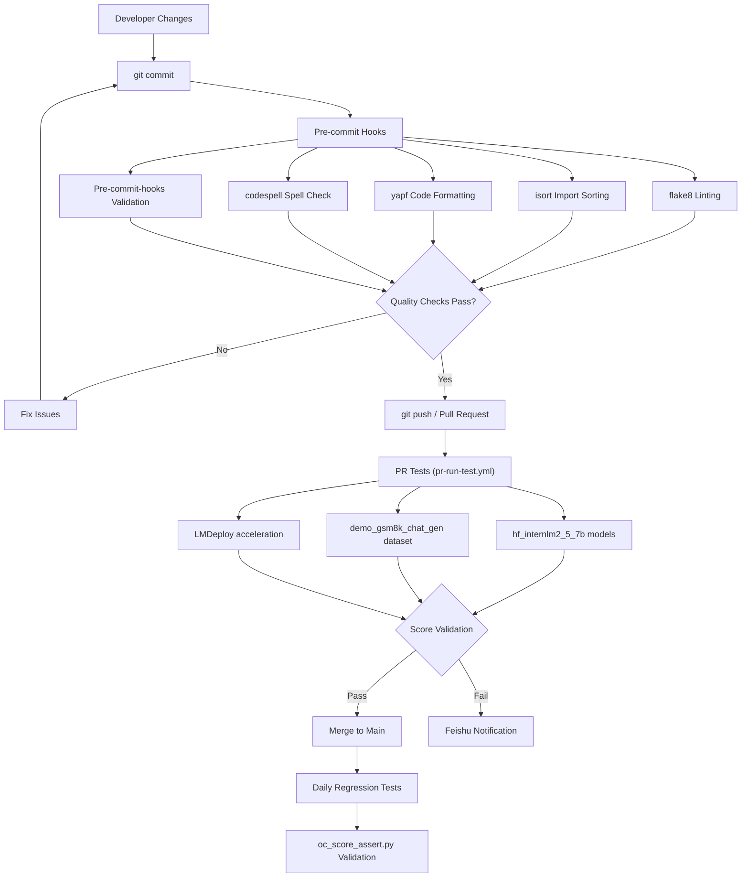
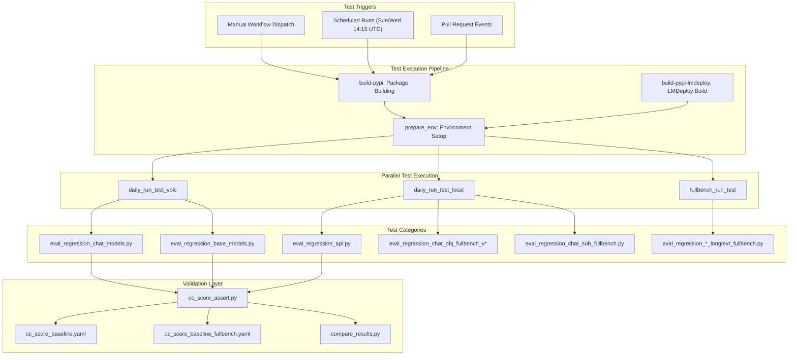
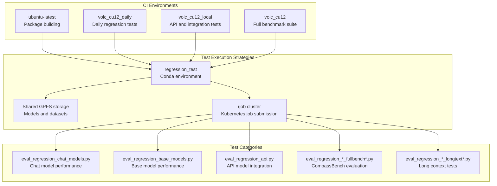
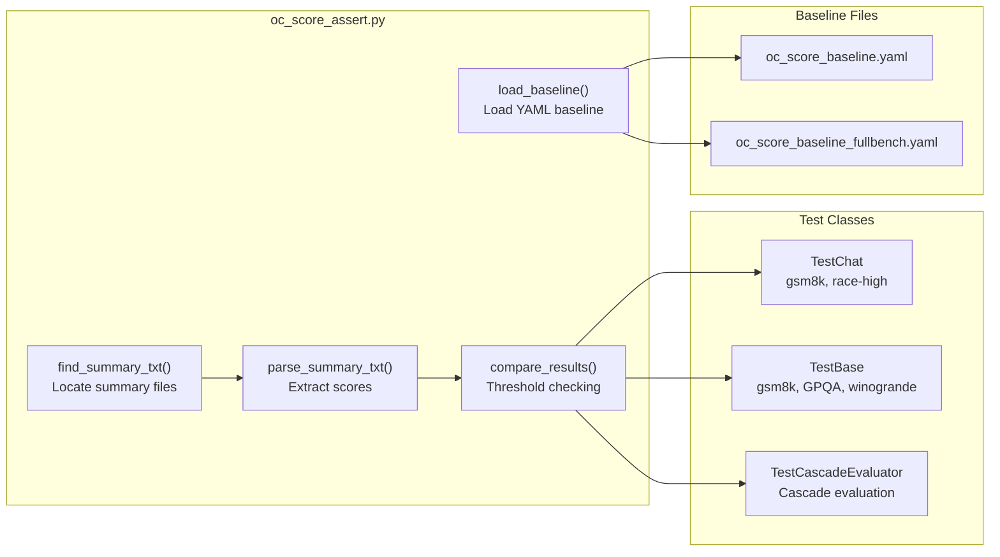
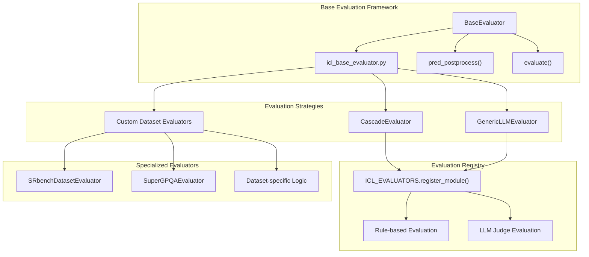

<!-- source: DeepWiki mcp.deepwiki.com · repo open-compass/opencompass · page 10 Developer Guide · fetched 2026-10-21 -->

# Developer Guide

<details>
<summary>Relevant source files</summary>

The following files were used as context for generating this wiki page:

- [.pre-commit-config-zh-cn.yaml](.pre-commit-config-zh-cn.yaml)
- [.pre-commit-config.yaml](.pre-commit-config.yaml)
- [docs/zh_cn/advanced_guides/compassbench_intro.md](docs/zh_cn/advanced_guides/compassbench_intro.md)
- [docs/zh_cn/advanced_guides/compassbench_v2_0.md](docs/zh_cn/advanced_guides/compassbench_v2_0.md)
- [opencompass/models/glm.py](opencompass/models/glm.py)
- [opencompass/models/interntrain.py](opencompass/models/interntrain.py)
- [opencompass/summarizers/subjective/compassbench_v13.py](opencompass/summarizers/subjective/compassbench_v13.py)
- [opencompass/summarizers/summarizer_pretrain.py](opencompass/summarizers/summarizer_pretrain.py)

</details>


This guide provides comprehensive information for developers contributing to or extending the OpenCompass evaluation platform. The guide is organized into three main sections:

1. **Contributing to OpenCompass**: How to add new components using the registry pattern
2. **Testing Framework and CI/CD**: Automated testing and continuous integration workflows
3. **Code Quality Standards**: Pre-commit hooks, formatting requirements, and best practices

For information about using OpenCompass as an end user, see [Getting Started](#2). For details about the core evaluation architecture, see [Core Architecture](#3). For model-specific integration details, see [Model Support](#4).

## Contributing to OpenCompass

OpenCompass is designed with extensibility in mind, using a registry-based plugin architecture that makes it easy to add new models, datasets, evaluators, and other components. This section explains the contribution workflow and how to extend OpenCompass with custom components.

### Development and Contribution Process



Sources: [.pre-commit-config.yaml:1-124](), [.github/workflows/pr-run-test.yml:1-123](), [.github/workflows/daily-run-test.yml:1-392]()

### Registry-Based Plugin Architecture

OpenCompass uses a registry pattern to manage all extensible components. This allows developers to add new functionality by simply decorating their classes and creating configuration files.

**Core Registry Components:**

The following registries are available in OpenCompass:

| Registry | Purpose | Location |
|----------|---------|----------|
| `MODELS` | Register model implementations | `opencompass.registry` |
| `LOAD_DATASET` | Register dataset loaders | `opencompass.registry` |
| `ICL_EVALUATORS` | Register evaluation methods | `opencompass.registry` |
| `ICL_INFERENCERS` | Register inference strategies | `opencompass.registry` |
| `ICL_PROMPT_TEMPLATES` | Register prompt templates | `opencompass.registry` |
| `TEXT_POSTPROCESSORS` | Register text postprocessors | `opencompass.registry` |
| `PARTITIONERS` | Register task partitioners | `opencompass.registry` |
| `RUNNERS` | Register execution runners | `opencompass.registry` |

**Adding a New Model:**

```python
from opencompass.models.base import BaseModel
from opencompass.registry import MODELS

@MODELS.register_module()
class MyCustomModel(BaseModel):
    def __init__(self, path: str, **kwargs):
        super().__init__(path=path, **kwargs)
        # Initialize your model
        
    def generate(self, inputs, max_out_len, **kwargs):
        # Implement generation logic
        pass
        
    def get_ppl(self, inputs, mask_length=None):
        # Implement perplexity calculation
        pass
```

Then create a configuration file in `opencompass/configs/models/`:

```python
from opencompass.models import MyCustomModel

models = [
    dict(
        type=MyCustomModel,
        path='path/to/model',
        max_seq_len=2048,
        # Other model-specific parameters
    )
]
```

Sources: [opencompass/models/interntrain.py:88-89](), [opencompass/models/glm.py:15-16](), [opencompass/registry/__init__.py]()

**Adding a New Dataset:**

```python
from opencompass.datasets.base import BaseDataset
from opencompass.registry import LOAD_DATASET

@LOAD_DATASET.register_module()
class MyCustomDataset(BaseDataset):
    @staticmethod
    def load(path: str, **kwargs):
        # Load dataset from path
        dataset = []
        # ... loading logic ...
        return dataset
```

Then create a dataset configuration in `opencompass/configs/datasets/`:

```python
from opencompass.openicl.icl_prompt_template import PromptTemplate
from opencompass.openicl.icl_retriever import ZeroRetriever
from opencompass.openicl.icl_inferencer import GenInferencer
from opencompass.openicl.icl_evaluator import AccEvaluator
from opencompass.datasets import MyCustomDataset

mycustom_reader_cfg = dict(
    input_columns=['question'],
    output_column='answer'
)

mycustom_infer_cfg = dict(
    prompt_template=dict(
        type=PromptTemplate,
        template=dict(
            round=[dict(role='HUMAN', prompt='Q: {question}\nA:')]
        )
    ),
    retriever=dict(type=ZeroRetriever),
    inferencer=dict(type=GenInferencer, max_out_len=256)
)

mycustom_eval_cfg = dict(
    evaluator=dict(type=AccEvaluator)
)

mycustom_datasets = [
    dict(
        type=MyCustomDataset,
        path='path/to/dataset',
        reader_cfg=mycustom_reader_cfg,
        infer_cfg=mycustom_infer_cfg,
        eval_cfg=mycustom_eval_cfg
    )
]
```

Sources: [opencompass/datasets/srbench.py:16-18](), [opencompass/configs/datasets/srbench/srbench_gen.py:1-57]()

**Adding a New Evaluator:**

```python
from opencompass.openicl.icl_evaluator import BaseEvaluator
from opencompass.registry import ICL_EVALUATORS

@ICL_EVALUATORS.register_module()
class MyCustomEvaluator(BaseEvaluator):
    def score(self, predictions, references):
        # Implement evaluation logic
        score_dict = {}
        # ... scoring logic ...
        return score_dict
```

Sources: [opencompass/openicl/icl_evaluator/icl_base_evaluator.py:45-60]()

### Component Integration Patterns

OpenCompass supports several integration patterns for different model types:

**Pattern 1: Standard HuggingFace Models**

For models compatible with HuggingFace transformers, use `HuggingFaceBaseModel` or `HuggingFacewithChatTemplate` as the base class. These handle tokenization, generation, and perplexity calculation automatically.

**Pattern 2: Custom Training Frameworks**

For models using custom training frameworks (e.g., InternTrain), implement a wrapper that:
1. Manages framework initialization in `_load_model()`
2. Handles tokenization in `_load_tokenizer()`
3. Implements `generate()` and `get_ppl()` methods
4. Uses `batch_encode()` and `batch_decode()` for efficient processing

The `InternTrain` class demonstrates this pattern with `InternTrainManager` for version compatibility:

Sources: [opencompass/models/interntrain.py:16-86](), [opencompass/models/interntrain.py:208-274]()

**Pattern 3: API-Based Models**

For API models, extend `BaseAPIModel` which provides:
- Token-based rate limiting with `TokenBucket`
- Automatic retry logic
- API key management
- Request/response parsing

**Pattern 4: Specialized Model Architectures**

For models with unique architectures (e.g., GLM-130B), implement specialized wrapper classes that handle:
- Custom tokenization schemes
- Special token handling (e.g., `[MASK]`, `[gMASK]`)
- Architecture-specific generation strategies

The `GLM130B` class demonstrates mask-based generation:

Sources: [opencompass/models/glm.py:16-120]()

## Testing Framework and CI/CD

OpenCompass implements a comprehensive testing framework that validates model performance against established baselines, ensures system reliability across different configurations, and automatically runs regression tests on every pull request and daily schedule.

### CI/CD Pipeline Architecture

**GitHub Actions Workflows:**

OpenCompass uses three main GitHub Actions workflows for continuous integration:

| Workflow | Trigger | Purpose |
|----------|---------|---------|
| `daily-run-test.yml` | Schedule (Sun/Wed 14:15 UTC), Manual | Comprehensive regression testing across multiple model configurations |
| `pr-run-test.yml` | Pull request events | Quick validation of PR changes with basic model and dataset tests |
| `build-pypi.yml` | Manual, Called by other workflows | Build and validate PyPI packages |

Sources: [.github/workflows/daily-run-test.yml:1-20](), [.github/workflows/pr-run-test.yml:1-10]()

### Regression Testing Architecture



Sources: [.github/workflows/daily-run-test.yml:78-392](), [.github/scripts/oc_score_assert.py:1-483]()

### Test Execution Environments

The CI system uses multiple execution environments to validate different aspects:

**Environment Configuration:**



Sources: [.github/workflows/daily-run-test.yml:32-76](), [.github/workflows/daily-run-test.yml:202-260]()

### Baseline Score Validation with oc_score_assert.py

The testing framework uses `oc_score_assert.py` for pytest-based validation that compares current evaluation results against established performance benchmarks.

**Core Validation Functions:**



**Validation Thresholds:**

The validation system supports different accuracy thresholds based on evaluation type:

| Model Type | Standard Metrics | Specialized Metrics | Code Metrics |
|------------|-----------------|---------------------|--------------|
| Standard | ±0.01 (exact) | N/A | N/A |
| Batch evaluation | ±3% | ±5% | ±10% |

**Key Validation Functions:**

- `load_baseline(baseline_file)`: Loads expected scores from YAML
- `find_summary_txt(path)`: Locates summary files in work directory
- `parse_summary_txt(file_path, target_model)`: Extracts model scores from summary
- `compare_results(summary_file, baseline_file, target_model, target_dataset)`: Compares against baseline with thresholds

Sources: [.github/scripts/oc_score_assert.py:1-483](), [.github/scripts/oc_score_baseline.yaml:1-45](), [.github/scripts/oc_score_baseline_fullbench.yaml:1-783]()

### Daily Regression Test Matrix

The daily regression tests run comprehensive evaluations across multiple dimensions:

**Test Matrix:**

| Test Config | Models | Datasets | Purpose |
|-------------|--------|----------|---------|
| `eval_regression_chat_models.py` | `hf_internlm2_5_7b_chat`, `hf_qwen2_5_7b_instruct`, `hf_llama3_1_8b_instruct` | `demo_gsm8k_chat_gen`, `race-high_*` | Chat model regression |
| `eval_regression_base_models.py` | `hf_internlm2_5_7b`, `hf_qwen2_5_7b`, `hf_llama3_1_8b` | `demo_gsm8k_gen`, `GPQA_diamond_*`, `race-high_*`, `winogrande_*` | Base model regression |
| `eval_regression_api.py` | `gpt-4o-mini`, `qwen-turbo` | `demo_gsm8k_chat_gen` | API integration |
| `eval_regression_*_fullbench_v*.py` | Multiple chat/base models | CompassBench v5-v8 datasets | Full benchmark suite |
| `eval_regression_*_longtext_fullbench.py` | Long context models | Long context benchmarks | Long text capability |

Sources: [.github/workflows/daily-run-test.yml:262-392]()

### Pull Request Testing

The `pr-run-test.yml` workflow provides fast validation for pull requests:

**PR Test Pipeline:**

1. **Package Building**: Build OpenCompass and LMDeploy packages
2. **Model Testing**: Test with `hf_internlm2_5_7b` model
3. **Dataset Testing**: Evaluate on `demo_gsm8k_chat_gen`
4. **Acceleration Testing**: Validate LMDeploy integration
5. **Score Validation**: Compare against baseline with `oc_score_assert.py`

Sources: [.github/workflows/pr-run-test.yml:1-123]()

### Notification System

The CI system integrates with Feishu (Lark) for real-time notifications:

**Notification Triggers:**
- Test failures with detailed error information
- Daily regression test completion
- Performance degradation alerts

Configuration is done through the `notify_to_feishu` script which sends formatted messages to configured webhooks.

Sources: [.github/workflows/daily-run-test.yml:380-392]()

## Model Integration Framework

OpenCompass provides a flexible framework for integrating new language models through standardized base classes and registration systems. The framework supports various model types including API-based models, local models, and specialized accelerated implementations.

### Base Model Architecture

The model integration system is built around the `BaseModel` class and uses a registry pattern for model discovery and instantiation.

**Key Base Classes:**
- `BaseModel`: Core model interface in [`opencompass/models/base.py`]()
- `BaseAPIModel`: API-based model implementations
- `InternTrain`: Specialized InternTrain model wrapper
- `GLM130B`: GLM model implementation

**Model Registration System:**
```python
@MODELS.register_module()
class CustomModel(BaseModel):
    def __init__(self, **kwargs):
        super().__init__(**kwargs)
        # Model-specific initialization
        
    def generate(self, inputs, max_out_len, **kwargs):
        # Generation implementation
        pass
```

The `InternTrain` model wrapper demonstrates advanced integration patterns, supporting both legacy and current InternTrain versions through the `InternTrainManager` factory pattern.

Sources: [opencompass/models/interntrain.py:88-206](), [opencompass/models/glm.py:15-118]()

## Evaluation System Architecture

OpenCompass implements a sophisticated evaluation framework that supports multiple evaluation paradigms including rule-based evaluation, LLM-as-judge, and cascade evaluation strategies.

### Core Evaluation Components



Sources: [opencompass/openicl/icl_evaluator/icl_base_evaluator.py:45-244](), [opencompass/evaluator/cascade_evaluator.py:12-342]()

### Cascade Evaluation Pattern

The `CascadeEvaluator` implements a sophisticated evaluation strategy that combines rule-based and LLM-based evaluation methods. This pattern is particularly useful for balancing evaluation accuracy with computational efficiency.

**Evaluation Flow:**
1. **Rule-based evaluation**: Fast initial assessment using deterministic rules
2. **LLM evaluation**: Expensive but accurate evaluation for failed or uncertain cases  
3. **Result aggregation**: Combines both evaluation methods for final scoring

The cascade evaluator supports both sequential (cascade) and parallel evaluation modes, allowing for different trade-offs between accuracy and computational cost.

**Key Methods:**
- `sample_score()`: Evaluates individual samples using rule-based methods
- `_get_llm_correctness()`: Interprets LLM judge responses 
- `score()`: Orchestrates the full evaluation pipeline

Sources: [opencompass/evaluator/cascade_evaluator.py:30-342]()

## Dataset Integration Framework

OpenCompass provides a structured framework for integrating evaluation datasets through the `BaseDataset` class and `LOAD_DATASET` registry. The system supports complex datasets with custom evaluation logic and preprocessing requirements.

### Dataset Implementation Patterns

**Standard Dataset Structure:**
```python
@LOAD_DATASET.register_module()
class CustomDataset(BaseDataset):
    @staticmethod
    def load(path: str, **kwargs):
        # Dataset loading logic
        return dataset
```

**Complex Dataset Example - SRbench:**
The `SRbenchDataset` demonstrates advanced dataset integration with custom evaluation logic for symbolic regression tasks. It implements specialized postprocessing, formula parsing, and mathematical evaluation.

**Key Features:**
- Custom data sampling with `change_data_to_prompt()`
- Mathematical expression parsing with `parse_formula()`
- Symbolic equivalence checking with `is_symbolically_equivalent()`
- Multi-metric evaluation (RMSE, R2, NMSE, SymbolicMatch)

Sources: [opencompass/datasets/srbench.py:16-281](), [opencompass/configs/datasets/srbench/srbench_gen.py:1-57]()

## Continuous Integration Pipeline

The OpenCompass CI/CD system implements a multi-stage validation pipeline that ensures code quality and performance consistency across different model and dataset configurations.

### Multi-Environment Testing Strategy

The CI system uses different execution environments to validate various aspects of the system:

**Environment Types:**
- `volc_cu12`: GPU cluster environment for intensive model testing
- `volc_cu12_daily`: Daily regression testing environment  
- `volc_cu12_local`: Local testing environment for API and integration tests
- `ubuntu-latest`: Standard CI environment for package building

**Test Categories:**
- **Command Line Interface Tests**: Validate CLI functionality with different model configurations
- **API Integration Tests**: Test RESTful API endpoints with live model servers
- **Regression Testing**: Compare current results against established baselines
- **Long Context Evaluation**: Specialized tests for long-context model capabilities

The system automatically triggers Feishu notifications for test failures, providing immediate feedback to the development team.

Sources: [.github/workflows/daily-run-test.yml:202-392](), [.github/scripts/eval_regression_api.py:1-61]()

## Extension and Customization Guidelines

### Adding New Models

To integrate a new model into OpenCompass:

1. **Implement Model Class**: Extend `BaseModel` or appropriate specialized base class
2. **Register with Registry**: Use `@MODELS.register_module()` decorator
3. **Add Configuration**: Create model config in `opencompass/configs/models/`
4. **Update Test Baselines**: Add baseline scores to validation YAML files
5. **Test Integration**: Run regression tests to validate performance

### Adding New Datasets  

To add a new evaluation dataset:

1. **Implement Dataset Class**: Extend `BaseDataset` with custom `load()` method
2. **Register Dataset**: Use `@LOAD_DATASET.register_module()` decorator  
3. **Create Evaluator**: Implement custom evaluator extending `BaseEvaluator`
4. **Add Configuration**: Create dataset config with reader, inference, and evaluation settings
5. **Update Baselines**: Add expected performance metrics to baseline files

### Adding New Evaluators

To implement custom evaluation logic:

1. **Extend BaseEvaluator**: Implement `score()` method with custom logic
2. **Register Evaluator**: Use `@ICL_EVALUATORS.register_module()` decorator
3. **Configure Postprocessing**: Implement `pred_postprocess()` for output cleaning
4. **Support Replication**: Use `evaluate()` method for multi-run validation
5. **Handle Edge Cases**: Implement robust error handling and logging

The framework supports sophisticated evaluation patterns including cascade evaluation, LLM-as-judge, and multi-metric assessment strategies.

Sources: [opencompass/datasets/supergpqa/supergpqa.py:28-200](), [opencompass/configs/datasets/supergpqa/supergpqa_cascade_gen_1545c1.py:1-129]()

---

