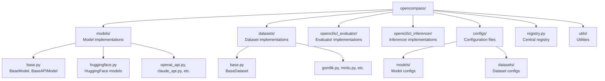
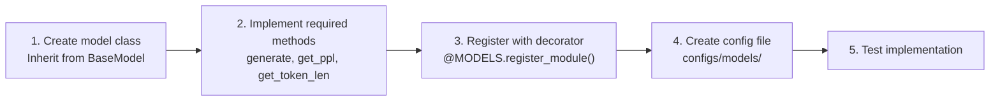
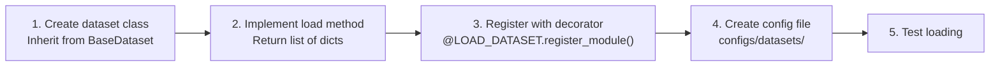
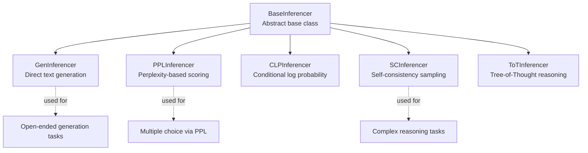
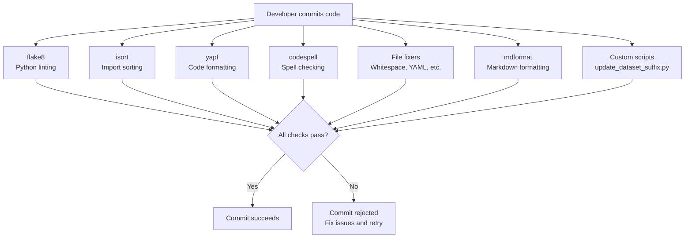
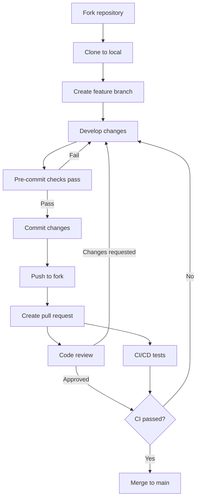

<!-- source: DeepWiki mcp.deepwiki.com · repo open-compass/opencompass · page 10.1 Contributing to OpenCompass · fetched 2026-10-21 -->

# Contributing to OpenCompass

<details>
<summary>Relevant source files</summary>

The following files were used as context for generating this wiki page:

- [.pre-commit-config-zh-cn.yaml](.pre-commit-config-zh-cn.yaml)
- [.pre-commit-config.yaml](.pre-commit-config.yaml)
- [README.md](README.md)
- [README_zh-CN.md](README_zh-CN.md)
- [docs/en/index.rst](docs/en/index.rst)
- [docs/en/notes/news.md](docs/en/notes/news.md)
- [docs/zh_cn/advanced_guides/compassbench_intro.md](docs/zh_cn/advanced_guides/compassbench_intro.md)
- [docs/zh_cn/advanced_guides/compassbench_v2_0.md](docs/zh_cn/advanced_guides/compassbench_v2_0.md)
- [docs/zh_cn/advanced_guides/evaluation_lmdeploy.md](docs/zh_cn/advanced_guides/evaluation_lmdeploy.md)
- [docs/zh_cn/index.rst](docs/zh_cn/index.rst)
- [docs/zh_cn/notes/news.md](docs/zh_cn/notes/news.md)
- [opencompass/models/glm.py](opencompass/models/glm.py)
- [opencompass/models/interntrain.py](opencompass/models/interntrain.py)
- [opencompass/summarizers/subjective/compassbench_v13.py](opencompass/summarizers/subjective/compassbench_v13.py)
- [opencompass/summarizers/summarizer_pretrain.py](opencompass/summarizers/summarizer_pretrain.py)

</details>


## Purpose and Scope

This document provides technical guidance for developers who want to contribute to the OpenCompass project. It covers the development workflow, registry-based plugin architecture, code quality standards, and the process for adding new components such as models, datasets, evaluators, and inferencers.

For general usage of OpenCompass, see the [Getting Started](#2) section. For information about the testing infrastructure, see [Testing Framework and CI/CD](#10.2). For code quality requirements, see [Code Quality Standards](#10.3).

## Development Environment Setup

### Initial Setup

To begin contributing to OpenCompass, you need to set up a development environment:

1. **Fork and Clone the Repository**
   ```bash
   git clone https://github.com/open-compass/opencompass opencompass
   cd opencompass
   ```

2. **Install OpenCompass in Editable Mode**
   ```bash
   pip install -e .
   # For full installation with all dependencies
   pip install -e ".[full]"
   ```

3. **Install Pre-commit Hooks**
   ```bash
   pip install pre-commit
   pre-commit install
   ```

The editable installation allows you to modify the source code and immediately see changes without reinstalling. The pre-commit hooks automatically enforce code quality standards before each commit.

Sources: [README.md:125-135](), [.pre-commit-config.yaml:1-124]()

### Directory Structure



**Understanding the Key Directories**

- `opencompass/models/`: Contains all model wrapper implementations
- `opencompass/datasets/`: Contains dataset loading and preprocessing logic
- `opencompass/openicl/icl_evaluator/`: Contains evaluation metric implementations
- `opencompass/openicl/icl_inferencer/`: Contains inference strategy implementations
- `opencompass/configs/`: Contains configuration files for models, datasets, and evaluation tasks
- `opencompass/registry.py`: Central registry for all pluggable components

Sources: [README.md:1-440]()

## Understanding the Registry System

OpenCompass uses a registry pattern to enable modular, extensible architecture. Components self-register using decorators, allowing users to easily add new models, datasets, evaluators, and inferencers without modifying core code.

### Registry Architecture Diagram

```mermaid
graph TB
    subgraph "Registry System"
        MODELS["MODELS Registry<br/>opencompass.registry"]
        LOAD_DATASET["LOAD_DATASET Registry<br/>opencompass.registry"]
        ICL_EVALUATORS["ICL_EVALUATORS Registry<br/>opencompass.registry"]
        ICL_INFERENCERS["ICL_INFERENCERS Registry<br/>opencompass.registry"]
    end
    
    subgraph "Model Implementations"
        BaseModel["BaseModel<br/>models/base.py"]
        HFModel["HuggingFaceBaseModel<br/>models/huggingface.py"]
        InternTrain["InternTrain<br/>models/interntrain.py"]
        GLM["GLM130B<br/>models/glm.py"]
        OpenAIAPI["OpenAI<br/>models/openai_api.py"]
    end
    
    subgraph "Dataset Implementations"
        BaseDataset["BaseDataset<br/>datasets/base.py"]
        GSM8K["GSM8KDataset<br/>datasets/gsm8k.py"]
        MMLU["MMLUDataset<br/>datasets/mmlu.py"]
    end
    
    subgraph "Evaluator Implementations"
        BaseEvaluator["BaseEvaluator<br/>openicl/icl_evaluator/icl_base_evaluator.py"]
        AccEvaluator["AccEvaluator<br/>openicl/icl_evaluator/icl_acc_evaluator.py"]
        LMEvaluator["LMEvaluator<br/>openicl/icl_evaluator/icl_lm_evaluator.py"]
    end
    
    subgraph "Inferencer Implementations"
        GenInferencer["GenInferencer<br/>openicl/icl_inferencer/icl_gen_inferencer.py"]
        PPLInferencer["PPLInferencer<br/>openicl/icl_inferencer/icl_ppl_inferencer.py"]
    end
    
    HFModel -->|"@MODELS.register_module()"| MODELS
    InternTrain -->|"@MODELS.register_module()"| MODELS
    GLM -->|"@MODELS.register_module(name=['GLM-130B'])"| MODELS
    OpenAIAPI -->|"@MODELS.register_module()"| MODELS
    
    GSM8K -->|"@LOAD_DATASET.register_module()"| LOAD_DATASET
    MMLU -->|"@LOAD_DATASET.register_module()"| LOAD_DATASET
    
    AccEvaluator -->|"@ICL_EVALUATORS.register_module()"| ICL_EVALUATORS
    LMEvaluator -->|"@ICL_EVALUATORS.register_module()"| ICL_EVALUATORS
    
    GenInferencer -->|"@ICL_INFERENCERS.register_module()"| ICL_INFERENCERS
    PPLInferencer -->|"@ICL_INFERENCERS.register_module()"| ICL_INFERENCERS
```



**Registry Types and Their Purposes**

| Registry | Purpose | Import Path |
|----------|---------|-------------|
| `MODELS` | Register model wrappers | `from opencompass.registry import MODELS` |
| `LOAD_DATASET` | Register dataset loaders | `from opencompass.registry import LOAD_DATASET` |
| `ICL_EVALUATORS` | Register evaluation metrics | `from opencompass.registry import ICL_EVALUATORS` |
| `ICL_INFERENCERS` | Register inference strategies | `from opencompass.registry import ICL_INFERENCERS` |

Sources: [opencompass/models/interntrain.py:88-89](), [opencompass/models/glm.py:8-15]()

### Registration Pattern Example

All components follow a standard registration pattern using decorators:

```python
from opencompass.registry import MODELS
from opencompass.models.base import BaseModel

@MODELS.register_module()
class MyCustomModel(BaseModel):
    def __init__(self, path, **kwargs):
        super().__init__(path=path, **kwargs)
        # Initialize your model
    
    def generate(self, inputs, max_out_len):
        # Implement generation logic
        pass
    
    def get_ppl(self, inputs, mask_length=None):
        # Implement perplexity calculation
        pass
```

The `@MODELS.register_module()` decorator automatically registers the class in the global `MODELS` registry, making it available for configuration-based instantiation.

Sources: [opencompass/models/interntrain.py:88-89](), [opencompass/models/glm.py:15-16]()

## Contributing New Components

### Adding a New Model

To add a new model to OpenCompass, you need to create a model wrapper class and register it in the `MODELS` registry.

#### Model Implementation Workflow



**Step 1: Inherit from the Base Class**

Choose the appropriate base class:
- `BaseModel` for local models (HuggingFace, custom implementations)
- `BaseAPIModel` for API-based models (OpenAI, Claude, etc.)

**Step 2: Implement Required Methods**

All models must implement the following interface:

| Method | Signature | Purpose |
|--------|-----------|---------|
| `generate()` | `generate(inputs: List[str], max_out_len: int) -> List[str]` | Generate text completions |
| `get_ppl()` | `get_ppl(inputs: List[str], mask_length: Optional[List[int]]) -> List[float]` | Calculate perplexity scores |
| `get_token_len()` | `get_token_len(prompt: str) -> int` | Get token count for input |

**Example: Adding a Local Model**

```python
from opencompass.models.base import BaseModel, LMTemplateParser
from opencompass.registry import MODELS

@MODELS.register_module()
class MyLocalModel(BaseModel):
    """Custom local model wrapper.
    
    Args:
        path (str): Path to model checkpoint
        max_seq_len (int): Maximum sequence length
        meta_template (Dict): Prompt template configuration
    """
    
    def __init__(self, path, max_seq_len=2048, meta_template=None, **kwargs):
        super().__init__(path=path, max_seq_len=max_seq_len, 
                         meta_template=meta_template)
        # Load your model
        self.model = self._load_model(path)
        self.tokenizer = self._load_tokenizer(path)
        self.template_parser = LMTemplateParser(meta_template)
    
    def generate(self, inputs: List[str], max_out_len: int) -> List[str]:
        # Tokenize inputs
        tokens = self.tokenizer(inputs)
        # Generate outputs
        outputs = self.model.generate(tokens, max_length=max_out_len)
        # Decode and return
        return self.tokenizer.decode(outputs)
    
    def get_ppl(self, inputs: List[str], mask_length=None) -> List[float]:
        # Calculate perplexity
        logits = self.model(self.tokenizer(inputs))
        # Compute cross-entropy loss
        return self._compute_ppl(logits, mask_length)
    
    def get_token_len(self, prompt: str) -> int:
        return len(self.tokenizer.encode(prompt))
```

**Step 3: Create Configuration File**

Create a configuration file in `configs/models/` to make your model easily accessible:

```python
# configs/models/my_model.py
from opencompass.models import MyLocalModel

models = [
    dict(
        type=MyLocalModel,
        abbr='my_model_7b',
        path='path/to/my_model',
        max_seq_len=4096,
        max_out_len=1024,
        batch_size=16,
        run_cfg=dict(num_gpus=1),
    )
]
```

Sources: [opencompass/models/base.py:1-500](), [opencompass/models/interntrain.py:88-180](), [opencompass/models/glm.py:15-120]()

### Adding a New Dataset

Datasets are loaded through the `LOAD_DATASET` registry and must inherit from `BaseDataset`.

#### Dataset Implementation Workflow



**Dataset Interface Requirements**

```python
from opencompass.registry import LOAD_DATASET
from opencompass.datasets import BaseDataset

@LOAD_DATASET.register_module()
class MyCustomDataset(BaseDataset):
    """Custom dataset loader.
    
    Args:
        path (str): Path to dataset files
        name (str): Dataset subset name
    """
    
    def load(self, path: str, name: str):
        """Load dataset and return list of samples.
        
        Returns:
            List[Dict]: Each dict should contain:
                - 'question': The input text
                - 'answer': The expected output (for evaluation)
                - Other task-specific fields
        """
        # Load your dataset
        data = self._load_data(path, name)
        
        # Format into expected structure
        dataset = []
        for item in data:
            dataset.append({
                'question': item['input'],
                'answer': item['output'],
                'category': item.get('category', 'default'),
            })
        
        return dataset
```

**Dataset Configuration Example**

```python
# configs/datasets/my_dataset/my_dataset_gen.py
from opencompass.datasets import MyCustomDataset
from opencompass.openicl.icl_evaluator import AccEvaluator
from opencompass.openicl.icl_inferencer import GenInferencer

my_dataset_datasets = [
    dict(
        type=MyCustomDataset,
        abbr='my_dataset',
        path='./data/my_dataset',
        name='default',
        reader_cfg=dict(
            input_columns=['question'],
            output_column='answer',
        ),
        infer_cfg=dict(
            inferencer=dict(type=GenInferencer),
            prompt_template=dict(
                type=PromptTemplate,
                template=dict(round=[
                    dict(role='HUMAN', prompt='Question: {question}\nAnswer:'),
                ])
            ),
        ),
        eval_cfg=dict(
            evaluator=dict(type=AccEvaluator),
        ),
    )
]
```

**Key Configuration Fields**

| Field | Purpose |
|-------|---------|
| `type` | The registered dataset class |
| `abbr` | Short name used in results |
| `path` | Path to dataset files |
| `reader_cfg` | Specifies input/output columns |
| `infer_cfg` | Inference strategy and prompt template |
| `eval_cfg` | Evaluation metrics |

Sources: [README.md:224-244]()

### Adding a New Evaluator

Evaluators compute metrics from model predictions and ground truth answers.

#### Evaluator Implementation

```python
from opencompass.registry import ICL_EVALUATORS
from opencompass.openicl.icl_evaluator import BaseEvaluator

@ICL_EVALUATORS.register_module()
class MyCustomEvaluator(BaseEvaluator):
    """Custom evaluator for specific metrics.
    
    Args:
        metric_name (str): Name of the metric to compute
    """
    
    def __init__(self, metric_name='custom_score'):
        self.metric_name = metric_name
    
    def score(self, predictions, references):
        """Compute evaluation scores.
        
        Args:
            predictions (List): Model predictions
            references (List): Ground truth answers
            
        Returns:
            Dict: Metrics dictionary
        """
        scores = []
        for pred, ref in zip(predictions, references):
            score = self._compute_score(pred, ref)
            scores.append(score)
        
        return {
            self.metric_name: sum(scores) / len(scores) * 100
        }
```

**Integration with Dataset Config**

```python
eval_cfg=dict(
    evaluator=dict(
        type=MyCustomEvaluator,
        metric_name='my_metric'
    ),
    pred_postprocessor=dict(type='my_postprocessor'),
)
```

Sources: [opencompass/summarizers/summarizer_pretrain.py:18-88]()

### Adding a New Inferencer

Inferencers define how models are queried during evaluation (e.g., generation, perplexity scoring).

#### Common Inferencer Types



**Custom Inferencer Implementation**

```python
from opencompass.registry import ICL_INFERENCERS
from opencompass.openicl.icl_inferencer import BaseInferencer

@ICL_INFERENCERS.register_module()
class MyCustomInferencer(BaseInferencer):
    """Custom inference strategy.
    
    Args:
        strategy (str): Inference strategy name
    """
    
    def __init__(self, strategy='default', **kwargs):
        super().__init__(**kwargs)
        self.strategy = strategy
    
    def inference(self, retriever, ice_template, prompt_template, 
                  model, max_out_len):
        """Execute inference with custom strategy.
        
        Args:
            retriever: In-context example retriever
            ice_template: In-context example template
            prompt_template: Prompt template
            model: Model wrapper instance
            max_out_len: Maximum output length
            
        Returns:
            List: Model predictions
        """
        # Build prompts with in-context examples
        prompts = self._build_prompts(retriever, ice_template, prompt_template)
        
        # Apply custom inference strategy
        predictions = []
        for prompt in prompts:
            pred = model.generate([prompt], max_out_len)[0]
            predictions.append(pred)
        
        return predictions
```

Sources: [README.md:177-268]()

## Code Quality Standards

OpenCompass enforces strict code quality standards through automated pre-commit hooks.

### Pre-commit Hook Configuration



**Code Quality Tools**

| Tool | Purpose | Configuration |
|------|---------|---------------|
| `flake8` | Linting (PEP 8 compliance) | [.pre-commit-config.yaml:22-30]() |
| `isort` | Import statement sorting | [.pre-commit-config.yaml:31-39]() |
| `yapf` | Code formatting | [.pre-commit-config.yaml:40-48]() |
| `codespell` | Spell checking in code/docs | [.pre-commit-config.yaml:49-59]() |
| `trailing-whitespace` | Remove trailing whitespace | [.pre-commit-config.yaml:63-68]() |
| `end-of-file-fixer` | Ensure newline at EOF | [.pre-commit-config.yaml:70-75]() |
| `mdformat` | Markdown formatting | [.pre-commit-config.yaml:83-92]() |

### Setting Up Pre-commit Hooks

```bash
# Install pre-commit
pip install pre-commit

# Install hooks for the repository
pre-commit install

# Run hooks manually on all files
pre-commit run --all-files

# Run specific hook
pre-commit run flake8 --all-files
```

### Excluded Directories

Some directories are excluded from certain checks:

- `configs/` - Configuration files are excluded from flake8, isort, yapf
- `examples/` - Example scripts are excluded from formatting checks
- `tests/data/` - Test data is excluded from all checks
- `opencompass/models/internal/` - Internal implementations are excluded

Sources: [.pre-commit-config.yaml:1-124](), [.pre-commit-config-zh-cn.yaml:1-123]()

### Code Style Guidelines

**Import Organization**

```python
# Standard library imports
import os
import sys
from typing import Dict, List, Optional

# Third-party imports
import numpy as np
import torch
from mmengine import Config

# Local imports
from opencompass.models.base import BaseModel
from opencompass.registry import MODELS
from opencompass.utils.logging import get_logger
```

**Function Documentation**

```python
def generate(self, inputs: List[str], max_out_len: int) -> List[str]:
    """Generate results given a list of inputs.
    
    Args:
        inputs (List[str]): A list of input strings.
        max_out_len (int): The maximum length of the output.
        
    Returns:
        List[str]: A list of generated strings.
    """
    pass
```

Sources: [opencompass/models/interntrain.py:1-14](), [opencompass/models/glm.py:1-13]()

## Pull Request Process

### Contribution Workflow



### Pull Request Guidelines

**Before Submitting**

1. Ensure all pre-commit hooks pass locally
2. Add tests for new functionality
3. Update documentation if adding new features
4. Verify your changes work with existing examples

**PR Description Template**

```markdown
## Description
Brief description of changes

## Type of Change
- [ ] Bug fix
- [ ] New feature (model/dataset/evaluator)
- [ ] Documentation update
- [ ] Code refactoring

## Testing
- [ ] Pre-commit hooks pass
- [ ] Added tests for new functionality
- [ ] Tested with existing configurations

## Checklist
- [ ] Code follows project style guidelines
- [ ] Documentation updated
- [ ] No breaking changes (or documented)
```

**Review Process**

1. Automated CI/CD checks run on all PRs
2. At least one maintainer review required
3. All discussions must be resolved
4. Tests must pass before merging

Sources: [README.md:387-390](), [README_zh-CN.md:380-383]()

## Component Registration Reference

### Complete Registration Examples

**Model Registration**

```python
from opencompass.models.base import BaseModel
from opencompass.registry import MODELS

@MODELS.register_module()
class MyModel(BaseModel):
    pass

# Or with custom name
@MODELS.register_module(name=['MyModel', 'my_custom_model'])
class MyModel(BaseModel):
    pass
```

**Dataset Registration**

```python
from opencompass.datasets import BaseDataset
from opencompass.registry import LOAD_DATASET

@LOAD_DATASET.register_module()
class MyDataset(BaseDataset):
    @staticmethod
    def load(path, name):
        return dataset_list
```

**Evaluator Registration**

```python
from opencompass.openicl.icl_evaluator import BaseEvaluator
from opencompass.registry import ICL_EVALUATORS

@ICL_EVALUATORS.register_module()
class MyEvaluator(BaseEvaluator):
    def score(self, predictions, references):
        return {'metric': score}
```

**Inferencer Registration**

```python
from opencompass.openicl.icl_inferencer import BaseInferencer
from opencompass.registry import ICL_INFERENCERS

@ICL_INFERENCERS.register_module()
class MyInferencer(BaseInferencer):
    def inference(self, retriever, ice_template, prompt_template, 
                  model, max_out_len):
        return predictions
```

### Registry to Code Entity Mapping

| Registry Name | Base Class Location | Config Location | Usage Context |
|--------------|---------------------|-----------------|---------------|
| `MODELS` | [opencompass/models/base.py]() | [configs/models/]() | Model wrappers |
| `LOAD_DATASET` | [opencompass/datasets/base.py]() | [configs/datasets/]() | Dataset loading |
| `ICL_EVALUATORS` | [opencompass/openicl/icl_evaluator/icl_base_evaluator.py]() | Dataset `eval_cfg` | Metric computation |
| `ICL_INFERENCERS` | [opencompass/openicl/icl_inferencer/icl_base_inferencer.py]() | Dataset `infer_cfg` | Inference strategies |

Sources: [opencompass/models/interntrain.py:88-89](), [opencompass/models/glm.py:15-16]()

## Testing Your Contributions

### Local Testing

Before submitting a PR, test your changes locally:

```bash
# Test with a simple dataset
opencompass --models your_model --datasets demo_gsm8k_chat_gen

# Test with configuration file
opencompass configs/eval_your_feature.py
```

### Adding Tests

If you're adding new functionality, include corresponding tests. The CI/CD pipeline will automatically run regression tests on all PRs.

For more details on the testing infrastructure, see [Testing Framework and CI/CD](#10.2).

Sources: [README.md:177-268]()

## Additional Resources

- **GitHub Repository**: https://github.com/open-compass/opencompass
- **Documentation**: https://opencompass.readthedocs.io
- **Issue Tracker**: https://github.com/open-compass/opencompass/issues
- **Discord Community**: https://discord.gg/KKwfEbFj7U

For questions about contributing, please open an issue or join the Discord community.

Sources: [README.md:1-30](), [README_zh-CN.md:1-30]()

---

