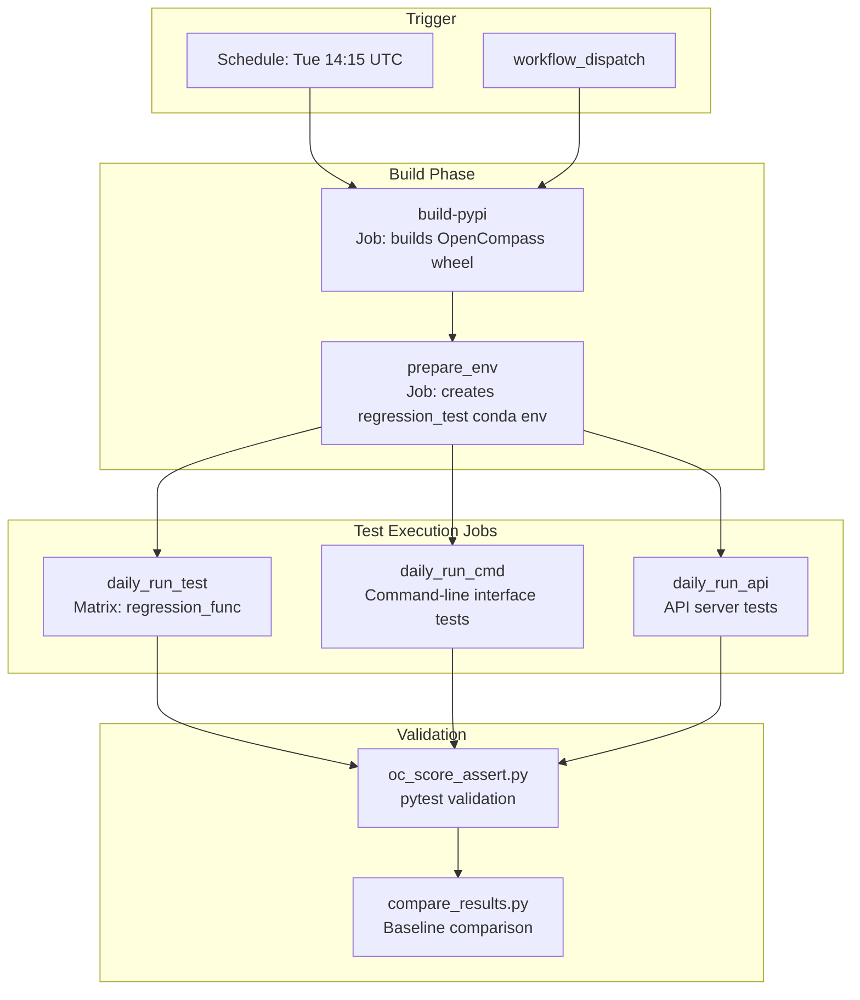
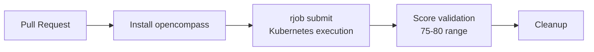
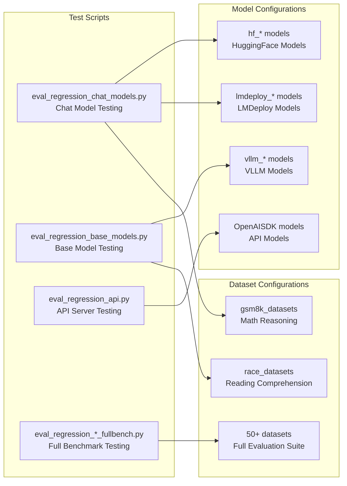
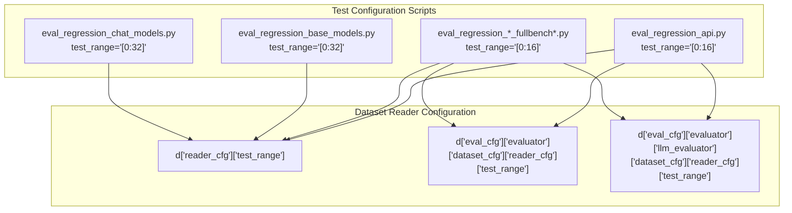
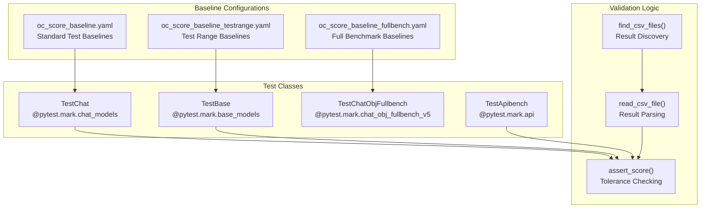
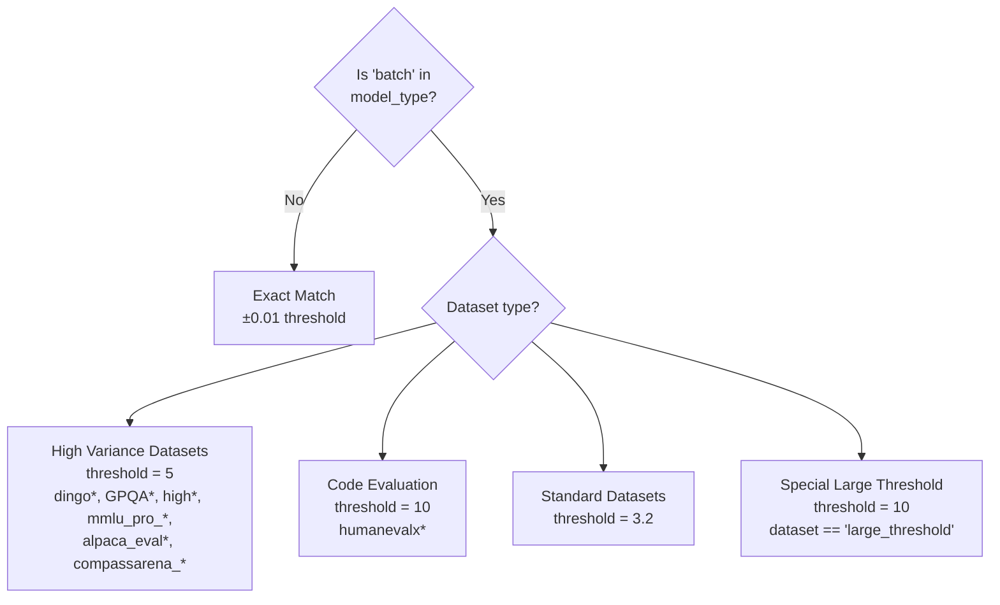
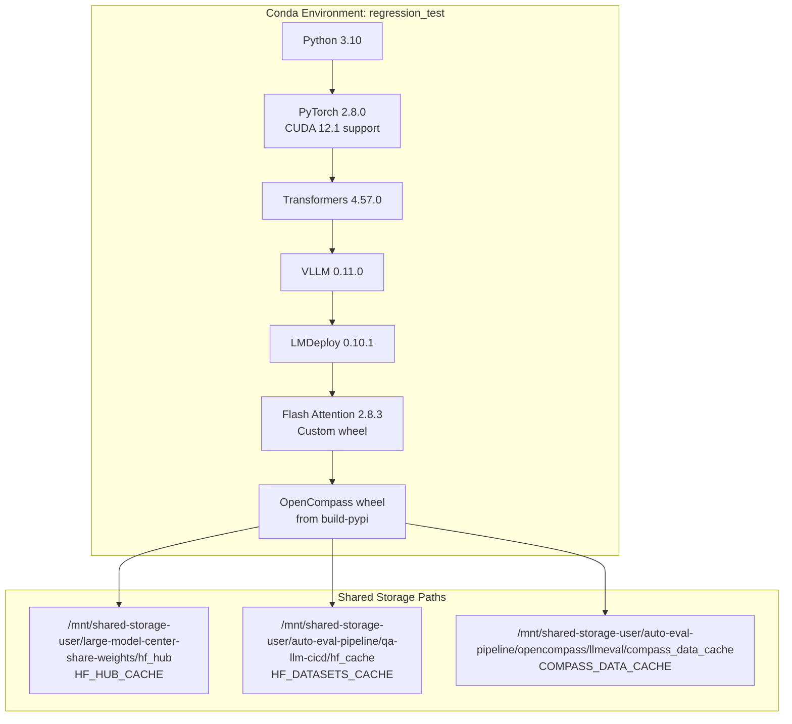
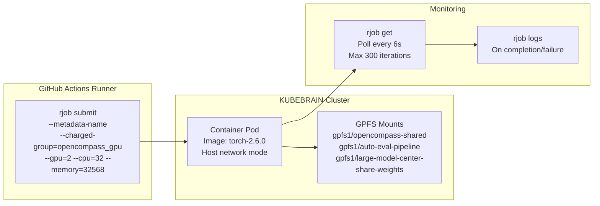
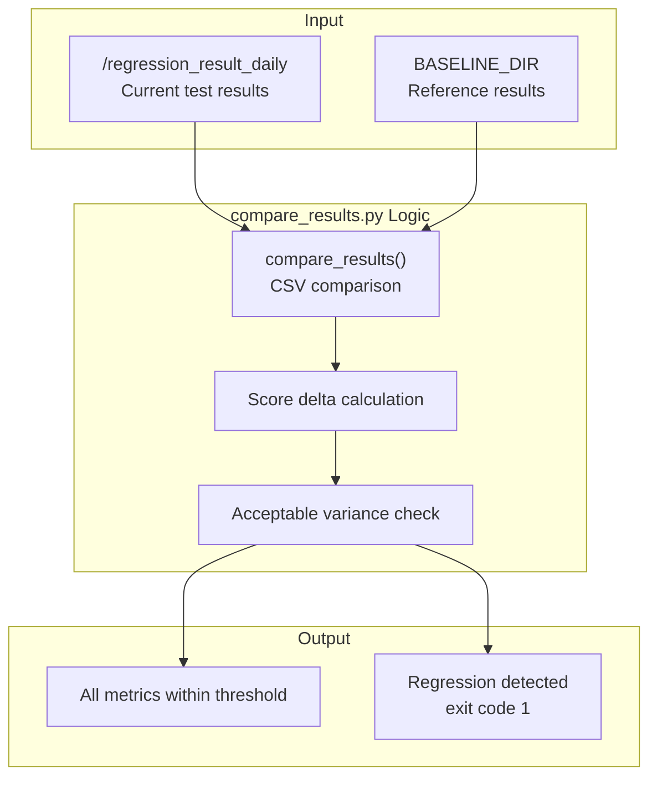

<!-- source: DeepWiki mcp.deepwiki.com · repo open-compass/opencompass · page 10.2 Testing Framework and CI/CD · fetched 2026-10-21 -->

# Testing Framework and CI/CD

<details>
<summary>Relevant source files</summary>

The following files were used as context for generating this wiki page:

- [.github/scripts/eval_regression_api.py](.github/scripts/eval_regression_api.py)
- [.github/scripts/eval_regression_base_fullbench.py](.github/scripts/eval_regression_base_fullbench.py)
- [.github/scripts/eval_regression_base_longtext_fullbench.py](.github/scripts/eval_regression_base_longtext_fullbench.py)
- [.github/scripts/eval_regression_base_models.py](.github/scripts/eval_regression_base_models.py)
- [.github/scripts/eval_regression_chat_longtext_fullbench.py](.github/scripts/eval_regression_chat_longtext_fullbench.py)
- [.github/scripts/eval_regression_chat_models.py](.github/scripts/eval_regression_chat_models.py)
- [.github/scripts/eval_regression_chat_obj_fullbench_other.py](.github/scripts/eval_regression_chat_obj_fullbench_other.py)
- [.github/scripts/eval_regression_chat_obj_fullbench_v5.py](.github/scripts/eval_regression_chat_obj_fullbench_v5.py)
- [.github/scripts/eval_regression_chat_obj_fullbench_v6.py](.github/scripts/eval_regression_chat_obj_fullbench_v6.py)
- [.github/scripts/eval_regression_chat_obj_fullbench_v7.py](.github/scripts/eval_regression_chat_obj_fullbench_v7.py)
- [.github/scripts/eval_regression_chat_sub_fullbench.py](.github/scripts/eval_regression_chat_sub_fullbench.py)
- [.github/scripts/oc_score_assert.py](.github/scripts/oc_score_assert.py)
- [.github/scripts/oc_score_baseline.yaml](.github/scripts/oc_score_baseline.yaml)
- [.github/scripts/oc_score_baseline_fullbench.yaml](.github/scripts/oc_score_baseline_fullbench.yaml)
- [.github/scripts/oc_score_baseline_testrange.yaml](.github/scripts/oc_score_baseline_testrange.yaml)
- [.github/workflows/daily-run-test.yml](.github/workflows/daily-run-test.yml)
- [.github/workflows/pr-run-test.yml](.github/workflows/pr-run-test.yml)

</details>


This document covers OpenCompass's automated testing framework and continuous integration/continuous deployment (CI/CD) system. The testing framework ensures evaluation quality through regression testing, score validation, and automated quality checks across multiple model backends and datasets.

For information about manual evaluation and dataset creation, see [Creating Custom Datasets](#5.3). For details about the evaluation pipeline itself, see [Evaluation Pipeline](#3.1).

## CI/CD Pipeline Architecture

OpenCompass uses GitHub Actions to orchestrate comprehensive testing across multiple dimensions: model types, inference backends, and dataset categories. The pipeline consists of two main workflows that validate both code changes and system stability.

### Workflow Structure

The testing infrastructure consists of two primary workflows with distinct execution patterns:

**Daily Workflow (daily-run-test.yml)**


**PR Workflow (pr-run-test.yml)**


**Sources:** [.github/workflows/daily-run-test.yml:1-56](), [.github/workflows/pr-run-test.yml:1-112]()

### Test Matrix Strategy

The CI/CD system uses GitHub Actions matrix strategy to parallelize test execution across multiple regression functions:

**Daily Test Matrix (daily_run_test job)**

| regression_func | Test Focus | Key Datasets | Models |
|-----------------|-----------|--------------|--------|
| `chat_models` | Chat model regression | GSM8K, RACE | Qwen3-0.6B-FP8 (HF, TurboMind, VLLM) |
| `base_models` | Base model regression | GSM8K, GPQA, RACE, Winogrande | Qwen3-8B-Base (HF, TurboMind, VLLM) |
| `chat_obj_fullbench_v5` | CompassBench v1.1 objective | 30+ datasets including IFEval, MMLU, GSM8K | Qwen3-8B (HF, TurboMind) |
| `chat_obj_fullbench_v6` | Enhanced objective suite | AIME, DROP, GPQA, MathBench, SuperGPQA | Qwen3-8B (HF, TurboMind) |
| `chat_obj_fullbench_v7` | Domain-specific benchmarks | ChemBench, OlympiadBench, PhyBench, SciCode | Qwen3-8B (HF, TurboMind) |
| `chat_obj_fullbench_v8` | Bio/Chemistry specialized | DNA, RNA, Protein benchmarks | Qwen3-8B (HF, TurboMind) |
| `chat_obj_fullbench_other` | Special datasets | C-MHChem, CPsyExam, MaScQA, UGPhysics | Qwen3-8B (HF, TurboMind) |
| `chat_sub_fullbench` | Subjective evaluation | AlignBench, ArenaHard, MTBench, WildBench | Qwen3-8B (HF, TurboMind) |
| `base_fullbench` | Base model comprehensive | MMLU, CMMLU, BBH, GaokaoBench, MathBench | Qwen3-8B-Base (HF, TurboMind) |
| `base_longtext_fullbench` | Long context testing | NeedleBench, LongBench | Qwen3-8B-Base (TurboMind) |
| `chat_longtext_fullbench` | Long context chat | BabiLong, RULER, NeedleBench | Qwen3-8B (TurboMind with YARN) |

**Command-Line Tests (daily_run_cmd job)**

Five test cases validating different CLI invocation patterns, each testing GSM8K and RACE datasets.

**API Tests (daily_run_api job)**

| Test Configuration | Purpose | Key Parameters |
|-------------------|---------|----------------|
| `lmdeploy-api-test` | Standard API serving | `batch_size=128`, `temperature=0.01` |
| `lmdeploy-api-streaming-test` | Streaming response | `stream=True` |
| `lmdeploy-api-streaming-test-chunk` | Chunked streaming | `stream_chunk_size=10` |
| `lmdeploy-api-test-maxlen` | Maximum length handling | `max_out_len=8092` |
| `lmdeploy-api-test-maxlen-mid` | Mid-length truncation | `mode='mid'` |
| `lmdeploy-api-test-nothink` | Disable reasoning mode | `enable_thinking=False` |
| `lmdeploy-api-test-chat-template` | Custom chat template | System prompt injection |

**Sources:** [.github/workflows/daily-run-test.yml:140-143](), [.github/scripts/eval_regression_chat_models.py:1-70](), [.github/scripts/eval_regression_api.py:35-168]()

## Regression Testing Framework

The regression testing framework systematically evaluates model performance across datasets to detect regressions and ensure consistent results. Each test category focuses on specific model types and evaluation scenarios.

### Test Configuration System



**Sources:** [.github/scripts/eval_regression_chat_models.py:4-13](), [.github/scripts/eval_regression_base_models.py:4-12](), [.github/scripts/eval_regression_api.py:6-11]()

### Test Range Management

All regression tests limit evaluation to dataset subsets to ensure timely completion:

**Test Range Configuration by Test Type**



**Test Range Application:**
- Basic regression tests (chat/base models): 32 samples per dataset
- Full benchmark tests: 16 samples per dataset
- LLM judge evaluator datasets: 16 samples per dataset
- API tests: 16 samples per dataset

This ensures statistical validity while keeping test execution under 4 hours per job.

**Sources:** [.github/scripts/eval_regression_chat_models.py:54-55](), [.github/scripts/eval_regression_base_fullbench.py:220-221](), [.github/scripts/eval_regression_api.py:170-179](), [.github/scripts/eval_regression_chat_obj_fullbench_v7.py:137-146]()

## Score Validation System

The score validation system uses pytest to automatically verify that evaluation results match expected baselines within acceptable tolerances. This prevents regressions and ensures evaluation stability.

### Baseline Management



**Sources:** [.github/scripts/oc_score_assert.py:24-51](), [.github/scripts/oc_score_assert.py:61-98]()

### Tolerance Thresholds

The `assert_score()` function in [.github/scripts/oc_score_assert.py:339-381]() applies adaptive tolerance thresholds:

**Threshold Logic**


**Threshold Rationale:**
- **±0.01 (Exact)**: Non-batch evaluations with deterministic outputs
- **±3.2**: Standard batch evaluations with sampling variance
- **±5**: Datasets with inherent high variance (knowledge QA, complex reasoning)
- **±10**: Code execution and multi-language benchmarks with stochastic outputs

**Sources:** [.github/scripts/oc_score_assert.py:339-381]()

## Test Execution and Infrastructure

### Environment Setup

The `prepare_env` job creates an isolated conda environment with pinned dependencies:

**Environment Configuration**


**Key Environment Variables:**
- `VLLM_WORKER_MULTIPROC_METHOD=spawn` - Process spawning method
- `HF_DATASETS_OFFLINE=1` - Offline mode for datasets
- `TRANSFORMERS_OFFLINE=1` - Offline mode for models
- Package installation uses private PyPI mirror: `https://pkg.pjlab.org.cn/repository/pypi-proxy/simple/`

**Sources:** [.github/workflows/daily-run-test.yml:85-136](), [.github/workflows/daily-run-test.yml:34-56]()

### RJob Cluster Integration

Tests execute on a Kubernetes cluster via `rjob`, a job submission system for the KUBEBRAIN infrastructure:

**RJob Execution Pattern**


The rjob configuration dynamically injects the task ID for tracking:
```python
# From rjob.py customization
sed -i "s/TASK_ID='none'/TASK_ID='${{ github.run_id }}'/g" rjob.py
```

**Sources:** [.github/workflows/pr-run-test.yml:58-71](), [.github/workflows/daily-run-test.yml:224-235](), [.github/workflows/daily-run-test.yml:160-163]()

### Test Execution Timeouts

| Job Type | Timeout | Runner | Purpose |
|----------|---------|--------|---------|
| `build-pypi` | Default | ubuntu-latest | Build wheel artifacts |
| `prepare_env` | 180 min | yidian_cu12_daily | Setup conda environment |
| `daily_run_test` | 240 min | yidian_cu12_daily | Benchmark evaluation |
| `daily_run_cmd` | 240 min | yidian_cu12_daily | CLI tests via rjob |
| `daily_run_api` | 240 min | yidian_cu12_daily | API server tests via rjob |
| `pr_run_test` | 45 min | yidian_cu12 | Quick validation |

**Sources:** [.github/workflows/daily-run-test.yml:59-89](), [.github/workflows/pr-run-test.yml:37-39]()

## Result Comparison and Validation

### Automated Result Comparison

The `compare_results.py` script compares current results against baseline results to detect regressions:

**Comparison Workflow**


**Invocation Pattern:**
```bash
python .github/scripts/compare_results.py compare_results \
  $REPORT_ROOT/${{ github.run_id }}/${{matrix.regression_func}} \
  $REPORT_ROOT/$BASELINE_DIR/${{matrix.regression_func}}
```

The comparison validates that current evaluation scores match baseline scores within the tolerance thresholds defined by `assert_score()`. This provides a second layer of validation beyond pytest assertions.

**Sources:** [.github/workflows/daily-run-test.yml:196-198](), [.github/workflows/daily-run-test.yml:55-56]()

### Notification System

Failed tests trigger automated Feishu/Lark notifications for scheduled runs on main branches:

**Notification Trigger (pr-run-test.yml)**
```yaml
notify_to_feishu:
  if: ${{ always() && !cancelled() && contains(needs.*.result, 'failure') && 
          (github.ref_name == 'develop' || github.ref_name == 'main') }}
  needs: [pr_run_test]
  steps:
    - name: notify
      run: |
        curl -X POST -H "Content-Type: application/json" \
          -d '{"msg_type":"post",...}' ${{ secrets.WEBHOOK_URL }}
```

**Notification Content:**
- Branch name (`github.ref_name`)
- Workflow name (`github.workflow`)
- Direct link to failed run (`github.run_id`)
- @mention to responsible user (`secrets.USER_ID`)

This ensures critical failures on protected branches are immediately escalated to the development team.

**Sources:** [.github/workflows/pr-run-test.yml:103-111]()

## Configuration Management

### Dynamic Test Configuration

The `workflow_dispatch` trigger allows manual test execution with customizable parameters:

**Manual Trigger Parameters**
```yaml
inputs:
  repo_org:
    description: 'Tested repository organization name'
    default: 'open-compass/opencompass'
  repo_ref:
    description: 'Branch, tag, or commit id'
    default: 'main'
  regression_type:
    description: 'regression types'
    default: "['cmd', 'api', 'bench']"
  regression_func:
    description: 'regression functions'
    default: "['chat_models','base_models','chat_obj_fullbench_v5', ...]"
  baseline_result:
    description: 'baseline result'
    default: "0.5.0-baseline"
```

**Environment Variable Configuration:**
```yaml
env:
  CONDA_ENV: regression_test
  CONDA_PATH: /mnt/shared-storage-user/opencompass-shared/qa-llm-cicd/miniconda3
  REPORT_ROOT: /mnt/shared-storage-user/opencompass-shared/qa-llm-cicd/eval_report/regression_test
  BASELINE_DIR: ${{github.event.inputs.baseline_result || '0.5.0-baseline' }}
  KUBEBRAIN_CLUSTER_ENTRY: https://h.pjlab.org.cn
  KUBEBRAIN_NAMESPACE: ailab-opencompass
  JOB_NAME: daily-test-${{ github.run_id }}-${{ github.run_attempt }}
```

This enables selective testing of specific model types, backends, or baseline comparisons without code changes.

**Sources:** [.github/workflows/daily-run-test.yml:4-56]()

### Test Marker System

The pytest framework uses markers to organize and execute specific test categories:

```python
@pytest.mark.chat_models      # Chat model validations
@pytest.mark.base_models      # Base model validations  
@pytest.mark.api             # API server validations
@pytest.mark.chat_obj_fullbench_v5  # Full benchmark validations
```

This marker system enables selective test execution and clear categorization of test responsibilities.

**Sources:** [.github/scripts/oc_score_assert.py:63-98](), [.github/scripts/oc_score_assert.py:253-269]()

---

