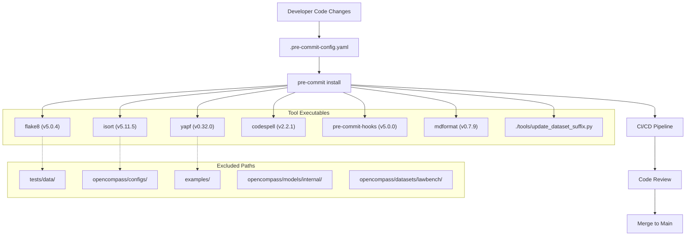
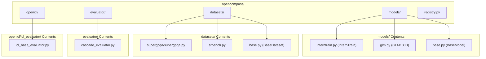
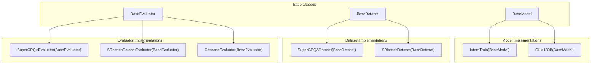
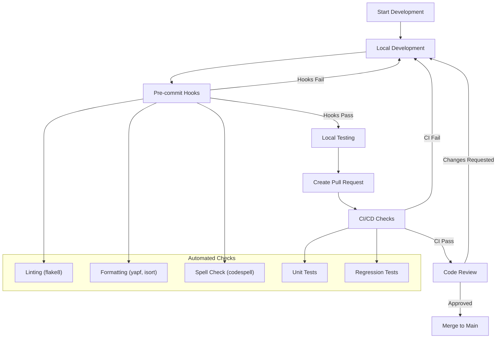

<!-- source: DeepWiki mcp.deepwiki.com · repo open-compass/opencompass · page 10.3 Code Quality Standards · fetched 2026-10-21 -->

# Code Quality and Standards

<details>
<summary>Relevant source files</summary>

The following files were used as context for generating this wiki page:

- [.pre-commit-config-zh-cn.yaml](.pre-commit-config-zh-cn.yaml)
- [.pre-commit-config.yaml](.pre-commit-config.yaml)
- [docs/zh_cn/advanced_guides/compassbench_intro.md](docs/zh_cn/advanced_guides/compassbench_intro.md)
- [docs/zh_cn/advanced_guides/compassbench_v2_0.md](docs/zh_cn/advanced_guides/compassbench_v2_0.md)
- [opencompass/models/glm.py](opencompass/models/glm.py)
- [opencompass/models/interntrain.py](opencompass/models/interntrain.py)
- [opencompass/summarizers/subjective/compassbench_v13.py](opencompass/summarizers/subjective/compassbench_v13.py)
- [opencompass/summarizers/summarizer_pretrain.py](opencompass/summarizers/summarizer_pretrain.py)

</details>


## Purpose and Scope

This document outlines the code quality tools, standards, and development practices used in the OpenCompass project. Following these guidelines ensures consistent, maintainable, and high-quality code across the entire codebase.

For general contribution guidelines, see [Contributing to OpenCompass](#9.1).

## Code Quality Tools Architecture

OpenCompass employs a comprehensive set of automated code quality tools integrated through pre-commit hooks and CI/CD workflows.

### Quality Assurance Pipeline



Sources: [.pre-commit-config.yaml:1-124](), [.pre-commit-config-zh-cn.yaml:1-119]()

### Pre-commit Configuration Structure

```mermaid
graph TB
    subgraph "Repository Configuration"
        RepoFlake8["github.com/PyCQA/flake8"]
        RepoIsort["github.com/PyCQA/isort"] 
        RepoYapf["github.com/pre-commit/mirrors-yapf"]
        RepoCodespell["github.com/codespell-project/codespell"]
        RepoHooks["github.com/pre-commit/pre-commit-hooks"]
        RepoMDFormat["github.com/executablebooks/mdformat"]
        LocalRepo["local"]
    end
    
    subgraph "Hook IDs and Executables"
        FlakeHook["id: flake8"]
        IsortHook["id: isort"]
        YapfHook["id: yapf"]
        CodespellHook["id: codespell"]
        TrailingWhitespace["id: trailing-whitespace"]
        CheckYaml["id: check-yaml"]
        EndOfFile["id: end-of-file-fixer"]
        MDFormatHook["id: mdformat"]
        DatasetSuffixUpdater["id: update-dataset-suffix"]
    end
    
    subgraph "Global Exclusions"
        GlobalExclude["exclude: tests/data/|opencompass/models/internal/"]
        ToolSpecificExclude["tool-specific exclude patterns"]
    end
    
    RepoFlake8 --> FlakeHook
    RepoIsort --> IsortHook
    RepoYapf --> YapfHook
    RepoCodespell --> CodespellHook
    RepoHooks --> TrailingWhitespace
    RepoHooks --> CheckYaml
    RepoHooks --> EndOfFile
    RepoMDFormat --> MDFormatHook
    LocalRepo --> DatasetSuffixUpdater
    
    GlobalExclude -.-> FlakeHook
    ToolSpecificExclude -.-> IsortHook
    ToolSpecificExclude -.-> YapfHook
```



Sources: [.pre-commit-config.yaml:1-20](), [.pre-commit-config.yaml:21-124]()

## Pre-commit Hooks Setup

Pre-commit hooks automatically run quality checks before each commit, ensuring code meets standards before entering the repository.

### Installation and Configuration

1. Install pre-commit:
   ```bash
   pip install pre-commit
   ```

2. Install the hooks:
   ```bash
   pre-commit install
   ```

3. Run hooks on all files (optional):
   ```bash
   pre-commit run --all-files
   ```

### Hook Configuration Details

The pre-commit configuration defines which tools run and their settings:

| Tool | Purpose | Repository | Version | Configuration |
|------|---------|------------|---------|---------------|
| flake8 | Python linting | github.com/PyCQA/flake8 | 5.0.4 | [.pre-commit-config.yaml:22-30]() |
| isort | Import sorting | github.com/PyCQA/isort | 5.11.5 | [.pre-commit-config.yaml:31-39]() |
| yapf | Code formatting | github.com/pre-commit/mirrors-yapf | v0.32.0 | [.pre-commit-config.yaml:40-48]() |
| codespell | Spell checking | github.com/codespell-project/codespell | v2.2.1 | [.pre-commit-config.yaml:49-59]() |
| trailing-whitespace | Remove trailing spaces | github.com/pre-commit/pre-commit-hooks | v5.0.0 | [.pre-commit-config.yaml:63-68]() |
| end-of-file-fixer | Ensure files end with newline | github.com/pre-commit/pre-commit-hooks | v5.0.0 | [.pre-commit-config.yaml:70-76]() |
| mdformat | Markdown formatting | github.com/executablebooks/mdformat | 0.7.9 | [.pre-commit-config.yaml:83-92]() |
| update-dataset-suffix | Dataset config updater | local | N/A | [.pre-commit-config.yaml:98-118]() |

### Custom Hooks

OpenCompass includes domain-specific custom hooks for maintaining dataset configurations:

#### Dataset Suffix Updater Hook

```yaml
- id: update-dataset-suffix
  name: dataset suffix updater
  entry: ./tools/update_dataset_suffix.py
  language: script
  pass_filenames: true
  require_serial: true
  files: ^opencompass/configs/datasets
```

#### Package-Level Dataset Suffix Updater

```yaml
- id: update-dataset-suffix-pacakge
  name: dataset suffix updater(package)
  entry: ./tools/update_dataset_suffix.py
  language: script
  pass_filenames: false
  args:
    - --root_folder
    - opencompass/configs/datasets
```

These hooks ensure consistency in dataset configuration files by automatically updating suffix patterns across the `opencompass/configs/datasets/` directory.

Sources: [.pre-commit-config.yaml:98-118]()

## Code Formatting Standards

### Python Code Formatting Standards

#### YAPF Configuration and Examples

OpenCompass uses `yapf` (Yet Another Python Formatter) with specific configuration for consistent code formatting. Examples from actual codebase:

```python
# Example: Model initialization with proper formatting
def __init__(self,
             path: str,
             module_path: str,
             max_seq_len: int = 2048,
             tokenizer_only: bool = False,
             tokenizer_path: Optional[str] = None,
             tokenizer_type: str = 'INTERNLM',
             model_config: Optional[Union[str, Dict]] = None,
             parallel_config: Optional[str] = None,
             model_type: str = 'INTERNLM2',
             ckpt_type: Optional[str] = None,
             meta_template: Optional[Dict] = None,
             model_dtype: Optional[str] = None,
             generation_kwargs={},
             sync_rank: bool = False,
             mode='none',
             end_str: Optional[str] = None):
```

#### Import Organization with isort

`isort` ensures consistent import ordering following PEP 8, as seen in actual codebase:

```python
# Standard library imports
import os
import random
import sys
import time
from typing import Dict, List, Optional, Union

# Third-party imports  
import numpy as np
import torch
import torch.distributed as dist

# Local OpenCompass imports
from opencompass.models.base import BaseModel
from opencompass.registry import MODELS
from opencompass.utils.logging import get_logger
```

#### Evaluator Method Signatures

```python
def score(self,
          predictions: List[str],
          references: List[str], 
          test_set: Optional[Dataset] = None) -> Dict[str, Any]:
    """Score predictions using cascade or parallel evaluation.
    
    Args:
        predictions: List of model predictions.
        references: List of ground truths.
        test_set: Huggingface Dataset containing original test samples.
        
    Returns:
        Dict: A dictionary containing the scores and details.
    """
```

Sources: [opencompass/models/interntrain.py:135-151](), [opencompass/models/interntrain.py:1-14](), [opencompass/evaluator/cascade_evaluator.py:122-137]()

## Code Organization Standards

### Registry-Based Architecture

OpenCompass uses a registry pattern for extensible component management across models, datasets, and evaluators.

#### Core Registry System

```mermaid
graph TD
    subgraph "Registry Decorators"
        ModelsRegistry["@MODELS.register_module()"]
        LoadDatasetRegistry["@LOAD_DATASET.register_module()"]
        ICLEvaluatorsRegistry["@ICL_EVALUATORS.register_module()"]
    end
    
    subgraph "Model Implementations"
        InternTrainClass["class InternTrain(BaseModel)"]
        GLM130BClass["class GLM130B(BaseModel)"]
    end
    
    subgraph "Dataset Implementations"
        SuperGPQADatasetClass["class SuperGPQADataset(BaseDataset)"]
        SRbenchDatasetClass["class SRbenchDataset(BaseDataset)"]
    end
    
    subgraph "Evaluator Implementations"  
        SuperGPQAEvaluatorClass["class SuperGPQAEvaluator(BaseEvaluator)"]
        SRbenchEvaluatorClass["class SRbenchDatasetEvaluator(BaseEvaluator)"]
        CascadeEvaluatorClass["class CascadeEvaluator(BaseEvaluator)"]
    end
    
    ModelsRegistry --> InternTrainClass
    ModelsRegistry --> GLM130BClass
    LoadDatasetRegistry --> SuperGPQADatasetClass
    LoadDatasetRegistry --> SRbenchDatasetClass
    ICLEvaluatorsRegistry --> SuperGPQAEvaluatorClass
    ICLEvaluatorsRegistry --> SRbenchEvaluatorClass
    ICLEvaluatorsRegistry --> CascadeEvaluatorClass
```



#### Module Structure and File Organization



Sources: [opencompass/models/interntrain.py:88-89](), [opencompass/models/glm.py:15-16](), [opencompass/datasets/supergpqa/supergpqa.py:28-29](), [opencompass/datasets/srbench.py:16-17](), [opencompass/evaluator/cascade_evaluator.py:12-13]()

### Class Inheritance and Interface Patterns

#### Base Class Hierarchy



Sources: [opencompass/models/interntrain.py:89-134](), [opencompass/models/glm.py:16-23](), [opencompass/datasets/supergpqa/supergpqa.py:29-37](), [opencompass/datasets/srbench.py:17-46](), [opencompass/evaluator/cascade_evaluator.py:13-36](), [opencompass/openicl/icl_evaluator/icl_base_evaluator.py:45-49]()

## Linting and Error Prevention

### Flake8 Configuration

Flake8 performs comprehensive Python linting to catch common errors and enforce style consistency. Key checks include:

- Syntax errors and undefined names
- Unused imports and variables
- Line length limits (typically 88-100 characters)
- PEP 8 style violations
- Complexity warnings

### Common Issues and Solutions

| Issue | Description | Solution |
|-------|-------------|----------|
| F401 | Unused import | Remove unused imports or use `# noqa: F401` if intentional |
| E501 | Line too long | Break long lines or use `# noqa: E501` for URLs |
| W503 | Line break before binary operator | Follow PEP 8 guidelines for operator placement |
| F811 | Redefined function/variable | Rename conflicting definitions |

### Exclusions and Special Cases

Certain directories are excluded from strict linting due to their nature:

```yaml
exclude: |
    (?x)^(
      tests/data/|
      opencompass/configs/|
      examples/|
      opencompass/models/internal/|
      opencompass/datasets/lawbench/|
      opencompass/datasets/medbench/
    )
```

Sources: [.pre-commit-config.yaml:1-20](), [.pre-commit-config.yaml:26-30]()

## Evaluation Framework Quality Standards

### Evaluator Implementation Patterns

OpenCompass enforces consistent evaluation patterns through base classes and standardized interfaces.

#### BaseEvaluator Interface Requirements

All evaluators must inherit from `BaseEvaluator` and implement the `score` method:

```python
class BaseEvaluator:
    def __init__(self, pred_postprocessor=None) -> None:
        self.pred_postprocessor = pred_postprocessor
        self._dataset_replica_idx = 0
        
    def score(self):
        raise NotImplementedError("Method hasn't been implemented yet")
        
    def pred_postprocess(self, predictions: List) -> Dict:
        if not hasattr(self, 'pred_postprocessor') or self.pred_postprocessor is None:
            return predictions
        else:
            kwargs = deepcopy(self.pred_postprocessor)
            proc = TEXT_POSTPROCESSORS.get(kwargs.pop('type'))
            return [proc(pred, **kwargs) for pred in predictions]
```

#### Advanced Evaluation: CascadeEvaluator Pattern

The `CascadeEvaluator` demonstrates a sophisticated evaluation approach combining rule-based and LLM-based evaluation:

```python
@ICL_EVALUATORS.register_module()
class CascadeEvaluator(BaseEvaluator):
    def __init__(self,
                 llm_evaluator: Dict,
                 rule_evaluator: Optional[Dict] = None,
                 sample_score_fn: Optional[Callable] = None,
                 parallel: bool = True) -> None:
        super().__init__()
        
        # Initialize LLM evaluator
        llm_evaluator_type = llm_evaluator.pop('type')
        if isinstance(llm_evaluator_type, str):
            llm_evaluator_type = ICL_EVALUATORS.get(llm_evaluator_type)
        self.llm_evaluator = llm_evaluator_type(**llm_evaluator)
```

#### Pass@k Metrics Implementation

For code evaluation tasks, OpenCompass implements standardized pass@k metrics with statistical rigor:

```python
def compute_pass_at_k(n, c, k):
    """Compute pass@k metric with proper statistical handling."""
    if n - c < k:
        return 1.0
    return 1.0 - np.prod(1.0 - k / np.arange(n - c + 1, n + 1))

def compute_g_pass_at_k(n, c, k, t):
    """Compute generalized pass@k with threshold."""
    m = max(int(np.ceil(k * t)), 1)
    return _compute_g_pass_at_k(n, c, k, m)
```

#### Domain-Specific Evaluator Examples

Real evaluators implement complex domain logic:

```python
class SRbenchDatasetEvaluator(BaseEvaluator):
    def score(self, predictions, references) -> dict:
        metrics_out = {
            'name': 'all',
            'mean_RMSE': 0,
            'mean_NMSE': 0,
            'mean_R2': 0,
            'SymbolicMatch': 0,
            'details': []
        }
        # Complex symbolic regression evaluation logic
        return metrics_out
```

Sources: [opencompass/openicl/icl_evaluator/icl_base_evaluator.py:45-103](), [opencompass/evaluator/cascade_evaluator.py:12-61](), [opencompass/openicl/icl_evaluator/icl_base_evaluator.py:17-32](), [opencompass/datasets/srbench.py:93-187]()

### Error Handling and Validation Patterns

#### Configuration Validation Patterns

OpenCompass implements robust configuration validation across all components:

```python
# Model configuration validation in InternTrain
def load_config(self, path, model_config=None):
    if model_config is None:
        from internlm.checkpoint.checkpoint_manager import try_load_config
        model_config = try_load_config(os.path.join(path, 'model_config.pt'))
    elif isinstance(model_config, str) and model_config.endswith('.pt'):
        from internlm.checkpoint.checkpoint_manager import try_load_config
        model_config = try_load_config(model_config)
    else:
        from internlm.config import Config
        if isinstance(model_config, dict):
            model_config = Config(model_config)
        elif isinstance(model_config, str):
            model_config = Config.fromfile(model_config).model
        else:
            raise NotImplementedError('model_config should be None, dict or filename.')
```

#### Resource Management with Graceful Fallbacks

```python
# Storage manager initialization with error handling
try:
    get_storage_manager()
except AssertionError:
    init_storage_manager(False, None, None)
    get_storage_manager()

# Version compatibility handling in InternTrain
@staticmethod
def build(module_path):
    sys.path.insert(0, module_path)
    try:
        from internlm.core.context.registry import register_model_initializer
        return CurrentInternTrainManager(module_path)
    except ImportError:
        return LegacyInternTrainManager(module_path)
```

#### Input Validation in Evaluators

```python
# CascadeEvaluator validation
if not self.rule_evaluator and not self.sample_score_fn:
    raise ValueError('Either rule_evaluator or sample_score_fn must be provided')

# BaseEvaluator validation  
if ('predictions' in score_kwargs and 'references' in score_kwargs
        and score_kwargs['references'] is not None):
    if len(score_kwargs['predictions']) != len(score_kwargs['references']):
        raise ValueError('Predictions and references must have the same length')
```

Sources: [opencompass/models/interntrain.py:34-51](), [opencompass/models/interntrain.py:257-261](), [opencompass/models/interntrain.py:21-29](), [opencompass/evaluator/cascade_evaluator.py:58-61](), [opencompass/openicl/icl_evaluator/icl_base_evaluator.py:113-118]()

## Development Workflow

The code quality process ensures all contributions meet OpenCompass standards:

### Quality Assurance Workflow



Sources: [.pre-commit-config.yaml:21-97]()

### Setting Up Development Environment

1. Clone the repository and install dependencies:
   ```bash
   git clone https://github.com/open-compass/opencompass.git
   cd opencompass
   pip install -e .
   ```

2. Install and configure pre-commit hooks:
   ```bash
   pip install pre-commit
   pre-commit install
   ```

3. Verify setup by running hooks:
   ```bash
   pre-commit run --all-files
   ```

## Best Practices

### Code Organization Principles

1. **Registry Pattern**: Use the registry system for extensible components:
   ```python
   @MODELS.register_module()
   class CustomModel(BaseModel):
       pass
   
   @LOAD_DATASET.register_module()
   class CustomDataset(BaseDataset):
       pass
   ```

2. **Configuration-Driven Design**: Implement configurable components:
   ```python
   def __init__(self, 
                path: str,
                max_seq_len: int = 2048,
                generation_kwargs: Dict = {},
                **kwargs):
       # Use default values and validate configuration
       self.generation_kwargs = {
           'temperature': 1.0,
           'top_p': 1.0,
           'do_sample': False,
           **generation_kwargs
       }
   ```

3. **Type Annotations**: Use comprehensive type hints:
   ```python
   def evaluate(self,
                k: Union[int, List[int]],
                n: int,
                original_dataset: Dataset,
                **score_kwargs) -> Dict[str, Any]:
   ```

Sources: [opencompass/models/interntrain.py:88-89](), [opencompass/datasets/supergpqa/supergpqa.py:28-29](), [opencompass/openicl/icl_evaluator/icl_base_evaluator.py:104-110]()

### Error Prevention

1. **Input Validation**: Always validate inputs early:
   ```python
   if len(predictions) != len(references):
       raise ValueError('Predictions and references must have same length')
   ```

2. **Resource Management**: Handle resources properly:
   ```python
   try:
       get_storage_manager()
   except AssertionError:
       init_storage_manager(False, None, None)
   ```

3. **Graceful Degradation**: Handle missing optional dependencies:
   ```python
   try:
       from internlm.core.context.registry import register_model_initializer
       return CurrentInternTrainManager(module_path)
   except ImportError:
       return LegacyInternTrainManager(module_path)
   ```

Sources: [opencompass/openicl/icl_evaluator/icl_base_evaluator.py:113-118](), [opencompass/models/interntrain.py:257-261](), [opencompass/models/interntrain.py:24-29]()

## Translation Guidelines

OpenCompass maintains documentation in both English and Chinese:

1. Ensure technical terminology is accurately translated
2. Maintain the same document structure in both languages
3. If only updating one language, indicate in the PR that translation is needed

## Pull Request Guidelines

When submitting documentation PRs:

1. Follow the established style and formatting guidelines
2. Update both language versions when possible
3. Include a clear description of the changes
4. Link related issues if applicable
5. Ensure the documentation builds without warnings

Sources: [docs/en/notes/news.md:1-41](), [docs/zh_cn/notes/news.md:1-41]()

## Adding New Documentation

When adding new documentation for components like datasets or models:

1. Place the document in the appropriate directory based on its type
2. Update the corresponding index.rst file to include the new document
3. Follow the established format for similar documents
4. Include diagrams and examples as needed
5. Add both English and Chinese versions

## Conclusion

Effective documentation is crucial for OpenCompass. By following these guidelines, contributors can create high-quality documentation that helps users understand and effectively use the framework for large language model evaluation. Documentation should be treated with the same care and attention to detail as code contributions.

---

