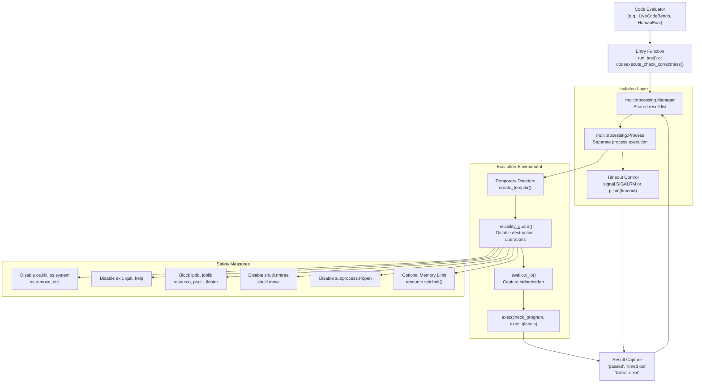
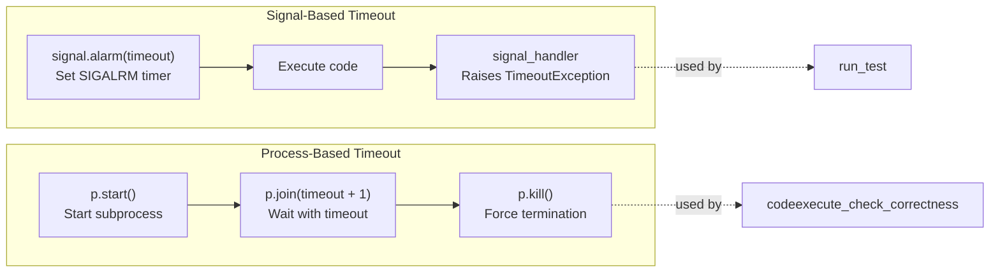
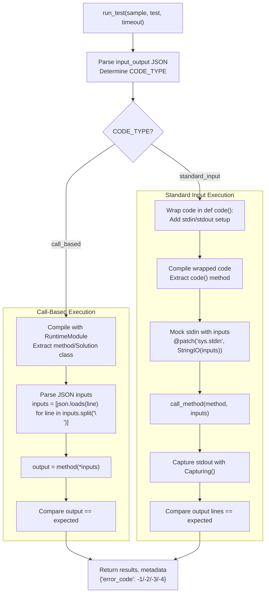
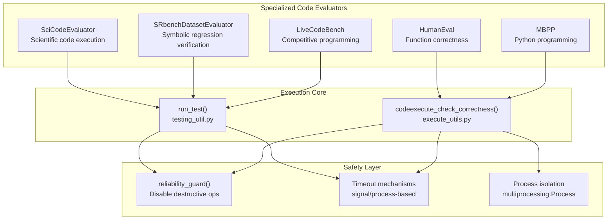
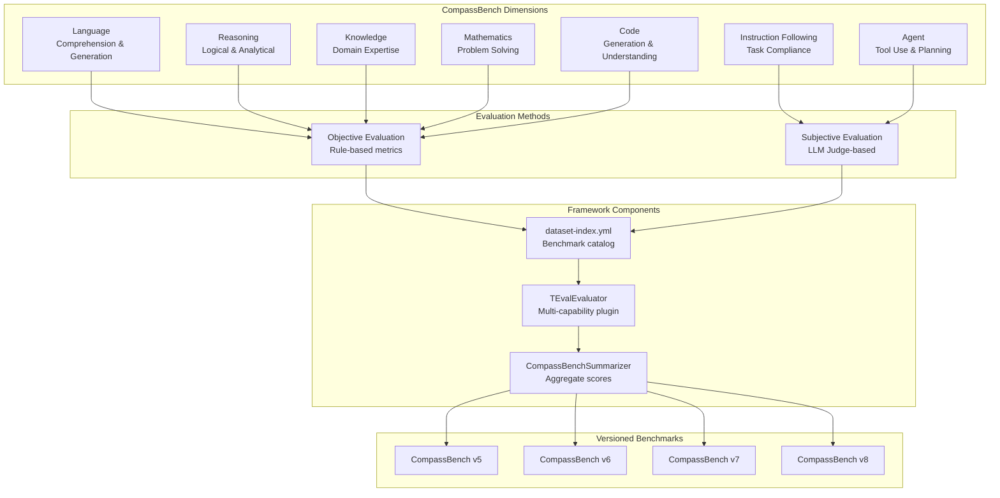
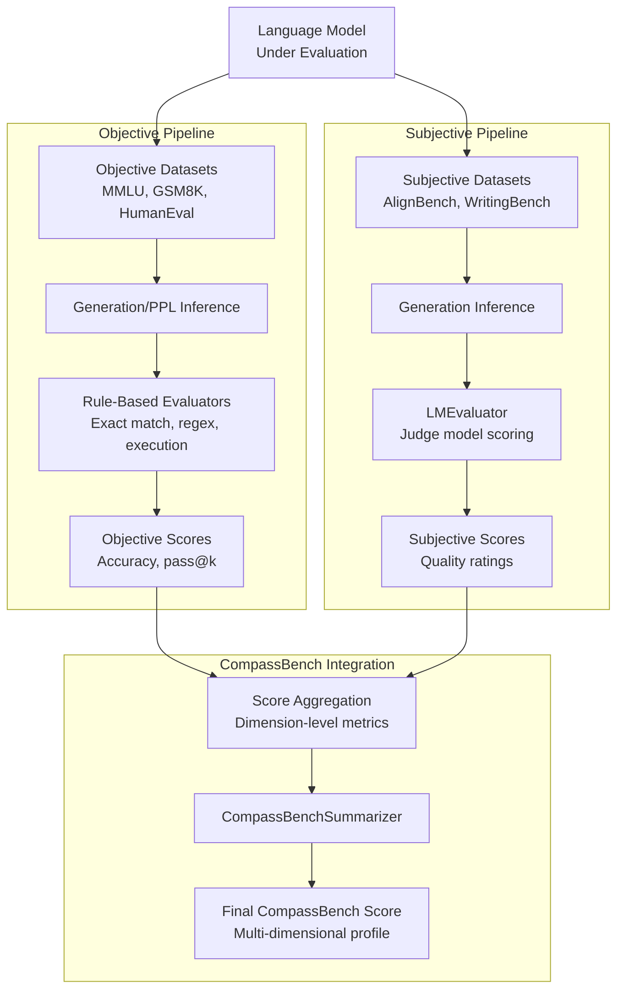

<!-- source: DeepWiki mcp.deepwiki.com · repo open-compass/opencompass · page 11 Advanced Topics · fetched 2026-10-21 -->

# Advanced Topics

<details>
<summary>Relevant source files</summary>

The following files were used as context for generating this wiki page:

- [opencompass/configs/datasets/TheoremQA/ThroremQA_0shot_cot_gen_8acdf7.py](opencompass/configs/datasets/TheoremQA/ThroremQA_0shot_cot_gen_8acdf7.py)
- [opencompass/configs/models/deepseek/lmdeploy_deepseek_v2.py](opencompass/configs/models/deepseek/lmdeploy_deepseek_v2.py)
- [opencompass/configs/models/deepseek/lmdeploy_deepseek_v2_5.py](opencompass/configs/models/deepseek/lmdeploy_deepseek_v2_5.py)
- [opencompass/configs/models/deepseek/lmdeploy_deepseek_v2_5_1210.py](opencompass/configs/models/deepseek/lmdeploy_deepseek_v2_5_1210.py)
- [opencompass/datasets/TheoremQA/__init__.py](opencompass/datasets/TheoremQA/__init__.py)
- [opencompass/datasets/TheoremQA/main.py](opencompass/datasets/TheoremQA/main.py)
- [opencompass/datasets/livecodebench/execute_utils.py](opencompass/datasets/livecodebench/execute_utils.py)
- [opencompass/datasets/livecodebench/prompts.py](opencompass/datasets/livecodebench/prompts.py)
- [opencompass/datasets/livecodebench/testing_util.py](opencompass/datasets/livecodebench/testing_util.py)
- [opencompass/openicl/icl_evaluator/icl_plugin_evaluator.py](opencompass/openicl/icl_evaluator/icl_plugin_evaluator.py)
- [requirements/runtime.txt](requirements/runtime.txt)

</details>


This document covers specialized and advanced features of OpenCompass that go beyond standard evaluation workflows. These topics include secure code execution mechanisms for evaluating code generation models, and the CompassBench comprehensive evaluation framework for multi-dimensional LLM assessment.

For basic evaluation methods, see [Evaluation Methods](#6). For dataset configuration, see [Dataset System](#5). For specialized domain-specific evaluators outside of code execution and CompassBench, see [Specialized Evaluators](#6.5).

## 11.1 Code Execution and Sandboxing

OpenCompass provides robust infrastructure for safely executing model-generated code during evaluation. This is critical for code generation benchmarks like HumanEval, LiveCodeBench, and SciCode where correctness must be verified through actual execution.

### Code Execution Architecture



**Sources:** [opencompass/datasets/livecodebench/testing_util.py:85-635](), [opencompass/datasets/livecodebench/execute_utils.py:65-120]()

### Core Execution Functions

OpenCompass provides two main patterns for code execution:

#### Pattern 1: `run_test` (LiveCodeBench Style)

The `run_test` function in [opencompass/datasets/livecodebench/testing_util.py:85-635]() supports both call-based and standard input execution modes:

| Execution Type | Description | Use Case |
|----------------|-------------|----------|
| `CODE_TYPE.call_based` | Directly invokes function with arguments | Function-based problems with defined signatures |
| `CODE_TYPE.standard_input` | Wraps code in function reading from stdin | Competitive programming style problems |

The function uses `RuntimeModule.from_string()` to dynamically compile code (requires `pyext` package from [requirements/runtime.txt:27]()) and handles test case execution with comprehensive error reporting including error codes:

- `-1`: Runtime error or timeout
- `-2`: Wrong answer (output mismatch)
- `-3`: Time limit exceeded
- `-4`: Runtime error with specific exception

#### Pattern 2: `codeexecute_check_correctness` (HumanEval Style)

The `codeexecute_check_correctness` function in [opencompass/datasets/livecodebench/execute_utils.py:65-86]() uses multiprocessing isolation:

```python
manager = multiprocessing.Manager()
result = manager.list()

p = multiprocessing.Process(target=unsafe_execute, args=(check_program, result, timeout))
p.start()
p.join(timeout=timeout + 1)
if p.is_alive():
    p.kill()
```

This pattern provides stronger isolation by executing code in a completely separate process that can be forcibly terminated.

**Sources:** [opencompass/datasets/livecodebench/testing_util.py:85-150](), [opencompass/datasets/livecodebench/execute_utils.py:65-120]()

### The `reliability_guard` Function

The `reliability_guard` function is the cornerstone of OpenCompass's code execution safety. It disables destructive operations before executing untrusted code. Both implementations ([testing_util.py:687-767]() and [execute_utils.py:192-272]()) follow identical patterns:

#### Disabled Operations Table

| Category | Disabled Functions/Modules | Purpose |
|----------|---------------------------|---------|
| **OS Operations** | `os.kill`, `os.system`, `os.putenv`, `os.remove`, `os.removedirs`, `os.rmdir`, `os.rename`, `os.unlink`, `os.chmod`, `os.chown`, `os.fork`, `os.forkpty` | Prevent file system modification and process manipulation |
| **Built-ins** | `exit`, `quit`, `help` | Prevent program termination |
| **File Operations** | `shutil.rmtree`, `shutil.move`, `shutil.chown` | Prevent destructive file operations |
| **Subprocesses** | `subprocess.Popen` | Prevent spawning external processes |
| **Debugging/Profiling** | `ipdb`, `joblib`, `resource`, `psutil`, `tkinter` modules | Block debugging and system introspection |
| **Environment** | `OMP_NUM_THREADS='1'` | Limit threading overhead |
| **Memory** | `resource.setrlimit()` (optional) | Cap memory usage |

The function also disables `faulthandler` to prevent crash reports from interfering with test execution.

**Important Warning:** As noted in [execute_utils.py:197-200](), the reliability guard is NOT a security sandbox. Model-generated code should only be executed in properly isolated environments (containers, VMs, or dedicated sandboxes).

**Sources:** [opencompass/datasets/livecodebench/testing_util.py:687-767](), [opencompass/datasets/livecodebench/execute_utils.py:192-272]()

### Timeout Mechanisms



OpenCompass uses two timeout strategies:

1. **Signal-based timeout** ([testing_util.py:44-50](), [execute_utils.py:123-133]()): Uses `signal.SIGALRM` with a custom handler that raises `TimeoutException`. This is used within the execution context.

2. **Process-based timeout** ([execute_utils.py:75-83]()): The parent process waits for the child with `p.join(timeout + 1)` and forcibly kills it if it hasn't completed. This provides an additional safety layer.

**Sources:** [opencompass/datasets/livecodebench/testing_util.py:39-50](), [opencompass/datasets/livecodebench/execute_utils.py:65-86](), [opencompass/datasets/livecodebench/execute_utils.py:123-133]()

### Test Case Execution Flow



The execution flow in [testing_util.py:85-635]() handles two distinct code types:

- **Call-based**: Directly imports and invokes functions/classes with parsed arguments
- **Standard input**: Wraps the code in a function that reads from mocked stdin, useful for competitive programming problems

Both paths include comprehensive output comparison logic with fallback strategies for handling different output formats (lists, tuples, numeric comparisons with tolerance).

**Sources:** [opencompass/datasets/livecodebench/testing_util.py:85-635]()

### Integration with Specialized Evaluators

Code execution infrastructure is used by several specialized evaluators:



These evaluators leverage the code execution infrastructure but add domain-specific logic:

- **TheoremQA** ([opencompass/datasets/TheoremQA/main.py:41-76]()): Uses specialized mathematical verification in `TheoremQAEvaluatorV3` with `compare_answer_with_groundtruth` for handling numeric, boolean, and list answers
- **SciCode**: Executes scientific Python code with domain-specific imports
- **SRBench**: Verifies symbolic regression expressions through execution

**Sources:** [opencompass/datasets/TheoremQA/main.py:1-76](), [opencompass/datasets/livecodebench/testing_util.py:1-767]()

### Security Best Practices

When using code execution features:

1. **Always run in isolated environments**: Use containers (Docker), VMs, or dedicated compute instances
2. **Set resource limits**: Configure memory limits via `reliability_guard(maximum_memory_bytes=...)` 
3. **Use appropriate timeouts**: Default is 6 seconds ([testing_util.py:85]()), adjust based on problem complexity
4. **Monitor execution**: Track failed executions and implement rate limiting for suspicious patterns
5. **Sandbox external dependencies**: The `pyext` package ([requirements/runtime.txt:27]()) should be installed in isolated environments only

**Sources:** [opencompass/datasets/livecodebench/testing_util.py:85-767](), [opencompass/datasets/livecodebench/execute_utils.py:65-272](), [requirements/runtime.txt:27]()

## 11.2 CompassBench Evaluation Framework

CompassBench is OpenCompass's comprehensive, multi-dimensional evaluation framework designed to assess language models across diverse capabilities. It provides both objective and subjective evaluation methods integrated into a unified benchmark suite.

### CompassBench Architecture Overview



CompassBench evaluates models across seven core dimensions, each mapped to specific evaluation methodologies. The framework evolves through versioned releases that refine evaluation protocols and expand coverage.

**Sources:** Based on system architecture diagrams and evaluation pipeline structure

### Plugin-Based Evaluation System

CompassBench uses a plugin architecture for specialized evaluations. The `TEvalEvaluator` in [opencompass/openicl/icl_evaluator/icl_plugin_evaluator.py:9-102]() demonstrates this pattern:

#### TEvalEvaluator Subset Mapping

| Subset Name | Evaluator Type | Capability Assessed | Language |
|-------------|----------------|---------------------|----------|
| `instruct` | `InstructEvaluator` | Instruction following with tool calls | English |
| `plan` | `PlanningEvaluator` | Solution planning and program design | English |
| `review` | `ReviewEvaluator` | Task completion verification | English |
| `reason_retrieve_understand` | `ReasonRetrieveUnderstandEvaluator` | Combined reasoning, retrieval, understanding | English |
| `reason` | `ReasonRetrieveUnderstandEvaluator` | Next step reasoning from observations | English |
| `retrieve` | `ReasonRetrieveUnderstandEvaluator` | Tool retrieval from large sets | English |
| `understand` | `ReasonRetrieveUnderstandEvaluator` | Context understanding | English |
| `instruct_zh` | `InstructEvaluator` | Instruction following | Chinese |
| `plan_zh` | `PlanningEvaluator` (with gte-large-zh) | Planning capability | Chinese |
| `review_zh` | `ReviewEvaluator` | Task completion review | Chinese |
| `reason_retrieve_understand_zh` | `ReasonRetrieveUnderstandEvaluator` (with gte-large-zh) | Combined capabilities | Chinese |

The plugin evaluator pattern allows CompassBench to integrate external evaluation libraries while maintaining a consistent interface through the `ICL_EVALUATORS` registry.

**Sources:** [opencompass/openicl/icl_evaluator/icl_plugin_evaluator.py:9-102]()

### Objective vs Subjective Evaluation Flow



CompassBench integrates both evaluation paradigms:

- **Objective evaluation**: Uses deterministic metrics for capabilities with clear ground truth (math, code, factual knowledge)
- **Subjective evaluation**: Employs LLM judges for nuanced capabilities (instruction following, agent behavior, writing quality)

The `CompassBenchSummarizer` (referenced in system diagrams) aggregates scores across dimensions to produce a comprehensive model profile.

**Sources:** Based on system architecture and evaluation pipeline design

### Multi-Language Support

CompassBench provides comprehensive multilingual evaluation:

The Chinese variants (`*_zh` subsets in [icl_plugin_evaluator.py:52-77]()) use specialized models for evaluation:
- `thenlper/gte-large-zh` for BERT score computation in planning and reasoning tasks
- Language-specific prompt templates and judging criteria

This enables fair comparison of models across language capabilities, crucial for evaluating multilingual and Chinese-specialized models.

**Sources:** [opencompass/openicl/icl_evaluator/icl_plugin_evaluator.py:52-77]()

### Advanced Model Configuration for CompassBench

CompassBench evaluations often require specialized model configurations to handle large contexts and high throughput. Example configurations:

#### LMDeploy/TurboMind Configuration

The DeepSeek v2.5 configuration in [opencompass/configs/models/deepseek/lmdeploy_deepseek_v2_5.py:1-22]() demonstrates advanced settings:

```python
dict(
    type=TurboMindModelwithChatTemplate,
    backend='pytorch',
    engine_config=dict(
        session_len=7168,
        max_batch_size=4,
        tp=8,  # Tensor parallelism across 8 GPUs
        cache_max_entry_count=0.7,  # KV cache optimization
    ),
    gen_config=dict(top_k=1, temperature=1e-6, top_p=0.9),
    max_seq_len=7168,
    max_out_len=2048,
    batch_size=4,
    run_cfg=dict(num_gpus=8),
)
```

Key optimization parameters:
- **`tp=8`**: Tensor parallelism for large models
- **`cache_max_entry_count=0.7`**: KV cache memory allocation (70% of available)
- **`session_len=7168`**: Context window for long-context evaluation
- **`backend='pytorch'`**: Uses PyTorch backend instead of TurboMind C++ for compatibility

Similar configurations appear in [lmdeploy_deepseek_v2.py:1-18]() and [lmdeploy_deepseek_v2_5_1210.py:1-22](), showing consistent patterns for high-performance evaluation.

**Sources:** [opencompass/configs/models/deepseek/lmdeploy_deepseek_v2_5.py:1-22](), [opencompass/configs/models/deepseek/lmdeploy_deepseek_v2.py:1-18](), [opencompass/configs/models/deepseek/lmdeploy_deepseek_v2_5_1210.py:1-22]()

### Integration with CI/CD Pipeline

CompassBench evaluations are integrated into OpenCompass's regression testing pipeline (see [Testing Framework and CI/CD](#10.2)). The system includes:

- **Versioned benchmarks** (v5, v6, v7, v8) tracked in baseline files
- **Automated score comparison** against expected performance
- **Multi-subset execution** for comprehensive capability assessment
- **Notification system** for performance regressions

This ensures that improvements to the framework maintain evaluation quality and consistency across versions.

**Sources:** Based on CI/CD workflow structure and system architecture

### Best Practices for CompassBench Evaluation

1. **Use appropriate accelerators**: Configure VLLM or LMDeploy for efficient inference on large-scale benchmarks
2. **Enable result reuse**: Use `--reuse` flag with result stations to avoid re-running completed evaluations
3. **Configure judge models**: For subjective evaluation, select appropriate judge models with sufficient capability
4. **Monitor resource usage**: CompassBench evaluations can be compute-intensive; monitor GPU memory and adjust batch sizes
5. **Version tracking**: Always specify the CompassBench version to ensure reproducible comparisons
6. **Dimension-level analysis**: Review individual dimension scores, not just aggregated metrics, to understand model strengths and weaknesses

**Sources:** Based on evaluation pipeline architecture and model configuration patterns

---

