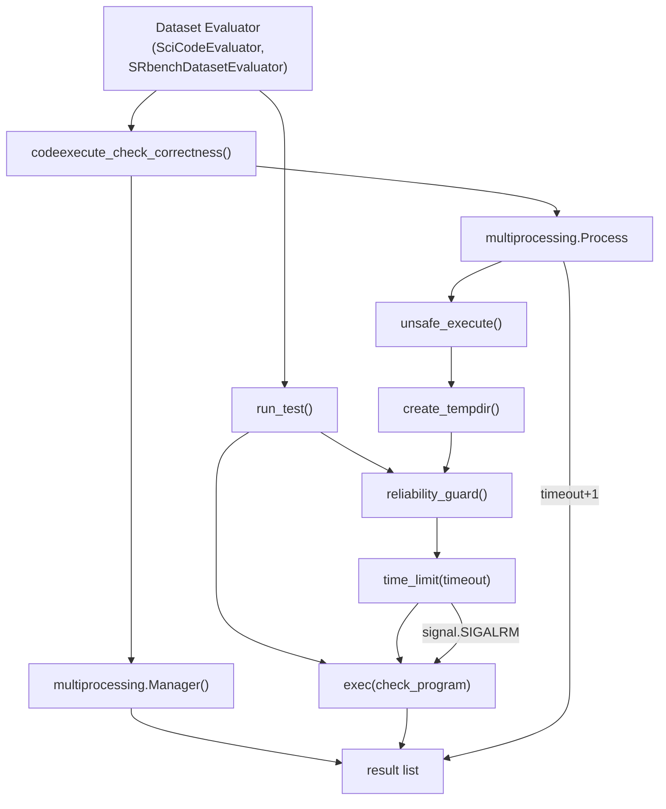
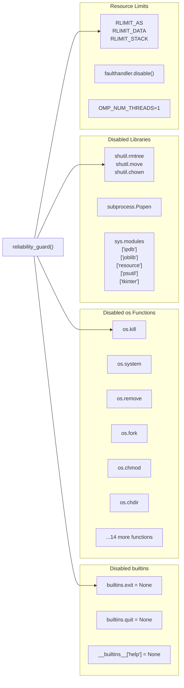
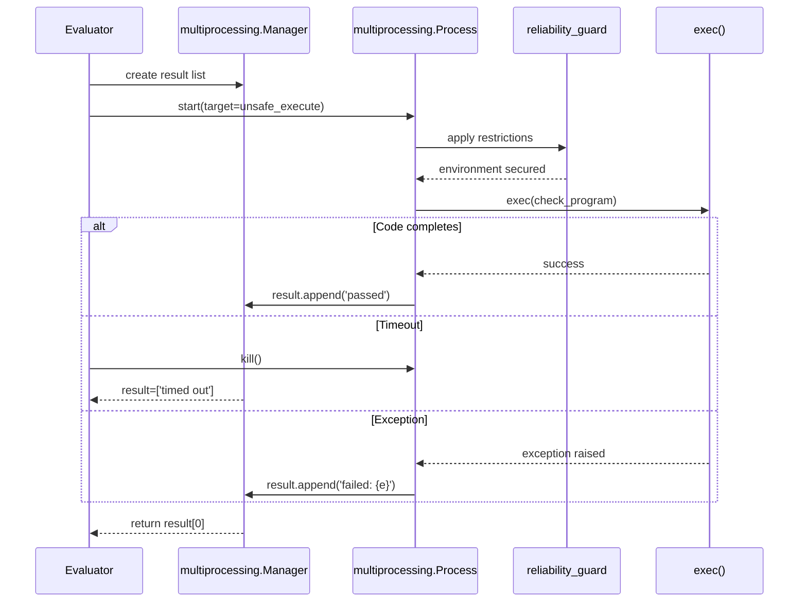
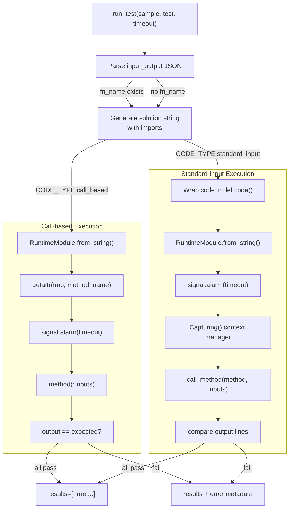
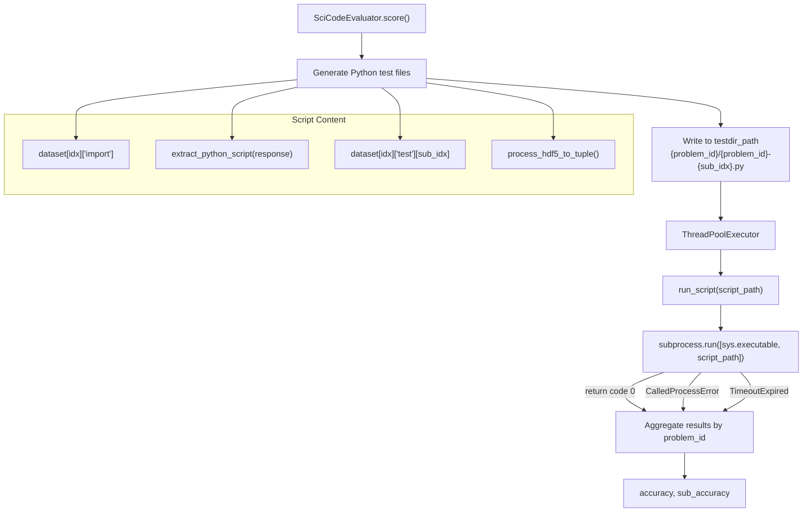
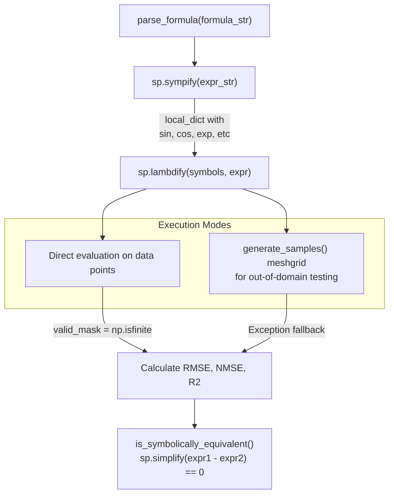
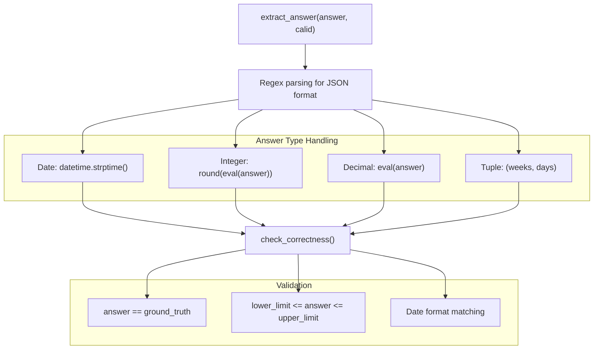
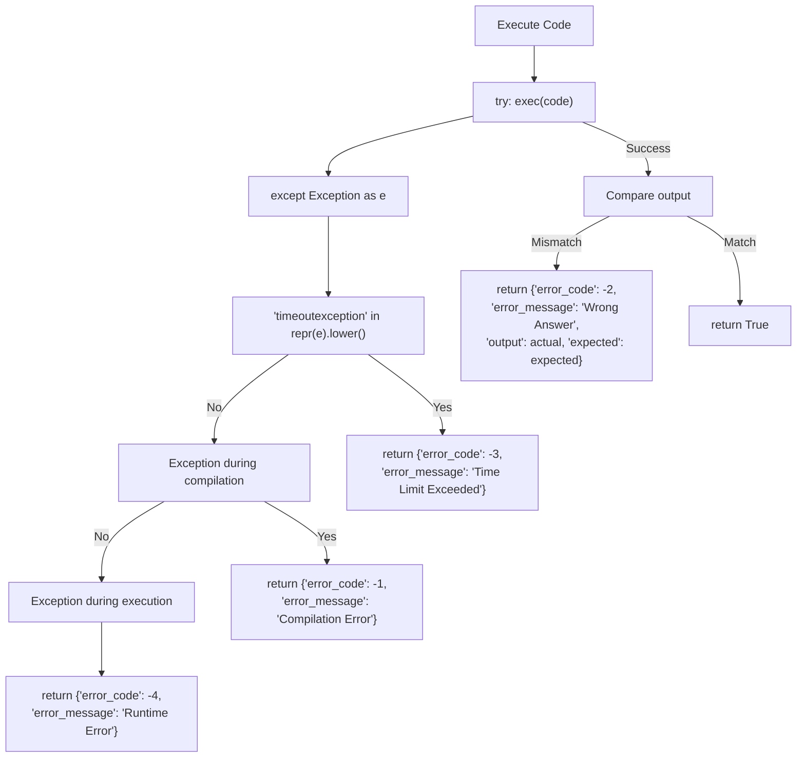
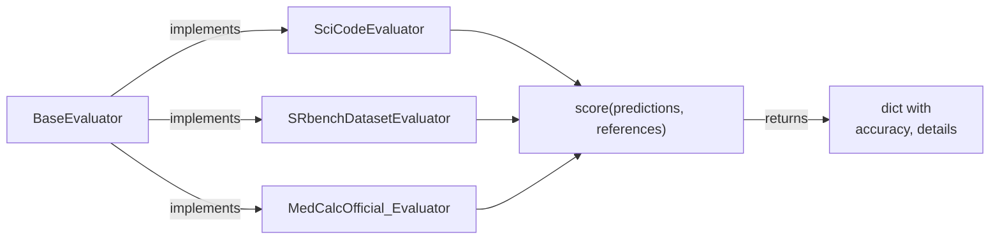

<!-- source: DeepWiki mcp.deepwiki.com · repo open-compass/opencompass · page 11.1 Code Execution and Sandboxing · fetched 2026-10-21 -->

# Code Execution and Sandboxing

<details>
<summary>Relevant source files</summary>

The following files were used as context for generating this wiki page:

- [dataset-index.yml](dataset-index.yml)
- [opencompass/configs/datasets/IFBench/IFBench_gen.py](opencompass/configs/datasets/IFBench/IFBench_gen.py)
- [opencompass/configs/datasets/MedCalc_Bench/MedCalcBench_official_gen_a5155f.py](opencompass/configs/datasets/MedCalc_Bench/MedCalcBench_official_gen_a5155f.py)
- [opencompass/configs/datasets/TheoremQA/ThroremQA_0shot_cot_gen_8acdf7.py](opencompass/configs/datasets/TheoremQA/ThroremQA_0shot_cot_gen_8acdf7.py)
- [opencompass/configs/datasets/srbench/srbench_gen.py](opencompass/configs/datasets/srbench/srbench_gen.py)
- [opencompass/configs/models/deepseek/lmdeploy_deepseek_v2.py](opencompass/configs/models/deepseek/lmdeploy_deepseek_v2.py)
- [opencompass/configs/models/deepseek/lmdeploy_deepseek_v2_5.py](opencompass/configs/models/deepseek/lmdeploy_deepseek_v2_5.py)
- [opencompass/configs/models/deepseek/lmdeploy_deepseek_v2_5_1210.py](opencompass/configs/models/deepseek/lmdeploy_deepseek_v2_5_1210.py)
- [opencompass/configs/summarizers/groups/biodata.py](opencompass/configs/summarizers/groups/biodata.py)
- [opencompass/datasets/IFBench/evaluation_lib.py](opencompass/datasets/IFBench/evaluation_lib.py)
- [opencompass/datasets/IFBench/ifbench.py](opencompass/datasets/IFBench/ifbench.py)
- [opencompass/datasets/IFBench/instructions.py](opencompass/datasets/IFBench/instructions.py)
- [opencompass/datasets/IFBench/instructions_registry.py](opencompass/datasets/IFBench/instructions_registry.py)
- [opencompass/datasets/IFBench/instructions_util.py](opencompass/datasets/IFBench/instructions_util.py)
- [opencompass/datasets/MedCalc_Bench.py](opencompass/datasets/MedCalc_Bench.py)
- [opencompass/datasets/TheoremQA/__init__.py](opencompass/datasets/TheoremQA/__init__.py)
- [opencompass/datasets/TheoremQA/main.py](opencompass/datasets/TheoremQA/main.py)
- [opencompass/datasets/__init__.py](opencompass/datasets/__init__.py)
- [opencompass/datasets/livecodebench/execute_utils.py](opencompass/datasets/livecodebench/execute_utils.py)
- [opencompass/datasets/livecodebench/prompts.py](opencompass/datasets/livecodebench/prompts.py)
- [opencompass/datasets/livecodebench/testing_util.py](opencompass/datasets/livecodebench/testing_util.py)
- [opencompass/datasets/scicode.py](opencompass/datasets/scicode.py)
- [opencompass/datasets/srbench.py](opencompass/datasets/srbench.py)
- [opencompass/openicl/icl_evaluator/icl_plugin_evaluator.py](opencompass/openicl/icl_evaluator/icl_plugin_evaluator.py)
- [opencompass/utils/datasets_info.py](opencompass/utils/datasets_info.py)
- [requirements/extra.txt](requirements/extra.txt)
- [requirements/runtime.txt](requirements/runtime.txt)

</details>


## Purpose and Scope

This document describes OpenCompass's code execution and sandboxing infrastructure used to safely evaluate model-generated code. The system executes Python code in a controlled environment to verify correctness while preventing destructive operations. This infrastructure is primarily used for code generation benchmarks (HumanEval, MBPP, LiveCodeBench, SciCode), mathematical formula evaluation (SRBench, TheoremQA), and medical calculation verification (MedCalc-Bench).

For general evaluation framework information, see [6.2](#6.2). For code-specific dataset implementations, see [5.2](#5.2).

## System Architecture

The code execution system consists of three main layers: safety enforcement (`reliability_guard`), execution orchestration (timeout and process isolation), and dataset-specific evaluators that interpret results.

### Execution Flow Diagram



Sources: [opencompass/datasets/livecodebench/execute_utils.py:65-86](), [opencompass/datasets/livecodebench/testing_util.py:85-143]()

## Safety Mechanisms: reliability_guard

The `reliability_guard()` function is the core security mechanism that prevents executed code from causing destructive changes to the test environment.

### Disabled Functions and Modules



Sources: [opencompass/datasets/livecodebench/execute_utils.py:192-272](), [opencompass/datasets/livecodebench/testing_util.py:90-91]()

### Implementation Details

The `reliability_guard()` function disables destructive capabilities through direct attribute assignment:

| Category | Disabled Functions | Purpose |
|----------|-------------------|---------|
| Process Control | `os.kill`, `os.fork`, `os.forkpty`, `os.killpg` | Prevent fork bombs and process manipulation |
| File Operations | `os.remove`, `os.rmdir`, `os.removedirs`, `os.unlink`, `shutil.rmtree`, `shutil.move` | Prevent file deletion/modification |
| Permission Changes | `os.chmod`, `os.chown`, `os.fchmod`, `os.fchown`, `os.lchmod`, `os.lchown` | Prevent permission escalation |
| System Calls | `os.system`, `subprocess.Popen`, `os.putenv` | Prevent arbitrary command execution |
| Exit Functions | `builtins.exit`, `builtins.quit` | Prevent premature termination |
| Debug Tools | `sys.modules['ipdb']`, `sys.modules['joblib']` | Prevent debugging interference |

Sources: [opencompass/datasets/livecodebench/execute_utils.py:192-272]()

## Execution Strategies

OpenCompass employs two primary execution strategies depending on the use case: multiprocessing-based isolation and direct execution with signal-based timeout.

### Multiprocessing Isolation Strategy

Used by `codeexecute_check_correctness()` for complete process isolation:



Sources: [opencompass/datasets/livecodebench/execute_utils.py:65-120]()

### Signal-Based Timeout Strategy

Used by `run_test()` for test case execution with lightweight timeout control:



Sources: [opencompass/datasets/livecodebench/testing_util.py:85-442]()

## Timeout Mechanisms

### Signal-Based Timeout

The `time_limit()` context manager uses `signal.SIGALRM` to interrupt execution:

| Component | Implementation | File Reference |
|-----------|---------------|----------------|
| Signal Handler | `signal.signal(signal.SIGALRM, timeout_handler)` | [testing_util.py:50]() |
| Timer Setup | `signal.setitimer(signal.ITIMER_REAL, seconds)` | [execute_utils.py:128]() |
| Exception | `TimeoutException` raised by handler | [execute_utils.py:126]() |
| Cleanup | `signal.setitimer(signal.ITIMER_REAL, 0)` in finally | [execute_utils.py:133]() |

### Process-Level Timeout

The multiprocessing strategy uses `Process.join(timeout)`:

```python
# From codeexecute_check_correctness
p = multiprocessing.Process(target=unsafe_execute, args=(check_program, result, timeout))
p.start()
p.join(timeout=timeout + 1)  # Wait slightly longer than internal timeout
if p.is_alive():
    p.kill()  # Force kill if still running
```

Sources: [opencompass/datasets/livecodebench/execute_utils.py:75-80]()

## Dataset-Specific Implementations

### SciCode Evaluator

The `SciCodeEvaluator` executes multi-step scientific computing problems:



**Key Features:**
- Imports from dataset: `python_code += self.dataset[idx]['import']`
- Code extraction: `extract_python_script()` removes markdown and import statements
- Test data loading: `process_hdf5_to_tuple()` loads ground truth from HDF5 files
- Concurrent execution: `ThreadPoolExecutor` runs multiple test scripts in parallel
- Timeout: 120 seconds per subprocess

Sources: [opencompass/datasets/scicode.py:219-363]()

### SRBench Evaluator

The `SRbenchDatasetEvaluator` executes symbolic regression formulas with SymPy:



**Safety Features:**
- Formula parsing with SymPy: mathematical expressions only
- Numpy module restrictions in `lambdify()`
- Finite value filtering: `valid_mask = np.isfinite(y_true) & np.isfinite(y_pred)`
- Exception handling for domain errors

Sources: [opencompass/datasets/srbench.py:93-313]()

### MedCalc-Bench Evaluator

The `MedCalcOfficial_Evaluator` uses `eval()` for medical calculation verification:



**Execution Safety:**
- Limited `eval()` usage on extracted numeric values only
- Type-specific validation by calculator ID
- Range checking for decimal outputs
- No arbitrary code execution - only formula evaluation

Sources: [opencompass/datasets/MedCalc_Bench.py:13-71](), [opencompass/datasets/MedCalc_Bench.py:73-167]()

## Error Categories and Handling

OpenCompass categorizes execution errors into four distinct types for better debugging and analysis:

| Error Code | Type | Detection Method | Example Scenario |
|------------|------|------------------|------------------|
| -1 | Compilation Error | Exception during `exec()` or `RuntimeModule.from_string()` | Syntax errors, import failures |
| -2 | Wrong Answer | Output doesn't match expected | Logical errors in generated code |
| -3 | Time Limit Exceeded | `TimeoutException` or process timeout | Infinite loops, inefficient algorithms |
| -4 | Runtime Error | Exception during execution | Division by zero, index errors, type errors |

### Error Detection Implementation



Sources: [opencompass/datasets/livecodebench/testing_util.py:133-331](), [opencompass/datasets/livecodebench/prompts.py:172-201]()

## I/O Handling

### Capturing Output

The `Capturing` context manager redirects stdout to collect program output:

```python
class Capturing(list):
    def __enter__(self):
        self._stdout = sys.stdout
        sys.stdout = self._stringio = StringIO()
        self._stringio.close = lambda x: 1  # Make closing a no-op
        return self
    
    def __exit__(self, *args):
        self.append(self._stringio.getvalue())
        sys.stdout = self._stdout
```

### Input Redirection

For standard input problems, the code is wrapped in a function with stdin mocking:

```python
# Transform standard input code
new_test = 'stdin = sys.stdin\nstdout = sys.stdout\n'
new_test += 'def code():\n'
new_test += '\t' + original_code.replace('\n', '\n\t')

# Execute with input mocking
with Capturing() as output:
    call_method(method, inputs)  # inputs are mocked via stdin
```

Sources: [opencompass/datasets/livecodebench/testing_util.py:56-71](), [opencompass/datasets/livecodebench/testing_util.py:160-189]()

## Import Management

### BASE_IMPORTS for Code Execution

The execution environment pre-imports common libraries to support a wide range of solutions:

```python
BASE_IMPORTS = """from itertools import accumulate, chain, combinations, count, permutations, product, groupby, islice, repeat
from copy import deepcopy
from string import ascii_lowercase
from math import floor, log2, log10, sqrt, comb, gcd, ceil, inf, isqrt
from collections import defaultdict, deque, Counter
from bisect import bisect, bisect_left, bisect_right, insort
from heapq import heappush, heappop, heapify, merge
from functools import reduce, cache, lru_cache
from random import randrange, shuffle
from operator import itemgetter, sub
import numpy as np
import pandas as pd
...
"""
```

### Solution Template

```python
sol = BASE_IMPORTS + test_code
tmp_sol = RuntimeModule.from_string('tmp_sol', '', sol)
method = getattr(tmp_sol, method_name)
```

Sources: [opencompass/datasets/livecodebench/execute_utils.py:28-62]()

## Configuration and Usage

### Timeout Configuration

Different datasets use different timeout values:

| Dataset | Timeout | Location | Rationale |
|---------|---------|----------|-----------|
| LiveCodeBench | 6 seconds | `run_test(timeout=6)` | Competitive programming time limits |
| SciCode | 120 seconds | `subprocess.run(..., timeout=120)` | Complex scientific computations |
| Code Execution Utils | 3 seconds | `codeexecute_check_correctness(timeout=3)` | Quick validation checks |

Sources: [opencompass/datasets/livecodebench/testing_util.py:85](), [opencompass/datasets/scicode.py:266](), [opencompass/datasets/livecodebench/execute_utils.py:65]()

### Memory Limits

The `reliability_guard()` function can optionally enforce memory limits:

```python
def reliability_guard(maximum_memory_bytes=None):
    if maximum_memory_bytes is not None:
        import resource
        resource.setrlimit(resource.RLIMIT_AS, (maximum_memory_bytes, maximum_memory_bytes))
        resource.setrlimit(resource.RLIMIT_DATA, (maximum_memory_bytes, maximum_memory_bytes))
        if not platform.uname().system == 'Darwin':
            resource.setrlimit(resource.RLIMIT_STACK, (maximum_memory_bytes, maximum_memory_bytes))
```

Sources: [opencompass/datasets/livecodebench/execute_utils.py:203-212]()

## Integration with Evaluation Framework

### Evaluator Interface

Code execution evaluators implement the `BaseEvaluator.score()` method:



### Registry Integration

Evaluators are registered for use in configurations:

```python
@ICL_EVALUATORS.register_module()
class SciCodeEvaluator(BaseEvaluator):
    def score(self, predictions, references):
        # Execute code and return metrics
        pass
```

Configuration example:
```python
eval_cfg = dict(
    evaluator=dict(type=SciCodeEvaluator, dataset_path='./data/scicode', with_bg=True),
    pred_role='BOT',
)
```

Sources: [opencompass/datasets/scicode.py:219-220](), [opencompass/datasets/srbench.py:93](), [opencompass/datasets/MedCalc_Bench.py:172]()

## Code Transformation

### Extract Python Script

The `extract_python_script()` method extracts code from markdown-formatted responses:

```python
def extract_python_script(self, response: str):
    start_marker = '```python'
    end_marker = '```'
    
    # Extract code between markers
    after_start = response.split(start_marker)
    python_script = after_start[1].split(end_marker)[0]
    
    # Remove leading import statements
    python_script = re.sub(r'^\s*(import .*|from .*\s+import\s+.*)', 
                          '', python_script, flags=re.MULTILINE)
    
    return python_script
```

### Standard Input Wrapping

For stdin-based problems, code is transformed to a callable function:

```python
# Original code with stdin operations
original = """
x = int(input())
print(x * 2)
"""

# Transformed to function
transformed = """
stdin = sys.stdin
stdout = sys.stdout
def code():
    x = int(input())
    print(x * 2)
"""
```

Sources: [opencompass/datasets/scicode.py:235-258](), [opencompass/datasets/livecodebench/testing_util.py:146-189]()

---

