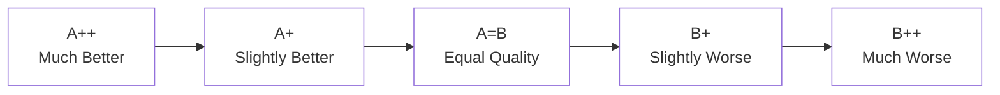
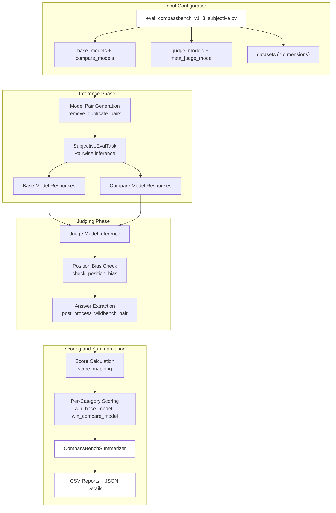
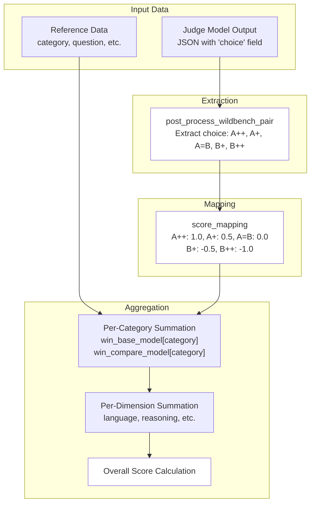

<!-- source: DeepWiki mcp.deepwiki.com · repo open-compass/opencompass · page 11.2 CompassBench Evaluation Framework · fetched 2026-10-21 -->

# CompassBench Evaluation Framework

<details>
<summary>Relevant source files</summary>

The following files were used as context for generating this wiki page:

- [.pre-commit-config-zh-cn.yaml](.pre-commit-config-zh-cn.yaml)
- [.pre-commit-config.yaml](.pre-commit-config.yaml)
- [dataset-index.yml](dataset-index.yml)
- [docs/zh_cn/advanced_guides/compassbench_intro.md](docs/zh_cn/advanced_guides/compassbench_intro.md)
- [docs/zh_cn/advanced_guides/compassbench_v2_0.md](docs/zh_cn/advanced_guides/compassbench_v2_0.md)
- [opencompass/configs/datasets/IFBench/IFBench_gen.py](opencompass/configs/datasets/IFBench/IFBench_gen.py)
- [opencompass/configs/datasets/MedCalc_Bench/MedCalcBench_official_gen_a5155f.py](opencompass/configs/datasets/MedCalc_Bench/MedCalcBench_official_gen_a5155f.py)
- [opencompass/configs/datasets/srbench/srbench_gen.py](opencompass/configs/datasets/srbench/srbench_gen.py)
- [opencompass/configs/summarizers/groups/biodata.py](opencompass/configs/summarizers/groups/biodata.py)
- [opencompass/datasets/IFBench/evaluation_lib.py](opencompass/datasets/IFBench/evaluation_lib.py)
- [opencompass/datasets/IFBench/ifbench.py](opencompass/datasets/IFBench/ifbench.py)
- [opencompass/datasets/IFBench/instructions.py](opencompass/datasets/IFBench/instructions.py)
- [opencompass/datasets/IFBench/instructions_registry.py](opencompass/datasets/IFBench/instructions_registry.py)
- [opencompass/datasets/IFBench/instructions_util.py](opencompass/datasets/IFBench/instructions_util.py)
- [opencompass/datasets/MedCalc_Bench.py](opencompass/datasets/MedCalc_Bench.py)
- [opencompass/datasets/__init__.py](opencompass/datasets/__init__.py)
- [opencompass/datasets/scicode.py](opencompass/datasets/scicode.py)
- [opencompass/datasets/srbench.py](opencompass/datasets/srbench.py)
- [opencompass/models/glm.py](opencompass/models/glm.py)
- [opencompass/models/interntrain.py](opencompass/models/interntrain.py)
- [opencompass/summarizers/subjective/compassbench_v13.py](opencompass/summarizers/subjective/compassbench_v13.py)
- [opencompass/summarizers/summarizer_pretrain.py](opencompass/summarizers/summarizer_pretrain.py)
- [opencompass/utils/datasets_info.py](opencompass/utils/datasets_info.py)
- [requirements/extra.txt](requirements/extra.txt)

</details>


## Purpose and Scope

This document describes the CompassBench evaluation framework, OpenCompass's comprehensive benchmark system for evaluating large language models across multiple capability dimensions. CompassBench combines objective and subjective evaluation methods to assess models on language, reasoning, knowledge, mathematics, code, instruction following, and agent capabilities.

For information about general subjective evaluation workflows, see [Subjective Evaluation Framework](#6.3). For LLM-as-judge evaluation mechanics, see [LLM-as-Judge Evaluation](#6.4). For result aggregation and reporting, see [Summarization and Reporting](#8.2).

## Overview

CompassBench is OpenCompass's flagship benchmark suite that provides a multi-dimensional evaluation of language model capabilities. It has evolved through multiple versions (v5 through v8, with the latest documented version being v1.3 as of 2024) and serves as the foundation for the official OpenCompass leaderboard (CompassRank).

The framework distinguishes itself through:

- **Multi-dimensional assessment**: Seven core capability dimensions evaluated simultaneously
- **Hybrid evaluation approach**: Combined objective (rule-based) and subjective (LLM-judge) methods
- **Comparative scoring**: Models are compared against reference baselines using a five-tier grading system
- **Position bias awareness**: Optional checking for position bias in pairwise comparisons

Sources: [docs/zh_cn/advanced_guides/compassbench_intro.md:1-20](), [opencompass/summarizers/subjective/compassbench_v13.py:38-55]()

## Evaluation Dimensions

CompassBench evaluates models across seven primary capability dimensions:

| Dimension | Description | Evaluation Method | Dataset Location |
|-----------|-------------|-------------------|------------------|
| **Language** | Information extraction, summarization, dialogue, creation tasks in Chinese and English | Subjective | `CompassBench/v1_3_data/language/` |
| **Reasoning** | Logical reasoning, common sense reasoning, social reasoning, professional domain reasoning | Subjective | `CompassBench/v1_3_data/reasoning/` |
| **Knowledge** | Science, engineering, humanities knowledge across multiple domains | Objective | `CompassBench/v1_3_data/knowledge/` |
| **Math** | Numerical calculation, high school and college-level mathematics | Objective | `CompassBench/v1_3_data/math/` |
| **Code** | Code generation, completion, annotation, refactoring, rewriting, and comprehension | Objective + Subjective | `CompassBench/v1_3_data/code/` |
| **Instruction Following** | Ability to follow complex instructions across various task types | Subjective | `CompassBench/v1_3_data/instruct/` |
| **Agent** | Complex tool invocation, code interpreter usage in data science and math contexts | Objective | T-Eval, CIBench datasets |

### Category Hierarchies

Each dimension is further divided into subcategories for fine-grained analysis:

```python
# Language dimension subcategories
MAP = {
    'language': [
        '总分', '中文总分', '英文总分',
        '自然语言处理_cn', '创作_cn', '对话_cn',
        'NLP_en', 'creation_en', 'chat_en'
    ],
    'reasoning': [
        '总分', '中文总分', '英文总分',
        'Common Sense Reasoning_cn', 'Social Reasoning_cn',
        'Humanities (History, Finance, etc.) Professional Reasoning_cn',
        'Science and Engineering Professional Reasoning_cn',
        'Common Sense Reasoning_en', 'Social Reasoning_en',
        'Humanities (History, Finance, etc.) Professional Reasoning_en',
        'Science and Engineering Professional Reasoning_en'
    ],
    'instruct': ['总分', '中文总分', '英文总分'],
    'coding': ['总分', '中文总分', '英文总分']
}
```

Sources: [docs/zh_cn/advanced_guides/compassbench_intro.md:9-19](), [opencompass/summarizers/subjective/compassbench_v13.py:32-36]()

## Evaluation Methods

### Objective Evaluation

Objective evaluation uses 0-shot prompting with Chain-of-Thought (CoT) reasoning for knowledge, math, and agent tasks. The system performs rule-based answer extraction and comparison.

**Key Characteristics:**
- Zero-shot evaluation with CoT prompting
- Format-constrained responses (answer format specified in prompt)
- Post-processing optimization for answer extraction
- Failures in instruction following result in incorrect scoring

**Evaluated Dimensions:**
- Knowledge (multiple-choice and structured answers)
- Mathematics (numerical and symbolic answers)
- Agent capabilities (tool usage correctness)

### Subjective Evaluation

Subjective evaluation employs LLM-as-judge methodology with pairwise model comparison against reference baselines.

**Five-Tier Grading System:**



**Scoring Mapping:**
- `A++`: Response A much better than B → Score: +1.0
- `A+`: Response A slightly better than B → Score: +0.5
- `A=B`: Equal quality → Score: 0.0
- `B+`: Response B slightly better than A → Score: -0.5
- `B++`: Response B much better than A → Score: -1.0

**Judge Prompt Structure:**

The evaluation prompt includes:
1. **User Query**: The original question
2. **Response A**: Prediction from model being evaluated
3. **Response B**: Reference baseline response
4. **Checklist**: Dimension-specific evaluation criteria
5. **Output Format**: Structured JSON with analysis and choice

Sources: [docs/zh_cn/advanced_guides/compassbench_intro.md:21-123](), [opencompass/summarizers/subjective/compassbench_v13.py:89-100]()

## Architecture and Components

### CompassBench Evaluation Pipeline



Sources: [opencompass/summarizers/subjective/compassbench_v13.py:38-56](), [opencompass/summarizers/subjective/compassbench_v13.py:57-100]()

### Core Components

#### CompassBenchSummarizer Class

The [`CompassBenchSummarizer`](opencompass/summarizers/subjective/compassbench_v13.py:38-218)() class orchestrates the entire summarization process:

**Initialization Parameters:**
```python
class CompassBenchSummarizer:
    def __init__(self, config: ConfigDict, check_pos_bias=False):
        self.base_models = config['datasets'][0]['base_models']
        self.compare_models = config['eval']['partitioner']['models']
        self.judge_models = config.get('judge_models', None)
        self.meta_judge_model = config.eval.partitioner.get('meta_judge_model', None)
        self.judge_function = post_process_wildbench_pair
        self.check_pos_bias = check_pos_bias
```

**Key Methods:**

1. **`get_score(time_str)`** - [opencompass/summarizers/subjective/compassbench_v13.py:57-150]()
   - Loads judged results from file system
   - Processes pairwise comparisons
   - Calculates category-specific win rates
   - Handles position bias detection if enabled

2. **`summarize()`** - [opencompass/summarizers/subjective/compassbench_v13.py:152-218]()
   - Aggregates scores across all dimensions
   - Generates per-dimension summary tables
   - Exports results to CSV format
   - Creates detailed JSON output with per-sample results

#### Answer Extraction Function

```python
def post_process_wildbench_pair(judgement: str):
    """Extract choice from judge model output"""
    pattern = r'\"choice\": \"(.*?)\"'
    matched_result = re.findall(pattern, judgement)
    if matched_result:
        return matched_result[0]  # Returns: A++, A+, A=B, B+, or B++
    else:
        return None
```

Sources: [opencompass/summarizers/subjective/compassbench_v13.py:24-30](), [opencompass/summarizers/subjective/compassbench_v13.py:38-100]()

## Scoring System

### Score Calculation Process



### Per-Category Scoring Logic

The scoring system tracks wins for both base and compare models at the category level:

```python
# From opencompass/summarizers/subjective/compassbench_v13.py:87-110
win_base_model = defaultdict(float)
win_compare_model = defaultdict(float)
score_mapping = {'A++': 1, 'A+': 0.5, 'A=B': 0, 'B+': -0.5, 'B++': -1}
cnt = defaultdict(float)

for judged_answer, reference in zip(judged_answers, references):
    if judged_answer not in score_mapping:
        continue
    category = reference['category']
    
    # Accumulate scores
    if score_mapping[judged_answer] > 0:
        win_base_model[category] += score_mapping[judged_answer]
    elif score_mapping[judged_answer] < 0:
        win_compare_model[category] += abs(score_mapping[judged_answer])
    
    cnt[category] += 1
```

### Win Rate Calculation

Final scores are normalized as win rates:

```python
# Calculate win rate for each category
for category in cnt:
    if cnt[category] > 0:
        base_win_rate = win_base_model[category] / cnt[category]
        compare_win_rate = win_compare_model[category] / cnt[category]
```

Sources: [opencompass/summarizers/subjective/compassbench_v13.py:87-110]()

## Position Bias Detection

CompassBench includes optional position bias checking through the [`check_position_bias`](opencompass/summarizers/subjective/compass_arena.py)() function. When enabled, the system evaluates whether the judge model exhibits preference based on response position (A vs B).

**Detection Method:**
1. Run evaluation with responses in position A-B
2. Run evaluation with responses swapped to position B-A
3. Compare consistency of judgments
4. Flag cases where judgment flips solely due to position

This feature can be enabled via the `check_pos_bias` parameter in the summarizer initialization:

```python
summarizer = CompassBenchSummarizer(config, check_pos_bias=True)
```

Sources: [opencompass/summarizers/subjective/compassbench_v13.py:46-55](), [opencompass/summarizers/subjective/compass_arena.py:19-20]()

## Dataset Integration

### Dataset Configuration Structure

CompassBench datasets are configured with specific evaluation modes and category labels:

```python
# Dataset configuration example
dataset_cfg = {
    'abbr': 'compass_bench_language_cn/creation',  # Format: dimension/category
    'type': SubjectiveDataset,
    'path': 'CompassBench/v1_3_data/language/creation_cn.jsonl',
    'base_models': [model1_cfg, model2_cfg],  # Reference models
    'reader_cfg': {
        'input_columns': ['question', 'category'],
        'output_column': 'reference'
    },
    'eval_cfg': {
        'evaluator': dict(type='LMEvaluator'),
        'mode': 'allpair'  # or 'singlescore', 'm2n'
    }
}
```

### Dataset Naming Convention

Dataset identifiers follow the pattern: `{root}/{detail}`

- **Root**: Primary dimension (e.g., `compass_bench_language`, `compass_bench_reasoning`)
- **Detail**: Subcategory and language (e.g., `creation_cn`, `Common_Sense_Reasoning_en`)

This structure enables hierarchical score aggregation as shown in the `MAP` dictionary.

Sources: [opencompass/summarizers/subjective/compassbench_v13.py:70-72](), [opencompass/summarizers/subjective/compassbench_v13.py:32-36]()

## Output Format

### Summary CSV Structure

The summarizer generates CSV files with the following structure:

```
model_name | language_总分 | language_中文总分 | language_英文总分 | ... | reasoning_总分 | ...
-----------|---------------|-------------------|-------------------|-----|----------------|-----
model_a    | 85.2          | 87.1              | 83.3              | ... | 78.9           | ...
model_b    | 82.5          | 84.2              | 80.8              | ... | 76.3           | ...
```

### Detailed JSON Output

For each evaluation pair, detailed results are saved in JSON format:

```json
{
  "model_pair": "base_model_vs_compare_model",
  "judge_model": "judge_model_name",
  "dataset": "compass_bench_language/creation_cn",
  "samples": [
    {
      "question": "...",
      "prediction_a": "...",
      "prediction_b": "...",
      "judgement": "A+",
      "score": 0.5,
      "category": "creation_cn"
    }
  ],
  "summary": {
    "total_samples": 100,
    "win_rate_base": 0.45,
    "win_rate_compare": 0.25,
    "tie_rate": 0.30
  }
}
```

Sources: [opencompass/summarizers/subjective/compassbench_v13.py:152-218]()

## Configuration Example

### Complete Evaluation Configuration

A minimal CompassBench evaluation configuration:

```python
from opencompass.models import HuggingFaceCausalLM, OpenAI
from opencompass.partitioners import SubjectiveSizePartitioner
from opencompass.runners import LocalRunner
from opencompass.summarizers import CompassBenchSummarizer

# Models to evaluate
base_models = [
    dict(type=HuggingFaceCausalLM, path='model_a', abbr='model_a')
]

compare_models = [
    dict(type=HuggingFaceCausalLM, path='model_b', abbr='model_b'),
    dict(type=HuggingFaceCausalLM, path='model_c', abbr='model_c')
]

# Judge model
judge_models = [
    dict(type=OpenAI, model='gpt-4', abbr='gpt4-judge')
]

# Datasets (all 7 dimensions)
datasets = [
    *language_datasets,
    *reasoning_datasets,
    *knowledge_datasets,
    *math_datasets,
    *code_datasets,
    *instruct_datasets,
    *agent_datasets
]

# Evaluation configuration
eval = dict(
    partitioner=dict(
        type=SubjectiveSizePartitioner,
        models=compare_models,
        base_models=base_models,
        mode='allpair',
        meta_judge_model=None  # Optional meta-judge for conflict resolution
    ),
    runner=dict(type=LocalRunner, max_num_workers=8)
)

# Summarizer
summarizer = dict(
    type=CompassBenchSummarizer,
    check_pos_bias=False
)
```

### Running the Evaluation

```bash
# Run complete CompassBench evaluation
opencompass --config configs/eval_compassbench_v1_3_subjective.py

# Run with specific work directory
opencompass --config configs/eval_compassbench_v1_3_subjective.py \
    --work-dir outputs/compassbench_v13

# Run with reuse for faster iteration
opencompass --config configs/eval_compassbench_v1_3_subjective.py \
    --reuse latest
```

Sources: [docs/zh_cn/advanced_guides/compassbench_intro.md:36-37]()

## Related Evaluation Frameworks

### Specialized Evaluators in CompassBench Context

While CompassBench provides a comprehensive framework, several specialized evaluators are used within its dimensions:

| Evaluator | Dimension | Purpose | Reference |
|-----------|-----------|---------|-----------|
| `IFBenchEvaluator` | Instruction Following | Complex instruction adherence checking | [opencompass/datasets/IFBench/ifbench.py:7-79]() |
| `SciCodeEvaluator` | Code | Scientific code execution and correctness | [opencompass/datasets/scicode.py:220-363]() |
| `SRbenchDatasetEvaluator` | Reasoning | Symbolic regression formula evaluation | [opencompass/datasets/srbench.py:93-313]() |
| `MedCalcOfficial_Evaluator` | Knowledge (Medical) | Medical calculation accuracy | [opencompass/datasets/MedCalc_Bench.py:151-250]() |

These specialized evaluators handle domain-specific scoring requirements while feeding results into the CompassBench aggregation pipeline.

Sources: [opencompass/datasets/IFBench/ifbench.py:7](), [opencompass/datasets/scicode.py:220](), [opencompass/datasets/srbench.py:93](), [opencompass/datasets/MedCalc_Bench.py:151]()

## Version History

CompassBench has evolved through multiple versions:

- **v1.3 (2024)**: Current documented version with 7 dimensions and bilingual support
- **v5-v8**: Internal versions with iterative improvements (referenced in codebase)

The framework continues to evolve with:
- Expanded evaluation dimensions
- Improved judge prompt engineering
- Enhanced position bias detection
- Better answer extraction heuristics

Future versions may incorporate additional capability dimensions and more sophisticated meta-judge arbitration for disagreements between multiple judge models.

Sources: [docs/zh_cn/advanced_guides/compassbench_intro.md:1-5](), [opencompass/summarizers/subjective/compassbench_v13.py:1-3]()