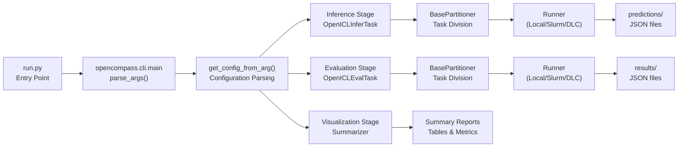
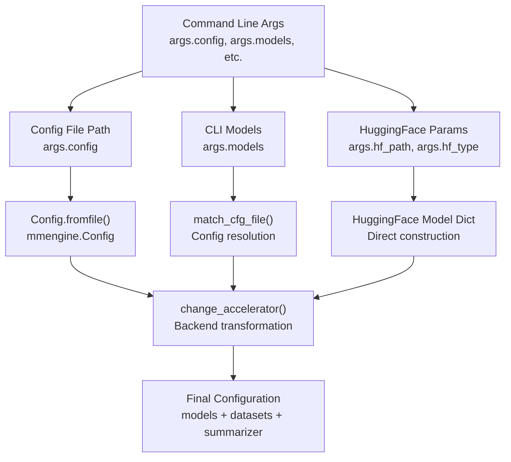
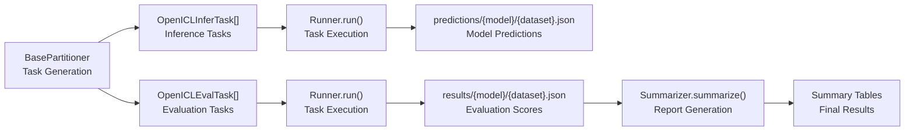

<!-- source: DeepWiki mcp.deepwiki.com · repo open-compass/opencompass · page 2 Getting Started · fetched 2026-10-21 -->

# Getting Started

<details>
<summary>Relevant source files</summary>

The following files were used as context for generating this wiki page:

- [README.md](README.md)
- [README_zh-CN.md](README_zh-CN.md)
- [docs/en/index.rst](docs/en/index.rst)
- [docs/en/notes/news.md](docs/en/notes/news.md)
- [docs/zh_cn/advanced_guides/evaluation_lmdeploy.md](docs/zh_cn/advanced_guides/evaluation_lmdeploy.md)
- [docs/zh_cn/index.rst](docs/zh_cn/index.rst)
- [docs/zh_cn/notes/news.md](docs/zh_cn/notes/news.md)

</details>


This document provides a practical introduction to running evaluations with OpenCompass. It covers installation, basic configuration, and executing your first evaluation task. For detailed information about specific evaluation methods, see [Evaluation Methods](#6). For advanced model and dataset customization, see [Model Support](#4) and [Dataset System](#5).

## Installation and Setup

OpenCompass supports multiple installation methods depending on your needs and the level of features required.

### Environment Requirements

OpenCompass requires Python 3.8+ and is optimized for conda environments:

```bash
conda create --name opencompass python=3.10 -y
conda activate opencompass
```

### Installation Options

#### Standard Installation via pip
For most users, pip installation provides access to core functionality:

```bash
# Basic installation
pip install -U opencompass

# Full installation with additional dataset support
pip install "opencompass[full]"

# Installation with API model support
pip install "opencompass[api]"
```

#### Accelerated Inference Support
For users requiring accelerated inference backends, separate environments are recommended due to dependency conflicts:

```bash
# LMDeploy acceleration
pip install "opencompass[lmdeploy]"

# vLLM acceleration  
pip install "opencompass[vllm]"
```

#### Source Installation
For development or access to latest features:

```bash
git clone https://github.com/open-compass/opencompass opencompass
cd opencompass
pip install -e .
```

**Installation Flow Diagram**

```mermaid
flowchart TD
    ENV[Create conda environment<br/>python=3.10]
    PIP[pip install opencompass]
    FULL[pip install opencompass[full]]
    ACC_LMD[pip install opencompass[lmdeploy]]
    ACC_VLLM[pip install opencompass[vllm]]
    SOURCE[git clone + pip install -e .]
    
    ENV --> PIP
    ENV --> FULL
    ENV --> ACC_LMD
    ENV --> ACC_VLLM
    ENV --> SOURCE
    
    PIP --> BASIC[Basic functionality<br/>Core datasets and models]
    FULL --> EXTENDED[Extended dataset support<br/>Additional dependencies]
    ACC_LMD --> LMD_BACKEND[LMDeploy acceleration<br/>TurboMindModel classes]
    ACC_VLLM --> VLLM_BACKEND[vLLM acceleration<br/>VLLM model classes]
    SOURCE --> DEV[Development access<br/>Latest features]
```

Sources: [README.md:96-135]()

## Basic Evaluation Workflow

OpenCompass evaluations follow a standardized pipeline managed by the [`run.py`](run.py:1-4)() entry point, which delegates to [`opencompass.cli.main.main()`](opencompass/cli/main.py:247-444)().

### Core Execution Modes

The evaluation process consists of three distinct phases:

1. **Inference (`infer`)**: Model generates predictions on dataset samples
2. **Evaluation (`eval`)**: Predictions are scored against ground truth  
3. **Visualization (`viz`)**: Results are summarized and formatted

**Evaluation Pipeline Architecture**



Sources: [opencompass/cli/main.py:318-354](), [opencompass/cli/main.py:357-400](), [opencompass/cli/main.py:407-439]()

### Command Line Interface

The primary interface uses [`run.py`](run.py:1-4)() with flexible configuration options:

#### Configuration File Approach
```bash
# Using a complete configuration file
python run.py configs/eval_demo.py

# With specific execution mode
python run.py configs/eval_demo.py -m infer  # inference only
python run.py configs/eval_demo.py -m eval   # evaluation only
python run.py configs/eval_demo.py -m all    # full pipeline
```

#### Command Line Arguments Approach  
```bash
# Direct model and dataset specification
python run.py --models hf_internlm2_5_1_8b_chat --datasets demo_gsm8k_chat_gen

# HuggingFace model quick setup
python run.py --datasets demo_gsm8k_chat_gen --hf-type chat --hf-path internlm/internlm2_5-1_8b-chat
```

#### Accelerated Inference
```bash
# Using LMDeploy acceleration
python run.py --models hf_internlm2_5_1_8b_chat --datasets demo_gsm8k_chat_gen -a lmdeploy

# Using vLLM acceleration  
python run.py --models hf_internlm2_5_1_8b_chat --datasets demo_gsm8k_chat_gen -a vllm
```

Sources: [opencompass/cli/main.py:21-26](), [opencompass/utils/run.py:87-233]()

## Configuration System

OpenCompass uses a hierarchical configuration system implemented in [`get_config_from_arg()`](opencompass/utils/run.py:87-233)() that supports multiple input methods.

**Configuration Resolution Flow**



### Configuration Priority Order

The [`get_config_from_arg()`](opencompass/utils/run.py:87-233)() function resolves configuration with the following precedence:

1. **Configuration File** (`args.config`): Complete evaluation specification
2. **CLI Models + Datasets** (`args.models` + `args.datasets`): Pre-defined configs
3. **HuggingFace Parameters** (`args.hf_path` + `args.datasets`): Quick model setup

### Model and Dataset Resolution

Configuration files are resolved through [`match_cfg_file()`](opencompass/utils/run.py:22-71)() which searches standard directories:

- `{config_dir}/models/` and `opencompass/configs/models/`
- `{config_dir}/datasets/` and `opencompass/configs/datasets/`  
- `{config_dir}/summarizers/` and `opencompass/configs/summarizers/`

Sources: [opencompass/utils/run.py:87-233](), [opencompass/utils/run.py:22-71]()

## Your First Evaluation

Let's walk through a complete evaluation example using both approaches.

### Example 1: Pre-configured Evaluation

```bash
# Simple chat model evaluation on GSM8K
opencompass --models hf_internlm2_5_1_8b_chat --datasets demo_gsm8k_chat_gen
```

This command:
1. Resolves the model config from `opencompass/configs/models/`
2. Resolves the dataset config from `opencompass/configs/datasets/`  
3. Uses default summarizer from `opencompass/configs/summarizers/`
4. Executes full pipeline (`infer` → `eval` → `viz`)

### Example 2: Custom HuggingFace Model

```bash
# Custom model with specific parameters
opencompass --datasets demo_gsm8k_chat_gen \
    --hf-type chat \
    --hf-path internlm/internlm2_5-1_8b-chat \
    --max-seq-len 4096 \
    --max-out-len 512 \
    --batch-size 8
```

### Example 3: API Model Evaluation

```bash
export OPENAI_API_KEY="your_api_key"
opencompass --models gpt_4o_2024_05_13 --datasets demo_gsm8k_chat_gen
```

### Understanding Output Structure

Evaluation results are organized in timestamped directories under `outputs/default/`:

```
outputs/default/
├── 20240101_120000/           # Timestamp directory
│   ├── configs/               # Configuration snapshots  
│   ├── logs/                  # Execution logs
│   │   ├── eval/             # Evaluation stage logs
│   │   └── infer/            # Inference stage logs
│   ├── predictions/          # Model outputs (JSON)
│   │   └── MODEL_NAME/
│   └── results/              # Evaluation results (JSON)
│       └── MODEL_NAME/
```

**Result Generation Flow**



Sources: [docs/en/user_guides/experimentation.md:98-125](), [opencompass/cli/main.py:288-298]()

## Next Steps

After completing your first evaluation:

1. **Explore Models**: See [Model Support](#4) for API models, local models, and accelerated inference options
2. **Add Datasets**: See [Dataset System](#5) for supported benchmarks and custom dataset creation  
3. **Customize Evaluation**: See [Evaluation Methods](#6) for different evaluation paradigms
4. **Scale Execution**: See [Task Execution and Distribution](#7) for distributed computing options

For troubleshooting common issues, see [FAQ and Troubleshooting](#2.3).

Sources: [README.md:177-270](), [opencompass/cli/main.py:247-444](), [docs/en/user_guides/experimentation.md:1-127]()

---

