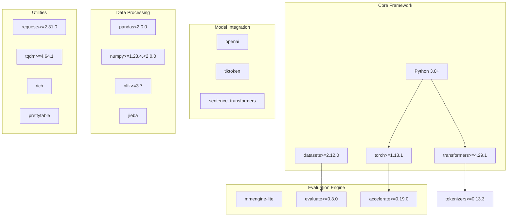
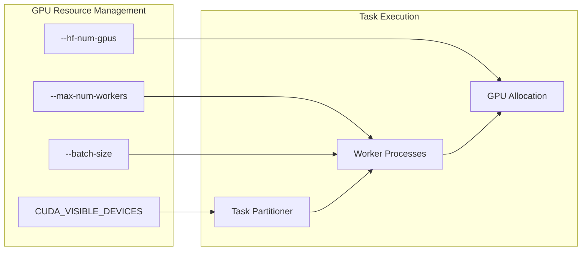
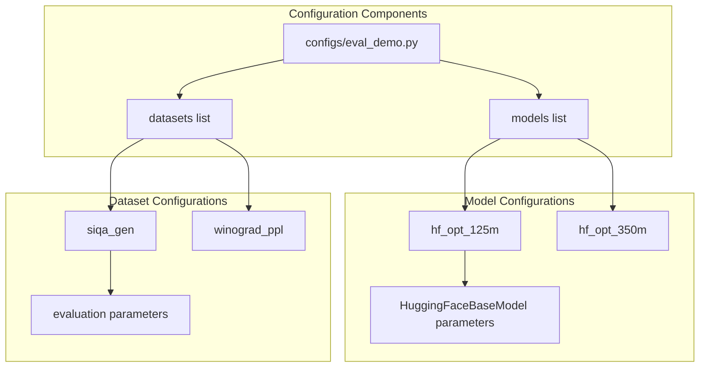

<!-- source: DeepWiki mcp.deepwiki.com · repo open-compass/opencompass · page 2.1 Installation and Setup · fetched 2026-10-21 -->

# Installation and Setup

<details>
<summary>Relevant source files</summary>

The following files were used as context for generating this wiki page:

- [README.md](README.md)
- [README_zh-CN.md](README_zh-CN.md)
- [docs/en/index.rst](docs/en/index.rst)
- [docs/en/notes/news.md](docs/en/notes/news.md)
- [docs/zh_cn/advanced_guides/evaluation_lmdeploy.md](docs/zh_cn/advanced_guides/evaluation_lmdeploy.md)
- [docs/zh_cn/index.rst](docs/zh_cn/index.rst)
- [docs/zh_cn/notes/news.md](docs/zh_cn/notes/news.md)
- [opencompass/configs/datasets/TheoremQA/ThroremQA_0shot_cot_gen_8acdf7.py](opencompass/configs/datasets/TheoremQA/ThroremQA_0shot_cot_gen_8acdf7.py)
- [opencompass/configs/models/deepseek/lmdeploy_deepseek_v2.py](opencompass/configs/models/deepseek/lmdeploy_deepseek_v2.py)
- [opencompass/configs/models/deepseek/lmdeploy_deepseek_v2_5.py](opencompass/configs/models/deepseek/lmdeploy_deepseek_v2_5.py)
- [opencompass/configs/models/deepseek/lmdeploy_deepseek_v2_5_1210.py](opencompass/configs/models/deepseek/lmdeploy_deepseek_v2_5_1210.py)
- [opencompass/datasets/TheoremQA/__init__.py](opencompass/datasets/TheoremQA/__init__.py)
- [opencompass/datasets/TheoremQA/main.py](opencompass/datasets/TheoremQA/main.py)
- [opencompass/datasets/livecodebench/execute_utils.py](opencompass/datasets/livecodebench/execute_utils.py)
- [opencompass/datasets/livecodebench/prompts.py](opencompass/datasets/livecodebench/prompts.py)
- [opencompass/datasets/livecodebench/testing_util.py](opencompass/datasets/livecodebench/testing_util.py)
- [opencompass/openicl/icl_evaluator/icl_plugin_evaluator.py](opencompass/openicl/icl_evaluator/icl_plugin_evaluator.py)
- [requirements/runtime.txt](requirements/runtime.txt)

</details>


This document covers the installation process, dependency management, and initial configuration required to run OpenCompass evaluations. It includes system requirements, installation methods, environment setup procedures, and solutions to common installation issues.

For information about basic usage patterns after installation, see [Quick Start Guide](#2.2). For detailed configuration of models and datasets, see [Model Support](#4) and [Dataset System](#5).

## System Requirements

OpenCompass requires a Python environment with specific dependencies for model inference, dataset processing, and evaluation frameworks. The platform supports multiple execution environments from single-GPU local machines to distributed computing clusters.

### Hardware Requirements

**Minimum Configuration:**
- 1 GPU with 6GB+ VRAM (tested on GTX-1660-6G)
- 16GB+ system RAM
- 50GB+ free disk space for models and datasets

**Recommended Configuration:**
- Multiple GPUs for parallel evaluation
- 32GB+ system RAM for large model inference
- 200GB+ SSD storage for caching
- High-bandwidth internet connection for initial setup

### Software Dependencies

**Core Runtime Dependencies:**



Sources: [requirements/runtime.txt:1-51](), [requirements.txt:1-2]()

## Installation Methods

### Basic Installation

**1. Clone Repository**
```bash
git clone https://github.com/open-compass/opencompass.git
cd opencompass
```

**2. Install Dependencies**
```bash
pip install -r requirements.txt
```

**3. Verify Installation**
```bash
python run.py --help
```

### Development Installation

For contributors and developers requiring pre-commit hooks and code quality tools:

```bash
# Install with development dependencies
pip install -e .

# Setup pre-commit hooks
pip install -U pre-commit
pre-commit install
```

For users in regions with network restrictions:
```bash
# Use China mirror for pre-commit
pre-commit install -c .pre-commit-config-zh-cn.yaml
pre-commit run --all-files -c .pre-commit-config-zh-cn.yaml
```

Sources: [docs/zh_cn/notes/contribution_guide.md:78-91](), [docs/en/notes/contribution_guide.md:78-83]()

## Environment Configuration

### Network Configuration

OpenCompass requires network access for downloading models and datasets from HuggingFace Hub during initial setup.

**Online Mode (Default):**
```bash
python run.py configs/eval_demo.py
```

**Offline Mode:**
```bash
# Set offline environment variables
export HF_DATASETS_OFFLINE=1
export TRANSFORMERS_OFFLINE=1
export HF_EVALUATE_OFFLINE=1
export HF_HUB_OFFLINE=1

python run.py configs/eval_demo.py
```

**Proxy Configuration:**
```bash
# Configure proxy if needed
export http_proxy=http://your-proxy:port
export https_proxy=https://your-proxy:port
python run.py configs/eval_demo.py
```

**Mirror Sites:**
```bash
# Use HuggingFace mirror for faster access
export HF_ENDPOINT=https://hf-mirror.com
python run.py configs/eval_demo.py
```

Sources: [docs/zh_cn/get_started/faq.md:92-106](), [docs/en/get_started/faq.md:72-85]()

### GPU Configuration

OpenCompass automatically detects and utilizes available GPU resources. Control GPU usage through environment variables and configuration parameters.



**Local GPU Control:**
```bash
# Limit to specific GPUs
CUDA_VISIBLE_DEVICES=0,1,2,3 python run.py configs/eval_demo.py

# Control parallel workers
python run.py configs/eval_demo.py --max-num-workers 4

# Specify GPU requirement per model
python run.py --hf-num-gpus 2 --datasets demo_gsm8k --hf-path Qwen/Qwen1.5-14B
```

Sources: [docs/zh_cn/get_started/faq.md:45-62](), [docs/en/get_started/faq.md:26-53]()

## Configuration Verification

### Basic Functionality Test

Run a minimal evaluation to verify installation:

```bash
# Debug mode for sequential execution and real-time output
python run.py --datasets siqa_gen winograd_ppl \
    --hf-type base \
    --hf-path facebook/opt-125m \
    --debug
```

Expected output indicating successful setup:
```
[INFO] Starting inference process...
```

### Configuration File Test

Test with a complete configuration file:

```bash
# Test with demo configuration
python run.py configs/eval_demo.py --debug
```

**Configuration Structure Verification:**



Sources: [docs/en/get_started/quick_start.md:211-230](), [docs/zh_cn/get_started/quick_start.md:356-378]()

## Common Installation Issues

### Dependency Conflicts

**OpenGL Library Issues:**
```bash
# Error: libGL.so.1 not found
pip uninstall opencv-python
pip install opencv-python-headless

# Alternative: install system dependencies
sudo apt-get update
sudo apt-get install -y libgl1 libglib2.0-0
```

**MKL Threading Conflicts:**
```bash
# Error: MKL_THREADING_LAYER=INTEL incompatible
export MKL_SERVICE_FORCE_INTEL=1
python run.py configs/eval_demo.py
```

Sources: [docs/zh_cn/get_started/faq.md:63-88](), [docs/en/get_started/faq.md:54-68]()

### Network Connectivity Issues

**HuggingFace Connection Failures:**

Common error patterns:
- `Connection aborted.', ConnectionResetError(104, 'Connection reset by peer')`
- `urllib3.exceptions.MaxRetryError: HTTPSConnectionPool(host='cdn-lfs.huggingface.co')`

**Solutions:**
1. **Cache Transfer Method:**
   ```bash
   # Copy cache from machine with internet access
   cp -r ~/.cache/huggingface/ /target/machine/.cache/
   
   # Run in offline mode
   HF_DATASETS_OFFLINE=1 TRANSFORMERS_OFFLINE=1 python run.py configs/eval_demo.py
   ```

2. **Mirror Configuration:**
   ```bash
   # Use regional mirrors
   HF_ENDPOINT=https://hf-mirror.com python run.py configs/eval_demo.py
   ```

Sources: [docs/zh_cn/get_started/faq.md:92-109](), [docs/en/get_started/faq.md:72-89]()

### Resource Management Issues

**Insufficient GPU Memory:**
- Reduce `batch_size` parameter in model configurations
- Use gradient checkpointing with `--model-kwargs device_map='auto'`
- Enable model sharding for large models

**Slow Evaluation Performance:**
- Check if using acceleration backends (LMDeploy, VLLM)
- Adjust `--max-partition-size` for better task distribution
- Verify network isn't bottleneck for model downloads

Sources: [docs/zh_cn/get_started/faq.md:122-131](), [docs/en/get_started/faq.md:98-112]()

## Installation Validation

### Complete System Test

```bash
# Run comprehensive test with multiple models and datasets
python run.py --models hf_opt_125m hf_opt_350m \
    --datasets siqa_gen winograd_ppl \
    --debug

# Expected directory structure after successful run
outputs/default/
├── TIMESTAMP/
│   ├── configs/
│   ├── logs/
│   │   ├── eval/
│   │   └── infer/
│   ├── predictions/
│   └── results/
```

### Configuration Listing Test

```bash
# Verify configuration discovery
python tools/list_configs.py

# Expected output format
+-----------------+-----------------------------------+
| Model           | Config Path                       |
|-----------------+-----------------------------------|
| hf_opt_125m     | configs/models/opt/hf_opt_125m.py |
| ...             | ...                               |
```

Sources: [docs/en/get_started/quick_start.md:70-77](), [docs/zh_cn/get_started/quick_start.md:93-102]()

---

