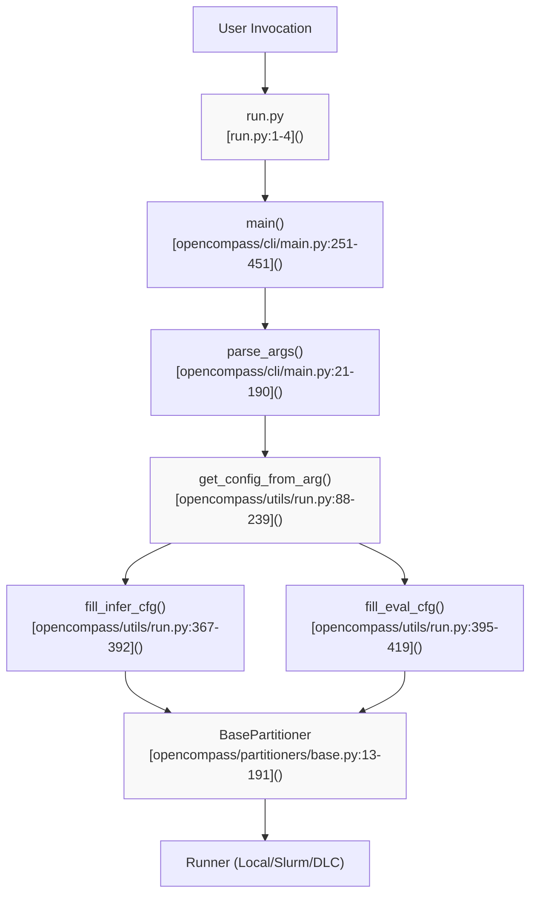
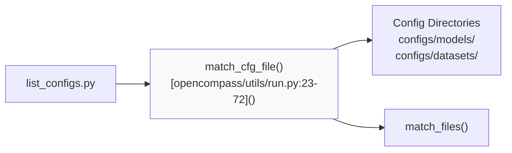
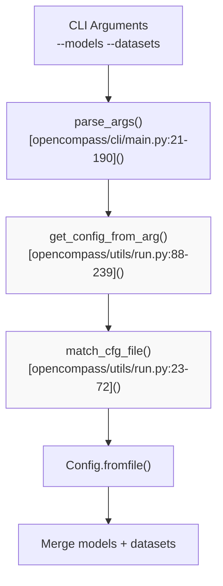
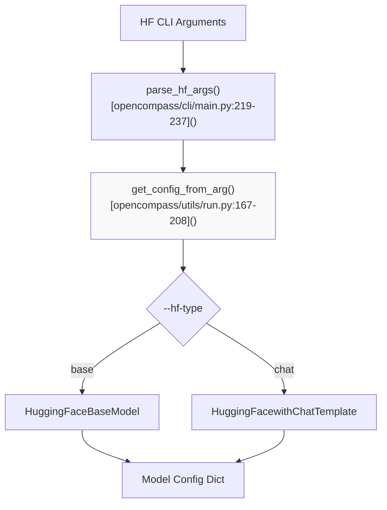
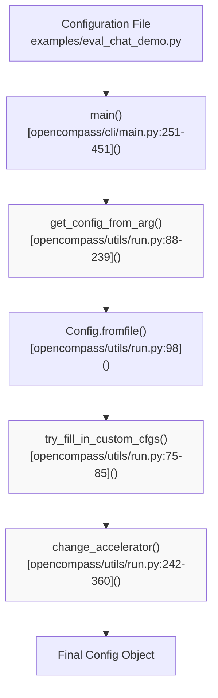
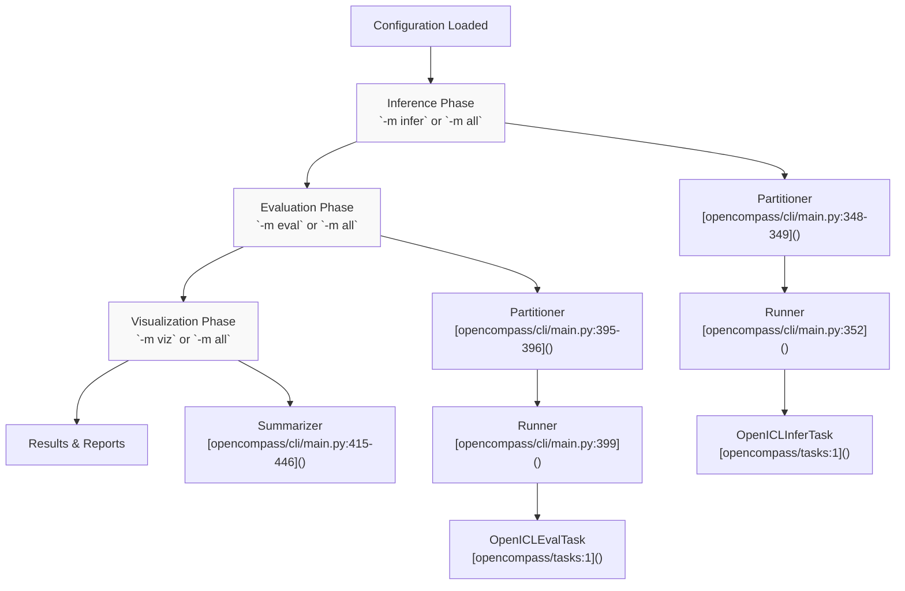
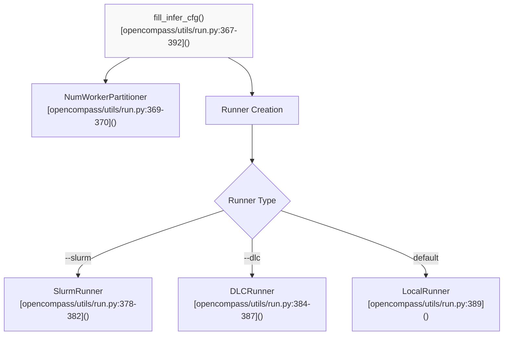
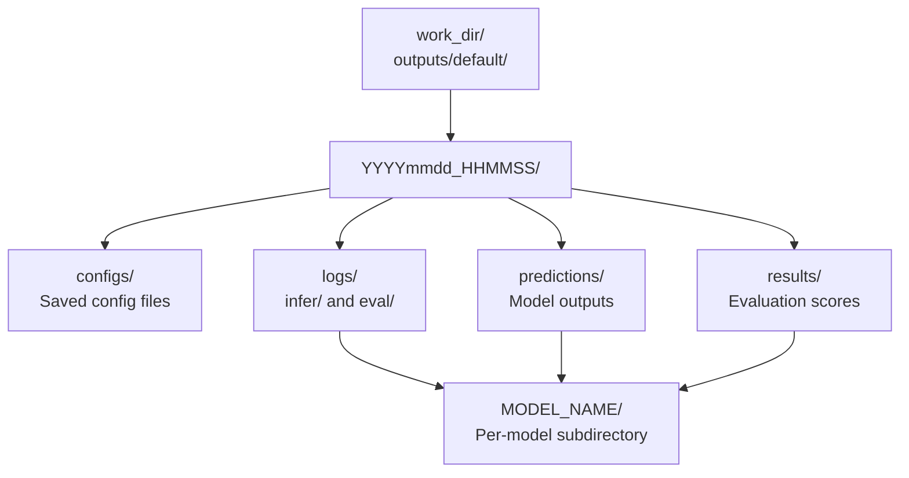

<!-- source: DeepWiki mcp.deepwiki.com · repo open-compass/opencompass · page 2.2 Quick Start Guide · fetched 2026-10-21 -->

# Quick Start Guide

<details>
<summary>Relevant source files</summary>

The following files were used as context for generating this wiki page:

- [README.md](README.md)
- [README_zh-CN.md](README_zh-CN.md)
- [docs/en/get_started/faq.md](docs/en/get_started/faq.md)
- [docs/en/get_started/quick_start.md](docs/en/get_started/quick_start.md)
- [docs/en/index.rst](docs/en/index.rst)
- [docs/en/notes/contribution_guide.md](docs/en/notes/contribution_guide.md)
- [docs/en/notes/news.md](docs/en/notes/news.md)
- [docs/en/user_guides/experimentation.md](docs/en/user_guides/experimentation.md)
- [docs/zh_cn/advanced_guides/evaluation_lmdeploy.md](docs/zh_cn/advanced_guides/evaluation_lmdeploy.md)
- [docs/zh_cn/get_started/faq.md](docs/zh_cn/get_started/faq.md)
- [docs/zh_cn/get_started/quick_start.md](docs/zh_cn/get_started/quick_start.md)
- [docs/zh_cn/index.rst](docs/zh_cn/index.rst)
- [docs/zh_cn/notes/contribution_guide.md](docs/zh_cn/notes/contribution_guide.md)
- [docs/zh_cn/notes/news.md](docs/zh_cn/notes/news.md)
- [docs/zh_cn/user_guides/experimentation.md](docs/zh_cn/user_guides/experimentation.md)
- [opencompass/cli/main.py](opencompass/cli/main.py)
- [opencompass/openicl/icl_retriever/icl_votek_retriever.py](opencompass/openicl/icl_retriever/icl_votek_retriever.py)
- [opencompass/partitioners/base.py](opencompass/partitioners/base.py)
- [opencompass/utils/result_station.py](opencompass/utils/result_station.py)
- [opencompass/utils/run.py](opencompass/utils/run.py)
- [run.py](run.py)

</details>


This guide covers the basic methods for running your first evaluation with OpenCompass. It demonstrates how to evaluate models on datasets using command-line interfaces and configuration files. For detailed installation instructions, see [Installation and Setup](#2.1). For advanced configuration options and the underlying configuration system, see [Configuration System](#2.3).

## Purpose and Scope

This document explains the three primary methods for launching evaluations in OpenCompass:

1. **CLI with pre-configured models and datasets** - Use predefined configurations
2. **CLI with HuggingFace parameters** - Quick evaluation of HF models without configuration files
3. **Configuration files** - Full control over evaluation settings

All methods ultimately invoke the same evaluation pipeline but differ in how they specify models and datasets.

## Entry Point and Execution Flow

The main entry point for all evaluations is `run.py` in the repository root, which delegates to `opencompass.cli.main.main()`.



**Sources:** [run.py:1-4](), [opencompass/cli/main.py:251-451](), [opencompass/utils/run.py:88-239]()

## Method 1: CLI with Pre-configured Models and Datasets

OpenCompass provides pre-defined configurations for popular models and datasets in `configs/models/` and `configs/datasets/`.

### Basic Usage

```bash
opencompass --models hf_internlm2_5_1_8b_chat --datasets demo_gsm8k_chat_gen
```

This command:
- Loads model configuration from the registry
- Loads dataset configuration from the registry
- Executes inference and evaluation
- Generates summary reports

### Listing Available Configurations

Use `tools/list_configs.py` to discover available configurations:

```bash
# List all configurations
python tools/list_configs.py

# Filter by keywords
python tools/list_configs.py llama mmlu
```

The tool uses `match_cfg_file()` to search for configuration files:



**Sources:** [opencompass/utils/run.py:23-72](), [README.md:227-231]()

### Configuration Resolution Flow

When you specify `--models` and `--datasets`, OpenCompass resolves them through this process:



**Sources:** [opencompass/cli/main.py:41-42](), [opencompass/utils/run.py:88-239](), [opencompass/utils/run.py:179-186]()

## Method 2: CLI with HuggingFace Models

For quick evaluation of HuggingFace models without creating configuration files, use the `--hf-path` and `--hf-type` parameters:

```bash
opencompass --datasets demo_gsm8k_chat_gen \
    --hf-type chat \
    --hf-path internlm/internlm2_5-1_8b-chat
```

### HuggingFace Parameter Mapping

The CLI arguments map to model configuration fields as follows:

| CLI Argument | Config Field | Description |
|-------------|--------------|-------------|
| `--hf-type` | `type` | Model class: `base` or `chat` |
| `--hf-path` | `path` | HuggingFace model path |
| `--tokenizer-path` | `tokenizer_path` | Tokenizer path (defaults to model path) |
| `--model-kwargs` | `model_kwargs` | Arguments for model initialization |
| `--tokenizer-kwargs` | `tokenizer_kwargs` | Arguments for tokenizer initialization |
| `--generation-kwargs` | `generation_kwargs` | Generation parameters |
| `--max-seq-len` | `max_seq_len` | Maximum sequence length |
| `--max-out-len` | `max_out_len` | Maximum output tokens |
| `--batch-size` | `batch_size` | Inference batch size |
| `--hf-num-gpus` | `run_cfg.num_gpus` | GPUs required per model instance |

**Sources:** [opencompass/cli/main.py:219-237](), [opencompass/utils/run.py:188-208]()

### Internal Model Construction

The HuggingFace parameters are converted into a model configuration dictionary:



**Sources:** [opencompass/utils/run.py:188-208](), [opencompass/cli/main.py:219-237]()

## Method 3: Configuration Files

Configuration files provide full control over evaluation settings and enable batch evaluation of multiple models and datasets.

### Basic Configuration Structure

A minimal configuration file must define `models` and `datasets`:

```python
from mmengine.config import read_base

with read_base():
    from .datasets.demo.demo_gsm8k_chat_gen import gsm8k_datasets
    from .models.hf_internlm.hf_internlm2_chat_1_8b import models as internlm_models

datasets = gsm8k_datasets
models = internlm_models
```

Execute with:

```bash
opencompass examples/eval_chat_demo.py
```

### Configuration Loading Process



**Sources:** [opencompass/utils/run.py:88-118](), [opencompass/cli/main.py:263]()

### Accelerator Transformation

When using `--accelerator vllm` or `--accelerator lmdeploy`, OpenCompass automatically transforms HuggingFace model configurations:

```mermaid
graph LR
    HFModel["HuggingFace Models"]
    CheckAccel{"`--accelerator`<br/>parameter"}
    ChangeAccel["change_accelerator()<br/>[opencompass/utils/run.py:242-360]()"]
    VLLM["VLLM Models"]
    LMDeploy["TurboMind Models"]
    NoChange["Original Models"]
    
    HFModel --> CheckAccel
    CheckAccel -->|vllm| ChangeAccel
    CheckAccel -->|lmdeploy| ChangeAccel
    CheckAccel -->|None| NoChange
    ChangeAccel -->|vllm| VLLM
    ChangeAccel -->|lmdeploy| LMDeploy
    
    style ChangeAccel fill:#f9f9f9
```

**Sources:** [opencompass/utils/run.py:106-117](), [opencompass/utils/run.py:242-360]()

## Understanding the Evaluation Flow

Once configuration is loaded, OpenCompass executes a three-phase pipeline:

### Phase Overview



**Sources:** [opencompass/cli/main.py:322-446]()

### Inference Phase (`-m infer` or `-m all`)

Configuration is set up by `fill_infer_cfg()`:



The partitioner splits model-dataset pairs into tasks, and the runner executes them in parallel.

**Sources:** [opencompass/utils/run.py:367-392](), [opencompass/cli/main.py:322-361]()

### Evaluation Phase (`-m eval` or `-m all`)

Similar to inference, configured by `fill_eval_cfg()`:


**Sources:** [opencompass/utils/run.py:395-419](), [opencompass/cli/main.py:364-407]()

### Visualization Phase (`-m viz` or `-m all`)

Summarizers aggregate evaluation results into readable reports:

```mermaid
graph TB
    VizPhase["Visualization Phase"]
    GetSummarizer["Get Summarizer Config<br/>[opencompass/cli/main.py:415-443]()"]
    CheckFunction{"`function` in config?"}
    SubjectivePath["Subjective Summarization<br/>[opencompass/cli/main.py:418-440]()"]
    ObjectivePath["Objective Summarization<br/>[opencompass/cli/main.py:442-446]()"]
    DefaultSummarizer["DefaultSummarizer<br/>[opencompass/cli/main.py:443]()"]
    BuildSummarizer["build_from_cfg()"]
    SummarizeCall["summarize(time_str=...)"]
    
    VizPhase --> GetSummarizer
    GetSummarizer --> CheckFunction
    CheckFunction -->|Yes| SubjectivePath
    CheckFunction -->|No| ObjectivePath
    ObjectivePath --> DefaultSummarizer
    SubjectivePath --> BuildSummarizer
    DefaultSummarizer --> BuildSummarizer
    BuildSummarizer --> SummarizeCall
    
    style VizPhase fill:#f9f9f9
```

**Sources:** [opencompass/cli/main.py:414-446]()

## Key Command-Line Arguments

### Task Control

| Argument | Description | Default |
|----------|-------------|---------|
| `-m`, `--mode` | Execution mode: `all`, `infer`, `eval`, `viz` | `all` |
| `-r`, `--reuse` | Reuse existing results from timestamp | None |
| `--debug` | Run in single-process debug mode | False |
| `--dry-run` | Print tasks without executing | False |

### Resource Control

| Argument | Description | Default |
|----------|-------------|---------|
| `--max-num-workers` | Maximum parallel workers | 1 |
| `--max-workers-per-gpu` | Workers per GPU (local only) | 1 |
| `--hf-num-gpus` | GPUs per model instance | 1 |

### Execution Environment

| Argument | Description | Default |
|----------|-------------|---------|
| `--slurm` | Use Slurm scheduler | False |
| `-p`, `--partition` | Slurm partition | None |
| `--dlc` | Use Alibaba DLC cluster | False |

### Output Control

| Argument | Description | Default |
|----------|-------------|---------|
| `-w`, `--work-dir` | Output directory | `outputs/default` |
| `--dump-eval-details` | Save detailed evaluation results | True |
| `-l`, `--lark` | Enable Lark bot reporting | False |

**Sources:** [opencompass/cli/main.py:21-190]()

### Common Usage Patterns

**Run inference only:**
```bash
opencompass config.py -m infer
```

**Run evaluation on existing inference results:**
```bash
opencompass config.py -m eval -r latest
```

**Use 4 parallel workers with Slurm:**
```bash
opencompass config.py --slurm -p gpu_partition --max-num-workers 4
```

**Debug mode (single process, real-time output):**
```bash
opencompass config.py --debug
```

**Sources:** [opencompass/cli/main.py:45-90](), [docs/en/user_guides/experimentation.md:1-61]()

## Output Structure

All evaluation outputs are organized under the work directory (default: `outputs/default/`):



### Directory Contents

**`configs/`**: Stores configuration files used for each run
- Format: `{timestamp}_{pid}.py`
- Contains complete evaluation configuration

**`logs/`**: Contains execution logs
- `logs/infer/`: Inference phase logs
- `logs/eval/`: Evaluation phase logs
- Organized by model name

**`predictions/`**: Model inference outputs
- JSON files containing model predictions
- Named as `{dataset}.json` or `{dataset}_{partition}.json`

**`results/`**: Evaluation results
- JSON files with metrics and scores
- Named as `{dataset}.json`

**Sources:** [docs/en/user_guides/experimentation.md:98-125](), [opencompass/cli/main.py:289-293]()

### Reusing Results

The `-r` or `--reuse` flag allows resuming interrupted evaluations:

```bash
# Reuse latest results
opencompass config.py -r

# Reuse specific timestamp
opencompass config.py -r 20240315_143022
```

OpenCompass skips completed tasks and continues from where it left off.

**Sources:** [opencompass/cli/main.py:72-81](), [opencompass/cli/main.py:271-286]()

## Summary

OpenCompass provides flexible evaluation methods:

1. **CLI + pre-configured**: Fast evaluation with standard configurations
2. **CLI + HuggingFace**: Quick evaluation without configuration files
3. **Configuration files**: Full control for complex evaluations

All methods converge to the same pipeline:
- `run.py` → `main()` → `get_config_from_arg()` → `fill_infer_cfg()` / `fill_eval_cfg()` → Partitioner → Runner → Tasks

For details on customizing configurations, see [Configuration System](#2.3). For troubleshooting common issues, see [FAQ and Troubleshooting](#2.4).

**Sources:** [README.md:177-268](), [opencompass/cli/main.py:251-451](), [opencompass/utils/run.py:88-419]()

---

