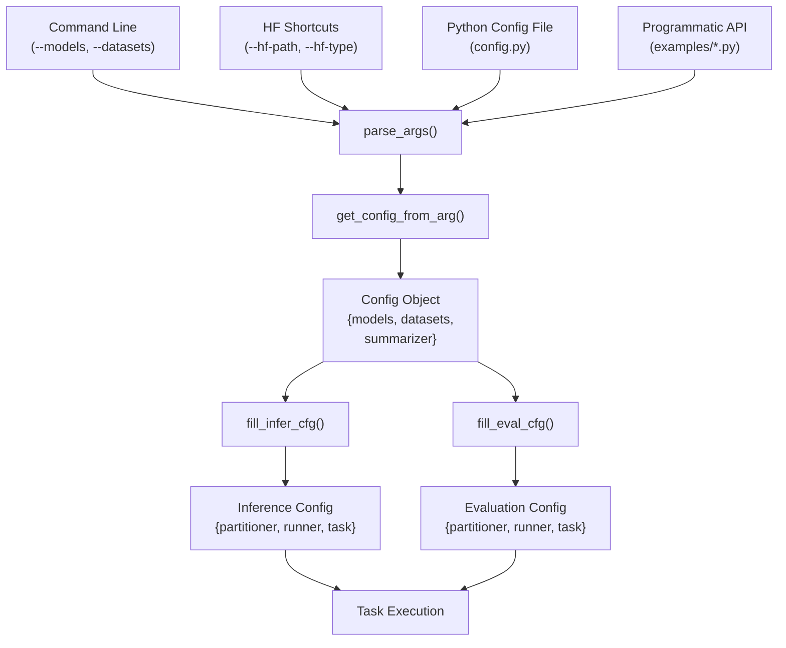
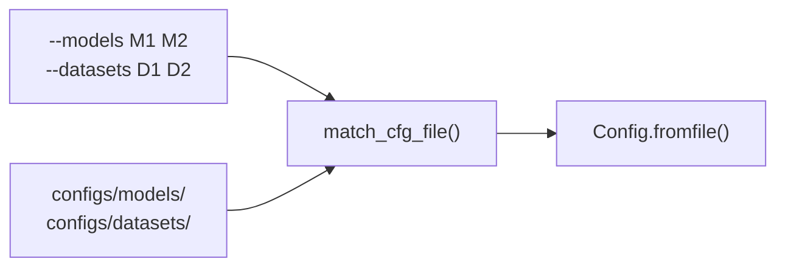
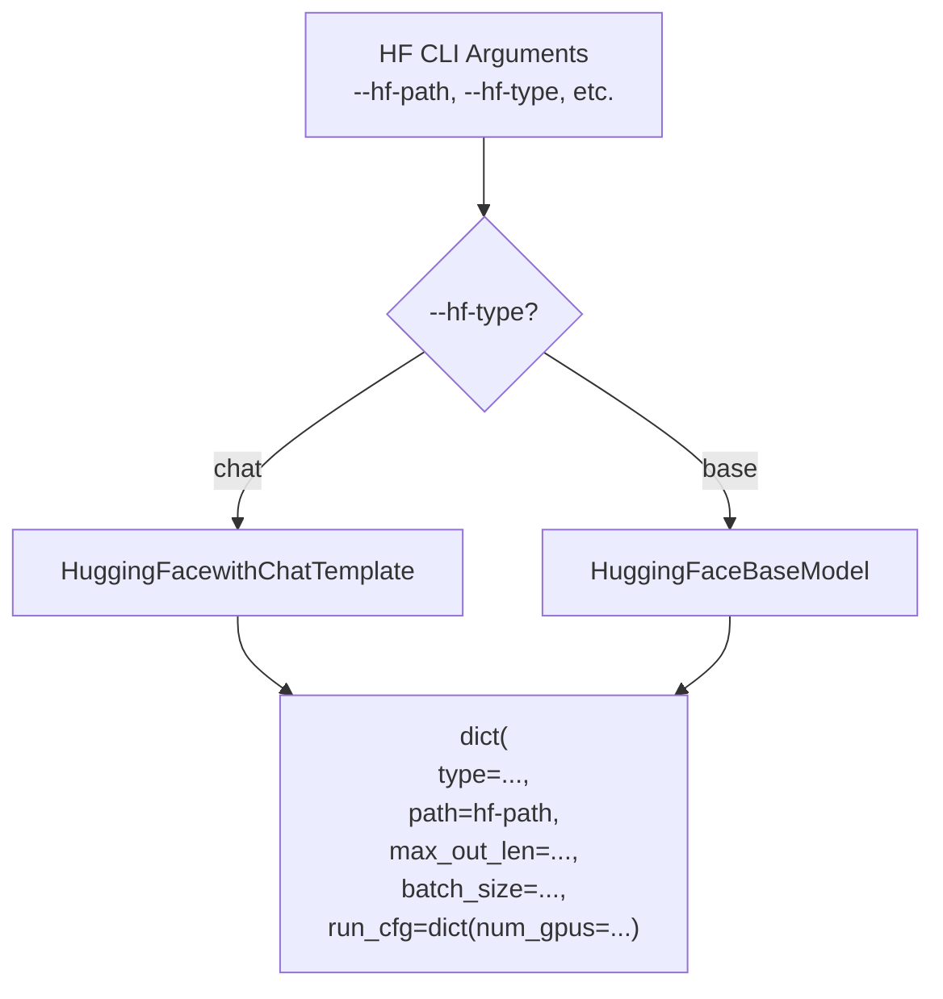
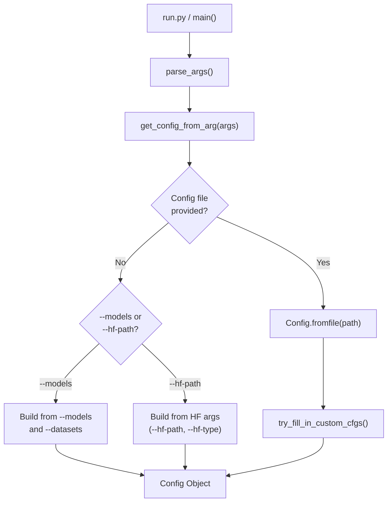
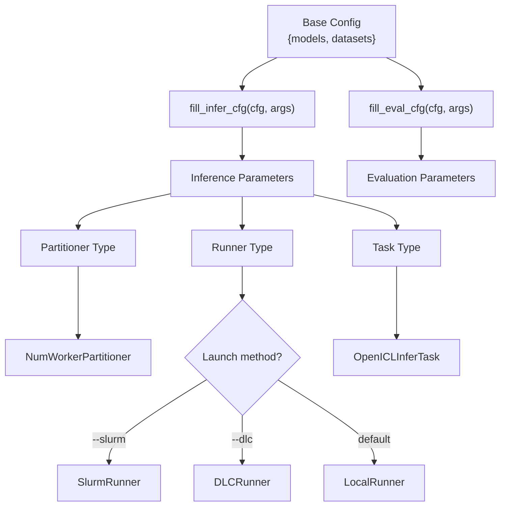
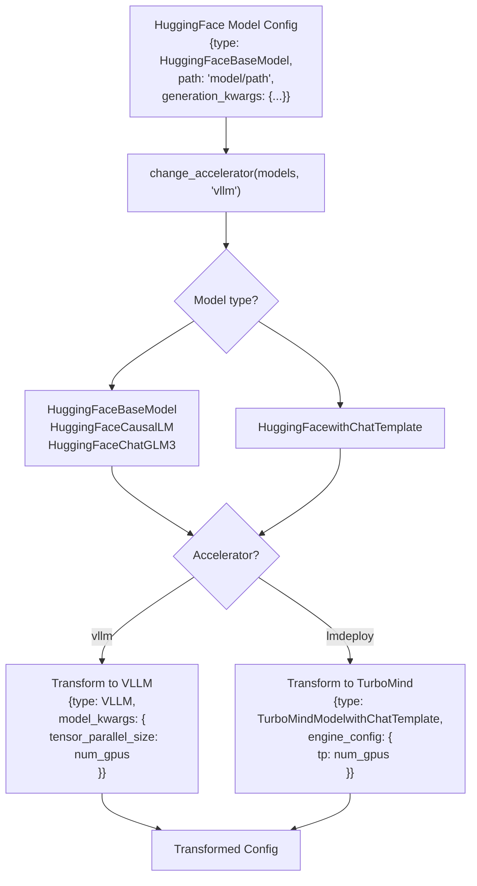
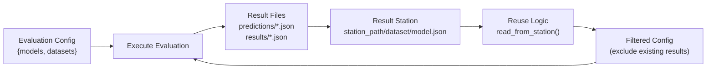

<!-- source: DeepWiki mcp.deepwiki.com · repo open-compass/opencompass · page 2.3 Configuration System · fetched 2026-10-21 -->

# Configuration System

<details>
<summary>Relevant source files</summary>

The following files were used as context for generating this wiki page:

- [README.md](README.md)
- [README_zh-CN.md](README_zh-CN.md)
- [docs/en/get_started/faq.md](docs/en/get_started/faq.md)
- [docs/en/get_started/quick_start.md](docs/en/get_started/quick_start.md)
- [docs/en/index.rst](docs/en/index.rst)
- [docs/en/notes/contribution_guide.md](docs/en/notes/contribution_guide.md)
- [docs/en/notes/news.md](docs/en/notes/news.md)
- [docs/en/user_guides/experimentation.md](docs/en/user_guides/experimentation.md)
- [docs/zh_cn/advanced_guides/evaluation_lmdeploy.md](docs/zh_cn/advanced_guides/evaluation_lmdeploy.md)
- [docs/zh_cn/get_started/faq.md](docs/zh_cn/get_started/faq.md)
- [docs/zh_cn/get_started/quick_start.md](docs/zh_cn/get_started/quick_start.md)
- [docs/zh_cn/index.rst](docs/zh_cn/index.rst)
- [docs/zh_cn/notes/contribution_guide.md](docs/zh_cn/notes/contribution_guide.md)
- [docs/zh_cn/notes/news.md](docs/zh_cn/notes/news.md)
- [docs/zh_cn/user_guides/experimentation.md](docs/zh_cn/user_guides/experimentation.md)
- [opencompass/cli/main.py](opencompass/cli/main.py)
- [opencompass/openicl/icl_retriever/icl_votek_retriever.py](opencompass/openicl/icl_retriever/icl_votek_retriever.py)
- [opencompass/partitioners/base.py](opencompass/partitioners/base.py)
- [opencompass/utils/result_station.py](opencompass/utils/result_station.py)
- [opencompass/utils/run.py](opencompass/utils/run.py)
- [run.py](run.py)

</details>


## Purpose and Scope

The Configuration System in OpenCompass provides a flexible mechanism for specifying evaluation tasks through multiple input methods: command-line arguments, Python configuration files, or programmatic APIs. This system handles the parsing, validation, consolidation, and transformation of user-specified models, datasets, and evaluation parameters into executable task configurations.

For information about task execution after configuration, see [Task Execution and Monitoring](#2.4). For details on the overall evaluation pipeline, see [Evaluation Pipeline Overview](#3.1).

---

## Overview of Configuration Methods

OpenCompass supports three primary methods for specifying evaluation configurations, all converging through a unified processing pipeline:



**Figure 1: Configuration Methods and Processing Flow**

Sources: [opencompass/cli/main.py:21-249](), [opencompass/utils/run.py:88-240]()

---

## Configuration File Structure

### Core Components

All OpenCompass configuration files must be Python scripts containing at minimum two required fields:

| Field | Type | Description | Example |
|-------|------|-------------|---------|
| `models` | `List[Dict]` | List of model configurations to evaluate | `[dict(type='HuggingFacewithChatTemplate', ...)]` |
| `datasets` | `List[Dict]` | List of dataset configurations to test | `[dict(type='GSM8KDataset', ...)]` |
| `summarizer` | `Dict` (optional) | Configuration for result summarization | `dict(type='DefaultSummarizer')` |

Additional optional fields include:

- `infer`: Custom inference stage configuration
- `eval`: Custom evaluation stage configuration  
- `lark_bot_url`: Lark notification webhook URL
- `work_dir`: Working directory path
- `station_path`: Results persistence path
- `model_dataset_combinations`: Custom model-dataset pairing strategy

Sources: [opencompass/utils/run.py:98-118](), [opencompass/partitioners/base.py:40-102]()

### AMOTIC Consolidation

As of version 0.4.0, OpenCompass has consolidated all configuration files from the previous locations (`./configs/datasets`, `./configs/models`, `./configs/summarizers`) into the `opencompass` package itself. This consolidation enables:

1. **Pip installation support**: Configs are now part of the installed package
2. **Versioning**: Configuration versions match package versions
3. **Easier distribution**: No separate config file management required

Users referencing old configuration paths must update to the new structure:

```python
# Old (deprecated)
from configs.models.hf_llama import models

# New (AMOTIC)
from opencompass.configs.models.hf_llama.hf_llama_7b import models
```

Sources: [README.md:55-56](), [README_zh-CN.md:55-56]()

---

## Configuration Methods in Detail

### Method 1: Command Line with Predefined Configs

Users can specify models and datasets using their configuration names:

```bash
opencompass --models hf_internlm2_chat_1_8b hf_qwen2_1_5b_instruct \
            --datasets demo_gsm8k_chat_gen demo_math_chat_gen
```

The `list_configs.py` tool helps discover available configurations:

```bash
# List all available configs
python tools/list_configs.py

# Filter by keywords
python tools/list_configs.py llama mmlu
```



**Figure 2: Predefined Configuration Loading**

Sources: [opencompass/utils/run.py:23-72](), [opencompass/utils/run.py:124-165]()

### Method 2: HuggingFace Quick Setup

For HuggingFace models, users can bypass configuration files entirely:

```bash
opencompass --datasets demo_gsm8k_chat_gen \
            --hf-type chat \
            --hf-path internlm/internlm2-chat-1_8b \
            --max-out-len 1024 \
            --batch-size 8 \
            --hf-num-gpus 1
```

This approach dynamically constructs model configuration:



**Figure 3: Dynamic HuggingFace Model Configuration**

Sources: [opencompass/utils/run.py:167-208](), [opencompass/cli/main.py:219-236]()

### Method 3: Python Configuration Files

Configuration files use the `read_base()` context manager for modular inheritance:

```python
# examples/eval_chat_demo.py
from mmengine.config import read_base

with read_base():
    from .datasets.demo.demo_gsm8k_chat_gen import gsm8k_datasets
    from .datasets.demo.demo_math_chat_gen import math_datasets
    from .models.qwen.hf_qwen2_1_5b_instruct import models as qwen_models
    from .models.hf_internlm.hf_internlm2_chat_1_8b import models as internlm_models

datasets = gsm8k_datasets + math_datasets
models = qwen_models + internlm_models
```

The `read_base()` context manager provides:

1. **Relative imports**: Import configs relative to the current file
2. **Lazy loading**: Configs loaded only when needed
3. **Namespace isolation**: Prevents naming conflicts
4. **Composition**: Easily combine multiple configuration sources

Sources: [docs/zh_cn/get_started/quick_start.md:138-152](), [docs/en/get_started/quick_start.md:136-161]()

### Method 4: Custom Dataset Configuration

For datasets not in the registry, use custom dataset arguments:

```bash
opencompass --custom-dataset-path /path/to/dataset.json \
            --custom-dataset-meta-path /path/to/meta.json \
            --custom-dataset-data-type mcq \
            --custom-dataset-infer-method gen \
            --models hf_internlm2_chat_1_8b
```

This internally calls `make_custom_dataset_config()` to generate a dataset configuration:

Sources: [opencompass/utils/run.py:150-158](), [opencompass/cli/main.py:239-248]()

---

## Configuration Processing Pipeline

### Stage 1: Argument Parsing and Config Retrieval



**Figure 4: Configuration Retrieval Flow**

The `get_config_from_arg()` function implements a priority-based resolution:

1. **Highest Priority**: Explicit config file path (`args.config`)
2. **Medium Priority**: Model and dataset names (`args.models` + `args.datasets`)
3. **Lowest Priority**: HuggingFace shortcuts (`args.hf_path` + `args.datasets`)

Sources: [opencompass/utils/run.py:88-240](), [opencompass/cli/main.py:251-263]()

### Stage 2: Configuration Filling

After retrieving the base configuration, OpenCompass fills in execution-specific parameters:



**Figure 5: Configuration Filling Pipeline**

The `fill_infer_cfg()` function populates:

| Parameter | Source | Purpose |
|-----------|--------|---------|
| `infer.partitioner.type` | Always `NumWorkerPartitioner` | Task partitioning strategy |
| `infer.partitioner.num_worker` | `args.max_num_workers` | Parallel worker count |
| `infer.runner.type` | `args.slurm` / `args.dlc` flags | Execution backend |
| `infer.runner.partition` | `args.partition` | Slurm partition name |
| `infer.runner.max_num_workers` | `args.max_num_workers` | Max parallel workers |
| `infer.runner.max_workers_per_gpu` | `args.max_workers_per_gpu` | GPU sharing ratio |
| `infer.runner.task.type` | Always `OpenICLInferTask` | Task implementation |

Similarly, `fill_eval_cfg()` populates evaluation-specific parameters with `NaivePartitioner` and `OpenICLEvalTask`.

Sources: [opencompass/utils/run.py:367-419](), [opencompass/cli/main.py:322-361]()

### Stage 3: Accelerator Transformation

When users specify an accelerator (e.g., `--accelerator vllm`), the `change_accelerator()` function transforms HuggingFace model configurations:



**Figure 6: Accelerator Transformation Process**

The transformation preserves essential parameters while mapping HuggingFace-specific settings to accelerator-specific equivalents:

| HuggingFace Parameter | VLLM Mapping | LMDeploy Mapping |
|----------------------|--------------|------------------|
| `run_cfg.num_gpus` | `model_kwargs.tensor_parallel_size` | `engine_config.tp` |
| `max_seq_len` | `model_kwargs.max_model_len` | `engine_config.session_len` |
| `generation_kwargs.temperature` | `generation_kwargs.temperature` | `gen_config.temperature` |
| `generation_kwargs.top_k` | Preserved | `gen_config.top_k` |
| `generation_kwargs.top_p` | Preserved | `gen_config.top_p` |

Sources: [opencompass/utils/run.py:242-360](), [opencompass/utils/run.py:106-117]()

---

## Configuration Object Structure

The final `Config` object after processing contains:

```python
Config({
    # Core evaluation components
    'models': [
        {
            'type': 'opencompass.models.HuggingFacewithChatTemplate',
            'abbr': 'internlm2-chat-1.8b-hf',
            'path': 'internlm/internlm2-chat-1_8b',
            'max_out_len': 1024,
            'batch_size': 8,
            'run_cfg': {'num_gpus': 1}
        }
    ],
    'datasets': [
        {
            'type': 'opencompass.datasets.GSM8KDataset',
            'abbr': 'gsm8k',
            'path': './data/gsm8k/',
            'reader_cfg': {...},
            'infer_cfg': {...},
            'eval_cfg': {...}
        }
    ],
    
    # Optional components
    'summarizer': {
        'type': 'opencompass.summarizers.DefaultSummarizer'
    },
    
    # Execution configuration (filled by fill_infer_cfg/fill_eval_cfg)
    'infer': {
        'partitioner': {
            'type': 'opencompass.partitioners.NumWorkerPartitioner',
            'out_dir': 'outputs/20240101_120000/predictions/',
            'num_worker': 4
        },
        'runner': {
            'type': 'opencompass.runners.LocalRunner',
            'max_num_workers': 4,
            'max_workers_per_gpu': 1,
            'task': {
                'type': 'opencompass.tasks.OpenICLInferTask'
            }
        }
    },
    'eval': {
        'partitioner': {
            'type': 'opencompass.partitioners.NaivePartitioner',
            'out_dir': 'outputs/20240101_120000/results/'
        },
        'runner': {
            'type': 'opencompass.runners.LocalRunner',
            'max_num_workers': 4,
            'task': {
                'type': 'opencompass.tasks.OpenICLEvalTask'
            }
        }
    },
    
    # Working directories
    'work_dir': 'outputs/default/20240101_120000',
    'lark_bot_url': None
})
```

Sources: [opencompass/utils/run.py:239-240](), [opencompass/cli/main.py:263-301]()

---

## Configuration Persistence and Reuse

### Config Dumping

Every evaluation run dumps its configuration to the work directory for reproducibility:

```
outputs/default/20240101_120000/
├── configs/
│   └── 20240101_120000_12345.py  # Dumped config with timestamp and PID
├── logs/
├── predictions/
└── results/
```

The config is reloaded from the dumped file to ensure all types are properly serialized:

```python
# Dump config
output_config_path = osp.join(cfg.work_dir, 'configs',
                              f'{cfg_time_str}_{os.getpid()}.py')
cfg.dump(output_config_path)

# Reload to avoid serialization issues
cfg = Config.fromfile(output_config_path, format_python_code=False)
```

Sources: [opencompass/cli/main.py:296-301]()

### Result Station Integration

When `--station-path` is specified, the configuration participates in result persistence:



**Figure 7: Configuration and Result Station Integration**

The configuration is saved alongside predictions and results, enabling:

1. **Reproducibility**: Exact config used for each result
2. **Reuse**: Skip already-evaluated model-dataset combinations
3. **Comparison**: Verify config consistency across runs

Sources: [opencompass/utils/result_station.py:11-112](), [opencompass/cli/main.py:304-307]()

---

## Advanced Configuration Features

### Model-Dataset Combinations

For subjective evaluation or complex scenarios, users can explicitly specify model-dataset pairings:

```python
from mmengine.config import read_base

with read_base():
    from .models.hf_internlm import models as internlm_models
    from .models.hf_qwen import models as qwen_models
    from .datasets.alignbench import alignbench_datasets
    from .datasets.mtbench import mtbench_datasets

# Explicit combinations
model_dataset_combinations = [
    {
        'models': internlm_models,
        'datasets': alignbench_datasets
    },
    {
        'models': qwen_models,
        'datasets': mtbench_datasets
    }
]
```

The partitioner uses `model_dataset_combinations` if available, otherwise defaults to Cartesian product of all models × all datasets.

Sources: [opencompass/partitioners/base.py:104-155]()

### Chatml Datasets

OpenCompass supports a special `chatml_datasets` configuration for chat-formatted evaluations with dynamic evaluator construction:

```python
chatml_datasets = [
    {
        'abbr': 'custom_math',
        'path': '/path/to/dataset.json',
        'evaluator': {
            'type': 'math_evaluator'  # Auto-constructs from registry
        }
    }
]
```

The `consturct_chatml_datasets()` function processes these into full dataset configurations with appropriate inferencers and evaluators.

Sources: [opencompass/utils/run.py:421-531]()

### Configuration Validation

OpenCompass validates configurations at multiple stages:

1. **File matching**: `match_cfg_file()` ensures specified configs exist
2. **Field validation**: Checks for required `models` and `datasets` fields  
3. **Combination validation**: Verifies model-dataset combinations reference valid configs
4. **Accelerator compatibility**: `change_accelerator()` validates model type support

Sources: [opencompass/utils/run.py:23-72](), [opencompass/partitioners/base.py:132-147]()

---

## Configuration System Code Entities

| Code Entity | Location | Purpose |
|-------------|----------|---------|
| `parse_args()` | [opencompass/cli/main.py:21-190]() | Parse command-line arguments |
| `get_config_from_arg()` | [opencompass/utils/run.py:88-240]() | Construct Config from arguments |
| `fill_infer_cfg()` | [opencompass/utils/run.py:367-392]() | Populate inference configuration |
| `fill_eval_cfg()` | [opencompass/utils/run.py:395-419]() | Populate evaluation configuration |
| `change_accelerator()` | [opencompass/utils/run.py:242-360]() | Transform HF to accelerator configs |
| `match_cfg_file()` | [opencompass/utils/run.py:23-72]() | Match config files by pattern |
| `try_fill_in_custom_cfgs()` | [opencompass/utils/run.py:75-85]() | Handle custom dataset configs |
| `consturct_chatml_datasets()` | [opencompass/utils/run.py:421-531]() | Build chatml-format datasets |
| `Config.fromfile()` | mmengine | Load Python config file |
| `read_base()` | mmengine | Context manager for config inheritance |
| `BasePartitioner.parse_model_dataset_args()` | [opencompass/partitioners/base.py:104-155]() | Parse model-dataset combinations |

Sources: All sources listed in table above

---

