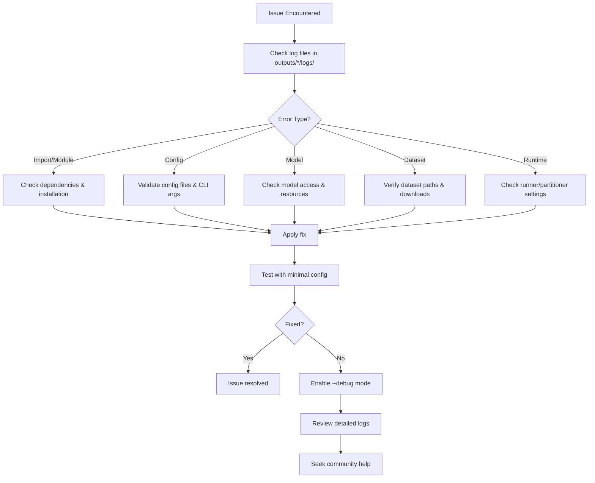

<!-- source: DeepWiki mcp.deepwiki.com · repo open-compass/opencompass · page 2.4 FAQ and Troubleshooting · fetched 2026-10-21 -->

# FAQ and Troubleshooting

<details>
<summary>Relevant source files</summary>

The following files were used as context for generating this wiki page:

- [README.md](README.md)
- [README_zh-CN.md](README_zh-CN.md)
- [docs/en/get_started/faq.md](docs/en/get_started/faq.md)
- [docs/en/get_started/quick_start.md](docs/en/get_started/quick_start.md)
- [docs/en/index.rst](docs/en/index.rst)
- [docs/en/notes/contribution_guide.md](docs/en/notes/contribution_guide.md)
- [docs/en/notes/news.md](docs/en/notes/news.md)
- [docs/en/user_guides/experimentation.md](docs/en/user_guides/experimentation.md)
- [docs/zh_cn/advanced_guides/evaluation_lmdeploy.md](docs/zh_cn/advanced_guides/evaluation_lmdeploy.md)
- [docs/zh_cn/get_started/faq.md](docs/zh_cn/get_started/faq.md)
- [docs/zh_cn/get_started/quick_start.md](docs/zh_cn/get_started/quick_start.md)
- [docs/zh_cn/index.rst](docs/zh_cn/index.rst)
- [docs/zh_cn/notes/contribution_guide.md](docs/zh_cn/notes/contribution_guide.md)
- [docs/zh_cn/notes/news.md](docs/zh_cn/notes/news.md)
- [docs/zh_cn/user_guides/experimentation.md](docs/zh_cn/user_guides/experimentation.md)
- [opencompass/cli/main.py](opencompass/cli/main.py)
- [opencompass/openicl/icl_retriever/icl_votek_retriever.py](opencompass/openicl/icl_retriever/icl_votek_retriever.py)
- [opencompass/partitioners/base.py](opencompass/partitioners/base.py)
- [opencompass/utils/result_station.py](opencompass/utils/result_station.py)
- [opencompass/utils/run.py](opencompass/utils/run.py)
- [run.py](run.py)

</details>


This page provides solutions to common issues encountered when using OpenCompass for LLM/VLM evaluation. It covers installation problems, configuration errors, runtime issues, and performance troubleshooting. 

For general usage guidance, see [2.2](#2.2) Quick Start Guide. For advanced configuration and customization, see the [6](#6) Evaluation Methods and [9](#9) Developer Guide sections.

## Overview of Common Issue Categories

OpenCompass troubleshooting typically falls into these categories:

```mermaid
graph TD
    Issues["Common Issues"]
    Issues --> Install["Installation & Dependencies"]
    Issues --> Config["Configuration Problems"] 
    Issues --> Models["Model Loading & Inference"]
    Issues --> Data["Dataset & Data Loading"]
    Issues --> Runtime["Runtime & Execution"]
    Issues --> Results["Results & Output"]
    
    Install --> PyTorch["PyTorch compatibility"]
    Install --> Accelerators["VLLM/LMDeploy setup"]
    Install --> Missing["Missing dependencies"]
    
    Config --> Args["CLI argument errors"]
    Config --> Files["Config file issues"]
    Config --> Paths["Path resolution"]
    
    Models --> HF["HuggingFace models"]
    Models --> API["API model access"]
    Models --> Memory["Memory/GPU issues"]
    
    Data --> Download["Dataset downloads"]
    Data --> Format["Data format errors"]
    Data --> Custom["Custom datasets"]
    
    Runtime --> Partitioner["Task partitioning"]
    Runtime --> Runner["Runner failures"]
    Runtime --> Resources["Resource limits"]
```



**Troubleshooting Flow Diagram**



Sources: [opencompass/cli/main.py:1-445](), [opencompass/utils/run.py:1-414](), [run.py:1-5]()

## Installation and Dependencies

### Python Environment Issues

**Problem**: Import errors or version conflicts
```bash
ModuleNotFoundError: No module named 'opencompass'
ImportError: cannot import name 'xxx' from 'opencompass'
```

**Solutions**:

1. **Check Python version**:
   ```bash
   python --version  # Should be 3.8+
   ```

2. **Verify installation**:
   ```bash
   # For pip installation
   pip list | grep opencompass
   
   # For source installation
   cd opencompass && pip install -e .
   ```

3. **Fix environment isolation**:
   ```bash
   conda create --name opencompass python=3.10 -y
   conda activate opencompass
   pip install opencompass
   ```

### Accelerator Backend Issues

**Problem**: VLLM or LMDeploy installation conflicts
```bash
RuntimeError: CUDA version mismatch
ImportError: No module named 'vllm'
```

**Solutions**:

1. **Use separate environments for each backend**:
   ```bash
   # VLLM environment  
   conda create -n oc-vllm python=3.10
   conda activate oc-vllm
   pip install "opencompass[vllm]"
   
   # LMDeploy environment
   conda create -n oc-lmdeploy python=3.10  
   conda activate oc-lmdeploy
   pip install "opencompass[lmdeploy]"
   ```

2. **Check CUDA compatibility**:
   ```bash
   nvidia-smi  # Check CUDA version
   python -c "import torch; print(torch.cuda.is_available())"
   ```

Sources: [README.md:96-136](), [docs/zh_cn/advanced_guides/evaluation_lmdeploy.md:6-26]()

## Configuration Problems

### CLI Argument Errors

**Problem**: Invalid command line arguments
```bash
ValueError: You must specify "--datasets" or "--custom-dataset-path"
AssertionError: '--partition(-p) must be set if you want to use slurm'
```

**Solution**: The argument parser in `main()` validates required parameters:

```bash
# Valid minimal command
opencompass --models hf_internlm2_5_1_8b_chat --datasets demo_gsm8k_chat_gen

# For Slurm execution
opencompass configs/eval_demo.py --slurm -p partition_name

# For custom models  
opencompass --datasets demo_gsm8k_chat_gen --hf-type chat --hf-path internlm/internlm2_5-1_8b-chat
```

### Configuration File Issues

**Problem**: Config file not found or malformed
```bash
ValueError: The provided pattern matches 0 or more than one config
FileNotFoundError: Config file not found
```

**Solutions**:

1. **List available configs**:
   ```bash
   python tools/list_configs.py
   python tools/list_configs.py llama mmlu  # Filter by keywords
   ```

2. **Check config search paths**: The `match_cfg_file()` function searches in:
   - `configs/datasets/`
   - `configs/models/` 
   - `configs/summarizers/`
   - Custom config directory (if specified with `--config-dir`)

3. **Validate config syntax**:
   ```python
   from mmengine.config import Config
   cfg = Config.fromfile('path/to/config.py')
   ```

### Path Resolution Issues

**Problem**: Model or dataset paths not found
```bash
FileNotFoundError: [Errno 2] No such file or directory
ValueError: invalid file: /path/to/file
```

**Solutions**:

1. **Use absolute paths** in configs
2. **Check working directory**: Default is `./outputs/default/`
3. **Verify dataset downloads**:
   ```bash
   # Download core datasets
   wget https://github.com/open-compass/opencompass/releases/download/0.2.2.rc1/OpenCompassData-core-20240207.zip
   unzip OpenCompassData-core-20240207.zip
   ```

Sources: [opencompass/utils/run.py:22-71](), [opencompass/cli/main.py:21-186]()

## Model Loading and Inference

### HuggingFace Model Issues

**Problem**: Model loading failures
```bash
OSError: Model not found  
RuntimeError: CUDA out of memory
ValueError: Unsupported model type
```

**Solutions**:

1. **Check model path and access**:
   ```python
   # Valid HuggingFace paths
   path='internlm/internlm2_5-1_8b-chat'  # Hub model
   path='/local/path/to/model'            # Local model
   ```

2. **Manage GPU memory**:
   ```bash
   # Use model parallel
   --hf-num-gpus 2
   
   # Reduce batch size
   --batch-size 4
   
   # Use CPU offloading
   --model-kwargs device_map=auto
   ```

3. **Accelerator backend switching**: Use `change_accelerator()` for optimization:
   ```bash
   # Switch to VLLM
   opencompass --models hf_internlm2_5_1_8b_chat --datasets demo_gsm8k_chat_gen -a vllm
   
   # Switch to LMDeploy  
   opencompass --models hf_internlm2_5_1_8b_chat --datasets demo_gsm8k_chat_gen -a lmdeploy
   ```

### API Model Issues

**Problem**: API access failures
```bash
openai.error.AuthenticationError: Invalid API key
requests.exceptions.ConnectionError: Connection failed
RateLimitError: Rate limit exceeded
```

**Solutions**:

1. **Set API credentials**:
   ```bash
   export OPENAI_API_KEY="your-api-key"
   export OPENAI_API_BASE="https://api.openai.com/v1"
   ```

2. **Configure rate limiting**: API models use `BaseAPIModel` with built-in retry and rate limiting
3. **Check API endpoints**: Verify the API base URL and model path are correct

### Memory and Resource Issues

**Problem**: Out of memory or resource exhaustion
```bash
RuntimeError: CUDA out of memory
RuntimeError: Too many open files
```

**Solutions**:

1. **Optimize batch processing**:
   ```bash
   --max-num-workers 1  # Reduce parallel tasks
   --max-workers-per-gpu 1  # One task per GPU
   --batch-size 1  # Smaller batches
   ```

2. **Use efficient partitioning**: The `NumWorkerPartitioner` distributes workload optimally
3. **Monitor resources**:
   ```bash
   nvidia-smi  # GPU usage
   htop        # CPU and memory
   ```

Sources: [opencompass/utils/run.py:236-354](), [opencompass/models/__init__.py]()

## Dataset and Data Loading

### Dataset Download Issues

**Problem**: Dataset files missing or corrupted
```bash
FileNotFoundError: Dataset not found
urllib.error.URLError: Connection failed
```

**Solutions**:

1. **Use automatic download**:
   ```bash
   opencompass --datasets demo_gsm8k_chat_gen --dry-run  # Downloads datasets
   ```

2. **Manual download**:
   ```bash
   wget https://github.com/open-compass/opencompass/releases/download/0.2.2.rc1/OpenCompassData-core-20240207.zip
   unzip OpenCompassData-core-20240207.zip
   ```

3. **Use ModelScope source**:
   ```bash
   pip install modelscope[framework]
   export DATASET_SOURCE=ModelScope
   ```

### Custom Dataset Issues

**Problem**: Custom dataset format errors
```bash
ValueError: Invalid dataset configuration
KeyError: Required field missing
```

**Solutions**:

1. **Use `make_custom_dataset_config()`**: The system auto-generates configs for custom datasets
2. **Required fields**:
   ```python
   dataset = {
       'path': '/path/to/dataset',
       'data_type': 'mcq',  # or 'qa'
       'infer_method': 'gen'  # or 'ppl'
   }
   ```

3. **Check dataset structure**: Ensure data files match expected format

### Data Format Issues

**Problem**: Incompatible data formats
```bash
ValueError: Invalid data format
JSONDecodeError: Expecting value
```

**Solutions**:

1. **Validate JSON files**: Check for syntax errors
2. **Check column mappings**: Ensure `reader_cfg` matches data structure  
3. **Use dataset validation tools**: Test with known working datasets first

Sources: [opencompass/datasets/custom.py](), [opencompass/utils/run.py:74-84]()

## Runtime and Execution

### Task Partitioning Issues

**Problem**: Task partitioning failures
```bash
ValueError: No tasks generated
RuntimeError: Partitioner failed
```

**Solutions**:

1. **Check partitioner config**: The `BasePartitioner` requires specific parameters:
   ```python
   partitioner = dict(
       type='NumWorkerPartitioner', 
       num_worker=8
   )
   ```

2. **Verify model-dataset combinations**: Ensure valid combinations exist
3. **Use debug mode**:
   ```bash
   opencompass config.py --debug  # Single-process mode
   ```

### Runner Execution Issues

**Problem**: Task execution failures
```bash
RuntimeError: Runner failed
subprocess.CalledProcessError: Command failed
```

**Solutions**:

1. **Check runner configuration**:
   ```python
   # LocalRunner
   runner = dict(type='LocalRunner', max_num_workers=4)
   
   # SlurmRunner  
   runner = dict(type='SlurmRunner', partition='gpu_partition')
   ```

2. **Monitor task logs**: Check `outputs/*/logs/infer/` and `outputs/*/logs/eval/`
3. **Use retry mechanism**: Runners support automatic retry on failure

### Resource Limit Issues

**Problem**: System resource limits exceeded
```bash
OSError: [Errno 24] Too many open files
RuntimeError: Resource temporarily unavailable
```

**Solutions**:

1. **Increase system limits**:
   ```bash
   ulimit -n 4096  # More file descriptors
   ```

2. **Reduce parallelism**:
   ```bash
   --max-num-workers 2
   --max-workers-per-gpu 1
   ```

3. **Use distributed execution**: Consider Slurm for large-scale evaluation

Sources: [opencompass/partitioners/base.py:13-191](), [opencompass/runners/__init__.py]()

## Results and Output

### Result File Issues

**Problem**: Missing or corrupted result files
```bash
ValueError: invalid file: /path/to/results.json
FileNotFoundError: Result file not found
```

**Solutions**:

1. **Check output structure**:
   ```
   outputs/default/TIMESTAMP/
   ├── predictions/MODEL/
   └── results/MODEL/
   ```

2. **Use result persistence**: The `save_to_station()` function manages result storage
3. **Verify evaluation completion**: Check that eval tasks finished successfully

### Result Station Issues  

**Problem**: Station read/write failures
```bash
ValueError: Station path not found
PermissionError: Cannot write to station
```

**Solutions**:

1. **Set station path**:
   ```bash
   --station-path /path/to/station
   ```

2. **Check permissions**: Ensure write access to station directory
3. **Use overwrite flag**: `--station-overwrite` for existing results

### Summarization Issues

**Problem**: Result summarization failures
```bash
ValueError: No results to summarize
KeyError: Missing summarizer field
```

**Solutions**:

1. **Check summarizer config**:
   ```python
   summarizer = dict(
       type='DefaultSummarizer',
       config=cfg
   )
   ```

2. **Verify result completeness**: All model-dataset combinations must have results
3. **Use appropriate summarizer**: Different summarizers for different evaluation types

Sources: [opencompass/utils/result_station.py:11-339](), [opencompass/summarizers/__init__.py]()

## Performance Optimization

### Slow Inference

**Solutions**:
1. **Use accelerated backends**: Switch to VLLM or LMDeploy
2. **Optimize batch sizes**: Balance memory vs. throughput
3. **Enable GPU parallelism**: Use multiple GPUs with proper configuration

### Memory Optimization

**Solutions**:
1. **Model sharding**: Use `device_map='auto'` for large models
2. **Gradient checkpointing**: Reduce memory footprint
3. **Mixed precision**: Use FP16 when supported

### Disk I/O Optimization

**Solutions**:
1. **Use faster storage**: SSD recommended for datasets
2. **Optimize dataset loading**: Use efficient data loaders
3. **Result caching**: Reuse previous results with `-r` flag

## Debugging Techniques

### Enable Debug Mode
```bash
opencompass config.py --debug --dry-run
```

### Check Log Files
- Inference logs: `outputs/*/logs/infer/`
- Evaluation logs: `outputs/*/logs/eval/`

### Use Minimal Configurations
Start with simple model-dataset pairs to isolate issues.

### Monitor System Resources
```bash
nvidia-smi -l 1  # GPU monitoring
htop            # System monitoring  
```

Sources: [opencompass/cli/main.py:338-441](), [docs/en/user_guides/experimentation.md:50-61]()

---

