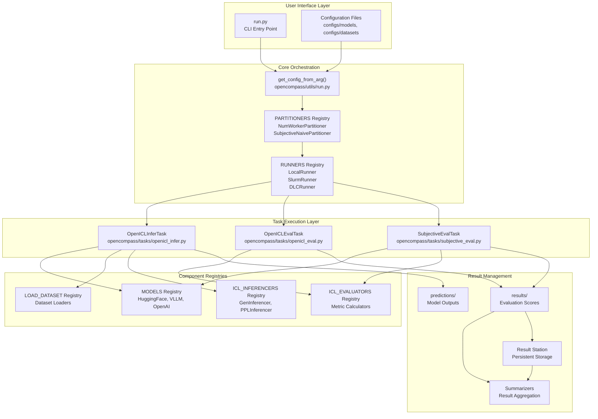
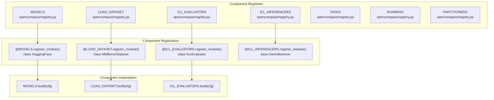
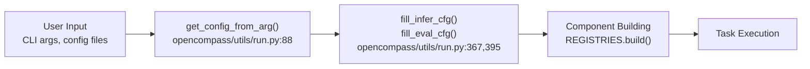
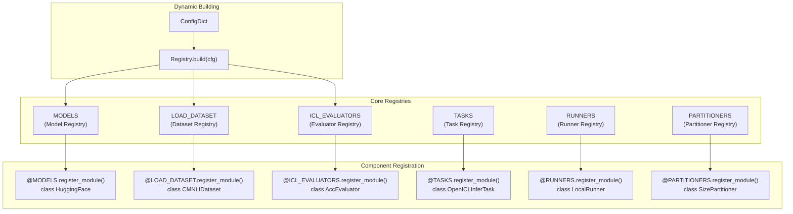
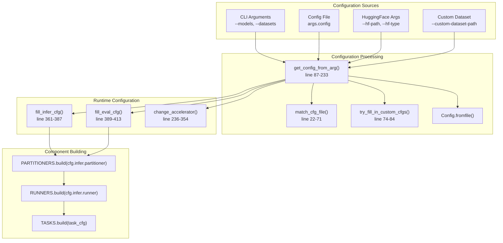
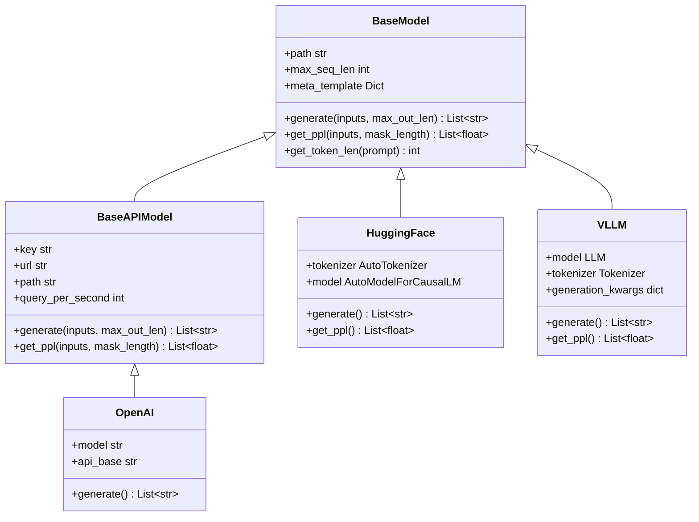
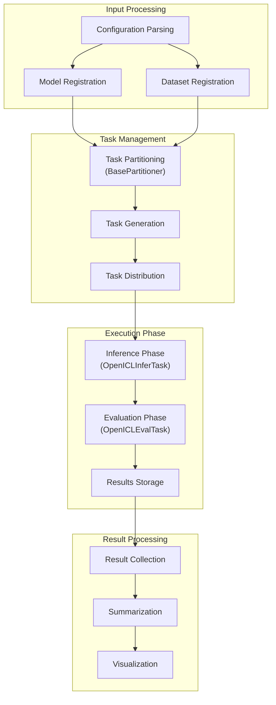

<!-- source: DeepWiki mcp.deepwiki.com · repo open-compass/opencompass · page 3 Core Architecture · fetched 2026-10-21 -->

# Core Architecture

<details>
<summary>Relevant source files</summary>

The following files were used as context for generating this wiki page:

- [docs/en/get_started/faq.md](docs/en/get_started/faq.md)
- [docs/en/get_started/quick_start.md](docs/en/get_started/quick_start.md)
- [docs/en/notes/contribution_guide.md](docs/en/notes/contribution_guide.md)
- [docs/en/user_guides/experimentation.md](docs/en/user_guides/experimentation.md)
- [docs/zh_cn/get_started/faq.md](docs/zh_cn/get_started/faq.md)
- [docs/zh_cn/get_started/quick_start.md](docs/zh_cn/get_started/quick_start.md)
- [docs/zh_cn/notes/contribution_guide.md](docs/zh_cn/notes/contribution_guide.md)
- [docs/zh_cn/user_guides/experimentation.md](docs/zh_cn/user_guides/experimentation.md)
- [opencompass/cli/main.py](opencompass/cli/main.py)
- [opencompass/openicl/icl_retriever/icl_votek_retriever.py](opencompass/openicl/icl_retriever/icl_votek_retriever.py)
- [opencompass/partitioners/base.py](opencompass/partitioners/base.py)
- [opencompass/utils/result_station.py](opencompass/utils/result_station.py)
- [opencompass/utils/run.py](opencompass/utils/run.py)
- [run.py](run.py)

</details>


OpenCompass is built on a modular, registry-based architecture that orchestrates distributed evaluation of large language models. This document provides an overview of the fundamental architectural patterns and design principles that enable OpenCompass to flexibly evaluate models across different computing environments.

The architecture is organized into several key subsystems:
- **Evaluation Pipeline** (Section 3.1): End-to-end flow from configuration through inference, evaluation, and summarization
- **Registry System** (Section 3.2): Plugin architecture enabling dynamic component registration and instantiation
- **Task Execution Framework** (Section 3.3): Task abstraction layer for distributed execution

## Architectural Overview

OpenCompass follows a **task-based execution model** where evaluation workloads are decomposed into independent, parallelizable tasks. Each task represents a specific model-dataset combination that can be executed independently across different computing environments.

**System Architecture**



**Sources:** [run.py:1-5](), [opencompass/cli/main.py:251-451](), [opencompass/utils/run.py:88-419](), [opencompass/partitioners/base.py:13-191](), [opencompass/tasks/openicl_infer.py:20-164](), [opencompass/tasks/openicl_eval.py:24-466](), [opencompass/tasks/subjective_eval.py:23-467]()

## Core Design Principles

OpenCompass architecture is guided by the following design principles:

| Principle | Implementation | Benefits |
|-----------|----------------|----------|
| **Registry-Based Plugin System** | Components register via `@REGISTRY.register_module()` decorators | New models, datasets, and evaluators can be added without modifying core code |
| **Task Abstraction** | Evaluation workloads are decomposed into `BaseTask` subclasses with standardized `run()` methods | Tasks execute independently and can be distributed across computing resources |
| **Configuration-Driven** | MMEngine config system with Python-based configuration files supporting inheritance | Experiments are reproducible, shareable, and version-controllable |
| **Environment Agnostic** | Multiple `BaseRunner` implementations (Local, Slurm, DLC, etc.) | Same evaluation can run on local machines, HPC clusters, or cloud platforms |
| **Modular Components** | Clear separation between models, datasets, evaluators, and inferencers | Components can be mixed and matched; each can evolve independently |

**Sources:** [opencompass/registry.py:1-50](), [opencompass/tasks/base.py:13-191](), [opencompass/runners/base.py:10-85](), [opencompass/utils/run.py:88-239]()

## Component Interaction Flow

The following diagram shows how the major components interact during a typical evaluation run:

**High-Level Execution Flow**

```mermaid
sequenceDiagram
    participant User
    participant RunPy["run.py"]
    participant MainFunc["main()<br/>opencompass/cli/main.py"]
    participant GetConfig["get_config_from_arg()<br/>opencompass/utils/run.py"]
    participant Partitioner["BasePartitioner<br/>partition()"]
    participant Runner["BaseRunner<br/>launch()"]
    participant Task["Task.run()<br/>OpenICLInferTask/EvalTask"]
    participant Registry["Component Registries<br/>MODELS, LOAD_DATASET"]
    
    User->>RunPy: python run.py config.py
    RunPy->>MainFunc: main()
    MainFunc->>GetConfig: get_config_from_arg(args)
    GetConfig-->>MainFunc: unified config
    
    Note over MainFunc: Inference Phase (--mode infer/all)
    MainFunc->>MainFunc: fill_infer_cfg(cfg, args)
    MainFunc->>Partitioner: PARTITIONERS.build(cfg.infer.partitioner)
    Partitioner->>Partitioner: partition() -> List[task_configs]
    MainFunc->>Runner: RUNNERS.build(cfg.infer.runner)
    Runner->>Runner: launch(tasks)
    
    loop For each task
        Runner->>Task: TASKS.build(task_cfg)
        Task->>Registry: build_model_from_cfg()
        Task->>Registry: build_dataset_from_cfg()
        Task->>Task: run() -> save to predictions/
    end
    
    Note over MainFunc: Evaluation Phase (--mode eval/all)
    MainFunc->>MainFunc: fill_eval_cfg(cfg, args)
    MainFunc->>Partitioner: PARTITIONERS.build(cfg.eval.partitioner)
    Partitioner->>Partitioner: partition() -> List[task_configs]
    MainFunc->>Runner: RUNNERS.build(cfg.eval.runner)
    Runner->>Runner: launch(tasks)
    
    loop For each task
        Runner->>Task: TASKS.build(task_cfg)
        Task->>Task: run() -> save to results/
    end
    
    Note over MainFunc: Visualization Phase (--mode viz/all)
    MainFunc->>MainFunc: build_from_cfg(summarizer_cfg)
    MainFunc->>MainFunc: summarizer.summarize()
```

**Sources:** [run.py:1-5](), [opencompass/cli/main.py:251-451](), [opencompass/utils/run.py:88-419](), [opencompass/partitioners/base.py:40-102](), [opencompass/runners/base.py:10-85](), [opencompass/tasks/openicl_infer.py:64-143](), [opencompass/tasks/openicl_eval.py:67-329]()

The execution flow consists of three main phases:

1. **Configuration Phase**: User arguments and configuration files are parsed by `get_config_from_arg()` into a unified configuration object
2. **Execution Phase**: Tasks are partitioned, distributed to runners, and executed (inference and/or evaluation)
3. **Summarization Phase**: Results are aggregated and formatted for presentation

Each phase is controlled by command-line arguments (`--mode`, `--models`, `--datasets`, etc.) and can be executed independently or as part of a complete evaluation run.

## Key Subsystems Overview

OpenCompass architecture consists of several interconnected subsystems, each responsible for specific aspects of the evaluation workflow.

### Task Execution System

The task execution system decomposes evaluation workloads into independent units of work:

| Component | Purpose | Key Classes |
|-----------|---------|-------------|
| **Task Abstraction** | Define unit of work with standardized interface | `BaseTask`, `OpenICLInferTask`, `OpenICLEvalTask`, `SubjectiveEvalTask` |
| **Partitioners** | Split model-dataset combinations into parallelizable tasks | `BasePartitioner`, `NumWorkerPartitioner`, `SubjectiveNaivePartitioner` |
| **Runners** | Execute tasks in different computing environments | `LocalRunner`, `SlurmRunner`, `DLCRunner`, `VOLCRunner` |

Tasks are the fundamental execution unit. Each task is self-contained and includes all necessary configuration to run independently. See Section 3.3 for details.

**Sources:** [opencompass/tasks/base.py:13-191](), [opencompass/tasks/openicl_infer.py:20-164](), [opencompass/tasks/openicl_eval.py:24-466](), [opencompass/partitioners/base.py:13-191](), [opencompass/runners/base.py:10-85]()

### Registry and Plugin System

The registry system enables dynamic component discovery and instantiation:

**Core Registries**



Components register themselves using decorators (e.g., `@MODELS.register_module()`) and are instantiated dynamically using `Registry.build(cfg)`. This enables a plugin architecture where new components can be added without modifying core code. See Section 3.2 for details.

**Sources:** [opencompass/registry.py:1-50](), [opencompass/utils/build.py:8-24](), [opencompass/models/huggingface.py:1-300](), [opencompass/datasets/base.py:1-100]()

### Configuration Management

OpenCompass uses a hierarchical configuration system based on MMEngine:

**Configuration Processing Flow**



Configuration sources include:
- **Command-line arguments**: `--models`, `--datasets`, `--hf-path`, etc.
- **Configuration files**: Python files in `configs/` directory supporting inheritance
- **Default values**: Filled in by `fill_infer_cfg()` and `fill_eval_cfg()`

**Sources:** [opencompass/utils/run.py:88-419](), [opencompass/cli/main.py:21-190]()

## Registry and Plugin System

OpenCompass uses a comprehensive registry system built on MMEngine's registry pattern to enable modular component registration and dynamic instantiation.

### Registry Architecture



The registry system enables:
- **Dynamic Component Loading**: Components are registered via decorators and built from configuration
- **Plugin Architecture**: New components can be added without modifying core code
- **Type Safety**: Registries ensure proper component instantiation

**Sources:** [opencompass/registry.py:1-50](), [opencompass/utils/build.py:1-25](), [opencompass/models/vllm.py:17-166](), [opencompass/datasets/cmnli.py:12-72]()

## Configuration Management

OpenCompass leverages MMEngine's configuration system to provide flexible, hierarchical configuration management with support for inheritance and composition.

### Configuration Flow



Key configuration components from `utils.run`:
- **Model Configuration**: Built via `match_cfg_file()` or HuggingFace parameters, supports accelerator changes
- **Dataset Configuration**: Loaded from dataset configs or custom dataset paths via `make_custom_dataset_config()`
- **Task Configuration**: Generated by `fill_infer_cfg()` and `fill_eval_cfg()` with runner and partitioner settings
- **Runner Configuration**: Configures `LocalRunner`, `SlurmRunner`, or `DLCRunner` based on CLI flags

**Sources:** [opencompass/cli/main.py:259-329](), [opencompass/utils/run.py:87-413](), [opencompass/utils/run.py:22-84]()

## Model Abstraction Layer

OpenCompass provides a unified interface for various model types through a hierarchical model abstraction system.

### Model Class Hierarchy



The model abstraction enables:
- **Unified Interface**: All models implement `generate()`, `get_ppl()`, and `get_token_len()` methods
- **Backend Flexibility**: Support for local models (HuggingFace, VLLM) and API models (OpenAI, Claude)
- **Acceleration Integration**: Seamless integration with inference acceleration frameworks

**Sources:** [opencompass/models/base.py:1-400](), [opencompass/models/huggingface.py:1-300](), [opencompass/models/vllm.py:1-166](), [opencompass/models/openai_api.py:1-200]()

## Evaluation Pipeline Architecture

The evaluation pipeline orchestrates the complete flow from task partitioning through result summarization.

### Pipeline Components



**Sources:** [opencompass/cli/main.py:318-440](), [opencompass/partitioners/base.py:40-102](), [opencompass/tasks/openicl_infer.py:64-90](), [opencompass/tasks/openicl_eval.py:67-105](), [opencompass/summarizers/default.py:1-100]()

---

