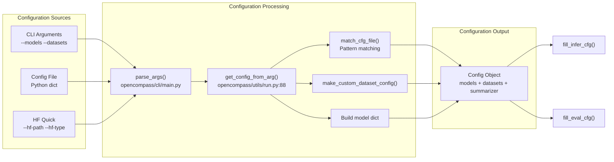
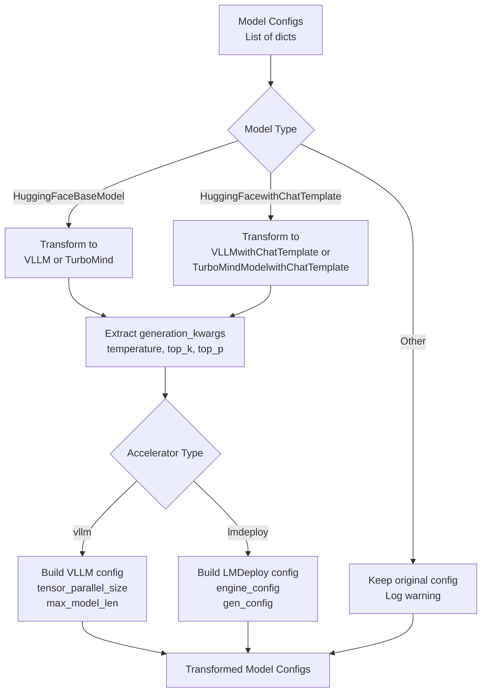
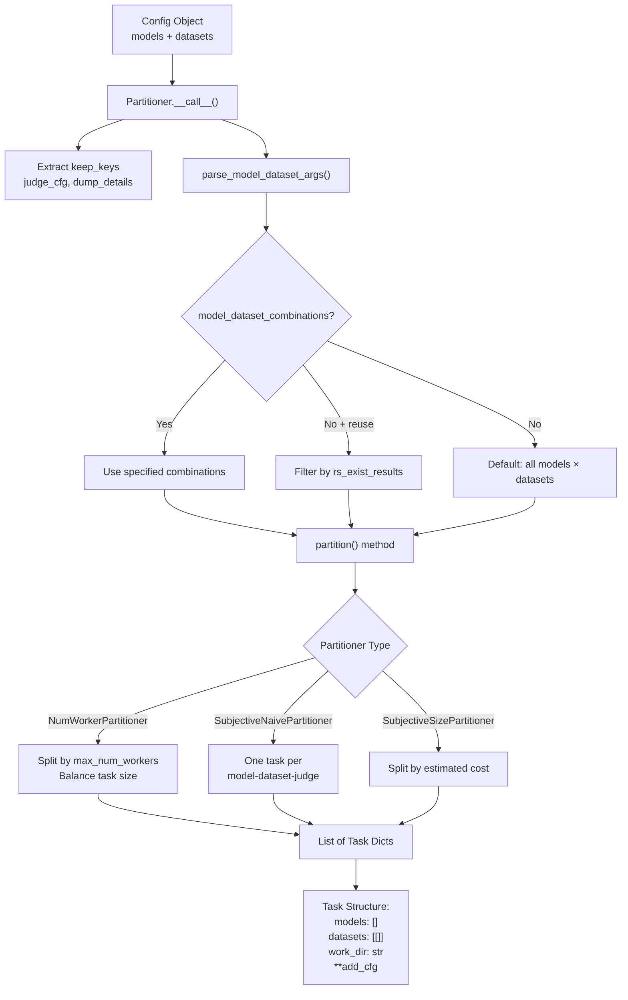
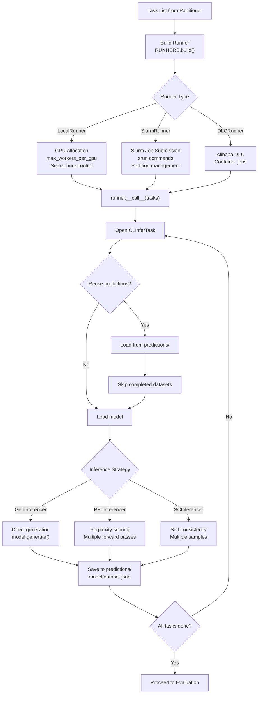
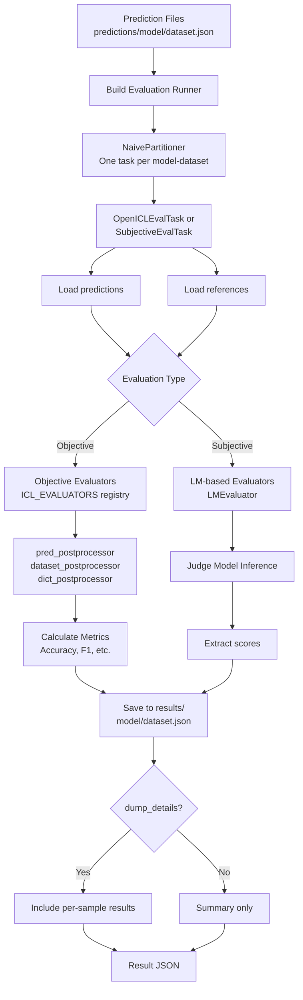
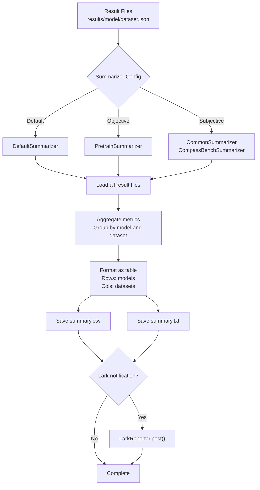
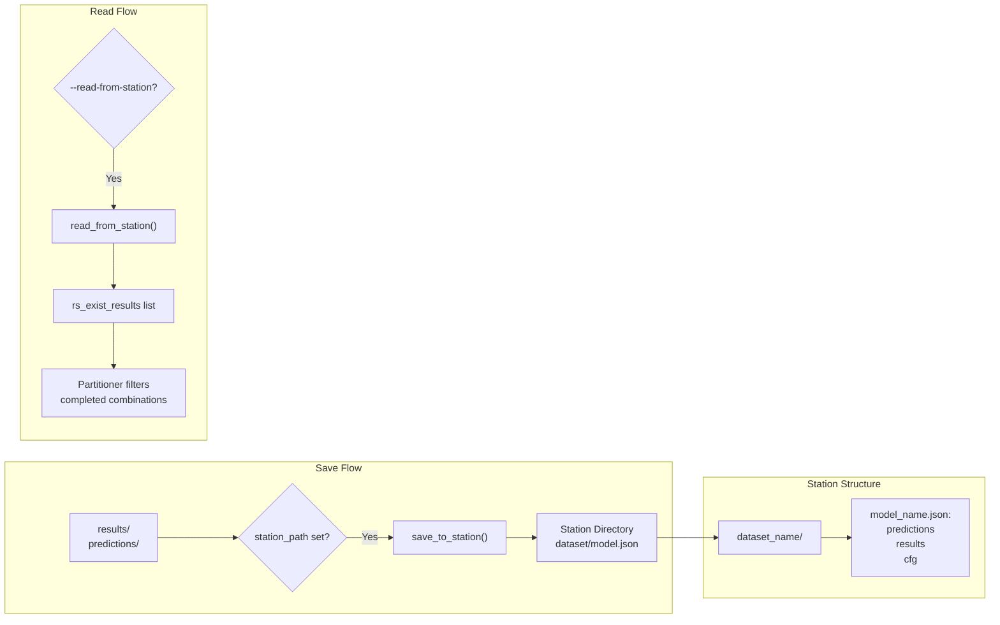

<!-- source: DeepWiki mcp.deepwiki.com · repo open-compass/opencompass · page 3.1 Evaluation Pipeline Overview · fetched 2026-10-21 -->

# Evaluation Pipeline Overview

<details>
<summary>Relevant source files</summary>

The following files were used as context for generating this wiki page:

- [README.md](README.md)
- [README_zh-CN.md](README_zh-CN.md)
- [docs/en/get_started/faq.md](docs/en/get_started/faq.md)
- [docs/en/get_started/quick_start.md](docs/en/get_started/quick_start.md)
- [docs/en/index.rst](docs/en/index.rst)
- [docs/en/notes/contribution_guide.md](docs/en/notes/contribution_guide.md)
- [docs/en/notes/news.md](docs/en/notes/news.md)
- [docs/en/user_guides/experimentation.md](docs/en/user_guides/experimentation.md)
- [docs/zh_cn/advanced_guides/evaluation_lmdeploy.md](docs/zh_cn/advanced_guides/evaluation_lmdeploy.md)
- [docs/zh_cn/get_started/faq.md](docs/zh_cn/get_started/faq.md)
- [docs/zh_cn/get_started/quick_start.md](docs/zh_cn/get_started/quick_start.md)
- [docs/zh_cn/index.rst](docs/zh_cn/index.rst)
- [docs/zh_cn/notes/contribution_guide.md](docs/zh_cn/notes/contribution_guide.md)
- [docs/zh_cn/notes/news.md](docs/zh_cn/notes/news.md)
- [docs/zh_cn/user_guides/experimentation.md](docs/zh_cn/user_guides/experimentation.md)
- [opencompass/cli/main.py](opencompass/cli/main.py)
- [opencompass/openicl/icl_retriever/icl_votek_retriever.py](opencompass/openicl/icl_retriever/icl_votek_retriever.py)
- [opencompass/partitioners/base.py](opencompass/partitioners/base.py)
- [opencompass/utils/result_station.py](opencompass/utils/result_station.py)
- [opencompass/utils/run.py](opencompass/utils/run.py)
- [run.py](run.py)

</details>


This document describes the end-to-end evaluation pipeline in OpenCompass, covering the complete workflow from task configuration through result generation. The pipeline consists of four main stages: **Configuration**, **Inference**, **Evaluation**, and **Visualization**. For details on specific components, see [Configuration System](#2.3), [Model Support](#4), [Dataset System](#5), [Task Execution and Distribution](#7), and [Result Management and Analysis](#8).

## Pipeline Stages

The OpenCompass evaluation pipeline transforms user specifications into actionable tasks, executes them across distributed compute resources, and produces comprehensive evaluation reports. The following diagram shows the high-level flow:

```mermaid
flowchart TD
    Start["User Input"]
    Start --> ConfigMethod{Configuration Method}
    
    ConfigMethod -->|CLI| CLI["Command Line<br/>--models --datasets"]
    ConfigMethod -->|Config File| ConfigFile["Python Config<br/>configs/*.py"]
    ConfigMethod -->|HF Quick| HFPath["--hf-path --hf-type"]
    
    CLI --> GetConfig["get_config_from_arg()"]
    ConfigFile --> GetConfig
    HFPath --> GetConfig
    
    GetConfig --> FillCfg["fill_infer_cfg()<br/>fill_eval_cfg()"]
    
    FillCfg --> Accelerator{Accelerator?}
    Accelerator -->|--accelerator| ChangeAccel["change_accelerator()"]
    Accelerator -->|None| Partition
    ChangeAccel --> Partition["Build Partitioner"]
    
    Partition --> PartType{Partitioner Type}
    PartType -->|Objective| NumWorker["NumWorkerPartitioner"]
    PartType -->|Subjective| SubjPart["SubjectiveNaivePartitioner<br/>SubjectiveSizePartitioner"]
    
    NumWorker --> TaskList["List of Task Configs"]
    SubjPart --> TaskList
    
    TaskList --> BuildRunner["Build Runner"]
    BuildRunner --> RunnerType{Runner Type}
    
    RunnerType -->|Local| LocalR["LocalRunner"]
    RunnerType -->|Slurm| SlurmR["SlurmRunner"]
    RunnerType -->|DLC| DLCR["DLCRunner"]
    
    LocalR --> InferPhase["Inference Phase<br/>OpenICLInferTask"]
    SlurmR --> InferPhase
    DLCR --> InferPhase
    
    InferPhase --> Reuse{--reuse?}
    Reuse -->|Yes| ReadStation["read_from_station()"]
    Reuse -->|No| RunInfer
    ReadStation --> Filter["Filter completed tasks"]
    Filter --> RunInfer["Execute Inference"]
    
    RunInfer --> SavePred["Save to predictions/"]
    SavePred --> EvalPhase["Evaluation Phase<br/>OpenICLEvalTask"]
    
    EvalPhase --> SaveResults["Save to results/"]
    SaveResults --> Station{station_path?}
    Station -->|Yes| SaveStation["save_to_station()"]
    Station -->|No| Viz
    SaveStation --> Viz["Visualization Phase<br/>Summarizers"]
    
    Viz --> Report["CSV/TXT Reports"]
```



**Sources:** [opencompass/cli/main.py:251-447](), [opencompass/utils/run.py:88-240](), [opencompass/utils/run.py:367-420](), [README.md:177-270]()

## Configuration Phase

The configuration phase begins at the entry point `run.py`, which delegates to `opencompass.cli.main.main()`. The system supports three configuration methods, all converging to a unified configuration object through `get_config_from_arg()`.



### Configuration Methods

| Method | Entry Point | Key Functions | Output |
|--------|-------------|---------------|--------|
| CLI with predefined configs | `--models MODEL --datasets DS` | `match_cfg_file()` [opencompass/utils/run.py:23-72]() | Config with resolved paths |
| Config file | `python run.py config.py` | `Config.fromfile()` | Full config object |
| HF quick config | `--hf-path PATH --hf-type TYPE` | Model dict construction [opencompass/utils/run.py:188-208]() | Single model config |

The `get_config_from_arg()` function [opencompass/utils/run.py:88-240]() handles three priority levels:

1. If `args.config` is provided, load from file and optionally apply accelerator transformation
2. If `args.models` and `args.datasets` are provided, match configuration files from `configs/` directories
3. If `args.hf_path` is provided, construct a HuggingFace model configuration on-the-fly

### Accelerator Transformation

When `--accelerator` is specified (vllm or lmdeploy), the system transforms model configurations using `change_accelerator()`:



**Sources:** [opencompass/utils/run.py:242-361](), [opencompass/utils/run.py:106-117]()

### Configuration Filling

After obtaining the base configuration, the system fills inference and evaluation configurations:

- **`fill_infer_cfg()`** [opencompass/utils/run.py:367-393](): Creates inference partitioner and runner configurations
  - Sets `NumWorkerPartitioner` with `num_worker` parameter
  - Configures runner type: `LocalRunner`, `SlurmRunner`, or `DLCRunner`
  - Sets task type to `OpenICLInferTask`
  
- **`fill_eval_cfg()`** [opencompass/utils/run.py:395-420](): Creates evaluation partitioner and runner configurations  
  - Sets `NaivePartitioner` for evaluation
  - Configures runner type matching inference
  - Sets task type to `OpenICLEvalTask`

**Sources:** [opencompass/utils/run.py:367-420](), [opencompass/cli/main.py:321-362]()

## Task Partitioning

The partitioner transforms the high-level configuration (models × datasets) into concrete executable tasks. The `BasePartitioner` [opencompass/partitioners/base.py:13-191]() defines the partitioning interface.



### Task Structure

Each task is a dictionary with the following structure [opencompass/partitioners/base.py:46-52]():

```python
{
    'models': [],        # List of model configs
    'datasets': [[]],    # Nested list of dataset configs
    'work_dir': '',      # Working directory
    **add_cfg           # Additional configs (judge_cfg, dump_details, etc.)
}
```

### Result Reuse Logic

When `--reuse` is specified, the partitioner filters out already-completed tasks by checking `rs_exist_results` [opencompass/partitioners/base.py:113-128]():

1. For each model-dataset combination, check if `[model_abbr, dataset_abbr]` exists in `rs_exist_results`
2. Remove completed combinations from the task list
3. Only schedule remaining combinations for execution

**Sources:** [opencompass/partitioners/base.py:13-191](), [opencompass/cli/main.py:348-361]()

## Inference Phase

The inference phase executes model predictions on datasets. Tasks are dispatched to runners, which manage parallel execution across compute resources.



### Inference Strategies

The system supports multiple inference strategies registered in `ICL_INFERENCERS`:

| Inferencer | Use Case | Method |
|------------|----------|--------|
| `GenInferencer` | Free-form generation | `model.generate()` |
| `PPLInferencer` | Multiple choice via perplexity | Compare log probabilities |
| `CLPInferencer` | Conditional log probability | Single token probability |
| `SCInferencer` | Self-consistency | Multiple generations + voting |
| `ToTInferencer` | Tree-of-thought | Structured reasoning |

### Output Structure

Inference outputs are saved to `{work_dir}/predictions/{model_abbr}/{dataset_abbr}.json` with the structure:

```json
{
    "0": {"prediction": "...", "origin_prompt": "..."},
    "1": {"prediction": "...", "origin_prompt": "..."},
    ...
}
```

**Sources:** [opencompass/cli/main.py:321-361](), [opencompass/tasks/openicl_infer.py](), [Diagram 2 from high-level diagrams]()

## Evaluation Phase

The evaluation phase compares model predictions against gold answers using registered evaluators.



### Evaluator Registry

Evaluators are registered in `ICL_EVALUATORS` and selected based on dataset configuration:

- **Rule-based evaluators**: Direct comparison with pattern matching
- **LM-based evaluators** (`LMEvaluator`): Use judge models for complex assessment
- **Specialized evaluators**: Domain-specific logic (e.g., `SciCodeEvaluator`, `TheoremQAEvaluatorV3`)

### Result Structure

Evaluation results are saved to `{work_dir}/results/{model_abbr}/{dataset_abbr}.json`:

```json
{
    "metric": 0.85,
    "details": [
        {"index": 0, "correct": true, "prediction": "A", "gold": "A"},
        ...
    ]
}
```

The `details` field is included when `--dump-eval-details` is enabled (default: True).

**Sources:** [opencompass/cli/main.py:364-407](), [opencompass/tasks/openicl_eval.py](), [opencompass/cli/main.py:376-382]()

## Visualization and Summarization

After evaluation completes, the summarization phase aggregates results into human-readable reports.



### Summarizer Types

The system supports multiple summarizer implementations:

- **`DefaultSummarizer`**: Basic table formatting for objective metrics
- **`PretrainSummarizer`**: Enhanced formatting with metric aggregation
- **Subjective summarizers**: Handle judge-based evaluation results with special formatting

### Output Files

Summarization produces the following files in `{work_dir}/`:

- `{timestamp}/summary/summary_DATE_TIME.txt`: Plain text table
- `{timestamp}/summary/summary_DATE_TIME.csv`: CSV format for programmatic access
- Console output: Formatted table printed to stdout

**Sources:** [opencompass/cli/main.py:414-446](), [opencompass/summarizers/default.py]()

## Result Persistence (Station System)

OpenCompass supports persisting evaluation results to a "result station" for reuse across runs. This is controlled by the `--station-path` argument.



### Station Operations

**Save** [opencompass/utils/result_station.py:11-228]():
- Triggered when `--station-path` is set
- Combines predictions, results, and configs into a single JSON file
- Skips already-saved results unless `--station-overwrite` is specified
- Structure: `{station_path}/{dataset_abbr}/{model_abbr}.json`

**Read** [opencompass/utils/result_station.py]():
- Triggered by `--read-from-station` flag
- Loads existing results and populates `rs_exist_results` list
- Partitioner uses this list to skip completed model-dataset pairs

**Sources:** [opencompass/utils/result_station.py:11-228](), [opencompass/cli/main.py:304-307](), [opencompass/cli/main.py:409-411]()

## Work Directory Structure

All evaluation artifacts are organized in the work directory (default: `outputs/default/`):

```
outputs/default/
└── YYYYMMDD_HHMMSS/
    ├── configs/
    │   └── {timestamp}_{pid}.py          # Config snapshot
    ├── logs/
    │   ├── infer/
    │   │   └── {model}/
    │   │       └── {dataset}.out          # Inference logs
    │   └── eval/
    │       └── {model}/
    │           └── {dataset}.out          # Evaluation logs
    ├── predictions/
    │   └── {model}/
    │       └── {dataset}.json             # Model outputs
    ├── results/
    │   └── {model}/
    │       └── {dataset}.json             # Evaluation scores
    └── summary/
        ├── summary_{timestamp}.txt        # Text report
        └── summary_{timestamp}.csv        # CSV report
```

### Reuse Mechanism

When using `--reuse` (or `-r`):

1. System identifies the latest (or specified) timestamp directory
2. Checks for existing prediction and result files
3. Tasks with complete outputs are skipped
4. Incomplete tasks resume from the last completed sample (identified by `tmp_` prefix)

**Sources:** [docs/zh_cn/user_guides/experimentation.md:98-125](), [opencompass/cli/main.py:270-290]()

## Command-Line Interface Summary

The following table summarizes key CLI arguments for controlling the pipeline:

| Argument | Purpose | Default | Stage |
|----------|---------|---------|-------|
| `--models` | Specify models to evaluate | None | Configuration |
| `--datasets` | Specify datasets to evaluate | None | Configuration |
| `--hf-path` | Quick HF model path | None | Configuration |
| `--accelerator` | Use vllm/lmdeploy | None | Configuration |
| `-m/--mode` | Run mode: all, infer, eval, viz | all | All |
| `-r/--reuse` | Reuse previous results | None | Inference/Eval |
| `-w/--work-dir` | Output directory | outputs/default | All |
| `--max-num-workers` | Parallel task limit | 1 | Execution |
| `--slurm` | Use Slurm runner | False | Execution |
| `--debug` | Single-process mode | False | Execution |
| `--dump-eval-details` | Include per-sample details | True | Evaluation |
| `--station-path` | Result persistence path | None | Post-evaluation |

**Sources:** [opencompass/cli/main.py:21-249](), [docs/en/user_guides/experimentation.md:5-60]()

---

