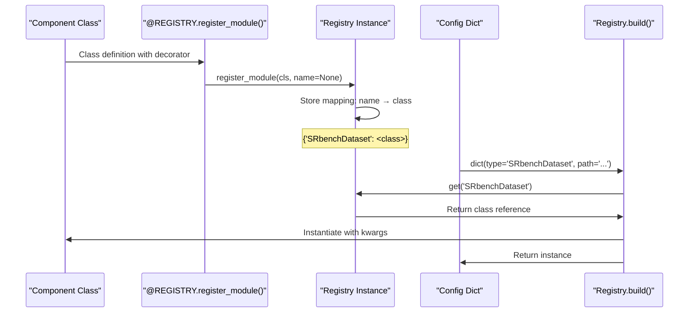
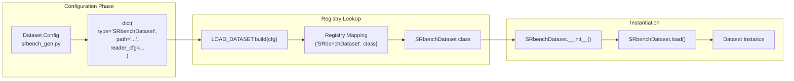
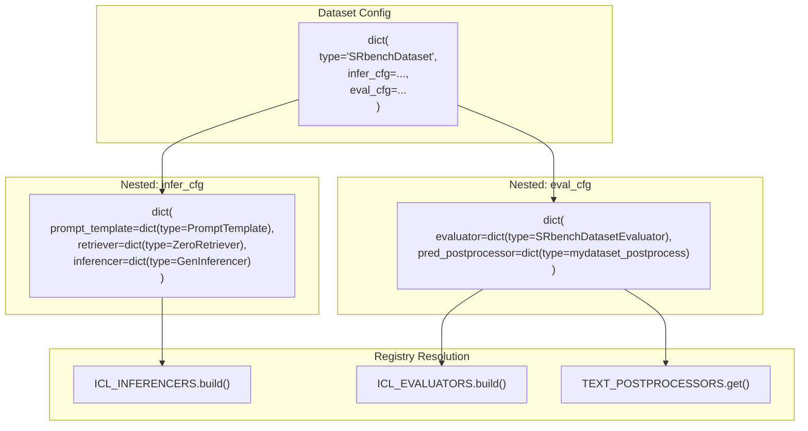

<!-- source: DeepWiki mcp.deepwiki.com · repo open-compass/opencompass · page 3.2 Registry System and Plugin Architecture · fetched 2026-10-21 -->

# Registry System and Plugin Architecture

<details>
<summary>Relevant source files</summary>

The following files were used as context for generating this wiki page:

- [dataset-index.yml](dataset-index.yml)
- [docs/en/prompt/chain_of_thought.md](docs/en/prompt/chain_of_thought.md)
- [docs/zh_cn/prompt/chain_of_thought.md](docs/zh_cn/prompt/chain_of_thought.md)
- [opencompass/configs/datasets/IFBench/IFBench_gen.py](opencompass/configs/datasets/IFBench/IFBench_gen.py)
- [opencompass/configs/datasets/MedCalc_Bench/MedCalcBench_official_gen_a5155f.py](opencompass/configs/datasets/MedCalc_Bench/MedCalcBench_official_gen_a5155f.py)
- [opencompass/configs/datasets/srbench/srbench_gen.py](opencompass/configs/datasets/srbench/srbench_gen.py)
- [opencompass/configs/summarizers/groups/biodata.py](opencompass/configs/summarizers/groups/biodata.py)
- [opencompass/datasets/IFBench/evaluation_lib.py](opencompass/datasets/IFBench/evaluation_lib.py)
- [opencompass/datasets/IFBench/ifbench.py](opencompass/datasets/IFBench/ifbench.py)
- [opencompass/datasets/IFBench/instructions.py](opencompass/datasets/IFBench/instructions.py)
- [opencompass/datasets/IFBench/instructions_registry.py](opencompass/datasets/IFBench/instructions_registry.py)
- [opencompass/datasets/IFBench/instructions_util.py](opencompass/datasets/IFBench/instructions_util.py)
- [opencompass/datasets/MedCalc_Bench.py](opencompass/datasets/MedCalc_Bench.py)
- [opencompass/datasets/__init__.py](opencompass/datasets/__init__.py)
- [opencompass/datasets/game24.py](opencompass/datasets/game24.py)
- [opencompass/datasets/scicode.py](opencompass/datasets/scicode.py)
- [opencompass/datasets/srbench.py](opencompass/datasets/srbench.py)
- [opencompass/models/base.py](opencompass/models/base.py)
- [opencompass/models/base_api.py](opencompass/models/base_api.py)
- [opencompass/openicl/icl_inferencer/icl_attack_inferencer.py](opencompass/openicl/icl_inferencer/icl_attack_inferencer.py)
- [opencompass/openicl/icl_inferencer/icl_base_inferencer.py](opencompass/openicl/icl_inferencer/icl_base_inferencer.py)
- [opencompass/openicl/icl_inferencer/icl_clp_inferencer.py](opencompass/openicl/icl_inferencer/icl_clp_inferencer.py)
- [opencompass/openicl/icl_inferencer/icl_gen_inferencer.py](opencompass/openicl/icl_inferencer/icl_gen_inferencer.py)
- [opencompass/openicl/icl_inferencer/icl_ppl_inferencer.py](opencompass/openicl/icl_inferencer/icl_ppl_inferencer.py)
- [opencompass/openicl/icl_inferencer/icl_sc_inferencer.py](opencompass/openicl/icl_inferencer/icl_sc_inferencer.py)
- [opencompass/openicl/icl_inferencer/icl_tot_inferencer.py](opencompass/openicl/icl_inferencer/icl_tot_inferencer.py)
- [opencompass/registry.py](opencompass/registry.py)
- [opencompass/utils/datasets_info.py](opencompass/utils/datasets_info.py)
- [opencompass/utils/lark.py](opencompass/utils/lark.py)
- [requirements.txt](requirements.txt)
- [requirements/extra.txt](requirements/extra.txt)
- [tests/openicl/test_prompt_template.py](tests/openicl/test_prompt_template.py)

</details>


This document describes OpenCompass's registry system and plugin architecture, which enables extensible, modular component registration and instantiation. The registry pattern allows datasets, evaluators, inferencers, models, and other components to self-register and be dynamically instantiated from configuration files.

For information about the overall evaluation pipeline and task execution, see [3.1](#3.1). For details on specific model implementations, see [4](#4). For dataset loading mechanisms, see [5.1](#5.1).

## Overview

OpenCompass implements a centralized registry system that manages component discovery and instantiation. Components self-register using Python decorators, allowing the framework to build them dynamically from configuration dictionaries. This pattern eliminates the need for hardcoded component mappings and enables users to extend the framework by simply adding new classes with appropriate decorators.

The registry system is built on `mmengine.registry.Registry` with custom extensions to support OpenCompass-specific requirements.

**Sources:** [opencompass/registry.py:1-83]()

## Core Registry Architecture

```mermaid
graph TB
    subgraph "Base Registry Layer"
        MMEngineReg["mmengine.registry.Registry<br/>(upstream)"]
        CustomReg["opencompass.registry.Registry<br/>force=True default"]
    end
    
    subgraph "OpenCompass Registries"
        LOAD_DATASET["LOAD_DATASET<br/>Dataset loaders"]
        ICL_EVALUATORS["ICL_EVALUATORS<br/>Evaluation logic"]
        ICL_INFERENCERS["ICL_INFERENCERS<br/>Inference strategies"]
        MODELS["MODELS<br/>Model wrappers"]
        TEXT_POSTPROCESSORS["TEXT_POSTPROCESSORS<br/>Text processing"]
        ICL_PROMPT_TEMPLATES["ICL_PROMPT_TEMPLATES<br/>Prompt templates"]
        TOT_WRAPPER["TOT_WRAPPER<br/>Tree-of-Thought wrappers"]
    end
    
    subgraph "Registered Components"
        SRbenchDataset["@LOAD_DATASET.register_module()<br/>SRbenchDataset"]
        SciCodeDataset["@LOAD_DATASET.register_module()<br/>SciCodeDataset"]
        GenInferencer["@ICL_INFERENCERS.register_module()<br/>GenInferencer"]
        PPLInferencer["@ICL_INFERENCERS.register_module()<br/>PPLInferencer"]
        SCInferencer["@ICL_INFERENCERS.register_module()<br/>SCInferencer"]
        ToTInferencer["@ICL_INFERENCERS.register_module()<br/>ToTInferencer"]
        SRbenchEval["@ICL_EVALUATORS.register_module()<br/>SRbenchDatasetEvaluator"]
        SciCodeEval["@ICL_EVALUATORS.register_module()<br/>SciCodeEvaluator"]
    end
    
    MMEngineReg --> CustomReg
    CustomReg --> LOAD_DATASET
    CustomReg --> ICL_EVALUATORS
    CustomReg --> ICL_INFERENCERS
    CustomReg --> MODELS
    CustomReg --> TEXT_POSTPROCESSORS
    CustomReg --> ICL_PROMPT_TEMPLATES
    CustomReg --> TOT_WRAPPER
    
    LOAD_DATASET --> SRbenchDataset
    LOAD_DATASET --> SciCodeDataset
    ICL_INFERENCERS --> GenInferencer
    ICL_INFERENCERS --> PPLInferencer
    ICL_INFERENCERS --> SCInferencer
    ICL_INFERENCERS --> ToTInferencer
    ICL_EVALUATORS --> SRbenchEval
    ICL_EVALUATORS --> SciCodeEval
```



**Sources:** [opencompass/registry.py:7-83](), [opencompass/datasets/srbench.py:16-17](), [opencompass/datasets/scicode.py:23-24](), [opencompass/openicl/icl_inferencer/icl_gen_inferencer.py:26-27](), [opencompass/openicl/icl_inferencer/icl_ppl_inferencer.py:22-23]()

## Registry Implementation

### Custom Registry Class

The `Registry` class extends `mmengine.registry.Registry` with modified default behavior:

```python
class Registry(OriginalRegistry):
    def register_module(
            self,
            name: Optional[Union[str, List[str]]] = None,
            force: bool = True,  # Changed default
            module: Optional[Type] = None) -> Union[type, Callable]:
        return super().register_module(name, force, module)
```

**Key Difference:** The `force=True` default allows components to be re-registered without errors, facilitating development workflows and module reloading.

**Sources:** [opencompass/registry.py:7-25]()

### Global Registry Instances

OpenCompass defines several global registry instances:

| Registry Name | Purpose | Primary Components |
|--------------|---------|-------------------|
| `LOAD_DATASET` | Dataset loading functions | `SRbenchDataset`, `SciCodeDataset`, `IFEvalDataset` |
| `ICL_EVALUATORS` | Evaluation logic | `SRbenchDatasetEvaluator`, `SciCodeEvaluator`, `IFBenchEvaluator` |
| `ICL_INFERENCERS` | Inference strategies | `GenInferencer`, `PPLInferencer`, `CLPInferencer`, `SCInferencer`, `ToTInferencer`, `AttackInferencer` |
| `MODELS` | Model wrappers | `BaseModel`, `BaseAPIModel`, and implementations |
| `TEXT_POSTPROCESSORS` | Text processing functions | `mydataset_postprocess`, etc. |
| `ICL_PROMPT_TEMPLATES` | Prompt templates | `PromptTemplate` variants |
| `TOT_WRAPPER` | Tree-of-Thought wrappers | ToT-specific prompt wrappers |

**Sources:** [opencompass/registry.py:27-83]()

## Component Registration Pattern

### Decorator-Based Registration

Components register themselves using the `@registry.register_module()` decorator:



**Sources:** [opencompass/datasets/srbench.py:16-46](), [opencompass/openicl/icl_inferencer/icl_gen_inferencer.py:26-27]()

### Dataset Registration Example

**File:** [opencompass/datasets/srbench.py:16-46]()

```python
@LOAD_DATASET.register_module()
class SRbenchDataset(BaseDataset):
    
    @staticmethod
    def load(path: str):
        base_path = get_data_path(path)
        formula_data_path = os.path.join(base_path, 'formula_data.json')
        dataset = load_dataset('json', data_files=formula_data_path)['train']
        # ... processing logic
        return dataset
```

The `@LOAD_DATASET.register_module()` decorator registers `SRbenchDataset` so it can be instantiated from config:

```python
dataset_cfg = dict(
    type=SRbenchDataset,  # or type='SRbenchDataset' as string
    path='opencompass/srbench',
    # other kwargs passed to __init__
)
dataset = LOAD_DATASET.build(dataset_cfg)
```

**Sources:** [opencompass/datasets/srbench.py:16-46](), [opencompass/configs/datasets/srbench/srbench_gen.py:46-55]()

### Evaluator Registration Example

**File:** [opencompass/datasets/srbench.py:93-314]()

```python
class SRbenchDatasetEvaluator(BaseEvaluator):
    
    def __init__(self, path=''):
        self.dataset = SRbenchDataset.load(path)
    
    def score(self, predictions, references) -> dict:
        # Evaluation logic
        return metrics_out
```

Note: While `SRbenchDatasetEvaluator` is referenced in config, it doesn't have an explicit `@ICL_EVALUATORS.register_module()` decorator in the shown code. However, other evaluators like `SciCodeEvaluator` do:

**File:** [opencompass/datasets/scicode.py:219-220]()

```python
@ICL_EVALUATORS.register_module()
class SciCodeEvaluator(BaseEvaluator):
    # ...
```

**Sources:** [opencompass/datasets/srbench.py:93-96](), [opencompass/datasets/scicode.py:219-220]()

### Inferencer Registration Example

**File:** [opencompass/openicl/icl_inferencer/icl_gen_inferencer.py:26-82]()

```python
@ICL_INFERENCERS.register_module()
class GenInferencer(BaseInferencer):
    """Generation Inferencer class to directly evaluate by generation."""
    
    def __init__(
            self,
            model: BaseModel,
            max_out_len: int,
            stopping_criteria: List[str] = [],
            # ... other params
            **kwargs) -> None:
        super().__init__(model=model, ...)
        self.max_out_len = max_out_len
        # ...
```

Multiple inferencer variants register to the same registry:

**File:** [opencompass/openicl/icl_inferencer/icl_ppl_inferencer.py:22-23]()
```python
@ICL_INFERENCERS.register_module()
class PPLInferencer(BaseInferencer):
    """PPL Inferencer class to evaluate by perplexity."""
```

**File:** [opencompass/openicl/icl_inferencer/icl_clp_inferencer.py:21-22]()
```python
@ICL_INFERENCERS.register_module()
class CLPInferencer(BaseInferencer):
    """Conditional log probability based In-context Learning Inferencer."""
```

**File:** [opencompass/openicl/icl_inferencer/icl_sc_inferencer.py:21]()
```python
class SCInferencer(BaseInferencer):
    """Self-Consistency Inferencer class to evaluate by multiple generations."""
```

**File:** [opencompass/openicl/icl_inferencer/icl_tot_inferencer.py:24-25]()
```python
@ICL_INFERENCERS.register_module()
class ToTInferencer(GenInferencer):
    """Tree-of-Thought Inferencer class to evaluate by tree style reasoning paths."""
```

**File:** [opencompass/openicl/icl_inferencer/icl_attack_inferencer.py:23-24]()
```python
@ICL_INFERENCERS.register_module()
class AttackInferencer(BaseInferencer):
    """Generation Inferencer class to directly evaluate by generation."""
```

**Sources:** [opencompass/openicl/icl_inferencer/icl_gen_inferencer.py:26-82](), [opencompass/openicl/icl_inferencer/icl_ppl_inferencer.py:22-56](), [opencompass/openicl/icl_inferencer/icl_clp_inferencer.py:21-70]()

## Component Instantiation Flow



**Sources:** [opencompass/configs/datasets/srbench/srbench_gen.py:46-55]()

### Configuration to Instance Example

**Configuration File:** [opencompass/configs/datasets/srbench/srbench_gen.py:46-55]()

```python
srbench_datasets.append(
    dict(
        abbr='srbench',
        type=SRbenchDataset,
        path='opencompass/srbench',
        reader_cfg=srbench_reader_cfg,
        infer_cfg=srbench_infer_cfg,
        eval_cfg=srbench_eval_cfg,
    )
)
```

**Instantiation Process:**

1. The config dict specifies `type=SRbenchDataset` (or `type='SRbenchDataset'` as string)
2. `LOAD_DATASET.build(config_dict)` is called
3. Registry looks up `'SRbenchDataset'` → `SRbenchDataset` class
4. Calls `SRbenchDataset(**filtered_kwargs)` where kwargs exclude `type`
5. Returns instantiated dataset object

**Sources:** [opencompass/configs/datasets/srbench/srbench_gen.py:46-55]()

## Nested Component Building

Registries support nested component instantiation. Components can reference other registered components in their configuration:



**Example from config:** [opencompass/configs/datasets/srbench/srbench_gen.py:24-44]()

```python
srbench_infer_cfg = dict(
    prompt_template=dict(
        type=PromptTemplate,
        template=dict(round=[dict(role='HUMAN', prompt=INFER_TEMPLATE)])
    ),
    retriever=dict(type=ZeroRetriever),
    inferencer=dict(type=GenInferencer),
)

srbench_eval_cfg = dict(
    evaluator=dict(type=SRbenchDatasetEvaluator, path='opencompass/srbench'),
    pred_postprocessor=dict(type=mydataset_postprocess),
    pred_role='BOT',
)
```

**Sources:** [opencompass/configs/datasets/srbench/srbench_gen.py:24-44]()

## Dataset Auto-Import Pattern

OpenCompass uses a centralized import pattern to ensure all components are registered before use:

**File:** [opencompass/datasets/__init__.py:1-194]()

The `__init__.py` file imports all dataset modules with wildcard imports:

```python
from .advglue import *  # noqa: F401, F403
from .afqmcd import *  # noqa: F401, F403
from .agieval import *  # noqa: F401, F403
# ... 190+ import statements
from .srbench import *  # noqa: F401, F403
from .scicode import *  # noqa: F401, F403
```

**Purpose:** When any code imports from `opencompass.datasets`, all dataset classes execute their `@LOAD_DATASET.register_module()` decorators, populating the registry before first use.

**Sources:** [opencompass/datasets/__init__.py:1-194]()

## Dataset Discovery System

OpenCompass maintains metadata about available datasets separate from the code registry:

### dataset-index.yml

**File:** [dataset-index.yml:1-1510]()

This YAML file catalogs datasets with human-readable metadata:

```yaml
- srbench:
    name: SRBench
    category: ''
    paper: ''
    configpath: opencompass/configs/datasets/srbench/srbench_gen.py
    configpath_llmjudge: ''
    
- scicode:
    name: SciCode
    category: Code
    paper: ''
    configpath: opencompass/configs/datasets/scicode/scicode_gen.py
    configpath_llmjudge: ''
```

**Purpose:** Provides discoverability and documentation without requiring code execution. Tools can parse this YAML to generate documentation or UI elements.

**Sources:** [dataset-index.yml:1-1510]()

### DATASETS_MAPPING

**File:** [opencompass/utils/datasets_info.py:1-587]()

This dictionary maps dataset identifiers to storage locations:

```python
DATASETS_MAPPING = {
    "opencompass/srbench": {
        "ms_id": "",
        "hf_id": "",
        "local": "./data/SRBENCH",
    },
    "opencompass/scicode": {
        "ms_id": "",
        "hf_id": "",
        "local": "./data/scicode",
    },
    # ... 80+ entries
}
```

**Purpose:** Central lookup for dataset file paths, ModelScope IDs, and HuggingFace IDs. Used by data preparation utilities.

**Sources:** [opencompass/utils/datasets_info.py:1-587]()

### DATASETS_URL

**File:** [opencompass/utils/datasets_info.py:589-966]()

```python
DATASETS_URL = {
    "SRBENCH": {
        "url": "http://opencompass.oss-cn-shanghai.aliyuncs.com/datasets/data/srbench.zip",
        "md5": "384537d681dceb1c76ba52e4004c5714"
    },
    "/scicode": {
        "url": "http://opencompass.oss-cn-shanghai.aliyuncs.com/datasets/data/scicode.zip",
        "md5": "9c6c64b8c70edc418f713419ea39989c",
    },
    # ... 60+ entries
}
```

**Purpose:** Provides download URLs and checksums for automatic dataset retrieval.

**Sources:** [opencompass/utils/datasets_info.py:589-966]()

## Adding New Components

### Step 1: Implement Component Class

Create a new class inheriting from the appropriate base class:

- `BaseDataset` for datasets
- `BaseEvaluator` for evaluators  
- `BaseInferencer` for inferencers
- `BaseModel` or `BaseAPIModel` for models

### Step 2: Add Registration Decorator

Add the appropriate registry decorator to your class:

```python
from opencompass.registry import LOAD_DATASET, ICL_EVALUATORS

@LOAD_DATASET.register_module()
class MyCustomDataset(BaseDataset):
    @staticmethod
    def load(path: str):
        # Load logic
        return dataset

@ICL_EVALUATORS.register_module()
class MyCustomEvaluator(BaseEvaluator):
    def score(self, predictions, references):
        # Evaluation logic
        return metrics
```

### Step 3: Import in __init__.py

Add import to the appropriate `__init__.py`:

```python
# In opencompass/datasets/__init__.py
from .my_custom_dataset import *  # noqa: F401, F403
```

### Step 4: Create Configuration File

Create a config file using the registered component:

```python
# configs/datasets/my_custom/my_custom_gen.py
from opencompass.openicl.icl_prompt_template import PromptTemplate
from opencompass.openicl.icl_retriever import ZeroRetriever
from opencompass.openicl.icl_inferencer import GenInferencer
from opencompass.datasets import MyCustomDataset, MyCustomEvaluator

my_custom_datasets = [
    dict(
        abbr='my_custom',
        type=MyCustomDataset,
        path='path/to/data',
        reader_cfg=dict(input_columns=['input'], output_column='output'),
        infer_cfg=dict(
            prompt_template=dict(type=PromptTemplate, template=...),
            retriever=dict(type=ZeroRetriever),
            inferencer=dict(type=GenInferencer),
        ),
        eval_cfg=dict(
            evaluator=dict(type=MyCustomEvaluator),
            pred_role='BOT',
        ),
    )
]
```

**Sources:** [opencompass/configs/datasets/srbench/srbench_gen.py:1-57](), [opencompass/datasets/__init__.py:1-194]()

## Registry Query and Inspection

### Listing Registered Components

```python
from opencompass.registry import LOAD_DATASET, ICL_INFERENCERS

# Get all registered names
dataset_names = LOAD_DATASET.module_dict.keys()
inferencer_names = ICL_INFERENCERS.module_dict.keys()

# Get specific component class
DatasetClass = LOAD_DATASET.get('SRbenchDataset')
InferencerClass = ICL_INFERENCERS.get('GenInferencer')
```

### Building from Configuration

```python
from opencompass.registry import LOAD_DATASET

config = {
    'type': 'SRbenchDataset',
    'path': 'opencompass/srbench',
}

# Build instance
dataset = LOAD_DATASET.build(config)
```

**Sources:** [opencompass/registry.py:7-25]()

## Text Postprocessor Registration

Text postprocessors are registered as functions rather than classes:

**File:** [opencompass/datasets/srbench.py:48-67]()

```python
def mydataset_postprocess(formula_str):
    # Remove Markdown artifacts
    formula_str = formula_str.replace('×', '*').replace('·', '*').replace('÷', '/')
    formula_str = formula_str.replace('−', '-').replace('^', '**')
    # ... more processing
    return formula_str.strip()
```

**Usage in config:** [opencompass/configs/datasets/srbench/srbench_gen.py:40-44]()

```python
srbench_eval_cfg = dict(
    evaluator=dict(type=SRbenchDatasetEvaluator, path='opencompass/srbench'),
    pred_postprocessor=dict(type=mydataset_postprocess),
    pred_role='BOT',
)
```

**Retrieval:** [opencompass/openicl/icl_inferencer/icl_attack_inferencer.py:169-172]()

```python
if 'pred_postprocessor' in self.eval_cfg:
    kwargs = self.eval_cfg['pred_postprocessor'].copy()
    proc = TEXT_POSTPROCESSORS.get(kwargs.pop('type'))
    pred_strs = [proc(s, **kwargs) for s in pred_strs]
```

**Sources:** [opencompass/datasets/srbench.py:48-67](), [opencompass/configs/datasets/srbench/srbench_gen.py:40-44](), [opencompass/openicl/icl_inferencer/icl_attack_inferencer.py:169-172]()

## Special Registry: Instructions

Some datasets use internal registries for sub-components. For example, IFBench uses an `INSTRUCTION_DICT` for instruction checkers:

**File:** [opencompass/datasets/IFBench/instructions_registry.py:22-67]()

```python
INSTRUCTION_DICT = {
    'count:word_count_range': instructions.WordCountRangeChecker,
    'count:unique_word_count': instructions.UniqueWordCountChecker,
    'ratio:stop_words': instructions.StopWordPercentageChecker,
    # ... 40+ instruction types
}
```

**Usage:** [opencompass/datasets/IFBench/evaluation_lib.py:86-89]()

```python
for index, instruction_id in enumerate(instruction_list):
    instruction_cls = instructions_registry.INSTRUCTION_DICT[instruction_id]
    instruction = instruction_cls(instruction_id)
    # Instantiate and check instruction
```

**Purpose:** Domain-specific component registry separate from global OpenCompass registries, used for specialized evaluation logic.

**Sources:** [opencompass/datasets/IFBench/instructions_registry.py:1-67](), [opencompass/datasets/IFBench/evaluation_lib.py:78-110]()

## Component Inheritance Hierarchy

```mermaid
graph TB
    subgraph "Base Classes"
        BaseDataset["BaseDataset"]
        BaseEvaluator["BaseEvaluator"]
        BaseInferencer["BaseInferencer"]
        BaseModel["BaseModel"]
        BaseAPIModel["BaseAPIModel"]
    end
    
    subgraph "Dataset Implementations"
        SRbenchDataset["SRbenchDataset"]
        SciCodeDataset["SciCodeDataset"]
        IFEvalDataset["IFEvalDataset"]
        MedCalcDataset["MedCalc_BenchDataset"]
    end
    
    subgraph "Evaluator Implementations"
        SRbenchEval["SRbenchDatasetEvaluator"]
        SciCodeEval["SciCodeEvaluator"]
        IFBenchEval["IFBenchEvaluator"]
        MedCalcEval["MedCalcOfficial_Evaluator"]
    end
    
    subgraph "Inferencer Implementations"
        GenInf["GenInferencer"]
        PPLInf["PPLInferencer"]
        CLPInf["CLPInferencer"]
        SCInf["SCInferencer"]
        ToTInf["ToTInferencer"]
        AttackInf["AttackInferencer"]
    end
    
    BaseDataset --> SRbenchDataset
    BaseDataset --> SciCodeDataset
    BaseDataset --> IFEvalDataset
    BaseDataset --> MedCalcDataset
    
    BaseEvaluator --> SRbenchEval
    BaseEvaluator --> SciCodeEval
    BaseEvaluator --> IFBenchEval
    BaseEvaluator --> MedCalcEval
    
    BaseInferencer --> GenInf
    BaseInferencer --> PPLInf
    BaseInferencer --> CLPInf
    BaseInferencer --> SCInf
    GenInf --> ToTInf
    BaseInferencer --> AttackInf
```



**Key Points:**
- `ToTInferencer` extends `GenInferencer` (not `BaseInferencer` directly)
- `SCInferencer` extends `BaseInferencer` but uses similar patterns to `GenInferencer`
- Most inferencers inherit directly from `BaseInferencer`

**Sources:** [opencompass/datasets/srbench.py:17](), [opencompass/datasets/scicode.py:24](), [opencompass/openicl/icl_inferencer/icl_gen_inferencer.py:27](), [opencompass/openicl/icl_inferencer/icl_tot_inferencer.py:25](), [opencompass/openicl/icl_inferencer/icl_base_inferencer.py:15]()

## Registry Dependencies

The registry system has minimal dependencies and can be understood in isolation:

**Core Dependencies:**
- `mmengine.registry.Registry` - Base registry implementation
- Python decorators - For `@register_module()` syntax
- Type hints - For configuration validation

**No Dependencies On:**
- Task execution system
- Model implementations  
- Dataset file formats

This separation allows components to be developed, tested, and registered independently of the broader evaluation pipeline.

**Sources:** [opencompass/registry.py:1-25]()

---

