<!-- source: DeepWiki mcp.deepwiki.com · repo open-compass/opencompass · page 3.3 Task Execution Framework · fetched 2026-10-21 -->

# Task Execution Framework

<details>
<summary>Relevant source files</summary>

The following files were used as context for generating this wiki page:

- [.gitignore](.gitignore)
- [examples/eval_model_rollout.py](examples/eval_model_rollout.py)
- [opencompass/configs/models/bluelm/bluelm_3b.py](opencompass/configs/models/bluelm/bluelm_3b.py)
- [opencompass/datasets/cmnli.py](opencompass/datasets/cmnli.py)
- [opencompass/datasets/generic.py](opencompass/datasets/generic.py)
- [opencompass/lagent/actions/python_interpreter.py](opencompass/lagent/actions/python_interpreter.py)
- [opencompass/models/__init__.py](opencompass/models/__init__.py)
- [opencompass/models/bluelm_api.py](opencompass/models/bluelm_api.py)
- [opencompass/models/openai_api.py](opencompass/models/openai_api.py)
- [opencompass/models/vllm.py](opencompass/models/vllm.py)
- [opencompass/models/zhipuai_v2_api.py](opencompass/models/zhipuai_v2_api.py)
- [opencompass/partitioners/sub_naive.py](opencompass/partitioners/sub_naive.py)
- [opencompass/partitioners/sub_size.py](opencompass/partitioners/sub_size.py)
- [opencompass/runners/__init__.py](opencompass/runners/__init__.py)
- [opencompass/runners/base.py](opencompass/runners/base.py)
- [opencompass/runners/dlc.py](opencompass/runners/dlc.py)
- [opencompass/runners/local.py](opencompass/runners/local.py)
- [opencompass/runners/local_api.py](opencompass/runners/local_api.py)
- [opencompass/runners/rjob.py](opencompass/runners/rjob.py)
- [opencompass/runners/slurm.py](opencompass/runners/slurm.py)
- [opencompass/runners/slurm_sequential.py](opencompass/runners/slurm_sequential.py)
- [opencompass/runners/volc.py](opencompass/runners/volc.py)
- [opencompass/summarizers/__init__.py](opencompass/summarizers/__init__.py)
- [opencompass/tasks/openicl_attack.py](opencompass/tasks/openicl_attack.py)
- [opencompass/tasks/openicl_eval.py](opencompass/tasks/openicl_eval.py)
- [opencompass/tasks/openicl_infer.py](opencompass/tasks/openicl_infer.py)
- [opencompass/tasks/subjective_eval.py](opencompass/tasks/subjective_eval.py)
- [opencompass/utils/build.py](opencompass/utils/build.py)
- [opencompass/utils/types.py](opencompass/utils/types.py)
- [tools/convert_alignmentbench.py](tools/convert_alignmentbench.py)

</details>


The Task Execution Framework manages the distributed execution of evaluation workloads across different computing environments. It handles task partitioning, resource allocation, command generation, and parallel execution of inference and evaluation jobs. For information about the overall evaluation pipeline flow, see [Evaluation Pipeline](#3.1). For details about specific runner environments, see [Runner Types and Environments](#7.1).

## Core Architecture

The framework consists of three main components: Tasks that define units of work, Partitioners that split configurations into parallelizable tasks, and Runners that execute tasks across different computing environments.

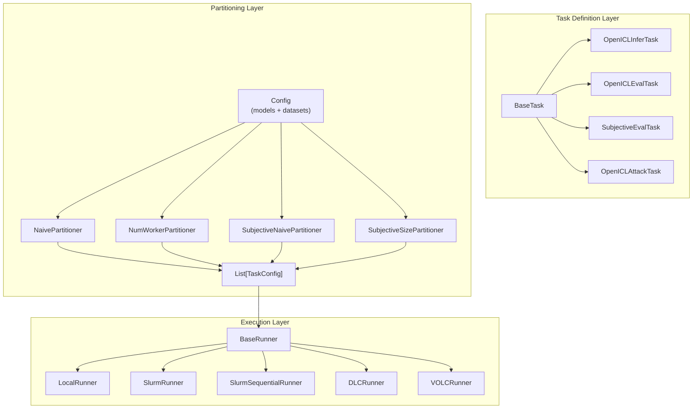

Sources: [opencompass/tasks/base.py](), [opencompass/tasks/subjective_eval.py:22-48](), [opencompass/runners/base.py:10-85](), [opencompass/partitioners/sub_naive.py:126-233](), [opencompass/partitioners/sub_size.py:20-288]()

## Configuration Management

The task execution framework begins with configuration parsing and setup through `get_config_from_arg()`, which handles multiple input formats and prepares unified configuration objects.

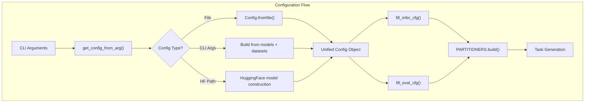

Sources: [opencompass/utils/run.py:87-233](), [opencompass/utils/run.py:361-413]()

## Task Types

Tasks represent atomic units of work that can be executed independently. Each task type handles a specific phase of the evaluation process.

### Inference Tasks

`OpenICLInferTask` executes model inference to generate predictions. It follows a structured workflow using ICL components:

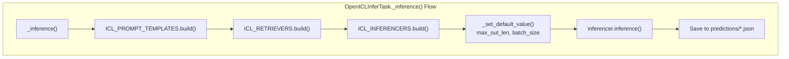

Sources: [opencompass/tasks/openicl_infer.py:91-143]()

### Evaluation Tasks  

`OpenICLEvalTask` implements a comprehensive evaluation pipeline with postprocessing and detailed result formatting:

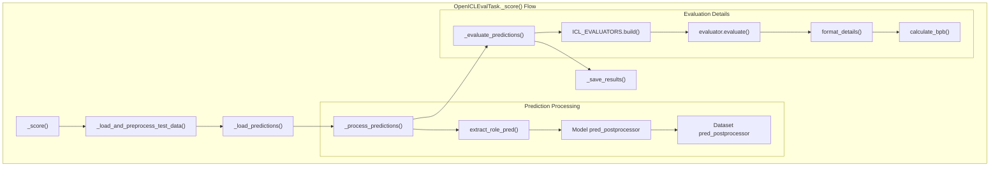

Sources: [opencompass/tasks/openicl_eval.py:87-328]()

### Subjective Evaluation Tasks

`SubjectiveEvalTask` handles human preference evaluation with judge models and supports multiple evaluation modes including meta-evaluation:

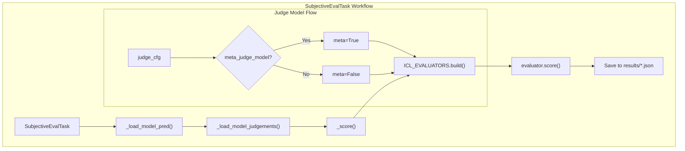

Sources: [opencompass/tasks/subjective_eval.py:79-416]()

### Attack Tasks

`OpenICLAttackTask` performs adversarial testing by modifying prompts to measure model robustness through prompt selection and attack generation.

Sources: [opencompass/tasks/openicl_attack.py:18-204]()

## Command Generation and GPU Management

Tasks generate executable commands through the `get_command()` method, which handles GPU allocation and distributed execution setup.

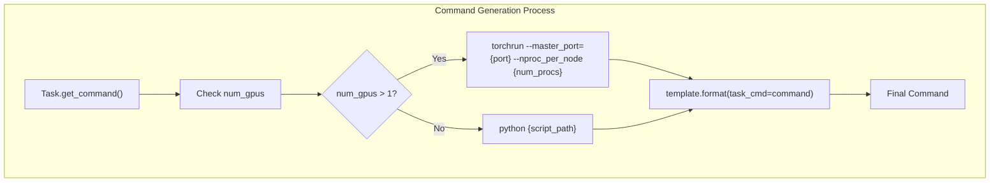

Sources: [opencompass/tasks/openicl_infer.py:38-62](), [opencompass/tasks/openicl_eval.py:54-65]()

## Runner Architecture

Runners execute tasks across different computing environments, handling resource allocation, job scheduling, and failure recovery.

### Base Runner Interface

All runners inherit from `BaseRunner` and implement the `launch()` method for parallel task execution:

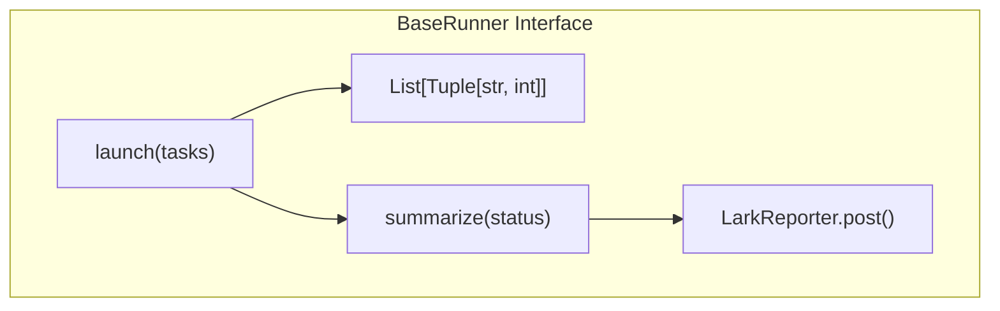

Sources: [opencompass/runners/base.py:31-85]()

### Local Runner

`LocalRunner` executes tasks locally with sophisticated GPU resource management and thread pooling:

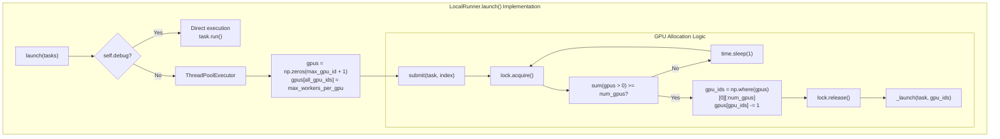

Sources: [opencompass/runners/local.py:69-196]()

### Slurm Runner

`SlurmRunner` submits jobs to Slurm clusters with retry logic and proper resource specification:

```mermaid
graph TD
    subgraph "SlurmRunner._launch() Implementation"
        Launch["_launch(cfg)"] --> BuildTask["TASKS.build(dict(cfg=cfg, type=self.task_cfg['type']))"]
        BuildTask --> BuildSrunCmd["Build srun command"]
        
        subgraph "Slurm Command Construction"
            BuildSrunCmd --> BaseCmd["tmpl = 'srun'"]
            BaseCmd --> AddPartition["tmpl += f' -p {self.partition}'"]
            AddPartition --> AddQuota["tmpl += f' --quotatype={self.quotatype}'"]
            AddQuota --> AddGPUs["tmpl += f' --gres=gpu:{num_gpus}'"]
            AddGPUs --> AddJob["tmpl += f' -N1 -u -J {task_name[:512]} {task_cmd}'"]
        end
        
        AddJob --> ExecuteCmd["subprocess.run(cmd)"]
        ExecuteCmd --> CheckFail["_job_failed(return_code, output_paths)"]
        CheckFail --> RetryLogic["Retry with cmd regeneration"]
    end
```

Sources: [opencompass/runners/slurm.py:79-162]()

### DLC Runner

`DLCRunner` manages Alibaba Cloud Deep Learning Cluster jobs with comprehensive monitoring:

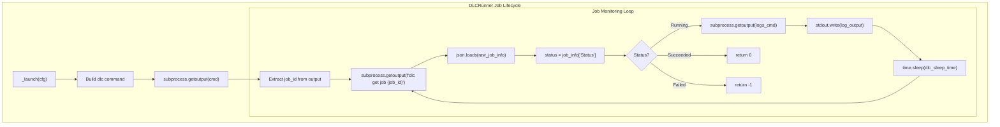

Sources: [opencompass/runners/dlc.py:89-354]()

## Task Partitioning Strategies

The framework provides multiple partitioning strategies to optimize task distribution and resource utilization.

### Partitioner Types

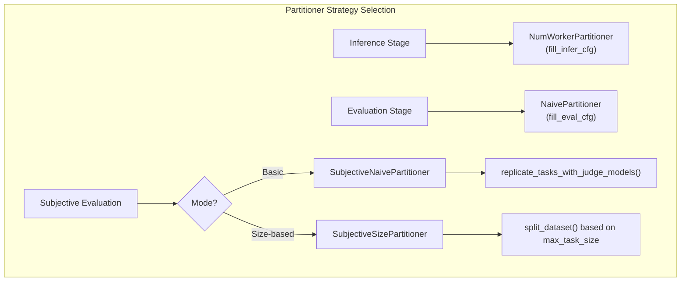

### Subjective Evaluation Partitioning

`SubjectiveNaivePartitioner` handles complex model combinations and judge model assignment:

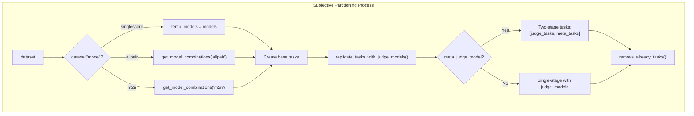

### Size-Based Partitioning

`SubjectiveSizePartitioner` implements dataset splitting based on computational cost estimation:

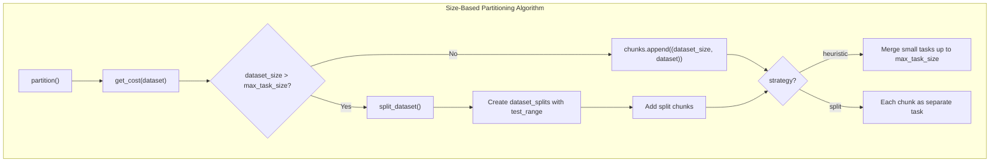

Sources: [opencompass/utils/run.py:361-413](), [opencompass/partitioners/sub_naive.py:126-233](), [opencompass/partitioners/sub_size.py:73-196]()

## Resource Management

### GPU Allocation in Local Runner

The local runner manages GPU resources using numpy arrays to track availability:

| Component | Purpose | Implementation |
|-----------|---------|----------------|
| `gpus` array | Track GPU availability | `np.zeros(max_gpu_id + 1)` |
| `max_workers_per_gpu` | Concurrent tasks per GPU | Configurable limit |
| `Lock` | Thread-safe allocation | Prevents race conditions |

Sources: [opencompass/runners/local.py:154-189]()

### Cluster Resource Templates

Different runners use environment-specific resource templates:

| Runner | Template Variables | Resource Specification |
|--------|-------------------|----------------------|
| Slurm | `partition`, `gres=gpu:N` | `--gres=gpu:{num_gpus}` |
| DLC | `worker_gpu`, `worker_memory` | Alibaba Cloud flavors |
| VOLC | `flavor`, `queue_name` | Volcano Cloud resources |

Sources: [opencompass/runners/slurm.py:102-113](), [opencompass/runners/dlc.py:210-213](), [opencompass/runners/volc.py:254-276]()

## Execution Flow Integration

The complete execution flow from CLI to task completion:

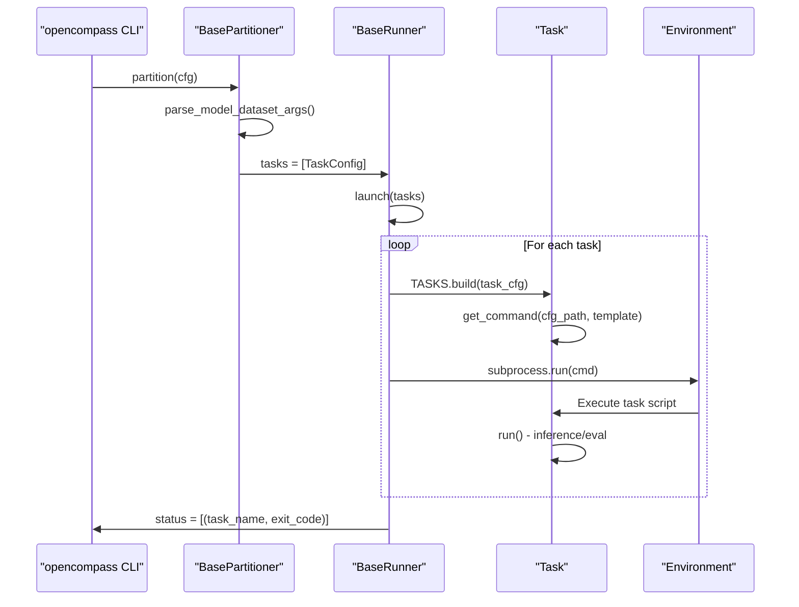

Sources: [opencompass/cli/main.py:344-354](), [opencompass/cli/main.py:388-400]()

## Environment-Specific Features

### Debug Mode Support

All runners support debug mode for local testing:

```python
if self.debug:
    # Execute directly without subprocess
    task.run()
else:
    # Use subprocess with proper logging
    subprocess.run(cmd, stdout=log_file)
```

Sources: [opencompass/runners/local.py:122-146]()

### Retry and Failure Handling

Runners implement configurable retry logic for job failures:

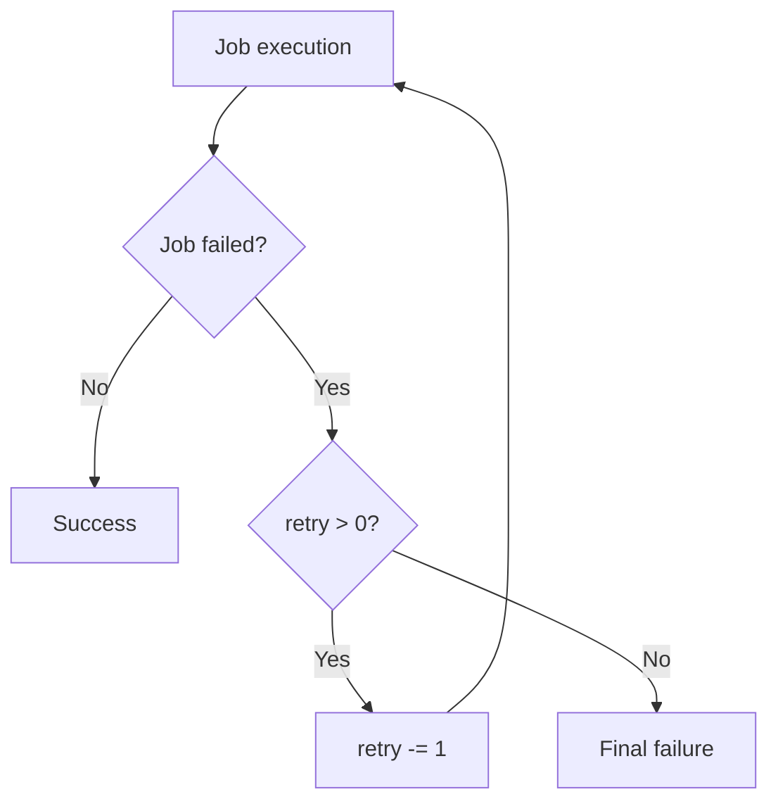

Sources: [opencompass/runners/slurm.py:138-151](), [opencompass/runners/dlc.py:335-341]()

---

