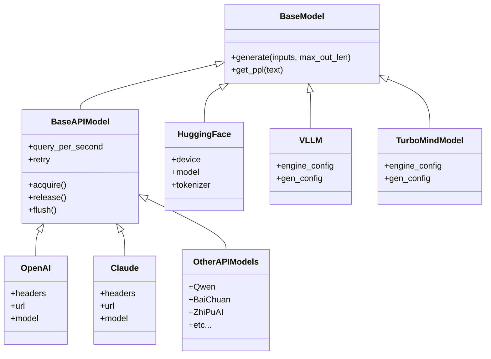
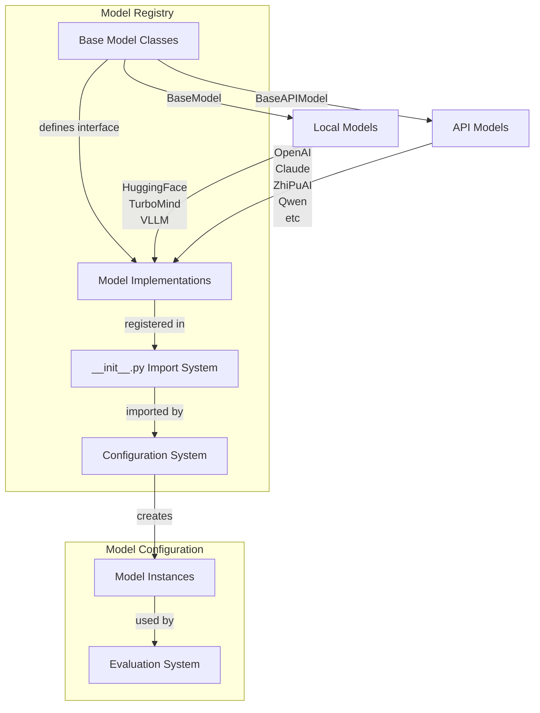
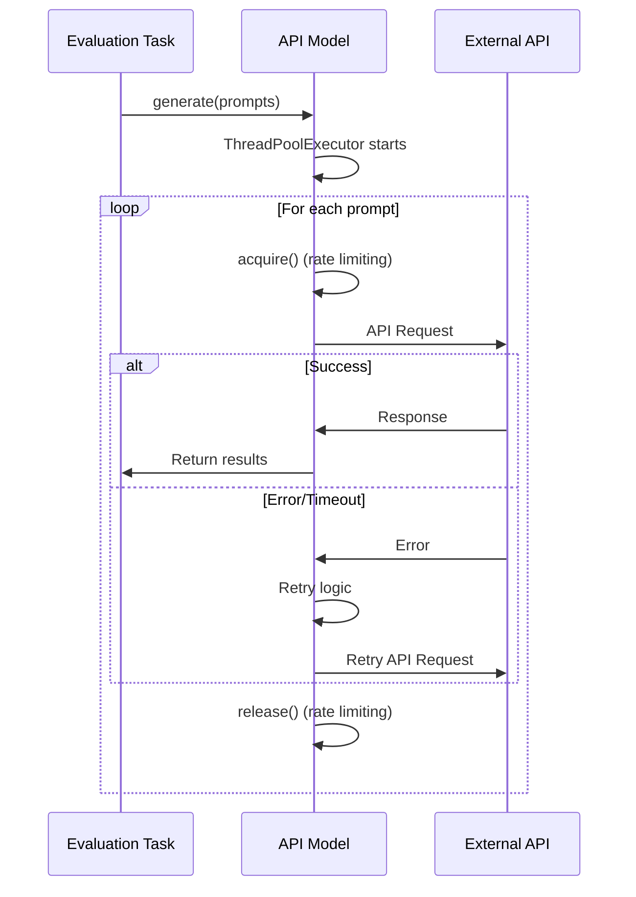
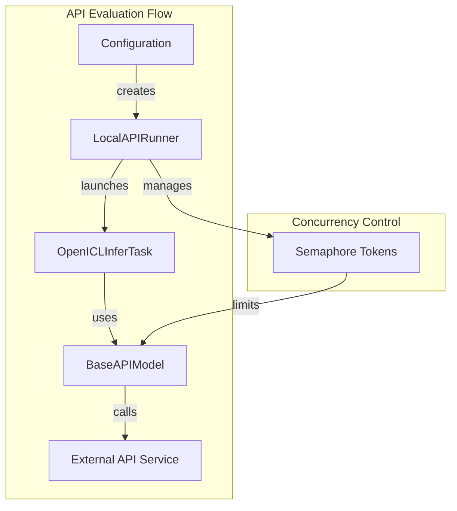
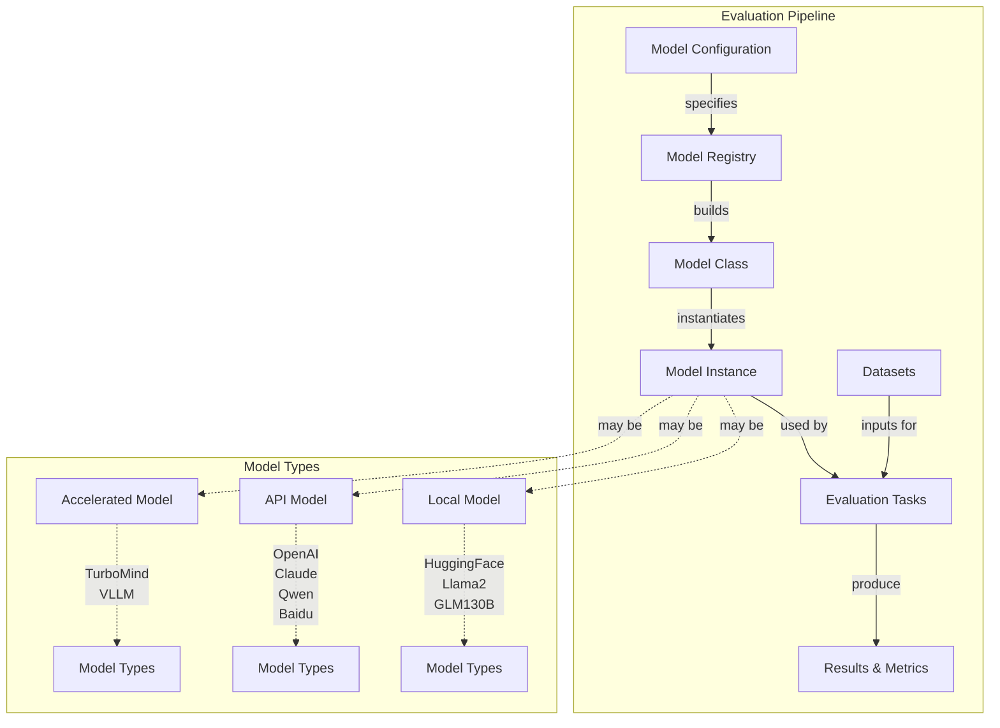

<!-- source: DeepWiki mcp.deepwiki.com · repo open-compass/opencompass · page 4 Model Support · fetched 2026-10-21 -->

# Model Support

<details>
<summary>Relevant source files</summary>

The following files were used as context for generating this wiki page:

- [examples/eval_model_rollout.py](examples/eval_model_rollout.py)
- [opencompass/configs/models/bluelm/bluelm_3b.py](opencompass/configs/models/bluelm/bluelm_3b.py)
- [opencompass/datasets/cmnli.py](opencompass/datasets/cmnli.py)
- [opencompass/datasets/generic.py](opencompass/datasets/generic.py)
- [opencompass/lagent/actions/python_interpreter.py](opencompass/lagent/actions/python_interpreter.py)
- [opencompass/models/__init__.py](opencompass/models/__init__.py)
- [opencompass/models/bluelm_api.py](opencompass/models/bluelm_api.py)
- [opencompass/models/openai_api.py](opencompass/models/openai_api.py)
- [opencompass/models/vllm.py](opencompass/models/vllm.py)
- [opencompass/models/zhipuai_v2_api.py](opencompass/models/zhipuai_v2_api.py)
- [opencompass/runners/__init__.py](opencompass/runners/__init__.py)
- [opencompass/runners/base.py](opencompass/runners/base.py)
- [opencompass/runners/dlc.py](opencompass/runners/dlc.py)
- [opencompass/runners/local.py](opencompass/runners/local.py)
- [opencompass/runners/local_api.py](opencompass/runners/local_api.py)
- [opencompass/runners/rjob.py](opencompass/runners/rjob.py)
- [opencompass/runners/slurm.py](opencompass/runners/slurm.py)
- [opencompass/runners/slurm_sequential.py](opencompass/runners/slurm_sequential.py)
- [opencompass/runners/volc.py](opencompass/runners/volc.py)
- [opencompass/tasks/openicl_attack.py](opencompass/tasks/openicl_attack.py)
- [opencompass/tasks/openicl_eval.py](opencompass/tasks/openicl_eval.py)
- [opencompass/tasks/openicl_infer.py](opencompass/tasks/openicl_infer.py)
- [opencompass/utils/build.py](opencompass/utils/build.py)
- [opencompass/utils/types.py](opencompass/utils/types.py)

</details>


This page provides a comprehensive overview of the model integration system in OpenCompass, detailing how different types of language models are supported, configured, and used for evaluations. It covers both API-based models that call external services and locally deployed models that run on your infrastructure. For information about accelerating model inference, see [Accelerated Inference](#4.3).

## Model System Architecture

OpenCompass implements a flexible model integration system that supports various types of language models through a consistent interface. The system is built around a core hierarchy of model classes that enable both local model evaluation and API-based model evaluation.



Sources: [opencompass/models/__init__.py:1-52](), [opencompass/models/base.py](), [opencompass/models/base_api.py]()

## Model Types Overview

OpenCompass organizes model support into three main categories:

| Category | Description | Examples | Base Class |
|----------|-------------|----------|------------|
| **API-based Models** | Models accessed through remote APIs | OpenAI, Claude, Qwen, Baidu, ZhiPu | `BaseAPIModel` |
| **Local Models** | Models deployed and run locally | HuggingFace, GLM | `BaseModel` |
| **Accelerated Models** | Optimized local models for faster inference | TurboMind, VLLM | `BaseModel` |

Sources: [opencompass/models/__init__.py:1-52]()

## Model Registry System

OpenCompass uses a model registry pattern to make all supported model implementations available through imports. The registry is implemented in the models `__init__.py` file, which exposes all model classes to the configuration system.



Sources: [opencompass/models/__init__.py:1-52]()

## API-based Models

API-based models connect to external services to perform inference. These models inherit from the `BaseAPIModel` class, which handles API rate limiting, retries, and error handling.

### Core API Model Features

- **Rate Limiting**: Controls query frequency through the `query_per_second` parameter
- **Retry Logic**: Automatically retries failed requests based on the `retry` parameter
- **Token Management**: Semaphore system for concurrent API access
- **Timeout Handling**: Graceful handling of API timeouts and connection errors

### Supported API Models

OpenCompass supports a comprehensive range of commercial and research API-based models:

| Model Provider | Class Name | Special Features |
|----------------|------------|------------------|
| OpenAI | `OpenAI`, `OpenAISDK`, `OpenAISDKStreaming` | Key rotation, reasoning models (o1/o3/o4), streaming support |
| Anthropic | `Claude`, `ClaudeSDK`, `ClaudeAllesAPIN` | Multiple Claude API implementations |
| Zhipu AI | `ZhiPuAI`, `ZhiPuV2AI` | Web search tools integration |
| Baidu | `ERNIEBot` | Native Chinese language support |
| Qwen | `Qwen` | Alibaba's Dashscope platform |
| ByteDance | `ByteDance`, `Doubao` | Volcengine platform integration |
| MiniMax | `MiniMax`, `MiniMaxChatCompletionV2` | Multiple API versions |
| MoonShot | `MoonShot` | Long context support |
| Hunyuan | `Hunyuan` | Tencent's model platform |
| DeepSeek | `DeepseekAPI` | Reasoning and coding models |
| XunFei | `XunFei`, `XunFeiSpark` | Voice and text capabilities |
| SenseTime | `SenseTime` | Computer vision integration |
| BlueLM | `BlueLMAPI` | Streaming response support |
| Gemini | `Gemini` | Google's multimodal AI |
| Mistral | `Mistral` | European AI models |
| StepFun | `StepFun` | Specialized reasoning models |
| Others | `AI360GPT`, `YiAPI`, `Nanbeige`, `PanGu`, `Yayi`, `Rendu`, `UniGPT`, `KrGPT`, `Alaya` | Regional and specialized models |

Sources: [opencompass/models/__init__.py:1-54]()

### Common API Usage Pattern

All API models follow a similar pattern for handling requests:



Sources: [opencompass/models/xunfei_api.py:101-122](), [opencompass/models/minimax_api.py:61-82](), [opencompass/models/baidu_api.py:91-112]()

### API Runner

For API models, OpenCompass provides a specialized runner called `LocalAPIRunner` that handles concurrent API requests while respecting rate limits:



Sources: [opencompass/runners/local_api.py:148-249]()

## Local Models

Local models are deployed and run directly on your infrastructure. These models inherit from the base `BaseModel` class and include implementations for popular frameworks like Hugging Face Transformers.

### Core Local Model Features

- **Device Management**: Controls which GPU/CPU the model runs on
- **Batch Processing**: Handles batching of inputs for efficient inference
- **Memory Optimization**: Settings for optimizing memory usage
- **Tokenization**: Integrated tokenization for input processing

### Supported Local Model Types

| Model Type | Class Name | Key Features |
|------------|------------|--------------|
| Hugging Face | `HuggingFace`, `HuggingFaceCausalLM` | General-purpose Transformers support |
| GLM | `GLM130B` | Support for GLM architecture |
| InternLM | `InternLM` | Support for InternLM models |
| Llama2 | `Llama2`, `Llama2Chat` | Specialized support for Llama2 |
| ModelScope | `ModelScope` | Integration with ModelScope models |

Sources: [opencompass/models/__init__.py:17-22](), [opencompass/models/huggingface.py]()

## Accelerated Models

OpenCompass supports accelerated inference using optimized runtimes like TurboMind (from LMDeploy) and VLLM:

### TurboMind

TurboMind provides optimized inference for large language models, especially suited for large-scale evaluation scenarios.

```python
# Example TurboMind configuration
dict(
    type=TurboMindModel,
    abbr='gemma-2-27b-turbomind',
    path='google/gemma-2-27b',
    engine_config=dict(session_len=16384, max_batch_size=16, tp=2),
    gen_config=dict(
        top_k=1, temperature=1e-6, top_p=0.9, max_new_tokens=4096
    ),
    max_seq_len=16384,
    max_out_len=4096,
    batch_size=16,
    run_cfg=dict(num_gpus=2),
)
```

Sources: [opencompass/configs/models/gemma/lmdeploy_gemma_27b.py:1-18]()

### VLLM

VLLM provides memory-efficient inference with high throughput for transformer-based language models.

## Model Configuration

Models in OpenCompass are configured through Python dictionaries that specify the model type, parameters, and runtime settings. These configurations are typically defined in files under the `opencompass/configs/models/` directory.

### Example Configuration: DeepSeek-V2 with TurboMind

```python
# DeepSeek-V2 with TurboMind acceleration
dict(
    type=TurboMindModelwithChatTemplate,
    abbr='deepseek-v2_lite-chat-turbomind',
    path='deepseek-ai/DeepSeek-V2-Lite-Chat',
    engine_config=dict(
        session_len=7168,
        max_batch_size=4,
        tp=2,
        cache_max_entry_count=0.7,
    ),
    gen_config=dict(top_k=1, temperature=1e-6, top_p=0.9),
    max_seq_len=7168,
    max_out_len=2048,
    batch_size=4,
    run_cfg=dict(num_gpus=2),
)
```

Sources: [opencompass/configs/models/deepseek/lmdeploy_deepseek_v2_lite.py:1-21]()

## API Dependencies

API-based models in OpenCompass have various dependencies that need to be installed:

```
# Example API dependencies
anthropic          # for Claude models
dashscope          # for Qwen models
openai             # for OpenAI models
spark_ai_python    # for XunFei models
tencentcloud-sdk-python  # for Tencent models
volcengine         # for ByteDance models
zhipuai            # for ZhiPu models
```

Sources: [requirements/api.txt:1-18]()

## Integration with Evaluation Pipeline

Models in OpenCompass integrate with the evaluation pipeline as follows:



Sources: [opencompass/models/__init__.py:1-52](), [opencompass/runners/local_api.py:148-249]()

## Summary

OpenCompass provides a flexible model support system that can accommodate a wide range of language models:

1. **API-based Models**: For accessing commercial and research models via remote APIs
2. **Local Models**: For deploying and running models on your infrastructure
3. **Accelerated Models**: For optimized inference using TurboMind and VLLM

The system's modular design allows easy extension to support new model types and API services as they become available. To learn more about how to use specific model types, see [API-based Models](#4.1) and [Local Models](#4.2).

---

