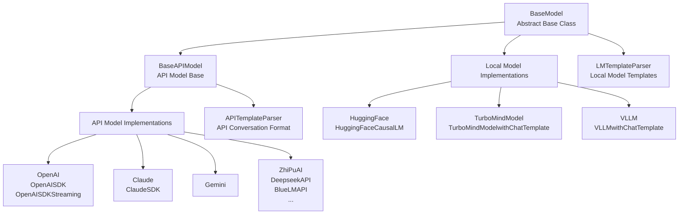
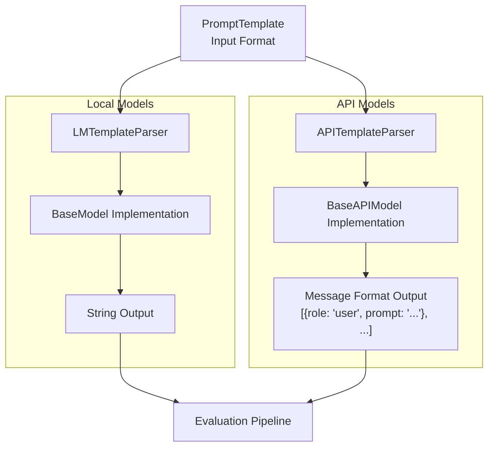
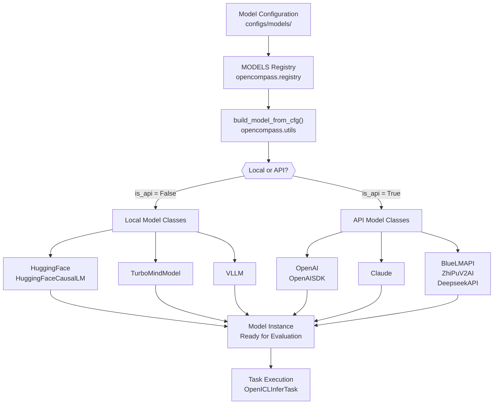

<!-- source: DeepWiki mcp.deepwiki.com · repo open-compass/opencompass · page 4.1 Model Abstraction and Base Classes · fetched 2026-10-21 -->

# Base Model Architecture

<details>
<summary>Relevant source files</summary>

The following files were used as context for generating this wiki page:

- [docs/en/prompt/chain_of_thought.md](docs/en/prompt/chain_of_thought.md)
- [docs/zh_cn/prompt/chain_of_thought.md](docs/zh_cn/prompt/chain_of_thought.md)
- [examples/eval_model_rollout.py](examples/eval_model_rollout.py)
- [opencompass/configs/models/bluelm/bluelm_3b.py](opencompass/configs/models/bluelm/bluelm_3b.py)
- [opencompass/datasets/cmnli.py](opencompass/datasets/cmnli.py)
- [opencompass/datasets/game24.py](opencompass/datasets/game24.py)
- [opencompass/datasets/generic.py](opencompass/datasets/generic.py)
- [opencompass/lagent/actions/python_interpreter.py](opencompass/lagent/actions/python_interpreter.py)
- [opencompass/models/__init__.py](opencompass/models/__init__.py)
- [opencompass/models/base.py](opencompass/models/base.py)
- [opencompass/models/base_api.py](opencompass/models/base_api.py)
- [opencompass/models/bluelm_api.py](opencompass/models/bluelm_api.py)
- [opencompass/models/openai_api.py](opencompass/models/openai_api.py)
- [opencompass/models/vllm.py](opencompass/models/vllm.py)
- [opencompass/models/zhipuai_v2_api.py](opencompass/models/zhipuai_v2_api.py)
- [opencompass/openicl/icl_inferencer/icl_attack_inferencer.py](opencompass/openicl/icl_inferencer/icl_attack_inferencer.py)
- [opencompass/openicl/icl_inferencer/icl_base_inferencer.py](opencompass/openicl/icl_inferencer/icl_base_inferencer.py)
- [opencompass/openicl/icl_inferencer/icl_clp_inferencer.py](opencompass/openicl/icl_inferencer/icl_clp_inferencer.py)
- [opencompass/openicl/icl_inferencer/icl_gen_inferencer.py](opencompass/openicl/icl_inferencer/icl_gen_inferencer.py)
- [opencompass/openicl/icl_inferencer/icl_ppl_inferencer.py](opencompass/openicl/icl_inferencer/icl_ppl_inferencer.py)
- [opencompass/openicl/icl_inferencer/icl_sc_inferencer.py](opencompass/openicl/icl_inferencer/icl_sc_inferencer.py)
- [opencompass/openicl/icl_inferencer/icl_tot_inferencer.py](opencompass/openicl/icl_inferencer/icl_tot_inferencer.py)
- [opencompass/registry.py](opencompass/registry.py)
- [opencompass/runners/__init__.py](opencompass/runners/__init__.py)
- [opencompass/runners/base.py](opencompass/runners/base.py)
- [opencompass/runners/dlc.py](opencompass/runners/dlc.py)
- [opencompass/runners/local.py](opencompass/runners/local.py)
- [opencompass/runners/local_api.py](opencompass/runners/local_api.py)
- [opencompass/runners/rjob.py](opencompass/runners/rjob.py)
- [opencompass/runners/slurm.py](opencompass/runners/slurm.py)
- [opencompass/runners/slurm_sequential.py](opencompass/runners/slurm_sequential.py)
- [opencompass/runners/volc.py](opencompass/runners/volc.py)
- [opencompass/tasks/openicl_attack.py](opencompass/tasks/openicl_attack.py)
- [opencompass/tasks/openicl_eval.py](opencompass/tasks/openicl_eval.py)
- [opencompass/tasks/openicl_infer.py](opencompass/tasks/openicl_infer.py)
- [opencompass/utils/build.py](opencompass/utils/build.py)
- [opencompass/utils/lark.py](opencompass/utils/lark.py)
- [opencompass/utils/types.py](opencompass/utils/types.py)
- [requirements.txt](requirements.txt)
- [tests/openicl/test_prompt_template.py](tests/openicl/test_prompt_template.py)

</details>


This document covers the foundational classes and interfaces that enable model integration in OpenCompass. It explains the base model architecture, template parsing system, and how different model types (local and API-based) are unified under a common interface.

For information about specific model implementations and configurations, see [Model Support](#4). For details on how models are executed within the evaluation pipeline, see [Task Execution Framework](#3.2).

## Overview

OpenCompass provides a unified architecture for integrating diverse model types through a common base interface. The system supports both local models (running on local hardware) and API-based models (accessed through external services) while abstracting away their implementation differences.

**Core Architecture Diagram**


Sources: [opencompass/models/__init__.py:1-54](), [opencompass/models/base.py:13-31](), [opencompass/models/base_api.py:20-37]()

## BaseModel: The Foundation Class

The `BaseModel` class serves as the abstract foundation for all model integrations in OpenCompass. It defines the core interface that all models must implement, ensuring consistent behavior across different model types.

### Key Abstract Methods

| Method | Purpose | Return Type |
|--------|---------|-------------|
| `generate(inputs, max_out_len)` | Generate text completions | `List[str]` |
| `get_ppl(inputs, mask_length)` | Calculate perplexity scores | `List[float]` |
| `get_ppl_tokenwise(inputs, mask_length)` | Get token-wise perplexity | `List[float]` |
| `encode(prompt)` | Tokenize input text | `torch.Tensor` |
| `decode(tokens)` | Convert tokens to text | `str` |
| `get_token_len(prompt)` | Count tokens in text | `int` |

### Template Integration

Every `BaseModel` instance includes a `LMTemplateParser` for handling prompt formatting:

```python
# From BaseModel.__init__
self.template_parser = LMTemplateParser(meta_template)
```

This enables models to work with structured prompts through methods like:
- `parse_template(prompt_template, mode)` - Convert templates to strings
- `generate_from_template(templates, max_out_len)` - Generate from structured prompts
- `get_token_len_from_template(templates, mode)` - Count template tokens

Sources: [opencompass/models/base.py:13-86](), [opencompass/models/base.py:149-227](), [opencompass/models/base.py:265-299]()

## BaseAPIModel: API Integration Layer

`BaseAPIModel` extends `BaseModel` to provide specialized functionality for external API services. It adds rate limiting, retry logic, and API-specific prompt formatting.

### Rate Limiting and Concurrency

The class implements sophisticated rate limiting through the `TokenBucket` mechanism:

```python
self.token_bucket = TokenBucket(query_per_second, rpm_verbose)
```

Key concurrency features:
- **Token-based rate limiting**: Controls requests per second
- **Retry mechanisms**: Automatic retry on failures with configurable attempts
- **Concurrent request management**: Thread-safe token acquisition/release
- **Request logging**: Optional verbose mode for monitoring API usage

### API Template Handling

`BaseAPIModel` uses `APITemplateParser` instead of `LMTemplateParser` to handle conversation-style APIs:

- Converts structured prompts to API message format (roles: user, assistant, system)
- Handles multi-turn conversations
- Manages role mappings and fallbacks
- Supports API-specific prompt wrapping

Sources: [opencompass/models/base_api.py:20-163](), [opencompass/models/base_api.py:426-463]()

## Template Parsing System

OpenCompass uses two specialized template parsers to handle different model requirements:

**Template Parser Architecture**


### LMTemplateParser Features

The `LMTemplateParser` handles local model prompt formatting:
- **Section management**: Handles begin/end sections, rounds, and ICE (in-context examples)
- **Role-based templating**: Supports custom role definitions with begin/end markers  
- **Multi-round conversations**: Manages dialogue history and turn-taking
- **Generation control**: Can stop template generation at specified roles

### APITemplateParser Features  

The `APITemplateParser` formats prompts for API consumption:
- **Conversation format**: Converts to API message arrays
- **Role mapping**: Maps OpenCompass roles to API roles (HUMAN→user, BOT→assistant)
- **Metadata handling**: Preserves role configurations and fallbacks
- **Generation boundaries**: Supports stopping before generation roles

Sources: [opencompass/models/base.py:265-516](), [opencompass/models/base_api.py:164-424]()

## Model Integration Flow

The following diagram shows how models are instantiated and integrated into the evaluation pipeline:

**Model Integration Pipeline**


### Registration Process

Models are registered through the `MODELS` registry and instantiated via configuration:

1. **Configuration**: Model configs specify type, path, and parameters
2. **Registration**: `@MODELS.register_module()` decorator registers model classes
3. **Instantiation**: `build_model_from_cfg()` creates model instances
4. **Template Assignment**: Models get appropriate template parsers based on type

### Key Integration Points

- **Model Discovery**: Through `opencompass/models/__init__.py` imports
- **Type Detection**: `is_api` boolean determines local vs API handling
- **Template Selection**: Automatic assignment of appropriate parser
- **Evaluation Interface**: Unified methods for inference and scoring

Sources: [opencompass/models/__init__.py:1-54](), [opencompass/registry.py:21](), [opencompass/runners/local_api.py:33]()

## Specialized Model Features

### Streaming Support

Some API models support streaming responses for real-time token generation:

```python
# OpenAISDKStreaming example
class OpenAISDKStreaming(OpenAISDK):
    def __init__(self, stream=True, stream_chunk_size=1, ...):
        self.stream = stream
```

### Rate Limiting Strategies

Different models implement various rate limiting approaches:
- **Query per second**: Basic time-based limiting
- **Concurrent users**: Pool-based limiting for shared resources  
- **Token bucket**: Smooth rate limiting with burst capacity
- **Retry backoff**: Exponential backoff on failures

### Template Customization

Models support extensive template customization:
- **Meta templates**: Define conversation structure and roles
- **Generation control**: Control where generation starts/stops
- **Role fallbacks**: Handle unsupported roles gracefully
- **Custom formatting**: Model-specific prompt formatting

Sources: [opencompass/models/openai_streaming.py:18-81](), [opencompass/models/base_api.py:426-463](), [opencompass/runners/local_api.py:26-53]()

---

