<!-- source: DeepWiki mcp.deepwiki.com · repo open-compass/opencompass · page 4.2 API-based Models · fetched 2026-10-21 -->

# API-based Models

<details>
<summary>Relevant source files</summary>

The following files were used as context for generating this wiki page:

- [examples/eval_model_rollout.py](examples/eval_model_rollout.py)
- [opencompass/configs/models/bluelm/bluelm_3b.py](opencompass/configs/models/bluelm/bluelm_3b.py)
- [opencompass/datasets/cmnli.py](opencompass/datasets/cmnli.py)
- [opencompass/datasets/generic.py](opencompass/datasets/generic.py)
- [opencompass/lagent/actions/python_interpreter.py](opencompass/lagent/actions/python_interpreter.py)
- [opencompass/models/__init__.py](opencompass/models/__init__.py)
- [opencompass/models/bluelm_api.py](opencompass/models/bluelm_api.py)
- [opencompass/models/openai_api.py](opencompass/models/openai_api.py)
- [opencompass/models/vllm.py](opencompass/models/vllm.py)
- [opencompass/models/zhipuai_v2_api.py](opencompass/models/zhipuai_v2_api.py)
- [opencompass/runners/__init__.py](opencompass/runners/__init__.py)
- [opencompass/runners/base.py](opencompass/runners/base.py)
- [opencompass/runners/dlc.py](opencompass/runners/dlc.py)
- [opencompass/runners/local.py](opencompass/runners/local.py)
- [opencompass/runners/local_api.py](opencompass/runners/local_api.py)
- [opencompass/runners/rjob.py](opencompass/runners/rjob.py)
- [opencompass/runners/slurm.py](opencompass/runners/slurm.py)
- [opencompass/runners/slurm_sequential.py](opencompass/runners/slurm_sequential.py)
- [opencompass/runners/volc.py](opencompass/runners/volc.py)
- [opencompass/tasks/openicl_attack.py](opencompass/tasks/openicl_attack.py)
- [opencompass/tasks/openicl_eval.py](opencompass/tasks/openicl_eval.py)
- [opencompass/tasks/openicl_infer.py](opencompass/tasks/openicl_infer.py)
- [opencompass/utils/build.py](opencompass/utils/build.py)
- [opencompass/utils/types.py](opencompass/utils/types.py)

</details>


This document covers the integration and usage of API-based language models in OpenCompass. These models are accessed through external APIs rather than being loaded locally, including providers like OpenAI, Claude, Gemini, and various Chinese commercial APIs.

For information about locally hosted models, see [Local Models](#4.2). For acceleration frameworks that can serve local models as APIs, see [Accelerated Inference](#4.3).

## Overview

OpenCompass provides a unified interface for evaluating models served through external APIs. The `BaseAPIModel` abstract class implements common functionality including rate limiting via `query_per_second`, API key management through the `keys` attribute, and retry logic controlled by the `retry` parameter.

API Model Class Hierarchy:

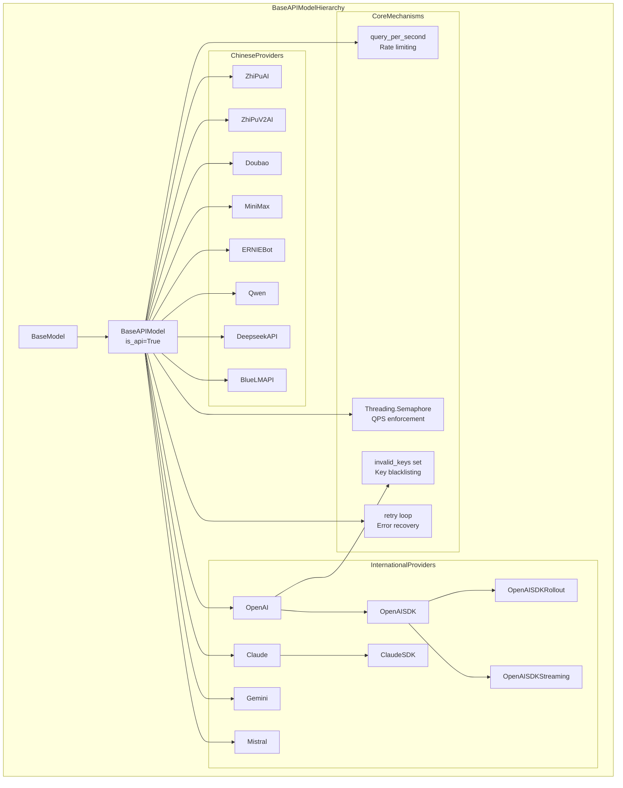

Sources: [opencompass/models/__init__.py:1-55](), [opencompass/models/base_api.py](), [opencompass/models/openai_api.py:31-77]()

## Base API Model Framework

The `BaseAPIModel` class provides the foundation for all API-based models, implementing common functionality like rate limiting, authentication, and request management.

### Core Architecture

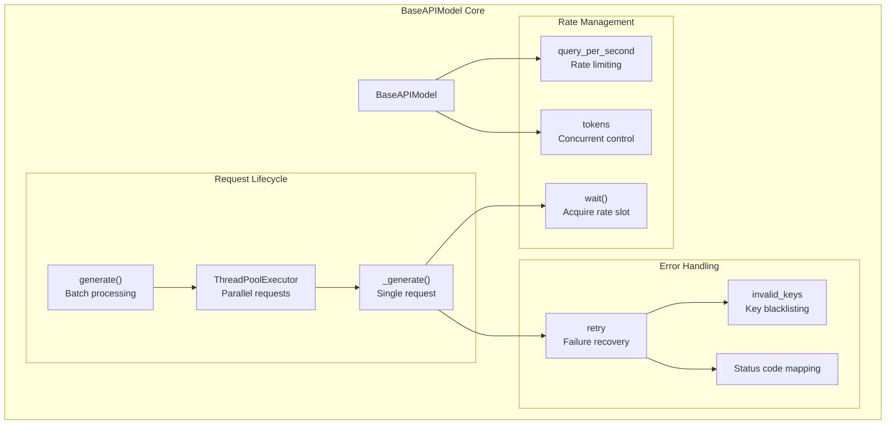

Sources: [opencompass/models/base_api.py:18](), [opencompass/models/openai_api.py:76-98](), [opencompass/models/openai_api.py:153-191]()

### Request Processing Flow

All API models follow a standardized request processing pattern implemented in the base class:

| Component | Purpose | Implementation |
|-----------|---------|----------------|
| `generate()` | Batch request orchestration | [opencompass/models/openai_api.py:153-191]() |
| `_generate()` | Single request handling | [opencompass/models/openai_api.py:192-373]() |
| `wait()` | Rate limiting enforcement | [opencompass/models/base_api.py]() |
| `ThreadPoolExecutor` | Concurrent request management | [opencompass/models/openai_api.py:178-190]() |

## Supported API Providers

OpenCompass supports a comprehensive set of API providers, each with specialized implementations while maintaining the common interface.

### Commercial International Providers

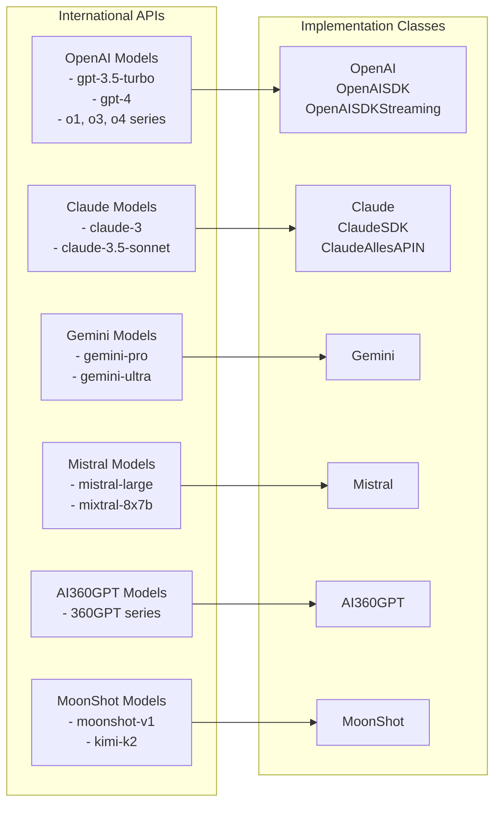

Sources: [opencompass/models/__init__.py:35-37](), [opencompass/models/__init__.py:11-13](), [opencompass/models/__init__.py:16](), [opencompass/models/__init__.py:30](), [opencompass/models/__init__.py:2](), [opencompass/models/__init__.py:33]()

### Chinese Commercial Providers

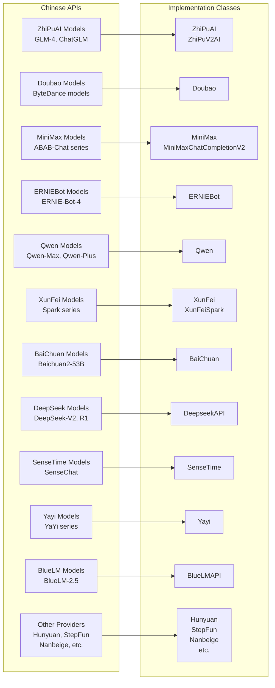

Sources: [opencompass/models/__init__.py:52-53](), [opencompass/models/__init__.py:15](), [opencompass/models/__init__.py:29](), [opencompass/models/__init__.py:5](), [opencompass/models/__init__.py:39](), [opencompass/models/__init__.py:49](), [opencompass/models/__init__.py:4](), [opencompass/models/__init__.py:14](), [opencompass/models/__init__.py:41](), [opencompass/models/__init__.py:50](), [opencompass/models/__init__.py:9](), [opencompass/models/__init__.py:23]()

## Authentication and Configuration

### API Key Management

OpenCompass provides flexible authentication mechanisms supporting multiple API keys and organizations:

```python
# Environment variable mode
key='ENV'  # Uses OPENAI_API_KEY environment variable

# Single key mode  
key='sk-your-api-key-here'

# Multiple keys for rotation
key=['sk-key-1', 'sk-key-2', 'sk-key-3']

# Organization support
org=['org-1', 'org-2']  # Round-robin organization usage
```

The `OpenAI` class demonstrates advanced key management with automatic key rotation and invalid key tracking:

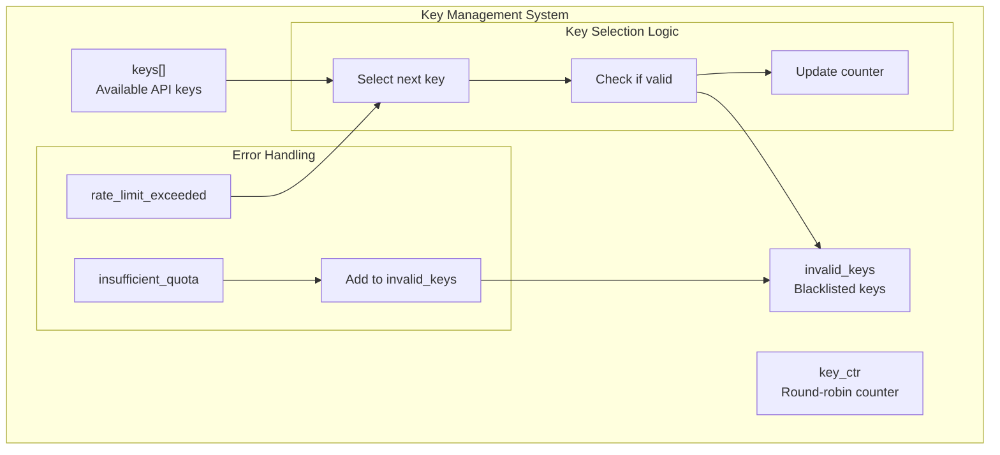

Sources: [opencompass/models/openai_api.py:122-141](), [opencompass/models/openai_api.py:219-232](), [opencompass/models/openai_api.py:354-357]()

### OpenAI Implementation Variants

OpenCompass provides multiple OpenAI implementations optimized for different use cases:

| Class | Base Class | API Approach | Key Features |
|-------|-----------|--------------|--------------|
| `OpenAI` | `BaseAPIModel` | Direct HTTP via `requests.post()` | Custom retry logic, proxy via `openai_proxy_url`, manual key rotation |
| `OpenAISDK` | `OpenAI` | Official SDK via `openai.OpenAI` client | Built-in SDK features, `httpx.Client` support, `status_code_mappings` |
| `OpenAISDKRollout` | `OpenAI` | Official SDK with logprobs | Returns `choices[0].logprobs.content` for rollout evaluation |
| `OpenAISDKStreaming` | `OpenAISDK` | Streaming chunks | Real-time `stream_chunk_size` processing, `_handle_stream_response()` |

**Implementation Details:**

The `OpenAI` class at [opencompass/models/openai_api.py:31-385]() implements direct HTTP POST requests to `OPENAI_API_BASE`, handling key rotation through `self.key_ctr` and tracking failed keys in `self.invalid_keys`. 

The `OpenAISDK` class at [opencompass/models/openai_api.py:568-795]() wraps the official `openai` Python package, using `self.openai_client = OpenAI(base_url=..., api_key=..., http_client=...)` for more robust SDK integration.

The `OpenAISDKRollout` class at [opencompass/models/openai_api.py:797-1003]() extends `OpenAI` specifically for rollout evaluations, calling `self.openai_client.chat.completions.create(**query_data, logprobs=True, top_logprobs=self.top_logprobs)` to collect token-level log probabilities for computing metrics like `sum_neg_logprob` and `entropy_nats`.

Sources: [opencompass/models/openai_api.py:31-77](), [opencompass/models/openai_api.py:568-596](), [opencompass/models/openai_api.py:797-824]()

### Streaming Support

OpenCompass provides streaming capabilities through the `OpenAISDKStreaming` class, enabling real-time token generation:

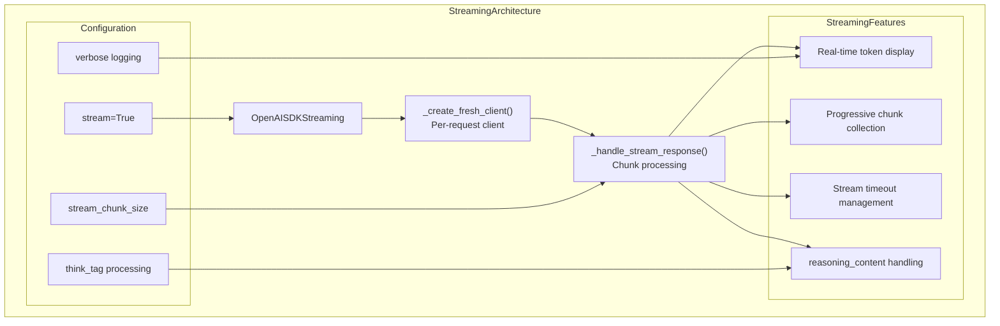

Sources: [opencompass/models/openai_streaming.py:18-81](), [opencompass/models/openai_streaming.py:121-209](), [opencompass/models/openai_streaming.py:238-346]()

#### Special O1 Model Handling

OpenCompass automatically handles OpenAI's reasoning models (O1, O3, O4 series) with specialized parameter mapping defined in `OAI_REASONING_MODEL_LIST` at [opencompass/models/openai_api.py:28]().

O1 Model Request Processing:

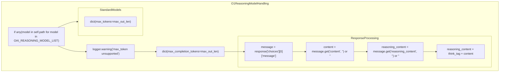

**Implementation:** At [opencompass/models/openai_api.py:258-273](), the code checks if the model name contains patterns from `OAI_REASONING_MODEL_LIST = ['o1', 'o3', 'o4', 'gpt-5']`. If matched, it uses `max_completion_tokens` instead of `max_tokens`. The response processing at [opencompass/models/openai_api.py:337-358]() extracts both `content` and `reasoning_content` fields, concatenating them with `self.think_tag` (default: `</think>`) as a separator.

Sources: [opencompass/models/openai_api.py:28](), [opencompass/models/openai_api.py:258-284](), [opencompass/models/openai_api.py:337-358]()

## LLM-as-Judge Integration

API models serve a crucial role in OpenCompass's LLM-as-judge evaluation system, where they act as evaluators for subjective tasks and complex reasoning problems.

### GenericLLMEvaluator Architecture

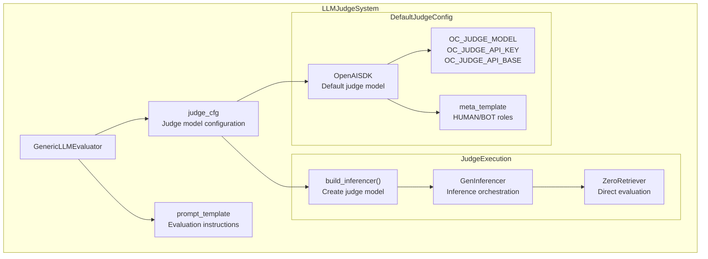

The `GenericLLMEvaluator` uses API models as judges by default, with fallback configuration using environment variables. Judge models evaluate predictions against references and return structured judgments.

Sources: [opencompass/evaluator/generic_llm_evaluator.py:21-84](), [opencompass/evaluator/generic_llm_evaluator.py:194-220](), [opencompass/models/openai_api.py:28](), [opencompass/models/openai_api.py:248-262](), [opencompass/models/openai_api.py:557-625](), [opencompass/models/openai_api.py:716-737]()

### Configuration Examples

Each API provider requires specific configuration parameters. The following table shows constructor parameters and their locations in the codebase:

| Provider | Required Parameters | Optional Parameters | Constructor Location |
|----------|-------------------|-------------------|---------------------|
| `OpenAI` | `path`, `key` | `org`, `openai_api_base`, `openai_proxy_url`, `think_tag`, `max_workers` | [opencompass/models/openai_api.py:81-102]() |
| `OpenAISDK` | `path`, `key` | `openai_api_base`, `http_client_cfg`, `status_code_mappings`, `timeout` | [opencompass/models/openai_api.py:571-596]() |
| `OpenAISDKRollout` | `path`, `key` | `top_logprobs`, `openai_extra_kwargs` | [opencompass/models/openai_api.py:800-824]() |
| `Claude` | `path`, `key` | `base_url`, `proxy_url` | [opencompass/models/claude_api.py]() |
| `ZhiPuV2AI` | `path`, `key` | `generation_kwargs` | [opencompass/models/zhipuai_v2_api.py:33-45]() |
| `BlueLMAPI` | `path`, `key`, `url` | `generation_kwargs`, `system_prompt` | [opencompass/models/bluelm_api.py:33-50]() |

**Example Configurations:**

```python
# OpenAI with multiple keys for rotation
models = [
    dict(
        type='OpenAI',
        path='gpt-4',
        key=['sk-key-1', 'sk-key-2', 'sk-key-3'],  # Round-robin rotation
        openai_api_base='https://api.openai.com/v1/chat/completions',
        max_seq_len=4096,
        query_per_second=1,
        max_workers=20,  # ThreadPoolExecutor size
    )
]

# OpenAISDKRollout for entropy evaluation
models = [
    dict(
        type='OpenAISDKRollout',
        path='gpt-3.5-turbo',
        key='ENV',
        top_logprobs=5,  # Return top 5 token probabilities
        openai_extra_kwargs=dict(top_p=0.95),
    )
]

# BlueLMAPI with custom endpoint
models = [
    dict(
        type='BlueLMAPI',
        path='bluelm-2.5',
        key='your-api-key',
        url='http://api-ai.vivo.com.cn/multimodal',
        generation_kwargs={'temperature': 0.6, 'max_tokens': 32768},
    )
]
```

Sources: [opencompass/models/openai_api.py:81-102](), [opencompass/models/openai_api.py:571-596](), [opencompass/models/openai_api.py:800-824](), [opencompass/models/bluelm_api.py:33-58](), [opencompass/configs/models/bluelm/bluelm_3b.py:1-24]()

## Rate Limiting and Concurrency Control

### Query-Per-Second Rate Limiting Implementation

The `BaseAPIModel` class implements rate limiting through `Threading.Semaphore` and timing mechanisms:

Rate Limiting Flow in BaseAPIModel:

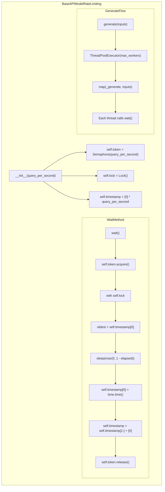

**Code Location:** The `wait()` method is implemented in `BaseAPIModel` (typically in [opencompass/models/base_api.py]()). The method uses `self.token.acquire()` to limit concurrent requests to `query_per_second`, then checks `self.timestamp[0]` to ensure at least 1 second has elapsed since the oldest request before allowing a new one.

Sources: [opencompass/models/base_api.py](), [opencompass/models/openai_api.py:163-200]()

### LocalAPIRunner for Concurrent API Evaluation

The `LocalAPIRunner` at [opencompass/runners/local_api.py:148-250]() provides specialized execution for API models with global concurrency limits across multiple processes.

**Key Configuration:**

```python
runner = dict(
    type='LocalAPIRunner',
    concurrent_users=10,  # Global API concurrency limit
    max_num_workers=16,   # Process pool size
    task=dict(type='OpenICLInferTask'),
)
```

LocalAPIRunner Architecture and Monkey Patching:

```mermaid
graph TB
    subgraph "LocalAPIRunnerImplementation"
        Launch["launch(tasks)"]
        Manager["Manager()"]
        Semaphore["tokens = manager.Semaphore(concurrent_users)"]
        Pool["Pool(processes=max_num_workers)"]
        
        subgraph "MonkeyRunFunction"
            MonkeyRun["monkey_run(self, tokens)"]
            BuildModel["build_model_from_cfg(model_cfg)"]
            AssertAPI["assert self.model.is_api"]
            InjectTokens["self.model.tokens = tokens"]
            RunInference["self._inference()"]
        end
        
        subgraph "SubmitFunction"
            Submit["submit(task, type, tokens)"]
            BuildTask["TASKS.build(type=type)"]
            CallLaunch["launch(task, tokens)"]
            RedirectStdout["redirect_std_to_file(out_path)"]
            CreateInferencer["OpenICLInferTask(task.cfg)"]
            PatchRun["inferencer.run = monkey_run"]
            Execute["inferencer.run(inferencer, tokens)"]
        end
        
        subgraph "ProgressTracking"
            PbarCounter["pbar_counter = manager.Value('i', 0)"]
            UpdateCallback["update(args)"]
            IncrementCounter["pbar_counter.value += 1"]
        end
    end
    
    Launch --> Manager
    Manager --> Semaphore
    Manager --> Pool
    Manager --> PbarCounter
    Pool --> Submit
    Submit --> BuildTask
    BuildTask --> CallLaunch
    CallLaunch --> RedirectStdout
    RedirectStdout --> CreateInferencer
    CreateInferencer --> PatchRun
    PatchRun --> Execute
    Execute --> MonkeyRun
    MonkeyRun --> BuildModel
    BuildModel --> AssertAPI
    AssertAPI --> InjectTokens
    InjectTokens --> RunInference
    Pool --> UpdateCallback
    UpdateCallback --> IncrementCounter
```

**Implementation Details:**

1. **Global Semaphore:** The `tokens = manager.Semaphore(concurrent_users)` at [opencompass/runners/local_api.py:218]() creates a shared semaphore that all processes respect for global concurrency control.

2. **Monkey Patching:** The `monkey_run` function at [opencompass/runners/local_api.py:26-53]() patches `OpenICLInferTask.run` to inject the shared semaphore via `self.model.tokens = tokens` at [opencompass/runners/local_api.py:36]().

3. **Process Execution:** Each task runs in a separate process via `Pool.apply_async()` at [opencompass/runners/local_api.py:231-233](), calling the `submit()` function at [opencompass/runners/local_api.py:139-146]() which redirects stdout to `out_path` and executes the patched inference task.

4. **Progress Tracking:** A shared counter `pbar_counter = manager.Value('i', 0)` at [opencompass/runners/local_api.py:221]() is incremented in callbacks to update the progress bar across processes.

Sources: [opencompass/runners/local_api.py:148-250](), [opencompass/runners/local_api.py:26-53](), [opencompass/runners/local_api.py:139-146](), [opencompass/runners/local_api.py:217-221]()

## Error Handling and Retry Logic

### Comprehensive Error Recovery

API models implement multi-layered error handling to ensure robust evaluation execution:

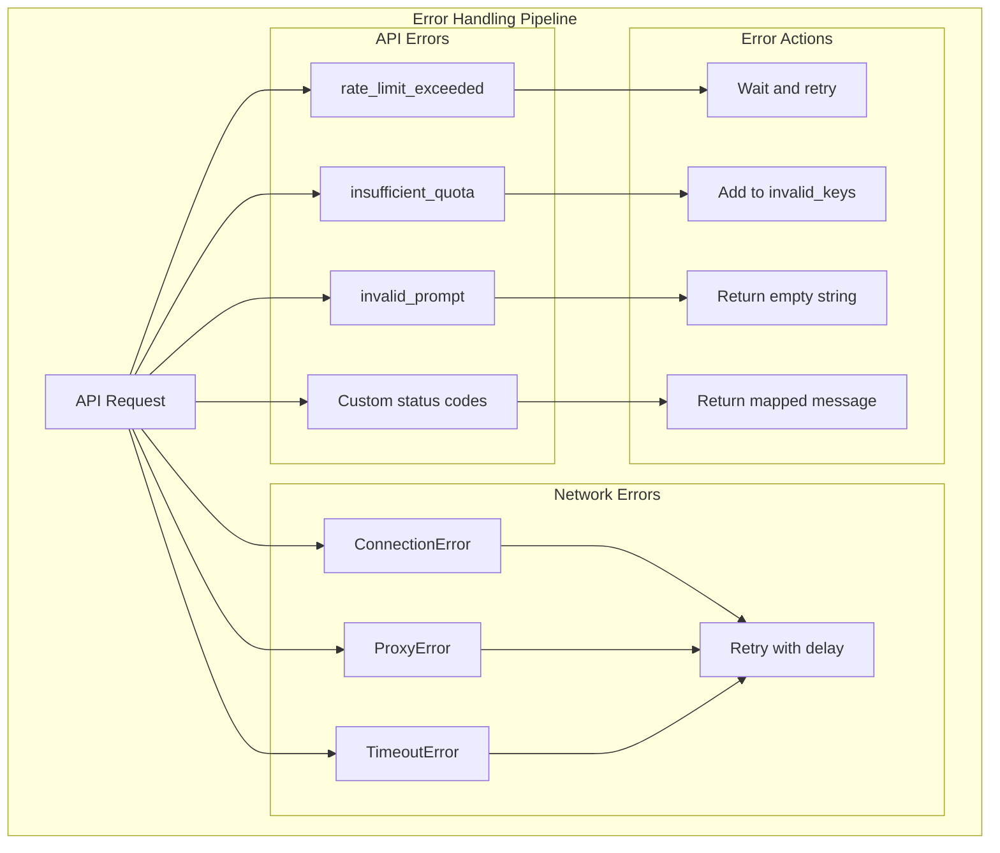

Sources: [opencompass/models/openai_api.py:306-373](), [opencompass/models/openai_api.py:350-368](), [opencompass/models/zhipuai_v2_api.py:130-151]()

### Provider-Specific Error Handling

Different API providers implement specialized error handling in their `_generate()` methods:

| Provider | Error Codes | Handling Logic | Code Location |
|----------|-------------|----------------|---------------|
| `OpenAI` | `rate_limit_exceeded` | `time.sleep(10)` then continue | [opencompass/models/openai_api.py:361-364]() |
| `OpenAI` | `insufficient_quota` | `self.invalid_keys.add(key)`, skip to next key | [opencompass/models/openai_api.py:365-368]() |
| `OpenAI` | `invalid_prompt` | Log warning, return empty string `''` | [opencompass/models/openai_api.py:369-371]() |
| `OpenAISDK` | `BadRequestError` | Check `status_code_mappings`, return custom message | [opencompass/models/openai_api.py:769-784]() |
| `ZhiPuV2AI` | `1301` (sensitive) | Return `'Sensitive content'` | [opencompass/models/zhipuai_v2_api.py:138-139]() |
| `ZhiPuV2AI` | `1302` (rate limit) | `time.sleep(1)`, continue retry | [opencompass/models/zhipuai_v2_api.py:140-143]() |
| `BlueLMAPI` | HTTP 200 | Call `split_think()` to extract answer from reasoning | [opencompass/models/bluelm_api.py:155-160]() |

**Example: OpenAI Key Blacklisting**

The `OpenAI._generate()` method at [opencompass/models/openai_api.py:202-384]() maintains an `invalid_keys` set. When it detects `insufficient_quota`, the key is added via `self.invalid_keys.add(key)` at [opencompass/models/openai_api.py:366](), and subsequent requests skip blacklisted keys in the key selection loop at [opencompass/models/openai_api.py:234-240]().

**Example: OpenAISDK Status Code Mapping**

The `OpenAISDK._generate()` method at [opencompass/models/openai_api.py:645-794]() accepts a `status_code_mappings` dict (e.g., `{400: 'Input data may contain inappropriate content.'}`). When catching `BadRequestError` or `APIStatusError`, it checks if `status_code in self.status_code_mappings` at [opencompass/models/openai_api.py:776-777]() and returns the mapped error message instead of raising an exception.

Sources: [opencompass/models/openai_api.py:202-384](), [opencompass/models/openai_api.py:645-794](), [opencompass/models/zhipuai_v2_api.py:122-180](), [opencompass/models/bluelm_api.py:100-169]()

## Message Format and Prompt Processing

### Unified Message Interface

All API models convert OpenCompass prompt formats to provider-specific message structures:

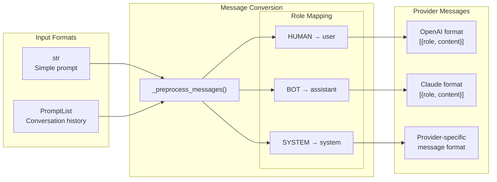

Sources: [opencompass/models/openai_api.py:475-554](), [opencompass/models/openai_api.py:516-538](), [opencompass/models/zhipuai_v2_api.py:99-113]()

### Input Truncation and Length Management

The OpenAI implementation demonstrates sophisticated input length management:

| Mode | Behavior | Use Case |
|------|----------|----------|
| `none` | Fail if input exceeds limit | Strict length requirements |
| `front` | Truncate from beginning | Preserve recent context |
| `mid` | Truncate from middle | Preserve start and end |
| `rear` | Truncate from end | Preserve early context |

The `_bin_trim()` method implements binary search for optimal truncation:

Sources: [opencompass/models/openai_api.py:429-474](), [opencompass/models/openai_api.py:497-553]()

## Integration with Evaluation Pipeline

### Model Registration and Discovery

API models are automatically registered and discoverable through the OpenCompass registry system:

```python
@MODELS.register_module()
class OpenAI(BaseAPIModel):
    # Implementation
```

The evaluation system can instantiate any registered model by configuration:

```python
models = [
    dict(
        type='OpenAI',
        path='gpt-4',
        key='ENV',
        max_seq_len=4096,
        query_per_second=1,
    )
]
```

### Task Execution Coordination

API models integrate seamlessly with OpenCompass task execution through the `is_api` flag:

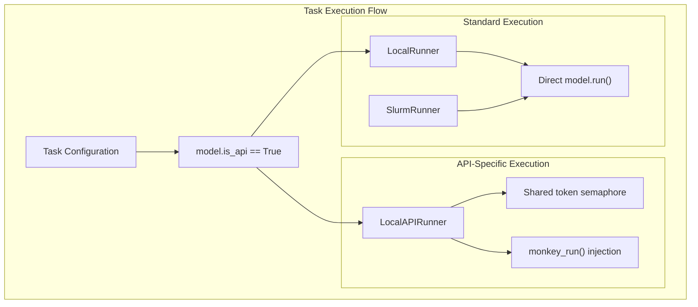

Sources: [opencompass/models/openai_api.py:76](), [opencompass/runners/local_api.py:35-36](), [opencompass/runners/local_api.py:175-178]()

---

