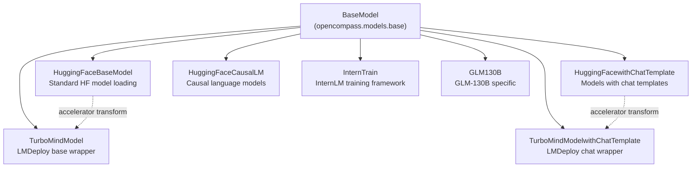
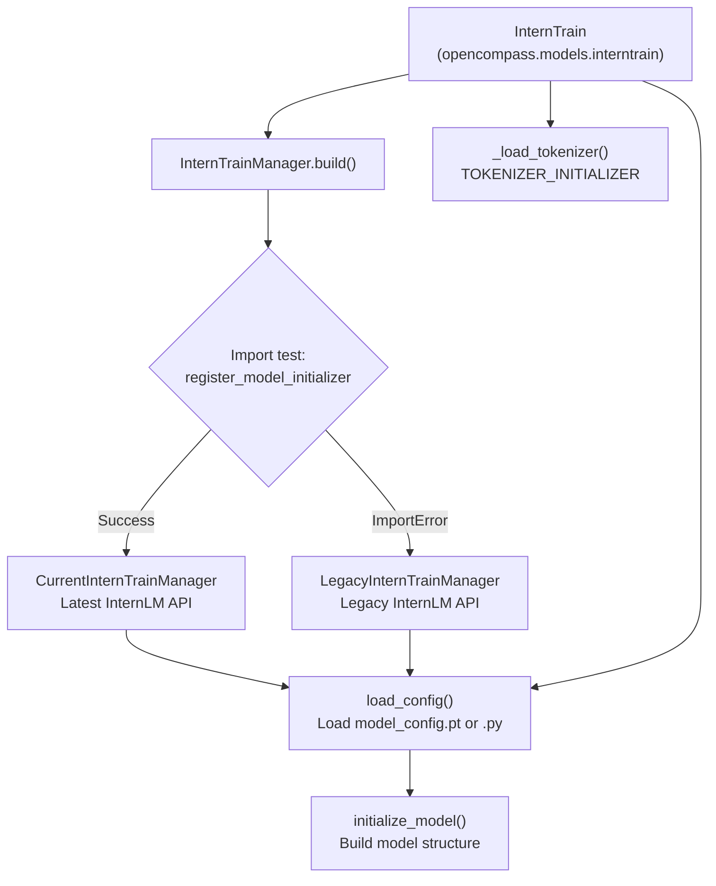
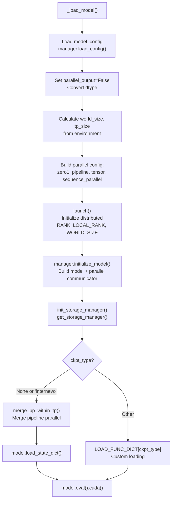
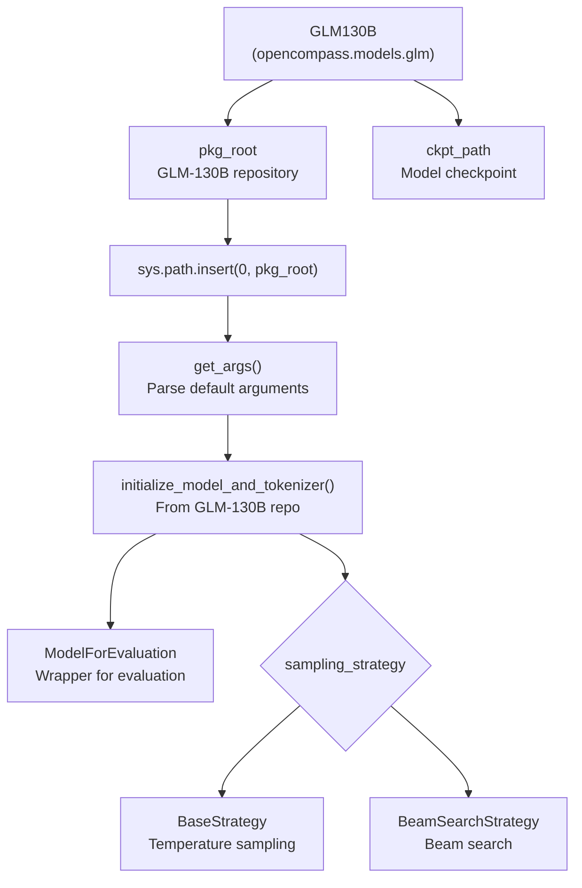
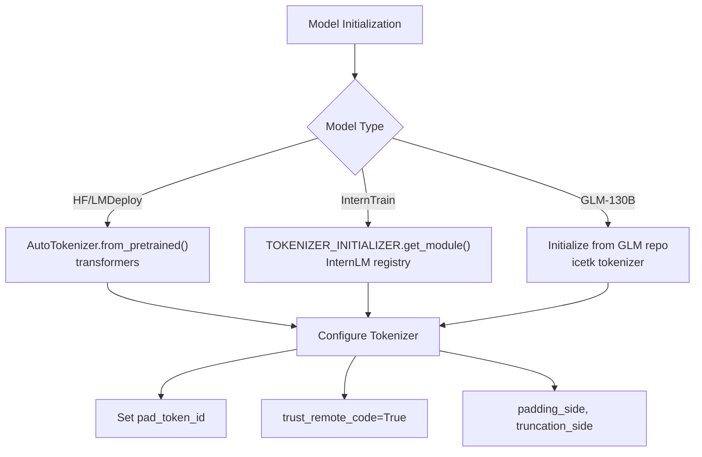
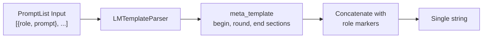
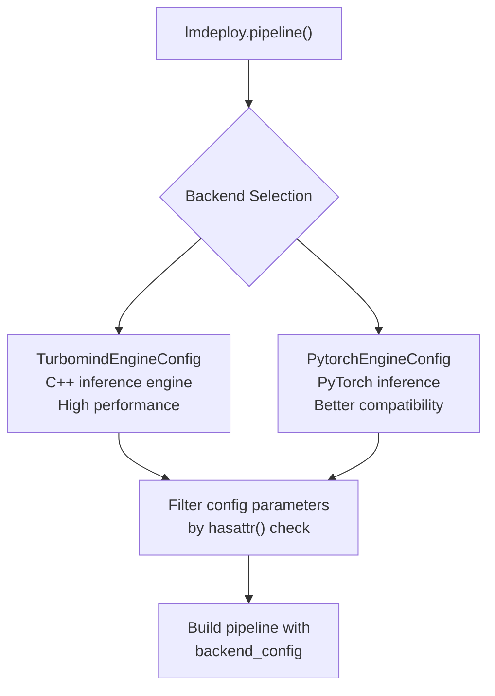
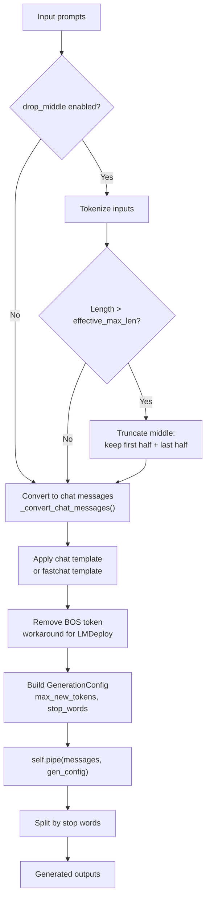
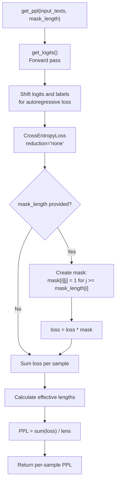

<!-- source: DeepWiki mcp.deepwiki.com · repo open-compass/opencompass · page 4.3 Local Models and HuggingFace Integration · fetched 2026-10-21 -->

# Local Models and HuggingFace Integration

<details>
<summary>Relevant source files</summary>

The following files were used as context for generating this wiki page:

- [.pre-commit-config-zh-cn.yaml](.pre-commit-config-zh-cn.yaml)
- [.pre-commit-config.yaml](.pre-commit-config.yaml)
- [docs/en/advanced_guides/evaluation_lmdeploy.md](docs/en/advanced_guides/evaluation_lmdeploy.md)
- [docs/zh_cn/advanced_guides/compassbench_intro.md](docs/zh_cn/advanced_guides/compassbench_intro.md)
- [docs/zh_cn/advanced_guides/compassbench_v2_0.md](docs/zh_cn/advanced_guides/compassbench_v2_0.md)
- [opencompass/configs/models/hf_internlm/lmdeploy_internlm2_chat_7b.py](opencompass/configs/models/hf_internlm/lmdeploy_internlm2_chat_7b.py)
- [opencompass/models/glm.py](opencompass/models/glm.py)
- [opencompass/models/interntrain.py](opencompass/models/interntrain.py)
- [opencompass/models/turbomind.py](opencompass/models/turbomind.py)
- [opencompass/models/turbomind_with_tf_above_v4_33.py](opencompass/models/turbomind_with_tf_above_v4_33.py)
- [opencompass/summarizers/subjective/compassbench_v13.py](opencompass/summarizers/subjective/compassbench_v13.py)
- [opencompass/summarizers/summarizer_pretrain.py](opencompass/summarizers/summarizer_pretrain.py)

</details>


## Purpose and Scope

This document covers the integration of locally-hosted language models in OpenCompass, including HuggingFace-based implementations and specialized model wrappers such as InternTrain and GLM-130B. Local models run on GPUs directly rather than through external APIs. For API-based models (OpenAI, Claude, etc.), see [API-based Models](#4.2). For accelerated inference using VLLM or LMDeploy backends, see [Accelerated Inference](#4.4). For the base model abstraction layer and common interfaces, see [Model Abstraction and Base Classes](#4.1).

## Model Class Hierarchy

OpenCompass provides several local model implementations, all inheriting from `BaseModel`:



**Local Model Types:**

| Model Class | Purpose | Template Parser | Key Features |
|------------|---------|----------------|--------------|
| `HuggingFaceBaseModel` | Standard HF models | `LMTemplateParser` | Generic model loading |
| `HuggingFacewithChatTemplate` | Chat-optimized models | Built-in template | Uses `apply_chat_template` |
| `HuggingFaceCausalLM` | Causal LMs | `LMTemplateParser` | Autoregressive generation |
| `InternTrain` | InternLM models | `LMTemplateParser` | Distributed training framework |
| `GLM130B` | GLM-130B | `LMTemplateParser` | MASK-based generation |
| `TurboMindModel` | LMDeploy acceleration | `LMTemplateParser` | C++/PyTorch backends |
| `TurboMindModelwithChatTemplate` | LMDeploy + chat | Built-in template | Accelerated chat models |

Sources: [opencompass/models/interntrain.py:1-501](), [opencompass/models/glm.py:1-408](), [opencompass/models/turbomind.py:1-255](), [opencompass/models/turbomind_with_tf_above_v4_33.py:1-222]()

## HuggingFace Model Implementations

### Standard Model Loading

HuggingFace models are loaded using the `transformers` library. The base implementation provides:

- Model loading from HuggingFace Hub or local paths
- Tokenizer initialization with `AutoTokenizer`
- Template-based prompt formatting via `LMTemplateParser`
- Device management and distributed support

### Chat Template Integration

Models with built-in chat templates use `HuggingFacewithChatTemplate`. This class delegates prompt formatting to the tokenizer's `apply_chat_template` method rather than using `LMTemplateParser`.

The LMDeploy wrapper imports helper functions for chat template processing:

```python
from .huggingface_above_v4_33 import (
    _convert_chat_messages,
    _format_with_fast_chat_template,
    _get_meta_template,
    _get_possible_max_seq_len
)
```

Sources: [opencompass/models/turbomind_with_tf_above_v4_33.py:14-17]()

### Model Configuration Structure

```python
dict(
    type='HuggingFacewithChatTemplate',
    abbr='model-abbr',
    path='organization/model-name',  # HF Hub or local path
    max_seq_len=8192,
    max_out_len=1024,
    tokenizer_path='organization/model-name',  # Optional
    tokenizer_kwargs=dict(
        padding_side='left',
        truncation_side='left',
        trust_remote_code=True
    ),
    model_kwargs=dict(
        trust_remote_code=True,
        device_map='auto',
        torch_dtype='auto'
    ),
    generation_kwargs=dict(
        do_sample=False,
        temperature=1.0
    ),
    meta_template=dict(...),  # Optional custom template
    batch_size=8,
    run_cfg=dict(num_gpus=1)
)
```

## InternTrain Model Integration

### Version Management Architecture

InternTrain models use a manager-based architecture to support multiple versions of the InternLM training framework:



The manager automatically detects the InternLM version:

```python
@staticmethod
def build(module_path):
    sys.path.insert(0, module_path)
    try:
        from internlm.core.context.registry import \
            register_model_initializer
        return CurrentInternTrainManager(module_path)
    except ImportError:
        return LegacyInternTrainManager(module_path)
```

Sources: [opencompass/models/interntrain.py:16-29]()

### Initialization Parameters

| Parameter | Type | Default | Description |
|-----------|------|---------|-------------|
| `path` | str | Required | Model checkpoint directory |
| `module_path` | str | Required | InternTrain repository path |
| `max_seq_len` | int | 2048 | Maximum sequence length |
| `tokenizer_only` | bool | False | Load only tokenizer |
| `tokenizer_path` | str | None | Custom tokenizer path |
| `tokenizer_type` | str | 'INTERNLM' | Tokenizer type identifier |
| `model_config` | str/dict | None | Model config file or dict |
| `parallel_config` | str | None | Parallel configuration |
| `model_type` | str | 'INTERNLM2' | Model architecture type |
| `ckpt_type` | str | None | Checkpoint loading function |
| `model_dtype` | str | None | Override model dtype |
| `generation_kwargs` | dict | {} | Generation parameters |
| `sync_rank` | bool | False | Synchronize inputs across ranks |
| `mode` | str | 'none' | Truncation mode ('none', 'mid') |
| `end_str` | str | None | Trim string from outputs |

Sources: [opencompass/models/interntrain.py:135-157]()

### Model Loading Workflow



Sources: [opencompass/models/interntrain.py:208-274]()

### Core Methods

InternTrain implements all standard model methods:

| Method | Returns | Description |
|--------|---------|-------------|
| `generate()` | List[str] | Text generation with sampling |
| `get_ppl()` | List[float] | Perplexity scores with optional masking |
| `get_loglikelihood()` | List[float] | Log likelihood of continuations |
| `get_token_len()` | int | Token count for prompt |
| `get_logits()` | Tensor | Raw model logits |
| `get_mink_percent()` | List[float] | Min-k% detection scores |
| `batch_encode()` | Tensor | Encode and pad tokens |
| `batch_decode()` | List[str] | Decode with stop words |

Sources: [opencompass/models/interntrain.py:320-500]()

### Truncation Modes

InternTrain supports flexible truncation strategies:

**Mode: 'none'**
```python
# Truncate from end
cur_input = cur_input[:max_len]
```

**Mode: 'mid'**
```python
# Keep first half and last half
if len(cur_input) > max_len:
    mid_cut_len = max_len // 2
    cur_input = cur_input[:mid_cut_len] + cur_input[-mid_cut_len:]
```

The mid-truncation mode is useful for long-context evaluation where beginning and end are most important.

Sources: [opencompass/models/interntrain.py:462-470]()

### Example Configuration

```python
from opencompass.models import InternTrain

models = [
    dict(
        type=InternTrain,
        abbr='internlm2-20b-chat',
        path='/path/to/checkpoint',
        module_path='/path/to/InternLM',
        max_seq_len=4096,
        tokenizer_path='/path/to/tokenizer',
        tokenizer_type='INTERNLM2',
        model_type='INTERNLM2',
        model_config='/path/to/model_config.pt',
        parallel_config=dict(
            zero1=dict(size=1, fsdp=False),
            pipeline=dict(size=1),
            tensor=dict(size=8, mode='mtp'),
            sequence_parallel=False
        ),
        generation_kwargs=dict(
            temperature=1.0,
            top_p=0.9,
            top_k=40,
            do_sample=False
        ),
        mode='mid',  # Use mid-truncation
        run_cfg=dict(num_gpus=8)
    )
]
```

## GLM-130B Model Integration

### Specialized Architecture

GLM-130B requires initialization from its own repository with custom loading logic:



Sources: [opencompass/models/glm.py:34-119]()

### MASK-Based Generation

GLM-130B uses special MASK tokens for generation:

```python
# Add generation mask if not present
generation_mask = '[gMASK]'
if '[MASK]' in raw_text:
    generation_mask = '[MASK]'
elif '[sMASK]' in raw_text:
    generation_mask = '[sMASK]'

# Parse text with MASK tokens
mask_pattern = r'\[[sg]?MASK\]'
text_list = re.split(mask_pattern, raw_text)
pattern_list = re.compile(mask_pattern).findall(raw_text)
```

The model generates text to fill in the MASK positions.

Sources: [opencompass/models/glm.py:186-209]()

### Multiple Choice Support

GLM-130B implements a specialized `choice()` method:

```python
def choice(self, inputs, choices):
    """Select best choice based on conditional log probability."""
    # Build multiple choice samples
    data_items = []
    for text in inputs:
        data_item = MultiChoiceTaskDataset.build_multiple_choice_sample(
            text=self.tokenizer.tokenize(text),
            choices=[self.tokenizer.tokenize(item) for item in choices],
            is_single_token=is_single_token
        )
        data_items.append(data_item)
    
    # Calculate log probabilities
    log_probs = self.model_for_eval.cond_log_prob(batch)
    
    # Select answer with highest log prob
    answers = []
    for log_prob in log_probs:
        answers.append(choices[np.argmax(log_prob).item()])
    
    return answers
```

Sources: [opencompass/models/glm.py:132-164]()

### Configuration Example

```python
from opencompass.models import GLM130B

models = [
    dict(
        type='GLM-130B',
        abbr='glm-130b',
        pkg_root='/path/to/GLM-130B',
        ckpt_path='/path/to/checkpoint',
        tokenizer_only=False,
        bminf=False,
        sampling_strategy='BeamSearchStrategy',
        num_beams=4,
        length_penalty=1.0,
        no_repeat_ngram_size=3,
        temperature=1.0,
        top_k=0,
        top_p=0,
        min_gen_length=0,
        run_cfg=dict(num_gpus=8)
    )
]
```

Sources: [opencompass/models/glm.py:48-87]()

## Tokenization and Stop Words

### Tokenizer Loading



Sources: [opencompass/models/turbomind_with_tf_above_v4_33.py:54-56](), [opencompass/models/interntrain.py:275-288](), [opencompass/models/glm.py:90-94]()

### Stop Words Extraction

Local models aggregate stop words from multiple sources:

```python
def _get_potential_stop_words(self, path: Optional[str]):
    """Extract stop words from generation config and tokenizer."""
    from transformers import GenerationConfig
    potential_stop_words = []
    
    try:
        generation_config = GenerationConfig.from_pretrained(path)
    except:
        generation_config = None
    
    # From generation_config.eos_token_id
    if generation_config and hasattr(generation_config, 'eos_token_id'):
        if isinstance(generation_config.eos_token_id, int):
            potential_stop_words.append(
                self.tokenizer.decode(generation_config.eos_token_id)
            )
        else:
            for token_id in generation_config.eos_token_id:
                stop_word = self.tokenizer.decode(token_id)
                if stop_word.startswith(' '):
                    stop_word = stop_word.strip()
                potential_stop_words.append(stop_word)
    
    # From tokenizer.eos_token
    if self.tokenizer.eos_token is not None:
        potential_stop_words.append(self.tokenizer.eos_token)
    
    return list(set(potential_stop_words))
```

Sources: [opencompass/models/turbomind_with_tf_above_v4_33.py:75-97]()

## Template Parsing

### LMTemplateParser for Local Models

Local models use `LMTemplateParser` which concatenates sections into a single string:



Example meta_template structure:

```python
meta_template = dict(
    begin=[
        dict(role='HUMAN', begin='<|User|>:', end='\n'),
        dict(role='BOT', begin='<|Bot|>:', end='\n', generate=True)
    ],
    round=[
        dict(role='HUMAN', begin='<|User|>:', end='\n'),
        dict(role='BOT', begin='<|Bot|>:', end='\n', generate=True)
    ],
    end=[
        dict(role='HUMAN', begin='<|User|>:', end='\n'),
        dict(role='BOT', begin='<|Bot|>:', generate=True)
    ],
    eos_token_id=2
)
```

Sources: [opencompass/models/glm.py:29](), [opencompass/models/interntrain.py:156]()

### Chat Template Processing

Models with chat templates bypass `LMTemplateParser`:

```python
# Convert inputs to message format
messages = _convert_chat_messages(inputs)

# Apply template
if self.fastchat_template:
    messages = _format_with_fast_chat_template(
        messages, self.fastchat_template
    )
else:
    messages = [
        self.tokenizer.apply_chat_template(
            m, add_generation_prompt=True, tokenize=False
        ) 
        for m in messages
    ]
```

Sources: [opencompass/models/turbomind_with_tf_above_v4_33.py:139-144]()

## LMDeploy Integration

### Backend Architecture

LMDeploy provides two inference backends for local models:



```python
def _build_pipe(self, model_path, backend, engine_config):
    from lmdeploy import (PytorchEngineConfig, TurbomindEngineConfig,
                          pipeline)
    
    assert backend in ['pytorch', 'turbomind'], \
            f'unsupported backend type: {backend}'
    
    if backend == 'turbomind':
        filtered = {k: v for k, v in engine_config.items() 
                   if hasattr(TurbomindEngineConfig, k)}
        backend_config = TurbomindEngineConfig(**filtered)
    else:
        filtered = {k: v for k, v in engine_config.items() 
                   if hasattr(PytorchEngineConfig, k)}
        backend_config = PytorchEngineConfig(**filtered)
    
    return pipeline(model_path, backend_config=backend_config)
```

Sources: [opencompass/models/turbomind.py:231-254](), [opencompass/models/turbomind_with_tf_above_v4_33.py:205-221]()

### Generation Pipeline



Sources: [opencompass/models/turbomind_with_tf_above_v4_33.py:99-190]()

### Engine Configuration Options

| Parameter | Applies To | Description |
|-----------|-----------|-------------|
| `session_len` | Both | Maximum context length |
| `tp` | Both | Tensor parallelism size |
| `max_batch_size` | Turbomind | Maximum batch size |
| `cache_max_entry_count` | Turbomind | KV cache size (0-1 ratio) |
| `quant_policy` | Turbomind | Quantization policy |
| `rope_scaling_factor` | Turbomind | RoPE scaling factor |
| `use_context_fmha` | Turbomind | Use flash attention |

### Drop Middle Truncation

LMDeploy models support middle-drop truncation for long contexts:

```python
if self.drop_middle:
    inputs_drop_middle = []
    for input in inputs:
        if isinstance(input, PromptList):
            input = input[0]['prompt']
        input_ids = self.tokenizer([input], padding=False,
                                   truncation=False)['input_ids'][0]
        original_len = len(input_ids)
        # Reserve space for max_out_len
        effective_max_len = self.max_seq_len - max_out_len
        if len(input_ids) > effective_max_len:
            self.logger.info(f'Input length {original_len} exceeds...')
            # Keep first half and last half
            input_ids = input_ids[:effective_max_len // 2] + \
                       input_ids[-effective_max_len // 2:]
            input = self.tokenizer.decode(input_ids,
                                         skip_special_tokens=True)
        inputs_drop_middle.append(input)
    inputs = inputs_drop_middle
```

Sources: [opencompass/models/turbomind_with_tf_above_v4_33.py:116-136]()

### Example Configuration

```python
from opencompass.models import TurboMindModelwithChatTemplate

models = [
    dict(
        type=TurboMindModelwithChatTemplate,
        abbr='internlm2-chat-7b-lmdeploy',
        path='internlm/internlm2-chat-7b',
        backend='turbomind',  # or 'pytorch'
        engine_config=dict(
            session_len=8192,
            tp=1,
            max_batch_size=128,
            cache_max_entry_count=0.8
        ),
        gen_config=dict(
            do_sample=False,
            max_new_tokens=1024,
            min_new_tokens=1,
            temperature=1.0,
            top_k=1,
            stop_words=['</s>', '<|im_end|>']
        ),
        max_seq_len=8192,
        max_out_len=1024,
        drop_middle=False,
        batch_size=5000,
        run_cfg=dict(num_gpus=1)
    )
]
```

Sources: [opencompass/configs/models/hf_internlm/lmdeploy_internlm2_chat_7b.py:1-25]()

## Core Methods Implementation

### Generation Interface

All local models implement a standardized `generate()` method:

```python
def generate(self,
             inputs: List[str],
             max_out_len: int,
             min_out_len: Optional[int] = None,
             stopping_criteria: List[str] = [],
             do_sample: Optional[bool] = None,
             temperature: float = 1.0,
             **kwargs) -> List[str]:
    """Generate results given a list of inputs.
    
    Args:
        inputs: List of input prompts
        max_out_len: Maximum output length
        min_out_len: Minimum output length (optional)
        stopping_criteria: Additional stop strings
        do_sample: Whether to use sampling
        temperature: Sampling temperature
    
    Returns:
        List of generated strings
    """
```

Sources: [opencompass/models/interntrain.py:320-363](), [opencompass/models/turbomind.py:78-145]()

### Perplexity Calculation



The `mask_length` parameter allows masking out prefix tokens from perplexity calculation:

```python
if mask_length is not None:
    mask = torch.zeros_like(shift_labels)
    for i in range(len(mask)):
        for j in range(mask_length[i] - 1, len(mask[i])):
            mask[i][j] = 1
    loss = loss * mask
```

Sources: [opencompass/models/interntrain.py:365-399](), [opencompass/models/glm.py:368-407]()

### Log Likelihood for Continuations

```python
def get_loglikelihood(self, input_texts: List[str],
                      conts: List[str]) -> List[float]:
    """Calculate log likelihood of continuations.
    
    Args:
        input_texts: Full texts (context + continuation)
        conts: Continuation parts only
    
    Returns:
        Log likelihood of each continuation
    """
    outputs, inputs = self.get_logits(input_texts)
    
    # Calculate loss for full sequence
    shift_logits = outputs[..., :-1, :].contiguous()
    shift_labels = inputs[..., 1:].contiguous()
    loss_fct = torch.nn.CrossEntropyLoss(reduction='none',
                                         ignore_index=self.pad_id)
    loss = loss_fct(shift_logits.view(-1, shift_logits.size(-1)),
                    shift_labels.view(-1)).view(shift_labels.size())
    
    lens = (inputs != self.pad_id).sum(-1).cpu().numpy()
    
    # Calculate loss for context only
    replaced_texts = [
        input_text.replace(cont, '')
        for input_text, cont in zip(input_texts, conts)
    ]
    replaced_lens = [
        self.get_token_len(input_text) 
        for input_text in replaced_texts
    ]
    
    # Extract continuation log likelihood
    loglikelihoods = []
    for nloss, nlen, rlen in zip(loss, lens, replaced_lens):
        nlen, rlen = int(nlen), int(rlen)
        nloss = nloss[:nlen]
        nloss = nloss[rlen:].float().sum().cpu().detach().numpy()
        loglikelihoods.append(-nloss)
    
    return np.array(loglikelihoods)
```

Sources: [opencompass/models/interntrain.py:401-424]()

### Token Length Computation

```python
def get_token_len(self, prompt: str) -> int:
    """Get lengths of the tokenized strings.
    
    Args:
        prompt: Input string
    
    Returns:
        Length of the input tokens
    """
    return len(self.tokenizer.encode(prompt))
```

Sources: [opencompass/models/turbomind.py:147-149](), [opencompass/models/interntrain.py:308-318]()

## Model Registry

Local models register themselves using the `MODELS` registry:

```python
from opencompass.registry import MODELS

@MODELS.register_module()
class InternTrain(BaseModel):
    """Model wrapper for InternTrain."""
    ...

@MODELS.register_module(name=['GLM-130B'])
class GLM130B(BaseModel):
    """Model wrapper for GLM-130B."""
    ...
```

Models are instantiated from configuration:

```python
from opencompass.registry import MODELS

model_cfg = dict(
    type='InternTrain',
    path='/path/to/checkpoint',
    module_path='/path/to/InternLM',
    ...
)

model = MODELS.build(model_cfg)
```

Sources: [opencompass/models/interntrain.py:88](), [opencompass/models/glm.py:15]()

## Best Practices

### Model Path Specification

- **HuggingFace Hub**: Use `'organization/model-name'` format
- **Local paths**: Use absolute paths like `'/data/models/model-name'`
- **Tokenizer paths**: Typically match model path unless explicitly different

### Memory Management

- Use `device_map='auto'` for automatic multi-GPU placement
- Configure `max_batch_size` in engine config to control memory usage
- Set `cache_max_entry_count` (0.0-1.0) to control KV cache size
- Use `batch_padding=False` for variable-length sequences to save memory

Sources: [opencompass/models/turbomind.py:55]()

### Distributed Inference

- **InternTrain**: Supports tensor parallel, pipeline parallel, and FSDP
- **LMDeploy**: Supports tensor parallel via `engine_config=dict(tp=N)`
- **Coordination**: Ensure `run_cfg=dict(num_gpus=N)` matches parallelism settings
- **Environment**: Set `RANK`, `LOCAL_RANK`, `WORLD_SIZE` for distributed

Sources: [opencompass/models/interntrain.py:229-250]()

### Stop Words Configuration

Aggregate stop words from all sources:

```python
# 1. From generation config
potential_stop_words = self._get_potential_stop_words(path)

# 2. User-provided
stop_words = list(set(self.stop_words + stopping_criteria))

# 3. Strip whitespace to avoid matching issues
stop_words = [s.strip() if s.startswith(' ') else s 
              for s in stop_words]
```

Sources: [opencompass/models/turbomind_with_tf_above_v4_33.py:72-96](), [opencompass/models/turbomind_with_tf_above_v4_33.py:152]()

### Long Context Handling

For sequences exceeding `max_seq_len`:

1. **Drop middle**: Use `drop_middle=True` with `mode='mid'` to preserve start and end
2. **Reserve output space**: Set `effective_max_len = max_seq_len - max_out_len`
3. **Log truncation**: Log warnings when truncation occurs

Sources: [opencompass/models/turbomind_with_tf_above_v4_33.py:116-136](), [opencompass/models/interntrain.py:338-345]()

---

