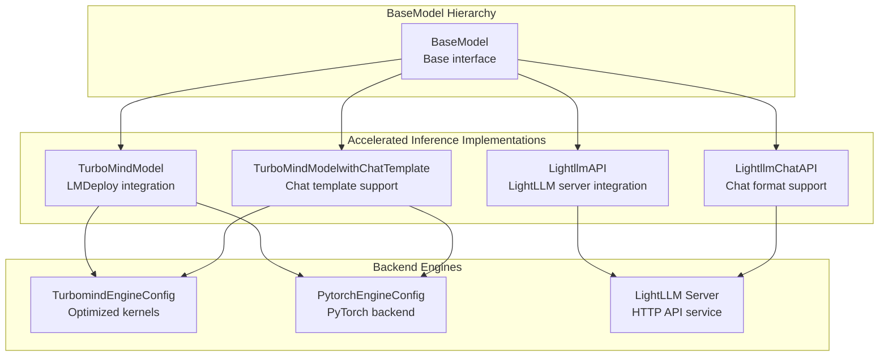
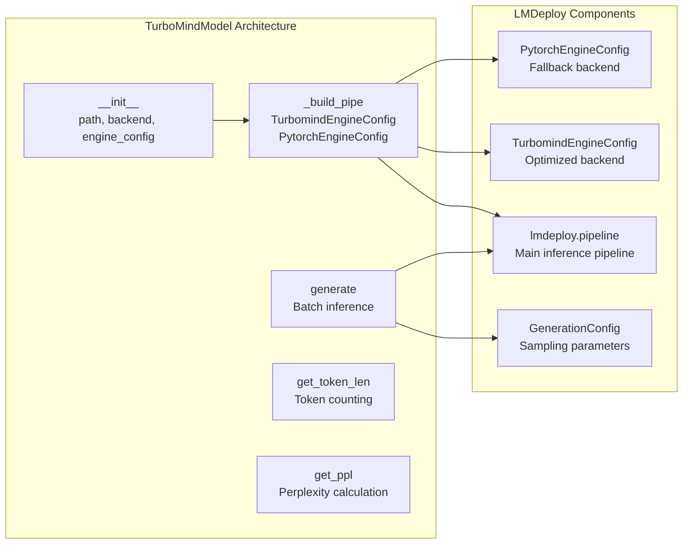
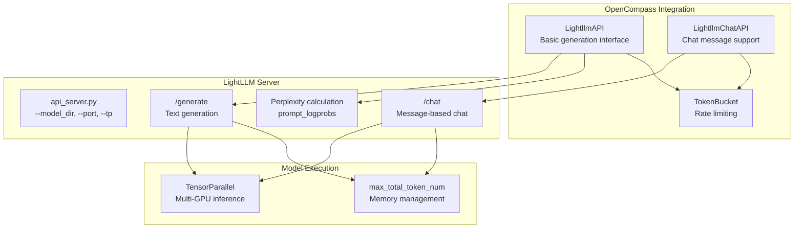
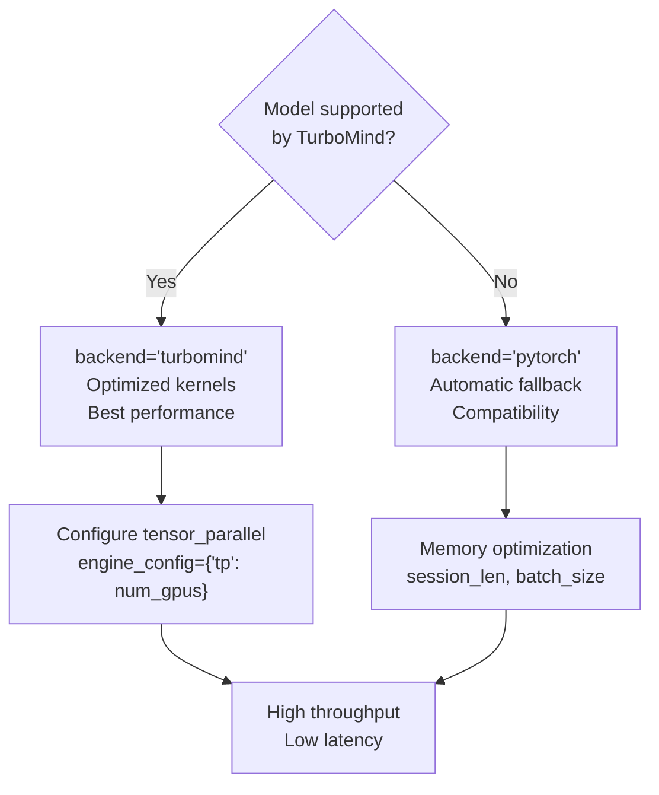

<!-- source: DeepWiki mcp.deepwiki.com · repo open-compass/opencompass · page 4.4 Accelerated Inference · fetched 2026-10-21 -->

# Accelerated Inference

<details>
<summary>Relevant source files</summary>

The following files were used as context for generating this wiki page:

- [README.md](README.md)
- [README_zh-CN.md](README_zh-CN.md)
- [docs/en/advanced_guides/evaluation_lmdeploy.md](docs/en/advanced_guides/evaluation_lmdeploy.md)
- [docs/en/index.rst](docs/en/index.rst)
- [docs/en/notes/news.md](docs/en/notes/news.md)
- [docs/zh_cn/advanced_guides/evaluation_lmdeploy.md](docs/zh_cn/advanced_guides/evaluation_lmdeploy.md)
- [docs/zh_cn/index.rst](docs/zh_cn/index.rst)
- [docs/zh_cn/notes/news.md](docs/zh_cn/notes/news.md)
- [opencompass/__init__.py](opencompass/__init__.py)
- [opencompass/configs/models/deepseek/lmdeploy_deepseek_v2_lite.py](opencompass/configs/models/deepseek/lmdeploy_deepseek_v2_lite.py)
- [opencompass/configs/models/gemma/lmdeploy_gemma_27b.py](opencompass/configs/models/gemma/lmdeploy_gemma_27b.py)
- [opencompass/configs/models/gemma/lmdeploy_gemma_9b.py](opencompass/configs/models/gemma/lmdeploy_gemma_9b.py)
- [opencompass/configs/models/hf_internlm/lmdeploy_internlm2_chat_7b.py](opencompass/configs/models/hf_internlm/lmdeploy_internlm2_chat_7b.py)
- [opencompass/datasets/korbench/__init__.py](opencompass/datasets/korbench/__init__.py)
- [opencompass/models/turbomind.py](opencompass/models/turbomind.py)
- [opencompass/models/turbomind_with_tf_above_v4_33.py](opencompass/models/turbomind_with_tf_above_v4_33.py)

</details>


This document covers the use of specialized inference acceleration frameworks in OpenCompass to achieve higher throughput and lower latency compared to standard HuggingFace model implementations. For basic local model usage, see [Local Models](#4.2). For API-based commercial model integration, see [API-based Models](#4.1).

OpenCompass supports several acceleration backends that optimize inference performance through techniques like kernel fusion, memory optimization, and efficient batching. These frameworks are particularly valuable for large model evaluation where inference speed is critical.

## Supported Acceleration Frameworks

OpenCompass integrates with multiple acceleration frameworks, each offering different optimization strategies:



Sources: [opencompass/models/turbomind.py:25-77](), [opencompass/models/turbomind_with_tf_above_v4_33.py:32-75](), [opencompass/models/lightllm_api.py:20-47]()

### Framework Comparison

| Framework | Strengths | Use Cases | Backend Support |
|-----------|-----------|-----------|-----------------|
| **LMDeploy/TurboMind** | Optimized kernels, multi-GPU support | Large models, high throughput | `turbomind`, `pytorch` |
| **LightLLM** | Lightweight, easy deployment | Moderate-scale inference | HTTP API server |
| **VLLM** | PagedAttention, continuous batching | High concurrency scenarios | Direct integration |

## TurboMind/LMDeploy Integration

TurboMind, part of the LMDeploy toolkit, provides highly optimized inference kernels and supports both TurboMind-specific optimizations and PyTorch fallback modes.

### Basic TurboMind Model

The `TurboMindModel` class provides direct integration with LMDeploy's pipeline system:



Sources: [opencompass/models/turbomind.py:48-77](), [opencompass/models/turbomind.py:231-254]()

### Chat Template Support

The `TurboMindModelwithChatTemplate` extends basic functionality with chat template processing and advanced token handling:

Key features include:
- **Chat Template Processing**: Automatic application of model-specific chat templates via [opencompass/models/turbomind_with_tf_above_v4_33.py:140-152]()
- **Stop Word Management**: Intelligent extraction and processing of stop tokens from generation config [opencompass/models/turbomind_with_tf_above_v4_33.py:76-98]()
- **Middle Truncation**: Handling of long sequences with `drop_middle` strategy [opencompass/models/turbomind_with_tf_above_v4_33.py:117-137]()

### Configuration Options

Essential configuration parameters for TurboMind models:

```python
# Engine configuration examples from code
DEFAULT_ENGING_CONFIG = {'session_len': max_seq_len}
backend_options = ['pytorch', 'turbomind']
generation_config = {
    'max_new_tokens': max_out_len,
    'min_new_tokens': 1,
    'stop_words': stop_words,
    'do_sample': False  # or True with temperature
}
```

Sources: [opencompass/models/turbomind.py:70-76](), [opencompass/models/turbomind_with_tf_above_v4_33.py:155-177]()

## LightLLM Integration

LightLLM provides a server-client architecture for model inference, offering both generate and chat API endpoints.

### LightLLM Architecture



Sources: [opencompass/models/lightllm_api.py:21-47](), [opencompass/models/lightllm_api.py:198-232](), [docs/en/advanced_guides/evaluation_lightllm.md:21-31]()

### Server Deployment

LightLLM requires separate server deployment before evaluation:

```bash
# Example server startup command
python -m lightllm.server.api_server \
    --model_dir /path/to/model \
    --host 0.0.0.0 \
    --port 1030 \
    --tp 1 \
    --max_total_token_num 120000
```

Sources: [docs/en/advanced_guides/evaluation_lightllm.md:21-31]()

### API Integration Details

The LightLLM API models handle HTTP communication with retry logic and rate limiting:

- **Request Format**: JSON payload with `inputs` and `parameters` fields [opencompass/models/lightllm_api.py:76-79]()
- **Response Processing**: Extraction of `generated_text` from JSON response [opencompass/models/lightllm_api.py:84-89]()
- **Error Handling**: Connection error retry and JSON decode error management [opencompass/models/lightllm_api.py:80-95]()
- **Perplexity Support**: Special handling of `prompt_logprobs` for perplexity calculation [opencompass/models/lightllm_api.py:140-158]()

## Performance Optimization Strategies

### Backend Selection

Choose the appropriate backend based on model support and performance requirements:



Sources: [opencompass/models/turbomind.py:210-218](), [opencompass/models/turbomind.py:232-250]()

### Memory and Throughput Tuning

Key parameters for performance optimization:

| Parameter | Purpose | Impact | Location |
|-----------|---------|--------|----------|
| `session_len` | Maximum context length | Memory usage | Engine config |
| `max_batch_size` | Batch size limit | Throughput | Engine config |
| `tp` (tensor_parallel) | GPU parallelism | Multi-GPU utilization | Engine config |
| `max_total_token_num` | Token buffer size | Concurrent requests | LightLLM server |

Sources: [opencompass/models/turbomind.py:70-73](), [docs/en/advanced_guides/evaluation_lightllm.md:33-35]()

## Configuration Examples

### LMDeploy TurboMind Configuration

Example configuration for InternLM model with TurboMind acceleration:

```python
# From configuration files
models = [
    dict(
        type=TurboMindModelwithChatTemplate,
        abbr='internlm2-chat-7b-lmdeploy',
        path='internlm/internlm2-chat-7b',
        backend='turbomind',  # or 'pytorch'
        engine_config=dict(tp=1),
        gen_config=dict(do_sample=False),
        max_seq_len=8192,
        max_out_len=4096,
        batch_size=5000,
        run_cfg=dict(num_gpus=1),
    )
]
```

Sources: [opencompass/configs/models/hf_internlm/lmdeploy_internlm2_chat_7b.py:4-24]()

### LightLLM API Configuration

Configuration for LightLLM server-based inference:

```python
# Basic LightLLM setup
models = [
    dict(
        type=LightllmAPI,
        path='LightllmAPI',
        url='http://localhost:8080/generate',
        max_workers_per_task=2,
        rate_per_worker=2,
        retry=2,
        generation_kwargs=dict(
            max_new_tokens=1024,
            do_sample=False,
        ),
    )
]
```

Sources: [opencompass/models/lightllm_api.py:25-44](), [docs/en/advanced_guides/evaluation_lightllm.md:41-61]()

---

