<!-- source: DeepWiki mcp.deepwiki.com · repo open-compass/opencompass · page 5 Dataset System · fetched 2026-10-21 -->

# Dataset System

<details>
<summary>Relevant source files</summary>

The following files were used as context for generating this wiki page:

- [dataset-index.yml](dataset-index.yml)
- [opencompass/configs/datasets/IFBench/IFBench_gen.py](opencompass/configs/datasets/IFBench/IFBench_gen.py)
- [opencompass/configs/datasets/MedCalc_Bench/MedCalcBench_official_gen_a5155f.py](opencompass/configs/datasets/MedCalc_Bench/MedCalcBench_official_gen_a5155f.py)
- [opencompass/configs/datasets/srbench/srbench_gen.py](opencompass/configs/datasets/srbench/srbench_gen.py)
- [opencompass/configs/summarizers/groups/biodata.py](opencompass/configs/summarizers/groups/biodata.py)
- [opencompass/datasets/IFBench/evaluation_lib.py](opencompass/datasets/IFBench/evaluation_lib.py)
- [opencompass/datasets/IFBench/ifbench.py](opencompass/datasets/IFBench/ifbench.py)
- [opencompass/datasets/IFBench/instructions.py](opencompass/datasets/IFBench/instructions.py)
- [opencompass/datasets/IFBench/instructions_registry.py](opencompass/datasets/IFBench/instructions_registry.py)
- [opencompass/datasets/IFBench/instructions_util.py](opencompass/datasets/IFBench/instructions_util.py)
- [opencompass/datasets/MedCalc_Bench.py](opencompass/datasets/MedCalc_Bench.py)
- [opencompass/datasets/__init__.py](opencompass/datasets/__init__.py)
- [opencompass/datasets/scicode.py](opencompass/datasets/scicode.py)
- [opencompass/datasets/srbench.py](opencompass/datasets/srbench.py)
- [opencompass/utils/datasets_info.py](opencompass/utils/datasets_info.py)
- [requirements/extra.txt](requirements/extra.txt)

</details>


The Dataset System is OpenCompass's comprehensive framework for managing, loading, and evaluating benchmarks across hundreds of datasets. This system provides a unified interface for handling diverse evaluation tasks ranging from multiple-choice questions to code generation and long-context understanding.

For information about model integration with datasets, see [Model Support](#4). For details on evaluation methodologies, see [Evaluation Methods](#6).

## Dataset Registry Architecture

The dataset system uses a registry-based architecture where all datasets are registered as modules and can be dynamically loaded based on configuration.

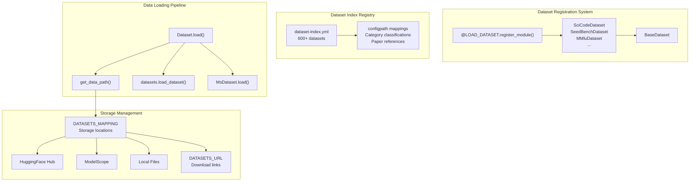

**Dataset Registry Flow**
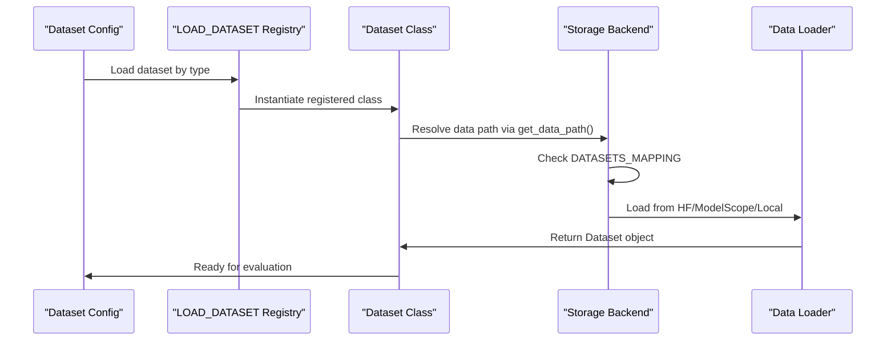

Sources: [opencompass/datasets/__init__.py:1-182](), [opencompass/utils/datasets_info.py:1-507](), [dataset-index.yml:1-50]()

## Dataset Implementation Patterns

All datasets in OpenCompass follow a consistent implementation pattern using the `BaseDataset` class and registration decorators.

### Core Dataset Structure

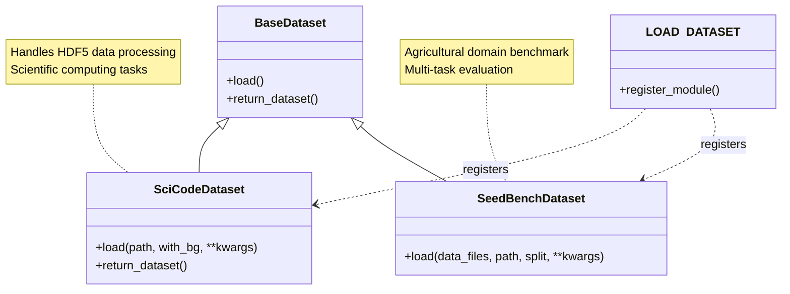

### Dataset Registration Pattern

All datasets use the `@LOAD_DATASET.register_module()` decorator pattern:

```python
@LOAD_DATASET.register_module()
class SciCodeDataset(BaseDataset):
    @staticmethod
    def load(path, with_bg, **kwargs):
        # Implementation specific loading logic
```

**Dataset Categories and Distribution**
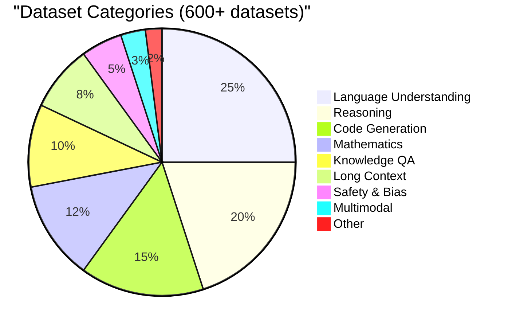

Sources: [opencompass/datasets/base.py](), [opencompass/datasets/scicode.py:23-43](), [opencompass/datasets/SeedBench.py:19-48]()

## Storage and Data Distribution System

The system supports multiple storage backends and automatic dataset downloading through a comprehensive mapping system.

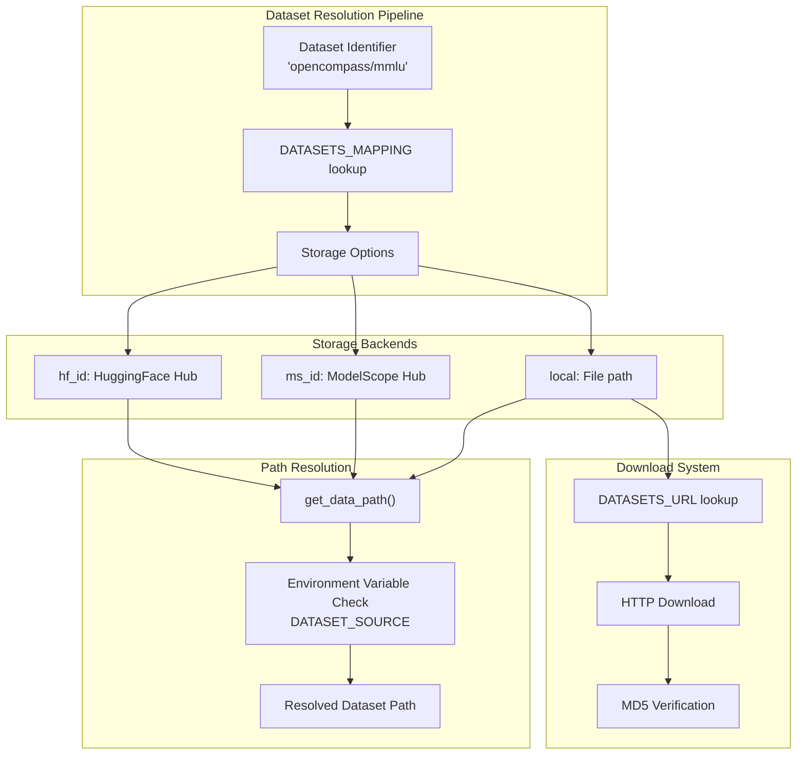

### Storage Mapping Examples

| Dataset ID | HuggingFace ID | ModelScope ID | Local Path | Download URL |
|------------|----------------|---------------|------------|--------------|
| `opencompass/mmlu` | `opencompass/mmlu` | `opencompass/mmlu` | `./data/mmlu/` | Auto-download |
| `opencompass/scicode` | - | - | `./data/scicode` | OSS URL with MD5 |
| `opencompass/seedbench` | `yj12869741/SeedBench` | `y12869741/SeedBench` | `./data/SeedBench` | - |

Sources: [opencompass/utils/datasets_info.py:1-507](), [opencompass/utils/datasets_info.py:509-886]()

## Evaluation Framework Integration

The dataset system integrates tightly with OpenCompass's evaluation framework through registered evaluators and standardized interfaces.

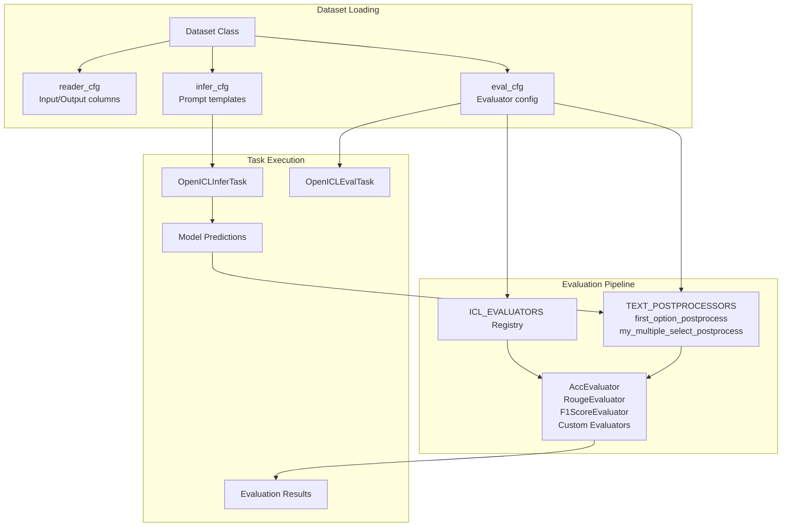

### Evaluator Registration Pattern

```python
@ICL_EVALUATORS.register_module()
class SciCodeEvaluator(BaseEvaluator):
    def score(self, predictions, references):
        # Custom evaluation logic
        return result
```

**Common Evaluation Patterns**
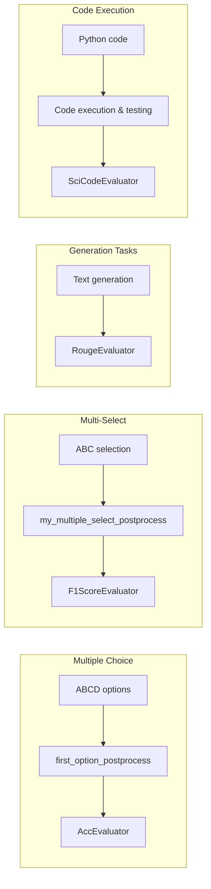

Sources: [opencompass/datasets/scicode.py:219-364](), [opencompass/datasets/SeedBench.py:135-309](), [opencompass/configs/datasets/SeedBench/seedbench_gen_5d5ea1.py:1-75]()

## Dataset Configuration Management

Dataset configurations are managed through a hierarchical system of YAML metadata and Python configuration files.

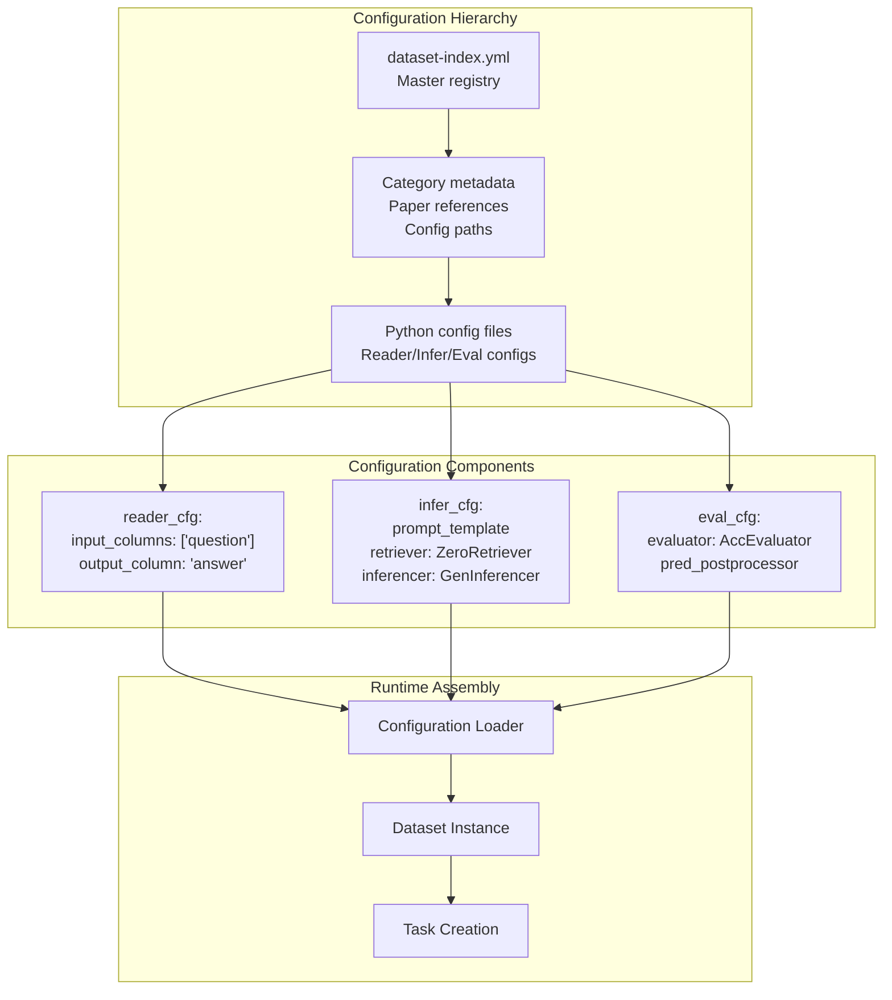

### Configuration Example Structure

| Component | Purpose | Example |
|-----------|---------|---------|
| `reader_cfg` | Define input/output columns | `{'input_columns': ['question'], 'output_column': 'answer'}` |
| `infer_cfg` | Prompt template and inference | `{'prompt_template': PromptTemplate, 'retriever': ZeroRetriever}` |
| `eval_cfg` | Evaluation method | `{'evaluator': AccEvaluator, 'pred_postprocessor': first_option_postprocess}` |

**Dataset Metadata Structure**
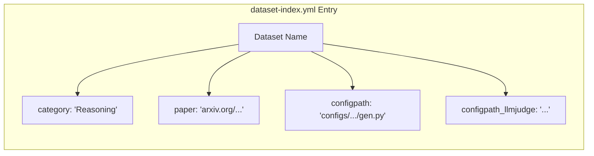

Sources: [dataset-index.yml:1-886](), [opencompass/configs/datasets/SeedBench/seedbench_gen_5d5ea1.py:9-29]()

## Specialized Dataset Examples

The system supports highly specialized datasets with custom evaluation logic and data processing requirements.

### SciCode: Scientific Computing Evaluation

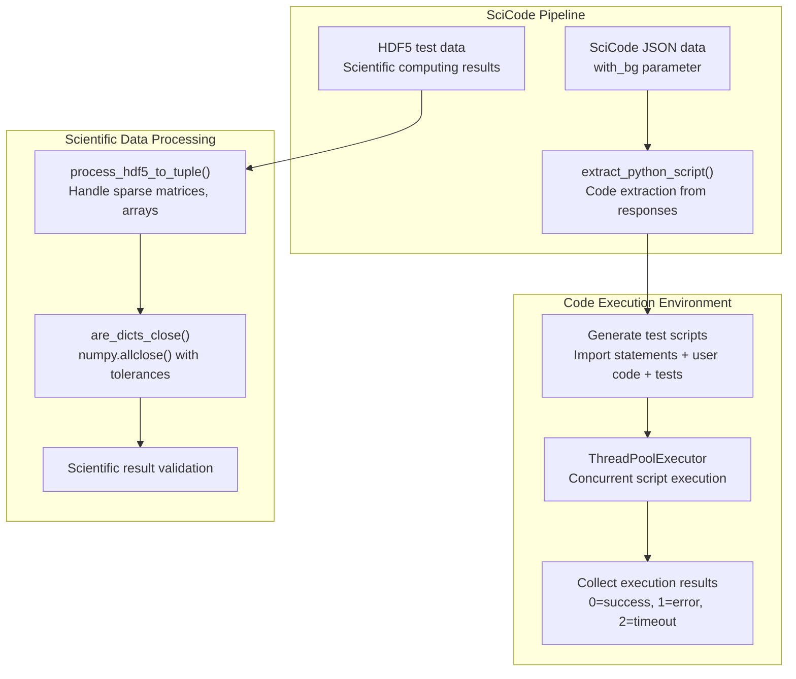

### SeedBench: Agricultural Domain Multi-task Evaluation  

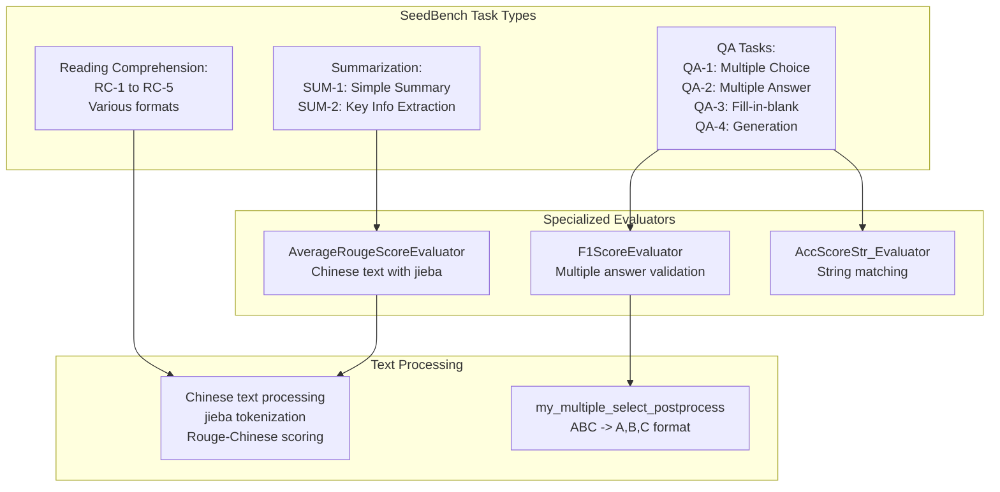

Sources: [opencompass/datasets/scicode.py:45-364](), [opencompass/datasets/SeedBench.py:51-309](), [opencompass/configs/datasets/SeedBench/README.md:1-80]()

---

