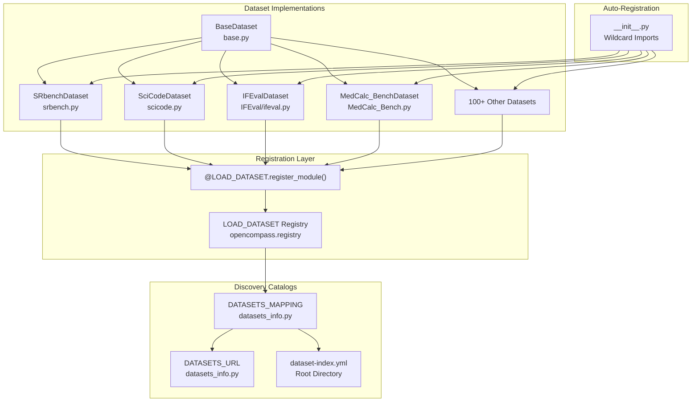
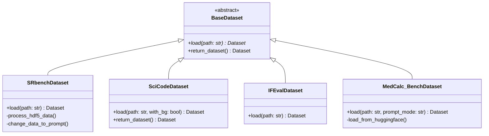
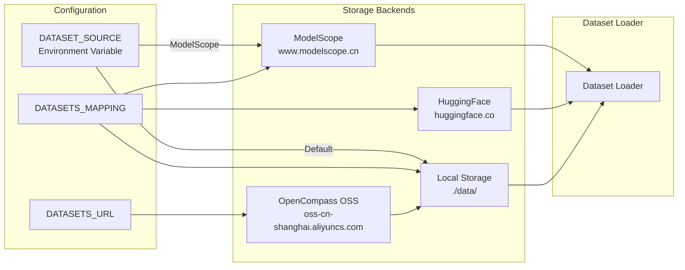
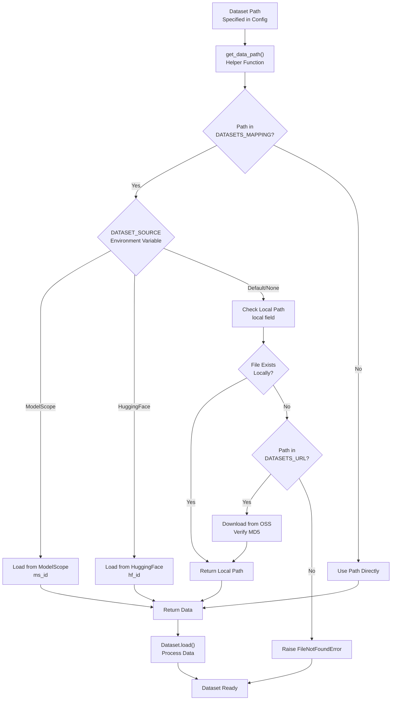

<!-- source: DeepWiki mcp.deepwiki.com · repo open-compass/opencompass · page 5.1 Dataset Registry and Loading · fetched 2026-10-21 -->

# Dataset Registry and Loading

<details>
<summary>Relevant source files</summary>

The following files were used as context for generating this wiki page:

- [README.md](README.md)
- [README_zh-CN.md](README_zh-CN.md)
- [dataset-index.yml](dataset-index.yml)
- [docs/en/index.rst](docs/en/index.rst)
- [docs/en/notes/news.md](docs/en/notes/news.md)
- [docs/zh_cn/advanced_guides/evaluation_lmdeploy.md](docs/zh_cn/advanced_guides/evaluation_lmdeploy.md)
- [docs/zh_cn/index.rst](docs/zh_cn/index.rst)
- [docs/zh_cn/notes/news.md](docs/zh_cn/notes/news.md)
- [opencompass/configs/datasets/IFBench/IFBench_gen.py](opencompass/configs/datasets/IFBench/IFBench_gen.py)
- [opencompass/configs/datasets/MedCalc_Bench/MedCalcBench_official_gen_a5155f.py](opencompass/configs/datasets/MedCalc_Bench/MedCalcBench_official_gen_a5155f.py)
- [opencompass/configs/datasets/srbench/srbench_gen.py](opencompass/configs/datasets/srbench/srbench_gen.py)
- [opencompass/configs/summarizers/groups/biodata.py](opencompass/configs/summarizers/groups/biodata.py)
- [opencompass/datasets/IFBench/evaluation_lib.py](opencompass/datasets/IFBench/evaluation_lib.py)
- [opencompass/datasets/IFBench/ifbench.py](opencompass/datasets/IFBench/ifbench.py)
- [opencompass/datasets/IFBench/instructions.py](opencompass/datasets/IFBench/instructions.py)
- [opencompass/datasets/IFBench/instructions_registry.py](opencompass/datasets/IFBench/instructions_registry.py)
- [opencompass/datasets/IFBench/instructions_util.py](opencompass/datasets/IFBench/instructions_util.py)
- [opencompass/datasets/MedCalc_Bench.py](opencompass/datasets/MedCalc_Bench.py)
- [opencompass/datasets/__init__.py](opencompass/datasets/__init__.py)
- [opencompass/datasets/scicode.py](opencompass/datasets/scicode.py)
- [opencompass/datasets/srbench.py](opencompass/datasets/srbench.py)
- [opencompass/utils/datasets_info.py](opencompass/utils/datasets_info.py)
- [requirements/extra.txt](requirements/extra.txt)

</details>


This document explains how OpenCompass discovers, registers, and loads evaluation datasets. It covers the registry system that makes datasets available for evaluation, the mechanisms for locating dataset files, and the base interfaces that all datasets implement.

For information about specific dataset types (objective, subjective) and their evaluation methods, see [5.2](#5.2) and [5.3](#5.3). For creating custom datasets, see [5.4](#5.4).

## Overview

OpenCompass supports 100+ evaluation datasets through a registry-based architecture. The system provides three complementary discovery mechanisms:

- **LOAD_DATASET Registry**: Python decorator-based registration for dataset classes
- **DATASETS_MAPPING**: Storage location mappings (ModelScope, HuggingFace, local paths)
- **dataset-index.yml**: Human-readable catalog with metadata and recommended configurations

## Dataset Registry Architecture



**Dataset Registration Pattern**

Sources: [opencompass/datasets/__init__.py:1-194](), [opencompass/datasets/srbench.py:16-17](), [opencompass/datasets/scicode.py:23-24]()

Datasets register themselves using the `@LOAD_DATASET.register_module()` decorator:

```python
@LOAD_DATASET.register_module()
class SRbenchDataset(BaseDataset):
    @staticmethod
    def load(path: str):
        # Dataset loading implementation
        pass
```

The `opencompass/datasets/__init__.py` file uses wildcard imports to trigger automatic registration:

```python
from .srbench import *  # noqa: F401, F403
from .scicode import *  # noqa: F401, F403
from .IFEval.ifeval import IFEvalDataset, IFEvaluator  # noqa: F401, F403
```

This pattern ensures all datasets are registered when the `opencompass.datasets` module is imported.

## Dataset Discovery Mechanisms

OpenCompass provides three complementary systems for discovering available datasets:

### DATASETS_MAPPING: Storage Location Registry

Sources: [opencompass/utils/datasets_info.py:1-587]()

`DATASETS_MAPPING` defines where each dataset can be found across three storage backends:

```python
DATASETS_MAPPING = {
    "opencompass/mmlu": {
        "ms_id": "opencompass/mmlu",      # ModelScope dataset ID
        "hf_id": "opencompass/mmlu",      # HuggingFace dataset ID
        "local": "./data/mmlu/",          # Local path
    },
    "opencompass/gsm8k": {
        "ms_id": "opencompass/gsm8k",
        "hf_id": "opencompass/gsm8k",
        "local": "./data/gsm8k/",
    },
}
```

Each entry maps a dataset identifier to:
- `ms_id`: ModelScope dataset identifier (may be `None`)
- `hf_id`: HuggingFace dataset identifier (may be `None`)
- `local`: Default local file path

### DATASETS_URL: Download Metadata

Sources: [opencompass/utils/datasets_info.py:589-1053]()

`DATASETS_URL` provides download URLs and MD5 checksums for automatic dataset retrieval:

```python
DATASETS_URL = {
    "/mmlu/": {
        "url": "http://opencompass.oss-cn-shanghai.aliyuncs.com/datasets/data/mmlu.zip",
        "md5": "761310671509a239e41c4b717f7fab9c",
    },
    "/gsm8k/": {
        "url": "http://opencompass.oss-cn-shanghai.aliyuncs.com/datasets/data/gsm8k.zip",
        "md5": "901e5dc93a2889789a469da9850cdca8",
    },
}
```

The system uses MD5 checksums to verify download integrity.

### dataset-index.yml: Human-Readable Catalog

Sources: [dataset-index.yml:1-1237]()

The `dataset-index.yml` file provides a structured, human-readable catalog with metadata:

```yaml
- mmlu:
    name: MMLU
    category: Understanding
    paper: https://arxiv.org/pdf/2009.03300
    configpath: opencompass/configs/datasets/mmlu/mmlu_gen.py
    configpath_llmjudge: ''
    
- gsm8k:
    name: GSM8K
    category: Math
    paper: https://arxiv.org/pdf/2110.14168
    configpath: opencompass/configs/datasets/gsm8k/gsm8k_gen.py
    configpath_llmjudge: ''
```

Each entry includes:
- `name`: Human-readable dataset name
- `category`: Classification (e.g., "Reasoning", "Knowledge", "Code")
- `paper`: Link to the dataset's paper
- `configpath`: Path to recommended evaluation configuration
- `configpath_llmjudge`: Path to LLM-judge configuration (if available)

## Dataset Discovery Flow

```mermaid
sequenceDiagram
    participant User
    participant Config["Configuration<br/>File"]
    participant Loader["Dataset Loader"]
    participant Mapping["DATASETS_MAPPING"]
    participant Source["Data Source<br/>(ModelScope/HF/Local)"]
    participant URL["DATASETS_URL"]
    participant Dataset["Dataset Instance"]
    
    User->>Config: Specify dataset in config
    Config->>Loader: Request dataset load
    Loader->>Mapping: Lookup dataset path
    
    alt ModelScope Source
        Mapping-->>Loader: Return ms_id
        Loader->>Source: Load from ModelScope
    else HuggingFace Source
        Mapping-->>Loader: Return hf_id
        Loader->>Source: Load from HuggingFace
    else Local Path
        Mapping-->>Loader: Return local path
        Loader->>Source: Check local file
        alt File Not Found
            Loader->>URL: Get download URL
            URL-->>Loader: Return URL + MD5
            Loader->>Source: Download & verify
        end
    end
    
    Source-->>Loader: Raw data
    Loader->>Dataset: Call load() method
    Dataset-->>Loader: Processed dataset
    Loader-->>User: Ready for evaluation
```

Sources: [opencompass/utils/datasets_info.py:1-1053](), [README.md:137-173]()

The loading process follows this sequence:

1. **Configuration Specification**: User specifies dataset in config file
2. **Path Resolution**: System looks up dataset in `DATASETS_MAPPING`
3. **Source Selection**: Chooses between ModelScope, HuggingFace, or local storage
4. **Automatic Download**: If local file missing, downloads from `DATASETS_URL`
5. **Dataset Construction**: Calls dataset's `load()` method to process raw data

## BaseDataset Interface



Sources: [opencompass/datasets/base.py](), [opencompass/datasets/srbench.py:17-46](), [opencompass/datasets/scicode.py:24-42]()

All datasets inherit from `BaseDataset` and implement the `load()` method:

**Key Methods:**
- `load(path, **kwargs)`: Static method that loads and processes dataset files
- `return_dataset()`: Returns the loaded dataset instance

**Example Implementation - SRbenchDataset:**

[opencompass/datasets/srbench.py:17-46]()
```python
@LOAD_DATASET.register_module()
class SRbenchDataset(BaseDataset):

    @staticmethod
    def load(path: str):
        base_path = get_data_path(path)
        formula_data_path = os.path.join(base_path, 'formula_data.json')
        dataset = load_dataset('json', data_files=formula_data_path)['train']
        
        # Process and augment dataset
        sample_data = []
        prompt_1_out = []
        prompt_2_out = []
        
        for row in dataset:
            # Data processing logic
            data = row['data']
            rand_idx = np.random.choice(len(data), 300, replace=False)
            points = np.array(data)[rand_idx]
            sample_data.append(points.tolist())
            
            # Generate prompts
            prompt_1 = change_data_to_prompt(points[:split_idx, :])
            prompt_2 = change_data_to_prompt(points[split_idx:, :])
            prompt_1_out.append(prompt_1)
            prompt_2_out.append(prompt_2)
            
        dataset = dataset.add_column(name='prompt1', column=prompt_1_out)
        dataset = dataset.add_column(name='prompt2', column=prompt_2_out)
        
        return dataset
```

**Example Implementation - SciCodeDataset:**

[opencompass/datasets/scicode.py:24-42]()
```python
@LOAD_DATASET.register_module()
class SciCodeDataset(BaseDataset):

    @staticmethod
    def load(path, with_bg, **kwargs):
        test_data = []
        path = get_data_path(path, local_mode=True)
        
        if with_bg:  # test with background
            file_path = osp.join(path, 'SciCode_datasets_with_background.json')
        else:  # test w/o background
            file_path = osp.join(path, 'SciCode_datasets.json')

        with open(file_path, 'r', encoding='utf-8') as file:
            test_data = json.load(file)

        dataset = Dataset.from_list(test_data)
        return dataset
```

## Dataset Storage Sources



Sources: [README.md:156-171](), [opencompass/utils/datasets_info.py:1-1053]()

OpenCompass supports three primary storage backends:

### 1. ModelScope (On-Demand Loading)

When `DATASET_SOURCE=ModelScope` is set, datasets load on-demand without downloading to local disk:

```bash
pip install modelscope[framework]
export DATASET_SOURCE=ModelScope
```

Supported datasets include: `humaneval`, `triviaqa`, `commonsenseqa`, `tydiqa`, `strategyqa`, `cmmlu`, `lambada`, `piqa`, `ceval`, `math`, `LCSTS`, `Xsum`, and more.

### 2. HuggingFace Hub

Datasets can be loaded directly from HuggingFace when `hf_id` is specified in `DATASETS_MAPPING`.

### 3. Local Storage

Default storage path is `./data/`. Datasets are automatically downloaded from `DATASETS_URL` if not present locally.

**Offline Preparation:**

```bash
# Download dataset to data/ folder
wget https://github.com/open-compass/opencompass/releases/download/0.2.2.rc1/OpenCompassData-core-20240207.zip
unzip OpenCompassData-core-20240207.zip
```

## Dataset Configuration in Evaluation

Sources: [opencompass/configs/datasets/srbench/srbench_gen.py:1-57](), [opencompass/configs/datasets/IFBench/IFBench_gen.py:1-33]()

Datasets are configured for evaluation using configuration files:

**Example: SRBench Configuration**

[opencompass/configs/datasets/srbench/srbench_gen.py:1-57]()
```python
from opencompass.openicl.icl_prompt_template import PromptTemplate
from opencompass.openicl.icl_retriever import ZeroRetriever
from opencompass.openicl.icl_inferencer import GenInferencer
from opencompass.datasets import SRbenchDataset, SRbenchDatasetEvaluator, mydataset_postprocess

# Reader configuration
srbench_reader_cfg = dict(
    input_columns=['prompt1', 'prompt2'], 
    output_column='formula'
)

# Inference configuration
srbench_infer_cfg = dict(
    prompt_template=dict(type=PromptTemplate, template=...),
    retriever=dict(type=ZeroRetriever),
    inferencer=dict(type=GenInferencer),
)

# Evaluation configuration
srbench_eval_cfg = dict(
    evaluator=dict(type=SRbenchDatasetEvaluator, path='opencompass/srbench'),
    pred_postprocessor=dict(type=mydataset_postprocess),
    pred_role='BOT',
)

# Dataset definition
srbench_datasets.append(
    dict(
        abbr='srbench',
        type=SRbenchDataset,
        path='opencompass/srbench',
        reader_cfg=srbench_reader_cfg,
        infer_cfg=srbench_infer_cfg,
        eval_cfg=srbench_eval_cfg,
    )
)
```

**Key Configuration Components:**
- `type`: Dataset class from `LOAD_DATASET` registry
- `path`: Dataset path (resolved via `DATASETS_MAPPING`)
- `reader_cfg`: Column mappings for input/output
- `infer_cfg`: Inference strategy and prompt template
- `eval_cfg`: Evaluator and post-processing

## Dataset Path Resolution



Sources: [opencompass/utils/datasets_info.py:1-1053](), [README.md:137-173]()

The `get_data_path()` helper function resolves dataset paths:

1. **Check DATASETS_MAPPING**: Look up dataset identifier
2. **Determine Source**: Check `DATASET_SOURCE` environment variable
3. **ModelScope/HuggingFace**: Load directly from remote source
4. **Local Path**: Check if file exists locally
5. **Auto-Download**: If missing, download from `DATASETS_URL`
6. **Verification**: Validate MD5 checksum for downloaded files

## Specialized Dataset Features

### Dataset with Background Context

Sources: [opencompass/datasets/scicode.py:27-32]()

Some datasets support optional background information:

```python
@staticmethod
def load(path, with_bg, **kwargs):
    path = get_data_path(path, local_mode=True)
    if with_bg:  # test with background
        file_path = osp.join(path, 'SciCode_datasets_with_background.json')
    else:  # test w/o background
        file_path = osp.join(path, 'SciCode_datasets.json')
```

### Dataset with External Data Files

Sources: [opencompass/datasets/scicode.py:98-140]()

Datasets may require additional data files (e.g., HDF5 for numerical data):

```python
def process_hdf5_to_tuple(step_id, test_num):
    H5PY_FILE_FOLDER = './data/scicode/test_data'
    H5PY_FILE_FOLDER = get_data_path(H5PY_FILE_FOLDER, local_mode=True)
    H5PY_FILE = os.path.join(H5PY_FILE_FOLDER, f'{step_id}.h5')
    
    assert os.path.exists(H5PY_FILE), \
        f"Please manually download 'test_data.h5' from ..."
```

### Dataset with Multiple Variants

Sources: [opencompass/configs/datasets/MedCalc_Bench/MedCalcBench_official_gen_a5155f.py:1-58]()

Datasets may have multiple evaluation modes:

```python
medcal_bench_dataset = dict(
    type=MedCalc_BenchDataset,
    path='ncbi/MedCalc-Bench-v1.0',
    prompt_mode='zero-shot',  # or 'few-shot'
    reader_cfg=reader_cfg,
    infer_cfg=infer_cfg,
    eval_cfg=eval_cfg,
)
```

## Dataset Categories and Organization

Sources: [opencompass/configs/summarizers/groups/biodata.py:1-27]()

Datasets are organized into categories for summarization:

```python
categories = [
    'DNA-cpd',
    'DNA-emp',
    'Protein-Fluorescence',
    'RNA-Modification',
    'Multi_sequence-antibody_antigen',
]

biodata_summary_groups = [
    {'name': 'bio_data', 'subsets': [c + '-sample_1k' for c in categories]},
]
```

This enables grouped reporting and analysis across related datasets.

## Summary

The OpenCompass dataset system provides:

1. **Automatic Registration**: Decorator-based registration via `@LOAD_DATASET.register_module()`
2. **Multiple Discovery Paths**: `DATASETS_MAPPING`, `DATASETS_URL`, and `dataset-index.yml`
3. **Flexible Storage**: ModelScope, HuggingFace, local, and auto-download from OSS
4. **Standardized Interface**: `BaseDataset` with `load()` method pattern
5. **Rich Metadata**: Category, paper references, and recommended configurations

This architecture enables OpenCompass to support 100+ datasets with minimal configuration while maintaining flexibility for custom datasets and evaluation scenarios.

---

