<!-- source: DeepWiki mcp.deepwiki.com · repo open-compass/opencompass · page 5.2 Objective Evaluation Datasets · fetched 2026-10-21 -->

# Objective Evaluation Datasets

<details>
<summary>Relevant source files</summary>

The following files were used as context for generating this wiki page:

- [dataset-index.yml](dataset-index.yml)
- [opencompass/configs/datasets/IFBench/IFBench_gen.py](opencompass/configs/datasets/IFBench/IFBench_gen.py)
- [opencompass/configs/datasets/MedCalc_Bench/MedCalcBench_official_gen_a5155f.py](opencompass/configs/datasets/MedCalc_Bench/MedCalcBench_official_gen_a5155f.py)
- [opencompass/configs/datasets/TheoremQA/ThroremQA_0shot_cot_gen_8acdf7.py](opencompass/configs/datasets/TheoremQA/ThroremQA_0shot_cot_gen_8acdf7.py)
- [opencompass/configs/datasets/srbench/srbench_gen.py](opencompass/configs/datasets/srbench/srbench_gen.py)
- [opencompass/configs/models/deepseek/lmdeploy_deepseek_v2.py](opencompass/configs/models/deepseek/lmdeploy_deepseek_v2.py)
- [opencompass/configs/models/deepseek/lmdeploy_deepseek_v2_5.py](opencompass/configs/models/deepseek/lmdeploy_deepseek_v2_5.py)
- [opencompass/configs/models/deepseek/lmdeploy_deepseek_v2_5_1210.py](opencompass/configs/models/deepseek/lmdeploy_deepseek_v2_5_1210.py)
- [opencompass/configs/summarizers/groups/biodata.py](opencompass/configs/summarizers/groups/biodata.py)
- [opencompass/datasets/IFBench/evaluation_lib.py](opencompass/datasets/IFBench/evaluation_lib.py)
- [opencompass/datasets/IFBench/ifbench.py](opencompass/datasets/IFBench/ifbench.py)
- [opencompass/datasets/IFBench/instructions.py](opencompass/datasets/IFBench/instructions.py)
- [opencompass/datasets/IFBench/instructions_registry.py](opencompass/datasets/IFBench/instructions_registry.py)
- [opencompass/datasets/IFBench/instructions_util.py](opencompass/datasets/IFBench/instructions_util.py)
- [opencompass/datasets/MedCalc_Bench.py](opencompass/datasets/MedCalc_Bench.py)
- [opencompass/datasets/TheoremQA/__init__.py](opencompass/datasets/TheoremQA/__init__.py)
- [opencompass/datasets/TheoremQA/main.py](opencompass/datasets/TheoremQA/main.py)
- [opencompass/datasets/__init__.py](opencompass/datasets/__init__.py)
- [opencompass/datasets/livecodebench/execute_utils.py](opencompass/datasets/livecodebench/execute_utils.py)
- [opencompass/datasets/livecodebench/prompts.py](opencompass/datasets/livecodebench/prompts.py)
- [opencompass/datasets/livecodebench/testing_util.py](opencompass/datasets/livecodebench/testing_util.py)
- [opencompass/datasets/scicode.py](opencompass/datasets/scicode.py)
- [opencompass/datasets/srbench.py](opencompass/datasets/srbench.py)
- [opencompass/openicl/icl_evaluator/icl_plugin_evaluator.py](opencompass/openicl/icl_evaluator/icl_plugin_evaluator.py)
- [opencompass/utils/datasets_info.py](opencompass/utils/datasets_info.py)
- [requirements/extra.txt](requirements/extra.txt)
- [requirements/runtime.txt](requirements/runtime.txt)

</details>


This document covers OpenCompass's objective evaluation datasets - standardized benchmarks that assess language model capabilities through measurable, deterministic metrics. Objective datasets provide ground truth answers that can be automatically compared against model predictions through rule-based evaluation logic.

OpenCompass supports over 100 objective benchmarks spanning knowledge (MMLU, CMMLU), reasoning (BBH, ARC), mathematics (GSM8K, MATH), code generation (HumanEval, MBPP), and specialized domains (TheoremQA, SRBench, SciCode, IFBench, MedCalc-Bench). Each dataset integrates through the `@LOAD_DATASET.register_module()` decorator and implements a standardized evaluation interface via `BaseEvaluator`.

For subjective evaluation methods using human preference or LLM-as-judge, see page 5.3. For guidance on implementing custom evaluation logic, see page 5.4.

## Generation vs PPL Evaluation Modes

OpenCompass datasets support two primary inference strategies that determine how models are evaluated:

**Generation Mode (`GenInferencer`)**
- Model generates free-form text responses
- Used for open-ended tasks: code generation, math problem solving, question answering
- Requires post-processing to extract answers (regex, format parsing)
- Examples: `humaneval_gen.py`, `gsm8k_gen.py`, `TheoremQA_gen.py`

**Perplexity Mode (`PPLInferencer`)**
- Model computes log-probabilities for candidate answers
- Used for multiple-choice tasks where selecting the lowest perplexity option
- No post-processing needed, directly selects highest probability choice
- Examples: `mmlu_ppl.py`, `ceval_ppl.py`, `arc_ppl.py`

**Inference Mode Comparison**

| Aspect | Generation Mode | Perplexity Mode |
|--------|----------------|-----------------|
| Inferencer | `GenInferencer` | `PPLInferencer` |
| Task Types | Code, Math, QA | Multiple Choice |
| Post-processing | Required | Not Required |
| Config Suffix | `*_gen.py` | `*_ppl.py` |
| Answer Extraction | Regex/Parsing | Argmax over options |

Many datasets provide both configurations (e.g., `mmlu_gen.py` and `mmlu_ppl.py`) to support different evaluation paradigms.

Sources: [opencompass/openicl/icl_inferencer/icl_gen_inferencer.py](), [opencompass/openicl/icl_inferencer/icl_ppl_inferencer.py](), [opencompass/configs/datasets/]()

## Dataset Registry and Loading System

OpenCompass uses a centralized registry system to manage its extensive collection of objective evaluation datasets. The system provides unified interfaces for dataset loading, configuration, and evaluation across diverse benchmark types.

### Dataset Registration Architecture

**Dataset Registry Flow**

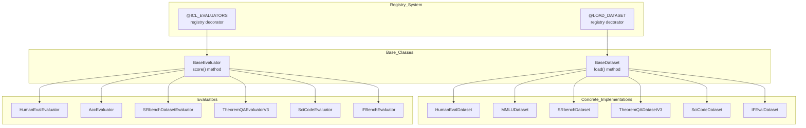

Sources: [opencompass/datasets/__init__.py:1-194](), [opencompass/registry.py](), [opencompass/datasets/base.py]()

### Dataset Metadata Management

OpenCompass maintains comprehensive metadata about available datasets through `DATASETS_MAPPING`, `DATASETS_URL`, and `dataset-index.yml`.

**DATASETS_MAPPING: Multi-Source Data Locations**

The `DATASETS_MAPPING` dictionary in [opencompass/utils/datasets_info.py:1-587]() provides fallback data sources:

```python
DATASETS_MAPPING = {
    "opencompass/humaneval": {
        "ms_id": "opencompass/humaneval",       # ModelScope ID
        "hf_id": "opencompass/humaneval",        # HuggingFace ID
        "local": "./data/humaneval/human-eval-v2-20210705.jsonl"
    },
    "opencompass/mmlu": {
        "ms_id": "opencompass/mmlu",
        "hf_id": "opencompass/mmlu",
        "local": "./data/mmlu/"
    },
    "opencompass/gsm8k": {
        "ms_id": "opencompass/gsm8k",
        "hf_id": "opencompass/gsm8k",
        "local": "./data/gsm8k/"
    },
    "opencompass/scicode": {
        "ms_id": "",
        "hf_id": "",
        "local": "./data/scicode"
    },
    "opencompass/srbench": {
        "ms_id": "",
        "hf_id": "",
        "local": "./data/SRBENCH"
    }
}
```

**DATASETS_URL: Download URLs**

The `DATASETS_URL` dictionary provides direct download links with MD5 checksums:

```python
DATASETS_URL = {
    "/mmlu/": {
        "url": "http://opencompass.oss-cn-shanghai.aliyuncs.com/datasets/data/mmlu.zip",
        "md5": "761310671509a239e41c4b717f7fab9c"
    },
    "/scicode": {
        "url": "http://opencompass.oss-cn-shanghai.aliyuncs.com/datasets/data/scicode.zip",
        "md5": "9c6c64b8c70edc418f713419ea39989c"
    },
    "SRBENCH": {
        "url": "http://opencompass.oss-cn-shanghai.aliyuncs.com/datasets/data/srbench.zip",
        "md5": "384537d681dceb1c76ba52e4004c5714"
    }
}
```

**dataset-index.yml: Human-Readable Catalog**

The `dataset-index.yml` file at the repository root provides structured metadata for dataset discovery:

```yaml
- theoremqa:
    name: TheroremQA
    category: Reasoning
    paper: https://arxiv.org/pdf/2305.12524
    configpath: opencompass/configs/datasets/TheroremQA/TheoremQA_gen.py
    
- ifeval:
    name: IFEval
    category: Instruction Following
    paper: https://arxiv.org/pdf/2311.07911
    configpath: opencompass/configs/datasets/IFEval/IFEval_gen.py
    
- MedCalc_Bench:
    name: MedCalc_Bench
    category: Knowledge / Medicine
    paper: https://arxiv.org/abs/2406.12036
    configpath: opencompass/configs/datasets/MedCalc_Bench/MedCalcBench_official_gen_a5155f.py
```

The `get_data_path()` utility function resolves these mappings based on availability and environment variables (`DATASET_SOURCE`).

Sources: [opencompass/utils/datasets_info.py:1-966](), [dataset-index.yml:1-1100](), [opencompass/utils/__init__.py]()

## Dataset Categories and Examples

OpenCompass organizes objective evaluation datasets into distinct categories based on the cognitive capabilities they assess. Each category contains multiple benchmark datasets with specialized evaluation logic.

### Code Generation and Programming

Code datasets evaluate programming capabilities through various tasks including code completion, generation, and execution validation.

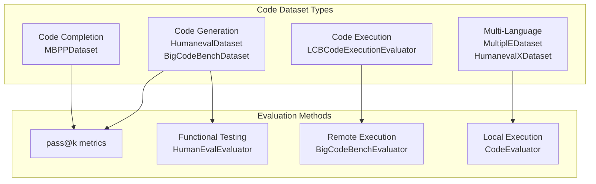

**Key Code Datasets:**

- **HumanEval**: Function-level code completion with 164 programming problems
- **BigCodeBench**: Complex coding tasks requiring external libraries and APIs  
- **MBPP**: Python programming problems with natural language descriptions
- **MultiPL-E**: Cross-language evaluation across 25+ programming languages
- **LiveCodeBench**: Dynamic benchmark with recent programming contests

The `HumanEvalEvaluator` implements the standard pass@k evaluation metric:

```python
def score(self, predictions, references, test_set):
    # Create json file in human_eval format
    for preds, refer in zip(predictions, references):
        if not isinstance(preds, list):
            preds = [preds]
        for pred in preds:
            humaneval_preds.append({'task_id': refer, 'completion': pred})
    
    score = evaluate_functional_correctness(out_dir, self.k, n_workers=4, timeout=3.0)
    results = {f'humaneval_{k}': score[k] * 100 for k in score}
    return results
```

Sources: [opencompass/datasets/humaneval.py:70-117](), [opencompass/datasets/bigcodebench/bigcodebench.py:60-220](), [opencompass/datasets/multipl_e.py:26-139]()

### Mathematical Reasoning

Mathematical datasets assess quantitative reasoning capabilities through problem-solving tasks requiring step-by-step logical thinking.

**Core Math Datasets:**

- **GSM8K**: Grade school math word problems with numerical reasoning
- **MATH**: High school competition mathematics covering algebra, geometry, and calculus  
- **MathBench**: Comprehensive mathematical evaluation across multiple difficulty levels
- **AIME**: American Invitational Mathematics Examination problems

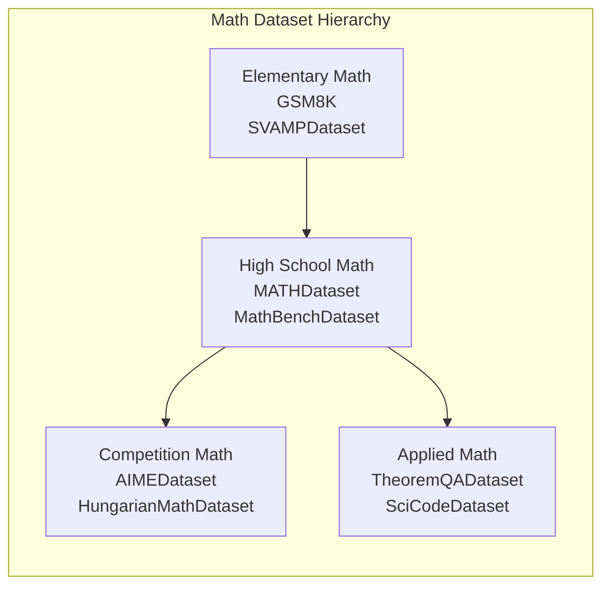

Mathematical datasets typically require specialized postprocessing to extract numerical answers from generated text, often using regex patterns to identify boxed answers or final numerical values.

Sources: [opencompass/datasets/gsm8k.py](), [opencompass/datasets/math.py](), [opencompass/datasets/mathbench.py]()

### Knowledge and Understanding

Knowledge datasets evaluate factual knowledge, reading comprehension, and domain expertise across diverse academic and professional fields.

**Major Knowledge Benchmarks:**

- **MMLU**: Massive Multitask Language Understanding across 57 academic subjects
- **CMMLU**: Chinese version of MMLU for Chinese language capabilities
- **CommonsenseQA**: Commonsense reasoning through multiple-choice questions
- **TriviaQA**: Open-domain question answering with trivia knowledge

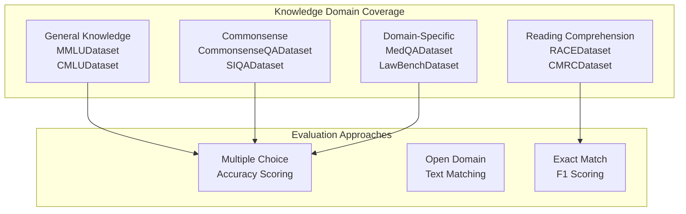

Sources: [opencompass/datasets/mmlu.py](), [opencompass/datasets/commonsenseqa.py](), [opencompass/datasets/race.py]()

### Reasoning and Logic

Reasoning datasets assess logical thinking, causal reasoning, and problem-solving abilities through structured tasks.

**Key Reasoning Benchmarks:**

- **BBH**: Big-Bench Hard featuring challenging reasoning tasks
- **ARC**: AI2 Reasoning Challenge with science question answering
- **HellaSwag**: Commonsense inference in everyday situations
- **PIQA**: Physical interaction question answering

The reasoning evaluation typically involves multiple-choice selection or short-answer generation with exact matching:

```python
# Example from ARC evaluation
def score(self, predictions, references):
    correct = 0
    for pred, ref in zip(predictions, references):
        if pred.strip().upper() == ref.strip().upper():
            correct += 1
    return {'accuracy': 100 * correct / len(predictions)}
```

Sources: [opencompass/datasets/bbh.py](), [opencompass/datasets/arc.py](), [opencompass/datasets/hellaswag.py]()

## Dataset Loading and Configuration

OpenCompass provides flexible mechanisms for loading and configuring datasets through standardized interfaces and configuration files.

### Dataset Configuration Structure

Each dataset requires three main configuration components:

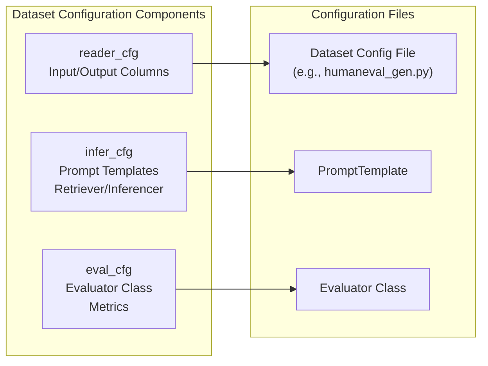

**Example Dataset Configuration:**
```python
humaneval_reader_cfg = dict(
    input_columns=['prompt'], 
    output_column='task_id', 
    train_split='test'
)

humaneval_infer_cfg = dict(
    prompt_template=dict(
        type=PromptTemplate,
        template=dict(round=[
            dict(role='HUMAN', prompt='Complete the following python code:\n{prompt}')
        ])
    ),
    retriever=dict(type=ZeroRetriever),
    inferencer=dict(type=GenInferencer)
)

humaneval_eval_cfg = dict(
    evaluator=dict(type=HumanEvalEvaluator),
    pred_role='BOT',
    k=[1, 10, 100]
)
```

### Dynamic Dataset Loading

The `get_data_path()` function implements intelligent data source resolution:

```python
def get_data_path(path: str, local_mode: bool = False):
    """Resolve dataset path from multiple sources."""
    if local_mode:
        return path
    
    # Try ModelScope first
    if environ.get('DATASET_SOURCE') == 'ModelScope':
        return resolve_modelscope_path(path)
    
    # Fallback to HuggingFace
    return resolve_huggingface_path(path)
```

This enables seamless switching between data sources based on availability and user preferences.

Sources: [opencompass/configs/datasets/humaneval/humaneval_gen.py](), [opencompass/utils/datasets_info.py]()

## Specialized Evaluators

OpenCompass includes domain-specific evaluators that implement custom evaluation logic beyond standard accuracy metrics. These evaluators handle complex domains like symbolic regression, theorem proving, code execution, instruction following, and medical calculations.

### SRBench: Symbolic Regression

**SRbenchDataset and SRbenchDatasetEvaluator**

`SRbenchDataset` evaluates symbolic regression capabilities - inferring mathematical formulas from input-output data points. The dataset provides sampled data points and expects models to generate mathematical expressions.

**Evaluation Flow**

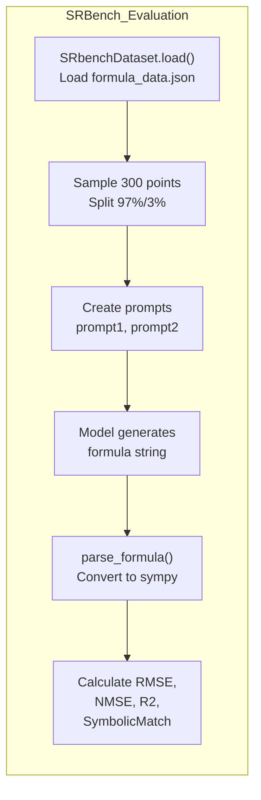

**Key Methods**

The `SRbenchDatasetEvaluator` at [opencompass/datasets/srbench.py:93-314]() implements:

- `parse_formula(formula_str)`: Converts string formulas to executable functions using `sympy.sympify()` and `sp.lambdify()`
- `is_symbolically_equivalent(formula1, formula2)`: Checks symbolic equivalence using `sp.simplify(expr1 - expr2) == 0`
- `score(predictions, references)`: Computes metrics:
  - **RMSE**: Root Mean Squared Error between predicted and ground truth values
  - **NMSE**: Normalized MSE (MSE / variance of ground truth)
  - **R2**: Coefficient of determination
  - **SymbolicMatch**: Boolean indicating exact symbolic equivalence

**Configuration**

[opencompass/configs/datasets/srbench/srbench_gen.py:1-57]() defines the evaluation setup:

```python
srbench_infer_cfg = dict(
    prompt_template=dict(
        type=PromptTemplate,
        template=dict(round=[dict(
            role='HUMAN',
            prompt='''You will be provided with input-output pairs. 
            Based on these data, infer the mathematical relationship...
            Output only the formula string (e.g. y=x_0 * x_1)'''
        )])
    ),
    retriever=dict(type=ZeroRetriever),
    inferencer=dict(type=GenInferencer)
)

srbench_eval_cfg = dict(
    evaluator=dict(type=SRbenchDatasetEvaluator, path='opencompass/srbench'),
    pred_postprocessor=dict(type=mydataset_postprocess)
)
```

Sources: [opencompass/datasets/srbench.py:1-314](), [opencompass/configs/datasets/srbench/srbench_gen.py:1-57]()

### SciCode: Scientific Code Generation

**SciCodeDataset and SciCodeEvaluator**

`SciCodeDataset` evaluates scientific computing code generation across multi-step problems requiring domain knowledge in physics, chemistry, and mathematics.

**Evaluation Architecture**

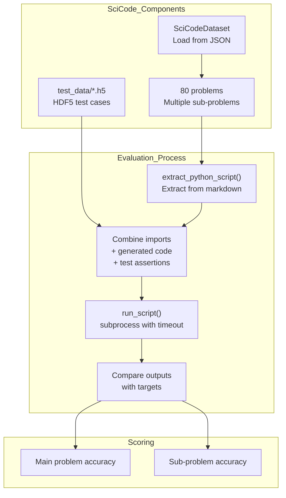

**Key Implementation Details**

The `SciCodeEvaluator` at [opencompass/datasets/scicode.py:219-364]() implements:

1. **Code Extraction**: Extracts Python code from markdown code blocks using `extract_python_script()` at [opencompass/datasets/scicode.py:235-258]()

2. **Test Case Loading**: Loads HDF5 test data using `process_hdf5_to_tuple()` at [opencompass/datasets/scicode.py:98-140](), which handles:
   - Lists
   - Sparse matrices (COO, CSR, BSR formats)
   - Nested dictionaries
   - Mixed data types

3. **Execution**: Runs scripts with timeout using `subprocess.run()` with 120-second timeout at [opencompass/datasets/scicode.py:260-271]()

4. **Concurrent Evaluation**: Uses `ThreadPoolExecutor` to parallelize test execution at [opencompass/datasets/scicode.py:328-338]()

**Metrics**

- `accuracy`: Percentage of main problems completely solved (all sub-problems correct)
- `sub_accuracy`: Percentage of individual sub-problems solved

Sources: [opencompass/datasets/scicode.py:1-364](), [opencompass/datasets/scicode.py:23-43]()

### TheoremQA: Mathematical Theorem Application

**TheoremQADatasetV3 and TheoremQAEvaluatorV3**

`TheoremQADataset` tests theorem application across mathematics, physics, and computer science. Problems require applying theoretical knowledge to solve numerical or analytical questions.

**Answer Type Handling**

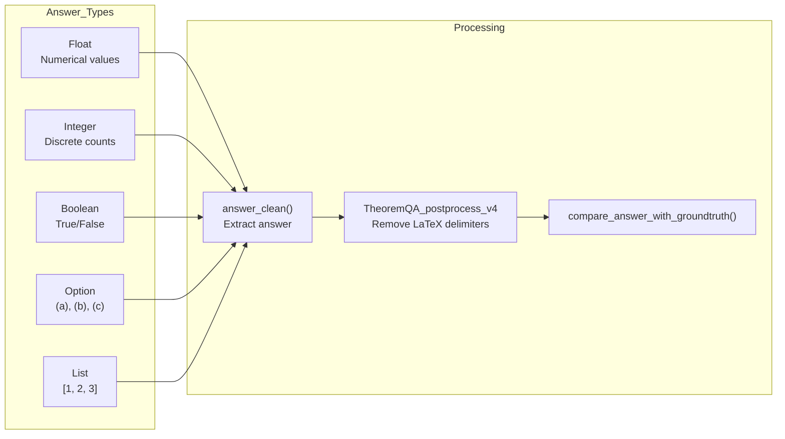

**Evaluation Logic**

The `TheoremQAEvaluatorV3` at [opencompass/datasets/TheoremQA/main.py:42-76]() implements:

```python
def score(self, predictions, references, test_set):
    for index in range(len(predictions)):
        answer = predictions[index]
        groundtruth = references[index]
        answer_type = test_set[index]['Answer_type']
        
        # Type-specific groundtruth formatting
        if answer_type in ['float', 'integer', 'bool']:
            groundtruth = [groundtruth, eval(groundtruth)]
        else:
            groundtruth = [groundtruth, None]
        
        # Compare using utils.compare_answer_with_groundtruth
        if utils.compare_answer_with_groundtruth(answer, *groundtruth):
            correct += 1
```

**Post-processing**

`TheoremQA_postprocess_v4()` at [opencompass/datasets/TheoremQA/main.py:33-38]() removes LaTeX delimiters and extracts answers using `utils.answer_clean()`.

**Configuration**

[opencompass/configs/datasets/TheoremQA/ThroremQA_0shot_cot_gen_8acdf7.py:1-58]() provides chain-of-thought prompting:

```python
TheoremQA_prompt1 = """You are a mathematician, you are supposed to answer 
the given question. You need to output the answer in your final sentence 
like "Therefore, the answer is ...". The answer can only be one of:
1. a numerical value like 0.1, no symbol and no unit
2. a list of numbers like [2, 3, 4]
3. True/False
4. an option like (a), (b), (c), (d)"""
```

Sources: [opencompass/datasets/TheoremQA/main.py:1-76](), [opencompass/configs/datasets/TheoremQA/ThroremQA_0shot_cot_gen_8acdf7.py:1-58]()

### IFBench: Instruction Following

**IFEvalDataset and IFBenchEvaluator**

`IFEvalDataset` evaluates instruction-following capabilities by testing whether models can satisfy multiple verifiable constraints in their responses. Unlike content quality, IFBench focuses on format and structural requirements.

**Instruction Types**

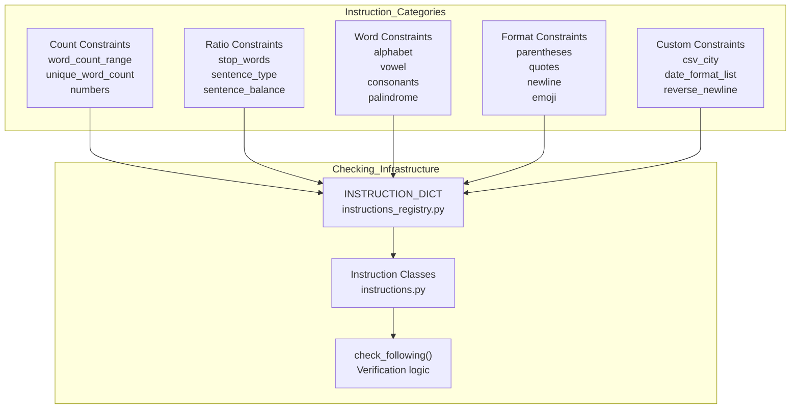

**Evaluation Modes**

The `IFBenchEvaluator` at [opencompass/datasets/IFBench/ifbench.py:1-80]() supports two evaluation modes:

1. **Strict Mode** (`test_instruction_following_strict`): Response must satisfy constraints exactly as generated
2. **Loose Mode** (`test_instruction_following_loose`): Tests multiple variations (removing first/last lines, removing asterisks)

**Implementation**

From [opencompass/datasets/IFBench/ifbench.py:9-62]():

```python
def score(self, predictions, references, origin_prompt):
    for index, (pred, refer) in enumerate(zip(predictions, references)):
        input = InputExample(
            key=refer['key'],
            instruction_id_list=refer['instruction_id_list'],
            prompt=refer['prompt'],
            kwargs=refer['kwargs']
        )
        
        # Strict evaluation
        example = test_instruction_following_strict(input, pred)
        prompt_strict_correct += all(example.follow_instruction_list)
        
        # Loose evaluation
        example = test_instruction_following_loose(input, pred)
        prompt_loose_correct += all(example.follow_instruction_list)
```

**Instruction Registry**

The `INSTRUCTION_DICT` at [opencompass/datasets/IFBench/instructions_registry.py:22-81]() maps instruction IDs to checker classes:

```python
INSTRUCTION_DICT = {
    'count:word_count_range': instructions.WordCountRangeChecker,
    'count:unique_word_count': instructions.UniqueWordCountChecker,
    'ratio:stop_words': instructions.StopWordPercentageChecker,
    'format:parentheses': instructions.NestedParenthesesChecker,
    'custom:csv_city': instructions.CityCSVChecker,
    # ... 50+ instruction types
}
```

Each instruction class implements `check_following(value)` to verify constraint satisfaction.

**Metrics**

- `Prompt-level-strict-accuracy`: Percentage of prompts where all instructions followed (strict)
- `Inst-level-strict-accuracy`: Percentage of individual instructions followed (strict)
- `Prompt-level-loose-accuracy`: Percentage of prompts where all instructions followed (loose)
- `Inst-level-loose-accuracy`: Percentage of individual instructions followed (loose)

Sources: [opencompass/datasets/IFBench/ifbench.py:1-80](), [opencompass/datasets/IFBench/instructions_registry.py:1-81](), [opencompass/datasets/IFBench/instructions.py:1-1500]()

### MedCalc-Bench: Medical Calculations

**MedCalc_BenchDataset and MedCalcOfficial_Evaluator**

`MedCalc_BenchDataset` evaluates medical calculation capabilities across 69 clinical calculators including risk scores, dosage calculations, and diagnostic criteria.

**Evaluation Pipeline**

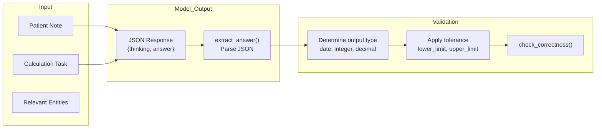

**Answer Type Processing**

The `check_correctness()` function at [opencompass/datasets/MedCalc_Bench.py:14-70]() handles different output types:

| Calculator IDs | Output Type | Validation Logic |
|----------------|-------------|------------------|
| 13, 68 | Date (MM/DD/YYYY) | Exact date match |
| 69 | Tuple (weeks, days) | Exact tuple match |
| 4, 15, 16, 17, 18, 20, 21, ... | Integer | Round and exact match |
| 2, 3, 5, 6, 7, 8, 9, 10, 11, ... | Decimal | Within [lower_limit, upper_limit] |

**JSON Extraction**

From [opencompass/datasets/MedCalc_Bench.py:73-167]():

```python
def extract_answer(answer, calid):
    # Extract from JSON format
    extracted_answer = re.findall(r'[Aa]nswer":\s*(.*?)\}', answer)
    
    if calid in [13, 68]:  # Date format
        match = re.search(r'^(0?[1-9]|1[0-2])\/(0?[1-9]|[12][0-9]|3[01])\/(\d{4})', 
                         extracted_answer)
        answer = f'{month:02}/{day:02}/{year}'
    
    elif calid in [69]:  # Integer tuple
        match = re.search(r"\((\d+)\s*,\s*(\d+)\)", extracted_answer)
        answer = f'({weeks}, {days})'
    
    # ... decimal and integer handling
```

**Configuration**

[opencompass/configs/datasets/MedCalc_Bench/MedCalcBench_official_gen_a5155f.py:1-58]() uses zero-shot prompting:

```python
ZERO_SHOT_PROMPT = '''You are a helpful assistant for calculating a score 
for a given patient note. Please think step-by-step to solve the question 
and then generate the required score. Your output should only contain a 
JSON dict formatted as {"step_by_step_thinking": str(...), "answer": str(...)}.'''
```

**Metrics**

- `accuracy`: Percentage of correct calculations
- `calculator_accuracy`: Per-calculator accuracy breakdown
- `category_accuracy`: Accuracy by medical category

Sources: [opencompass/datasets/MedCalc_Bench.py:1-262](), [opencompass/configs/datasets/MedCalc_Bench/MedCalcBench_official_gen_a5155f.py:1-58]()

### Code Execution Evaluation

Code datasets use execution-based evaluation to verify functional correctness with sandbox safety mechanisms.

**Execution Safety: reliability_guard()**

The `reliability_guard()` function at [opencompass/datasets/livecodebench/execute_utils.py:192-272]() disables destructive operations:

```python
def reliability_guard(maximum_memory_bytes=None):
    """Prevents destructive operations during code execution."""
    # Disable dangerous builtins
    builtins.exit = None
    builtins.quit = None
    
    # Disable dangerous os operations
    os.kill = None
    os.system = None
    os.remove = None
    os.fork = None
    # ... 20+ disabled operations
    
    # Disable dangerous shutil operations
    shutil.rmtree = None
    shutil.move = None
    
    # Disable subprocess
    subprocess.Popen = None
```

**Test Execution Flow**

The `run_test()` function at [opencompass/datasets/livecodebench/testing_util.py:85-465]() implements:

1. Parse input_output JSON to determine test type (call-based vs standard input)
2. Create solution script with imports and test code
3. Execute with timeout using `signal.alarm()`
4. Capture output and compare against expected results
5. Return pass/fail status with error details

**Error Codes**

| Code | Meaning | Description |
|------|---------|-------------|
| -1 | Compilation Error | Code failed to compile/import |
| -2 | Wrong Answer | Execution completed but output incorrect |
| -3 | Time Limit Exceeded | Execution timeout |
| -4 | Runtime Error | Exception during execution |

Sources: [opencompass/datasets/livecodebench/testing_util.py:85-465](), [opencompass/datasets/livecodebench/execute_utils.py:65-86]()

## Dataset Integration Patterns

OpenCompass follows consistent patterns for integrating new objective evaluation datasets, ensuring compatibility with the broader evaluation framework.

### Standard Integration Template

```mermaid
graph TB
    subgraph "Dataset Implementation"
        LoadMethod["@LOAD_DATASET.register_module()<br/>Static load() method"]
        BaseClass["Inherit from BaseDataset"]
        DataFormat["Return HuggingFace Dataset"]
    end
    
    subgraph "Evaluator Implementation" 
        EvalRegister["@ICL_EVALUATORS.register_module()"]
        EvalBase["Inherit from BaseEvaluator"]
        ScoreMethod["Implement score() method"]
    end
    
    subgraph "Configuration Files"
        ReaderConfig["reader_cfg"]
        InferConfig["infer_cfg"] 
        EvalConfig["eval_cfg"]
    end
    
    LoadMethod --> BaseClass
    BaseClass --> DataFormat
    EvalRegister --> EvalBase
    EvalBase --> ScoreMethod
    ReaderConfig --> InferConfig
    InferConfig --> EvalConfig
```

This standardized approach ensures that all datasets integrate seamlessly with OpenCompass's task execution and result aggregation systems, enabling consistent evaluation workflows across diverse benchmark types.

Sources: [opencompass/datasets/base.py](), [opencompass/openicl/icl_evaluator/base.py](), [opencompass/registry.py]()

---

